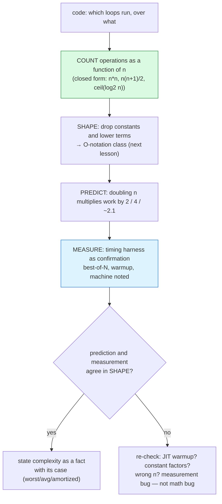

# Algorithm Analysis

## 1. Learning Objectives

After this lesson you will be able to:

- [ ] Say what an algorithm's *cost* is — **operations that grow with input size**, not
      milliseconds — and separate the two measurement tools: counting (deterministic) vs timing
      (evidence, with noise).
- [ ] Read the executed growth table (`O(n)`, `O(n²)`, `O(n log n)` at four sizes) and explain
      each column's shape — including why the sub-millisecond column wiggles.
- [ ] Distinguish worst / average / best case *of an algorithm* from the bound notation you will
      formalize in [big-o-notation.md](big-o-notation.md), using an executed example where
      best and worst differ.
- [ ] Count work on paper **and check it against a program's counter** — the executed
      `nested = n*n` and `upper-tri = n(n+1)/2` rows are your answer key for the technique.
- [ ] Analyze *space* as well as time, and name the amortized question ("what is the cost *per
      operation over a sequence*?") from the dynamic-array evidence in [arrays.md](arrays.md).
- [ ] Read a timing harness critically — warmup, best-of-N, and machine variance — and state
      what your own numbers do and do not prove.

## 2. Prerequisites

- [04-JAVA-PROGRAMMING](../04-JAVA-PROGRAMMING/README.md) — the Java you will compile with
  (`javac --release 21`), methods, loops, and arrays are assumed fluent.
- [02-PROGRAMMING-FUNDAMENTALS](../02-PROGRAMMING-FUNDAMENTALS/README.md) — loops and counting
  from the Python side; this subject's language is Java.
- Optional: [04-JAVA-PROGRAMMING/jvm-and-memory.md](../04-JAVA-PROGRAMMING/jvm-and-memory.md) —
  heap/stack areas, referenced when space cost is discussed.

**Environment used in this lesson:** every transcript executed on the authoring machine —
JDK 25.0.4.1, `javac --release 21`. **Timings are machine-specific** (Windows 11 laptop); the
*shapes* are not.

## 3. Introduction

Two programs solve the same problem. At ten items you cannot tell them apart; at ten million
one finishes and the other doesn't. **Analysis is the discipline of answering which is which
*before* you run it at ten million.** The tools are simple — count the operations that grow,
describe how they grow — and the payoff is enormous: every "why is this slow?" incident in this
curriculum (an O(n²) loop over real data — the industry's most common performance bug) is
caught on paper first and confirmed by measurement second, in exactly the order this lesson
practices.

## 4. The Problem It Solves

Without a cost vocabulary, "faster" means "felt fast on my data" — an anecdote. Analysis
replaces the anecdote with two questions you can answer about *any* code before shipping it:
**what grows** (which operations scale with n) and **how fast does it grow** (the shape of that
growth). Executed evidence of why this matters: the same machine, the same JVM, one program
doing linear work and one doing pairwise work at n = 50,000 — **0.21 ms vs 164.5 ms**, a factor
of ~780 on data that fits in cache. Nothing was wrong with the slow program at n = 50; analysis
predicts the gap; measurement confirms it. That prediction is what lets you choose structures
*before* the data arrives.

## 5. Core Concepts

### Cost lives in growth, not in milliseconds

Milliseconds depend on the machine, the JIT, the cache, the temperature. What analysis tracks
is **how the work count changes when n doubles** — a property of the algorithm alone. The
executed counting example (Example 2) shows the method: instrument the loops, read exact
operation counts (`nested = 100 / 10000 / 1000000` = n² exactly), match them to a closed form
(`n*n`, `n(n+1)/2`) — the counter is your oracle; the algebra is your explanation. Timings then
serve the counts, not the other way around.

### The growth table: three shapes on one machine

Executed (best-of-5, JIT warm — see the harness note below):

```text
n=  1000  O(n):   0.016 ms   O(n^2):    0.519 ms   O(n log n):   0.075 ms
n=  2000  O(n):   0.032 ms   O(n^2):    1.959 ms   O(n log n):   0.141 ms
n=  4000  O(n):   0.069 ms   O(n^2):    8.224 ms   O(n log n):   0.267 ms
n=  8000  O(n):   0.128 ms   O(n^2):   37.735 ms   O(n log n):   0.240 ms
```

Read the **shape**, not the digits: the linear column doubles with n (0.016 → 0.032 → 0.069 →
0.128), the quadratic column multiplies by ~4–5× per doubling (0.519 → 1.959 → 8.224 →
37.735), the linearithmic column roughly doubles with a log factor on top. The honest detail:
at 8000 the `O(n log n)` reading dipped *below* the 4000 reading — sub-millisecond timings
carry ±20% noise from JIT, GC, and scheduler events, which is why (a) columns are best-of-5,
(b) small numbers get read as ranges, and (c) real benchmarks use dedicated harnesses
([limitations](#11-limitations-and-trade-offs)).

### Worst, average, best — and the case of the data

Three different questions: the *worst case over all inputs* (the one you can always guarantee),
the *average case* (over the input distribution you actually have — assume none and you are
guessing), and the *best case* (often trivial: a sorted-input insertion sort stops early).
Analysis's habit: **state which case you mean**. Example 3's comparison counter shows the
method — count `12` comparisons for one concrete input, then ask what input maximizes it.

### Space is a cost too

Every structure pays in memory: the dynamic array of [arrays.md](arrays.md) holds spare
capacity on purpose (4 → 8 → 16 …), a linked list pays a pointer per node, a recursion call pays
a frame. The analysis question mirrors time: **what grows with n?** — plus one unique wrinkle:
some structures trade space for time (spare capacity buys O(1) append; a hash index buys fast
lookup), and naming the trade is part of justifying a choice.

### Amortized: cost over a sequence

A single dynamic-array `add` that triggers a doubling copies n elements — worst case O(n) —
yet appends *feel* O(1). Both statements are true: amortized analysis spreads the rare expensive
operation across the cheap ones that follow. The executed evidence lives in
[arrays.md](arrays.md): 100,000 appends cost **131,068 element copies ≈ 1.31 × n** — not n²/2
— so the *per-operation average* is constant even though individual operations spike. This is
the third leg of the vocabulary: worst case, average case, **amortized**.

## 6. How It Works



The order is the method: **count → shape → predict → measure → reconcile**. Measurement never
leads — if timing contradicts the derivation, first suspect the harness (warmup, noise) and only
then the algebra. The green node is where skill lives; the blue node is where humility lives.

## 7. Practical Examples

**Example 1 — linear vs pairwise on the same data (executed)**

```java
// Analysis.java (extract) — n = 50_000 random ints, best-of-N timings
long linear = best(5, () -> {
    long s = 0;
    for (int v : data) s += v;
});
long nested = best(3, () -> {
    long s = 0;
    for (int i = 0; i < data.length; i++)
        for (int j = i; j < data.length; j++) s += data[i] ^ data[j];
});
```

```console
$ javac --release 21 Analysis.java && java Analysis
n=50000  linear sum: 0.21 ms   nested pairs: 164.5 ms
-- growth curve (best of 5, JIT warm) --
n=  1000  O(n):   0.016 ms   O(n^2):    0.519 ms   O(n log n):   0.075 ms
n=  2000  O(n):   0.032 ms   O(n^2):    1.959 ms   O(n log n):   0.141 ms
n=  4000  O(n):   0.069 ms   O(n^2):    8.224 ms   O(n log n):   0.267 ms
n=  8000  O(n):   0.128 ms   O(n^2):   37.735 ms   O(n log n):   0.240 ms
insertion-sort comparisons on [5,3,9,1,7,2] = 12
sorted result = [1, 2, 3, 5, 7, 9]
$ echo $?
0
```

- The first line is the thesis: **~780×** between one pass and all-pairs on identical data,
  same process, same JIT. The pairwise loop does n(n−1)/2 ≈ **1.25 billion** XOR-adds at
  n = 50,000; the linear loop does 50,000. The gap is arithmetic, not optimization.
- The growth table (read above) is the *prediction* made visible: measure four sizes, check the
  per-doubling factor. Linear ≈ ×2, quadratic ≈ ×4–5, linearithmic ≈ ×2-plus.
- The comparison counter (`= 12`) is the *deterministic* half of the toolkit: one concrete
  input, exact count, hand-checkable — the method you'll use all subject.

**Example 2 — count first, formula second, both checked (executed)**

```console
$ javac --release 21 CountOps.java && java CountOps
n=10  nested=100 (n*n=100)   upper-tri=55 (n(n+1)/2=55)
n=100  nested=10000 (n*n=10000)   upper-tri=5050 (n(n+1)/2=5050)
n=1000  nested=1000000 (n*n=1000000)   upper-tri=500500 (n(n+1)/2=500500)
halvings of 16 = 4   log2(16)=4
halvings of 1000 = 10   log2(1000)=9
halvings of 1000000 = 20   log2(1000000)=19
recursive calls in the naive doubling f(n)=2f(n-1)+1 at n=10 = 1023
recursive calls in the naive doubling f(n)=2f(n-1)+1 at n=20 = 1048575
recursive calls in the naive doubling f(n)=2f(n-1)+1 at n=30 = 1073741823
$ echo $?
0
```

- **Rows 1–3:** the instrumented counters *equal* their closed forms for every n — that's the
  verification loop: derive `n²` and `n(n+1)/2` on paper, then let the program prove you right.
  The upper-triangle row is why `for (j = i; …)` is "half of n²" but still **O(n²)** (a factor
  of 2 is a constant — the next lesson's first rule).
- **Rows 4–6:** halving counts vs `floor(log2 n)` — 16 → 4 = 4 exactly; 1000 → 10 while
  `floor(log2 1000)` prints 9 (1000 is not a power of two: you need `ceil(log2 n)` halvings to
  reach 1 — read *both* columns and know which formula you're quoting; binary search's
  `⌊log₂ n⌋ + 1` worst-case comparisons and this halving count agree for 1000 and 1,000,000).
- **Rows 7–9:** exponential growth as exact call counts: `2ⁿ − 1` (1023, 1,048,575,
  1,073,741,823). n grew ×3 from 10 to 30; work grew ×**million** — the shape that makes
  "exponential" a four-letter word in this field.

**Example 3 — the harness itself, read critically (executed)**

The `best(reps, …)` helper above exists because a first-run measurement on this machine
reported `O(n²): 5.482 ms` at n=1000 and `3.139 ms` at n=2000 — **larger time at smaller
input**, a physically impossible shape for a fixed algorithm. Diagnosis: JIT compiling the
lambda mid-measurement (the interpreter-to-compiled transition you met in
[04-JAVA-PROGRAMMING/jvm-and-memory.md](../04-JAVA-PROGRAMMING/jvm-and-memory.md)). The fix
applied: warm up, then take best-of-5 — which produced the clean table in Example 1.

```text
first (cold) run:   n=1000 O(n^2)=5.482 ms   n=2000 O(n^2)=3.139 ms   <- warmup artifact
after warm+best-of: n=1000 O(n^2)=0.519 ms   n=2000 O(n^2)=1.959 ms   <- the shape you expect
```

- **The lesson is the discrepancy:** a measurement that contradicts your derivation is first a
  *harness* bug, then (only then) a math bug. Your evidence standard: report machine + method
  (best-of-N, warmup), treat sub-ms columns as noisy, and never publish a single cold sample.

## 8. Real-World Applications

- **Choosing before scaling** — "list scan or map lookup?" is an analysis question answered at
  whiteboard time; by the time production data arrives, the choice is expensive to revisit.
- **Incident triage** — the O(n²) loop over real data is the industry's most common
  performance bug (this subject's README says so); the first diagnostic step is always
  *count the inner loop's trip count*, exactly Example 2's method.
- **Capacity planning** — cloud bills scale with operation counts; a service that went from
  O(n) to O(n²) under load didn't slow down, it multiplied its infrastructure cost shape.
- **API contracts** — libraries document `O(1) amortized` (HashMap.get, ArrayList.add) so
  callers can compose guarantees; reading those documents critically *is* this lesson's skill.
- **Interviews and design review** — "state its running time with a one-line derivation" is
  this subject's expected outcome (README), and the line always starts where Example 2 does:
  *what does the inner loop run over?*

## 9. Common Mistakes

| Mistake | Why it happens | How to recognize it | How to prevent it |
|---|---|---|---|
| Timing as proof ("it's fast") | Measurement feels objective | Numbers change per run/machine; no n-sweep | Derive first, measure across sizes second, report method |
| One cold sample | Harness skipped warmup | Impossible shapes (bigger n, less time — the executed artifact) | Warmup + best-of-N; distrust sub-ms single reads |
| Counting statements instead of growth | `5*n` read as "big" | Constant ×n confused with n² | Ask the doubling question: ×2? ×4? |
| Ignoring the case label | Worst/average/best blurred | Guarantees that hold on your test data only | State case with every complexity claim |
| Claiming average without a distribution | "Average" assumed uniform | Real input is clustered/sorted/repeated | Name the distribution or quote worst case |
| Forgetting space | Only time analyzed | Swap, OOM, or a "slow" GC from a huge structure | Ask "what grows with n?" for memory too |
| Calling spikes "wrong" | Amortized unknown | Dynamic array occasionally slow, yet throughput fine | Use the amortized vocabulary (1.31×n evidence) |
| Micro-optimizing constants first | Theory skipped | Hours saved on an O(n²) that needed removing | Shape first; constants only after the class is right |
| Benchmarking across process runs | JIT/GC state not controlled | 20% swings between runs of identical code | Same-process sweeps; cite harness limits |

## 10. Best Practices

- **Count → shape → predict → measure → reconcile** — the pipeline in Section 6; measurement
  confirms, never replaces, the derivation.
- **Write the closed form beside the loop** (`n²`, `n(n+1)/2`, `⌈log₂ n⌉`) and verify it with
  an instrumented run for 2–3 sizes — Example 2's exact-match rows are the template.
- **Label every claim:** worst / average / best / amortized — one word, at the first mention.
- **Sweep sizes, don't single-shot** — four doublings reveal the per-doubling factor, which is
  the *shape*; one number reveals nothing about growth.
- **Report the harness** — machine, warmup, repetitions — the way Example 3's own mistake was
  caught: by a shape that couldn't be true.
- **Analyze space at the same time** — spare capacity, per-node overhead, frame depth; the
  structure you choose is a time–memory trade you must be able to state.
- **Optimize by class** — removing an O(n²) beat any constant-factor tuning of it; reach for
  micro-optimization only once the class is right.

## 11. Limitations and Trade-Offs

- **Timings are machine-truths, not algorithm-truths** — the executed numbers came from one
  Windows laptop; another machine reorders the *digits*, never the *shapes*. Sub-ms columns
  here even dipped non-monotonically — real benchmarking wants JMH-grade harnesses (forking,
  iteration control), which this lesson names rather than fakes.
- **Asymptotics hide constants and caches** — O(n log n) can beat O(n) for small n if its
  constant is large; cache misses make "O(1)" array access slower than a "O(log n)" walk in
  memory-friendly layouts. Big-O answers *growth*, not *wall time at n = 12* — the level at
  which measurement (carefully done) still leads.
- **Average case needs a distribution** — without one, "average" is a guess dressed as
  mathematics; production inputs are often adversarial to your assumption (sorted, clustered,
  duplicated).
- **Amortized hides spikes** — a guaranteed-per-operation requirement (real-time systems) must
  use worst case, and a single O(n) append inside it is disqualifying even at 1.31×n average.
- **Analysis is of the algorithm, not the system** — I/O, locking, network, and GC pauses sit
  outside these counts; subject 11+ brings the vocabulary for those layers.

## 12. Practical Exercises

### Introductory

1. **Reproduce Examples 1–3.** **Completion criteria:** the n=50,000 line, the four-row growth
   table, the three counting rows, and the warmup-discrepancy pair each captured; exit 0.
2. **Derive, then verify two loops.** For a `for (i…) for (j=0; j<i; j++)` and a
   `while (n > 1) n /= 2`, write closed forms (`n(n−1)/2`, `⌈log₂ n⌉`), then instrument and
   run for three sizes. **Completion criteria:** three counter rows matching your formulas
   exactly (or your formula corrected with an explanation of the mismatch).
3. **Re-run the growth table twice on your machine.** **Completion criteria:** two tables; the
   per-doubling factors you compute for each column (e.g. 3.7×, 4.6×, 2.1×); one paragraph on
   which digits moved between runs and which shapes didn't.

### Intermediate

4. **Worst vs best, counted.** Implement insertion sort with a comparison counter; run it on
   sorted, reverse-sorted, and random 100-element inputs. **Completion criteria:** three
   counts (expect ≈99 sorted / ≈4950 reverse / in between random) and the rule for which input
   class maximizes and minimizes work — with the *case labels* attached.
5. **Space analysis of a structure you know.** For `ArrayList<Integer>` at n = 100,000, state
   the grown capacity (from [arrays.md](arrays.md)'s doubling evidence), the slot count, and
   the boxing overhead — then measure process memory before/after allocation
   (`Runtime.totalMemory - freeMemory`, forcing no GC). **Completion criteria:** predicted
   slot count vs observed capacity; measured bytes and your reconciliation (within a stated
   tolerance — say what the measurement *cannot* resolve).
6. **Find an O(n²) in code you wrote earlier** (any subject). **Completion criteria:** the
   nested-loop pair identified, its closed form, the n where it starts to hurt (derived, then
   measured at three sizes), and a refactored version whose table shows the new shape.

### Independent problem-solving

7. **The cost-of-a-feature report.** Spec and build `WorkReport.analyze(int n)` that, for one
   file containing four candidate snippets (linear scan; nested dedup; sort-then-unique;
   hash-based unique), prints for each: the operation-count closed form, the predicted
   n=1,000,000 operation count, and a *measured* time at n ∈ {10³, 10⁴, 10⁵} with the
   per-doubling factor computed from your own measurements. Requirements: counts come from
   instrumented runs (not clock-watching), timings use warmup + best-of-5, and the report's
   verdict section states which snippet wins at 10⁶ **by analysis** — with the measurement at
   10⁵ cited only as corroboration (or as a contradiction you investigate via the
   count→shape→reconcile pipeline). Executed demo on your own data. **Completion criteria:**
   the spec and predicted operation counts written *before* code; a 4-snippet × (count form,
   predicted ops, 3 timings, measured ratio) table each cell produced by the program; the
   verdict paragraph distinguishing what the 10⁵ measurements prove from what the derivation
   proves — including one constant-factor caveat (name one factor your counts ignore, e.g.
   cache or allocation, from this lesson's limitations).

*Solutions: attempt first; set practice in [problem-solving/README.md](problem-solving/README.md).*

## 13. Knowledge Check

1. On one machine, linear took 0.21 ms and pairwise 164.5 ms at n = 50,000. State what *grew*
   (the operation), its closed form, and why milliseconds were not the argument.
2. The first cold run printed `n=1000: 5.482 ms` and `n=2000: 3.139 ms` for the same algorithm.
   Explain the impossibility, name the cause (JIT warmup), and give the harness fix used.
3. `upper-tri = n(n+1)/2` vs `n²` — both are "quadratic-shaped". Justify that claim in terms
   of what happens to *each* when n doubles (numbers from Example 2 welcome).
4. Halvings of 1000 = 10 but `floor(log2 1000)` printed 9. Which quantity is which formula?
   State the binary-search worst-case comparison count for 1000 and how it relates to both.
5. The exponential rows (1023 → 1,048,575 → 1,073,741,823) — what closed form generated
   them, and what happened to work when n grew ×3? Contrast with the linear column's ×3.
6. "O(n) worst case but O(1) amortized" — both said about `ArrayList.add`. Explain how both
   are true using the 1.31 × n copy evidence, and name one requirement under which the
   amortized claim would be the wrong one to make.

## 14. Completion Criteria

Observable evidence that you have understood this lesson:

- [ ] Examples 1–3 reproduce (n=50,000 line, growth table, three counting rows, warmup pair)
- [ ] Exercise 2's two derivations verified by instrumented counters, mismatch explained if any
- [ ] Two of your own growth tables exist with computed per-doubling factors
- [ ] A worst/best/random comparison-counter table exists with case labels attached
- [ ] An O(n²) from your own earlier code was found, derived, measured, and refactored
- [ ] The cost-of-a-feature report (or equivalent) runs with derivation-vs-measurement roles
      clearly separated

## 15. Summary

- **Cost = operations that grow with n** — count them (closed form + instrumented
  verification), describe the shape, predict the doubling factor, then measure to reconcile —
  never the reverse order.
- **Three shapes executed:** linear doubles with n, quadratic multiplies by ~4, linearithmic
  doubles-plus-log; one machine, four sizes, one lesson in reading tables.
- **Case labels matter** (worst/average/best) and **amortized** covers sequences — the dynamic
  array's 1.31×n copies is the standing example.
- **Measurement is evidence with noise:** warm up, take best-of-N, report the method — the
  executed cold-run impossibility (5.482 ms at n=1000 > 3.139 ms at n=2000) is your cautionary
  transcript.
- **Space is analyzed the same way:** what grows with n — and what the structure trades to buy
  its speed.

## 16. Next Steps

- Next lesson: [big-o-notation.md](big-o-notation.md) — the formal vocabulary (O, Ω, Θ,
  constants, composition) that turns this lesson's shapes into written claims.
- Practice: [problem-solving/README.md](problem-solving/README.md) set 1.
- Where it is applied: every later choice — [10-DATABASE-ENGINEERING](../10-DATABASE-ENGINEERING/README.md)
  index plans and [11-BACKEND-ENGINEERING](../11-BACKEND-ENGINEERING/README.md) service payloads
  are analysis claims with dollars attached.
