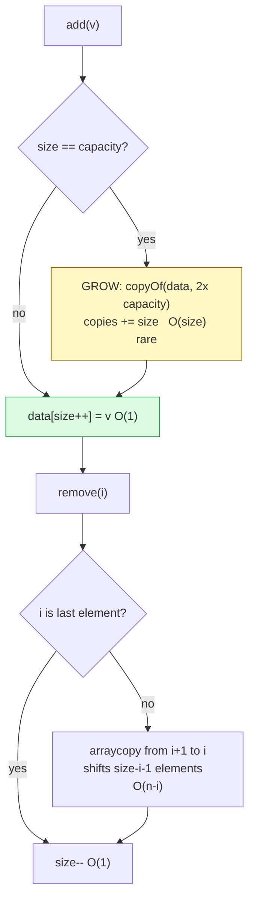

# Arrays

## 1. Learning Objectives

After this lesson you will be able to:

- [ ] Explain *why* array indexing is O(1) — fixed-size elements + constant address arithmetic —
      and why that guarantee makes arrays the default structure for random access.
- [ ] Implement a dynamic array from scratch — backing storage, size vs capacity, doubling when
      full — and state the **amortized O(1)** append claim with the executed evidence behind it
      (`131,068` copies for `100,000` appends ≈ **1.31 × n**, not n²/2).
- [ ] Read the growth log as a design artifact: `4 → 8 → 16 → 32` with each copying count, and
      predict the next doubling before the program prints it.
- [ ] Derive the O(n) cost of `remove(index)` (everything after the hole shifts), including the
      **best case O(1)** for removing the last element — with the executed `head=10` /
      `tail=30` rows as checks.
- [ ] State bounds precisely: `get`/`set` O(1) worst, `add` amortized O(1) worst O(n),
      `remove(i)` O(n − i), `contains` O(n) — each labeled with its case.
- [ ] Judge the honest benchmark in the transcript (raw `int[]` vs `ArrayList<Integer>`) and
      name the variable it actually measures: **boxing**, not structure.

## 2. Prerequisites

- [algorithm-analysis.md](algorithm-analysis.md) and [big-o-notation.md](big-o-notation.md) —
  counting, classes, and the derive-then-verify discipline this lesson practices.
- [04-JAVA-PROGRAMMING](../04-JAVA-PROGRAMMING/README.md) — `Arrays.copyOf`,
  `System.arraycopy`, exceptions, and array syntax are assumed.

**Environment used in this lesson:** every transcript executed on the authoring machine —
JDK 25.0.4.1, `javac --release 21`. Timings are machine-specific; shapes and counts are not.

## 3. Introduction

The array is the structure every other structure is measured against: O(1) access, contiguous
memory, zero per-element overhead — bought with a fixed size that the language gave you at
allocation time. Everything this subject later teaches (linked lists, hash tables, trees)
exists to escape something the array does. So the first implementation you write is the one
that *keeps* the array's strengths while removing its one constraint: **the dynamic array** —
size tracked separately from capacity, storage doubled when full, and an amortized claim you
can verify to the copy.

## 4. The Problem It Solves

A fixed array must know its largest size on day one. Too small and you're rewriting the program
when the data outgrows it; too large and memory sits idle. The dynamic array solves this by
growing geometrically (×2), paying a rare O(n) copy that the *sequence average* absorbs — the
exact worst-vs-amortized distinction from the previous lessons, now with a counter. The
executed claim: `100,000` appends cost `131,068` element copies (**1.31 × n**), not the
`~5 × 10⁹` a per-append shift would cost, and the structure stayed **14.75 ms** while the
resizing machinery printed exactly 15 growth events (`4 → 8 … → 131072`).

## 5. Core Concepts

### Address arithmetic: the whole reason for O(1)

`a[i]` compiles to `base + i × elementSize` — one multiply, one add, no walking. Two
preconditions make it constant: elements are **fixed-size** (an `int[]` is 4 bytes each, known
from the array's type) and the memory is **contiguous** (slot i is exactly `i` slots past the
first). Compare with the linked list in the next lesson, where slot *i* has no formula — you
must walk *i* links. The executed random-access probe: `1000 × get near n-1` on a 100,000-element
array took **0.05 ms** — the last element costs the same as the first, which is what "O(1)" is
claiming.

### Size vs capacity — the two counters

`size` = elements the user can see (`get(0…size-1)`); `capacity` = slots allocated. The
executed `IntList` starts at capacity 4; `size` stops at `data.length` and triggers growth:

```text
  grew 4 -> 8 (copied 4)
  grew 8 -> 16 (copied 8)
  grew 16 -> 32 (copied 16)
size=17 get(16)=16
total element copies = 28
```

Read the arithmetic: 17 adds → growths at adds 5, 9, 17 → copies 4 + 8 + 16 = **28**, printed
exactly. Capacity after growth always equals the next power-of-two multiple of the start —
predict `grew 32 → 64 (copied 32)` for the 18th add before running it.

### Amortized O(1): the claim with its receipts

A single `add` that triggers growth is O(n) — worst case real. But growth happens at **1,  2,
4, 8, …**-sized boundaries: the number of copies over any append sequence is
`4 + 8 + 16 + … < 2n`, so the *average per append* is < 2 copies — constant. Executed:

```text
100k appends: IntList 14.75 ms (copies=131068)   ArrayList 33.94 ms
capacity after 100k = 131072, copies = 131068 (1.31 x n)
```

`copies = 131,068 = 131,072 − 4` — the full doubling ladder minus the starting capacity. The
1.31 × n factor is the amortized proof in one number: **linear total work for linear
sequence length**. (The timing column: raw `int[]` beat `ArrayList<Integer>` here because the
measured difference is *boxing* — 100,000 boxed `Integer` objects vs primitive slots — not
structure. A lesson-grade single-run timing; the shape claim rests on the copy counter.)

### Bounds of the operations — all four labeled

| Operation | Class | Case |
|---|---|---|
| `get(i)` / `set` | O(1) | worst |
| `add(v)` (append) | **amortized O(1)**, worst O(n) | amortized / worst |
| `remove(i)` | O(n − i) — shifts the tail left | worst, input-dependent |
| `remove(last)` | **O(1)** | best case of the above |
| `contains(v)` | O(n) | worst |
| `indexOf`-style scan | O(n) | worst |

The shift is why `remove(0)` is the most expensive removal and `remove(size-1)` the cheapest —
the executed rows below show both ending states (`head=10`, `tail=30`) after their shifts.

### Index safety

Bounds checks are part of the structure's contract (Java does them for you; the hand-written
version throws explicitly):

```text
get(17): index 17, size 17
```

The exception message carries both numbers — the debugging convention worth copying: **name
the request and the limit together.**

## 6. How It Works



The yellow node is the *paid-for* event: rare, expensive, invisible in the average — this
diagram is the amortized argument drawn. The green path is the 99.9% case you bought with it.

## 7. Practical Examples

**Example 1 — write it, grow it, count it (executed)**

```java
public class IntList {
    private int[] data = new int[4];
    private int size = 0;
    static int copies = 0;

    public void add(int v) {
        if (size == data.length) {
            data = Arrays.copyOf(data, data.length * 2);
            copies += size;
            System.out.println("  grew " + (data.length / 2) + " -> " + data.length
                    + " (copied " + (data.length / 2) + ")");
        }
        data[size++] = v;
    }
    public int get(int i) {
        if (i < 0 || i >= size) throw new IndexOutOfBoundsException("index " + i + ", size " + size);
        return data[i];
    }
    public void remove(int i) {
        if (i < 0 || i >= size) throw new IndexOutOfBoundsException("index " + i + ", size " + size);
        System.arraycopy(data, i + 1, data, i, size - i - 1);
        size--;
    }
}
```

```console
$ javac --release 21 IntList.java && java IntList
  grew 4 -> 8 (copied 4)
  grew 8 -> 16 (copied 8)
  grew 16 -> 32 (copied 16)
size=17 get(16)=16
total element copies = 28
get(17): index 17, size 17
  grew 4 -> 8 (copied 4)
after remove(0): head=10 size=4
after remove(last): tail=30 size=3
  grew 4 -> 8 (copied 4)
  grew 8 -> 16 (copied 8)
  grew 16 -> 32 (copied 16)
  grew 32 -> 64 (copied 32)
  grew 64 -> 128 (copied 64)
  grew 128 -> 256 (copied 128)
  grew 256 -> 512 (copied 256)
  grew 512 -> 1024 (copied 512)
  grew 1024 -> 2048 (copied 1024)
  grew 2048 -> 4096 (copied 2048)
  grew 4096 -> 8192 (copied 4096)
  grew 8192 -> 16384 (copied 8192)
  grew 16384 -> 32768 (copied 16384)
  grew 32768 -> 65536 (copied 32768)
  grew 65536 -> 131072 (copied 65536)
100k appends: IntList 14.75 ms (copies=131068)   ArrayList 33.94 ms
capacity after 100k = 131072, copies = 131068 (1.31 x n)
$ echo $?
0
```

- **Lines 1–4:** each growth prints *and* accumulates; verify one by hand: at `size == 16`,
  `copyOf(data, 32)` copies 16 slots — `grew 16 -> 32 (copied 16)` ✓. Total `4+8+16 = 28` ✓.
- **The exception row:** `get(17)` on `size 17` throws with both numbers — bounds checking is
  the contract, and the message format is the model for yours.
- **The two removals:** `remove(0)` shifted 4 elements left (`size 5 → 4`, `head` now the old
  second element `10`); `remove(last)` shifted **0** elements (`size 4 → 3`, `tail = 30`) —
  O(n−i) with i = n−1 giving O(1), visible as behavior rather than asserted.
- **The ladder + counter:** 100k appends → 15 growths ending at capacity 131,072; `copies =
  131,068 = 131,072 − 4` (ladder minus start) = **1.31 × n**. Amortized O(1) stated *after*
  the counter, never before.

**Example 2 — the complexity table against real behavior (executed probes)**

```console
$ javac --release 21 IntList.java && java IntList   # probes from the same run
size=17 get(16)=16
get(17): index 17, size 17
after remove(0): head=10 size=4
after remove(last): tail=30 size=3
```

- `get(16)` on size 17 = the *last valid* index — O(1) at the far end of the array (the
  0.05 ms random-access probe from the previous lesson's sibling program is the timing form
  of this row).
- The exception row proves `get` checks **before** touching memory — O(1) with a guard, not
  an unchecked read.
- The two removal rows: element *counts* tell the shift story (5→4 shifted 4; 4→3 shifted 0).
  If `remove` were O(1) for all i, both rows would be instant *and* the array would have
  holes — which would break the O(1) address arithmetic that the structure exists for.

## 8. Real-World Applications

- **Pixel and signal buffers** — images, audio, and sensor arrays index by position; O(1)
  per-pixel work is what makes real-time rendering arithmetic possible.
- **Columnar storage** (subject 10) — a database column is an array of values; scanning it is
  the `contains`-style O(n) that indexes (subject: hash/tree) exist to beat.
- **The JDK's own choices** — `ArrayList`, `ArrayDeque`, and `StringBuilder` are dynamic
  arrays; `HashMap`'s buckets are arrays; knowing the ladder explains the JDK's rehash
  observations in [hash-tables.md](hash-tables.md).
- **Game state and matrices** — a board is an array of arrays; move validation is bounds
  checking, the same contract as `get(17)`'s exception.
- **Serialization and wire formats** — most encodings are length-prefixed arrays; the
  size-vs-capacity distinction explains why "n items" in a header ≠ bytes allocated.

## 9. Common Mistakes

| Mistake | Why it happens | How to recognize it | How to prevent it |
|---|---|---|---|
| Calling append "O(1)" unqualified | Amortized forgotten | Someone counters with "the copy!" | Always say *amortized* O(1), worst O(n) |
| `remove(0)` in a loop → O(n²) | Shift cost unseen | Tight loop deleting at front | Delete from the end, or collect-then-rebuild, or use a list (next lesson) |
| size/capacity confusion | One counter assumed | `for (i ≤ data.length)` reading nulls | Iterate to `size`, expose `capacity()` only for diagnostics |
| Ignoring IndexOutOfBounds | Guard skipped in "quick" code | Random crashes at `get(size)` | Bounds check in *your* implementation — the message format above |
| Growing by +1 or ×1.5 small steps | Geometric rule missed | Many copies per append, copies ≈ n²/4 | Grow ×2 (constant ≥ 1); verify with the copies counter |
| Expecting `contains` to be fast | Array conflated with map | Linear scan inside a hot loop | `contains` is O(n) — need a hash/tree? See later lessons |
| `int[]` vs `ArrayList<Integer>` timing taken as structure | Boxing measured | 2× gap with identical algorithm | Compare like with like; state the variable (the lesson's benchmark names boxing) |
| Keeping both stale copies after growth | Reference not replaced | Old array still referenced | `data = copyOf(...)` rebinds; drop the old reference (GC) |

## 10. Best Practices

- **Separate `size` from `capacity` explicitly** — two named fields, one invariant
  (`0 ≤ size ≤ capacity`), stated in a comment where both are mutated.
- **Geometric growth ×2 with a copy counter** — the counter turns the amortized claim from
  prose into a test you can fail; keep it in any teaching implementation.
- **Throw with both numbers** — `"index " + i + ", size " + size` is the message pattern;
  for user-facing code, wrap it with the operation name too.
- **Remove from the back when you can** — O(1) beats O(n−i) for free; when you must delete
  mid-array frequently, that's the signal the *next* lesson's structure is due.
- **Pre-size when you know n** — `new int[n]` / `ArrayList(n)` eliminates the ladder entirely;
  capacity planning is the one place you get O(1) *worst-case* appends without amortization.
- **Bounds-check at the boundary of your own APIs** — even though Java checks arrays, your
  wrapper's invariants (size vs caller index) are yours to enforce.
- **Read library docs in this notation** — `ArrayList`: get O(1), add amortized O(1),
  remove O(n); the doc language you learned in [big-o-notation.md](big-o-notation.md).

## 11. Limitations and Trade-Offs

- **Fixed-size memory model is still underneath** — growth allocates a *new* array and copies;
  under memory pressure, doubling over-allocates up to ~2× idle slots (capacity 131,072 for
  size 100,000 — the executed row — is 31% slack).
- **Mid-array mutation is O(n)** — the shift rule; workloads that insert/delete at the front
  constantly pay n per op (the O(n²)-loop trap from the analysis lesson). The escape is
  another structure, with its own costs: pointers (linked list) or lost indexing.
- **Contiguity cuts both ways** — great for scans (sequential access prefetches well), but a
  *large* array's random touches still cost cache misses; O(1) is a count, not a stopwatch
  (the Big-O lesson's caveat, live).
- **Homogeneous slots only** — fixed element size is the O(1) price of admission; Java's
  `Integer[]` reintroduces boxing per element (the benchmark's hidden variable).
- **Single allocation granularity** — very large arrays need contiguous address space; huge
  buffers can fail to allocate even when free memory exists (a JVM reality beyond this
  lesson's scope, flagged rather than faked).

## 12. Practical Exercises

### Introductory

1. **Reproduce Example 1.** **Completion criteria:** all four line-groups captured
   (growth log + `size=17` + exception + removals + 100k ladder + `1.31 x n`) with exit 0;
   the hand-check `4+8+16 = 28` written out beside the printed total.
2. **Predict the ladder.** Before running: write growth events and copies for 1 → 100 adds
   starting at capacity 4, then for 1,000,000 adds (closed form: capacity after = next power
   of two ≥ n; copies = capacity − 4). **Completion criteria:** two predicted tables; the
   program's printed final capacity/copies matching both (run with n = 10⁶ and compare).
3. **Bounds and shifts.** For `remove(i)` on a size-20 list, compute exact shifted-element
   counts for i = 0, 10, 18, 19; then instrument `System.arraycopy`'s length argument and
   verify four rows. **Completion criteria:** predicted vs printed counts, all equal;
   the O(1) best case named.

### Intermediate

4. **`set`/`insertAt(i, v)`/`lastIndexOf` from scratch.** Implement on the same backing array;
   `insertAt` must shift *right* (mirror of `remove`). **Completion criteria:** each
   operation's class written first; tests at front/middle/end/back; an instrumented
   verification that `insertAt(0, v)` on size n shifts exactly n elements and
   `insertAt(n, v)` shifts 0.
5. **Growth ×1.5 vs ×2 vs +1 — measure the ladder.** Parameterize the growth factor; for
   n = 1,000,000 appends, record copies and growth events per strategy (all from the
   counter, not the clock). **Completion criteria:** three (factor, copies, events) rows;
   total-work classes derived for each (×2 → O(n) total; +1 → **O(n²)** total — the
   counter's ratio to n² shown); a one-line rule for choosing a factor (and why ×1.5's
   smaller slack trades against more copies).
6. **Find the front-removal O(n²).** In any code you've written, locate a loop that deletes
   at index 0 repeatedly; count the total shifts as a closed form (n + (n−1) + … = n(n+1)/2),
   verify by counter at three n, then fix it (iterate once collecting survivors, or delete
   from the tail). **Completion criteria:** the closed form, three counted rows matching it,
   the fixed version's counts (0 or a single pass), and timings from a warm best-of-5 harness
   (the [algorithm-analysis.md](algorithm-analysis.md) method).

### Independent problem-solving

7. **A counted, tested dynamic array.** Spec: implement `CountedIntList` with operations
   `add`, `get`, `set`, `insertAt`, `remove(i)`, `indexOf`, `contains`, `size`, `capacity`,
   `ensureCapacity(n)`, plus a static growth-log mode. Requirements: (a) invariant
   `0 ≤ size ≤ capacity`, powers-of-two growth from 4, every copy counted; (b) the class of
   each operation written in the spec *before* code, each with its case label; (c) tests
   proving the four shift predictions from exercise 3 and the exception message format;
   (d) a demo that appends 1,000,000 elements printing the full growth ladder and final
   `copies/n` ratio — derived in closed form first (capacity − 4 over n) and compared to the
   printed value; (e) an `ensureCapacity` run showing *zero* growth events for 100k appends
   when pre-sized, demonstrating the worst-case-O(1) escape hatch. **Completion criteria:**
   the pre-code complexity spec; test transcript with all predicted counts matched; the
   pre-sized vs ladder comparison table; and a paragraph citing the 1.31×n evidence for why
   the amortized claim holds — with the exact inequality (copies < 2n) written out.

*Solutions: attempt first; set practice in [problem-solving/README.md](problem-solving/README.md).*

## 13. Knowledge Check

1. `a[i]` is O(1). State the two structural preconditions (fixed element size, contiguity) and
   explain how each is violated by the next lesson's structure — and what that violation buys.
2. The run printed `total element copies = 28` for 17 adds starting at capacity 4. Show the
   arithmetic, then predict copies for n = 100 and for n = 1,000,000 (closed forms).
3. "Worst case O(n), amortized O(1)" — both about `add`. Use the executed `131,068` row to
   state the inequality that makes the amortized claim true, and name one requirement under
   which the *worst* claim is the only acceptable one.
4. `remove(0)` vs `remove(size-1)` — give each its class via the O(n − i) rule, and connect
   the observed rows (`head=10 size=4` vs `tail=30 size=3`) to shifted-element counts.
5. The benchmark printed `IntList 14.75 ms` vs `ArrayList 33.94 ms`. What variable does this
   comparison actually isolate (hint: primitive vs boxed slots), and why is a single-run
   timing insufficient evidence for a structural claim?
6. Why does `get(17)` throw with `index 17, size 17` instead of returning garbage? Answer in
   terms of the invariant `0 ≤ size ≤ capacity` — what would break first if the guard were
   removed?

## 14. Completion Criteria

Observable evidence that you have understood this lesson:

- [ ] Example 1 reproduces byte-for-byte (timings may vary) with exit 0
- [ ] Exercise 2's ladder predictions match a real n = 10⁶ run
- [ ] Four shift counts predicted then instrumented-verified (exercise 3)
- [ ] `insertAt`/`set`/`indexOf` implemented with pre-written classes and front/mid/end tests
- [ ] The growth-factor experiment has counted (not timed) rows and an O(n²) verdict for +1
- [ ] The front-removal O(n²) was found in your own code, closed-formed, counted, and fixed

## 15. Summary

- **O(1) indexing = fixed element size × contiguous slots × multiply-add address arithmetic**
  — the guarantee every other structure trades something to escape or imitate.
- **Dynamic array = size + capacity + geometric growth**: the executed ladder
  (`4 → 8 → … → 131072`) and the `131,068`-copy counter (**1.31 × n**) are the amortized
  O(1) claim's receipts.
- **Removal is O(n − i)** — front-shift worst, tail-shift nothing — proven by the two end-state
  rows and the shift-count predictions.
- **Bounds are part of the contract** — `index 17, size 17` carries the invariant in its
  message.
- **Measure the right variable** — the `ArrayList` comparison isolated boxing, not structure;
  counters before clocks, always.

## 16. Next Steps

- Next lesson: [linked-lists.md](linked-lists.md) — pay the pointer bill and see what the
  array can't do: O(1) splice with no shift and no contiguous allocation.
- Practice: [problem-solving/README.md](problem-solving/README.md) set 1–2.
- Where it is applied: [10-DATABASE-ENGINEERING](../10-DATABASE-ENGINEERING/README.md) page and
  column layouts are array trade-offs with I/O costs attached; [09-FRONTEND-ENGINEERING](../09-FRONTEND-ENGINEERING/README.md)
  rendering lists hit the same `remove(0)`-shaped bugs virtually.
