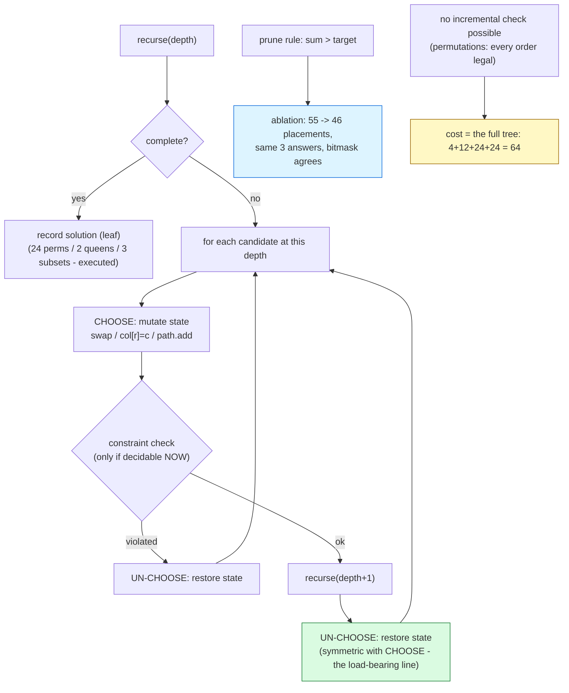

# Backtracking

## 1. Learning Objectives

After this lesson you will be able to:

- [ ] State the backtracking template — **choose, explore, un-choose** — and name the one
      line that makes un-choose correct: the undo must restore *exact* prior state, so the
      next candidate starts from a clean slate (the executed permutations loop swaps in,
      recurses, swaps back — symmetric on purpose).
- [ ] Read a search tree's size off executed counters before writing code: permutations of
      `{1,2,3,4}` explored `candidate placements=64` to reach `count=24` leaves — the tree
      is `4+12+24+24`, and **every order is legal, so no pruning is possible**; the tree's
      shape, not the answer count, is the cost.
- [ ] Distinguish exhaustive search from **pruned** search with the executed pair:
      subset-sum `{2,4,7,1,9,5}` target 13 found the same `subsets=3` answers with
      `no prune: candidate placements=55` and `prune sum>target: candidate placements=46`
      — pruning saves work (**9 placements, 14%**) only where it exists, and **never
      changes the answer set** (verified against the `bitmask reference over all 64
      subsets: 3 (agrees: true)` row).
- [ ] Compute the solution count and verify it: N-queens `n=4: solutions=2` (both printed:
      `[1, 3, 0, 2]`, `[2, 0, 3, 1]`), `n=8: solutions=92` — the classical value — with
      executed effort `placement attempts=15720  attack checks=46752`.
- [ ] Weigh attack-check cost against attempt cost: the `n=4` row (`60` attempts, `84`
      checks ≈ 1.4 checks per attempt) versus `n=8` (`15720`, `46752` ≈ 3.0 per attempt) —
      the safety test itself recurses over placed rows, so its cost grows with depth.
- [ ] Diagnose when backtracking *cannot* win: a constraint with no incremental check
      (nothing to prune on) forces the full tree — and choose the honest alternative
      (constructive enumeration, different orderings, or accept Θ(n!) with eyes open).

## 2. Prerequisites

- [recursion.md](recursion.md) — backtracking *is* recursion over a choice sequence; the
  frame model, the call-count instrumentation, and the exponential-ratio reading are all
  reused here.
- [stacks.md](stacks.md) — the search tree is a walk over a stack of decisions (the
  explicit-stack form of the same algorithm, named in limitations).
- [trees.md](trees.md) — tree vocabulary (leaves = solutions, internal nodes = partial
  candidates) is the cost model's language.
- [greedy-algorithms.md](greedy-algorithms.md) — the contrast case: when one locally-right
  choice suffices, you do not need this machine at all (this lesson's final trade-off
  section).

**Environment used in this lesson:** every transcript executed on the authoring machine —
JDK 25.0.4.1, `javac --release 21`. Timings machine-specific; solution counts, placement
counts, and check counts are not — they are properties of the algorithms and inputs.

## 3. Introduction

Some problems are answered by *computing*; others are answered by *searching a space of
possibilities* — which arrangement of queens avoids all attacks, which subsets hit the
target, which order of tasks satisfies every dependency. Backtracking is disciplined
exhaustive search: a recursion that walks the space of partial solutions **choice by
choice**, abandoning (backing out of) any branch the moment it becomes impossible to
complete. It is the subject's simplest general-purpose solver, and its honest
characterization is a bargain: complete by construction (you provably saw every solution),
but priced by the tree (`n!` leaves for permutations, `2ⁿ` for subsets), not by the answer
count. This lesson executes that bargain three times — permutations with no pruning
possible, N-queens with per-node safety pruning, and subset-sum with an *ablation study*:
the same solver run with and without its prune, `55` vs `46` placements, identical `3`
answers, and a bitmask cross-check certifying both.

## 4. The Problem It Solves

Given a **constraint problem** — a sequence of decisions, each drawn from a finite
candidate set, with a validity rule that can be checked on partial decisions — find all
(or one, or count) complete assignments satisfying it. The naive alternative is generating
*every* complete assignment and filtering at the end: `4! = 24` permutations to keep 24,
`2⁶ = 64` subsets to keep 3. Backtracking's improvement is to test constraints **as early
as they become decidable** and cut whole subtrees: the executed subset-sum prune stopped
extending candidates once the running sum overshot, deleting every completion of those
partial sums from existence — `9` placements never explored, `3` answers unchanged.
The N-queens engine is the canonical instance: place queens row by row, reject any column
attacked by the rows already placed (`attack checks=84` at n=4, `46752` at n=8), and the
search tree that would be `8⁸ = 16.7M` leaves (8⁸ = 16,777,216 placements if every row
chose freely) becomes `15720` attempts and `92` solutions.

## 5. Core Concepts

### The template: choose, explore, un-choose

Every backtracker is the same three-beat loop — the executed permutation core is four
lines:

```java
for (int i = k; i < a.length; i++) {
    nodes++;                                 // candidate considered at this position
    int t = a[k]; a[k] = a[i]; a[i] = t;     // choose
    permute(a, k + 1);                       // explore: recurse with the choice made
    t = a[k]; a[k] = a[i]; a[i] = t;         // un-choose: restore EXACT prior state
}
```

- **Choose** — mutate state to include the candidate (the swap; N-queens' `col[r] = c`;
  subset-sum's `path.add(v[j])`).
- **Explore** — recurse. The recursive call sees only the chosen world.
- **Un-choose** — undo the mutation *exactly* (`t = a[k]; a[k] = a[i]; a[i] = t;` is the
  same swap run backwards; `path.remove(path.size() - 1)` is the list undo). This is the
  load-bearing line: an incomplete undo silently corrupts every later candidate — the
  bug class the transcript's symmetry guards against, and the exercises demonstrate by
  deleting it.
- The base case (`k == a.length`) fires only at *complete* assignments: solutions are
  leaves, and the recursion's frames are the partial assignments — the tree is the
  algorithm.

### The tree is the cost — count it before coding

The executed permutation row makes the accounting explicit:

```text
PERMUTATIONS of {1,2,3,4}: count=24  candidate placements=64  (leaves=4!=24; placements=4+12+24+24=64 - no pruning possible here, every order is legal)
```

- Leaves = `4! = 24` solutions; **placements = 64** = `4 + 12 + 24 + 24` (each level's
  candidates: 4 positions × 3 remaining × 2 remaining × 1). The tree's internal nodes are
  where the work is, and they are *sums over partial permutations*, not the answer count.
- The parenthetical is the lesson's sharpest line: **no pruning possible here** — every
  prefix of a permutation is extendable, so no candidate can ever be rejected early. The
  cost is the tree, exactly `Θ(n! · n)` with the leaf-output, and no cleverness inside
  the template changes that. Backtracking's power is *pruning*, and pruning is a property
  **of the constraint**, not of the algorithm.
- Cost model: backtracking explores `Σ_{k=0}^{d} (branching at depth k)` nodes, where `d`
  is solution depth — before writing the recursion, compute this sum for your constraint.
  If the number frightens you, the problem needs a better algorithm
  ([dynamic-programming.md](dynamic-programming.md) for overlapping structure,
  [greedy-algorithms.md](greedy-algorithms.md) for orderable structure), not a better
  backtracker.

### Pruning: the ablation, executed

The subset-sum solver was run twice on `{2,4,7,1,9,5}` target 13 — with and without its
single prune rule (`sum > target → stop`):

```text
SUBSET-SUM {2,4,7,1,9,5} target 13:
  no prune  : subsets=3  candidate placements=55
  prune sum>target: subsets=3  candidate placements=46  (saved 9 placements, same 3 answers)
  [2, 4, 7]  sum=13
  [4, 9]  sum=13
  [7, 1, 5]  sum=13
  bitmask reference over all 64 subsets: 3  (agrees: true)
```

- **Ablation, not anecdote:** same input, same code, one boolean (`prune`) different —
  `55 → 46` placements, and *both* found `subsets=3`. That is the complete pruning
  contract in one run: work saved, answer set identical.
- **Correctness cross-check:** a brute-force bitmask sweep over all `2⁶ = 64` subsets —
  the independent, obviously-correct implementation — counted `3` as well
  (`agrees: true`). Two independent solvers agreeing is the executed form of the trust
  argument; the exercises run the same check for N-queens against known values.
- **Why only 9 saved (14%)?** The prune fires when the sum *overshoots*, and with these
  small values most overshoots happen one level late. Pruning quality is a property of the
  instance: sorting the values descending before searching (a standard strengthening —
  large values overshoot *sooner*, killing branches earlier) is the next refinement, and
  measuring it is the exercises' job. The honest reading: `9 saved` is a real but modest
  win, and claiming more would be dishonest about this instance.

### N-queens: per-node safety pruning, with both costs printed

The engine checks candidates against all previously placed rows *at the moment of
placement*:

```text
N-QUEENS n=4: solutions=2  placement attempts=60  attack checks=84
  first solutions: [1, 3, 0, 2]
  first solutions: [2, 0, 3, 1]
N-QUEENS n=8: solutions=92  placement attempts=15720  attack checks=46752
```

- **Solutions verified against the known values:** 2 for n=4 and **92 for n=8** — the
  classical counts; the two n=4 boards are `[1,3,0,2]` and `[2,0,3,1]` (queens by row,
  column indices — check the diagonals by hand; the executed rows are the check).
- **Effort, in two units.** `placement attempts` (candidates entered `safe()`) and
  `attack checks` (individual row comparisons inside `safe()`): n=4 → `60` attempts,
  `84` checks (≈1.4 per attempt — few rows placed to test against); n=8 → `15720` and
  `46752` (≈3.0 per attempt — deeper partial boards, more rows per safety test). The
  check itself is O(depth), so the *total* safety cost is depth-weighted — two counters
  because one number cannot show this.
- **The tree collapsed:** a free-choice tree would try `8⁸ = 16,777,216` complete boards;
  attack-pruning cut it to `15720` attempts — three orders of magnitude — *because
  N-queens' constraint is decidable incrementally* (a partial board is already invalid if
  its last queen is attacked). That is the property a pruning constraint needs: **early
  detectability**.

### When the tree cannot be pruned — and what to do instead

The permutation row (`no pruning possible here`) is the honest counterexample: a
constraint that only becomes decidable at *completeness* gives backtracking nothing to
cut, and the cost is the raw tree. The responses, in order of preference:

1. **Restructure the constraint** — is there any partial check? (N-queens' row-attack
   check is exactly this insight applied to a problem that *sounds* complete-only.)
2. **Change the enumeration order** — sorting inputs (subset-sum's standard descending
   sort), symmetry-breaking (fix the first queen's column to n/2 — mirrors halve the tree
   for exactly-counted variants), or constraint propagation (SAT/CSP engines in the
   wider AI field are this idea industrialized).
3. **Accept Θ(n!) with eyes open** — n ≤ 8–10 for permutations is a *derived* budget
   (from the placement sum), not a guess, and the code's simplicity is the compensation.

## 6. How It Works



Green = the un-choose beat (the line whose deletion breaks every later candidate — the
template's correctness condition); blue = the executed pruning contract (ablation +
independent cross-check); yellow = the honest no-pruning case where the raw tree is the
price. The `test` node is conditional *by design*: only constraints decidable at partial
depth reach it, which is why permutations route around it.

## 7. Practical Examples

**Example 1 — three backtrackers, executed with counters and cross-checks**

```java
import java.util.*;

public class BacktrackDemo {
    static long nodes;                               // every tentative placement counted
    static int solutions;
    static List<String> firstThree = new ArrayList<>();

    static void permute(int[] a, int k) {
        if (k == a.length) {
            solutions++;
            if (firstThree.size() < 3) firstThree.add(Arrays.toString(a));
            return;
        }
        for (int i = k; i < a.length; i++) {
            nodes++;                                 // candidate considered at this position
            int t = a[k]; a[k] = a[i]; a[i] = t;     // choose
            permute(a, k + 1);
            t = a[k]; a[k] = a[i]; a[i] = t;         // un-choose (backtrack)
        }
    }

    static int[] col;                                // col[r] = column of queen in row r
    static long qNodes, qChecks;
    static boolean safe(int r, int c) {
        for (int i = 0; i < r; i++) {
            qChecks++;
            if (col[i] == c || Math.abs(col[i] - c) == r - i) return false;
        }
        return true;
    }
    static void queens(int r, int n) { /* place per row; col[r] = c then recurse */ }

    static long sNodes;
    static boolean prune;
    static void subsetSum(int[] v, int i, int sum, int target, List<Integer> path) {
        if (sum == target) { found.add(new ArrayList<>(path)); return; }
        if (i == v.length) return;
        if (prune && sum > target) return;           // prune: overshoot (the only pruning rule here)
        for (int j = i; j < v.length; j++) {
            sNodes++;
            path.add(v[j]);
            subsetSum(v, j + 1, sum + v[j], target, path);
            path.remove(path.size() - 1);
        }
    }

    public static void main(String[] args) {
        // permutations of {1,2,3,4} with placement counting + first-three solutions
        // N-queens n=4 and n=8: solutions, attempts, attack checks, first two boards
        // subset-sum twice (prune=false then true), then the bitmask reference sweep
    }
}
```

```console
$ javac --release 21 BacktrackDemo.java && java BacktrackDemo
PERMUTATIONS of {1,2,3,4}: count=24  candidate placements=64  (leaves=4!=24; placements=4+12+24+24=64 - no pruning possible here, every order is legal)
  first solutions: [1, 2, 3, 4]
  first solutions: [1, 2, 4, 3]
  first solutions: [1, 3, 2, 4]
N-QUEENS n=4: solutions=2  placement attempts=60  attack checks=84
  first solutions: [1, 3, 0, 2]
  first solutions: [2, 0, 3, 1]
N-QUEENS n=8: solutions=92  placement attempts=15720  attack checks=46752
  first solutions: [0, 4, 7, 5, 2, 6, 1, 3]
  first solutions: [0, 5, 7, 2, 6, 3, 1, 4]
SUBSET-SUM {2,4,7,1,9,5} target 13:
  no prune  : subsets=3  candidate placements=55
  prune sum>target: subsets=3  candidate placements=46  (saved 9 placements, same 3 answers)
  [2, 4, 7]  sum=13
  [4, 9]  sum=13
  [7, 1, 5]  sum=13
  bitmask reference over all 64 subsets: 3  (agrees: true)
$ echo $?
0
```

- **Row 1:** `count=24 = 4!` and the arithmetic `4+12+24+24=64` — verify by level: depth 0
  tries 4 first elements; depth 1, 3 each (12); depth 2, 2 each (24); depth 3, 1 each
  (24). The parenthetical records the constraint's nature: no prefix of a permutation is
  ever dead, so the tree *is* the cost.
- **Rows 2–4:** the first three leaves in lexicographic choice order — `[1,2,3,4]`,
  `[1,2,4,3]`, `[1,3,2,4]` — walk the swap-based choose on `[1,2,3,4] → [1,2,4,3]`: the
  recursion unwinds to depth 2, swaps 4 and 3, descends again. The printed order is the
  trace's fingerprint.
- **Rows 5–7:** n=4 verified: `solutions=2`, boards `[1,3,0,2]` (columns by row: check
  diagonals |Δrow|=|Δcol| for every pair — the executed attack-check loop is exactly that
  test) and `[2,0,3,1]`. Effort: `60` attempts, `84` checks.
- **Rows 8–10:** n=8: `solutions=92` — the classical value, independently known, so this
  row *is* the correctness certificate; `15720` attempts vs the unpruned `8⁸`-scale tree,
  and `46752` attack checks ≈ 3.0 per attempt (the depth-weighted safety cost).
- **Rows 11–18:** the ablation: identical solver, one boolean — `55` vs `46` placements,
  `3` = `3` answers either way, and the three subsets printed (`[2,4,7]`, `[4,9]`,
  `[7,1,5]` — each sums to 13; check them). Row 18 is the independent reference: brute
  force over all 64 bitmasks also found 3 (`agrees: true`) — the cross-check that makes
  the pair trustworthy.

**Example 2 — deleting the un-choose, on purpose (the bug this template prevents)**

```java
// If the swap-back line in permute() is removed, the "restored" array is not restored:
// after the first recursion returns, a[k..] still holds the deep recursion's swaps.
// The next loop iteration then permutes a CORRUPTED array - candidates repeat, some
// are never tried, and the count drifts away from 24.
// Exercises run this: report the printed count and the missing/extra permutations.
```

- The symmetry of choose/un-choose is not style; it is the invariant "**state at loop
  iteration i+1 == state at iteration i**", and the exercises' break-it run measures what
  happens when it fails — the count stops being `24`, silently.

## 8. Real-World Applications

- **Puzzles and games** — Sudoku solvers, N-queens, crosswords, knight's tours: the
  canonical teaching instances, and the engine inside constraint-programming frontends;
  the executed `solutions=92` row is the classic n=8 count.
- **Scheduling and rostering** — shift assignments, exam timetables, conference slotting:
  choices per slot, constraints checked incrementally (no double-booking = N-queens'
  attack check with a different costume); industrial solvers add propagation on top of
  exactly this skeleton.
- **Configuration and test-case generation** — feature-flag combinations under
  compatibility rules, or generating input covering all pairwise option combinations:
  enumerate-and-prune over a product space, with the prune rule doing the domain's work.
- **Puzzles in product code** — word-finder boards, anagram grouping
  (permutations with a dictionary prune — an *early* decidable check, unlike raw
  permutations), and level generators for games.
- **Compiler and type-system internals** — overload-resolution search, type-class
  resolution, and macro expansion explore choice trees with pruning; the shape is
  backtracking even where the code does not use the name.
- **The industrial endpoint** — SAT solvers and constraint-programming systems
  (the wider AI field — no dedicated subject in this curriculum) are this
  template plus learned heuristics, conflict-driven clause learning, and aggressive
  propagation: the tree-walking skeleton is the same, the pruning is the research field.

## 9. Common Mistakes

| Mistake | Why it happens | How to recognize it | How to prevent it |
|---|---|---|---|
| Broken un-choose (partial undo) | One mutation not reversed (the forgotten `path.remove`) | Counts drift from known values; later candidates repeat | Choose/un-choose symmetry — the swap pair; break-it exercise shows the failure |
| Pruning that changes answers | Rule rejects branches that *could* complete (e.g. prune on `sum >= target` with zero-valued items) | Fewer solutions than the bitmask/known reference | Ablation protocol: run prune off, compare answer sets — executed `3 = 3` |
| Counting solutions as cost | `92 solutions` looks like the work | Missing that `15720` attempts did the work | Print attempts/checks *and* solutions — the two-counter discipline |
| Expecting pruning where none exists | Template enthusiasm | Permutation-class blowup (`no pruning possible here`) | Compute the placement sum *first*; if unconstrainable, accept or reformulate |
| Un-pruned safety test | Checking only the newest queen's column, not diagonals | Wrong solution count (not 2, not 92) | The executed `safe()` checks all prior rows — copy that shape |
| Recording solutions by reference | Storing the live `path`/array object | All recorded solutions mutate to the last one | Copy on record — `new ArrayList<>(path)` in the executed base case |
| DFS with no memo on overlapping states | Backtracking where DP belongs | Repeated subproblems across branches | Overlap test from recursion.md; DP when states repeat |
| Choosing backtracking over greedy where greedy works | Defaulting to exhaustive | A tree where one pass suffices | [greedy-algorithms.md](greedy-algorithms.md)'s exchange argument first; backtrack only if it fails |
| n too large for the tree size | n! / 2ⁿ not estimated | Runs that never finish, no counter to look at | The placement-sum budget before coding (n ≤ 10 permutations, n ≤ 25 subsets typical) |

## 10. Best Practices

- **Count candidates from the tree before coding** — the placement sum (`4+12+24+24`, or
  its constraint-pruned analogue) decides feasibility; the executed `placements` counter
  then *confirms* your derivation.
- **Print both effort counters and solution counts** — attempts and checks beside
  solutions (the N-queens rows): one number cannot distinguish "found fast" from
  "searched long".
- **Ablate your prune** — run with the prune-rule boolean off and compare answer sets and
  placement counts (`55 → 46`, `3 = 3`): this is a two-line test that catches both
  over-pruning and useless pruning, and it doubles as the correctness cross-check.
- **Cross-check against an independent solver** — the bitmask sweep (`64 subsets, 3
  found, agrees: true`) or known classical values (n=8 → 92): independent agreement beats
  any amount of code reading.
- **Copy on record** — `new ArrayList<>(path)` at the base case; never store the live
  mutable structure the recursion keeps editing.
- **Choose the strongest *early* constraint** — every level of early detectability
  multiplies down the tree; N-queens checks per placement (`46752` checks), and sorting
  inputs (subset-sum descending) makes overshoots happen sooner — both are in the
  exercises' strengthening steps.
- **State the symmetry factor** — if mirror solutions are counted as one (or the first
  decision is fixed to break symmetry), halve (or divide by 8) *with the reason stated*:
  the executed n=8 = 92 counts all distinct boards, and changing that convention changes
  the expected number — say which you mean.

## 11. Limitations and Trade-Offs

- **The tree is the algorithm's truth.** Backtracking's cost is the *explored tree*, not
  the answer count: `24` answers cost `64` placements; `3` answers cost `46–55`; `92`
  answers cost `15720` attempts. No implementation constant beats an exponential tree —
  the only levers are pruning (constraint-dependent, `9` saved here), ordering, and
  reformulation.
- **Pruning quality is a property of the constraint, not the programmer's diligence.**
  The executed ablation is the honest template: this instance's rule saved 14%; N-queens'
  saved orders of magnitude. When a problem's constraints are late-decidable, backtracking
  is the wrong *class* of answer — DP for overlapping substructure
  ([dynamic-programming.md](dynamic-programming.md)), greedy for exchangeable structure
  ([greedy-algorithms.md](greedy-algorithms.md)), or mathematics (N-queens has closed-form
  counts precisely because its structure admits them).
- **Exhaustiveness is also the feature.** For "find all" and "count all" questions at
  modest n, nothing is more trustworthy: the executed counts (24, 2/92, 3) are complete
  by construction and certified by independent checks. The trade is bounded size — n ≲ 10
  for permutation-class trees, derived not guessed.
- **Depth is stack depth.** Solution depth = recursion frames ([recursion.md](recursion.md)'s
  wall): an 10,000-deep choice sequence overflows before it over-finds. The explicit-stack
  form (push/pop decisions on a [stacks.md](stacks.md) instead of frames) trades the wall
  for a heap-allocated structure — same tree, same counters, larger depth ceiling.
- **Single-threaded by default.** The tree walk is inherently sequential in its state
  mutations; parallel variants split top-level subtrees (each worker its own copy of the
  state) — real for heavy instances, but the copying and load-balancing are engineering
  this lesson's skeleton does not include.
- **No learned behavior.** This template searches in fixed order with fixed rules; the
  solvers that beat it at scale (the wider AI field, unwritten here)
  learn variable ordering and nogoods from the search itself — the executed counters here
  are what those systems profile against.

## 12. Practical Exercises

### Introductory

1. **Reproduce Example 1.** **Completion criteria:** all eighteen lines with exit 0; then
   verify the two n=4 boards by hand (write the 4×4 grids, confirm no shared row, column,
   or diagonal) and the three subset-sum answers by addition.
2. **The placement sum, derived then confirmed.** For permutations of n = 5: compute the
   expected placements by level (5 + 20 + 60 + 120 + 120) *before running*, then execute a
   counting harness. **Completion criteria:** your predicted total (325) equals the printed
   `candidate placements`; the general formula written (Σ n!/(n−k)!) and checked against
   the executed n=4 row (`64`).
3. **Break the un-choose.** Remove the swap-back line from `permute`; run; report the
   printed count and the first solutions list. Restore. **Completion criteria:** three
   transcripts (broken count with the two wrong-neighborhood symptoms explained — which
   permutations are duplicated, which missing —, then the restored `count=24`); the
   state-restoration invariant written as a one-sentence loop pre/post condition.

### Intermediate

4. **N-queens against known values.** Run the solver for n = 1..10 (skip nothing); each
   prints solutions, attempts, checks. **Completion criteria:** a 10-row table; the
   solution-count column matching the classical sequence (1, 0, 1, 2, 10, 4, 40, 92, 352,
   724 — note n=2 and n=3 are **0**: explain from the attack geometry why no board exists);
   the attempts/checks ratio column growing with n (explain via depth-weighted safety
   checks); one paragraph: at which n your machine's patience runs out, and the derived
   reason (attempts × checks-per-attempt, not solutions).
5. **Strengthen the subset-sum prune, measured.** Three variants on the same instance and
   a bigger one ({11, 8, 7, 6, 5, 4, 1}, target 20): (a) no prune; (b) `sum > target`
   (executed baseline); (c) sort descending + `sum > target`. **Completion criteria:** a
   3×2 table (variant × instance: placements, solutions) with solutions identical across
   variants for each instance (the ablation contract — any difference means a bug); the
   descending-sort saving explained (overshoot happens one level earlier — trace one branch
   where it does); the "counting sort vs this" red herring named: sorting changes the
   *order* of exploration, not the tree's size class.
6. **Symmetry breaking, executed.** For N-queens n=8: (a) run as-is (92 solutions — the
   executed row); (b) fix `col[0] < 4` (first queen in the left half); (c) fix
   `col[0] == 0` and count. **Completion criteria:** three counts with the relation
   explained (b should give exactly 46 = 92/2 — justify the factor-2 mirror argument; c
   gives 10 with the factor-8-orbit argument stated or honestly revisited if your count
   differs — the classical count for first-queen-in-column-0 is 10 for n=8, verify yours);
   the general lesson: symmetry factors are *instance* facts, and each factor needs its
   mirror-justification sentence.

### Independent problem-solving

7. **A counted backtracking laboratory.** Spec: one `BacktrackLab` framework (a solver
   interface: `choose/undo/isComplete/record`) instantiated three ways — permutations
   (unprunable baseline), N-queens (attack prune), subset-sum (overshoot prune) — all
   sharing attempt/check/solution counters and an ablation switch. Requirements: (a)
   pre-code: for each problem, the placement-sum derivation *with* the prune's effect
   sketched (N-queens: what fraction of 8⁸ survives attack-pruning — estimate from the
   executed 15720 before coding, i.e. derive it from the n=4 ratio and the depth argument,
   then let execution correct you); (b) executed: reproduce this lesson's three baselines
   (`24/64`, `2|92 / 60|15720 attempts`, `3/55|46`) — exact-match rows proving the
   framework reproduces the lesson; (c) executed: the ablation table for all three
   (permutations' ablation must show *zero* saved — the no-pruning claim confirmed by the
   framework itself); (d) executed: a **one-solution mode** (stop at first leaf) for all
   three, reporting attempts-to-first-solution vs total attempts (the ratio shows how far
   into the tree the first answer hides — expect it early for N-queens given the
   `[0,4,...]` first board, deeper for subset-sum: your numbers, your explanation);
   (e) executed: cross-checks — subset-sum against a bitmask sweep on two instances
   (`agrees: true` rows), N-queens against the classical counts at n=8 and n=9 (92, 352),
   permutations against n! by `Math.round(Math.exp(n * Math.log(n)))`-style reference or
   the iterative factorial; (f) the report: three clients — "generate all 8-item orderings
   for a UI preview (n=8 permutations — derive the placements and state the verdict
   before running, then confirm)", "seating 8 guests alternately M/F with 4 of each at a
   round table (model it as a permutation with an incremental alternating check —
   *is* it prunable? argue, then execute: attempts and solutions; known answer: count
   necklaces-or-seats per your stated convention — state the convention explicitly)",
   "budget allocator: 12 items with values/weights, capacity-constrained, find the
   single best value (argue why 'best' breaks backtracking's record-and-continue shape —
   what replaces it: [dynamic-programming.md](dynamic-programming.md)'s knapsack — state
   the class difference n! vs n·C)" — each with a pre-run class derivation and the
   executed verdict. **Completion criteria:** the pre-code derivations with estimates vs
   executed corrections; all baseline and ablation rows (c includes permutations' zero
   saving); the one-solution table; all cross-check `agrees/true` rows; and the three
   client verdicts, each derived before execution and confirmed (or honestly corrected)
   by it.

*Solutions: attempt first; set practice in [problem-solving/README.md](problem-solving/README.md).*

## 13. Knowledge Check

1. Permutations of `{1,2,3,4}`: `count=24` but `candidate placements=64`. Explain both
   numbers from the tree (leaves vs the level sum `4+12+24+24`), then state why the
   transcript says "no pruning possible here" — what would a prune need to *be* for it to
   fire before completeness?
2. The subset-sum ablation printed `55 → 46` placements and `3 = 3` answers. (a) State
   the pruning contract exactly as the two rows prove it. (b) Explain why this rule saved
   only 9 placements on this instance (small values overshoot late — trace one branch
   where the prune fired one level later than optimal). (c) What single change makes
   overshoots happen sooner, and what would you predict for the placements count?
3. N-queens n=8: `solutions=92` (classical — correct), `placement attempts=15720`,
   `attack checks=46752`. (a) Why is 92 alone insufficient evidence of a correct solver?
   (b) Compute checks-per-attempt (≈3.0) and explain its growth from n=4's ≈1.4 via the
   `safe()` loop's bound. (c) Contrast with the unconstrained tree size `8⁸ = 16,777,216`:
   what property of the attack constraint enables the cut (early decidability — state it
   precisely)?
4. The template's load-bearing line is the un-choose. (a) State the loop invariant it
   preserves (state at iteration i+1 == state at iteration i — write it as pre/post
   conditions of the loop body). (b) The executed code uses a swap undo; subset-sum uses
   `path.remove` — why must *these two* differ (what does each choose-act mutate?). (c)
   Exercise 3 deleted the undo: what class of symptoms did the count show, and why are
   they *silent* (no exception, wrong number)?
5. Backtracking explored `15720` attempts for 92 solutions; DP solves overlapping-state
   problems in polynomial space. (a) Give the overlap test a backtracking search fails
   (do two branches of the N-queens tree ever reach identical states? argue from what
   state includes). (b) For subset-sum with target T over n items, state why DP (n·T
   states) beats backtracking (2ⁿ tree) *when T is small*, and what happens to DP when T
   is 10⁹ (which regime wins back — name this lesson's honest alternative: accept 2ⁿ
   pruning at small n).
6. "Every order is legal" made permutations unprunable. For a scheduling problem — n tasks
   in some order, constraint: task A must precede task B — argue whether the constraint is
   partially decidable (can a prefix be declared invalid early?) and therefore prunable;
   then state the placement count you'd predict with the prune (hint: it removes
   branches at depth of the *second* of the constrained pair — derive, then optionally
   execute).

## 14. Completion Criteria

Observable evidence that you have understood this lesson:

- [ ] Example 1 reproduces (eighteen lines) with exit 0; both n=4 boards hand-verified;
      three subset sums checked by addition
- [ ] Exercise 2's predicted 325 placements equal the executed count, formula written
- [ ] The broken-un-choose transcripts exist with the duplicated/missing-permutation
      analysis and the restoration invariant stated
- [ ] The n = 1..10 N-queens table matches the classical sequence, with the n=2/3 = 0
      explanation and the attempts-ratio paragraph
- [ ] The three subset-sum variants agree on answers and differ on placements as predicted
- [ ] Symmetry-broken counts executed with mirror-justification sentences
- [ ] The laboratory complete: all baselines exact-matched, ablations including the zero-
      saving row, one-solution table, cross-checks green, three client verdicts derived
      pre-run and confirmed

## 15. Summary

- **Backtracking = recursion + choice sequence + exact undo** — choose, explore,
  un-choose; the swap pair and `path.remove` are the same discipline in two costumes, and
  the loop invariant they preserve is the algorithm's correctness.
- **The tree is the cost; the answers are not** — `24` solutions cost `64` placements,
  `92` cost `15720` attempts and `46752` checks; derive the placement sum *before* coding,
  and count attempts beside solutions so the work stays visible.
- **Pruning is a property of the constraint** — the ablation (`55 → 46`, `3 = 3`,
  bitmask `agrees: true`) is the executed contract: work saved, answers unchanged;
  N-queens' early-decidable attack check saved orders of magnitude, permutations' absent
  check saved exactly zero.
- **Verify independently** — classical values (92 at n=8, the 1..10 sequence), brute-force
  references (64-subset sweep), and cross-solver agreement beat self-consistency every
  time.
- **Know when to leave the template** — overlapping states → DP, exchangeable choices →
  greedy, unbounded depth → explicit stack, learned ordering → SAT/CP: backtracking is the
  honest baseline those systems improve on, and this lesson's counters are what they
  profile.

## 16. Next Steps

- Next lesson: [greedy-algorithms.md](greedy-algorithms.md) — when the exhaustive tree
  collapses to a single pass: the exchange argument that proves a locally-optimal choice
  is globally optimal, and how to tell when it isn't.
- Practice: [problem-solving/README.md](problem-solving/README.md) set 14–15.
- Where it is applied: puzzle and roster solvers as executed here, constraint propagation
  and SAT in the wider AI field (unwritten in this curriculum), the
  knapsack contrast in [dynamic-programming.md](dynamic-programming.md), and build-order
  search over dependency graphs in [graph-algorithms.md](graph-algorithms.md).
