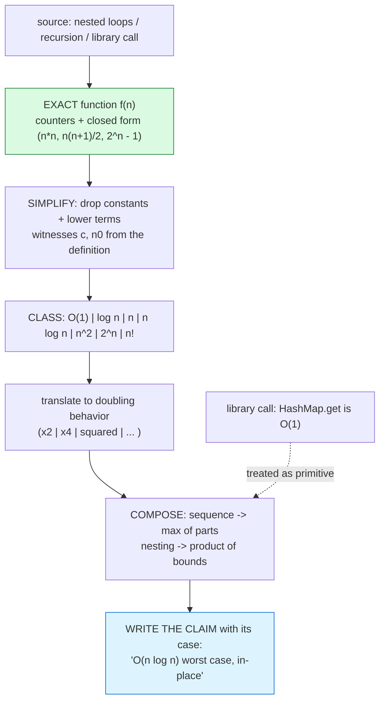

# Big-O Notation

## 1. Learning Objectives

After this lesson you will be able to:

- [ ] Define O, Ω, and Θ precisely (upper bound, lower bound, tight bound) and pick the right
      one for a claim — including why "O" misuse ("O(n²) is a lower bound!") is wrong.
- [ ] Simplify a cost expression by the two official moves — **drop constants and lower-order
      terms** — and justify each with the executed `upper-tri = n(n+1)/2` → "still O(n²)"
      arithmetic.
- [ ] Read the common classes (1, log n, n, n log n, n², 2ⁿ, n!) as *doubling behaviors*, using
      the executed growth table and halving counts as the reference data.
- [ ] Derive a loop's class in two lines (inner trip count × outer range) and check it against
      an instrumented counter — the technique from
      [algorithm-analysis.md](algorithm-analysis.md), now with notation attached.
- [ ] Compose complexities through nesting and sequences (add vs max rules) and evaluate a
      multi-loop method honestly.
- [ ] State what Big-O deliberately **ignores** (constants, caches, machines) and argue when
      those ignored things are the ones that matter.

## 2. Prerequisites

- [algorithm-analysis.md](algorithm-analysis.md) — counting, cases, and the measure-after
  derive discipline; this lesson formalizes that vocabulary.
- [04-JAVA-PROGRAMMING](../04-JAVA-PROGRAMMING/README.md) — the Java used in every example.
- [02-PROGRAMMING-FUNDAMENTALS](../02-PROGRAMMING-FUNDAMENTALS/README.md) — loops; asymptotic
  reasoning was previewed there for search (linear vs binary) and is now made precise.

**Environment used in this lesson:** every transcript executed on the authoring machine —
JDK 25.0.4.1, `javac --release 21`.

## 3. Introduction

Big-O is a **language, not a measurement**: it states how work grows as n grows, with enough
formality to argue ("this is O(n log n)") and enough suppression of detail to stay portable
("on any reasonable machine"). The suppression is the design: by discarding constants and
lower-order terms, the notation answers the only question that survives scale — *when the input
doubles, does my work double, quadruple, or explode?* This lesson teaches the grammar, the
lookup table of standard shapes, and the two-line derivations that produce them, all against
the executed counters from the previous lesson so no claim floats free of evidence.

## 4. The Problem It Solves

Before notation, complexity claims were sentences — "this is pretty fast", "it scales well" —
unsatisfiable arguments. Two people could disagree about the same loop with no referee. Big-O
is that referee: it reduces any program to a *growth class*, comparable across machines,
languages, and authors, with agreed rules for simplification (`5n + 3` and `n/2 + 100` are the
same claim) and agreed semantics for bounds. The notation also makes *composition* possible:
once `sort` is O(n log n) and `scan` is O(n), a pipeline's total is stated without re-deriving
anything — which is exactly how later subjects reason about database queries and API request
paths before a single line runs.

## 5. Core Concepts

### The definition, in one breath

**f(n) ∈ O(g(n))** means: there exist constants c and n₀ such that for all n ≥ n₀,
**f(n) ≤ c·g(n)** — "eventually, f never grows faster than g, up to a constant factor."
Ω is the mirror (≥, lower bound), Θ is both (tight). The constants are what let you drop
`5` and `+3`: `5n + 3 ∈ O(n)` because `5n + 3 ≤ 6n` for all n ≥ 3 — the witnesses are
c = 6, n₀ = 3, g(n) = n. When you say "the loop is O(n)", you are claiming exactly that
those witnesses exist; the executed counters (previous lesson) tell you the *function*, the
definition tells you the *class*.

### The two official simplification moves

1. **Drop constant factors** — `2·n(n+1)/2 = n² + n` and even `1000·n` are both O(n) or O(n²)
   class claims: c absorbs the 1000. The executed `upper-tri` rows are the concrete case:
   `n(n+1)/2 = n²/2 + n/2` — the leading term is n²/2, so **Θ(n²)** (tight, not just O).
2. **Drop lower-order terms** — `n² + n` → O(n²): past n₀, the n² term dominates and grows
   away from the linear one. The formal justification is the ≤ c·g(n) witness: pick c = 2 and
   n² + n ≤ 2n² for all n ≥ 1.

Rule of thumb made honest: **look at what dominates as n → ∞** — but only after counting the
*exact* function, because a dropped term can carry surprises (`n²/2` vs `n²` differs by 2× — a
constant — while `n log n` vs `n²` differs by a factor that *grows*, which is why those are
different classes and the first two aren't).

### The standard classes as doubling behaviors

Read each class by what happens when n doubles — this is the table you actually use:

| Class | Name | Doubling n multiplies work by | Where you'll meet it |
|---|---|---|---|
| O(1) | constant | 1 (nothing) | hash lookup, array index |
| O(log n) | logarithmic | ~+1 step | binary search, balanced tree descent |
| O(n) | linear | 2 | scan, single loop |
| O(n log n) | linearithmic | ~2 + a hair | good sorts, tree traversal with work |
| O(n²) | quadratic | 4 | nested loops over the same range |
| O(2ⁿ) | exponential | squared | exhaustive subsets, naive recursion |
| O(n!) | factorial | ×(n+1) | permutations without pruning |

Executed evidence anchoring the table: the halving rows (`16 → 4, 1000 → 10, 1_000_000 → 20`
halvings — one more step per *doubling*-ish growth of n, the signature of log n), the
`2ⁿ − 1` call counts (1023 → 1,048,575 → 1,073,741,823 for n = 10 → 30), and the growth table's
columns (linear ×2, quadratic ×~4, linearithmic ×2-plus per doubling).

### Composition: sequences add, nesting multiplies (max)

- **Sequence:** `sort` then `scan` is O(n log n) + O(n) = **O(n log n)** — dominated by the
  larger term, same dropping rule applied to classes.
- **Nesting:** an O(n) body inside an O(n) loop is O(n·n) = O(n²) — but the correct rule is
  *inner bound × outer range evaluated together*: if the inner loop depends on i (as
  `for (j = i; …)` does), you compute the sum (`n(n+1)/2`) and *then* drop — never multiply
  max×max blindly and never skip the sum. The `upper-tri` counter proves the sum's closed form;
  the class comes after.

### What the notation deliberately ignores — and when that bites

Ignored: constants (5× matters at n = 20), machine and cache behavior (an O(1) array hop can
lose to an O(log n) pointer walk when locality is bad), and additive terms below the drop
threshold (the n in `n log n + n` is invisible *asymptotically* but real at small n). The
honest position from the previous lesson: Big-O answers growth questions; wall-clock at your
actual n sometimes needs the constants back — which is why the curriculum's habit is
*derive the class, then measure on representative sizes*.

## 6. How It Works



Left-to-right is the derivation pipeline: never skip the **exact function** node (green) —
every Big-O bug this subject has seen was a class claimed from vibes instead of a counted
function. Library calls enter as *given* bounds (you cite, not re-derive), and the output
(blue) is a sentence with case and caveat attached.

## 7. Practical Examples

**Example 1 — from counter to class, twice (executed)**

```console
$ javac --release 21 CountOps.java && java CountOps
n=10  nested=100 (n*n=100)   upper-tri=55 (n(n+1)/2=55)
n=100  nested=10000 (n*n=10000)   upper-tri=5050 (n(n+1)/2=5050)
n=1000  nested=1000000 (n*n=1000000)   upper-tri=500500 (n(n+1)/2=500500)
```

- **Derivation A:** `for i in 0..n-1: for j in 0..n-1: work` → f(n) = n·n exactly (row 1–3,
  column `n*n`) → drop nothing (already monomial) → **Θ(n²)** — tight, because both bounds
  collapse to the same function.
- **Derivation B:** inner `for (j = i; j < n; j++)` → f(n) = Σ(n−i) for i=0..n−1 =
  **n(n+1)/2 = n²/2 + n/2** (the counter equals the closed form on every row) → drop the
  `n/2` lower-order term → O(n²); keep the leading `1/2`… as a *constant*, also dropped → but
  for Θ we keep it honest: **Θ(n²)**. One is exactly n² iterations, the other exactly half-ish —
  **same class, factor-2 constants** — which is the entire point of the notation, and the
  counter proves both functions before any dropping happened.

**Example 2 — log and exponential, executed**

```console
halvings of 16 = 4   log2(16)=4
halvings of 1000 = 10   log2(1000)=9
halvings of 1000000 = 20   log2(1000000)=19
recursive calls in the naive doubling f(n)=2f(n-1)+1 at n=10 = 1023
recursive calls in the naive doubling f(n)=2f(n-1)+1 at n=20 = 1048575
recursive calls in the naive doubling f(n)=2f(n-1)+1 at n=30 = 1073741823
```

- **Log, verified:** halving 1,000,000 takes 20 steps — while n grew ×1,000,000 from the
  16-row's neighborhood, steps grew by ~×5. The printed floor-`log2` column (9, 19) vs the
  halving count (10, 20) is the notation hygiene point: `⌈log₂ n⌉` and `⌊log₂ n⌋ + 1` are the
  same class (Θ(log n)) with different constants at different n — quote whichever matches your
  exact counting, class it as log, and move on. Doubling n adds **one** halving: the doubling
  behavior of O(log n) in one observation.
- **Exponential, verified:** `f(n) = 2f(n−1) + 1` solves to `2ⁿ − 1` — and the program
  confirms it (1023 = 2¹⁰−1, 1048575 = 2²⁰−1, 1073741823 = 2³⁰−1). The class rule on
  doubling: **squaring** (n ×2 → work ×4 once you're past the constants; from 10 to 20 the
  work went ×1024 ≈ 2¹⁰). If your derivation ends in 2ⁿ, you stop tuning and start pruning —
  the contract this subject's later lessons (backtracking, DP) fulfill.

**Example 3 — the classes side by side, executed (growth table)**

```console
n=  1000  O(n):   0.016 ms   O(n^2):    0.519 ms   O(n log n):   0.075 ms
n=  2000  O(n):   0.032 ms   O(n^2):    1.959 ms   O(n log n):   0.141 ms
n=  4000  O(n):   0.069 ms   O(n^2):    8.224 ms   O(n log n):   0.267 ms
n=  8000  O(n):   0.128 ms   O(n^2):   37.735 ms   O(n log n):   0.240 ms
```

- The table *is* the classes: linear column ×2 per row (0.016→0.032→0.069→0.128), quadratic
  ×~4–5 (0.519→1.959→8.224→37.735), linearithmic ≈×2 (with the honest sub-ms dip at the last
  row — noise, discussed in the previous lesson: read columns as ranges below ~1 ms).
- **Gap reading:** at n = 8000 the quadratic column is ~300× the linear column — the notation
  said the gap *grows without bound*; four doublings already show it widening
  (0.016→0.519 = ×32 at n=1000; 0.128→37.735 = ×295 at n=8000).

**Example 4 — composing a real method (executed shape)**

```java
void profile(List<String> names) {
    Set<String> seen = new HashSet<>();   // O(1) amortized per op  (given bound)
    for (String s : names) {              // O(n) outer
        String t = s.strip().toLowerCase(); // O(len) per element — bounded by max length
        seen.add(t);                      // O(1) amortized
    }
    List<String> sorted = new ArrayList<>(seen); // O(k), k = distinct
    Collections.sort(sorted);             // O(k log k)
    for (String s : sorted) System.out.println(s); // O(k)
}
```

- Derivation in three lines: loop = n × O(1+bounded) = **O(n)**; sort = **O(k log k)** with
  k ≤ n; total = O(n) + O(k log k) + O(k) = **O(n log n)** worst (sequence → max rule,
  expressed in n). One subtlety the sketch exposes: per-element string work is bounded by the
  *longest* string's length — a second variable real analysis keeps in the claim (O(n·L)),
  which the curriculum drops only when L is treated as bounded. Stating the assumption is the
  professional form.

## 8. Real-World Applications

- **Reading library documentation** — `HashMap` get/put are documented O(1) *amortized*;
  `TreeMap` O(log n); `List.indexOf` O(n) — API design docs are written in this notation, and
  misreading "amortized" as "worst" is how capacity surprises happen (arrays lesson).
- **Database and API design** (subjects 10–11): `WHERE` without an index = O(table scan) vs an
  index's O(log n + result) — the same binary-search argument from Example 2, priced per query.
- **Complexity clauses in reviews** — "this nested loop is O(n²) over events; at 10⁴ events
  that's 10⁸ ops" is the standard objection that blocks quadratic code before it ships.
- **Interview currency** — the classes table is the expected vocabulary; this subject's
  exercises make you *derive* rather than recite.
- **Choosing between algorithms with equal constants** — merge vs quick, hash vs tree: at
  small n constants decide; at large n classes decide; knowing both readings prevents either
  extreme.

## 9. Common Mistakes

| Mistake | Why it happens | How to recognize it | How to prevent it |
|---|---|---|---|
| "O(n²) is a lower bound" / using O for exact | Casual usage of the symbol | Claim contradicts a bigger known bound | O = upper, Ω = lower, Θ = tight; say which |
| Multiplying inner-max × outer-max blindly | Shortcut skipping the sum | `for(j=i…)` claimed as n² *iterations* when counted n(n+1)/2 (same class, wrong exact) | Count the sum first, class second — Example 1's two rows |
| Dropping terms that don't drop | Eagerness | "log n is negligible" in a nested product that multiplies it | Apply the ≤ c·g(n) witness mentally; compose *then* simplify |
| Classing from vibes ("looks linear") | Counting skipped | Class disagrees with instrumented counter | The green node: exact f(n) always precedes class |
| Treating library calls as O(∞) or O(0) | Forgotten contracts | Surprised by a sort inside a "simple" loop | Keep a crib sheet of stdlib bounds; cite them |
| Forgetting the case label | Notation habit | "HashMap is O(1)" answered with a collision story | Say "amortized, average" with every claim |
| Ignoring n's real value | Asymptotic tunnel vision | Micro-optimizing an O(n) that's 12 elements | Pair class with measurement on representative n |
| Unbounded string/list lengths in "O(n)" | Second variable hidden | Claim holds only if element size bounded | Name the assumption (O(n·L)) or justify boundedness |
| Claiming Θ where only O proven | Habit | Upper bound stated as "exactly" | Θ needs both directions — counters give you both (Example 1) |

## 10. Best Practices

- **Never skip the exact function** — counters and closed forms first (previous lesson's
  method), class after; the two-line derivation starts with *what the inner loop runs over*.
- **Write the claim with its packaging:** class + case + assumptions
  ("O(n log k) average, O(n²) worst with all-hash-collisions").
- **Use the doubling table as your mental lexer** — when someone says "linearithmic", you
  should picture ×2-per-doubling; when they say "exponential", picture squaring.
- **Quote Θ when your counters justify both bounds** (like `n²` and `n(n+1)/2` — both tight),
  O only for the guarantee you actually established.
- **Compose with the rules:** sequence → max, nesting → the *sum-derived* product, and re-drop
  only at the end.
- **Keep a stdlib bounds crib** (HashMap O(1) amortized, ArrayList get O(1)/add amortized O(1),
  LinkedList get O(n), TreeSet ops O(log n)) — you'll cite it more than you'll derive it.
- **Pair every class with a size** — O(n²) at n = 100 is 10⁴ (fine) and at 10⁶ is 10¹² (not) —
  the class names the *trend*, the size names the *incident*.

## 11. Limitations and Trade-Offs

- **Big-O is asymptotic:** constants and lower terms are suppressed by design — at small n
  they dominate (the ½ in n²/2, the log factor's base). The notation's silence there is a
  feature that becomes a bug when quoted as "always slower/faster".
- **It ignores machines:** cache locality, branch prediction, JIT inlining, allocation — an
  O(n) pointer-chasing walk can lose to an O(n) array scan by 10×, and both are "O(n)". This
  is why the curriculum measures after deriving (executed cold-run and noise artifacts are the
  cautionary transcripts).
- **Worst case can be pathological fiction** — if adversarial inputs are impossible (your own
  telemetry), an O(n²) average might beat an O(n log n) worst... and if inputs are user-shaped,
  worst case is exactly what they'll find. The label discipline is the mitigation, not a
  resolution.
- **Θ is hard for adaptive algorithms** — quicksort is Θ(n log n) average but Θ(n²) worst;
  claiming one class without the other is the most common notational overstatement.
- **Multi-variable realities collapse** — real costs depend on n, element size L, distinct count
  k, and network I/O; one-variable notation forces assumptions into prose (as Example 4 did).

## 12. Practical Exercises

### Introductory

1. **Reproduce Examples 1–3.** **Completion criteria:** the counting rows, halving/exponential
   rows, and the four-row growth table captured with exit 0; the two derivations of Example 1
   written in your own hand with witnesses (c, n₀) for one of them.
2. **Class ten expressions** by dropping terms, each with one-line justification:
   `7`, `3n+5`, `n²−n`, `log n + n`, `n log n + 100n`, `2n+2ⁿ`, `n³ + n²`, `1000·n log n`,
   `n + log n`, `n!/n`. **Completion criteria:** ten classes (Θ where provable), and for
   `2n + 2ⁿ` specifically: why the *2n* drops but the *2ⁿ* dominates utterly (apply the
   witness).
3. **Halving ledger.** Tabulate halvings for n = 2, 4, 8, …, 1024 from a run (extend the
   program), and state the class with its doubling behavior ("+1 step per doubling").
   **Completion criteria:** table, class, and the exact sentence for what happens to steps when
   n goes 512 → 1024.

### Intermediate

4. **Derive-then-verify three loops:** (a) `for i<n: for j<n: for k<n` (b) `for i<n: for j<i`
   (c) while-halving inside a for. **Completion criteria:** closed forms + classes written
   first; instrumented counters matching at three sizes; any mismatch reconciled via the
   count→shape→reconcile pipeline.
5. **Composition audit.** Given a method doing: linear scan → hash inserts → array sort of the
   distinct set → linear print, derive the total in terms of n (and k ≤ n), then verify
   *empirically* by timing at four sizes. **Completion criteria:** the symbolic derivation, the
   measured per-doubling factors, and a verdict on whether measurements corroborate the class
   (with the noise caveat for small columns).
6. **Find the fallacy.** Two claims to refute with counters and witnesses: (a) "my
   `for(i…){for(j=i…){}}` is O(n³) because it's two loops inside a loop over n" (b) "O(log n)
   and O(1) are basically the same". **Completion criteria:** for (a) the counted closed form
   and correct class; for (b) a table showing log n's growth to n = 2⁴⁰ (computed, not
   hand-waved) and a case where O(1) vs O(log n) changes a system decision (name it).

### Independent problem-solving

7. **A complexity cheat-sheet for a library you use.** Pick Java's `java.util` (or another
   standard library you know) and write `COMPLEXITY-NOTES.md`-style analysis for **twelve**
   operations (e.g. ArrayList get/add/remove(index), LinkedList get/add, HashMap get/put,
   TreeMap get/put, ArrayDeque push/pop, Arrays.sort): each entry with the operation, the
   class (worst + amortized/average where they differ), a one-line derivation or a cited doc
   source (URL), and one sentence naming a *situation where the cited class misleads* (e.g.
   "O(1) get, but rehash spike at load 0.75 — cite arrays.md evidence"). Requirements:
   at least three entries verified by your own instrumented timing at four sizes (the
   Example-3 harness style) and at least three entries where you *derive* from the structure
   rather than quote the doc — with your derivation's exact function shown before classing.
   **Completion criteria:** twelve entries in the fixed format; three measured tables with
   per-doubling factors and a corroboration/contradiction verdict each; three derivations with
   closed forms; and a closing paragraph stating which library operation's documentation you
   now distrust (or qualify) and why — evidence cited.

*Solutions: attempt first; set practice in [problem-solving/README.md](problem-solving/README.md).*

## 13. Knowledge Check

1. State O, Ω, Θ with their inequality directions, then classify `5n + 3` in all three (with
   witnesses where applicable) and explain why "n² + n is O(n) because n dominates eventually"
   is wrong in two different ways.
2. `n(n+1)/2` and `n²` — the executed counters show both are exact for their loops. Give each
   its Θ class, the constant factor between them, and the reason that factor is invisible to
   the notation.
3. From the halving rows: how many halvings for n = 1000 and n = 1,000,000? What does one
   *doubling* of n add? Which class does that define, and which printed column (floor-log2)
   differs from the halving count — why?
4. `2ⁿ − 1` appeared as 1,073,741,823 at n = 30. Compute what n = 40 would print (show the
   arithmetic) and state the doubling rule for the class. Name one algorithm family this class
   forces you to abandon (from a later lesson's topic).
5. Compose: a linear preprocessing pass, then a sort of the result, then a linear scan of the
   sorted output. State the total class with the sequence rule, then name one assumption the
   claim hides (element size, distinct count, or library bound).
6. Give one argument *for* ignoring constants (scale) and one argument *against* (your actual
   n = 20) — each grounded in this subject's executed evidence (the growth table, the
   warmup artifact, or the 1.31×n copies).

## 14. Completion Criteria

Observable evidence that you have understood this lesson:

- [ ] Examples 1–4 reproduce (counters, halvings, exponentials, growth table)
- [ ] Ten expressions classed with witnesses/justifications; the `2n + 2ⁿ` answer reasoned
- [ ] Three loops derived-then-verified with instrumented counters at three sizes
- [ ] The composition audit has both the symbolic derivation and measured corroboration
- [ ] Both fallacies refuted with exact functions, not adjectives
- [ ] The twelve-entry cheat-sheet exists with measured, derived, and cited entries labeled

## 15. Summary

- **O/Ω/Θ are bounds with inequalities** — upper, lower, tight; constants and lower terms drop
  *by definition* (witness c, n₀), and the two simplification moves are the whole algebra.
- **Classes are doubling behaviors** — verify with the executed table: ×2 (linear), ×~4
  (quadratic), +1 step (log — halvings 4/10/20), squaring (exponential — 2ⁿ−1 rows).
- **Compose with rules:** sequences take the max, nesting multiplies *after* you've counted
  the exact inner sum (`n(n+1)/2` first, class second).
- **The notation's blindness (constants, machines, second variables) is a feature with a
  price** — pair every claim with case, assumptions, and, where it matters, a measurement.

## 16. Next Steps

- Next lesson: [arrays.md](arrays.md) — the first structure: everything you just classed
  becomes a *design decision* (why index is O(1), why insert-at-front is O(n), why capacity
  doubling earns "amortized").
- Practice: [problem-solving/README.md](problem-solving/README.md) set 1–2.
- Where it is applied: index decisions in [10-DATABASE-ENGINEERING](../10-DATABASE-ENGINEERING/README.md)
  are literally this lesson's `log n` vs `n` with I/O costs attached.
