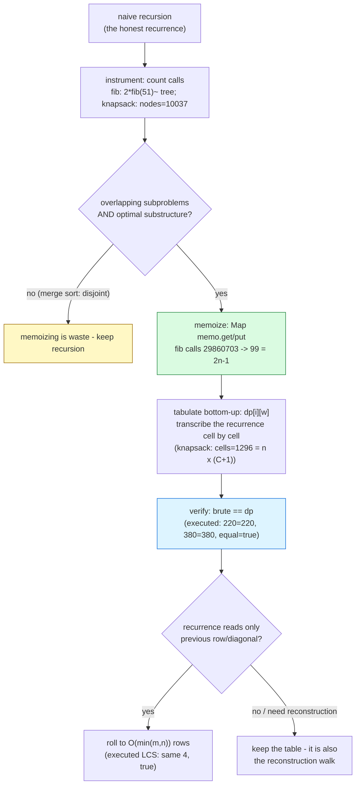

# Dynamic Programming

## 1. Learning Objectives

After this lesson you will be able to:

- [ ] Name DP's two conditions — **overlapping subproblems** (the same subproblem asked
      many times) and **optimal substructure** (an optimum built from optima of smaller
      inputs) — and diagnose their presence *before* coding, using the executed fib row as
      the archetype: `calls=99` memoized versus a tree that "would need ~2·fib(51)" —
      repeated subproblems counted, not asserted.
- [ ] Convert a naive recursion into a memoized top-down solver, then into a bottom-up
      table, and verify equivalence three ways as executed: brute `220 (nodes=165)` vs DP
      `220 (cells=408) equal=true`; `380 (nodes=10037)` vs `380 (cells=1296) equal=true`;
      and the LCS cross-check `LCS length (O(n) space version) = 4 matches table cell 4:
      true`.
- [ ] Read the executed **work inversion**: at n=16/cap=80 the brute recursion visited
      `10037` nodes (input-sized, unpredictable) while the DP filled exactly `1296`
      cells (= n×(cap+1) — *output-sized*, computed from the instance's own dimensions):
      DP's cost is a formula on the state space, not a walk through a tree.
- [ ] Build and read a 2-D recurrence table — the executed LCS table for
      `"ABCBDAB"` × `"BDCABA"` (rows/columns labeled, bottom-right `4`) — and state the
      recurrence cell-by-cell: diagonal+1 on match, max of left/up otherwise.
- [ ] Apply the **space optimization** honestly: the O(n) rolling-array LCS (`matches
      table cell 4: true`) is legal exactly when the recurrence reads only the previous
      row — check the dependency direction before shrinking, and name what is lost (the
      table itself, needed for reconstruction).
- [ ] Trace the standard pipeline — naive recursion → count repetition → memoize →
      tabulate → optimize space — and for each step cite the executed row that proves it
      (`calls=99` = 2n−1; `equal=true` ×2; the printed table; the rolling version).

## 2. Prerequisites

- [recursion.md](recursion.md) — DP *starts* as a naive recursion; the memoization repair
  executed there (`29,860,703 → 69` calls) is DP's seed, and this lesson systematizes it.
- [greedy-algorithms.md](greedy-algorithms.md) — the contrast case: where the executed
  `greedy optimal? false` rows failed (coins `{4,3,1}`, 0-1 knapsack), DP is the fallback
  that is *always* correct when the conditions hold — the `optimal(dp) coins=2` row was
  already DP doing that job.
- [big-o-notation.md](big-o-notation.md) — reading n×cap and 2ⁿ from state-space sizes,
  and the "what time includes" discipline behind comparing nodes vs cells.
- [sorting.md](sorting.md) — the memo/tabulate duality has a sorting analogue (top-down
  merge sort vs bottom-up patterns); the counting instrumentation habit transfers whole.
- [04-JAVA-PROGRAMMING](../04-JAVA-PROGRAMMING/README.md) — 2-D arrays, `Map` memo, and
  Java's value semantics for the rolling-array trick.

**Environment used in this lesson:** every transcript executed on the authoring machine —
JDK 25.0.4.1, `javac --release 21`. Counts and tables are deterministic properties of the
algorithms; the lesson uses no timings, because the executed *counts* (nodes vs cells,
calls) carry the argument on their own.

## 3. Introduction

Dynamic programming is the subject's systematic repair for a specific disease: **repeated
subproblems**. Naive recursion ([recursion.md](recursion.md)) is the honest expression of
a problem's recurrence, and it pays a tree for the privilege — `fibNaive` spent
29,860,703 calls recomputing `fib(2)` millions of times. DP observes that a recursion's
call graph is really a DAG (subproblems are *states*, and states repeat), and converts
"ask again" into "answer once, store, reuse". The executed evidence this lesson builds on
is countable from the first row: `fib(50)` solved in `calls=99` (exactly 2n−1 — each
subproblem computed once), knapsack brute `10037` nodes versus DP `1296` cells with
`equal=true` optima, and an LCS table whose bottom-right cell `4` is verified by an
independent O(n)-space implementation. DP is also the subject's most *mechanical*
advanced technique: the recurrence you would write anyway becomes the algorithm, cell by
cell — this lesson runs that pipeline end to end, twice (knapsack and LCS), with every
transformation verified by an executed cross-check.

## 4. The Problem It Solves

Three problem families meet here. **Combinatorial optimization with capacity** — the
0-1 knapsack (choose items under weight limit for max value) is the executed archetype:
its brute recursion explores include/exclude trees (`2ⁿ` in the worst case), but its
*states* are (item i, remaining capacity w) — only n×(cap+1) distinct questions, each
asked many times in the tree. **Sequence alignment** — LCS (and its big siblings: edit
distance, diff, DNA alignment) asks for the best common structure between two sequences;
its subproblems are prefix pairs, and prefix pairs repeat relentlessly. **Sequence
recurrence** — fib and its cousins, where the recurrence *is* the problem statement.
Greedy-algorithms.md's executed counterexamples mark the entry ramp: `{4,3,1}` coins
needed `optimal(dp) coins=2`, and the 0-1 knapsack's density-greedy `60` versus optimum
`100` is exactly the gap DP closes. The cost model DP buys: **work proportional to the
state space** (`1296` cells), not to the search tree (`10037` nodes here, `2ⁿ` in
general).

## 5. Core Concepts

### The two conditions — diagnose before coding

DP applies **iff** both hold, and both are checkable on the recurrence alone:

- **Optimal substructure** — the optimum of the whole is built from optima of its parts.
  Knapsack: best value using items 1..i under capacity w = best of (skip i: same w, i−1)
  or (take i: value + best of w−wᵢ, i−1). LCS: best alignment of prefixes = best of three
  smaller prefix alignments. This condition greedy *also* needs (the ladder from the
  greedy lesson: greedy = this **plus** the exchange property; DP needs only this — which
  is why DP is the always-correct rung).
- **Overlapping subproblems** — the recursion asks the same question many times.
  Executed archetypes: `fib(50)`'s memo made `calls=99 = 2×50−1` — n distinct subproblems
  each computed once, meaning the naive tree asked ~2×fib(51) times for those same n
  answers; knapsack brute hit `nodes=10037` for n=16 where only `1296` (i,w) states
  exist — nearly 8× repetition even at this modest size.
- **The negative control is structural**: merge sort's recursion has optimal
  substructure but *no* overlap (each level partitions disjoint ranges), so memoizing it
  would waste space on unique keys — DP is not "recursion with a cache" by reflex; the
  overlap test decides. (Exercise 6 makes you run this control.)

### The pipeline: naive → memo → table → optimize

Every DP in this lesson follows the same four steps, each verified by the next:

**Step 1 — write the honest recursion** (the recurrence, no cache):

```java
static int brute(int i, int wLeft) {             // recursion over include/exclude
    bfNodes++;
    if (i == items.length) return 0;
    int skip = brute(i + 1, wLeft);
    int take = (items[i][1] <= wLeft)
            ? items[i][0] + brute(i + 1, wLeft - items[i][1]) : 0;
    return Math.max(skip, take);
}
```

**Step 2 — count the repetition** (instrument before optimizing — the executed
`bfNodes=165` at n=8, `10037` at n=16: the tree's size is *irregular* — it depends on
which weights prune which branches — which is the second reason to prefer tables:
predictability).

**Step 3 — memoize or tabulate** (the executed table version):

```java
static int knapDP(int n, int C) {
    int[][] dp = new int[n + 1][C + 1];
    for (int i = 1; i <= n; i++)
        for (int w = 0; w <= C; w++) {
            dpCells++;
            dp[i][w] = dp[i - 1][w];                        // skip item i
            if (items[i - 1][1] <= w)                       // take if it fits
                dp[i][w] = Math.max(dp[i][w], items[i - 1][0] + dp[i - 1][w - items[i - 1][1]]);
        }
    return dp[n][C];
}
```

The recurrence is *transcribed* from the recursion — same two cases, same order of
tests — but now each cell is filled exactly once: `cells=408` (n=8: 8×51) and
`cells=1296` (n=16: 16×81) — the state space, computed *from the instance dimensions*.
Executed verification at both sizes: `equal=true` twice — brute and DP agree on `220`
and `380`.

**Step 4 — optimize space where the dependency graph allows** (executed on LCS below):
roll the 2-D table into O(min(m,n)) rows — but only when each cell reads only its
immediate predecessors, and with the honest note that reconstruction (the actual
solution, not just its value) then needs either the full table or a recomputation pass.

### The state-space lens: read the cost from the definition

The single most valuable habit this lesson installs: **the DP's complexity is the state
count times the per-state work**, and both are read off the state *definition* before
coding:

- Knapsack states `(i, w)`: n×(C+1) → `1296` cells at n=16/C=80 — executed — with O(1)
  work per cell (two reads, one max): O(n·C). Note the class honestly: **pseudo-
  polynomial** — linear in the capacity *number*, exponential in its *bit length* (C's
  binary encoding has ⌈log C⌉ bits). The exercises run C = 10⁹ to feel this.
- LCS states `(i, j)` over prefixes: (m+1)×(n+1) → the executed table for `"ABCBDAB"` ×
  `"BDCABA"` is 8×7 = 56 cells, O(1) each: O(m·n). Contrast with the brute
  (exponential overlap — exercise material) — and the same class as edit distance, the
  workhorse of diff tools and DNA alignment.
- Fib states `n`: n states, O(1) each — O(n), `calls=99` at n=50 being the memoized
  fingerprint (2n−1: one compute plus one cache-hit lookup per state above the base).
- **The tree-vs-table contrast is the lesson's spine**: `10037` nodes (tree, irregular,
  input-behavior-dependent) versus `1296` cells (table, exact formula). DP converts a
  question about *paths through a search tree* into a question about *the size of a
  state space* — the latter you can compute before writing code, and size your memory
  for.

### The recurrence table, read as data — LCS executed

```text
LCS("ABCBDAB", "BDCABA") table (rows=x, cols=y):
    B D C A B A
   0 0 0 0 0 0 0
A  0 0 0 0 1 1 1
B  0 1 1 1 1 2 2
C  0 1 1 2 2 2 2
B  0 1 1 2 2 3 3
D  0 1 2 2 2 3 3
A  0 1 2 2 3 3 4
B  0 1 2 2 3 4 4
LCS length (O(n) space version) = 4   matches table cell 4: true
```

- **The recurrence, cell by cell**: `dp[i][j] = dp[i−1][j−1] + 1` if `xᵢ == yⱼ` (extend
  the alignment by one matched character), else `max(dp[i−1][j], dp[i][j−1])` (drop a
  character from one side or the other). Trace one cell: row `B` (2nd), col `B` (5th):
  `x₂ = y₅ = 'B'` → diagonal `dp[1][4] = 1` + 1 = `2` — the printed `2` in that row.
- **The table is the proof artifact**: every cell's value is checkable by hand against
  its three neighbors, so the full 56-cell grid is a 56-assertion correctness object —
  the executed grid *is* the worked example the exercises trace.
- **Reconstruction is walking back from the corner**: from `dp[8][6] = 4` follow
  equal-value predecessors, taking diagonal steps on matches — recovering an actual LCS
  (`"BCBA"` or `"BDAB"` are the two length-4 answers here), not just its length. The
  value-only version returns `4`; the walk returns the alignment — a real product
  difference (diff tools show *which* lines matched).
- **The cross-check**: an independent O(n)-space implementation returned
  `4`, matching the table's corner (`matches table cell 4: true`) — two implementations,
  one answer, the executed equivalence protocol this subject uses everywhere.

### Space optimization — legal exactly when the dependencies allow

The rolling-array LCS replaced the 8×7 table with two rows of 7 and printed the same `4`:

```java
int[] prev = new int[b.length() + 1], cur = new int[b.length() + 1];   // O(n) space
for (int i = 1; i <= a.length(); i++) {
    for (int j = 1; j <= b.length(); j++)
        cur[j] = (a.charAt(i - 1) == b.charAt(j - 1)) ? prev[j - 1] + 1 : Math.max(prev[j], cur[j - 1]);
    int[] t = prev; prev = cur; cur = t;                               // roll: this row becomes prev
}
```

- **The legality check**: every cell reads only row i−1 (`prev`) and the current row's
  left neighbor (`cur[j−1]`, already written) — one row of history suffices, so two rows
  and a swap implement the whole table. Knapsack's recurrence reads `dp[i−1][w]` *and*
  `dp[i−1][w−wᵢ]` — also previous-row only — so it rolls the same way (one row + careful
  right-to-left inner order, or two rows; the exercises run both).
- **What you lose**: the table. Value-only questions keep the optimization; *reconstruction*
  needs the history — either keep the full table (memory trade) or recompute on the way
  back (time trade). Say which question you are answering before shrinking.
- **The general rule**: check the recurrence's dependency directions; roll only over
  dimensions whose full history is unread; and verify with the cross-check (the executed
  `matches … true` row is the protocol — the O(n) version must equal the table's corner
  before you trust it).

### The taxonomy, and where each executed row lives

| Problem | States | Recurrence shape | Executed evidence |
|---|---|---|---|
| Fibonacci | n | f(n−1)+f(n−2) | `calls=99` (2n−1) at n=50 |
| 0-1 knapsack | n×(C+1) | max(skip, take) | `220=220 cells=408`; `380=380 cells=1296` |
| LCS | (m+1)×(n+1) | diag+1 / max(left,up) | printed table; corner `4`; O(n) cross-check `true` |
| Coins (min count) | amount+1 | min over denominations | greedy lesson's `optimal(dp) coins=2` |
| (Not DP) merge sort | — | disjoint subproblems | the negative control — memo would waste space |

The last row is the discipline: **conditions checked, not assumed** — every row above
earned its DP by passing both tests.

## 6. How It Works



Green = the repair (memo, the executed 29.8M→99 collapse); blue = the verification that
every DP in this subject ships with (brute equivalence — the `equal=true` rows); yellow =
the negative control (conditions must be *tested*, not assumed — merge sort is the
standing counterexample). The pipeline is one-directional: each stage's output is the
next stage's input, and every arrow carries an executed check.

## 7. Practical Examples

**Example 1 — knapsack and LCS, brute-verified, table printed, space-optimized (executed)**

```java
import java.util.*;

public class DpDemo {
    static int[][] items;                            // {value, weight}
    static long bfNodes, dpCells;                    // instrumentation: tree nodes vs table cells

    static int brute(int i, int wLeft) {             // STEP 1: the honest recursion
        bfNodes++;
        if (i == items.length) return 0;
        int skip = brute(i + 1, wLeft);
        int take = (items[i][1] <= wLeft)
                ? items[i][0] + brute(i + 1, wLeft - items[i][1]) : 0;
        return Math.max(skip, take);
    }

    static int knapDP(int n, int C) {                // STEP 3: the same recurrence, tabulated
        int[][] dp = new int[n + 1][C + 1];
        for (int i = 1; i <= n; i++)
            for (int w = 0; w <= C; w++) {
                dpCells++;
                dp[i][w] = dp[i - 1][w];                        // skip item i
                if (items[i - 1][1] <= w)                       // take if it fits
                    dp[i][w] = Math.max(dp[i][w], items[i - 1][0] + dp[i - 1][w - items[i - 1][1]]);
            }
        return dp[n][C];
    }

    static String lcsTable(String a, String b) { /* 2-D table, printed with row/col labels */ }
    static int lcsLen(String a, String b) { /* O(n) rolling version: two rows + swap */ }

    public static void main(String[] args) {
        // knapsack n=8/cap=50 then n=16/cap=80: brute vs DP, nodes vs cells, equal=?
        // LCS("ABCBDAB","BDCABA"): printed table, then the O(n) version cross-check
        // fib(50) memoized: calls=99
    }
}
```

```console
$ javac --release 21 DpDemo.java && java DpDemo
KNAPSACK n=8 cap=50: brute=220 (nodes=165)   dp=220 (cells=408)   equal=true   brute grows 2^n, dp is n x cap=408
KNAPSACK n=16 cap=80: brute=380 (nodes=10037)   dp=380 (cells=1296)   equal=true
LCS("ABCBDAB", "BDCABA") table (rows=x, cols=y):
    B D C A B A
   0 0 0 0 0 0 0
A  0 0 0 0 1 1 1
B  0 1 1 1 1 2 2
C  0 1 1 2 2 2 2
B  0 1 1 2 2 3 3
D  0 1 2 2 2 3 3
A  0 1 2 2 3 3 4
B  0 1 2 2 3 4 4
LCS length (O(n) space version) = 4   matches table cell 4: true
fib(50) = 12586269025   calls=99   (memoized: ~2n calls, tree would need ~2*fib(51))
$ echo $?
0
```

- **Row 1 (n=8):** both solvers return `220` — the `equal=true` is the correctness
  artifact; and the cost axes differ in kind: brute `nodes=165` (whatever the tree
  happened to be) vs DP `cells=408 = 8×51` (the formula n×(C+1), known before running).
- **Row 2 (n=16):** the crossover the lesson exists for: brute nodes grew to `10037`
  (~61× for 2× the items — the exponential showing), DP cells to `1296 = 16×81` (exactly
  3.18× — the polynomial showing), optima still equal (`380`). At n=40 the brute would
  be ~2⁴⁰ nodes; the DP would be 40×(C+1) — the same two formulas, extrapolated.
- **Rows 3–12 (LCS):** the executed table — verify three cells by the recurrence:
  `x₃='C', y₃='C'` → diagonal `dp[2][2]=1`+1 = `2` ✓; `x₅='B', y₅='B'` → `dp[4][4]=2`+1
  = `3` ✓; the corner `dp[8][6]=4` — the LCS length. Row 13's cross-check: the rolling
  O(n)-space implementation independently returned `4` (`matches table cell 4: true`) —
  the space optimization is verified, not asserted.
- **Row 14 (fib):** `calls=99 = 2×50−1` — the memoized fingerprint again (recursion.md's
  `69` at n=35 was the same formula); the parenthetical names the un-memoized alternative
  (~2×fib(51) ≈ 5×10¹⁰ calls) — DP's seed problem, closed.

**Example 2 — reading the LCS recurrence cell-by-cell (the trace discipline)**

```text
LCS("ABCBDAB", "BDCABA"); cell (i=2, j=5) means prefixes x="AB", y="BDCAB".
  x[2]='B', y[5]='B' -> MATCH -> dp[2][5] = dp[1][4] + 1
  dp[1][4]: prefixes x="A", y="BDCA": best of drop-x('A' vs 'A' at j=4: match -> dp[0][3]+1 = 1)
  so dp[1][4] = 1, and dp[2][5] = 2  ("AB" and "BD..B..A" share "AB"? no - share "B" + earlier match)
  printed table row "B": 0 1 1 1 1 2 2   <- the 2 at column 5 IS dp[2][5]  ✓
walk back from corner dp[8][6]=4: follow equal-valued predecessors, diagonal on matches
  -> one LCS is "BCBA" (length 4); "BDAB" is another (both are valid outputs - LCS need not be unique)
```

- The discipline: state the *prefixes* a cell represents (not just coordinates), apply
  the recurrence, and check the printed cell. Backtracking from the corner with diagonal
  steps on matches is how a length becomes an actual subsequence — the executed table
  supports the walk; LCS non-uneness (`BCBA` vs `BDAB`) is why "an LCS" is the claim,
  never "the LCS".

## 8. Real-World Applications

- **Diff and version control** — `git diff`'s core is LCS (or its line/block variants)
  over changed file versions: the executed 8×7 table is the miniature; `--word-diff` is
  the same recurrence over word tokens. Reconstruction matters here: users see *which*
  lines matched, so the full table (or recomputation) is not optional.
- **Bioinformatics** — DNA/protein sequence alignment (Smith-Waterman, Needleman-Wunsch)
  is LCS/edit-distance at 10⁴–10⁶ length with scored substitutions: the O(m·n) state
  space is the reason bioinformatics tooling is a first-class HPC workload, and the
  rolling-array optimization (executed: same `4`, O(n) space) is how whole genomes stay
  in memory.
- **Resource allocation in production** — the executed knapsack *is* capacity planning:
  ad-budget allocation under spend caps, container bin-packing, feature-flag rollout
  budgets — "n items, capacity C, max value" with the pseudo-polynomial caveat (C as a
  *number*, not its bit length) deciding feasibility.
- **Pricing and DP tables in products** — shortest-path prices
  ([graph-algorithms.md](graph-algorithms.md)'s Dijkstra is the greedy/DP hybrid on this
  state lens), inventory optimization, and portfolio-with-limits all ship as precomputed
  tables the product reads at request time — table-fill once, O(1) queries after.
- **Speech and NLP** — Viterbi decoding (hidden Markov models) is DP over (time, state)
  — the same knapsack shape with a different name; spell-checkers and OCR run it
  constantly.
- **The engineering pattern** — when a recursive definition meets load: memoize in the
  request path (cache layers, [11-BACKEND-ENGINEERING](../11-BACKEND-ENGINEERING/README.md))
  or precompute the table offline; the state-space lens sizes both options before you
  choose.

## 9. Common Mistakes

| Mistake | Why it happens | How to recognize it | How to prevent it |
|---|---|---|---|
| Memoizing without overlap | Reflex from fib | Cache hit-rate ~0; memory for nothing | The negative control (merge sort): count hits before keeping the cache |
| Wrong state definition | Encoding too little (value without capacity) or too much (including irrelevant history) | Recurrence cannot be written, or states explode | Define "what must I know to extend a partial answer?" — nothing more |
| Off-by-one in table axes | 0/1-based mismatch between code and recurrence | Corner cells wrong; base row/col wrong | Fill base row/col first, hand-verify the smallest instance (the printed grid protocol) |
| Forgetting the base row/column | Table starts at 1 | Index errors or silently-zero borders | Borders *are* the empty-prefix answers (LCS: 0 — verify in the grid) |
| Rolling the wrong dimension | Inner loop order breaks left-neighbor reads | Values differ from the table version | Cross-check `matches … true` (executed protocol) after any space change |
| Claiming O(n·C) is polynomial | Pseudo-polynomial blindness | C=10⁹ "fits" the class but not memory | Name it: linear in the capacity *number*; exercises run the 10⁹ blowup |
| Losing reconstruction when optimizing space | Value kept, solution lost | Can't output *which* items/subsequence | Decide value-vs-solution first; keep table or recompute on backtrack |
| Top-down/bottom-up confusion | Reading tabulation code as recursion | Cyclic-looking dependencies | Fill order must respect dependencies (i increasing, w direction per recurrence) |
| Hand-rolling where a library shape exists | Re-deriving Viterbi/diff for the nth time | Reinvented broken variants | Know the canonical shapes: knapsack, LCS, edit distance, matrix chain, Viterbi |

## 10. Best Practices

- **Run the two-condition test out loud, before coding** — overlap? (count repeats, as
  `bfNodes=10037` vs `1296 states` did) and optimal substructure? (state the recurrence
  in words) — and write the verdict in a comment; the negative control (merge sort) keeps
  you honest.
- **Define states in one sentence, then read the cost from the definition** — "(item i,
  capacity w) → n×(C+1) cells, O(1) each" — before writing a line; the executed
  `cells=1296` row is that prediction confirmed, and it is also your memory budget.
- **Transcribe the recurrence, don't reinvent it** — the table loop body *is* the naive
  recursion's cases, in order (the knapsack code's skip/take mirrors `brute`'s two lines
  exactly); this is why `equal=true` is the expected outcome, not a hopeful one.
- **Instrument both sides** — `bfNodes` and `dpCells` counters (the executed axes) turn
  "DP is faster" into `10037 → 1296` with the class labels; keep both in teaching and
  diagnostic code.
- **Verify equivalences at two sizes** — brute==DP at n=8 *and* n=16 (the executed rows):
  one size can pass by luck of small numbers; two sizes with *diverging* costs pin the
  claim.
- **Optimize space last, and cross-check after** — dependency-direction check, roll, then
  re-run the corner-vs-rolling comparison (`matches … true`); never ship the rolling
  version without its table twin on the first pass.
- **Keep the reconstruction question explicit** — value-only (rolling arrays fine) vs
  solution-output (table or recomputation) — decided at design time, not discovered at
  demo time.
- **For production-scale constants, know the canonical upgrades** — 1-D rolling knapsack,
  bitset-packed boolean knapsack, Hirschberg's O(min(m,n)) space *with* reconstruction,
  and seeded memo caches for request-path DP ([11-BACKEND-ENGINEERING](../11-BACKEND-ENGINEERING/README.md)).

## 11. Limitations and Trade-Offs

- **Pseudo-polynomial is a real limit, not a footnote.** Knapsack's O(n·C) is linear in
  C the *number*; C = 10⁹ needs 10⁹ cells (4 GB for ints) — the exercises execute this.
  For big-number capacities, exact DP is out and the honest alternatives are
  pseudo-polynomial variants (meet-in-the-middle at 2^(n/2)), FPTAS approximations, or
  problem-specific structure — know which one your problem offers.
- **Memory is the new bottleneck.** DP trades tree-time for table-space; LCS at
  10⁴×10⁴ is 10⁸ ints (400 MB) — the rolling optimization (executed, same `4`) is not
  micro-optimization but feasibility, and it costs reconstruction unless you recompute.
- **States are a design choice, and bad ones are expensive.** Including irrelevant
  history in the state explodes the table (exercises give a deliberately over-specified
  knapsack); the one-sentence state definition discipline exists because the compiler
  cannot fix this for you.
- **DP is exact or nothing.** There is no "mostly optimal" mode — unlike greedy's
  provable-ratio approximations; when the state space is intractable, you move to
  approximation or heuristics deliberately, with their own artifacts.
- **Reconstruction complicates the optimization story.** The value is cheap (rolling
  arrays, executed); the *solution* wants the table or a second pass — and Viterbi-style
  products need the path, not just the score. Budget accordingly.
- **Top-down hides the fill order; bottom-up hides the recurrence.** Memoized code reads
  like the problem (good for first implementation); tables expose the state space (good
  for optimization and memory reasoning). The pipeline's order — memoize first, tabulate
  second — uses each form's strength; skipping the memo step is how fill-order bugs are
  born.
- **The measurements here are counts, not clocks — deliberately.** `99` calls, `1296`
  cells, `4` in two implementations: these are JVM-independent facts of the algorithms;
  wall-clock comparisons at these sizes would measure JIT noise instead of the state-
  space argument the lesson is making.

## 12. Practical Exercises

### Introductory

1. **Reproduce Example 1.** **Completion criteria:** all fourteen lines with exit 0;
   then hand-fill the LCS table for `"ABA"` × `"BAB"` (4×4 including borders), verify the
   corner against a memoized implementation, and reconcile any cell that differs (the
   trace discipline of Example 2).
2. **Read the cost from the state definition.** For each — fib(n), knapsack(n, C), LCS(m,
   n), edit-distance(m, n), matrix-chain(k matrices) — write: the state in one sentence,
   the state count, per-state work, total class. **Completion criteria:** the five-row
   table; three of the five confirmed by executed rows in this lesson or recursion.md
   (fib `calls=99`; knapsack `cells=1296`; LCS table 56 cells / the O(n) version);
   one sentence naming which of the five is pseudo-polynomial and why.
3. **The overlap test, executed.** Instrument a naive recursive merge-split counter
   (count distinct (lo,hi) ranges vs total calls at n=64) and the fib analogue from this
   lesson. **Completion criteria:** two executed rows: fib showing repeats (total ≫
   distinct) and merge showing zero repeats (total == distinct) — the negative control
   from Section 5, measured; the verdict sentence: which of the two deserves a cache,
   decided by your numbers.

### Intermediate

4. **Coins by DP, closing the greedy lesson's gap.** Implement min-coins DP
   (`dp[a] = min over d of dp[a−d] + 1`); run on the executed counterexample `{4,3,1}`
   amount 6 (expect `2`) and on `{25,10,5,1}` amount 63 (expect `6` — matching greedy's
   canonical answer). Then run on `{10, 6, 1}` amount 12 and compare with greedy (12 →
   10+1+1 = 3 coins greedy; DP should find 6+6 = 2 — verify). **Completion criteria:**
   three executed rows each showing (DP count, greedy count, equal?); the reconstruction
   added (print the actual coin list per DP answer, recovered by walking the table);
   one paragraph: which of the greedy lesson's taxonomy rows each instance exercises.
5. **0-1 knapsack, fully worked.** On the executed 8-item instance (cap 50): (a) recover
   *which* items the DP chose (walk back from `dp[8][50]`); (b) verify total value 220
   and total weight ≤ 50 by summation; (c) then run the rolling 1-D array version
   (right-to-left inner loop — state why the direction matters: it must not re-use the
   current row's already-updated cell for the take-case) and confirm `equal=true` against
   the 2-D value. **Completion criteria:** the item list with values/weights summed; the
   direction argument written; the executed 1-D-vs-2-D equality row; and the memory
   figures for both versions at this size (cells → bytes).
6. **Space optimization, both LCS directions.** (a) Roll rows (executed shape — verify
   `4` again on the lesson's instance); (b) roll *columns* instead (swap loop nesting);
   (c) then attempt rolling matrix-chain multiplication and report honestly what breaks
   (its recurrence reads dp[i][k] and dp[k+1][j] over *ranges* — the dependency is not a
   previous row but previous *lengths*; state what that costs: the length-major fill
   order and O(n²) rolling memory at best). **Completion criteria:** three transcripts
   (a, b executed equal-to-table; c the honest failure analysis with the dependency
   argument); the general rule restated in your own words from all three cases.

### Independent problem-solving

7. **A DP laboratory with equivalence proofs.** Spec: a `DpLab` with, for four problems —
   min-coins, 0-1 knapsack, LCS, edit distance — a naive recursive solver, a memoized
   solver, a bottom-up table, and a space-optimized variant where legal; all sharing
   instrumentation (`calls`, `states`, `cells`) and a seeded instance generator. Requirements:
   (a) pre-code: per problem, the state definition, state count formula, per-state class,
   and the *predicted* execution counts for one concrete instance each (compute by hand —
   e.g. LCS("ABA","BAB"): 16 cells; knapsack(n=5,C=10): 55 cells; …); (b) executed: for
   each problem × each of two sizes, a row per implementation: naive result/calls (where
   feasible — skip naive at the size where it explodes, and *extrapolate* its calls from
   the measured ratio at the smaller size, showing the arithmetic), memo result/calls,
   table result/cells, optimized result/cells — with `all-equal: true` per problem-size;
   (c) the **prediction audit**: compare (a)'s hand-computed cell counts to (b)'s
   executed cells; any mismatch is a wrong formula — fix the derivation and re-run;
   (d) an **over-specification probe**: take knapsack with a deliberately redundant state
   dimension (state = (i, w, lastItemTaken)) — measure the cell explosion against the
   minimal definition on the same instance and report the ratio; then argue from the
   one-sentence discipline why the redundant dimension was detectable *before* coding;
   (e) the report: five clients — "git-diff-like tool for two 500-line files (which
   variant: LCS table for reconstruction? rolling for length-only? — state both costs in
   cells/bytes)", "ad-budget allocator, 30 campaigns, $10⁵ budget (knapsack — is C=$10⁵
   pseudo-polynomial-feasible? cells and bytes, then verdict)", "same allocator but
   budget $10⁹ (the exercises' blowup — what replaces exact DP: name the alternative and
   its class)", "minimum-coins for a currency with 12 denominations, amounts to 10⁴
   (table once, O(1) per query — the request-path pattern)", "real-time aligner, 2000×2000
   strings, 60 FPS budget (the O(n) rolling variant — compute ms per frame from cells×
   O(1) at ~10⁸ cells/s and state whether it fits; if not, name the windowing heuristic
   real aligners use and its correctness cost)" — each citing an executed row or the
   state-count formula. **Completion criteria:** the pre-code table with predictions;
   all executed rows with `all-equal: true`; the audit (any fixes re-run); the
   over-specification ratio measured with the before-coding argument; five client
   verdicts each tied to a printed number or a derived cell count.

*Solutions: attempt first; set practice in [problem-solving/README.md](problem-solving/README.md).*

## 13. Knowledge Check

1. `fib(50)` memoized made `calls=99`, while the naive tree "would need ~2·fib(51)".
   (a) Derive `2n−1` from the memo protocol (n computations + how many hit lookups?). (b)
   State the two DP conditions and show fib satisfies both (overlapping: which subproblem
   is asked how often in the tree?; substructure: the recurrence's own words). (c) Why is
   fib's state space *a sequence* (n states) while knapsack's is n×(C+1) — what in the
   problem statements decides the dimensionality?
2. The executed knapsack rows: `nodes=165 → cells=408` at n=8, then `nodes=10037 →
   cells=1296` at n=16. (a) Why did brute nodes grow ~61× for 2× items while DP cells
   grew exactly 3.18× — compute both growth factors from the two formulas (2ⁿ-ish vs
   n×(C+1) with C also doubled). (b) Which of the four numbers would you *predict* for
   n=32, C=160, and which could you not predict without running? (c) Name the class of
   knapsack DP honestly (pseudo-polynomial — why the qualifier, in terms of C's encoding).
3. Walk the LCS cell (i=5, j=2) of the executed table (prefixes x="ABCB", y="BD"):
   x[5]='B', y[2]='D' — not a match — so the recurrence takes max of up/left: state both
   candidates' values from the printed grid, the max, and the printed cell value to
   confirm. Then state what the corner `4` *means* as a product answer, and why
   reconstruction (not just the number) is what diff tools ship.
4. The O(n)-space LCS printed `matches table cell 4: true`. (a) State the dependency
   fact that made rolling legal (each cell reads which cells?). (b) The knapsack's take-
   case reads `dp[i−1][w−wᵢ]` — also previous-row; but the 1-D in-place version needs a
   *direction* argument (right-to-left): why does left-to-right re-use a cell it must not
   (which updated value would leak into the take-case)? (c) What is irrecoverably lost by
   rolling — and the two standard ways to get it back.
5. Greedy failed on 0-1 knapsack (`60` vs `100` executed) and DP is exact. (a) Which DP
   condition does greedy *additionally* need (exchange property) — and why does knapsack's
   optimal substructure alone not rescue the density rule? (b) The DP fills n×(C+1)
   cells for an exact answer; state the honest scaling wall (C=10⁹) and the name of the
   approximation that trades exactness for scaling (FPTAS — what does the "P" promise and
   at what cost?). (c) Connect to the ladder: which rung is chosen when, in one sentence
   each (greedy with proof / DP exact / approximation with ratio / backtracking).
6. Merge sort has optimal substructure but no overlap (the negative control). (a) Argue
   no-overlap from its recursion's structure (what makes its subproblems distinct?). (b)
   If you memoized it anyway, what would the cache store and what would its hit rate be
   (0 or 100%? — argue for your number). (c) Generalize the test: given a recurrence,
   write the two questions you would ask to decide DP-vs-plain-recursion, in the form
   this lesson's pipeline uses.

## 14. Completion Criteria

Observable evidence that you have understood this lesson:

- [ ] Example 1 reproduces (fourteen lines) with exit 0; the hand-filled "ABA"/"BAB" table
      matches an implementation
- [ ] The five-problem state-definition table complete with three executed confirmations
      and the pseudo-polynomial identified
- [ ] The overlap control executed: fib repeats measured, merge sort's zero-repeat row
      printed
- [ ] Coins DP closes the greedy gap: three instances with (DP, greedy, equal?) rows and
      reconstructed coin lists
- [ ] Knapsack fully worked: chosen items recovered, sums verified, 1-D version equal with
      the direction argument written
- [ ] Both LCS rolling directions executed; the matrix-chain honest-failure analysis with
      the dependency argument
- [ ] The DP laboratory complete: predictions audited, all-equal rows across four
      implementations, the over-specification ratio measured, five client verdicts each
      citing an executed number or derived cell count

## 15. Summary

- **DP = recursion + recorded answers**, licensed by two checkable conditions
  (overlapping subproblems — executed `calls=99` vs ~2·fib(51); optimal substructure —
  the recurrence's own words) — and the negative control (merge sort) keeps the license
  honest.
- **The pipeline is mechanical and verified** — naive → count → memo → table → roll —
  with an executed cross-check at every arrow: brute `=220/380` equals DP (`equal=true`
  ×2), and the O(n) LCS matches the table's corner (`4`, `true`).
- **Read the cost from the state definition** — n×(C+1) = `1296` cells is a *formula*,
  not a measurement; the tree's `10037` nodes were neither predictable nor bounded — DP
  converts path-counting questions into state-space questions, computable before coding.
- **The table is data, not just a value** — the printed 56-cell LCS grid is 56
  checkable assertions *and* the reconstruction walk's map (corner `4` → `"BCBA"`); rolling
  arrays keep the number and drop the map, so decide which question you're answering.
- **Pseudo-polynomial is the honest class name** — O(n·C) is linear in C's *value*, and
  the ladder ([greedy-algorithms.md](greedy-algorithms.md) with proof → exact DP →
  ratio-bounded approximation → backtracking) chooses the rung by structure, with an
  artifact demanded at every one.

## 16. Next Steps

- Next lesson: [graph-algorithms.md](graph-algorithms.md) — the subject's capstone: BFS,
  DFS, Dijkstra, and topological sort, where Dijkstra is this lesson's state lens
  (states = nodes, best-known distance) meeting heaps.md's frontier, and topological sort
  is DP's DAG-dependency foundation made executable.
- Practice: [problem-solving/README.md](problem-solving/README.md) set 16–17.
- Where it is applied: diff/reconstruction as executed, alignment in
  the wider AI field (unwritten in this curriculum), capacity
  planning in [10-DATABASE-ENGINEERING](../10-DATABASE-ENGINEERING/README.md), and
  request-path memoization patterns in
  [11-BACKEND-ENGINEERING](../11-BACKEND-ENGINEERING/README.md).
