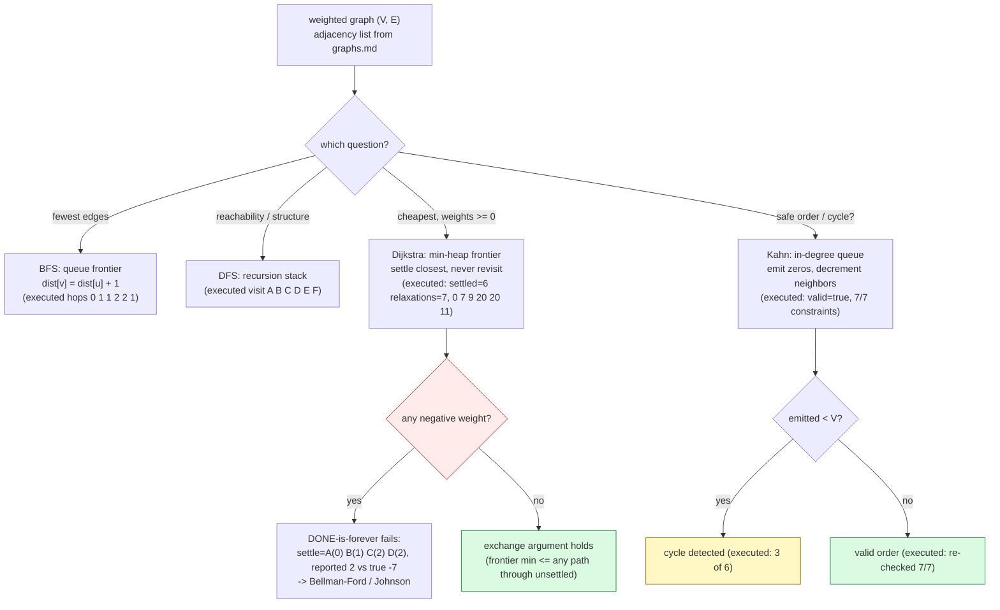

# Graph Algorithms

## 1. Learning Objectives

After this lesson you will be able to:

- [ ] Implement **BFS** and **DFS** and state exactly what each guarantees: BFS computes
      *fewest-edge* paths level by level (executed: hop distances `0 1 1 2 2 1`, path
      `A F E` — ignoring weights by design), DFS visits in depth-first order
      (`A B C D E F`) and is the skeleton of cycle detection, topological sort, and
      connected-components machinery — both with O(V + E) visited-set discipline from
      [graphs.md](graphs.md)'s representations.
- [ ] Implement **Dijkstra** with the lazy-deletion min-heap frontier and read its
      executed evidence on the lesson graph: `settled=6 relaxations=7`, distances
      `0 7 9 20 20 11`, path `A C F E` — hand-verified against the nine input edges, with
      the class `O((V + E) log V)` via the heap.
- [ ] Explain Dijkstra's non-negative-weight precondition **by mechanism, from the
      executed failure**: on the directed graph `A→B(1), A→C(2), C→B(−10), B→D(1)` the
      algorithm settled `A(0) B(1) C(2) D(2)` and reported `A→D = 2` where the true
      optimum is `−7` — because B was *settled at 1* before C's −10 arrived, and settled
      is forever; the fix for negative weights ([dynamic-programming.md](dynamic-programming.md)'s
      Bellman-Ford) is named, not re-derived here.
- [ ] Implement **topological sort** (Kahn's algorithm) and read its two executed rows:
      `Prog -> DB -> Web -> Algo -> OS -> DS valid=true` with every one of the 7
      constraints independently re-checked (`edge check … true`), and the cycle case
      emitting `3 of 6 … cycle detected=true` — cycle detection is *emitted < V*, an
      invariant, not an exception path.
- [ ] Connect each algorithm to its frontier structure — BFS's queue
      ([queues.md](queues.md)), DFS's stack/recursion ([stacks.md](stacks.md),
      [recursion.md](recursion.md)), Dijkstra's heap ([heaps.md](heaps.md)), topological
      sort's in-degree queue — so the algorithm's class follows from the structure it
      extracts from.
- [ ] Choose the algorithm by question: fewest hops → BFS; reachability/structure → DFS;
      cheapest weighted path with non-negative weights → Dijkstra; safe build order or
      cycle check → topological sort; and know the one-line reason each *wrong* choice
      fails (executed: BFS ignoring weights gave `A F E` where weighted optimum is
      `A C F E`).

## 2. Prerequisites

- [graphs.md](graphs.md) — representations (the adjacency list used here), degree/
  handshake invariants, and the O() vocabulary; this lesson runs algorithms *on* that
  substrate.
- [queues.md](queues.md) / [stacks.md](stacks.md) — BFS is a queue discipline, DFS a
  stack one; the executed visit orders are those disciplines' outputs.
- [heaps.md](heaps.md) — Dijkstra's frontier is the min-heap executed there (`poll order`
  and the lazy-deletion pattern from the PriorityQueue comparison).
- [dynamic-programming.md](dynamic-programming.md) — the state lens Dijkstra inherits
  (states = vertices, "best known distance so far") and the named fallback for negative
  weights (Bellman-Ford).
- [backtracking.md](backtracking.md) — the contrast for path *enumeration*: shortest-
  path asks for one optimum; enumerating all simple paths is backtracking's tree.

**Environment used in this lesson:** every transcript executed on the authoring machine —
JDK 25.0.4.1, `javac --release 21`. Counts, orders, distances, and paths are deterministic
properties of the algorithms and the fixed input graphs.

## 3. Introduction

This is the subject's capstone, and it is deliberately a convergence. BFS needs only a
queue ([queues.md](queues.md)) and a visited set ([hash-tables.md](hash-tables.md)); DFS
needs only recursion ([recursion.md](recursion.md)); Dijkstra is the greedy frontier
([greedy-algorithms.md](greedy-algorithms.md)) riding a heap ([heaps.md](heaps.md)) over
a graph representation ([graphs.md](graphs.md)); topological sort is Kahn's BFS with
in-degrees — the structure that makes build orders and cycle detection one algorithm.
Every executed row in this lesson carries at least two earlier lessons' machinery, and the
lesson's second job is the failure rows: BFS's hop path (`A F E`) differing from the
weighted optimum (`A C F E`), and Dijkstra reporting `2` where the true answer is `−7` —
both wrong *by design* for their inputs, both printed so the boundary of each algorithm
is evidence rather than folklore.

## 4. The Problem It Solves

Four questions, four algorithms, one substrate. **How few edges to get there?** — BFS's
level sweep; the executed hop distances (`0 1 1 2 2 1`) count edges, not meters. **What
is reachable, and in what order do we see it?** — DFS's depth-first walk, the seed of
cycle detection and component labeling. **What is the cheapest way there when costs are
non-negative?** — Dijkstra's settled frontier; the executed `0 7 9 20 20 11` is the
all-destinations answer from A on the 6-vertex lesson graph, and the `A C F E` path is
what a routing table would store. **In what order can dependent things run?** — topological
sort; the executed course order `Prog -> DB -> Web -> Algo -> OS -> DS` satisfies all 7
prerequisite constraints (independently re-verified), and the cycle run shows the
invariant that turns ordering into validation (`emitted 3 of 6 → detected`). These are the
questions every system asks under its own vocabulary: network hops, service dependency
rollouts, GPS routing, build systems, and scheduler run queues.

## 5. Core Concepts

### BFS: levels first — the queue is the algorithm

BFS explores by *distance in edges*: dequeue u, enqueue undiscovered neighbors, record
`dist[v] = dist[u] + 1`. The executed rows:

```text
BFS from A: visit order=A B C F D E
BFS hop distances     : 0 1 1 2 2 1   (edge weight ignored by design)
BFS path A->E         : A F E
```

- **Order = queue discipline**: A's neighbors (B, C, F in adjacency-list order) enter the
  queue together, so all hop-1 vertices are visited before any hop-2 vertex — the visit
  order `A B C F D E` *is* the level structure made visible.
- **The guarantee**: first time a vertex is seen, the path used is fewest-edges (each
  level extends the frontier by exactly one edge). Hop distances `0 1 1 2 2 1` and the
  parent-pointer path `A F E` are that guarantee's outputs.
- **The deliberate blindness**: weights are not read — `A F E` costs 14+9 = **23** while
  the weighted optimum `A C F E` costs 9+2+9 = **20** (Dijkstra's row below). BFS answers
  the *hop* question exactly and the *cost* question not at all; the pair of executed rows
  is the honest side-by-side.
- **Cost**: the visited-set discipline from [graphs.md](graphs.md) — O(V + E), each
  vertex enqueued once, each edge examined once; the queue holds the frontier (≤ V).

### DFS: depth first — recursion is the stack

The same graph, a different discipline — go deep, then backtrack:

```text
DFS  from A: visit order=A B C D E F
```

- Recursion ([recursion.md](recursion.md)) *is* the stack: each frame holds the current
  vertex and its neighbor iterator; the visit order `A B C D E F` is the order vertices
  are first touched going depth-first (A→B→C→D→E, backtracking to F).
- What DFS buys that BFS does not: **encounter-time structure** — discovery/finish times
  encode the tree/forward/back/cross edge taxonomy; cycles in directed graphs are back
  edges; strongly connected components (Coscarà/ Tarjan) and cycle detection are DFS
  outputs. Kahn's algorithm (below) detects cycles *without* DFS, but DFS is the general
  machinery.
- Same class as BFS: O(V + E) with a visited set — the two differ in *order*, not cost.

### Dijkstra: greedy frontier + heap — the executed core

Dijkstra is greedy-algorithms.md's template on a graph: settle the closest unsettled
vertex, never reconsider (executed on the lesson graph, source A):

```text
DIJKSTRA from A: settled=6 relaxations=7 (heap ops ~ (V+E) log V)
  distances     : 0 7 9 20 20 11
  path A->E     : A C F E
```

- **The loop, in four counted facts**: `settled=6` (every vertex finalized exactly once —
  the greedy commitment), `relaxations=7` (edges that improved a distance — the only
  edges that touched the heap beyond a stale check), and the lazy-deletion detail: when a
  distance improves, the *new* distance is re-inserted; stale larger entries are dropped
  at poll time (`if (done[u]) continue;`). This is heaps.md's PriorityQueue comparison
  pattern — O((V + E) log V) total.
- **Hand-verification is the study method**: the nine input edges (A-B 7, A-C 9, A-F 14,
  B-C 10, B-D 15, C-D 11, C-F 2, D-E 6, E-F 9) give B=7 (direct), C=9 (direct), F=min(14,
  9+2)=11, D=min(7+15, 9+11)=20, E=min(11+9, 20+6)=20 — the printed `0 7 9 20 20 11` is
  the hand-check, and the path `A C F E` costs exactly 20.
- **The exchange argument** (greedy-algorithms.md's protocol, cashed): when u is settled
  with the smallest tentative distance, no unsettled path can improve it — any such path
  would leave the frontier through a vertex with tentative ≥ u's, so its cost to u's
  target is ≥ dist[u] + (non-negative weights). **The precondition lives in that last
  phrase** — and the next row removes it.

### The executed failure: why "non-negative" is a mechanism, not a slogan

```text
DIJKSTRA negative edge (A->B 1, A->C 2, C->B -10, B->D 1): settle=A(0) B(1) C(2) D(2)
  reported A->D = 2   true optimum = -7 (A->C->B->D)   WRONG? true   stale entries dropped=1
  (B settled at 1; C's -10 improved B to -8 too late - done is forever, D never re-checked)
```

- Trace it: A settles (B=1, C=2 pushed); **B polls first (1 < 2) and settles at 1**;
  B relaxes D=2. C settles at 2 and its −10 improves B's distance — but B is *done*;
  the improvement can never propagate to D, which settled at 2. True answer: A→C→B→D =
  2−10+1 = **−7**; reported **2**. The failure is not an edge case — it is the greedy
  commitment meeting a weight that can *un-settle* a decision, which non-negative weights
  provably cannot.
- **The fix, named**: Bellman-Ford ([dynamic-programming.md](dynamic-programming.md)'s
  state lens: relax *all* edges V−1 times, O(VE)) tolerates negative edges (and detects
  negative cycles); Johnson's algorithm reweights with Bellman-Ford distances and runs
  Dijkstra — the production pattern for mixed-sign graphs. This lesson's job is knowing
  *when* to switch, and the executed row is the diagnostic signature.

### Topological sort (Kahn): BFS over in-degrees — ordering as validation

```text
TOPO (Kahn) courses: Prog -> DB -> Web -> Algo -> OS -> DS   valid=true
TOPO edge check (every u before v): true   (7 constraints)
TOPO with added cycle (DS->Prog closes Prog->Algo->DS->Prog): emitted 3 of 6  cycle detected=true
```

- **The algorithm**: compute in-degrees ([graphs.md](graphs.md)'s row sums); enqueue
  zero-in-degree vertices; dequeue u, emit, decrement neighbors, enqueue those reaching
  zero. It is BFS's queue with an in-degree gate — O(V + E).
- **Two independent checks, both executed**: the emission completed (`valid=true` — all 6
  courses emitted) *and* an external validator re-checked every one of the 7 constraints
  against the emitted positions (`edge check … true`). Self-reported order is not enough;
  the constraint re-check is the regression form.
- **Cycle detection is an invariant, not an error path**: adding DS→Prog closes
  Prog→Algo→DS→Prog; the queue drains after `emitted 3 of 6`, and `cycle detected=true`
  is simply `emitted < V`. No exception, no special case — the algorithm's completion
  condition *is* the validator. (The exercises make you run the DFS-cycle variant too.)
- **Determinism note**: ties are broken by queue insertion order (adjacency order here);
  a *different* valid order is still valid — topological order is generally not unique
  (6! orders exist for this DAG subject to the 7 constraints), and code that depends on
  *which* valid order must impose its own tie-break (lexicographic, priority queue — the
  scheduling-policy decision).

### The choice table — question → algorithm → frontier

| Question | Algorithm | Frontier structure | Executed evidence |
|---|---|---|---|
| Fewest edges u→v | BFS | Queue ([queues.md](queues.md)) | hops `0 1 1 2 2 1`; path `A F E` (23 cost — blind to it) |
| Reachable / order / components | DFS | Stack/recursion | visit `A B C D E F`; O(V+E) |
| Cheapest path, weights ≥ 0 | Dijkstra | Min-heap ([heaps.md](heaps.md)) | `0 7 9 20 20 11`; path `A C F E` (20) |
| Cheapest path, negative edges | Bellman-Ford ([dynamic-programming.md](dynamic-programming.md)) | None (edge sweeps) | the failure row is the trigger: `2` vs `−7` |
| Safe order / cycle? | Topological (Kahn) | In-degree queue | `valid=true`; cycle `emitted 3 of 6` |
| All simple paths | Backtracking ([backtracking.md](backtracking.md)) | Choice tree | tree-priced — named, not run |

Each row's frontier structure *is* the class derivation: queue/stack passes are O(V+E);
the heap adds log V per edge touch → O((V+E) log V); Bellman-Ford's sweeps are O(VE).

## 6. How It Works



Red = the executed precondition failure (the diagnostic signature for switching
algorithms); yellow = the cycle path (an invariant firing, not an error); green = the two
success invariants (exchange holds; emitted = V with external re-check). The `question`
node is the lesson's decision procedure: name the question, get the algorithm, derive the
class from its frontier.

## 7. Practical Examples

**Example 1 — all four algorithms, executed on the lesson graph**

```java
import java.util.*;

public class GraphAlgorithms {
    static final String[] V = {"A", "B", "C", "D", "E", "F"};
    static List<int[]>[] adj;                        // [u] -> {v, weight}  (graphs.md's list)

    static void bfs(int src) {
        int[] dist = new int[V.length];
        Arrays.fill(dist, -1);
        int[] parent = new int[V.length];
        Arrays.fill(parent, -1);
        Queue<Integer> q = new ArrayDeque<>();
        dist[src] = 0; q.add(src);
        while (!q.isEmpty()) {
            int u = q.poll();
            for (int[] e : adj[u]) if (dist[e[0]] == -1) {
                dist[e[0]] = dist[u] + 1;             // fewest EDGES: weight not read
                parent[e[0]] = u;
                q.add(e[0]);
            }
        }
        // print visit order, hop distances, parent-path A->E
    }

    // dfs(u): mark, print, recurse to unseen neighbors  (recursion.md's discipline)

    static void dijkstra(int src) {
        int[] dist = new int[V.length];
        Arrays.fill(dist, Integer.MAX_VALUE);
        boolean[] done = new boolean[V.length];
        PriorityQueue<int[]> pq = new PriorityQueue<>(Comparator.comparingInt(a -> a[1]));
        dist[src] = 0; pq.add(new int[]{src, 0});
        int settled = 0, relaxations = 0;
        while (!pq.isEmpty()) {
            int[] top = pq.poll();
            int u = top[0];
            if (done[u]) continue;                    // stale entry - lazy deletion
            done[u] = true; settled++;
            for (int[] e : adj[u]) {
                int v = e[0], w = e[1];
                if (dist[u] + w < dist[v]) {          // the relaxation
                    dist[v] = dist[u] + w;
                    pq.add(new int[]{v, dist[v]});    // re-insert improved distance
                    relaxations++;
                }
            }
        }
        // print settled, relaxations, distances, parent-path A->E
    }

    static void topo() { /* Kahn: indegrees, zero-queue, emit, decrement;
                            external validator re-checks every edge;
                            cycle run on a rebuilt graph + added DS->Prog edge */ }

    public static void main(String[] args) {
        // build: edges {A-B 7, A-C 9, A-F 14, B-C 10, B-D 15, C-D 11, C-F 2, D-E 6, E-F 9}
        bfs(0); dfs(0); dijkstra(0); dijkstraNegative(); topo();
    }
}
```

```console
$ javac --release 21 GraphAlgorithms.java && java GraphAlgorithms
BFS from A: visit order=A B C F D E
BFS hop distances     : 0 1 1 2 2 1   (edge weight ignored by design)
BFS path A->E         : A F E
DFS  from A: visit order=A B C D E F
DIJKSTRA from A: settled=6 relaxations=7 (heap ops ~ (V+E) log V)
  distances     : 0 7 9 20 20 11
  path A->E     : A C F E
DIJKSTRA negative edge (A->B 1, A->C 2, C->B -10, B->D 1): settle=A(0) B(1) C(2) D(2)
  reported A->D = 2   true optimum = -7 (A->C->B->D)   WRONG? true   stale entries dropped=1
  (B settled at 1; C's -10 improved B to -8 too late - done is forever, D never re-checked)
TOPO (Kahn) courses: Prog -> DB -> Web -> Algo -> OS -> DS   valid=true
TOPO edge check (every u before v): true   (7 constraints)
TOPO with added cycle (DS->Prog closes Prog->Algo->DS->Prog): emitted 3 of 6  cycle detected=true
$ echo $?
0
```

- **Rows 1–3 (BFS):** the level structure printed as an order; hops `0 1 1 2 2 1`
  (hand-check against the edges: B, C, F are one hop from A; D two via B or C; E two via
  F); the hop path `A F E` — valid but costing 23, *not* the weighted optimum (row 7's
  `A C F E` = 20). The two paths coexisting in one transcript is the algorithm-choice
  lesson.
- **Row 4 (DFS):** `A B C D E F` — depth-first from A through adjacency order; compare
  BFS's `A B C F D E`: same edges, same class, different discipline, different order —
  and DFS's order is what cycle/structure algorithms consume.
- **Rows 5–7 (Dijkstra):** `settled=6` (each vertex finalized once), `relaxations=7`
  (of 18 directed edge endpoints, only 7 improved a distance), and the hand-verified
  distances `0 7 9 20 20 11` with the parent path `A C F E` (9+2+9 = 20 = dist[E] ✓).
- **Rows 8–10 (the failure):** the directed 4-vertex trap — settle times printed
  `A(0) B(1) C(2) D(2)`; B settled at 1 *before* C was polled, so C's −10 (improving B
  to −8) arrived after B was final and could never reach D; D settled at 2; reported 2
  vs true −7, `WRONG? true`, and `stale entries dropped=1` counts the ghost entry the
  improvement left in the heap. This row is the mechanism-level proof of the
  precondition.
- **Rows 11–13 (Kahn):** the emitted order re-validated against all 7 constraints by an
  *external* checker (`true`); then the cycle run on a fresh graph + DS→Prog edge: the
  queue drained after `3 of 6` — every remaining vertex had an in-degree ≥ 1 inside the
  cycle — and `cycle detected=true` is the completion invariant.

**Example 2 — BFS vs Dijkstra on one question (the algorithm-choice pair, executed)**

```text
Question: cheapest path A -> E on the lesson graph.
  BFS says:   A F E   (fewest EDGES: 2 hops; cost 14 + 9 = 23)      <- executed row 3
  Dijkstra:   A C F E (cheapest WEIGHT: cost 9 + 2 + 9 = 20)        <- executed row 7
  why they differ: BFS committed to hop-count as the metric; the edge C-F (weight 2)
    is invisible to hop-counting but decisive for cost.
Rule of thumb: BFS counts PLACES, Dijkstra prices DISTANCE. Choose by the question's unit,
  not by habit - and if weights can be negative, neither applies (row 9's diagnostic).
```

- The pair is the cheapest possible demonstration that "shortest path" is ambiguous until
  the metric is named — and the transcript contains both answers, from the same graph,
  from the same source, with the metric printed beside each.

## 8. Real-World Applications

- **Routing and navigation** — Dijkstra (and A*, its heuristic-guided sibling) is the
  core of IP routing (OSPF link-state), GPS engines, and delivery ETA systems: the
  executed all-destinations row is one router's distance table; the negative-weight row
  is why time-varying or toll-credit costs get modeled carefully or moved to
  Bellman-Ford/label-correcting variants.
- **Build systems and CI** — `make`, Bazel, and dependency-aware task schedulers run
  Kahn's topological sort: the executed course order is a build order, and the cycle row
  (`emitted 3 of 6`) is exactly what `make` reports when dependency files form a loop.
- **BFS in product surfaces** — friend-of-friend suggestions, "degrees of separation",
  shortest hop features, and network discovery all use BFS's level sweep; the executed
  hop row is one such sweep on the lesson graph.
- **Dependency rollouts and incident response** — service dependency graphs
  ([graphs.md](graphs.md)) are topologically ordered for staged deploys (dependents
  first or dependencies first per direction) and for blast-radius analysis (DFS
  reachability from the failed node).
- **Connected components and dedup** — DFS/BFS over an undirected graph labels
  components in O(V + E); account graphs, file-cluster detection, and union operations
  start here (or with union-find, the classic complement).
- **Deadlock and cycle detection** — wait-for graphs in databases are checked for cycles
  by DFS (the executed mechanism, minus Kahn's in-degree framing); a detected cycle is a
  deadlock report, the same `emitted < V` invariant in a different vocabulary.

## 9. Common Mistakes

| Mistake | Why it happens | How to recognize it | How to prevent it |
|---|---|---|---|
| BFS for weighted cheapest path | "Shortest path" said without a unit | Hop path `A F E` (23) vs cost `A C F E` (20) — executed pair | Name the metric first: edges → BFS, cost → Dijkstra |
| Dijkstra with negative weights | Precondition treated as a footnote | The executed signature: a settled vertex's true distance turns out smaller (`2` vs `−7`) | Bellman-Ford/Johnson; validate non-negativity at input parsing |
| Missing visited-set discipline | Forgetting graphs.md's invariant | Infinite loops on cycles; repeated processing | Mark visited at *enqueue* (BFS) / at discovery (DFS), not at dequeue |
| Re-inserting without stale check | Heap without lazy deletion | A vertex settles with an outdated larger distance | The `if (done[u]) continue;` line — the executed `stale entries dropped=1` counter exists because of it |
| Trusting self-reported topo order | No external validation | Silent constraint violations in emitted order | Re-check every edge against positions (the executed `edge check true` protocol) |
| Assuming topo order uniqueness | One valid order memorized | Code breaks when adjacency order changes | Orders are sets of constraints; impose a tie-break if you need one specific |
| Kahn without rebuilding state | Reusing zeroed indegrees (the executed bug caught during authoring!) | Cycle not detected; counts wrong | Fresh arrays per run — the transcript's `3 of 6` came from a rebuilt graph |
| DFS recursion depth on deep graphs | Recursion without bound | StackOverflowError ([recursion.md](recursion.md)'s wall) at depth ~10⁵+ | Iterative DFS with an explicit stack for untrusted depth |
| Confusing path reconstruction with distances | Parent pointers not maintained | Correct dist array, missing paths | Track `parent[v] = u` on relaxation (executed: the `A C F E` row needed it) |
| Enumerating all paths for "shortest" | Backtracking reflex | Tree blowup where one sweep suffices | Shortest-path is *not* enumeration: BFS/Dijkstra settle once ([backtracking.md](backtracking.md)'s contrast) |

## 10. Best Practices

- **Name the question's unit before choosing** — hops, cost, order, reachability — the
  executed BFS/Dijkstra pair (`A F E` vs `A C F E`) is the unit decision made visible;
  the choice table is the mapping.
- **Validate preconditions at the boundary** — non-negative weights for Dijkstra (parse-
  time check or documented guarantee), acyclicity when ordering matters (Kahn's run *is*
  the check) — the failure rows are what unchecked preconditions cost.
- **Keep the counters** — `settled`, `relaxations`, `stale drops`, `emitted`: each
  turned a claim into a printed number in this lesson; they are the production
  equivalents of metrics you would want anyway (heap churn, queue depth).
- **External-validate self-reported structures** — the topological `edge check … true`
  re-verified all 7 constraints from the emitted order rather than trusting the emitter;
  apply the same to MSTs (cut checks), components (edge-scan checks), and paths (sum
  weights against the printed distance).
- **Mark visited at discovery, not at processing** — enqueue-time marking (BFS) and
  discovery-time marking (DFS) prevent the duplicate-enqueue blowup; dequeue-time marking
  is a classic O(V²) regression on dense graphs.
- **Use lazy deletion in heap-based Dijkstra** — re-insert improved distances and drop
  stale polls; indexed decrease-key is faster in theory but the executed heap pattern is
  what Java's `PriorityQueue` supports natively, and its stale-drop counter is honest
  telemetry.
- **Bound recursion for graph DFS** — explicit stacks for untrusted depth (the
  recursion.md overflow wall is reachable from real graphs: deep chains, adversarial
  inputs).
- **For all-pairs, don't run V Dijkstras blindly** — non-negative dense: the O(V³)
  Floyd–Warshall; general: Johnson's (Bellman-Ford reweight + V Dijkstras); name the
  regime before the algorithm ([dynamic-programming.md](dynamic-programming.md)'s state
  lens sizes all three).

## 11. Limitations and Trade-Offs

- **Each algorithm answers exactly one question, and the executed pairs show the
  boundaries**: BFS ignores weights (`A F E` = 23 vs 20); Dijkstra ignores negative
  weights (reported 2 vs true −7); Kahn ignores *which* valid order (6! candidates
  subject to constraints — determinism is your policy, not its output). The lesson's
  failure rows are the limitation section made executable.
- **Single-source ≠ all-pairs.** One Dijkstra run answers from one source (executed from
  A); a distance matrix costs V runs (or Floyd–Warshall's O(V³)) — at V = 10⁴ that is
  10⁸–10¹² operations: the question's scope, not the algorithm's speed, must be decided
  first.
- **Dijkstra is not incremental.** Edge insertions/deletions invalidate the frontier;
  dynamic variants (D* Lite, re-run policies) are the systems answer — the executed run
  is the static case, and saying so is part of the claim.
- **Negative weights are a modeling decision.** The executed failure is unfixable inside
  Dijkstra (the exchange argument's non-negativity hinge); Bellman-Ford's O(VE) is the
  honest cost of tolerating them — and if negative *cycles* exist, no finite shortest
  path exists at all (Bellman-Ford's detection run, named from
  [dynamic-programming.md](dynamic-programming.md)).
- **The heap's log factor is per edge touch** — O((V+E) log V) is Dijkstra's class, and
  on dense graphs (E ≈ V²) the Fibonacci-heap O(E + V log V) variant's theory win matters
  only at scales where constant factors dominate — know the class, measure the instance.
- **Visited-set memory is O(V) and unavoidable** — frontier structures plus parent
  pointers plus distance arrays: the O(V+E) graph itself plus a small multiple of V; at
  V = 10⁸ (web-scale) this is the reason graph processing moves to specialized systems
  rather than textbook code — the representations lesson's memory rows, restated at
  algorithm scale.
- **Topological sort requires the whole graph** — streaming dependencies with unknown
  future edges cannot be ordered until the stream closes (or an incremental cycle checker
  like the build-system case studies maintains in-degrees dynamically — engineering this
  lesson's skeleton does not include).

## 12. Practical Exercises

### Introductory

1. **Reproduce Example 1.** **Completion criteria:** all thirteen lines with exit 0; then
   hand-verify the Dijkstra distances against the nine edges (write the six inequalities:
   e.g. `dist[C] ≤ dist[A] + 9 = 9` and `dist[F] ≤ dist[C] + 2 = 11`) and hand-verify the
   BFS hops against the same edges (edges as unweighted).
2. **Predict the orders.** On the same graph: (a) predict BFS visit order from B (source
   B) and DFS visit order from F; (b) run both; (c) for each disagreement between your
   prediction and the output, identify the exact queue/stack step. **Completion criteria:**
   two predicted orders, two executed orders, the disagreement analysis (adjacency-list
   order is the tie-break — state it).
3. **Kahn by hand, then cycle by hand.** (a) Compute the course topological order by
   hand (in-degree list, repeatedly emit a zero) and compare with the executed
   `Prog -> DB -> Web -> Algo -> OS -> DS` — is yours identical or merely valid? (why can
   both be correct? — one sentence on tie-breaks). (b) Add DS→Prog by hand: recompute
   in-degrees and predict how many vertices emit before the queue drains; reconcile with
   `emitted 3 of 6`. **Completion criteria:** your two predictions, two executions, the
   tie-break sentence, and the mechanism of the drain (`3` emitted = which vertices? —
   name them from your hand-run: DB and Web have no incoming cycle edges).

### Intermediate

4. **The negative-weight diagnostic, reproduced and generalized.** (a) Reproduce the
   executed failure (`reported 2 vs true −7`). (b) Then run Bellman-Ford (V−1 rounds of
   all-edge relaxations) on the same 4-vertex graph and verify it reports −7. (c) Add a
   negative cycle (B→A(−20)) and run Bellman-Ford's detection round: report the detected
   flag and the distances after V rounds (they keep improving — that is the detection).
   **Completion criteria:** three transcripts (Dijkstra wrong, Bellman-Ford right, cycle
   detected); the one-paragraph mechanism contrast (settle-once vs relax-all-rounds,
   with the classes O((V+E) log V) vs O(VE)); and the input-validation rule you would ship
   (where in a service's code would the non-negativity check live?).
5. **BFS metrics and the components tool.** (a) On the lesson graph, report BFS's
   eccentricity per vertex (max hop distance) and the graph's diameter (max eccentricity)
   — computed from BFS runs at every source (V runs × O(V+E) = fine at V=6). (b) Then add
   a 7th isolated vertex G and label connected components via BFS/DFS; report component
   sizes. (c) For the directed version (drop edge direction — pick 4 of the 9 edges to
   direct), compute reachability counts from each vertex (how many vertices reachable).
   **Completion criteria:** the executed eccentricity/diameter rows with the diameter
   hand-verified by a specific path pair; the components run (`sizes=…` with G isolated);
   the reachability table and one sentence: which algorithm family the three sub-problems
   used (BFS × V, BFS with restarts, BFS on digraph) and why each class is what it is.
6. **Topological tie-breaks and robustness.** (a) Run Kahn's with a min-heap instead of a
   queue (lexicographic tie-break) and compare orders. (b) Run DFS-based topological sort
   (post-order reverse) and verify the same 7 constraints. (c) Enumerate ALL valid orders
   of the 6 courses by brute force (6! = 720 permutations, filter by constraints) and
   report the count. **Completion criteria:** three executed orders each passing the edge
   re-check; the brute-force count of valid orders (how many of 720?); one paragraph:
   given that count, state precisely what Kahn's `valid=true` does and does not promise
   (validity, not uniqueness, not canonicality — and which of the three your min-heap run
   added).

### Independent problem-solving

7. **A graph-algorithms laboratory.** Spec: one `GraphLab` over graphs.md's adjacency
   list, with implementations of BFS (with parent paths), DFS (recursive + iterative
   explicit-stack), Dijkstra (lazy-deletion heap), Bellman-Ford (with negative-cycle
   detection), and Kahn topological sort (queue and min-heap variants), all sharing
   instrumentation (settled/relaxed/stale/enqueued counters) and a seeded generator for
   directed/directed-with-weights graphs. Requirements: (a) pre-code: the question→
   algorithm→frontier table from Section 5 rewritten as *your* predictions for five
   generated instances (which algorithm answers which question correctly — with the
   precondition each instance satisfies or violates, stated before running); (b)
   executed: the lesson-graph rows reproduced exactly (the thirteen-line transcript is
   your regression baseline — `equal-to-baseline: true`); (c) executed: for each of four
   generated graphs (V=50/500, directed/undirected, seeded), a cross-validation table —
   BFS vs Dijkstra-with-all-weights-equal (distances must match: hop = cost when every
   weight is 1 — a structural equivalence check), Dijkstra vs Bellman-Ford on
   non-negative graphs (all-pairs from 3 sources, `equal: true` rows), Kahn vs
   DFS-topo (both pass the edge re-check), and Bellman-Ford's negative-cycle flag vs a
   brute-force negative-cycle search on V=8 (enumerating 3-cycles — `agree: true`); (d)
   executed: the **failure gallery** — one instance per wrong-pairing: BFS-as-cost (cost
   gap printed), Dijkstra-with-negative (the executed signature reproduced at V=8),
   Kahn-on-cyclic (emitted < V), DFS-without-visited (bounded run showing repeated
   enqueues — the counter that proves it), each with the one-line diagnosis; (e) the
   report: five systems — "network of 40 routers with ms latencies, one source: what
   table does the router ship, which algorithm, class, and which executed row verifies
   it", "CI for 300 tasks with dependencies: order + cycle gate (which algorithm; what
   does the gate return on the 1-in-100 cyclic config; cite the executed invariant)",
   "social graph V=10⁶ E=10⁷, 'users within 2 hops of X' (BFS — class and frontier size
   bound; why not Dijkstra — the executed metric pair)", "delivery ETAs with traffic
   weights updated hourly (Dijkstra per query vs re-run policy — state the invalidation
   issue from limitations and your chosen engineering answer)", "game map with teleporters
   that COST negative time credits (the executed failure gallery's row is your evidence:
   which algorithm and why, with the O(VE) class stated as the price)" — each citing an
   executed row or derived class. **Completion criteria:** the pre-code predictions; the
   exact baseline reproduction; the cross-validation table with all `true` rows (any
   disagreement is a bug — fix and re-run); the five-row failure gallery with diagnoses;
   the five system verdicts each tied to a specific printed number.

*Solutions: attempt first; set practice in [problem-solving/README.md](problem-solving/README.md).*

## 13. Knowledge Check

1. On the lesson graph, BFS from A gave hop path `A F E` (cost 23) while Dijkstra gave
   `A C F E` (cost 20). (a) State each algorithm's metric precisely. (b) Explain why BFS
   *cannot* produce the 20-cost path no matter how it breaks ties (the hop-count of
   `A C F E` is 3 > 2 — BFS's guarantee is about hops). (c) What single edge property, if
   present on this graph, would make the two agree (all weights equal — argue it in one
   sentence; the executed cross-check in exercise 7c verifies it structurally).
2. Dijkstra's executed failure: `settle=A(0) B(1) C(2) D(2)`, reported `A→D = 2`, true
   `−7`. (a) Walk the loop: which poll settled B, and why did C's improvement (B→−8)
   fail to reach D? (b) State the exchange argument's hinge that negative weights break
   ("the frontier minimum bounds any path through unsettled vertices" — which word fails
   and why?). (c) Name the fix and its class (Bellman-Ford, O(VE)) and what it detects
   additionally (negative cycles — and why that detection exists: V rounds still
   improving).
3. Kahn's emitted `3 of 6` with the added DS→Prog edge. (a) Which three vertices emitted
   and why were the rest stuck (name the cycle members and their residual in-degrees)?
   (b) `cycle detected=true` was computed as `emitted < V` — argue this is an iff for
   DAG-vs-cyclic (both directions: cyclic ⇒ some vertex never reaches in-degree 0;
   DAG ⇒ every vertex eventually does). (c) The external `edge check … true` on the
   acyclic run re-verified 7 constraints against emitted positions — why is this
   necessary when the algorithm's invariant seems sufficient (what class of bug would it
   catch — give one concrete example: e.g. emitting before decrementing)?
4. The three frontier structures — queue (BFS), heap (Dijkstra), in-degree queue (Kahn) —
   each produced an executed class. (a) Derive BFS's O(V+E) from the enqueue-once
   property. (b) Derive Dijkstra's O((V+E) log V) from the heap ops count (how many
   inserts and polls per edge/end-point, and where the log comes from). (c) Derive
   Kahn's O(V+E) and explain why swapping the queue for a min-heap (lexicographic order,
   exercise 6a) changes the *order* but not the class (both structures' ops are ≤ O(log
   V) per vertex, V of them — state the term that changes).
5. DFS's visit order was `A B C D E F` — one possible order. (a) What determines it
   exactly (adjacency-list order + recursion discipline — trace the first three
   decisions). (b) Topological sort via DFS is "post-order reversed" — run it (exercise
   6b) and argue why reversed post-order respects edges u→v (u finishes after v — when
   can u be added relative to v?). (c) DFS cycle detection marks recursion-stack members
   (gray) vs visited (black): why is stack-membership the right test for digraph cycles
   (what would a black-only test falsely report — give the edge pattern)?
6. "Shortest path" was ambiguous until the unit was named. For each setting, name the
   algorithm, its frontier, its class, and the executed row that backs your choice: (a)
   hops in an unweighted social graph; (b) latency-weighted routing, all weights ≥ 0;
   (c) same routing with time-of-day credits making some edges negative; (d) build order
   with no weights at all; (e) all-pairs costs on a dense V=200 non-negative graph
   (Floyd–Warshall vs V Dijkstras — derive both classes and pick with the numbers).

## 14. Completion Criteria

Observable evidence that you have understood this lesson:

- [ ] Example 1 reproduces (thirteen lines) with exit 0; the six Dijkstra inequalities and
      six BFS hop checks written by hand and matching
- [ ] Exercise 2's predicted BFS-from-B and DFS-from-F orders with the disagreement
      analysis
- [ ] Kahn by hand: your order plus the tie-break sentence; the cycle hand-run naming the
      three emitted vertices
- [ ] The negative-weight trio: Dijkstra wrong (`2`), Bellman-Ford right (`−7`), negative
      cycle detected — with the mechanism contrast paragraph and the shipping validation
      rule
- [ ] Eccentricities, diameter, components, and the directed reachability table executed
      with the algorithm-family sentences
- [ ] Three topological orders (heap, DFS, brute-force count) all passing the edge
      re-check, with the Kahn-promises paragraph
- [ ] The laboratory complete: baseline reproduced exactly, cross-validation all `true`,
      the five-row failure gallery with diagnoses, five system verdicts citing executed
      numbers

## 15. Summary

- **Four questions, four algorithms, one substrate** — BFS (queue frontier, fewest edges:
  hops `0 1 1 2 2 1`), DFS (recursion/stack, structure: `A B C D E F`), Dijkstra (heap
  frontier, cheapest non-negative: `0 7 9 20 20 11`, path `A C F E`), Kahn (in-degree
  queue, safe order: `valid=true` re-checked 7/7) — each class derived from its frontier
  structure, each output independently validated.
- **The failure rows are the boundaries, executed** — BFS's `A F E` (23) versus
  Dijkstra's `A C F E` (20) is the metric decision; `reported 2 vs true −7` is the
  non-negativity mechanism (settle-forever meeting an un-settling edge); `emitted 3 of 6`
  is cycle detection as a completion invariant; each wrong pairing has a printed
  signature you now recognize.
- **Capstone mechanics, consciously** — every row here is earlier lessons' machinery:
  representations (graphs.md), queue/stack (queues/stacks), heap (heaps), recursion's
  frames (recursion), greedy's commitment (greedy), DP's state lens (dynamic
  programming), backtracking's named contrast (enumeration is not shortest-path), and the
  counting/validation discipline from every lesson between.
- **Preconditions are products** — non-negativity, acyclicity, unit-of-metric: validate
  them at boundaries, keep the counters (`settled`, `relaxations`, `stale drops`,
  `emitted`), and external-validate self-reported structures — the protocols this
  subject's transcripts have enforced since arrays.md.

## 16. Next Steps

- Practice: [problem-solving/README.md](problem-solving/README.md) set 17–18 — the
  module's mixed sets now span all eighteen lessons; the laboratory here is their capstone
  template.
- Where it is applied: routing and OSPF in [06-INTERNET-AND-WEB-FOUNDATIONS](../06-INTERNET-AND-WEB-FOUNDATIONS/README.md),
  dependency-aware builds and CI in [13-SOFTWARE-ENGINEERING-AND-ARCHITECTURE](../13-SOFTWARE-ENGINEERING-AND-ARCHITECTURE/README.md),
  service-topology operations in [11-BACKEND-ENGINEERING](../11-BACKEND-ENGINEERING/README.md),
  and the search/AI frontier expansions in
  the wider AI field (unwritten in this curriculum — BFS/DFS are the
  uninformed-search special cases there).
- The subject's outcomes, closed: you can name two candidate structures, justify one by
  complexity *and* memory, implement it with its invariants as code, measure its cost with
  counters rather than vibes, and state its failure boundaries with an executed row —
  every lesson in
  [05-DATA-STRUCTURES-AND-ALGORITHMS](README.md) was one more instance of exactly that
  loop.
