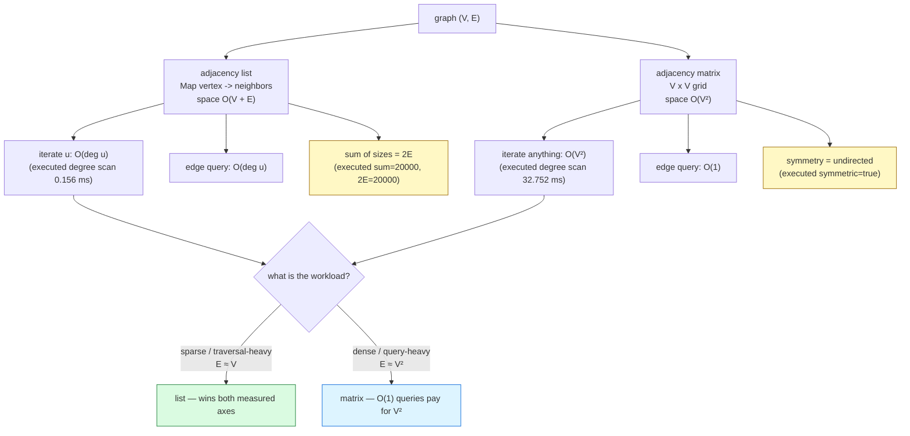

# Graphs

## 1. Learning Objectives

After this lesson you will be able to:

- [ ] Define a graph as `(V, E)` with directed/undirected and weighted/unweighted variants —
      and place trees (connected, acyclic, exactly V−1 edges) and DAGs as **sub-families**
      of graphs, not separate topics.
- [ ] Implement both canonical representations and read their executed evidence: the
      adjacency-list printout `A -> [B, C] …`, the matrix printout `  . 1 1 . . .`, and the
      cross-check rows `edges from upper triangle = 8 (declared 8)  matrix symmetric=true`
      and `degree (list) : 2 2 3 4 3 2` == `degree (matrix) : 2 2 3 4 3 2` — two structures,
      one graph, proven equal by construction.
- [ ] Derive the representation costs from the data each one stores — **list: O(V+E) space,
      O(degree) neighbor iteration, O(E) edge scan; matrix: O(V²) space, O(1) edge query,
      O(V²) scan** — and tie each to its executed row: `degree scan … list 0.156 ms …
      matrix 32.752 ms` (~210×) and `storage (rough): matrix 3906 KiB vs list 234 KiB`
      (~17×) at V = 2000, E = 10000.
- [ ] Choose a representation by *workload* — dense-or-query-heavy → matrix; sparse-or-
      traversal → list — and defend the choice with the two measured axes (time and bytes),
      not with taste.
- [ ] Explain the handshake lemma as a debugging tool: the executed row `sum=20000,
      2E=20000` shows the list degree-sum *equals* 2E — an invariant you can assert in tests.
- [ ] Convert between representations and state directed asymmetry as a *design* property:
      `directed A->B: matrix[A][B]=true matrix[B][A]=false (asymmetric by design)`.

## 2. Prerequisites

- [arrays.md](arrays.md) — the matrix *is* a 2-D array; size/capacity and index arithmetic
  carry over.
- [trees.md](trees.md) — tree vocabulary; this lesson generalizes it (a tree is a graph
  with extra constraints) and reuses traversal thinking.
- [hash-tables.md](hash-tables.md) — the adjacency list's vertex→neighbors map is exactly a
  hash map, so its O(1) expected lookup is assumed.
- [heaps.md](heaps.md) — named as the frontier structure the next lesson's Dijkstra needs;
  not used directly here.
- [big-o-notation.md](big-o-notation.md) — every cost row below is an O() claim measured.

**Environment used in this lesson:** every transcript executed on the authoring machine —
JDK 25.0.4.1, `javac --release 21`. Timings machine-specific; counts, degrees, and printed
structures are not.

## 3. Introduction

Every structure so far holds *items*; a graph holds *relationships*. Roads between cities,
prerequisites between courses, friends between accounts, services in a microservice mesh —
the moment your data is "things connected to other things", arrays and trees stop being the
right abstraction and `(V, E)` becomes it. Graphs are also where this subject's earlier
lessons converge: representation is an [arrays.md](arrays.md)/[hash-tables.md](hash-tables.md)
decision, traversal needs [stacks.md](stacks.md) or [queues.md](queues.md), and the shortest
path engine waits on [heaps.md](heaps.md). This lesson fixes the vocabulary and — the part
that decides everything downstream — the two representations and their measured costs.

## 4. The Problem It Solves

A graph is the general model for **connection**, and the general questions asked of it are:
what is reachable, what is the cheapest route, in what order can dependent things run, and
how close is everyone to everyone. Two prior lessons already answered narrower versions —
[trees.md](trees.md) handled *hierarchical* connection (one parent, no cycles), which is
exactly what makes in-order traversal and recursion trivial there. Remove the parent
restriction and cycles appear, so traversals need visited-sets, "the path" may not be unique,
and shortest paths need an algorithm rather than a lookup. Representation is the first fork:
the executed benchmark at V = 2000, E = 10000 shows the same degree computation costing
**0.156 ms from the list** versus **32.752 ms from the matrix** (~210×), with **234 KiB**
versus **3906 KiB** (~17×) of storage — a fork whose consequences every graph algorithm in
this subject inherits.

## 5. Core Concepts

### Vocabulary, stated once

- **Graph** `G = (V, E)` — vertices `|V|` and edges `|E|`. **Directed** (arrows: `A → B` does
  not imply `B → A`) or **undirected**; **weighted** (edges carry costs) or **unweighted**;
  **labeled** (vertices have identities, e.g. `"A"`) or **anonymous** (0…V−1).
- **Degree** — undirected: number of incident edges; directed: split into in-degree and
  out-degree (the matrix's row sums are out-degrees, column sums in-degrees — the printed
  `degree (matrix) : 2 2 3 4 3 2` used row sums).
- **Path / cycle / connected** — a path is a vertex sequence of consecutive edges; a cycle
  closes it; connected means every pair has a path. A **DAG** is a directed graph with no
  directed cycles — the shape of build orders, prerequisite graphs, and dynamic programming
  over states.
- **Trees are graphs** — connected + acyclic + undirected + `|E| = |V| − 1`; this lesson's
  tree/acyclicity framing is what [trees.md](trees.md) assumed without saying. A tree is a
  *maximally sparse* connected graph: delete one edge and it disconnects, add one and it
  cycles.

### Adjacency list — pay only for the edges that exist

Map (or array slot) per vertex → its neighbor collection. The executed printout:

```text
adjacency list:
  A -> [B, C]
  B -> [A, D]
  C -> [A, D, E]
  D -> [B, C, E, F]
  E -> [C, D, F]
  F -> [D, E]
```

- Every edge appears **twice** (once per endpoint, undirected), so `sum of list sizes =
  2|E|` — the executed large-run row confirms it exactly: `sum=20000, 2E=20000`. That is the
  **handshake lemma** as an assertable invariant: a mismatch means a one-sided insertion,
  the classic undirected-graph bug.
- Costs fall out of what is stored: space **O(V + E)** (a slot per vertex + two ints and a
  reference per edge, roughly the executed `list 234 KiB` for V=2000, E=10000); iterating
  vertex `u`'s neighbors costs **O(deg(u))** — nothing else; scanning all edges costs
  **O(V + E)** (the degree scan's `0.156 ms` row).
- **No free edge queries:** `adj.get("A").contains("D")` walks A's list — **O(deg(A))**,
  executed as `list=false` for the A–D pair.

### Adjacency matrix — pay V², query in O(1)

A `V × V` boolean (or weight) grid; `matrix[i][j] = true` means edge `i—j`. The executed
printout (rows A…F, `.` = no edge):

```text
adjacency matrix (rows A..F):
  . 1 1 . . .
  1 . . 1 . .
  1 . . 1 1 .
  . 1 1 . 1 1
  . . 1 1 . 1
  . . . 1 1 .
edges from upper triangle = 8 (declared 8)  matrix symmetric=true
```

- The symmetry row is an **invariant check**: for undirected graphs the matrix must equal
  its transpose — an asymmetric cell after loading means an edge was added one-sided.
- **Counting by the upper triangle** (cells `i < j`) counts each undirected edge once
  without double-counting: `8` from the grid, `8` declared — the representations agree with
  the input, and `degree (matrix)` matching `degree (list)` proves equality on a second axis.
- Costs are the mirror image: space **O(V²)** regardless of E (executed `matrix 3906 KiB`
  = 2000² bytes ≈ exactly the estimate); **edge query O(1)** (`matrix[A][D]` — one index
  read); but *any* scan — all edges, all degrees — is **O(V²)** (executed `32.752 ms` vs the
  list's `0.156 ms` for the same degree sum, same values).

### The comparison, on the two measured axes

| Workload step | List | Matrix | Executed evidence |
|---|---|---|---|
| Space | O(V + E) | O(V²) | `list 234 KiB` vs `matrix 3906 KiB` (V=2000, E=10000) |
| Iterate u's neighbors | O(deg u) | **O(V)** | degree scan `0.156 ms` vs `32.752 ms` (~210×) |
| Edge query u–v | O(deg u) | **O(1)** | `edge A-D? matrix=false list=false` — same answer, different class |
| Full edge scan | **O(V + E)** | O(V²) | same degree-scan row |
| Add edge | O(1) | O(1) | both writes |
| Add vertex | amortized grow | **O(V²)** rebuild | matrix row/column append |

- **The density crossover:** E ≈ V²/2 or denser, the matrix's V² space stops being waste
  and its O(1) queries dominate; sparse graphs (E ≈ V, the real-world default — social
  graphs, roads, dependency graphs) make the matrix pay V² to store E items. At the
  executed V=2000/E=10000 the graph is 0.25% dense — the list wins both measured axes, and
  the numbers say so rather than the prose.
- **Anomaly to notice:** the matrix degree *values* match the list exactly (`2 2 3 4 3 2`)
  — correctness is identical; only cost differs. Representation never changes *answers*, it
  changes *prices*; the 210× row is what that sentence means.

### Undirected ⇄ directed, and the conversions

- The executed asymmetry row states the directed case as design, not accident:
  `directed A->B: matrix[A][B]=true matrix[B][A]=false` — one cell, and the reverse edge is
  *absent unless declared*.
- **List → matrix:** allocate V², walk every list entry setting one cell — O(V² + E).
- **Matrix → list:** walk the upper triangle (undirected) or all cells (directed), emitting
  edges — O(V²), output size O(V + E).
- **Anonymize:** label→index map (`idx` in the executed source, a
  [hash-tables.md](hash-tables.md) map) is the bridge from labeled vertices to array/matrix
  positions; dropping the map gives the anonymous form the algorithms in
  [graph-algorithms.md](graph-algorithms.md) index directly.

## 6. How It Works



Yellow = the two invariant checks you can run in tests (handshake, symmetry); green/blue =
the two decision branches, each named by its workload condition rather than by preference.

## 7. Practical Examples

**Example 1 — build once, prove twice, price both (executed)**

```java
public class GraphRepr {
    public static void main(String[] args) {
        String[] V = {"A", "B", "C", "D", "E", "F"};
        String[][] E = {{"A","B"}, {"A","C"}, {"B","D"}, {"C","D"},
                        {"C","E"}, {"D","E"}, {"D","F"}, {"E","F"}};

        // adjacency list: Map vertex -> neighbors
        Map<String, List<String>> adj = new LinkedHashMap<>();
        for (String v : V) adj.put(v, new ArrayList<>());
        boolean[][] matrix = new boolean[V.length][V.length];
        Map<String, Integer> idx = new HashMap<>();
        for (int i = 0; i < V.length; i++) idx.put(V[i], i);
        for (String[] e : E) {                     // each undirected edge: both directions
            adj.get(e[0]).add(e[1]);  adj.get(e[1]).add(e[0]);
            matrix[idx.get(e[0])][idx.get(e[1])] = true;
            matrix[idx.get(e[1])][idx.get(e[0])] = true;
        }
        // print list; print matrix rows with '1'/'.'
        // upper-triangle edge count + full symmetry check
        // degree sequence from both: list .size() vs row sums
        // edge query: matrix[idx(A)][idx(D)] vs adj.get("A").contains("D")
        // large run: V=2000, E=10000 (seed 11) — degree scan timing + storage estimate
    }
}
```

```console
$ javac --release 21 GraphRepr.java && java GraphRepr
adjacency list:
  A -> [B, C]
  B -> [A, D]
  C -> [A, D, E]
  D -> [B, C, E, F]
  E -> [C, D, F]
  F -> [D, E]
adjacency matrix (rows A..F):
  . 1 1 . . .
  1 . . 1 . .
  1 . . 1 1 .
  . 1 1 . 1 1
  . . 1 1 . 1
  . . . 1 1 .
edges from upper triangle = 8 (declared 8)  matrix symmetric=true
degree (list)   : 2 2 3 4 3 2
degree (matrix) : 2 2 3 4 3 2
edge A-D? matrix=false  list=false   (O(1) vs O(degree))
degree scan of V=2000, E=10000: list 0.156 ms (sum=20000, 2E=20000)   matrix 32.752 ms (sum=20000)
storage (rough): matrix 3906 KiB vs list 234 KiB  for V=2000, E=10000
directed A->B: matrix[A][B]=true matrix[B][A]=false  (asymmetric by design)
$ echo $?
0
```

- **Rows 1–8, correctness:** both representations built from the *same* edge array; three
  independent cross-checks pass — edge count `8 = 8`, symmetry `true`, degree sequences
  identical `2 2 3 4 3 2`. If any one disagreed, exactly one representation (or the input
  loop) would be at fault; agreeing on all three pins the shared source.
- **Row 9:** same query, two classes: `matrix=false` read one cell (O(1)); `list=false`
  walked A's 2-element list (O(deg A)). At deg 2 the difference is invisible — at
  deg 2,000,000 (a hub vertex) it is the whole decision.
- **Rows 10–11, cost:** the identical degree computation, ~210× apart, and ~17× apart in
  bytes — both gaps are the V²-vs-(V+E) class difference made visible at a graph size a
  laptop holds comfortably.

**Example 2 — the handshake lemma as a test assertion (from the executed row)**

```java
// after building any undirected adjacency list:
long sum = 0;
for (String v : V) sum += adj.get(v).size();
System.out.println("sum=" + sum + ", 2E=" + 2L * E.length);
assert sum == 2L * E.length : "handshake violated: an edge was added one-sided";
// executed: sum=20000, 2E=20000  (V=2000, E=10000)
```

- The assertion turns the lesson's printed row into a permanent regression test — the same
  habit as `validateBST` in trees and the property-check loop in heaps: **invariants are
  code, not prose.**

## 8. Real-World Applications

- **Social and communication networks** — users and follows/edges: adjacency lists all the
  way (billions of vertices, per-user degree in the low hundreds; the matrix would need
  V² ≈ 10¹⁸ cells — the executed 17× at V=2000 extrapolates to the impossibility).
- **Routing and road maps** — intersections and roads with distance/time weights: lists of
  `(neighbor, weight)`; Dijkstra over that list is [graph-algorithms.md](graph-algorithms.md).
- **Dependency and build systems** — `make`, Bazel, package managers: courses→prereqs is a
  DAG; a topological sort produces a **safe build order** — the curriculum's own
  stated-without-steps practice problem.
- **Recommendation and knowledge graphs** — "users who bought also bought", Wikidata facts:
  edges carry types and weights; the *scans* are list workloads, which is why triple-stores
  index by adjacency rather than materializing V².
- **Network and infrastructure topology** — services and calls: adjacency lists feed
  circuit breakers and dependency-aware rollouts; matrices feed all-pairs health dashboards
  only when V is small (dozens).
- **Compilers** — control-flow and call graphs are DAGs (per function) or general digraphs
  (recursion); def-use chains are edges; liveness analysis traverses them per basic block.

## 9. Common Mistakes

| Mistake | Why it happens | How to recognize it | How to prevent it |
|---|---|---|---|
| Adding an edge one-sided in an undirected graph | Loop writes `adj[u].add(v)` only | Handshake fails: `sum ≠ 2E` | Example 2's assert; write both directions in one place |
| Matrix sized to E instead of V | Vertices numbered by edge order | IndexOutOfBounds / silent aliasing | Matrix dimension is **|V|**, always; map labels→indices first (the executed `idx` map) |
| Querying `adj.get(u).contains(v)` and calling it O(1) | Hash-map habit | Slow checks on hub vertices | It is O(deg u) — say so; need O(1) queries? matrix (or a hash-set per vertex) |
| Ignoring in-degree vs out-degree on digraphs | Undirected habit | "degree" sums don't match 2E (directed: they match **E** each) | Name which sum; row sums = out, column sums = in |
| Building the matrix because it is 'simpler' | Visibility of the grid | Memory blowups at V in the 10⁴+ range | Decide from workload: the executed rows are the decision table |
| Forgetting self-loops / parallel edges in counts | Textbook graphs lack them | Upper-triangle count ≠ E; 2E check off by loop count | Define the policy up front (simple graph assumed here; multigraphs need edge lists) |
| Anonymous vertices in printed output | Index arrays everywhere | Debug output `17 -> [42, 8]` meaningless | Keep the `idx` map inverted for printing, as the executed printout does |
| Traversing a cyclic graph without a visited set | Tree habit from trees.md | Infinite loops on the first cycle | Traversal needs O(V) visited state — the next lesson makes this explicit |

## 10. Best Practices

- **Default to the adjacency list.** Real graphs are sparse; the executed rows show the list
  winning *both* measured axes at realistic density — reach for the matrix only when the
  O(1) query or dense algebra (transitive closure, all-pairs) is the actual workload.
- **Build both invariants into tests** — handshake (`sum = 2E`) and, for undirected
  matrices, symmetry — exactly as the executed run prints them; they localize one-sided-
  insertion bugs to the line that inserted.
- **Index vertices once.** A label→index `HashMap` at construction lets every algorithm
  work on ints; the executed source keeps `idx` for exactly this bridge.
- **State the vertex and edge *policies* at the class top** — directed? self-loops? parallel
  edges? weighted default? — every count and traversal below depends on them; the
  [trees.md](trees.md) convention-note habit, generalized.
- **Count while you scan.** The `sum=20000` row is free (it falls out of the degree loop)
  and doubles as verification — instrument by default in teaching and diagnostic code.
- **Convert deliberately, at the boundary.** List→matrix is O(V²); do it once when a
  dense-phase algorithm needs it, not per query — the conversion cost is the algorithm's
  setup, and should be visible in its analysis.
- **For directed graphs, store in-edges only if you traverse them.** Reverse adjacency is
  O(V+E) extra space; BFS/DFS-from-source never touch it — but Kosaraju will
  ([graph-algorithms.md](graph-algorithms.md)) — pay when the algorithm demands, not before.

## 11. Limitations and Trade-Offs

- **No representation is free — they trade the same V+E+E budget differently.** The list
  spends E once at build and again per full scan; the matrix spends V² up front to make
  every query one read. The executed 0.156/32.752 ms and 234/3906 KiB pairs are that
  trade's price tags at one (V, E); other sizes move the tags but not the structure.
- **Both are static-shape choices under churn.** Adding vertices to a matrix is O(V²)
  (new row + new column of the old matrix copied — [arrays.md](arrays.md)'s growth problem,
  squared); lists amortize but invalidate nothing. Highly dynamic graphs pay in the matrix.
- **Edge weights/labels live awkwardly in the boolean grid.** A `boolean[][]` answers
  "edge?" — real graphs carry distance, capacity, timestamp: the matrix becomes `double[][]`
  or an object grid, and the executed storage row doubles or worse. Lists carry
  `(neighbor, weight)` tuples at the same O(deg) price they already pay — another reason
  lists are the default shape.
- **Graph algorithms, not representations, carry the hard problems.** This lesson prices
  storage and access; reachability, shortest paths, ordering, and connectivity are
  [graph-algorithms.md](graph-algorithms.md)'s — picking the right representation makes
  *those* analyses correct and cheap, but does not perform them.
- **The measurements are one machine, one seed.** `0.156` vs `32.752` ms will differ
  elsewhere; the **ratio and the class derivation** travel, the absolute numbers do not —
  the analysis lesson's re-measure-locally rule, restated.
- **Sparse real graphs hide hub vertices.** Degree distributions are skewed (a few vertices
  with enormous degree); the list's per-vertex iterate is still O(deg), so "fast per
  vertex" claims must name *which* vertices — average-case reasoning misleads here more
  than anywhere else in this subject.

## 12. Practical Exercises

### Introductory

1. **Reproduce Example 1.** **Completion criteria:** all ten lines with exit 0; then draw
   the 6-vertex graph on paper and verify each printed degree and the `A -> [B, C]` line by
   eye against your drawing.
2. **Handshake on a digraph.** For the directed version of the same graph (each edge
   `u—v` kept only as written in `E`), compute: total out-degree sum, total in-degree sum,
   and |E|. Then run a harness printing both sums. **Completion criteria:** your three
   predicted numbers; executed sums equal to |E| each (`8` and `8`) — and one sentence
   contrasting with the undirected `2E = 16` case.
3. **Symmetry repair.** Take the executed matrix load, delete the `matrix[v][u] = true`
   write, and re-run: report the symmetry-check output, the upper-triangle count, and the
   degree mismatch. **Completion criteria:** three wrong printed values, each predicted
   before running, plus the fixed line restored and all checks passing again.

### Intermediate

4. **Density sweep: find your machine's crossover.** Fix V = 1000; generate graphs at
   E = 1000, 10,000, 100,000, 400,000 (fixed seed); build list and matrix; time a full
   degree scan of each (best-of-3 with warmup — the
   [algorithm-analysis.md](algorithm-analysis.md) harness). **Completion criteria:** a 4×
   (E, density %, list ms, matrix ms, ratio) table; the E where the ratio first drops below
   2× named and explained by the density formula (E vs V²/2 — compute the percentages);
   one paragraph: given your table, what E would it take for the matrix to *win* the scan,
   and why does that E exceed V²/2?
5. **Conversions, both directions, with checks.** Implement `listToMatrix` and
   `matrixToList` (undirected, labeled via an `idx` map); run on Example 1's graph and on a
   fixed-seed V=300, E=1200 random graph. **Completion criteria:** round-trip equality
   printed (`list -> matrix -> list` gives back the identical neighbor sets — assert per
   vertex); the conversion timings at V=300 (expected classes: O(V²+E) and O(V²));
   an edge-case run with an isolated vertex (degree 0 both ways — appears in the list as
   `X -> []` and in the matrix as an all-`.` row).
6. **Weighted lists, unweighted matrix — the mismatch.** Extend the list to `(neighbor,
   distance)` ints; store the same weighted graph as `int[][]` (0 = no edge). Query
   `distance("A","D")` from both. **Completion criteria:** both answer (the matrix cell's
   value; the list's scan find), the class of each (O(1) vs O(deg)), the storage rows for
   both at V=2000/E=10000 with weights (int matrix = 4 bytes/cell — recompute the estimate,
   compare to `list 234 KiB` with 4-byte weights added per entry), and the recommendation
   for a road-network workload (sparse, weighted, occasional queries) with your numbers as
   the justification.

### Independent problem-solving

7. **A counted, invariant-checked graph toolkit.** Spec: `CountedGraph` supporting directed
   and undirected modes (constructor flag), labeled vertices (hash map + index arrays),
   with `addVertex/addEdge(u,v[,w])/neighbors(u)/hasEdge(u,v)/degree(u)/edgeCount()`,
   instrumentation (`neighborScans`, `edgeReads`), plus conversions `toMatrix()` /
   `fromMatrix()`. Requirements: (a) pre-code complexity table for all seven operations in
   both representations, each cell labeled with its case; (b) executed test transcripts: the
   handshake assert and symmetry check after a 200-vertex/600-edge fixed-seed build
   (undirected mode) *and* the in/out degree sums matching E (directed mode) — the exercise-2
   protocol generalized; the empty-vertex and self-loop policy rows (what your class does —
   state the policy in the comment at the top and demonstrate it); (c) a measured comparison
   at V=2000, E=10000 (seed 11, matching this lesson): `hasEdge(A,D)` × 100,000 calls
   counted (`edgeReads` will show the class gap: ~1 cell-read vs ~sum-of-degrees list reads)
   and timed, plus the degree-scan rows replicated from your own code (expect the same
   ratio family as `0.156 vs 32.752 ms`); (d) a hub-vertex probe: add a vertex with degree
   100,000 (E=100,000, V=1000), run 10,000 `hasEdge(hub, x)` misses on both
   representations, report counted reads and ms — the row that shows the list's O(deg)
   query on a hub is *the* failure mode, not a theoretical one; (e) a written verdict:
   for each of three workloads — social graph (V=10⁸, E=10⁹, neighbor iteration only),
   airfare lookup (V=5000, constant edge queries), compiler call graph (V=10⁴, E=3×10⁴,
   DFS + reverse-DFS — note the reverse-adjacency cost) — pick a representation, cite the
   measured row (c or d) or the derived class that justifies it, and state the memory in
   concrete units (KiB/GiB) for each pick. **Completion criteria:** the pre-code table; all
   executed transcripts including both invariants in both modes; the hub-vertex numbers
   with the class explanation; the three verdicts each tied to a specific executed row.

*Solutions: attempt first; set practice in [problem-solving/README.md](problem-solving/README.md).*

## 13. Knowledge Check

1. A graph has V = 2000 and E = 10000. Using the executed rows, state its space in both
   representations (KiB), the degree-scan time in both (ms), and the *class* each number
   comes from. Which representation would you pick, and what single workload change would
   flip your answer?
2. Why does the undirected degree sum equal exactly 2E — argue from the list-construction
   loop (each edge writes two entries) — and what does the executed `sum=20000, 2E=20000`
   row prove about the large graph's construction?
3. `edge A-D? matrix=false list=false (O(1) vs O(deg))` — both answers agree. Explain why
   representations can change cost but never *answers* for well-formed inputs, and name the
   invariant checks from the executed run that certify both inputs were well-formed.
4. State the symmetry row's meaning for directed graphs: would `matrix symmetric=true` be
   a *bug* there? Justify with the executed directed row
   (`matrix[A][B]=true matrix[B][A]=false`).
5. Trees are graphs with |E| = |V| − 1 and no cycles. Explain why a tree *must* use the
   adjacency list under the executed cost model (compute both representations' space for
   V=2000 as a tree: E=1999 — how many KiB each?), and why the matrix would be pure waste.
6. At what density does the matrix stop being wasteful — derive the E-vs-V² crossover
   formula, then compute it for V = 1000 and V = 100,000 (as percentages of V²). Which of
   the two sizes ever reaches it with realistic data, and what does that say about the
   "default to list" rule?

## 14. Completion Criteria

Observable evidence that you have understood this lesson:

- [ ] Example 1 reproduces (ten lines) with exit 0; the paper drawing matches every printed
      degree and neighbor list
- [ ] Exercise 2's directed sums predicted and confirmed (8, 8, |E|=8)
- [ ] Exercise 3's three broken values predicted before the broken run, then restored
- [ ] Density-sweep table exists with a named crossover E and derived percentages
- [ ] Round-trip conversions assert equal, with the isolated-vertex edge case shown
- [ ] Weighted variants built; the road-network recommendation backed by your storage rows
- [ ] The counted toolkit runs: both invariants in both modes, the 100,000-call edge-query
      comparison, the hub-vertex probe, and three verdicts each citing an executed row

## 15. Summary

- **A graph is `(V, E)` with variants** — directed/undirected, weighted, labeled — and
  trees and DAGs are sub-families defined by extra constraints (acyclicity; V−1 edges).
- **Two representations, one graph, different prices** — list O(V+E) space with O(deg)
  neighbor work; matrix O(V²) space with O(1) queries — proven answer-equivalent by the
  executed triple cross-check (edge count, symmetry, identical degrees).
- **The measurements are the argument** — `0.156 vs 32.752 ms` (~210×) and `234 vs 3906
  KiB` (~17×) at V=2000/E=10000; the handshake `sum=20000, 2E=20000` and symmetry
  `true` rows are the invariants that certify the inputs, and they belong in your tests.
- **Default list, justify matrix** — sparse is the real-world shape; the matrix earns its
  V² only under dense or query-heavy workloads, and the density formula (E vs V²/2) names
  the flip point before you measure it.
- **This lesson set the stage; the algorithms come next** — traversal, shortest paths, and
  ordering live in [graph-algorithms.md](graph-algorithms.md), inheriting whichever
  representation costs you chose here.

## 16. Next Steps

- Next lesson: [searching.md](searching.md) — from searching *neighbors* back to searching
  *sorted data*, with binary search's halving argument.
- Practice: [problem-solving/README.md](problem-solving/README.md) set 9–10.
- Where it is applied: shortest paths and build order in
  [graph-algorithms.md](graph-algorithms.md), dependency graphs in
  [13-SOFTWARE-ENGINEERING-AND-ARCHITECTURE](../13-SOFTWARE-ENGINEERING-AND-ARCHITECTURE/README.md), service-topology
  traversal in [11-BACKEND-ENGINEERING](../11-BACKEND-ENGINEERING/README.md), and query
  planning over join graphs in [10-DATABASE-ENGINEERING](../10-DATABASE-ENGINEERING/README.md).
