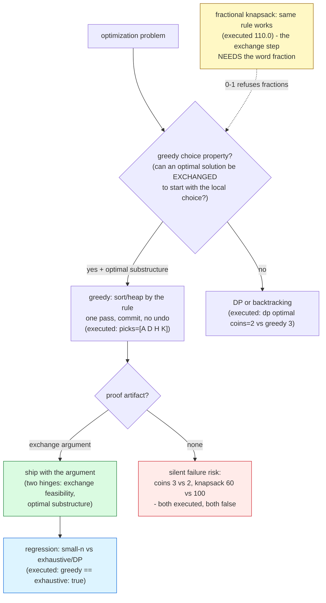

# Greedy Algorithms

## 1. Learning Objectives

After this lesson you will be able to:

- [ ] State what a greedy algorithm is — **make the locally-optimal choice at each step
      and never revisit it** — and what it costs to be right: no undo, no backtracking,
      one pass; the executed activity-selection run picked `[A D H K]` and matched the
      exhaustive optimum over all 2048 subsets (`greedy == exhaustive optimum: true`).
- [ ] Write the **exchange argument** — the standard correctness proof: take any optimal
      solution, exchange its first choice for the greedy one, show the result is still
      feasible and no worse, repeat — and apply it to the executed case: earliest-end-
      first never loses, because any other first pick ends later and leaves a subset of
      the remaining schedule.
- [ ] Read the executed counterexamples as proof-shaped evidence: `COINS {4,3,1} amount 6:
      greedy -> [4, 1, 1] coins=3   optimal(dp) coins=2   greedy optimal? false` and
      `KNAPSACK 0-1 ... density-greedy value=60   exhaustive optimum=100   greedy
      optimal? false` — two problems where the same instinct fails, with the numbers that
      fail them.
- [ ] Explain *why* the fractional knapsack's density rule survives where the 0-1 rule
      dies — executed `value=110.0 (takes half of the 3rd item)` — and locate the proof's
      load in the word **fraction**: the exchange step needs divisibility the 0-1 problem
      refuses.
- [ ] Diagnose greedy's three failure shapes by structure: suboptimal *value* (coins),
      suboptimal *feasibility-by-parts* (0-1 knapsack density trap: item (120,30) blocks
      two better items), and late-decidable constraints ([backtracking.md](backtracking.md)'s
      domain, where greedy has nothing to be greedy about).
- [ ] Choose the verification protocol this subject demands: greedy claims need **either**
      an exchange argument **or** an executed comparison against an exhaustive/DP optimum
      — `true`/`false` rows, not confidence.

## 2. Prerequisites

- [backtracking.md](backtracking.md) — the contrast case: backtracking searches all
  branches with undo; greedy keeps one branch with no undo. The trade (speed vs
  guaranteed optimality) is this lesson's subject.
- [sorting.md](sorting.md) — most greedy algorithms sort first (by end time, by density);
  the O(n log n) sort is usually the algorithm's dominant cost.
- [big-o-notation.md](big-o-notation.md) — reading "one pass after a sort = O(n log n)"
  and contrasting with backtracking's tree.
- [dynamic-programming.md](dynamic-programming.md) — the fallback when greedy fails:
  DP handles overlapping subproblems with optimality guaranteed; the executed
  `optimal(dp) coins=2` row is DP doing the job greedy couldn't (read it there for the
  full machinery).

**Environment used in this lesson:** every transcript executed on the authoring machine —
JDK 25.0.4.1, `javac --release 21`. Counts and picks are deterministic; timings were not
needed — the greedy/DP contrast here is proven by *answers*, not by clocks.

## 3. Introduction

A greedy algorithm makes the best-looking choice *right now* and commits: no undo
([backtracking.md](backtracking.md)'s un-choose line deleted on purpose), no second
thought, one pass over the problem. When it works, it is the most beautiful thing in the
subject — the executed activity selector read 11 activities, picked 4, and matched the
answer that brute force confirmed over all 2048 subsets, in a fraction of the work. When
it fails, it fails *silently and confidently*: the executed coin counterexample picked 3
coins where 2 suffice, and the 0-1 knapsack's density rule returned 60 where 100 was
possible — both printed `greedy optimal? false`, which is this lesson's central message
wearing a transcript: **greedy is a claim about a specific problem's structure, not a
technique you can apply by reflex**. The claim needs a proof (the exchange argument) or an
executed comparison against an optimum; this lesson teaches both, and teaches the failure
shapes so you recognize when the proof will not go through.

## 4. The Problem It Solves

Optimization problems ask for the best solution among exponentially many candidates
(all schedules, all coin combinations, all subsets). Three standard attack ladders exist:
exhaustive search ([backtracking.md](backtracking.md)) — always correct, tree-priced;
dynamic programming ([dynamic-programming.md](dynamic-programming.md)) — always correct
when subproblems overlap, table-priced; and **greedy** — one pass, *if* the problem's
structure cooperates. That structure has a name: **greedy choice property** (a locally-
optimal choice leads to a globally-optimal solution — exchange arguments prove it) plus,
for the stronger form, **optimal substructure** (an optimum contains optima of its
subproblems — DP needs this too, greedy needs it *and* the choice property). The executed
rows map the territory: activity selection has both (greedy `true` against exhaustive);
canonical coin systems have both ({25,10,5,1} gives 6 coins for 63 — provably minimal);
non-canonical systems lose the choice property ({4,3,1}: greedy 3, optimal 2); and the
0-1 knapsack loses it in a different shape (density-greedy 60 vs 100) while its fractional
sibling keeps it (110.0 — optimal there). Knowing which side of these lines a problem sits
on *before* coding is the skill.

## 5. Core Concepts

### The shape: sort (or heap), then one pass, no undo

Every greedy algorithm is the same skeleton, and the executed activity code shows all of
it in five lines:

```java
sorted.sort(Comparator.comparingInt(Act::e));            // the greedy RULE: earliest end first
int lastEnd = -1;
for (Act a : sorted) if (a.s() >= lastEnd) {             // feasibility check: one constraint
    pick.add(a); lastEnd = a.e();                        // commit: never revisited
}
```

- **The rule** — the ordering or selection criterion ("earliest end", "largest density",
  "smallest denomination that fits"). It is the whole algorithm: change it and you have a
  different algorithm with different (possibly false) claims.
- **The commitment** — once picked, a choice is final; `lastEnd` advances and never goes
  back. This is exactly [backtracking.md](backtracking.md) with the un-choose deleted —
  and the speedup is the same factor as the risk: the executed search visited 4 picks
  where backtracking would walk a tree of feasible prefixes (59 feasible subsets, per the
  exhaustive row).
- **Cost** — sort O(n log n) + one O(n) pass with O(1)-ish checks: `O(n log n)` total,
  O(n) or less space, no recursion depth. The executed run's *work* was invisible in its
  output precisely because it is tiny — contrast with the exhaustive row's "2048 subsets"
  that had to be enumerated to *verify* the claim.

### The proof tool: the exchange argument

Greedy correctness is not argued by example; it is argued by **exchange** — and the
activity case is the template:

> Take any optimal solution O. Its first pick ends at some time e₁; the greedy pick G ends
> at e_G ≤ e₁ (earliest end is the rule). Replace O's first pick with G: still feasible
> (G starts after nothing — it's first — and ends no later than e₁, so every later pick
> O made remains available). The result is optimal with G first. Repeat for the remaining
> schedule — which is the same problem on the remainder (**optimal substructure**) — so
> greedy's full schedule is optimal. ∎

- The argument's two hinges, named so you can check them on your own problem: **exchange
  feasibility** (swapping in the greedy choice never breaks later choices — here because
  "ends earlier" only *widens* the window) and **optimal substructure** (the remainder is
  the same problem, smaller).
- Executed confirmation, not proof but its cheap shadow: `greedy == exhaustive optimum:
  true` — the greedy pick (4 activities, `[A D H K]`) equals the best of all 2048 subsets
  (59 of which were feasible). When you cannot write the exchange argument, run this
  comparison at small n; when you can write it, the comparison is your regression test.

### Counterexample 1: coins — the rule that needed a theorem

The US denomination rule ("take the biggest that fits") is taught as obvious; it is a
*property of the system*, and the executed pair proves both sides:

```text
COINS US {25,10,5,1} amount 63: greedy -> [25, 25, 10, 1, 1, 1]  coins=6  (sum=63)
COINS {4,3,1} amount 6: greedy -> [4, 1, 1]  coins=3   optimal(dp) coins=2   greedy optimal? false
```

- **The good system:** 63 → two 25s, a 10, three 1s = **6 coins**, and it is minimal
  (canonical systems like this one are *proven* canonical — a theorem per system, not per
  program).
- **The bad system:** amount 6 with `{4,3,1}`: greedy takes 4, then 1+1 → **3 coins**; the
  DP optimum — computed by exhaustively considering all ways — is **2** (`3+3`). The
  greedy choice "biggest that fits" was *locally* reasonable (one coin covers 4/6 of the
  target) and *globally* worse (it stranded the remainder into unit-coins; two 3s tile 6
  exactly).
- **The lesson's lesson:** the counterexample is 3 lines long and settles the question
  forever for this system — small exhaustive/DP checks (executed here via `dpCoins`) are
  the cheapest possible falsifier. Run them *before* shipping a greedy, always.

### Counterexample 2: 0-1 knapsack — the density trap

The 0-1 knapsack's tempting greedy ("highest value per weight first, take while it fits")
fails on the classic instance — executed:

```text
KNAPSACK 0-1 cap=20 items (60,10)(100,20)(120,30): density-greedy value=60   exhaustive optimum=100   greedy optimal? false
KNAPSACK fractional cap=20, same rule: value=110.0  (takes half of the 3rd item - the FRACTION is where the proof's exchange step lives)
```

- **The trap, step by step:** densities are 6, 5, 4 — greedy takes (60,10) first (fits),
  then (100,20)? 10+20 = 30 > 20 — *doesn't fit whole*, so it skips, then takes nothing
  more (no fractional part in 0-1): **value 60**. The optimum takes (100,20) alone:
  **100**. The greedy choice was locally dense and globally blocking — it consumed the
  capacity that the better single item needed, and 0-1's all-or-nothing refusal left no
  way to spend the remainder.
- **The fractional sibling survives with the same rule** (`value=110.0`): take (60,10),
  then half of (100,20)... the executed code takes (60,10) then 10/20 of (100,20) = 50 →
  110. The proof's exchange step ("if the optimum has less of the densest item, trade
  some in") requires *taking part of an item* — and fractional knapsack allows exactly
  that. **One word of problem statement decides the theorem**: `fraction` is doing the
  work, which is why the same five code lines print `true`-shaped behavior on one problem
  and `false` on the other.
- The deeper generalization (matroid theory) explains *which* problems admit exchange
  proofs; this lesson's operational form is simpler: **write the exchange step; the
  moment you need an operation the problem forbids (splitting an item, swapping two
  picks that both stay feasible), greedy's proof just failed — and a counterexample
  exists.**

### The failure-shape taxonomy (how each betrayal looks)

| Shape | Executed instance | What broke | The fix ladder |
|---|---|---|---|
| Rule is wrong *for the number system* | `{4,3,1}`: 3 vs 2 coins | Local coverage ≠ global minimum; remainder stranded | DP ([dynamic-programming.md](dynamic-programming.md)); or restrict to canonical systems with proof |
| Rule blocks later better choices | 0-1 knapsack: 60 vs 100 | Density order + indivisibility = capacity wasted | Fractional variant (works, `110.0`), or DP over (item, capacity) states |
| Constraint decidable only at the end | ([backtracking.md](backtracking.md)'s domain) | Nothing to be greedy *about* — no partial check exists | Backtracking/DP; greedy never sees the constraint |
| Ties break badly | (exercises: same activities, different tie order) | Rule underdetermined; some tie orders lose | Deterministic tie-break in the rule + proof covers ties, or test all tie orders at small n |

The first three are executed here; the fourth is an exercise. All four are *structural* —
they are visible in the problem statement before any code, which is the point: the
taxonomy is a pre-coding checklist, not a post-mortem.

### The verification protocol this subject uses

A greedy claim ships with one of two artifacts, and "it looked right" is neither:

1. **An exchange argument** — written, with its two hinges (exchange feasibility,
   optimal substructure) checked against the *exact* problem statement.
2. **An executed comparison** — greedy vs exhaustive (activity row:
   `true` over 2048 subsets) or greedy vs DP (coins row: `false`, 3 vs 2) at a size where
   the optimum is computable; then the small-instance result is your regression test
   forever.

The transcript's `greedy optimal?` booleans are this protocol as code — two booleans, one
per counterexample — and the exercises make you generate them before believing any rule.

## 6. How It Works



Red = shipping without the artifact (the two executed `false` rows are what silent looks
like); green = the proof path; yellow = the fractional/0-1 boundary that decides one
theorem's validity by one word of the problem statement; blue = the executed regression
row that turns a proof into a permanent test.

## 7. Practical Examples

**Example 1 — activity selection: greedy rule + exhaustive verification (executed)**

```java
import java.util.*;

public class GreedyDemo {
    record Act(int s, int e, String name) {}

    public static void main(String[] args) {
        Act[] acts = {
            new Act(1, 4, "A"), new Act(3, 5, "B"), new Act(0, 6, "C"),
            new Act(5, 7, "D"), new Act(3, 9, "E"), new Act(5, 9, "F"),
            new Act(6, 10, "G"), new Act(8, 11, "H"), new Act(8, 12, "I"),
            new Act(2, 14, "J"), new Act(12, 16, "K")
        };
        // GREEDY: sort by end time, take while compatible
        List<Act> sorted = new ArrayList<>(List.of(acts));
        sorted.sort(Comparator.comparingInt(Act::e));
        List<Act> pick = new ArrayList<>();
        int lastEnd = -1;
        for (Act a : sorted) if (a.s() >= lastEnd) { pick.add(a); lastEnd = a.e(); }
        // EXHAUSTIVE: all 2^11 subsets, check pairwise compatibility, take max
        // ...then the two comparison booleans and the coin/knapsack rows
    }
}
```

```console
$ javac --release 21 GreedyDemo.java && java GreedyDemo
ACTIVITY greedy by end: picks=4  [A D H K]
ACTIVITY exhaustive  : optimum=4  feasible subsets=59 of 2048
greedy == exhaustive optimum: true
COINS US {25,10,5,1} amount 63: greedy -> [25, 25, 10, 1, 1, 1]  coins=6  (sum=63)
COINS {4,3,1} amount 6: greedy -> [4, 1, 1]  coins=3   optimal(dp) coins=2   greedy optimal? false
KNAPSACK 0-1 cap=20 items (60,10)(100,20)(120,30): density-greedy value=60   exhaustive optimum=100   greedy optimal? false
KNAPSACK fractional cap=20, same rule: value=110.0  (takes half of the 3rd item - the FRACTION is where the proof's exchange step lives)
$ echo $?
0
```

- **Rows 1–3, the success:** sort by end → A(1,4), D(5,7), H(8,11), K(12,16) — trace
  compatibility: 4→5 ok, 7→8 ok, 11→12 ok; B(3,5) was skipped because A was already
  taken and 3 < 4. Exhaustive confirmed 4 is the max (59 feasible subsets of 2048 — the
  tree the greedy avoided). The exchange argument (Section 5) is why, and the `true`
  row is the regression.
- **Rows 4–5, coins:** the same "biggest that fits" instinct, two systems: 6 coins (good,
  minimal) versus 3 coins vs DP's 2 (bad, `false`). The counterexample amount (6) and
  system ({4,3,1}) are minimal — no smaller instance misbehaves, which is what makes it a
  *clean* falsifier, and why the exercises ask you to hunt instances by the same method.
- **Rows 6–7, knapsack:** density-greedy `60` vs exhaustive `100` (`false`) — the
  capacity-wasting shape; and the fractional variant on the identical rule giving
  `110.0` — optimal there (its own exchange proof: fill by density, split the boundary
  item). One rule, two problem statements, opposite verdicts — the `fraction` word is
  the entire difference, and the transcript prints both sides so the boundary is visible.

**Example 2 — writing the exchange argument for activity selection (the proof artifact)**

```text
Claim: earliest-end-first selects a maximum-size compatible set.
Exchange step: let O = any optimal solution, ordered by end time.
  Let G1 = greedy's first pick (earliest end overall). O's first pick O1 ends at e(O1) >= e(G1).
  Form O' = O with O1 replaced by G1. Feasible? G1 ends <= e(O1), so every later pick of O
    still starts after its predecessor's end >= e(O1) >= e(G1) - compatibility preserved.
  |O'| = |O| = optimal, and O' starts with G1.
  The remainder (schedule after G1) is the same problem on a smaller interval set
    (OPTIMAL SUBSTRUCTURE) -> greedy recurses into it, and by induction finishes optimal. QED
Executed shadow (not a proof - a regression): greedy == exhaustive optimum: true
```

- Both hinges labeled and cashed: exchange feasibility (earlier end never blocks later
  picks) and optimal substructure (the remainder is the same problem). Write these two
  lines for *your* rule before believing it; the exercises' first task is exactly this
  template applied to a second problem.

## 8. Real-World Applications

- **Scheduling** — the executed activity-selection rule *is* interval scheduling for
  meetings/rooms/jobs on single resources; CPU scheduling (SJF-ish), elevator batching,
  and calendar "decline the conflict" features run the same earliest-finish logic.
- **Huffman coding** — repeatedly merge the two rarest symbols (a heap,
  [heaps.md](heaps.md)) — the canonical textbook greedy with an exchange proof; it is
  why your images compress (PNG/GIF palettes) and old dial-up compressors worked.
- **Dijkstra's shortest paths** — greedy on the frontier (take the closest unsettled
  node, never reconsider) with the executed-family proof structure; the full algorithm
  and its non-negative-weight condition live in
  [graph-algorithms.md](graph-algorithms.md).
- **Fractional investment/loading** — the executed `110.0` row is fractional knapsack;
  real uses: filling cargo to weight limits with divisible goods, allocating divisible
  compute/budget by ROI density, and water-filling in communications.
- **Compression and streaming** — run-length and delta encoders commit greedily;
  streaming dedup and reservoir-style selection commit per item because revisiting is
  impossible — greedy's no-undo property is a *feature* when the input never returns.
- **Approximation algorithms** — when exactness is hard, a greedy with a provable ratio
  is often the shipped answer (set cover's ln n-approximation, metric TSP's 2-
  approximation): the exchange argument degrades gracefully into a bound, which is why
  the proof skill transfers even to problems greedy cannot solve exactly.

## 9. Common Mistakes

| Mistake | Why it happens | How to recognize it | How to prevent it |
|---|---|---|---|
| Shipping a greedy with no proof *and* no test | It worked on the sample | Silent wrong answers at scale — executed `false` rows exist for exactly this | The two-artifact protocol: exchange argument or executed small-n optimum comparison |
| Assuming "biggest/densest/smallest first" is a theorem | Intuition from systems where it happens to hold | Coins-style failures: remainder stranded | Check the canonical-system condition; falsify with DP at n small (executed {4,3,1} pattern) |
| Ignoring ties in the rule | Rule underdetermined | Some tie orders optimal, others not | Deterministic tie-break; test adversarial tie instances |
| Using greedy where constraints decide late | Backtracking's domain in disguise | No partial feasibility check exists | The failure taxonomy's row 3: DP/backtrack instead |
| Confusing fractional and 0-1 variants | Same code skeleton | `110.0` vs `60` on the same items | Read the problem statement's divisibility word first — it decides the theorem |
| Forgetting the sort's cost | Greedy feels O(n) | Claims of O(n) where the rule needs sorting | O(n log n) is the usual real cost — say so in the class claim |
| Greedy + heuristic mix | "Greedy-ish" repair attempts | No proof, no bound, no reproducibility | Either the proven rule or DP/backtracking; hybrids need their own artifact |
| Verifying only on random large inputs | Optimum not computable there | "Looks optimal" for 10⁶ items | Verify at small n where exhaustive/DP is possible; the property is size-independent |
| Redoing greedy per query | Rule recomputed each time | O(n log n) per request with static data | Sort once; or maintain a structure (heap/tree) if data changes |

## 10. Best Practices

- **Name the rule in one sentence before coding** — "earliest end first", "largest
  density first" — and immediately ask for its exchange argument; a rule you cannot state
  cleanly is a rule you cannot prove.
- **Write the two hinges explicitly** — exchange feasibility and optimal substructure —
  against the exact problem statement (the executed activity proof's format); the moment
  exchange needs an operation the problem forbids, you have found the counterexample's
  address (0-1 knapsack: splitting items).
- **Falsify cheaply, first** — run the greedy against exhaustive/DP at small n (the
  `true`/`false` booleans here); this took 20 lines and would have caught both executed
  failures before production.
- **Keep the counterexample in the repo** — `{4,3,1}/6` and the (60,10)(100,20)(120,30)/20
  instance are minimal, deterministic, and forever: they are unit tests for the *absence*
  of greedy claims and regression tests for the presence of DP fixes.
- **State the class honestly** — the sort dominates: `O(n log n)`, not O(n); when a heap
  drives the rule (Huffman, Dijkstra) say `O(n log n)` via n extracts instead.
- **When greedy fails, go down the ladder in order** — DP if subproblems overlap
  (executed: `optimal(dp) coins=2`), backtracking if constraints decide late, approximation
  with a bound if exact is intractable; each rung has its lesson and its executed proof.
- **For approximation greedies, prove the ratio** — the exchange argument's degraded form:
  "greedy is within X of optimal" (set cover's ln n) — the artifact standard does not
  relax just because the goal did.

## 11. Limitations and Trade-Offs

- **Greedy's speed buys fragility.** The executed activity run touched 4 picks; the
  exhaustive verifier touched 2048 subsets — that speedup is real, and it is the *only*
  thing guaranteed. Correctness is a property of the problem, and when it fails it fails
  silently at exactly the confidence-building sizes (small instances often work by luck;
  the `false` rows here needed the *right* small instance to show).
- **The proof burden is real and non-negotiable.** No proof + no small-n optimum test =
  an unverified claim; this subject's protocol (two artifacts, either one) is the minimum.
  The exchange argument is learnable and small (the template in Example 2), but it must be
  *written against the actual constraints* — the fractional/0-1 pair shows how one word of
  problem statement moves a rule between theorem and trap.
- **Optimal substructure is necessary but not sufficient.** DP problems (LCS, knapsack,
  coins) all have it; greedy needs it *plus* the choice property — which is the subtle
  part. The knapsack has perfect optimal substructure and *still* defeats greedy, because
  the density choice does not extend to the remainder.
- **Ties and adversarial orderings are the residual risk** — a proven rule with
  unspecified tie behavior has unproven branches; specify the tie-break or test all orders
  at small n.
- **Greedy is the seed of approximations, not their replacement** — for problems where
  exact solutions are intractable (large set cover, metric TSP), a greedy *with a proven
  ratio* is the shipped answer industry-wide; the artifact then is the bound, not the
  optimum, and this lesson's protocol degrades honestly rather than disappearing.
- **When data changes, greedy re-runs** — most rules need a sort or a heap over current
  state; incremental maintenance (a [heaps.md](heaps.md) frontier, a
  [trees.md](trees.md) order) is the systems answer, and its cost belongs in the design.

## 12. Practical Exercises

### Introductory

1. **Reproduce Example 1.** **Completion criteria:** all seven lines with exit 0; then
   hand-run the greedy on the 11 activities (write the sorted-by-end list and the
   accepted/rejected decision per line) and reconcile with `[A D H K]`; state which of
   the 59 feasible subsets your hand-run proves maximal-by-inspection for this instance.
2. **The exchange argument, written.** Using Example 2's format, write the exchange
   argument for the *canonical coin system claim*: "for {25,10,5,1}, greedy gives the
   minimum number of coins" — hint: show any optimal solution can exchange its 25s down
   (or up) to match greedy's count without increasing coin count; if you get stuck,
   locate the exact step where canonicality is used. **Completion criteria:** the
   argument with both hinges labeled; and the executed `coins=6` row cited as its
   regression shadow.
3. **Find the next counterexample by hand.** For coin systems over {d₁ > d₂ > … > 1} with
   target ≤ 10: enumerate systems where greedy ≠ DP optimum (start with {4,3,1}/6 — the
   executed one). **Completion criteria:** three systems with (system, amount, greedy
   coins, optimal coins) filled from executed runs; the smallest-amount pattern you
   notice (why does 6 appear for {4,3,1}? — one sentence connecting to the "remainder
   stranded" shape).

### Intermediate

4. **Prove then test a second greedy: minimum spanning tree (Prim-like edge rule).**
   Implement: repeatedly add the cheapest edge that does not form a cycle (Kruskal by
   rule). (a) Write the exchange argument sketch for *cut property* (any minimum-weight
   edge crossing a cut is safe to take) — name the two hinges. (b) Run on a fixed 8-
   vertex weighted graph and verify total weight against exhaustive spanning-tree
   enumeration is impossible (Cayley: too many) — instead verify against a known-answer
   textbook graph (weight 37 or similar you construct with a unique optimum). (c) Then
   break the rule: "cheapest edge overall, cycle or not" — report the (wrong) total.
   **Completion criteria:** the argument sketch; the correct run matching your
   hand-computed optimum; the broken-rule run printing a lower (infeasible) weight with
   the cycle identified; one paragraph: why feasibility checks are still allowed in
   greedy (they are checks, not choices — distinguish from backtracking's undo).
5. **Fractional vs 0-1, mapped.** For items (v,w) = {(40,3),(45,4),(50,5),(90,9)} cap 10:
   (a) density-greedy 0-1 (skip-if-doesn't-fit) value; (b) density-greedy fractional
   value; (c) exhaustive 0-1 optimum. **Completion criteria:** three executed numbers;
   the instance where 0-1 greedy lost the most (state the gap); the fractional-vs-0-1
   theorem boundary restated in your own words with the executed `110.0/60` pair cited;
   and the exchange argument for fractional knapsack written (the "trade up to density
   order" step — where exactly does it use divisibility?).
6. **Tie-breaking, adversarially.** Take the activity instance and add a second greedy
   rule: "earliest start first" (with ties by end). (a) Run both rules; report both picks
   and sizes. (b) Then construct a 5-activity instance where earliest-start-first loses
   to earliest-end-first (your construction, executed). (c) For earliest-end-first with
   *random* tie order, run 1000 shuffles of tie resolution and report min/max pick
   counts. **Completion criteria:** the three runs; the losing instance with the exchange
   argument's failing step identified (which hinge breaks for earliest-start?); the
   tie-robustness numbers and one sentence on why proofs must cover ties (or rules must
   break them deterministically).

### Independent problem-solving

7. **A greedy-verification laboratory.** Spec: a `GreedyLab` with, for each of four
   problems — activity selection, fractional knapsack, 0-1 knapsack (density rule),
   canonical-coin check — a greedy implementation *and* an exact verifier (exhaustive or
   DP) sharing an instance generator (fixed seeds, sizes chosen so the verifier finishes).
   Requirements: (a) pre-code: for each problem, the rule in one sentence, the exchange
   argument's two hinges written, and a *predicted* verdict `greedy optimal? true/false`
   — commit to the prediction before executing; (b) executed: 20 random instances per
   problem (seeded) + the 3 handcrafted classics (the executed {4,3,1}/6, the
   (60,10)(100,20)(120,30)/20 knapsack, and your own activity instance) — a per-problem
   table: instance, greedy value, optimum, gap, verdict; (c) the **prediction audit**:
   any instance contradicting your (a) prediction means your *argument* was wrong, not
   the algorithm — locate the failing hinge, fix the written argument, re-run; (d) a
   **rule-swap study**: for activity selection run earliest-start and shortest-duration
   rules on the same 23 instances — report their failure counts (expect >0) and the
   smallest failing instance for each (printed); for fractional knapsack run
   "heaviest first" — report its verdicts and explain via the exchange step which hinge
   it violates; (e) the report: for each of three production scenarios — "meeting-room
   auto-decliner (choose max non-overlapping bookings)", "batch scheduler picking max
   count of jobs fitting a window (no preemption)", "bandwidth allocator splitting a
   link among flows by density (divisible)" — choose greedy or DP/backtracking citing
   your executed verdict table and the argument's hinges; for any greedy pick, state the
   regression instance you would keep in the test suite. **Completion criteria:** the
   pre-code arguments with predictions; the full verdict tables (b) with 80+ instance
   rows; the audit write-up (c) if any prediction failed (and if none did, a paragraph on
   what your arguments would have looked like had one failed — the falsification path);
   the rule-swap failure instances printed with hinge diagnoses; the three scenario
   verdicts each tied to an executed row.

*Solutions: attempt first; set practice in [problem-solving/README.md](problem-solving/README.md).*

## 13. Knowledge Check

1. The activity greedy matched exhaustive (`true`, 4 = 4 over 2048 subsets) while the
   coin greedy failed on `{4,3,1}` (`false`, 3 vs 2). Both algorithms share the same
   skeleton — sort/rule, one pass, commit. State precisely what differs *in the problems*
   (which exchange hinge does {4,3,1} lack that earliest-end has?), and explain why the
   skeleton's speed is unaffected by the difference (greedy is fast either way — speed is
   not evidence).
2. Write the exchange step for activity selection in one sentence (the O1→G1 swap) and
   then attempt the same step for 0-1 knapsack density-greedy: take the optimum's item
   set and try to exchange in the densest item. At which exact operation does the proof
   break (the optimum holds a bundle; swapping in the dense item may exceed capacity —
   and you cannot take a *fraction* to fix it)? Connect to the executed pair: `60` (0-1)
   vs `110.0` (fractional) — the same rule, one word of statement apart.
3. `COINS {4,3,1} amount 6: greedy [4,1,1] coins=3, optimal 2`. (a) Trace the greedy
   decisions (why 4 first, why then 1s). (b) State the optimal pair (3+3) and why greedy
   could never reach it (its first commitment forecloses it — commitment is the
   structure). (c) Generalize: give the *shape* of amounts this system breaks on (which
   multiples of 3 does greedy handle badly? predict for 9 and 12, then verify with
   `dpCoins`).
4. The failure taxonomy lists four shapes. Classify each executed failure — coins
   (`3 vs 2`), 0-1 knapsack (`60 vs 100`) — by shape, and for each state the earliest
   point in the *problem statement* (not the code) where the shape is detectable. Then
   take "shortest job first minimizes average completion time" (a true greedy — prove it
   with the exchange argument in three lines) and state which taxonomy row it avoids and
   why.
5. `KNAPSACK fractional ... value=110.0 (takes half of the 3rd item)`. The executed
   fractional run took (60,10) then part of (100,20). Verify the arithmetic (60 + 50 =
   110 with weight 10 + 10 = 20 = cap) and then argue optimality *for this instance* by
   showing no reassignment of the 20 capacity units beats density order (each unit of
   weight goes to the highest-density item still available — the exchange step's
   arithmetic form).
6. A teammate proposes "greedily take the highest-value item first, then the next, while
   it fits" for 0-1 knapsack (value, not density). Using the executed instance
   (60,10)(100,20)(120,30) cap 20: compute their rule's result, the density rule's `60`,
   and the optimum `100` — which rule wins, which loses worst, and what does the three-way
   comparison teach about "a greedy exists" vs "this greedy is the one" (every problem
   admits *some* greedy rule — most are wrong; the artifact protocol is per-rule, not
   per-problem)?

## 14. Completion Criteria

Observable evidence that you have understood this lesson:

- [ ] Example 1 reproduces (seven lines) with exit 0; the hand-run of the 11 activities
      matches `[A D H K]`
- [ ] The canonical-coins exchange argument written with both hinges labeled, or an
      honest note of where canonicality was needed
- [ ] Three hand-found coin counterexamples with executed (greedy, optimal) pairs
- [ ] The MST rule executed: correct total matching the hand optimum, broken-rule run
      identified with its cycle
- [ ] Fractional-vs-0-1 mapped: three executed values, the gap instance, the divisibility
      hinge located in the written fractional proof
- [ ] Tie-breaking studied: earliest-start loses (instance printed), tie-shuffle min/max
      reported
- [ ] The verification laboratory complete: predictions committed, 80+ verdict rows,
      the audit paragraph (real or simulated failure path), rule-swap hinge diagnoses,
      three scenario verdicts citing executed rows

## 15. Summary

- **Greedy = the rule + commitment**, and its skeleton is five lines (sort, pass, commit);
  the executed activity run matched the exhaustive optimum over 2048 subsets (`true`) in
  work measured in single digits.
- **Correctness is a structural claim, proved by exchange** — exchange feasibility plus
  optimal substructure, written against the exact problem statement (Example 2's template);
  the fractional/0-1 knapsack pair (`110.0` vs `60`) shows one word of statement deciding
  the theorem.
- **Failure is silent and shaped** — `{4,3,1}`: 3 vs 2 coins; 0-1 density: 60 vs 100;
  both printed `greedy optimal? false` because small-n optimum checks were *run*, not
  assumed; the taxonomy (wrong rule / blocking choice / late constraints / ties) is the
  pre-coding checklist.
- **Two artifacts, always** — an exchange argument or an executed optimum comparison at
  verifiable n; keep the minimal counterexample in the repo as the permanent test.
- **The ladder when greedy fails** — DP ([dynamic-programming.md](dynamic-programming.md)'s
  `optimal(dp) coins=2`), backtracking (late-decidable constraints), or a proven-ratio
  approximation — each with its own executed proof discipline.

## 16. Next Steps

- Next lesson: [dynamic-programming.md](dynamic-programming.md) — the executed
  `optimal(dp) coins=2` engine opened up: overlapping subproblems, memoization to tables,
  and the knapsack/LCS machinery this lesson's counterexamples leaned on.
- Practice: [problem-solving/README.md](problem-solving/README.md) set 15–16.
- Where it is applied: scheduling and the activity rule as executed, Huffman in
  [06-INTERNET-AND-WEB-FOUNDATIONS](../06-INTERNET-AND-WEB-FOUNDATIONS/README.md)'s
  compression context, Dijkstra's frontier in [graph-algorithms.md](graph-algorithms.md),
  and approximation algorithms in the wider AI field (unwritten in this curriculum).
