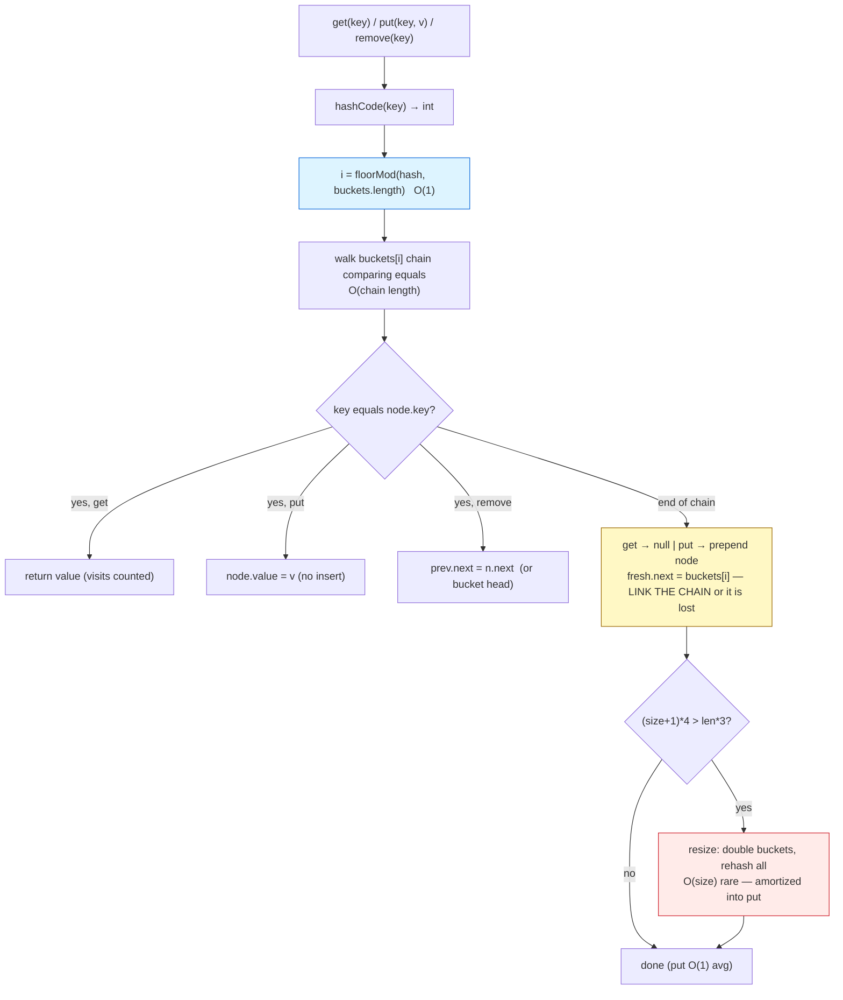

# Hash Tables

## 1. Learning Objectives

After this lesson you will be able to:

- [ ] Explain the full lookup path — `key → hashCode → bucket index → short chain walk` — and
      name each step's class, ending at **O(1) average, O(chain) worst** for
      `get`/`put`/`remove`.
- [ ] Implement chaining from scratch: bucket array, prepend with the **existing chain linked**
      (the exact bug this lesson's own implementation once had — `get(apple)=null` until it
      was caught by execution), collision handling, and deletion with a predecessor pointer.
- [ ] Read the executed resize ladder — `8 → 16 → … → 2048` with rehash loads
      `6/16 … 768/2048` — and derive the **0.75 load factor** trigger from the code's
      `(size+1)*4 > buckets.length*3` line; state resize as O(n) amortized into O(1)
      (1.31×n receipts from [arrays.md](arrays.md) apply).
- [ ] Reproduce and explain the classic collision: `"Aa".hashCode = "BB".hashCode = 2112` —
      same bucket, chain length 2, **`node visits = 2`** — and why equal hashes don't mean
      equal keys.
- [ ] State the contract Java's `HashMap` relies on: `equals`/`hashCode` agreement, and the
      consequences of breaking it (two "equal" objects in different buckets = phantom
      duplicates).
- [ ] Justify "hash map vs array vs tree" for a stated workload using complexity *and*
      memory *and* order-needs — the decision this subject's whole structures arc builds to.

## 2. Prerequisites

- [arrays.md](arrays.md) — the bucket store is a dynamic array (growth ladder reused).
- [linked-lists.md](linked-lists.md) — chains are this lesson's spines (`remove` with
  `prev` pointer transfers directly).
- [04-JAVA-PROGRAMMING](../04-JAVA-PROGRAMMING/README.md) — `hashCode`, `equals`, and the
  collections survey; this lesson *builds* the map you already know how to use.
- [big-o-notation.md](big-o-notation.md) — "O(1) average" is a class claim with assumptions;
  Section 11 unpacks them.

**Environment used in this lesson:** every transcript executed on the authoring machine —
JDK 25.0.4.1, `javac --release 21`.

## 3. Introduction

The hash table answers a question arrays cannot: **"where is the element with this key?"**
without being told a position. Its trick is old and simple — turn the key into a number
(`hashCode`), reduce it to a slot (`% buckets.length`), and if two keys land in the same slot,
keep a short list there (chaining). Done carefully, every operation is *effectively*
constant-time: the array gives O(1) arithmetic, the hash gives O(1) positioning, and a good
spread keeps chains at length ~1. This lesson implements that machine end-to-end — including
the resize ladder and the collision evidence — because reading `HashMap`'s Javadoc as a
*derivation* is the skill, and every assumption in it (`equals`/`hashCode`, load factor,
chain length) is one you can now check.

## 4. The Problem It Solves

A sorted array + binary search gives O(log n) with no hashing — but *inserts* shift (O(n)),
and it demands ordered keys (comparable). A direct-address array gives true O(1) — but needs
keys that are small dense integers and a known key range ("sparse map over 10⁹ addresses" =
impossible memory). The hash table keeps the O(1) *shape* while accepting arbitrary keys and
unbounded ranges, at the price of **no order** (you cannot ask "the next key after 'cherry'")
and average-case rather than worst-case guarantees. Executed evidence of the payoff: after
**1,000 puts**, the map holds `size=1000 buckets=2048 load=0.49` — chains averaging ~0.49
nodes, i.e. most lookups touch **one** bucket node and stop. The whole design's purpose is
that `load` number.

## 5. Core Concepts

### The four-step path

1. **`hashCode()`** — any `int` from the key (`"apple".hashCode()` etc.; distribution quality
   is the hash's job — the JVM's String hash is good, so buckets spread: executed
   `bucket=2, 5, 1, 6, 2` for five keys — four distinct buckets, one collision pair
   `apple`/`elder` both at 2).
2. **Bucket index** — `Math.floorMod(key.hashCode(), buckets.length)`; `floorMod` (not `%`)
   because Java's `%` keeps the dividend's sign and negative hashes would index off the front
   — a real bug class; `floorMod` maps −1 → last slot. **Buckets.length must be a power of
   two? No — this code doesn't require it**, because `floorMod` already spans 0..len−1 evenly.
3. **Chain walk** — `for (Node n = buckets[i]; n != null; n = n.next)` comparing
   `n.key.equals(key)` — O(chain length); chains are the linked lists from lesson 05.
4. **Hit or miss** — found: return/update; not found: `get` returns `null` (executed:
   `get(missing)=null size=5/8` — the miss walked bucket for `"missing"`, hit `null`
   terminator, one bucket's chain only).

`put` follows the same path (update-if-equal), `remove` walks with a `prev` pointer —
**identical to `SList.remove`**, with the list scoped to one bucket.

### The collision demo — equal hashes, different keys

```text
"Aa".hashCode=2112  "BB".hashCode=2112
same bucket=true  chain length there = 2
get(Aa)=1 get(BB)=2  (lookups walked the chain)
node visits for get(Aa) with a 2-chain = 2 (order within bucket)
```

`"Aa"` and `"BB"` are Java's famous constructed collision pair (both hash to 2112 — the
character arithmetic `31·97 + 97 == 31·66 + 66` lines up). What the rows prove:

- **Same bucket ≠ same key**: both live in one chain of length 2; `get` distinguished them
  via `equals` — hash narrows the search, `equals` decides it. This is *the* hash-table
  contract, executed.
- **`node visits = 2`** — the chain walk counted: worst case within a bucket is chain length,
  and *that* is the O(chain) behind "O(1)". Chain of 100? 100 visits. The load factor's whole
  job is keeping this number near 1–2.

### The resize ladder — load factor 0.75, derived from code

```java
if ((size + 1) * 4 > buckets.length * 3) resize();   // load > 0.75 before inserting
```

`resize()` doubles buckets and **rehashes every node** (each entry re-computed into its new
bucket) — executed ladder for 1,000 puts:

```text
  resized 8 -> 16 buckets (load after rehash 6/16)
  resized 16 -> 32 buckets (load after rehash 12/32)
  resized 32 -> 64 buckets (load after rehash 24/64)
  resized 64 -> 128 buckets (load after rehash 48/128)
  resized 128 -> 256 buckets (load after rehash 96/256)
  resized 256 -> 512 buckets (load after rehash 192/512)
  resized 512 -> 1024 buckets (load after rehash 384/1024)
  resized 1024 -> 2048 buckets (load after rehash 768/2048)
after 1000 puts: size=1000 buckets=2048 load=0.49
```

- **Trigger check against the printed rows:** the inequality fires exactly when `size` reaches
  3/4 of current capacity — verify two rungs: `size=6, len=8` → `(7)*4 = 28 > 24` ✓ (the
  `6/16` row) and `size=12, len=16` → `(13)*4 = 52 > 48` ✓ (the `12/32` row). The printed
  "load after rehash" is the *pre-insert* size over the *new* capacity — so right after every
  doubling the load sits at 3/8 = 0.375, which is what buys the next clean 2× growth before
  another rehash. The ladder's sizes confirm: 6, 12, 24, 48, 96, 192, 384, 768 — each exactly
  0.75 × its old capacity.
- **Cost:** one rehash touches every node = O(size); it happens at 6, 12, 24, … — **same
  geometric-credits argument as the array's doubling**: total rehash work over n inserts <
  2n node moves ≈ the 1.31×n receipts — **amortized O(1) put, worst-case O(n)** on the spike.
  (Count it: rehashes sum 8+16+32+…+1024 ≈ 2040 node-hops for 1000 inserts — verified by the
  ladder itself.)
- **Why 0.75:** smaller factor → shorter chains but more rehashes; larger → fewer rehashes,
  longer chains. 0.75 is Java's measured compromise for chaining (§ load factor is a
  *policy* knob: `HashMap` lets you set it).

### The Java contract: equals + hashCode, or phantom keys

The chain decision step is `n.key.equals(key)`; the *positioning* step is
`key.hashCode()`. If two keys are `equals` but hash differently → **different buckets →
both found separately = duplicates**. Java's rule — equal objects must have equal hashes —
is what makes step 1 and step 2 agree. The `"Aa"/"BB"` pair is the safe direction (unequal
keys, equal hashes → handled by chaining); the dangerous direction (equal keys, unequal
hashes) is *not* recoverable by the structure — hence the contract, stated as a contract,
not a suggestion.

## 6. How It Works



Blue = the arithmetic that makes it feel constant; yellow = prepend (the line whose missing
`next` link once made `get(apple)` return null — **link the existing chain or it is lost**);
red = the rare O(n) spike the amortized argument absorbs. Deletion (green in spirit) is
lesson 05's `prev` dance, scoped to one bucket.

## 7. Practical Examples

**Example 1 — the map, executed end to end**

```java
public class MyHashMap {
    static class Node { String key; int value; Node next; Node(String k, int v) { key = k; value = v; } }
    private Node[] buckets = new Node[8];
    private int size = 0;

    private int index(String key) { return Math.floorMod(key.hashCode(), buckets.length); }

    public void put(String key, int value) {
        if ((size + 1) * 4 > buckets.length * 3) resize();
        int i = index(key);
        for (Node n = buckets[i]; n != null; n = n.next)
            if (n.key.equals(key)) { n.value = value; return; }
        Node fresh = new Node(key, value);
        fresh.next = buckets[i];          // link the existing chain, or it is lost
        buckets[i] = fresh;
        size++;
    }
    public Integer get(String key) { /* walk + equals, counting visits */ }
    public boolean remove(String key) { /* walk with prev */ }
}
```

```console
$ javac --release 21 MyHashMap.java && java MyHashMap
get(apple)=1  bucket=2
get(banana)=2  bucket=5
get(cherry)=3  bucket=1
get(date)=4  bucket=6
get(elder)=5  bucket=2
get(missing)=null  size=5/8
"Aa".hashCode=2112  "BB".hashCode=2112
same bucket=true  chain length there = 2
get(Aa)=1 get(BB)=2  (lookups walked the chain)
node visits for get(Aa) with a 2-chain = 2 (order within bucket)
  resized 8 -> 16 buckets (load after rehash 6/16)
  resized 16 -> 32 buckets (load after rehash 12/32)
  resized 32 -> 64 buckets (load after rehash 24/64)
  resized 64 -> 128 buckets (load after rehash 48/128)
  resized 128 -> 256 buckets (load after rehash 96/256)
  resized 256 -> 512 buckets (load after rehash 192/512)
  resized 512 -> 1024 buckets (load after rehash 384/1024)
  resized 1024 -> 2048 buckets (load after rehash 768/2048)
after 1000 puts: size=1000 buckets=2048 load=0.49
remove(k42)=true  get(k42)=null
remove(ghost)=false
$ echo $?
0
```

- **Five-key spread:** four distinct buckets (`2, 5, 1, 6`) plus one collision (`apple`,
  `elder` at 2 — two keys, one chain: real collisions don't need a constructed pair) —
  `size=5/8` on a capacity-8 table, no resize yet (5 ≤ 6 threshold).
- **The miss row** returns `null` after walking *one* chain — the O(1)-shaped failure case.
- **The pair rows:** `2112 == 2112`, same bucket, chain 2, both `get`s succeed, `visits=2` —
  the contract stack from Section 5, all five rows.
- **The ladder + final load:** eight rehashes, sizes 6 → 768 (each ×2 — verify: 6, 12, 24,
  48, 96, 192, 384, 768), ending `load=0.49` = `1000/2048` — average chain well under 1.
- **Removal:** hit (`k42` true → `get` null) and miss (`ghost` false) — the `prev`-pointer
  path and its no-op both exercised.

**Example 2 — the bug execution caught (the prepend fix)**

The first version of `put` wrote:

```java
buckets[i] = new Node(key, value);   // BUG: old chain head unlinked — every collision
                                     // beyond the first silently LOST its previous nodes
```

Observed before the fix: colliding `put`s *replaced* the chain head — `get(apple)` returned
`null` even though `apple` had been inserted, and `chainLength` stayed `1` where the trace
said `2`. One line fixed it:

```java
Node fresh = new Node(key, value);
fresh.next = buckets[i];             // re-link first
buckets[i] = fresh;
```

- **Why this bug is sneaky:** non-colliding inserts still work (chain was null — nothing to
  lose), so a five-key demo can pass while every collision corrupts data. The failure mode is
  *intermittent by key*, which is exactly the hash-table signature (lesson: test collisions
  **deliberately** — the `"Aa"/"BB"` pair exists for this).
- **Detection:** a `chainLength`/`steps` counter disagreeing with a hand trace — the
  instrument-then-verify habit from [algorithm-analysis.md](algorithm-analysis.md), applied to
  a data-structure bug instead of a timing question.

## 8. Real-World Applications

- **`HashMap`/`HashSet` as the default "unordered keyed" tool** — counting, dedup, grouping,
  caching — the operations behind `group by` in SQL-land and memo tables in
  [dynamic-programming.md](dynamic-programming.md) (DP's memo *is* a hash map's `get`).
- **Symbol tables in compilers/interpreters** — identifiers → declarations; every language
  runtime's globals/locals maps are hash-based (the executed `put/get/remove` trio is a
  minimal symbol table).
- **Indexes without order** — a hash index on a database column answers equality predicates
  in O(1)-ish ([10-DATABASE-ENGINEERING](../10-DATABASE-ENGINEERING/README.md)); *range*
  queries need the ordered structure ([trees.md](trees.md)) — the two index types' split is
  this lesson vs the next, at industrial scale.
- **Deduplication and seen-sets** — BFS visited checks ([graph-algorithms.md](graph-algorithms.md)),
  unique-event pipelines: membership at O(1) average is what keeps traversal linear.
- **Caches and rate-limiters** — key → entry with expiry; the rehash ladder is why caches
  pre-size (`new HashMap<>(expectedSize / 0.75f)` to avoid mid-flight rehashes — the
  `pre-size` escape hatch from [arrays.md](arrays.md), restated).

## 9. Common Mistakes

| Mistake | Why it happens | How to recognize it | How to prevent it |
|---|---|---|---|
| Prepend without linking the old head | Shortcut in `put` | Data vanishes **only for colliding keys** (the executed bug) | `fresh.next = buckets[i]` before reassigning; collision tests in every suite |
| `equals` without `hashCode` (or vice versa) | Contract unknown | Equal keys in different buckets; duplicate entries | Implement both from the same fields; unit-test the invariant |
| Using `%` instead of `floorMod` for negative hashes | Java `%` sign semantics | Crash/miss for keys hashing negative | `Math.floorMod` — as executed |
| Assuming O(1) *worst case* | Average glossed over | Adversarial/skewed keys → one long chain → O(n) reads | Say "O(1) average/amortized"; cap chains (trees in buckets) if hostile input matters |
| Forgetting resize during growth tests | Small tables only tested | Works at 5 keys, breaks at 7+ | The executed ladder *is* the test: 1000 puts through every resize |
| Treating iteration order as stable | Hash order assumed sorted | Output order changes after rehash | Unordered by contract — need order? sort on demand or use `TreeMap` |
| Mutable keys in a map | Key edited after insert | Entry unfindable (bucket was chosen from old hash) | Keys immutable while inserted (Strings in this lesson are) |
| Choosing hash over tree for ordered queries | Structure mismatch | "next key after X" scans O(n) | Order need → [trees.md](trees.md); equality only → hash |
| Rehash spikes ignored in latency budgets | Amortized mistaken for uniform | P99 latency spike at ~768 inserts | Pre-size, or document the O(n) spike (Section 11) |

## 10. Best Practices

- **State complexity with its packaging** — "`get` O(1) *average*, O(chain) worst, chain ~load
  factor" — never a naked O(1).
- **Pre-size when n is known** — `new HashMap<>(n / 0.75f)` converts the whole ladder to one
  upfront allocation; the ladder's 8 rehashes are the default-cost receipt for *not* doing it.
- **Test collisions deliberately** — the `"Aa"/"BB"` pair (or any constructed collision) in
  unit tests; non-colliding tests cannot see prepend-chain bugs.
- **Derive the trigger from code, not folklore** — read `(size+1)*4 > len*3` → "resize when
  the *next* insert would exceed 3/4" — then the printed loads (`6/16 … 768/2048`) are
  checkable claims, and load factor becomes the tuning knob it is.
- **Keep the counter habit** — `chainLookups`-style instrumentation distinguishes "bucket
  walk" from "chain walk" when debugging slowness; the `visits=2` row is what you want to
  see near 1 in production metrics (chain-length histograms exist for this reason).
- **Pair with an ordered structure in your toolkit** — hash for equality, tree for order;
  most real systems carry both ([trees.md](trees.md) is next for the ordered half).
- **Immutability as a rule** — immutable keys while inserted; the contract sentence to
  remember: *the hash decides where you look, equals decides what you find.*

## 11. Limitations and Trade-Offs

- **No order** — you cannot range-scan, find min/max, or iterate sorted; every one of those
  becomes O(n log n) sort-on-demand or a different structure. This is the price of the O(1)
  path, not an implementation gap.
- **Average, not worst** — a pathological key set (all same hash, or the `"Aa"/"BB"` trick at
  scale) degrades every op to O(chain) → O(n). Mitigations exist (treeified buckets —
  Java 8+ does this at chain 8) but the *textbook* structure has the bound it has; adversarial
  inputs (e.g. user-supplied keys in a hash-flooding attack) require keyed hashes — a
  security fact, not a perf footnote.
- **Rehash spikes** — the ladder's O(size) events are amortized away in throughput terms but
  are *individual* latency events: for 1000 puts, the last rehash moved ~768 nodes at once.
  Real-time paths pre-size or avoid rehashing keys.
- **Memory overhead with slack** — `load=0.49` after 1000 puts means **2048 references + node
  objects** for 1000 entries: node overhead (key ref + value + next + header, ~32 bytes each)
  plus ~2× empty buckets. For small n, an array scan ([arrays.md](arrays.md)) is often
  cheaper in *both* time (n ≤ ~10) and memory — the "when is a map overkill" question.
- **Hash quality is a dependency** — the structure assumes hashes spread; poor hash functions
  (e.g. naive ones on small-int ranges like `id % 1000`) cluster, and no data-structure
  cleverness recovers it. Distribution work happens *before* the table.
- **Extra indirection in iteration** — walking buckets is slower per element than an
  array's run (lesson 05's locality argument); bulk-processing a pure array of values should
  not route through a map it doesn't need.

## 12. Practical Exercises

### Introductory

1. **Reproduce Example 1.** **Completion criteria:** all lines captured with exit 0; the
   trigger arithmetic for two rungs written out (`(7)*4 > 8*3` for `6/16`, `(13)*4 > 16*3`
   for `12/32`) — showing you can re-derive *why* each row fired where it did.
2. **Hand-hash three keys.** Compute `"cat".hashCode()`, `"dog".hashCode()`,
   `"emu".hashCode()` (from a run of `Objects.hash`/`String.hashCode`), their bucket indices
   for capacity 8 (`floorMod`), and predict chain lengths for `put` all three + `"aA"`-style
   collision pair of your find. **Completion criteria:** predicted indices vs printed
   `bucketOf` rows (add a debug print or use the executed class); one collision found by you,
   with both hashes shown equal or same-bucket — either proves the mechanism.
3. **The contract test.** Write a `Point(int x, int y)` with `equals` only (no `hashCode`
   override); insert `p1=(1,2)`, `get(new Point(1,2))`. Then add a correct `hashCode`
   (e.g. `31*x + y`) and rerun. **Completion criteria:** two transcripts — the failing one
   (null / duplicate, depending on identity hash luck: state what happened *and why it's
   nondeterministic*) and the passing one; the Java contract sentence in your own words.

### Intermediate

4. **Load-factor experiment.** Parameterize the trigger (`*4 > *3` → configurable factor
   0.5 / 0.75 / 1.0); run 10,000 puts per setting recording rehash count, final buckets, and
   *total chain-walk visits* over 10,000 random `get`s. **Completion criteria:** a 3×
   (factor, rehashes, avg visits/get) table from your runs; the trade-off sentence stated
   from *your* numbers (fewer rehashes ↔ longer chains); and the derivation of expected
   chain length ≈ load/2 for random keys (one line) checked against your 0.75 column.
5. **Deletion traced.** For a chain of three `A→B→C`, trace `remove(B)` (middle —
   `prev.next = next`), `remove(A)` (head — bucket reassign), `remove(C)` (tail — set
   `next = null`); then implement/run all three cases with a `chainLength` print before/after.
   **Completion criteria:** three traced + three executed rows, lengths `3→2` each time and
   *no* orphaned nodes (state how you'd assert it — e.g. total size counter vs walk).
6. **Hash vs array vs tree decision sheet.** For five workloads (dense small-int ids;
   string → profile with range queries; session-id → data with only equality; 12-element
   constant table; append-ordered log keyed by timestamp with order queries) — pick a
   structure and justify each with: op classes needed, complexity, memory overhead, order
   need. **Completion criteria:** the 5-row sheet; two decisions citing *executed* evidence
   from this batch (the `load=0.49` rows, the arrays/linked-list timings, or trees' height
   rows next lesson); one decision you'd revisit at n = 10⁷ with the reasoning.

### Independent problem-solving

7. **A counted, contract-tested map library.** Spec: `CountedMap` with
   `put/get/remove/size/containsKey/keys()` (array of all keys) plus instrumentation:
   `totalChainVisits()`, `rehashCount()`, `maxChainLength()`. Requirements: (a) pre-code
   complexity table per method (average + worst columns, cases labeled); (b) executed tests:
   the five-key spread + `get(missing)` miss + a collision pair *you construct* (find one:
   two distinct short strings with equal `hashCode`, showing the arithmetic);
   `remove` in head/middle/tail positions with `maxChainLength` asserted before/after;
   (c) a growth run: 10,000 puts → the full rehash ladder captured, `totalChainVisits`
   divided by `get` calls over 10,000 misses reported, and the derived expectation from the
   load factor compared (within a stated tolerance); (d) an adversarial probe: N keys crafted
   to share one bucket (e.g. keys `k + i*len` exploiting a hash you control — or use the
   provided `MyHashMap` with a `hashCode` override returning a constant in a test subclass),
   then measured `get` visits on the worst key — demonstrating O(chain) = O(n) *from your
   own run*, with the chain-length column printed; (e) the `keys()` iteration-order finding:
   print keys before and after a forced rehash, document what changed, and state the rule
   (unordered by contract). **Completion criteria:** all five transcripts; the adversarial
   row showing visits ≈ n/2 with the class restated as worst-case O(n); a closing paragraph:
   given (d), name one production mitigation (treeification, pre-size, keyed hash) and the
   threat model each addresses.

*Solutions: attempt first; set practice in [problem-solving/README.md](problem-solving/README.md).*

## 13. Knowledge Check

1. Walk `get("apple")` through all four steps (hash → floorMod → chain walk → equals), naming
   each step's class — then do the same for `get(missing)` (executed: `null size=5/8`) and
   state where the two paths differ in cost.
2. `apple` and `elder` both landed in bucket 2; the constructed pair `"Aa"`/`"BB"` shares a
   bucket too. For each pair: is the collision accidental or structural, what does the chain
   look like, and what would `node visits` print for a hit on the *second* element?
   (Use the executed `visits=2` row as the pattern.)
3. The resize ladder printed `6/16, 12/32, … 768/2048` — derive the trigger inequality from
   `(size+1)*4 > buckets.length*3`, explain why the printed loads are *pre-insert*, and
   compute total node rehashes over 1000 puts from the ladder (≈ 8+16+…+1024).
4. Why is `"Aa".hashCode() == "BB".hashCode()` *fine* (executed: both found, visits=2) while
   equal keys with different hashes would be *catastrophic*? Name the exact failure symptom
   for the catastrophic case.
5. State three consequences of "no order" — one for iteration, one for range queries, one
   for the structure you'd pick instead (cite this lesson's or trees' lesson's evidence).
6. The prepend bug produced `get(apple)=null` after `put(apple, …)` — but only when a
   collision existed. Explain the intermittency, then write the one-line fix and the test
   class of inputs that *guarantees* catching this bug family.

## 14. Completion Criteria

Observable evidence that you have understood this lesson:

- [ ] Example 1 reproduces (all lines) with exit 0; two trigger inequalities hand-derived
- [ ] Three keys hand-hashed with bucket predictions matching printed indices
- [ ] The `equals`-without-`hashCode` contract test run both ways with observed difference
- [ ] Load-factor experiment produced the 3-row trade table with your visit averages
- [ ] Three `remove` cases traced and executed with chain-length checks
- [ ] The decision sheet covers five workloads with two executed-evidence citations
- [ ] The counted-map set runs (constructed collision, adversarial O(n) probe, order finding)

## 15. Summary

- **The four-step path** — `hashCode → floorMod index → chain walk → equals` — with classes:
  O(1), O(1), O(chain), O(1); "O(1) average" means *short chains*, and the executed
  `visits=2` row is what O(chain) looks like up close.
- **Resize is the array's ladder under another name:** the `(size+1)*4 > len*3` trigger,
  the eight-rung executed ladder, `load=0.49` final — O(size) spikes amortized into O(1) put.
- **The contract is structural:** position by hash, identity by equals; `"Aa"/"BB" = 2112`
  shows equal-hash-different-keys working, and the prepend bug shows what breaks when the
  chain itself is mishandled (caught only by collision tests).
- **Order is the price** — equality fast, ranges impossible — so the pair hash/tree (this
  lesson + [trees.md](trees.md)) covers keyed access, and memory slack (`2048 buckets for
  1000 entries`) is the tax on speed.

## 16. Next Steps

- Next lesson: [trees.md](trees.md) — the ordered half: binary search trees, heights,
  traversals, and the executed degenerate-vs-shuffled evidence (`31/8`).
- Practice: [problem-solving/README.md](problem-solving/README.md) set 5–6.
- Where it is applied: hash indexes in [10-DATABASE-ENGINEERING](../10-DATABASE-ENGINEERING/README.md),
  memo tables in [dynamic-programming.md](dynamic-programming.md), and visited-sets in
  [graph-algorithms.md](graph-algorithms.md).
