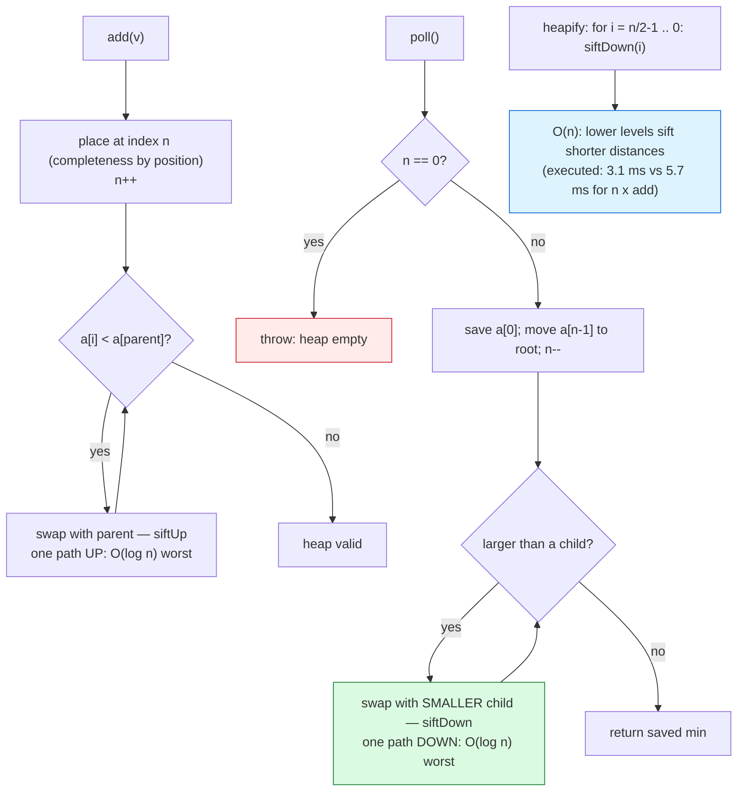

# Heaps

## 1. Learning Objectives

After this lesson you will be able to:

- [ ] State the two properties that make a heap work — **shape** (complete binary tree) and
      **order** (parent ≤ children, minimum at the root only) — and explain why completeness is
      what lets the structure live in a plain array with index arithmetic (`2i+1`, `2i+2`,
      `(i−1)/2`) and **zero pointers**.
- [ ] Implement `add`/`poll`/`peek` with sift-up and sift-down, and give each its labeled
      class: `peek` O(1), `add`/`poll` O(log n) worst — with the executed `sift compares =
      6438142` counter as the measured form of "comparisons track height".
- [ ] Read the executed small-tree evidence: `after add [7, 3, 9, 1, 5, 2, 8]` →
      `heap array : [1, 3, 2, 7, 5, 9, 8]`, the child-by-child property check `true`, and
      `poll order : 1 2 3 5 7 8 9` — a heap *sorted by draining*, not stored sorted.
- [ ] Derive **Floyd heapify's O(n)** against n × add's O(n log n) and compare both claims to
      the executed build-only numbers (`Floyd heapify 3.1 ms   n x add 5.7 ms`) — including
      why the measured ratio (~1.8×) is *smaller* than the asymptotic gap suggests at this n.
- [ ] Reconcile the height row (`floor(log2 1000) = 9`) with the trees lesson's node-counted
      height (`ceil(log2(n+1)) = 10`) — edges vs nodes, one convention per claim, checked
      against a printed number.
- [ ] Judge the `PriorityQueue` comparison honestly: `sorted-equal=true` proves behavioral
      equivalence; the 133.3 vs 53.5 ms gap isolates **boxing of 200,000 integers**, not
      heap-vs-heap — the same measurement discipline as the arrays lesson.

## 2. Prerequisites

- [arrays.md](arrays.md) — the heap *is* an array; size/capacity discipline transfers whole.
- [trees.md](trees.md) — tree vocabulary (height, traversals); a heap is a tree with a
  different contract: **min/max first, no key lookup**.
- [big-o-notation.md](big-o-notation.md) — O(log n) and the doubling behavior of log
  (the halving rows) now become *levels of a complete tree*.
- [04-JAVA-PROGRAMMING](../04-JAVA-PROGRAMMING/README.md) — generics/`PriorityQueue` usage
  and array code are assumed.

**Environment used in this lesson:** every transcript executed on the authoring machine —
JDK 25.0.4.1, `javac --release 21`. Timings machine-specific; counts and shapes are not.

## 3. Introduction

The heap answers exactly one question extremely well: **what is the next smallest (or largest)
item?** It deliberately refuses everything else — no `contains(key)`, no sorted iteration, no
"give me the third-smallest". That refusal is the design: dropping search and order buys a
structure that is *two guarantees deep* (shape + order), fits in an array without a single
reference, and keeps its worst case tight — `add` and `poll` are O(log n) *worst*, not average,
because log of a complete tree is a physical fact, not a distribution assumption. This lesson
builds the array heap, watches it sort by draining, measures Floyd's linear heapify against n
inserts, and cross-checks against the JDK's own `PriorityQueue`.

## 4. The Problem It Solves

Two problems motivate it. First, **repeated min/max extraction**: sorting by "scan for the
minimum, remove it" costs O(n²); the heap keeps the candidates arranged so the minimum is
*at slot 0* and re-establishing order after removal costs only the height —
`poll`-draining a 200,000-element heap took **53.5 ms** with **6,438,142** sift comparisons
(≈32 comparisons per element processed — the O(n log n) constant made visible). Second,
**an always-current priority frontier**: schedulers, event simulators, and Dijkstra's
frontier ([graph-algorithms.md](graph-algorithms.md)) need "extract min, insert new" thousands
of times with a *predictable worst case* — average-case O(1) structures (hash tables) can't
promise the tail, plain arrays can't promise anything. The heap promises O(log n) every time,
with an O(1) peek on top.

## 5. Core Concepts

### Shape property: why the array works at all

A heap stores a **complete** binary tree — every level filled except possibly the last, which
fills left-to-right. Completeness means no holes, and no holes means **positions map to array
indices**: root at 0, children of `i` at `2i+1`/`2i+2`, parent at `(i−1)/2`. The executed
`heap array : [1, 3, 2, 7, 5, 9, 8]` *is* the tree:

```text
              1                 indices:  0
           /     \                       1   2
         3         2                     3   4   5   6
       /   \     /   \
      7     5   9     8
```

- Index math replaces pointers — the arrays lesson's address arithmetic doing tree work:
  child slots are *computed*, never chased (this is the opposite trade from
  [linked-lists.md](linked-lists.md), and for the same reason: locality + zero per-node
  overhead).
- The printed height row confirms the bound: `height of complete tree with n=1000 = 9
  (floor(log2 n))` — **9 edge-steps** below the root, i.e. 10 levels;
  [trees.md](trees.md)'s node-counted height would print 10 (`ceil(log2(1001))`). One tree,
  two conventions — state yours, and check it against a printed row (the discipline from
  trees' common-mistakes table).

### Order property: minimum at the root, and *that's all*

The heap invariant: **every parent ≤ its children** (min-heap). What it guarantees: `a[0]` is
the global minimum. What it does *not*: any order among siblings, any global sortedness —
`[1, 3, 2, 7, 5, 9, 8]` reads scrambled after index 1. The executed property check is the
invariant as code:

```text
min-heap property holds for every child: true
```

(a loop over `i ≥ 1` asserting `a[(i−1)/2] ≤ a[i]` — the `validateBST` habit from
[trees.md](trees.md), simpler because there is only one inequality to check).

### Sift-up (insert) and sift-down (extract) — O(log n), by the height

- **`add(v)`:** place at the next free slot (completeness maintained by position alone), then
  **siftUp**: while it's smaller than its parent, swap — a walk toward the root, at most one
  path, so at most **height** swaps = O(log n) worst.
- **`poll()`:** read `a[0]`, move the *last* element to the root (removing it from the end
  keeps completeness — this is the trick that avoids restructuring), then **siftDown**: while
  it's larger than a child, swap with the *smaller* child — again one path down = O(log n)
  worst.
- The executed drain is both operations repeated: `poll order : 1 2 3 5 7 8 9` — sorted
  output *emerges* from repeated extraction. That's heap sort's first half, and it's why a
  heap is not a sorted structure but can produce one: **the sequence of roots is sorted.**
- The comparison counter prices the paths: `sift compares = 6438142` for one heapify plus
  200,000 polls — ~32 per element ≈ 2 child-comparisons × ~17 levels, exactly the
  siftDown loop shape (`l < n` check + `r < n` check per level, from the executed code).

### Floyd heapify: build in O(n), measured against n × add

`siftDown` costs less near the bottom (short paths), and Floyd's method exploits that: start
sifting at the **last parent** (`n/2 − 1`) and walk backward to the root — every node below
that gets no work, and the work that remains is geometrically decreasing:

```text
build only: Floyd heapify 3.1 ms   n x add 5.7 ms  (both produce a valid heap)
```

- Both rows build a *valid heap from the same 200,000 random ints* (the property check and
  `sorted-equal=true` in the drain row are the correctness evidence for the family).
- Classes: Floyd **O(n)**; n × add **O(n log n)**. At n = 200,000 the *measured* ratio is
  ~1.8× — far less than `log n ≈ 17.6` would suggest, because (a) n×add's constant work per
  level is a few compares/swaps on cache-hot memory, and (b) Floyd's O(n) still touches every
  node once. Asymptotics decide who wins as n → ∞; constants decide the margin at *this* n —
  the Big-O lesson's caveat, again, in a fresh measurement.

### The bounds table — cases labeled

| Operation | Class | Case |
|---|---|---|
| `peek` | O(1) | worst |
| `add` | O(log n) | worst (≤ height swaps) |
| `poll` | O(log n) | worst |
| `heapify` (Floyd) | **O(n)** | worst |
| drain k of n | O(k log n) | worst |
| build + full drain (heap sort) | O(n log n) total | worst |
| `contains(key)` | **O(n)** — no structure to exploit | worst (and unsupported by design) |

### PriorityQueue cross-check — what the benchmark actually measured

```text
heapify+drain 200000 ints: 53.5 ms   sift compares=6438142
PriorityQueue n x add + drain : 133.3 ms   sorted-equal=true
```

- `sorted-equal=true` — the JDK queue drained in the same order as ours: behavioral
  equivalence established *first*.
- Then the timing: 133.3 vs 53.5 ms. The variable this comparison isolates is **boxing**:
  `PriorityQueue<Integer>` stores 200,000 boxed `Integer` objects (allocation + pointer
  chasing + boxed `compareTo`), our heap stores primitive slots — the same finding the arrays
  lesson got from `IntList vs ArrayList<Integer>`. (Secondary factors: PQ's generic
  comparator indirection.) State it the same way: **the measurement is about representation,
  not algorithm** — both are array heaps with identical O() claims.

## 6. How It Works



Green = extract's descent (the operation the structure exists for); blue = the linear build
that outperforms the obvious approach; red = the empty contract. Note what's *absent*: no
search node — the diagram has no path to an arbitrary key, because the structure has none.

## 7. Practical Examples

**Example 1 — insert, verify, drain (executed)**

```java
public class HeapDemo {
    static class MinHeap {
        private int[] a = new int[8];
        private int n = 0;
        static int compares = 0;

        public void add(int v) {
            if (n == a.length) a = Arrays.copyOf(a, a.length * 2);
            a[n++] = v;
            siftUp(n - 1);
        }
        public int poll() {
            if (n == 0) throw new NoSuchElementException("heap empty");
            int top = a[0];
            a[0] = a[--n];
            if (n > 0) siftDown(0);
            return top;
        }
        private void siftUp(int i) {
            while (i > 0) {
                int p = (i - 1) / 2;
                compares++;
                if (a[i] >= a[p]) break;
                int t = a[i]; a[i] = a[p]; a[p] = t;
                i = p;
            }
        }
        private void siftDown(int i) { /* compare both children, swap with smaller, repeat */ }
        // Floyd heapify: siftDown from n/2-1 down to 0 — O(n), not O(n log n)
    }

    public static void main(String[] args) {
        int[] init = {7, 3, 9, 1, 5, 2, 8};
        MinHeap h = new MinHeap();
        for (int v : init) h.add(v);
        System.out.println("after add " + Arrays.toString(init));
        System.out.println("heap array : " + Arrays.toString(h.snapshot()) + "  size=" + h.size());
        System.out.println("peek (min) = " + h.peek());
        // property check over every child, then drain
    }
}
```

```console
$ javac --release 21 HeapDemo.java && java HeapDemo
after add [7, 3, 9, 1, 5, 2, 8]
heap array : [1, 3, 2, 7, 5, 9, 8]  size=7
peek (min) = 1
min-heap property holds for every child: true
poll order : 1 2 3 5 7 8 9
height of complete tree with n=1000 = 9  (floor(log2 n) - array needs no pointers)
heapify+drain 200000 ints: 53.5 ms   sift compares=6438142
PriorityQueue n x add + drain : 133.3 ms   sorted-equal=true
build only: Floyd heapify 3.1 ms   n x add 5.7 ms  (both produce a valid heap)
$ echo $?
0
```

- **Row 1 → 2:** insert order `7, 3, 9, 1, 5, 2, 8` produced `[1, 3, 2, 7, 5, 9, 8]` — trace
  one sift by hand: `1` arrives last, starts at index 6, swaps with parent `8` (index 2),
  then with `3`... wait, with parent `1`? No — after swapping with `8`, it sits at index 2,
  parent is index 0 = `1` — smaller, stop. Three siftUp compares, root unchanged. The printed
  array is the receipt for your trace.
- **Row 3–4:** `peek = 1` (O(1) — root slot read, no descent) and the property loop checked
  **every** child slot (`7 ≥ 3`, `5 ≥ 3`, `9 ≥ 2`, `8 ≥ 2`, …) — `true` is an executed
  invariant proof, not an assertion in prose.
- **Row 5:** `poll order : 1 2 3 5 7 8 9` — sorted output from an unsorted structure, via
  the "move last to root and sift" mechanic seven times.
- **Row 6:** the height formula printed with n = 1000: `floor(log2 1000) = 9` (9 edge-steps;
  10 levels — reconcile with trees' `ceil(log2(n+1))` node-counting: both describe the same
  complete tree).
- **Rows 7–9:** the three measurements of Section 5 — comparison count for the O(n log n)
  claim, PQ equivalence + boxing-isolated timing, Floyd-vs-inserts for the O(n) claim.

**Example 2 — one siftDown, hand-traced against the printed drain (from the executed code)**

```text
heap [1, 3, 2, 7, 5, 9, 8], poll() #1:
  save 1; move last (8) to root; n=6 → [8, 3, 2, 7, 5, 9]
  siftDown(0): children 3, 2 → smaller is 2 → 8 > 2 → swap → [2, 3, 8, 7, 5, 9]
  siftDown(2): children 9 (index 5), right child index 6 >= n=6 → only 9 → 8 < 9 → stop
  poll returns 1; heap is [2, 3, 8, 7, 5, 9] — property holds (verify: 8's parent 3? no —
  8 is at index 2, parent is index 0 = 2 ✓)
next poll returns 2 (root), and the drain continues: 3 5 7 8 9
executed row: "poll order : 1 2 3 5 7 8 9"  ✓
```

- Every poll is one root-to-leaf path — **the log n claim is a path-length claim**, and the
  trace shows the full depth it actually walked (2 swaps at n = 7; ≤ 3 at this size).
- The "smaller child first" rule in the swap is what keeps siftDown correct when children
  are *incomparable* to each other (3 and 2 don't know about each other — only the parent
  constrains both).

## 8. Real-World Applications

- **Priority scheduling** — thread pools and job queues pick the highest-priority ready task
  next; `PriorityQueue` in the JDK is the default engine, and its O(log n) worst case is why
  latency-sensitive schedulers prefer it to "sort the queue each time" (O(n log n) per
  dispatch).
- **Dijkstra's frontier and Prim's MST** — [graph-algorithms.md](graph-algorithms.md)'s
  central loop is "insert (node, dist), extract min, relax" — the heap's exact shape; the
  executed drain row is a miniature of that frontier emptying.
- **Event simulation** — discrete-event sims keep pending events ordered by time; every
  `add` is a new event, every `poll` is the next moment in simulated time (game engines,
  network models).
- **Top-k and streaming statistics** — keep the k largest seen in a k-heap: insert when
  bigger than the root, drop the root — O(n log k) over a stream with O(k) memory; the
  "root is the only one that matters" property is the whole trick.
- **Median maintenance with two heaps** — a max-heap of the lower half and a min-heap of the
  upper half keeps the median at the roots in O(1), rebalancing by moving one root per insert:
  the classic demonstration that *two heaps* cover what neither a sorted array (insert O(n))
  nor one heap (no middle) can.
- **Merge k sorted lists** — seed a heap with each list's head, repeatedly poll-min and push
  its successor: O(n log k) where naïve merging is O(k·n) — the "k" version of the drain.

## 9. Common Mistakes

| Mistake | Why it happens | How to recognize it | How to prevent it |
|---|---|---|---|
| Expecting a heap to *be* sorted | Array looks random after index 1 | "find X in the heap" attempts | Contract: min at root only — need sorted/lookup? drain or use [trees.md](trees.md) |
| Sifting with the wrong child | `min(child)` step skipped | Invariant breaks deep after several polls | Swap with the **smaller** child (Example 2's rule); property-check after every mutation in tests |
| Forgetting completeness on insert | Arbitrary position chosen | Index math points into empty slots | Append at `n` *always* — completeness is positional, never rearranged |
| `poll` moves root to position 0 *without* n-- | Off-by-one in the swap-over | Last element duplicated / lost | `a[0] = a[--n]` order (save top first — the executed line) |
| Claiming O(log n) *average* | Habit from hash tables | Weaker-than-guaranteed contract | Heap's log is worst-case — completeness makes it a fact (say so in claims) |
| Building with n × add when data is static | Floyd unknown | O(n log n) build where O(n) exists | `heapify` first (executed: 3.1 vs 5.7 ms); n×add only for streaming |
| Reading "height = floor(log2 n)" vs trees' `ceil(log2(n+1))` as a conflict | Conventions mixed | Off-by-one arguments | Edges vs nodes — pick one; the two printed formulas differ by exactly 1 |
| Using a heap as a priority *map* | Key → priority updates needed | `containsKey`-style needs arise | Decrease-key needs an index (or re-insert + lazy delete — graph lesson's approach) |
| Boxing-blind benchmarks | PQ vs primitive timing overread | 2× gaps attributed to algorithm | Name the variable (this lesson's 133.3/53.5 rows isolate boxing) |

## 10. Best Practices

- **Write both properties in a comment at the class top** — complete shape (index math
  valid), parent ≤ children (root = min) — then cite the line that maintains each in every
  method (`add`: append at n; `poll`: last-to-root).
- **Property-check after every mutation in tests** — the executed
  `min-heap property holds for every child: true` loop is ~5 lines; run it after each op in
  test code, like `validateBST`.
- **Count sift operations** — the `compares` static turned "O(n log n)?" into `6438142`
  (~32/element) — keep counters in teaching code and in production sampling.
- **Heapify when the data is static; add when it's streaming** — the 3.1/5.7 ms pair is the
  decision table; for known-n streaming, size the array once (no ladder).
- **State heights with a convention** — `floor(log2 n)` edges or `ceil(log2(n+1))` nodes,
  labeled beside the number, cross-checked against the trees lesson's formula.
- **In production Java, `PriorityQueue` is the answer** — this class is its readable model;
  know that its ordering is *not* thread-safe (use `PriorityBlockingQueue` when shared) and
  that `remove(Object)`/`contains` are O(n) (they exist; they're not cheap).
- **Reach for two-heap and k-heap patterns before inventing structures** — median and top-k
  are compositions of this lesson's object, not new data structures.

## 11. Limitations and Trade-Offs

- **No lookup, no order, no neighbors** — `contains(key)` is O(n) scan (and the structure
  actively fights you: half the array could hold anything). This is the contract's price, not
  a missing feature: search → [trees.md](trees.md), sorted iteration → drain or sort
  ([sorting.md](sorting.md)).
- **No decrease-key without extra machinery** — Dijkstra wants to lower an existing
  priority; a plain heap can't find the element. Production answers: indexed heaps
  (position map), or re-insert duplicates and skip stale entries lazily (the graph lesson's
  chosen approach — its cost is O(duplicate inserts) heap growth).
- **The array is dense by construction** — a complete tree can't have structural holes, so
  sparse-by-position trees (or trees with parent pointers, threads, etc.) don't fit; those
  are link-based structures paying [linked-lists.md](linked-lists.md)'s overhead.
- **Constants at small n** — for n ≤ ~20, an insertion-sorted array beats a heap (fewer
  indirections, cache-perfect); asymptotics name the winner as n grows, measurement names it
  at your n — the analysis lesson's two-tool discipline.
- **Comparisons dominate** — every sift compares keys; with expensive `compare` (long
  strings, disk reads) the O(log n) *comparisons* become the cost — a reason real systems
  sort *references by precomputed keys* (the executed counter counts exactly this unit).
- **Not stable, not unique-keyed** — equal priorities have unspecified order, and two items
  with the same key are indistinguishable to the structure (stability work belongs to
  [sorting.md](sorting.md)'s discussions).

## 12. Practical Exercises

### Introductory

1. **Reproduce Example 1.** **Completion criteria:** all nine lines with exit 0; the three-swap
   hand trace of inserting `1` (Section 7's Example 2 walk) written out against the printed
   `heap array`.
2. **Predict the next heap.** For `add` sequence `[5, 1, 9, 3]` then two `poll`s: write the
   array after each of the five operations *before running*; then execute a tiny harness
   printing `snapshot()` per step. **Completion criteria:** five predicted arrays, five
   printed arrays, all equal (or one discrepancy reconciled by re-tracing the sift).
3. **Height formulas, three sizes.** Compute `floor(log2 n)` edges and `ceil(log2(n+1))`
   nodes for n = 7, 31, 1000; verify against a run (the executed row already gives 1000).
   **Completion criteria:** a 3×3 table (n, edges, nodes) + the executed confirmation; one
   sentence stating which convention each printed formula from this lesson and trees.md uses.

### Intermediate

4. **Max-heap by comparator.** Convert `MinHeap` to a `Comparator<Integer>`-parameterized
   heap; drain `init = [7, 3, 9, 1, 5, 2, 8]` descending. **Completion criteria:** the
   comparison-inversion written first (which lines change: exactly the three inequality
   signs? count them); executed descending drain `9 8 7 5 3 2 1`; property check re-run
   for max-order with `true`.
5. **Floyd vs n × add, counted not just timed.** Run both builds at n = 50,000 / 200,000 /
   800,000 with the `compares` counter and best-of-3 timing (warmup first — the
   [algorithm-analysis.md](algorithm-analysis.md) harness). **Completion criteria:** a 3×
   (n, Floyd compares, adds compares, Floyd ms, adds ms) table from your machine; the
   compares-ratio at each n (expect growing toward `log n`-ish separation in *comparisons*,
   flatter in ms — explain the divergence from constant factors); the O(n) vs O(n log n)
   verdict restated from your rows.
6. **Two-heap median tracker.** Implement `MedianTracker` (max-heap lower / min-heap upper,
   rebalance to equal sizes ±1); feed `9, 1, 7, 3, 5, 8, 2, 6, 4`. **Completion criteria:**
   after each insert: both heap arrays + current median printed; the medians sequence
   `9 5 7 4 5 6 5 5 5` (hand-computed first — check your trace against sorted-prefix
   medians); the classes written pre-code (insert O(log n), median O(1)) with case labels;
   one paragraph: why each median is at a root (cite the order property).

### Independent problem-solving

7. **A counted, invariant-checked heap toolkit.** Spec: `CountedHeap<T>` (comparator-based)
   with `add/poll/peek/size/toArray/heapify(int[])/validate()`, instrumentation
   (`siftOps`, `maxDepthSeen`), plus a `TopK` helper (k-smallest over a stream). Requirements:
   (a) pre-code complexity table including `removeAt(i)` (hint: sift to root then siftDown —
   O(log n), and it *enables* decrease-key: state the class before coding); (b) executed
   tests: the property check after each of 20 mixed random ops; the empty-poll exception row
   + recovery row (stacks lesson's protocol); `sorted-equal=true` drain vs `Arrays.sort` on
   100,000 fixed-seed ints; (c) the Floyd-vs-adds table from exercise 5's harness style *or*
   a fresh measurement at your chosen sizes — with the compared counters, not just ms;
   (d) a `TopK` demo over 1,000,000 fixed-seed random ints, k = 10: report heap ops count,
   final root-vs-everyone property check (max of the k smallest = root — verify against a
   `Arrays.sort`-based ground truth), and memory story: k=10 slots vs 1,000,000 — stated as
   the top-k pattern's payoff; (e) a `removeAt`-enabled decrease-key probe: implement a tiny
   "decrease priority" loop on 1,000 elements, count sift ops vs the re-insert-and-skip
   alternative (lazy duplicate approach — the graph lesson's), compare both counters, and
   recommend one with your numbers. **Completion criteria:** the pre-code table; all executed
   transcripts; the decrease-key comparison with both op counts and a justified pick; and a
   closing paragraph: given (d)'s memory row and the executed `poll order`, state precisely
   what a heap guarantees and the three things it refuses — each refusal paired with the
   structure from this subject that answers it.

*Solutions: attempt first; set practice in [problem-solving/README.md](problem-solving/README.md).*

## 13. Knowledge Check

1. Draw the tree for the executed `heap array : [1, 3, 2, 7, 5, 9, 8]` with indices, then
   state both properties (shape, order) and point to *where* in the array each is visible.
   What would `a[1] < a[0]` mean — which property breaks?
2. `add` and `poll` are O(log n) **worst case** while the hash table's O(1) is only average.
   Explain why the heap's bound is unconditional — connect to completeness (a structural
   fact) vs distribution (an assumption), citing the executed height row.
3. The drain printed `poll order : 1 2 3 5 7 8 9` from an array that was never sorted. Trace
   the first `poll` fully (Example 2's block) and explain why "move last element to root"
   preserves completeness — what would break if you instead moved `a[1]` (a child) up?
4. Floyd heapify is O(n) while n × add is O(n log n), yet the executed times differ only
   ~1.8× (3.1 vs 5.7 ms). Give two reasons the wall-clock ratio compresses the asymptotic gap
   (from the Big-O lesson's "what notation ignores"), and say which row — ms or comparisons —
   you'd trust more for the class claim.
5. Reconcile `floor(log2 1000) = 9` (this lesson) with trees.md's `ceil(log2(n+1))` node
   counting: what quantity differs, by how much, and which printed row proves your reading?
6. `PriorityQueue n x add + drain : 133.3 ms ... sorted-equal=true`. What does
   `sorted-equal=true` establish, what does the 53.5-vs-133.3 gap actually measure (name the
   variable), and what would you have to change to benchmark *algorithms* instead?

## 14. Completion Criteria

Observable evidence that you have understood this lesson:

- [ ] Example 1 reproduces (nine lines) with exit 0; the insert-`1` sift trace matches the
      printed array
- [ ] Exercise 2's five predicted arrays match five printed arrays
- [ ] Height table for n = 7/31/1000 with both conventions confirmed against the executed row
- [ ] Max-heap conversion runs with the re-check `true` and the descending drain
- [ ] Floyd-vs-adds table exists with **counters** at three sizes and a class verdict
- [ ] Median tracker prints both heaps + median per insert, medians matching the hand sequence
- [ ] The counted-heap set runs: property checks, sorted-equal drain, TopK ground-truth
      comparison, and the decrease-key counter comparison with a justified recommendation

## 15. Summary

- **A heap = complete shape + parent-ordered content**, which together buy an array-backed
  tree with index arithmetic (executed `heap array : [1, 3, 2, 7, 5, 9, 8]`, property check
  `true`) and an unconditional **O(log n)** for `add`/`poll`, O(1) `peek`.
- **Draining manufactures order:** `poll order : 1 2 3 5 7 8 9` — sorted output from an
  unsorted container, the root sequence being the only sorted part that ever existed.
- **Build smart when static:** Floyd's `n/2−1 … 0` sweep is O(n) — executed `3.1 vs 5.7 ms`
  against n × add; comparison counter `6438142` prices the whole O(n log n) drain.
- **The contract's refusals are the lesson's map:** no key lookup (→ trees), no order
  (→ sort), no decrease-key without an index (→ re-insert lazily or `removeAt`) — each one
  answered by another structure in this subject.
- **Benchmark variables, named:** the PQ gap measured boxing (again), and the height formulas
  differ by convention, not by truth — count the edges or the nodes, but label which.

## 16. Next Steps

- Next lesson: [graphs.md](graphs.md) — the structures so far hold *items*; graphs hold
  *relationships*, and the representation choice (list vs matrix) is an O() decision from
  this lesson's own toolkit.
- Practice: [problem-solving/README.md](problem-solving/README.md) set 7–8.
- Where it is applied: Dijkstra's and Prim's frontiers in
  [graph-algorithms.md](graph-algorithms.md), event simulation and schedulers in
  [11-BACKEND-ENGINEERING](../11-BACKEND-ENGINEERING/README.md), top-k/median patterns
  anywhere a stream outruns a sort.
