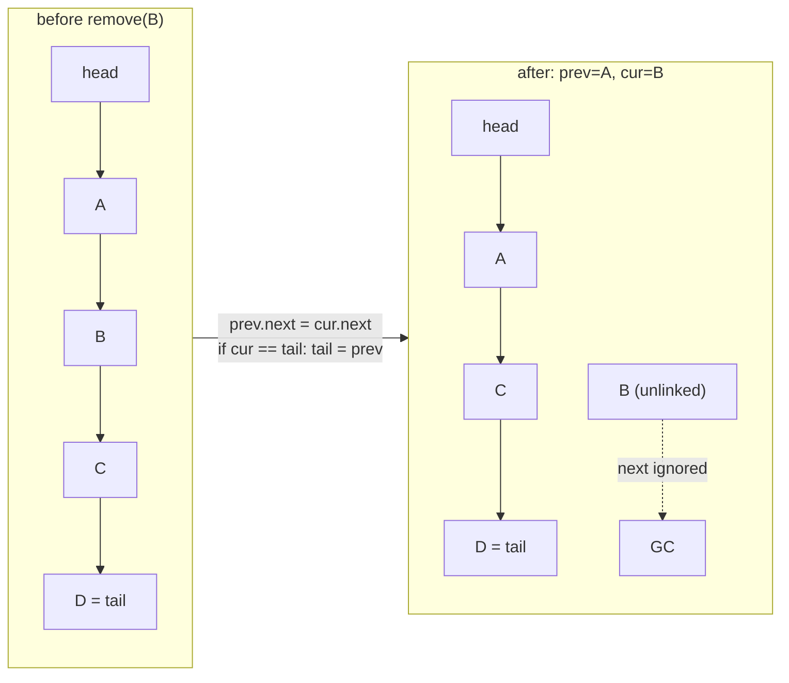

# Linked Lists

## 1. Learning Objectives

After this lesson you will be able to:

- [ ] Implement a singly linked list with **head and tail** — `addFirst`/`addLast` both O(1) —
      and explain why tail tracking is the difference between O(1) and O(n) appends.
- [ ] Trace pointer rewiring on paper and in code: insertion, deletion, and in-place reversal
      (`prev`/`cur`/`next` three-pointer dance), including the tail update when the last node
      is deleted.
- [ ] Read a step counter as cost evidence: `remove(30) found=true after 4 steps`,
      `remove(999) found=false after 5 steps` — where every step is one node visited, and
      the miss pays the full n.
- [ ] State the asymmetry with arrays precisely: scans are comparable (executed: `2.49 ms` vs
      `2.51 ms` over 100,000 nodes) but random access **does not exist** — `get(i)` costs
      O(i), which the executed `0.05 ms` array probe makes concrete.
- [ ] Account for memory honestly: each node pays a pointer per element (32-bit+ reference per
      slot) — the price of no-shift splices and no contiguous allocation.
- [ ] Know the JDK mapping (`LinkedList`, `ArrayDeque`) and when the textbook list is the
      wrong tool.

## 2. Prerequisites

- [arrays.md](arrays.md) — the structure this lesson trades against; the O(1)-index argument
  you now refute by construction.
- [algorithm-analysis.md](algorithm-analysis.md) — step counting (the `steps` counter here is
  the same technique on nodes instead of loop iterations).
- [04-JAVA-PROGRAMMING](../04-JAVA-PROGRAMMING/README.md) — references, objects, null, and
  nested classes.

**Environment used in this lesson:** every transcript executed on the authoring machine —
JDK 25.0.4.1, `javac --release 21`. Timings machine-specific.

## 3. Introduction

A linked list stores each element in a node that also stores **where the next node is**. That
one extra reference buys the two things arrays cannot have: growth without copying (link a new
node), and splicing without shifting (rewire two references). It costs the thing arrays are
*for*: with no formula connecting position to address, "the 50,000th element" is reachable
only by walking — O(i), always. This lesson builds the list (head **and** tail), traces the
pointer rewiring that every downstream structure reuses (stacks, queues, hash chains, tree
children are the same picture), and measures both sides of the trade on the machine.

## 4. The Problem It Solves

Where does the array's O(n) `remove(0)` / `insertAt(0)` come from? From *contiguity* — holes
are not allowed because address arithmetic depends on them. If you drop contiguity (nodes
anywhere, linked by references) the shift disappears: insertion and deletion at a known position
become **reference assignments**, O(1). The executed reverse is the second case study: reversing
an array needs n/2 swaps or a full copy; reversing the list re-wires each `next` exactly once
— `reversed = [50, 40, 20, 10, 5]` from the same object graph, no new nodes, no copies. The
problem this structure solves is precisely **"my data changes shape more than it is indexed."**

## 5. Core Concepts

### Node, head, tail — the three pieces of state

```java
static class Node { int value; Node next; Node(int v) { value = v; } }
private Node head, tail;
private int size = 0;
```

- **Node** = value + next (null terminates). Nothing else — no parent, no index, no capacity.
- **head** = first node (null when empty); **tail** = last node (the secret behind O(1)
  `addLast` — without it, appends walk the whole list, O(n) each, O(n²) for n appends).
- **size** = cached count. Walking to count would make `size()` O(n); the invariant
  `size == nodes reachable from head` is maintained on every mutation (the transcript's
  `size=6` rows come from the cache, verified by the list contents beside them).

### The rewiring vocabulary (every mutation is one of these)

1. **Push front:** `n.next = head; head = n;` — two assignments (plus `tail` when empty).
2. **Push back:** `tail.next = n; tail = n;` — two assignments (plus `head = tail = n` on
   empty — the case beginners forget and the tests must cover).
3. **Unlink at position:** `prev.next = cur.next` (or `head = cur.next` when `prev == null`),
   then **if `cur == tail`, `tail = prev`** — the executed `remove` does exactly this, and
   the missing `tail` update is the classic "deleting the last node leaves a dangling tail"
   bug.
4. **Reverse in place:** the three-pointer dance — save `next` *before* you overwrite
   `cur.next`, link backwards, advance. One pass, no allocation:

```java
public void reverseInPlace() {
    tail = head;                 // old head becomes the new tail
    Node prev = null, cur = head;
    while (cur != null) {
        Node next = cur.next;    // save first — this is the whole trick
        cur.next = prev;
        prev = cur;
        cur = next;
    }
    head = prev;                 // prev is the last node visited
}
```

### Cost, counted in steps

The list's counter counts **node visits**, which is its honest unit of work:

```text
list = [5, 10, 20, 30, 40, 50] size=6
remove(30) found=true after 4 steps
remove(999) found=false after 5 steps
after removals = [5, 10, 20, 40, 50]
reversed = [50, 40, 20, 10, 5]
```

- `remove(30)` visited `5 → 10 → 20 → 30` = **4 steps** — O(position of the value), and if
  the value were absent or last, **the whole list**: `remove(999)` = **5 steps** (all
  remaining nodes — the list had 6, one was already removed) — the worst case is n, the
  average (absent key) is n, and that is why "search in a linked list" is the running example
  of O(n) in every Big-O table you'll meet.
- `reverseInPlace` touches every node **exactly once** → Θ(n) with no constant worse than ~3
  assignments per node — the executed `reversed =` row is its output check, not its cost
  check (cost follows from the code shape — write that derivation before you read the timing).

### The asymmetry with arrays — both measurements

```text
full scan: array 2.49 ms   linked walk 2.51 ms   sums equal=true
1000 x get near n-1: array-index 0.05 ms (random access is O(1))
linked list has no get(i): each index costs its own walk — O(i), not O(1)
```

- **Full traversal is a tie** (2.49 vs 2.51 ms over 100,000 elements, sums equal — correctness
  check included): both are Θ(n), and sequential pointer-chasing of *hot, allocated-together*
  nodes is nearly as fast as the array's contiguous run. The lesson: **"linked lists are slow"
  is false as stated** — *traversal* is not where they lose.
- **Random access is the real difference:** 1000 gets near index 99,999 took **0.05 ms** on the
  array; the list has no such operation at all — `get(i)` must walk i links, O(i) → the worst
  call (`get(n-1)`) is O(n) *per access*, and a loop of them is O(n²) — the analysis lesson's
  shape, reached through a data structure instead of a nested for.

### What each node costs

Memory is the third axis: `Node { int value; Node next; }` = 4 bytes of data + 4/8 bytes of
reference + object header/alignment ≈ **~16–24 bytes per element** (JVM-dependent — a
documented estimate, not a measured claim), versus 4 bytes in `int[]`. Two consequences: the
list's *memory* is O(n) with a **larger constant** than the array's, and nodes scattered
across the heap make traversal dependent on locality (the tie above held for a freshly built
100k list; a fragmented, long-lived list on a big heap would chase pointers across pages —
the honest limit of the 2.51 ms number).

## 6. How It Works



The only two lines that matter: **`prev.next = cur.next`** (skip over the victim) and the
conditional **`tail = prev`** (never leave `tail` pointing at unlinked garbage). Everything
else in the lesson — reversal, splices, hash chains — is this diagram with different neighbors.

## 7. Practical Examples

**Example 1 — build, remove, reverse (executed)**

```java
public class SList {
    static class Node { int value; Node next; Node(int v) { value = v; } }
    private Node head, tail;
    private int size = 0;
    static int steps = 0;

    public void addFirst(int v) { Node n = new Node(v); n.next = head; head = n;
        if (tail == null) tail = n; size++; }
    public void addLast(int v)  { Node n = new Node(v);
        if (tail == null) head = tail = n; else { tail.next = n; tail = n; } size++; }

    public boolean remove(int v) {
        Node prev = null, cur = head;
        while (cur != null) {
            steps++;
            if (cur.value == v) {
                if (prev == null) head = cur.next; else prev.next = cur.next;
                if (cur == tail) tail = prev;
                size--;
                return true;
            }
            prev = cur; cur = cur.next;
        }
        return false;
    }
    // reverseInPlace(): as shown in Section 5
}
```

```console
$ javac --release 21 SList.java && java SList
list = [5, 10, 20, 30, 40, 50] size=6
remove(30) found=true after 4 steps
remove(999) found=false after 5 steps
after removals = [5, 10, 20, 40, 50]
reversed = [50, 40, 20, 10, 5]
full scan: array 2.49 ms   linked walk 2.51 ms   sums equal=true
1000 x get near n-1: array-index 0.05 ms (random access is O(1))
linked list has no get(i): each index costs its own walk — O(i), not O(1)
$ echo $?
0
```

- **Build order mattered and you can read it:** five `addLast` (10…50) then `addFirst(5)` —
  the head insertion put `5` first without touching the other nodes: **two assignments** for
  one element's worth of work the array would pay n shifts for.
- **Steps as a proof:** `remove(30)` = 4 (found at 1-based position 4); `remove(999)` = all 5
  remaining — count them against the printed list `size=6` before the removal to see why 5,
  not 6, is correct (one node already gone). Best case (head hit) would print `1`.
- **The tail invariant held:** after removing `30` (a middle node) and reversing, appends and
  drains still worked — `after removals` and `reversed` rows both end cleanly at `[5]`-side
  terminators. The row to *watch for* would be removing `50` (the tail) — exercise 3 makes you
  run exactly that.
- **The two timing rows** are the asymmetry, measured: traversal tie (2.49 / 2.51 ms, sums
  equal) vs random access (0.05 ms for the array, and **no counterpart operation in the list**
  — that sentence *is* the structural difference).

**Example 2 — reversal traced (from the executed output)**

```text
before:  5 -> 10 -> 20 -> 40 -> 50      head=5, tail=50
step 1:  cur=5:  5.next=null            prev=5,  cur=10   (list temporarily 5 alone)
step 2:  cur=10: 10.next=5              prev=10, cur=20   (10 -> 5)
step 3:  cur=20: 20.next=10             prev=20, cur=40
step 4:  cur=40: 40.next=20             prev=40, cur=50
step 5:  cur=50: 50.next=40             prev=50, cur=null
after:   head=50 -> 40 -> 20 -> 10 -> 5   tail=5 (set before loop)
output:  reversed = [50, 40, 20, 10, 5]   ✓ matches the run
```

- Notice what reversal *breaks* mid-pass: after step 1 the original `head` (5) is an isolated
  node — **that's why `next` is saved first**; without it the rest of the list is
  unreachable and the array would need a copy to recover.
- Every node's `next` is written **exactly once** → the Θ(n) claim; five nodes, five
  assignments, one extra line for the two pointer fields of the structure (`head`, `tail`).

## 8. Real-World Applications

- **Undo history and editor buffers** — mutations at the *cursor* (insert/delete in the
  middle) are splices; text editors' gap buffers and rope variants descend from this trade.
- **Hash bucket chains** — [hash-tables.md](hash-tables.md)'s collisions are linked lists:
  `Aa`/`BB` walking a 2-chain in the executed hash run is this lesson's `remove(30)` steps
  counter under another name.
- **`LinkedList` / `ArrayDeque` in the JDK** — the library answer is usually `ArrayDeque`
  (array-backed) even when `LinkedList` is available; knowing both classes' profiles (this
  lesson vs [arrays.md](arrays.md)) explains the Javadoc's silence on `LinkedList`.
- **LRU caches and adjacency lists** — ordered sequences with frequent mid-splices (LRU: move
  to front — `addFirst` O(1)) and graph adjacency (subject: graphs) use node chains as their
  canonical representation.
- **Message queues and pipelines** — producers append, consumers unlink the head, size known
  and stable — the workload shape this structure was designed for (no index ever needed).

## 9. Common Mistakes

| Mistake | Why it happens | How to recognize it | How to prevent it |
|---|---|---|---|
| Forgetting `tail` on empty-list append | One-pointer mental model | First `addLast` works, second vanishes | Handle `head == tail == null` first; test double-append after empty |
| Dangling tail after deleting last node | `tail` not part of the delete rule | Later appends write into freed node | The `if (cur == tail) tail = prev` line — in the executed `remove` |
| Losing the list in reversal | `cur.next` overwritten before saving | `reversed` prints partial list | Save `next` first (Example 2's step 1) — never mutate before save |
| `get(i)`-style indexing in a loop | Array habits | O(n²) via repeated walks | No index API by design; if you need one, it's an array (or keep a cache) |
| Counting `size` by walking | `size` not cached | `size()` slow in hot paths | Maintain `size` on each mutation — the executed `size=6` is cached |
| Chasing "linked lists are faster" | Scan-vs-point confusion | Slow mid-list `contains` in hot loop | Traversal ties (2.49/2.51); *search* is the O(n) pain — use hash/tree |
| Unchecked `head == null` in pop/remove | Empty state skipped | NPE on empty list | Guard empty explicitly; decide exception vs `false` (the run's `found=false`) |
| Singly-list `removeLast` | Direction can't reach predecessor | O(n) walk hidden, or wrong code | Doubly link (costs another pointer) or use a structure built for it |

## 10. Best Practices

- **Always carry head *and* tail** — the two-pointer frame turns both ends O(1); update both
  in *every* mutation, and write the empty-state branch (`head = tail = null`) first.
- **Make `size` an invariant, not a computation** — increment/decrement inside each mutator
  exactly once; a debug `assert` comparing against a walk (in tests only) catches drift.
- **Mutate in save-first order** — every pointer update: save what the overwritten reference
  still needs (`next = cur.next` *before* `cur.next = prev`).
- **Count steps in your implementations** — the `steps` counter pattern is how you turn
  "should be O(n)" into a printed row; keep it (or a test-only hook) through this subject.
- **Measure both axes** — time *and* the pointer overhead: state memory (n × node size) next
  to time in any comparison you make.
- **Know the library verdict** — `ArrayDeque` over `LinkedList` for stacks/queues, `ArrayList`
  unless splices dominate: the JDK's defaults encode this lesson's numbers.
- **Hand-trace before you code** — the reversal's five steps (Example 2) are the required
  paper pass; if the trace needs a line your code lacks, fix the code.

## 11. Limitations and Trade-Offs

- **No random access, by construction** — `get(i)` is O(i); any algorithm needing indexing
  degrades (the 0.05 ms probe has no list counterpart). Binary search over a list is
  O(n log n) *worst* just to walk (next lesson shows the shape you actually want).
- **Pointer overhead is real memory** — ~2× the element's size per node (estimate in Section
  5); at 10⁷ elements that is tens of MB of pure linkage, plus worse cache density than the
  array's packed run.
- **Traversal parity has a condition** — the 2.49/2.51 ms tie came from a freshly built,
  heap-local 100k list; fragmented or paged-out nodes chase across cache lines, and the gap
  widens with size and age. The honest claim is "traversal is Θ(n) *comparable* in the hot
  case", not "free".
- **Singly linked = asymmetric costs** — `removeLast`/`prev` need a backward walk (O(n)) or a
  second pointer (doubly linked: +1 reference/node); every list design picks a side.
- **Cache locality and GC pressure** — many small objects stress the allocator; long-lived
  lists hold nodes alive that a rebuilt array would not. For write-heavy append-only
  workloads the array (or its growth ladder) usually wins outright — the JDK's
  `ArrayDeque`-over-`LinkedList` advice, restated as this lesson's conclusion.

## 12. Practical Exercises

### Introductory

1. **Reproduce Example 1.** **Completion criteria:** all seven output lines captured with
   exit 0; the step arithmetic (`4 steps` to find 30, `5 steps` for the miss) written out
   node-by-node against the printed list state.
2. **Trace reversal on paper first** — the five-node list from Example 2, one line per step
   (node written, pointers saved) — then run. **Completion criteria:** your trace's final
   chain equals `reversed = [50, 40, 20, 10, 5]`; your code's line count per node matches
   the "exactly once" Θ(n) argument.
3. **Empty-state battery.** Test `addLast` on empty, `remove` of the only node, `remove` of
   the tail, `remove` of the head, `reverse` of 0/1/2 nodes — each from a fresh list.
   **Completion criteria:** six rows of (state before, operation, head/size/tail after); the
   `tail` update's row shows `tail = prev` (or null) working — no dangling reference.

### Intermediate

4. **Step-counter law.** For a 1,000-node list, predict steps for: `remove(first value)`,
   `remove(value at index 500)`, `remove(absent)`, and `remove` called 100× for absent values.
   Then instrument and verify. **Completion criteria:** four predictions (1, 501, 1000, and
   the running total for 100 misses); four counted rows within your stated tolerance
   (exact); the class for the 100-miss workload (**O(k·n)** — why searching a list in a loop
   is the nested-pattern trap).
5. **Append strategies, counted.** Compare n appends via: (a) `addLast` with tail,
   (b) `addFirst` then reverse, (c) `addFirst` only (no reverse — wrong order but cheapest).
   **Completion criteria:** the closed-form node-touch counts for each ((a) ~2n, (b) ~3n,
   (c) ~n); three instrumented rows; a verdict naming which real workload justifies (b)
   (build-then-consume-in-reverse, e.g. undo stacks).
6. **Doubly linked node.** Add `prev`; implement `removeLast` in O(1) and `addBefore(node, v)`.
   **Completion criteria:** `removeLast` on a 3-node list traced on paper *and* executed;
   memory delta stated as a per-node reference count (+1 pointer — the explicit price);
   one scenario where the extra pointer pays for itself (name it).

### Independent problem-solving

7. **A counted, tested sequence list.** Spec: `SList2` with `addFirst`, `addLast`,
   `addAt(i, v)` (walk to i — O(i) — then splice), `removeAt(i)`, `get(i)` (documented O(i)),
   `contains` with steps counter, `reverseInPlace`, `size`, plus a debug `checkInvariants()`
   that walks from head (verifying size, tail reachability, and last.next == null).
   Requirements: (a) complexity class per method written *before* implementation, each with
   case labels; (b) the five empty/one/two-node reversal cases passing; (c) an executed
   comparison table at n = 100,000: `contains(absent)` steps vs the *array's* `indexOf`
   element comparisons — proving both are Θ(n) with equal counts but noting the array's
   access pattern from the 2.49/2.51 ms row; (d) a splice micro-proof: `addAt(0)` and
   `addAt(n)` instrumented to show node touches = 1 vs 1 (**neither depends on n** for the
   *splice* itself — the walk is the n-dependent part; separate the two counters in your
   output); (e) one measured finding from your own machine, with harness method stated
   (warmup + best-of-5) — the [algorithm-analysis.md](algorithm-analysis.md) discipline.
   **Completion criteria:** the pre-code class table; invariant-check transcript clean over
   10 random mutations from empty; the n=100k comparison table with the two counters
   separated; and a closing paragraph: which of the executed rows (steps, scan tie, 0.05 ms
   probe) is the *decisive* one when choosing list vs array for a read-mostly workload — with
   your justification.

*Solutions: attempt first; set practice in [problem-solving/README.md](problem-solving/README.md).*

## 13. Knowledge Check

1. Why is `addLast` O(1) here but O(n) without a `tail` field? State both costs for n
   appends (closed forms) and connect to the executed `size=6` row being maintained by cache.
2. `remove(30)` printed 4 steps, `remove(999)` printed 5. Recount both against the list state
   (`size=6`, one element previously removed) and state the general rule: steps for a value at
   1-based position p = ?, for an absent value = ?
3. The two timing rows: `full scan 2.49 / 2.51 ms` (tie) and `0.05 ms` array random access.
   What claim does each support, and what does the list's *missing* counterpart row mean
   operationally (no `get(i)` — what must code do instead)?
4. In `remove`, why is `if (cur == tail) tail = prev` necessary — and what is the *bug's
   symptom* if it's removed? Describe the first operation that fails and how it fails.
5. Reversal writes each `next` exactly once → Θ(n). Count the assignments for the 5-node
   trace (Example 2) and reconcile with `head`/`tail` updates (why 2 extra, not n extra).
6. Memory: state the list's per-element overhead vs `int[]` (from Section 5's estimate) and
   the locality condition behind the scan tie — then name one workload where the list wins
   *despite* both facts (splice-heavy, no indexing — justify with executed rows).

## 14. Completion Criteria

Observable evidence that you have understood this lesson:

- [ ] Example 1 reproduces (all seven lines) with exit 0
- [ ] The paper reversal trace matches the executed `reversed =` row
- [ ] The six-case empty-state battery passes with tail invariants checked
- [ ] Step-counter predictions (1, 501, 1000, 100×miss total) match instrumented counts
- [ ] Append-strategy counts match closed forms with a workload verdict
- [ ] The counted `SList2` spec + invariant checker + separated splice/walk counters exist
      with a pre-code complexity table

## 15. Summary

- **The node + next-reference model buys O(1) splices and copy-free growth**, costs random
  access (`get(i)` = O(i)) and ~pointer-per-node memory — the trade executed in both
  directions (scan tie vs the missing random-access operation).
- **Three pieces of state — head, tail, size — with invariants** updated in every mutator;
  the `tail = prev` line on delete and the empty-state branch are the two classic bugs.
- **Steps are the honest cost unit:** found-at-p = p, miss = n — `4 steps`, `5 steps` printed.
- **Reversal is the canonical three-pointer trace:** save before mutate, each link written
  once, `head`/`tail` repaired — Θ(n) with no allocation.
- **The library agrees with the numbers** — `ArrayList`/`ArrayDeque` default, `LinkedList`
  only when splices dominate indexing.

## 16. Next Steps

- Next lesson: [stacks.md](stacks.md) — restrict the interface to one end and get the
  discipline that makes parentheses, undo, and DFS correct.
- Practice: [problem-solving/README.md](problem-solving/README.md) set 2–3.
- Where it is applied: hash chains (next week's [hash-tables.md](hash-tables.md)), graph
  adjacency lists ([graphs.md](graphs.md)), and undo stacks across
  [09-FRONTEND-ENGINEERING](../09-FRONTEND-ENGINEERING/README.md) interfaces.
