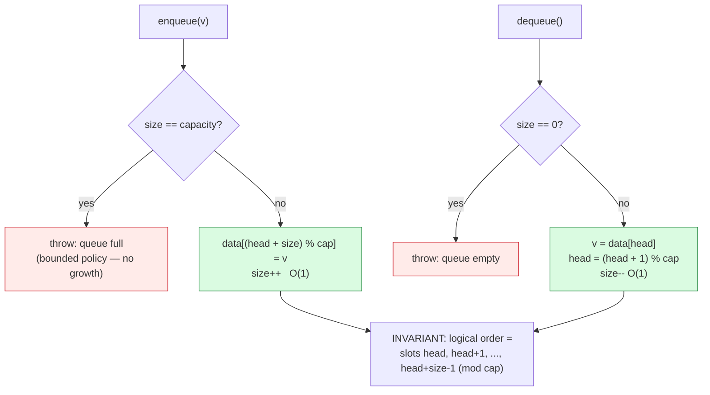

# Queues

## 1. Learning Objectives

After this lesson you will be able to:

- [ ] State the FIFO contract precisely — first in, first out — and explain what class of
      problems it models (scheduling, buffers, breadth-first anything) that LIFO cannot.
- [ ] Implement a **ring buffer** queue over a fixed array — `head` + `size`, wrap with
      modulo — and trace the executed wrap (`wrapped: [6, 2, 3, 4, 5] head=2 size=4`) and
      full/empty boundaries (`queue full`, `queue empty`).
- [ ] Explain why the naive "shift everything left on dequeue" design is O(depth) per dequeue
      and defend the ring's O(1) with the executed benchmark: **`ring 0.82 ms` vs
      `shift-all-dequeue 60.6 ms`** at depth 10,000 (~74× on the same machine, same
      workload).
- [ ] Read every state line of the ring transcript (`head`, `size`, slots) as an invariant
      check — `0 ≤ size ≤ capacity`, `head < capacity`, logical order = slots
      `(head…head+size-1) mod capacity`.
- [ ] Distinguish the three queue flavors and their costs: fixed ring (this lesson, bounded
      and full-capable), growable ring (`ArrayDeque`), and linked queue (copy-free growth,
      pointer overhead).
- [ ] Handle the two boundary errors explicitly — enqueue-when-full and dequeue-when-empty —
      with the executed exception rows as the contract.

## 2. Prerequisites

- [arrays.md](arrays.md) — backing storage, the growth ladder (this lesson's fixed ring
  deliberately *doesn't* grow — Section 11).
- [stacks.md](stacks.md) — one-cursor discipline; the queue is where the second cursor
  (and modulo arithmetic) earns its complexity.
- [linked-lists.md](linked-lists.md) — the head/tail alternative implementation for
  Section 11's comparison.
- [04-JAVA-PROGRAMMING](../04-JAVA-PROGRAMMING/README.md) — arrays, `%`, exceptions.

**Environment used in this lesson:** every transcript executed on the authoring machine —
JDK 25.0.4.1, `javac --release 21`. Timings machine-specific.

## 3. Introduction

A queue is a structure with **two ends and one rule**: append at the back, remove from the
front, in arrival order — the model of everything that must be handled in sequence: tasks,
messages, print jobs, requests, the waiting line itself. The rule is trivial; the
implementation is where the lesson lives. Removing the front element of an array by shifting
is O(n) *every dequeue* (O(n²) for a drain — the analysis lesson's shape arriving via a data
structure), so the real design question is: **how do you remove from the front without moving
anything?** The answer — circular indexing, a ring buffer — is one `%` operator, and this
lesson executes both designs head-to-head to show the ~74× difference.

## 4. The Problem It Solves

FIFO is a *correctness* requirement before it is a performance one: a CPU scheduler that ran
the newest short job first would starve the oldest work forever; a breadth-first search that
took the most recently discovered node first would be depth-first instead (see
[graph-algorithms.md](graph-algorithms.md) — the algorithm *is* the queue's order policy).
Given FIFO is required, the implementation problem is the O(depth) shift: with 10,000 items
waiting, each dequeue memmoves 10,000 elements — the executed benchmark's
`shift-all-dequeue 60.6 ms` for only 10,000 pairs. The ring buffer makes dequeue a
*cursor advance* (`0.82 ms` for the same pairs): the queue stops paying for its own length.

## 5. Core Concepts

### FIFO contract and the three operations

- `enqueue(v)` — append at the back; `dequeue()` — remove from the front;
  `size()`/`isEmpty()` — the observables.
- Order proof obligation: a drain must print **insertion order**. The executed
  `FIFO drain: 3 4 5 6 7` (after interleaved enqueues/dequeues/wrap) is that proof —
  compare `LIFO drain: 3 2 1` from [stacks.md](stacks.md): same machine, opposite order,
  two structures.

### The ring: `head` + `size`, wrap with modulo

```java
public class RingQueue {
    private int[] data;
    private int head = 0, size = 0;          // front at data[head]; count = size

    public RingQueue(int capacity) { data = new int[capacity]; }

    public void enqueue(int v) {
        if (size == data.length) throw new IllegalStateException("queue full");
        data[(head + size) % data.length] = v;   // next free slot, wrapping
        size++;
    }
    public int dequeue() {
        if (size == 0) throw new NoSuchElementException("queue empty");
        int v = data[head];
        head = (head + 1) % data.length;         // advance, wrapping
        size--;
        return v;
    }
}
```

- **`size` is the truth, not slot contents.** After dequeues, stale values stay in the array
  (`start`/`deq` rows below still show `1, 2, 3` in their slots) — they are *outside the
  logical window* `[head, head+size) mod capacity`. The invariant that lets you ignore them:
  **only the `size` slots starting at `head` are elements** — reading beyond is reading
  garbage-by-contract (same discipline as `top` in the stack).
- **Full vs empty are distinguishable** because `size` is explicit: full = `size == capacity`,
  empty = `size == 0`. (The alternative design — `head == tail` with no size — collides
  full/empty unless it wastes a slot; knowing *why* this design keeps `size` is the
  takeaway.)
- **Costs:** `enqueue`/`dequeue` both **O(1) worst** — no growth copy exists (fixed array) and
  no shift exists (modulo advance); boundary violations throw, with the executed messages
  `queue full` / `queue empty`.

### The executed state walk

```text
start : [1, 2, 3, 0, 0] head=0 size=3
deq=1  [1, 2, 3, 0, 0] head=1 size=2
deq=2  [1, 2, 3, 0, 0] head=2 size=1
wrapped: [6, 2, 3, 4, 5] head=2 size=4
full : [6, 7, 3, 4, 5] head=2 size=5
enqueue when full: queue full
FIFO drain: 3 4 5 6 7
dequeue when empty: queue empty
```

- **`start → deq=1 → deq=2`:** slots never change; `head` walks `0 → 1 → 2`. The queue
  "empties from the left" *logically* while the array holds still — the entire trick.
- **`wrapped:`** after `enqueue 4, 5, 6`: `4` went to slot 3, `5` to slot 4, and **`6` wrapped
  to slot 0** — `(head+size) % 5 = (2+3) % 5 = 0`. The printed array `[6, 2, 3, 4, 5]` looks
  "out of order" to an array-reader and is *perfectly* in order to a ring-reader starting at
  `head=2`: logical sequence = slots 2,3,4,0 = `3, 4, 5, 6` — verify against the drain line.
- **`full : [6, 7, 3, 4, 5] head=2 size=5`** — slot 1 (last free) took `7`; `size == 5 ==
  capacity`. The next enqueue **throws** (`queue full`) — bounded queues *reject* rather than
  grow; that's a policy decision (Section 11), executed here.
- **`FIFO drain: 3 4 5 6 7`** — the invariant check: dequeue order =
  `3 (slot 2), 4 (slot 3), 5 (slot 4), 6 (slot 0), 7 (slot 1)` — logical order across the
  physical wrap, insertion order preserved.
- **`dequeue when empty: queue empty`** — after the drain, `size == 0`; the guard fires
  before any slot read (no garbage `1` from slot 0 returned).

### Head-to-head: ring vs shift-all, executed

```text
10000 dequeue+enqueue pairs at depth 10000: ring 0.82 ms   shift-all-dequeue 60.6 ms
```

Same process, same 10,000-item depth, same 10,000 pairs — the only variable is the dequeue
implementation:

| Design | Dequeue work | Total for 10k pairs at depth 10k | Measured |
|---|---|---|---|
| Ring (`head = (head+1) % n`) | **O(1)** — advance + decrement | ~20,000 simple ops | **0.82 ms** |
| Shift all (`arraycopy` left) | **O(depth)** — memmove of ~10,000 | ~10⁸ element moves | **60.6 ms** |

The measured ratio (**≈74×**) matches the operation-count ratio (~5,000× ops vs moves — moves
are bulk-copied by `arraycopy`, which is why the wall-clock ratio is *smaller* than the op
ratio: constant factors compress asymptotics at this n, the Big-O lesson's caveat made
visible). The shape claim is the durable one: **ring cost is independent of depth; shift cost
is proportional to it** — double the depth and the shift column doubles while the ring column
stays flat (exercise 5 makes you verify exactly that).

## 6. How It Works



Green = the two O(1) operations (both are index arithmetic — **nothing moves**); red = the two
executed boundary errors. The invariant box is the read-side contract: any question about the
queue's contents is answered by walking the window starting at `head`, never by scanning the
raw array.

## 7. Practical Examples

**Example 1 — the full transcript, annotated (executed)**

```console
$ javac --release 21 RingQueue.java && java RingQueue
start : [1, 2, 3, 0, 0] head=0 size=3
deq=1  [1, 2, 3, 0, 0] head=1 size=2
deq=2  [1, 2, 3, 0, 0] head=2 size=1
wrapped: [6, 2, 3, 4, 5] head=2 size=4
full : [6, 7, 3, 4, 5] head=2 size=5
enqueue when full: queue full
FIFO drain: 3 4 5 6 7
dequeue when empty: queue empty
10000 dequeue+enqueue pairs at depth 10000: ring 0.82 ms   shift-all-dequeue 60.6 ms
$ echo $?
0
```

The five reads from Section 5, in run order: slots static while `head` walks; the wrap of `6`
into slot 0; full-with-`size==capacity`; drain crossing the wrap in logical order
(`3 4 5 6 7`); both boundary exceptions — and then the benchmark row that justifies every line
of design above it. (Timing note: single-run, same-process, same-depth A/B — adequate for a
~74× gap; the growth-table discipline from [algorithm-analysis.md](algorithm-analysis.md)
applies to smaller ratios.)

**Example 2 — the shift alternative, as actually benchmarked**

```java
int[] arr = new int[D];
int sz = 0;
for (int i = 0; i < iters; i++) {
    System.arraycopy(arr, 1, arr, 0, --sz);   // dequeue = shift the whole depth
    arr[sz++] = i;
}
```

- This is the *honest* naive competitor — a real `System.arraycopy` (bulk, native-speed
  moves), not a byte-at-a-time Java loop. Even so: 60.6 ms vs 0.82 ms.
- Why it scales badly: work per dequeue = depth − 1 elements; total over `k` pairs ≈
  `k × depth`. At `k = depth = 10⁴`: **~10⁸ moves**. The ring's total: `k` × (2 adds + 1
  compare) ≈ **3×10⁴** ops. The lesson's thesis line: *the queue stopped paying for its own
  length.*
- The design lesson beyond queues: **removal-at-index-0 is the array's structural weak spot**
  (arrays.md's `remove(0)` O(n)); a ring converts "remove the front" into "advance a
  cursor" — same trick, different name, everywhere from OS buffers to
  `ArrayDeque`.

## 8. Real-World Applications

- **Task and request scheduling** — web servers, thread pools, and print spoolers process
  arrivals in order; the ring buffer is the canonical in-memory job queue (subject 11's
  request handling is FIFO-shaped at every layer).
- **Breadth-first search** — BFS *is* "run DFS with a queue"; the executed FIFO order is why
  BFS finds shortest paths in unweighted graphs ([graph-algorithms.md](graph-algorithms.md)).
- **Buffers everywhere** — keyboard input, network packet rings (kernel NIC buffers are
  ring buffers), audio pipelines: fixed capacity + O(1) + no allocation after setup are the
  requirements a ring satisfies simultaneously.
- **Producer/consumer with backpressure** — a *bounded* queue that throws `queue full` (this
  lesson's policy) is how systems push back on producers instead of growing without limit —
  the executed exception row is a backpressure primitive.
- **Undo-free histories and time windows** — rolling metrics ("last N readings"), ring logs:
  capacity == window size, overwrite-by-advancing is the natural extension (exercise 6).

## 9. Common Mistakes

| Mistake | Why it happens | How to recognize it | How to prevent it |
|---|---|---|---|
| Shifting on dequeue | Array instinct (`remove(0)`) | O(depth) cost, `60.6 ms`-shaped | Ring: advance `head` with `%` — never move elements |
| Confusing full and empty with `head == tail` | size-less design | Queue reads full when empty (or vice versa) | Keep explicit `size` (this lesson) or waste a slot — know which |
| Returning stale slots in iteration | Raw-array scans | Drain prints `1 2 3` leftovers after wrap | Walk `size` slots from `head` with modulo — the invariant box |
| Off-by-one in `(head + size) % cap` | Index arithmetic slips | Enqueue overwrites the last element | State the invariant; test to *exactly* full (the executed `full :` row) |
| Growing "when full" silently | Bounded vs growable unstated | Memory climbs; `queue full` never happens | Decide policy up front: throw (executed) or grow (`ArrayDeque`) |
| `head = head + 1` without `%` | Linear indices assumed | Works until the first wrap, then `ArrayOutOfBounds` | The `wrapped:` row is the regression test for this exact bug |
| Interpreting `size == capacity` as "one empty slot used" | Ring folklore mixing | Off-by-one vs the actual design | This design has explicit `size` — full *is* `size == cap`, no wasted slot |
| Comparing queues by single-run micro timings | Harness discipline skipped | Suspicious 2× results | Keep A/B pairs *large* (the 74× gap) and state harness limits |

## 10. Best Practices

- **Carry `head` + `size` (+ `capacity`), and write the invariant in a comment** — logical
  order = `head … head+size-1 (mod cap)`; every method's correctness argument cites it.
- **Make boundary behavior explicit in the API** — `queue full` / `queue empty` with *types*
  (`IllegalStateException` / `NoSuchElementException`, as executed) — and test both rows plus
  the operation *after* each throw (the stack lesson's recovery discipline).
- **Choose the growth policy deliberately** — fixed+bounded (backpressure, real-time: no
  allocation in the hot path) vs growable (`ArrayDeque`: unbounded convenience). The executed
  design chose bounded; name your choice in code comments.
- **Benchmark competitors that are *good*** — the shift implementation used
  `System.arraycopy`; a strawman (`for` loop shifting one-by-one) would have inflated the
  ratio. Honest A/B = strongest A/B.
- **Prove order with a drain line** — `FIFO drain: …` in every test; interleaved ops before
  it (wrap coverage) are what make the proof mean something.
- **Know the library mapping** — `ArrayDeque<Integer>` is the JDK's queue (growable ring,
  O(1) both ends, no synchronization); `LinkedList` implements `Queue` but loses the locality
  this lesson's numbers depend on; `PriorityQueue` is a *different* order policy
  ([heaps.md](heaps.md)).
- **Queue depth is a metric** — like the stack's depth axis: sustained depth ≈ arrival −
  service rate; the `queue full` row is what a depth alarm would catch in production.

## 11. Limitations and Trade-Offs

- **Fixed capacity is the ring's price** — this design throws on full instead of growing:
  bounded is a feature (backpressure, predictable memory, no allocation mid-operation) and a
  bug (bursts get rejected). The growable ring (`ArrayDeque`) re-doubles like
  [arrays.md](arrays.md)'s ladder — amortized O(1) append, transient O(n) copy, no rejection.
- **Modulo arithmetic isn't free** — `%` costs a division; at extreme rates, power-of-two
  capacity with `& (cap-1)` masks is the standard optimization (a constant-factor move —
  the Big-O class doesn't change; state it only when measured).
- **No middle access, no removal by value** — even stricter than the array: the ring is
  two-ended by construction; anything else needs a different structure (or a scan that the
  structure was chosen to avoid).
- **Iteration order needs the walk** — printing or draining is O(size) *through modulo*;
  code that assumes `data[0]` is the front will misread wrapped states (the `wrapped:` line
  looks scrambled to the wrong reader — by design).
- **Single-consumer/single-producer assumptions** — this implementation is not thread-safe;
  concurrent queues need atomics/locks (or ring designs built for SPSC/MPSC), a
  synchronization topic outside this lesson — flagged so the 0.82 ms number isn't
  misquoted as a concurrency result.

## 12. Practical Exercises

### Introductory

1. **Reproduce Example 1.** **Completion criteria:** all nine lines with exit 0; for the
   `wrapped:` line, the logical sequence written out (`head=2 → slots 2,3,4,0 = 3,4,5,6`)
   and matching the later `FIFO drain`.
2. **Predict five state lines.** Starting from empty (capacity 5): `enq 1..3, deq, enq
   4..7, deq ×2, enq 8` — predict `head/size/array` after each of the five groups, then
   instrument the executed program (or your copy) to print them. **Completion criteria:** five
   predicted + five printed state pairs, all matching; the wrap moment (first slot-0 reuse)
   identified in both.
3. **Boundary battery.** Fill to capacity; enqueue (expect `queue full`); drain fully;
   dequeue (expect `queue empty`); enqueue again (recovery). **Completion criteria:** the two
   exception rows + the recovery row captured, with `head/size` before and after each —
   proving the invariants survived the throws.

### Intermediate

4. **Both failure modes by design.** Implement the alternative `head/tail` ring (no `size`;
   full = `(tail+1) % cap == head`, wasting one slot) alongside this lesson's `size`-based
   ring. **Completion criteria:** capacity comparison (a capacity-5 array holds 4 vs 5
   elements — printed); one failing-input family per design; a paragraph choosing one for a
   fixed-memory embedded buffer and justifying with the trade (wasted slot vs maintained
   counter).
5. **Depth sweep — the shape claim.** Run the ring-vs-shift benchmark at depths 1,000 /
   10,000 / 100,000 (10k pairs each, warmup + best-of-5 — the
   [algorithm-analysis.md](algorithm-analysis.md) harness). **Completion criteria:** a 3×3
   table (depth × design × mean ms); per-design ratios between successive depths — ring ≈ ×1
   (flat), shift ≈ ×10 (linear in depth) — stated from *your* numbers; one sentence naming
   the constant-factor compression visible in the wall-clock vs op-count ratios.
6. **Ring log (overwrite mode).** Extend the ring so `enqueue` on full **overwrites the
   oldest** (advance `head`, keep `size == capacity`) — the rolling-window pattern.
   **Completion criteria:** capacity-5 trace: enqueue 1..8, printed window after each of the
   last three; drain order = the last 5 arrivals; the invariant comment updated to state
   which slot is now "stale"; and a use-case paragraph (last-N readings / log tail) naming
   why overwrite is correct there but wrong for the bounded-backpressure queue of Example 1.

### Independent problem-solving

7. **A counted, policy-aware queue library.** Spec: implement `RingQ` (fixed, throws —
   this lesson) and `GrowQ` (growable ring: doubles when full, copies on wrap) with a shared
   interface `enqueue/dequeue/peekFront/size/isEmpty`, plus a `drain()` returning insertion
   order as a list. Requirements: (a) complexity table written pre-code for both classes per
   method — `GrowQ.enqueue` must be *amortized* O(1) with the worst-case O(n) labeled, and
   the copy-on-wrap subtlety (window spans the physical end) must appear in your derivation;
   (b) executed tests: the wrap-crossing drain for `GrowQ` (a 7-element grow from capacity 5
   with interleaved dequeues — the hard case), the boundary battery from exercise 3 for
   `RingQ`, and a `drain()` order check on 10 mixed ops for both; (c) an executed A/B: drain
   100,000 mixed enq/deq on both classes — mean of 5 (warmup first), with the copy count for
   `GrowQ` printed (copies should stay < appended count, the amortized receipt — verify the
   inequality against your number); (d) a backpressure scenario: feed `RingQ` at
   2× service rate for 1,000 ticks, count `queue full` rejections, and compute the *observed*
   max depth from your run — then state which design you'd deploy for a request broker and
   why, citing (c)'s numbers and the rejection count together. **Completion criteria:** the
   pre-code table; all executed transcripts; the copies < appended inequality with both
   numbers shown; and the deployment paragraph — bounded-vs-growable argued from *measured
   evidence plus policy*, not preference.

*Solutions: attempt first; set practice in [problem-solving/README.md](problem-solving/README.md).*

## 13. Knowledge Check

1. FIFO vs LIFO in one test each: write the drain output you'd expect from pushing `1,2,3`
   to each structure, cite both executed lines (`FIFO drain: 3 4 5 6 7`, `LIFO drain: 3 2 1`),
   and name one algorithm that would be *wrong* if its queue drained LIFO.
2. The `wrapped:` row shows array `[6, 2, 3, 4, 5] head=2 size=4`. List the four logical
   elements in order by walking the invariant, and explain why a raw array scan (slots 0→4)
   prints a *wrong* order — what exactly does it read beyond the window?
3. Why does this design carry an explicit `size`? State what breaks in a `head/tail`-only
   ring at capacity (the full/empty collision) and which row of the transcript would change.
4. Dequeue at depth D: give the operation counts for ring (per call) and shift-all (per call),
   then totals for k pairs — and map them onto the measured `0.82 ms` / `60.6 ms`. Why is the
   wall-clock ratio (~74×) *smaller* than the op-count ratio (~5,000×)?
5. `enqueue when full: queue full` — this is a policy, not a necessity. Name the alternative
   (grow, as `ArrayDeque` does) and the two situations where each policy is correct — one
   from backpressure, one from convenience.
6. The invariant `0 ≤ size ≤ capacity` and `head < capacity` — pick two transcript lines and
   verify both hold in each. Which single line would fail first if `head = head + 1` lost its
   `% data.length`?

## 14. Completion Criteria

Observable evidence that you have understood this lesson:

- [ ] Example 1 reproduces (nine lines) with exit 0; the wrapped-window walk written out
- [ ] Exercise 2's five predicted states match five printed states
- [ ] Boundary battery: `queue full`, `queue empty`, and the recovery row captured with
      invariants checked around each throw
- [ ] The head/tail variant exists with the wasted-slot comparison printed
- [ ] The depth sweep produced a 3×3 table with per-design ratios and a flat-vs-linear verdict
- [ ] Overwrite mode traces the last-5 window with the invariant comment updated
- [ ] The queue-library set runs (wrap-crossing drain, copy-inequality check, rejection count)

## 15. Summary

- **FIFO is an order policy with algorithmic consequences** (BFS, schedulers) — and the ring
  is how you get it from an array: `head` + `size` + `%`, both ends O(1) worst, nothing moves.
- **The executed state walk is the invariant made visible:** slots static, `head` walking,
  `6` wrapping to slot 0, drain crossing the wrap as `3 4 5 6 7`, both boundary exceptions.
- **The benchmark is the design's justification:** `0.82 ms` vs `60.6 ms` at depth 10,000 —
  O(1) vs O(depth) per dequeue, with the honest note that wall-clock compresses the op-count
  ratio.
- **Bounded-vs-growable is a policy decision** — throw for backpressure, double for
  convenience — and the JDK's `ArrayDeque` is the growable answer this lesson's design
  generalizes into.

## 16. Next Steps

- Next lesson: [hash-tables.md](hash-tables.md) — arrays meet keys: the structure that makes
  `get` O(1) *without* knowing the position, using this lesson's array as the bucket store.
- Practice: [problem-solving/README.md](problem-solving/README.md) set 4–5.
- Where it is applied: BFS in [graph-algorithms.md](graph-algorithms.md), request buffers in
  [11-BACKEND-ENGINEERING](../11-BACKEND-ENGINEERING/README.md), and rate-limiter/token-bucket
  designs that are rings with timestamps in the slots.
