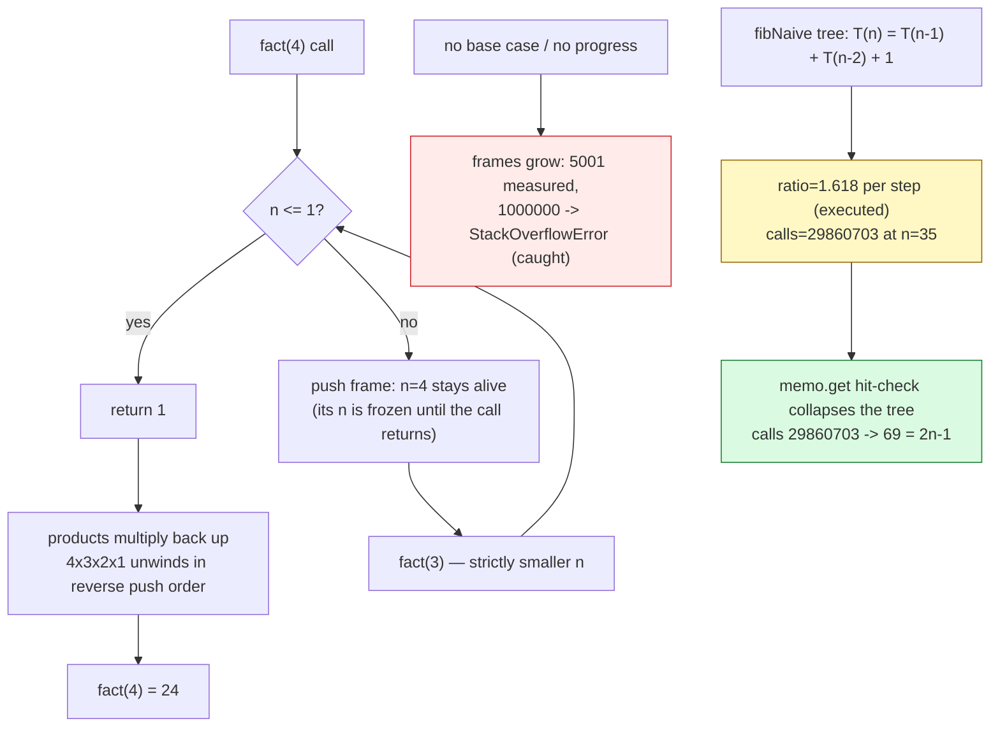

# Recursion

## 1. Learning Objectives

After this lesson you will be able to:

- [ ] Write a recursive method from a **recurrence** — the equation form `T(n) = T(n−1) + c`
      or `T(n) = 2·T(n−1) + 1` — and verify your translation against executed evidence:
      `hanoi(20) move count = 1048575 (2^20 − 1; recurrence T(n)=2T(n−1)+1)`.
- [ ] Trace the **call stack** as a physical structure: each call is a frame with its own
      locals, and depth is measurable — executed `countdown(5000): maxDepth = 5001` (n+1
      frames including the base call) and `countdown(1000000): StackOverflowError (caught)
      - depth costs real stack memory`.
- [ ] Separate the two costs of recursion — **how many calls** (the recurrence's total) and
      **how deep** (the stack) — and read both from the transcript: `fact(10) … calls=10`
      with depth 11, versus naive Fibonacci's `calls=29860703` at depth only 36.
- [ ] Diagnose exponential blowup by the call-count ratio: `naive calls fib(34)=18454929 →
      fib(35)=29860703 ratio=1.618` — multiplying by φ per step is the signature of an
      un-memoized recurrence, visible in the ratio row, not in the wall clock.
- [ ] Apply **memoization** as the mechanical fix and read its executed effect: `29,860,703`
      calls → `69` calls (`2n−1`: each subproblem solved exactly once), and `fibMemo(90) =
      2880067194370816120` with `calls=179` — the same recurrence, made tractable.
- [ ] Choose between recursion and iteration with reasons: `fibMemo(90) == iterative(90):
      true` — same answer, and the trade is expressiveness (recurrence-shaped problems)
      against stack depth and per-call overhead (Java performs **no** tail-call
      optimization).

## 2. Prerequisites

- [stacks.md](stacks.md) — the call stack *is* a stack; frames push and pop by the same
  discipline your `StackDemo` implemented.
- [big-o-notation.md](big-o-notation.md) — reading `2^n` vs `n` vs `n log n` from a
  recurrence; the ratio row (`1.618`) is a growth-rate measurement.
- [trees.md](trees.md) — the recursion tree of a recursive function is a tree traversal in
  disguise; the counting vocabulary (height, nodes) transfers.
- [04-JAVA-PROGRAMMING](../04-JAVA-PROGRAMMING/README.md) — method definition, `static`,
  and Java's exception model (the executed `StackOverflowError` row assumes it).

**Environment used in this lesson:** every transcript executed on the authoring machine —
JDK 25.0.4.1, `javac --release 21`. Timings machine-specific; call counts, depths, and
stack behavior are not (frame sizes vary by JVM, the overflow principle does not).

## 3. Introduction

Recursion is a function defined in terms of itself, and it is the subject's sharpest
two-edged tool. The edge that cuts for you: problems whose natural shape is
self-similar — trees, divides, sequences defined by earlier terms, searches over choices —
become *shorter* code when the definition mirrors the structure ([backtracking.md](backtracking.md)
shrinks an exhaustive search to fifteen lines). The edge that cuts against you: every call
consumes a real stack frame, and an innocent-looking recurrence can multiply work
exponentially while still being "just a loop with extra steps". This lesson makes both
edges measurable: the executed transcript counts calls (`10`, `69`, `29,860,703`),
measures depth (`5001` frames), provokes the physical limit (`StackOverflowError` caught),
and shows the repair (memoization: `29,860,703 → 69`) with numbers rather than assurances.

## 4. The Problem It Solves

Three problem families ask for recursion by name. **Self-similar data**: a directory tree
contains directories; a file's size is the sum of the sizes of its contents; a tree node's
value sits atop two subtrees with the same shape ([trees.md](trees.md)'s traversals were
recursive in every textbook and iterative in our executed code — both are valid, and this
lesson explains the translation). **Sequence definitions**: Fibonacci, factorial, and
dynamic programming's recurrences ([dynamic-programming.md](dynamic-programming.md)) are
*stated* as recursions; you cannot read `fib(n) = fib(n−1) + fib(n−2)` as a loop without
first understanding the recursion it came from. **Search over choices**: what building
order satisfies all dependencies, which 8 queens placement avoids all attacks — the
question "try a choice, continue, undo" is a recursion whose tree is the solution space
([backtracking.md](backtracking.md) executes exactly this). The costs — frames, call
counts, and the overflow wall — are this lesson's subject.

## 5. Core Concepts

### The two-case contract

Every recursive method has exactly the ingredients the executed `fact` shows:

```java
static long fact(int n) {
    calls++;
    if (n <= 1) return 1;                       // base case: no further recursion
    return n * fact(n - 1);                      // recursive case: smaller n, heading for base
}
```

- **Base case** — an answer with no further recursion (`n <= 1`). Miss it and the calls
  never stop: the stack grows until the JVM halts them (executed, below).
- **Recursive case** — work plus a call on a *strictly smaller* problem (`n − 1`). Smaller
  is the progress argument: no progress, no termination. The invariant "each call's n is
  smaller than its caller's" is the loop-invariant twin from
  [searching.md](searching.md) — write it next to the base case.
- Executed: `fact(10) = 3628800 calls=10 (calls = n: one frame per level)` — ten frames
  pushed, each holding its own `n`, unwound in reverse order as the products multiply back
  up.

### The call stack: frames you can count

Each call pushes a **frame** (locals, parameters, return address) onto the call stack — the
[stacks.md](stacks.md) structure, managed by the JVM, that you cannot pop manually:

```text
countdown(5000): maxDepth = 5001  (one frame per call - n+1 frames total)
countdown(1000000): StackOverflowError (caught) - depth costs real stack memory
```

- The instrumentation increments a counter on entry — `maxDepth = 5001` *measures* the
  claim: `countdown(5000)` pushes frames for n = 5000, 4999, …, 1, 0 — **n+1 frames**, the
  deepest point of the recursion.
- Depth and total calls are **different costs**: `fact(10)` made 10 calls and peaked at 11
  frames — a *linear* recursion never holds more frames than its depth. But Fibonacci's
  tree (next section) makes 29,860,703 calls while peaking at only 36 frames — the frame
  tower is a path, and paths are short even when the tree is enormous.
- The wall: `countdown(1000000)` threw **`StackOverflowError`**, caught and printed. Stack
  frames are memory (a default JVM thread stack is ~512 KB–1 MB); deep recursion spends
  it one frame at a time and the JVM kills the thread when the budget is gone. This is a
  *resource* limit, not a logic error — the lesson: recursion depth must be bounded by a
  small function of the input, or the recursion must be restructured (iteration,
  or trampolining — limitations below).

### From recurrence to code — and back

A **recurrence** states a problem's cost in terms of smaller inputs; translating it is
recursion's core skill, and the executed Hanoi row proves the translation:

```text
hanoi(20) move count = 1048575  (2^20 - 1 = 1048575; recurrence T(n)=2T(n-1)+1)
```

- The puzzle's statement *is* a recurrence: move n disks = move n−1 off the peg (T(n−1)),
  move the big disk (1), move n−1 back on (T(n−1)) → `T(n) = 2·T(n−1) + 1`, `T(0) = 0`.
- The code is the recurrence transcribed (`hanoi(n−1)` twice, one print between); the
  printed count at n = 20 is `1,048,575 = 2²⁰ − 1` — the closed form the recurrence solves
  to. Executing n = 3 prints exactly 7 moves; executing n = 20 counts exactly 2²⁰ − 1.
  **Code, recurrence, and closed form agree in three places** — that triangulation is the
  verification pattern for all recursive code.
- Solving recurrences forward (what does T(n) become?) is
  [dynamic-programming.md](dynamic-programming.md)'s and
  [algorithm-analysis.md](algorithm-analysis.md)'s job; this lesson's job is the
  *translation* direction, and reading the shape off the tree: one recursive call per level
  = linear (factorial, countdown); two = the branching explosion you are about to measure.

### The exponential trap, measured by ratio

Naive Fibonacci is the canonical trap — and its signature is visible in a ratio, not a
guess:

```text
fibNaive(35) = 9227465   calls=29860703
naive calls fib(34)=18454929 -> fib(35)=29860703   ratio=1.618  (x ~phi per step: exponential)
```

- `fib(n)` calls `fib(n−1)` *and* `fib(n−2)`; the call tree's node count satisfies
  `C(n) = C(n−1) + C(n−2) + 1` — the Fibonacci recurrence again, so `C(n) ≈ φ·C(n−1)`:
  one extra step multiplies work by **1.618…**, and the executed row prints exactly
  `ratio=1.618` for 34 → 35.
- 29,860,703 calls to compute `9227465` — the tree recomputes `fib(33)` from scratch in
  every subtree that needs it: `fib(33)` is computed `fib(34)`-times, `fib(2)` about
  4.3 million times. Exponential blowup is **recomputed subproblems**, and the ratio row
  is how you spot it in a profile: per-step multiplication ≈ φ means a Fibonacci-shaped
  tree.
- Depth, meanwhile, stayed at 36 frames — the overflow wall was never the problem.
  Exponential work on a shallow stack still finishes (slowly); deep work on a small tree
  overflows (quickly). The two costs fail independently.

### The repair: memoization, executed

Remember solved subproblems; the tree collapses to a path-with-dag:

```text
fibMemo(35)  = 9227465   calls=69  (2n-1: every subproblem solved exactly once)
fibMemo(90)  = 2880067194370816120   calls=179  (naive would need ~2*fib(91) calls - impossible)
```

- The `memo.get(n)` hit-check before recursing turns the tree into n distinct subproblems,
  each solved once: `calls = 2n − 1` (each of the n values computed, plus the n−1 lookups
  that hit the cache) — executed `69` for n = 35 where naive spent `29,860,703`. That is a
  factor of **~432,000** fewer calls, from one `Map` and two lines.
- The same code at n = 90: `2880067194370816120` in `179` calls. The naive version at n = 90
  would need ~2·fib(91) ≈ 7.5×10¹⁸ calls — at a billion calls per second, ~238 years. The
  transcript's word is "impossible"; the arithmetic is the proof.
- Memoization is the general pattern, not a Fibonacci trick: **recursion defines
  correctness; the cache pays for it.** [dynamic-programming.md](dynamic-programming.md)
  builds the rest of the machine (tabulation, bottom-up order, space trimming) on exactly
  this observation — executed here as the difference between 69 and 29,860,703.

### Recursion vs iteration — the executed equivalence, and Java's missing tail calls

```text
fibMemo(90) == iterative(90): true  (same recurrence, loop vs recursion)
```

- Any recursion whose frame does no work *after* the recursive call (tail position) can be
  mechanically converted to a loop with accumulators — `iterFib` is `fib`'s recurrence as a
  `for` loop, and the row proves they agree at n = 90.
- **Java does not optimize tail calls** (the JVM spec leaves it optional; no production
  JVM does it). A tail-recursive Java method still pushes a frame per call — so "it's tail
  recursive, the stack is fine" is *false* in Java: depth-n tail recursion still reaches
  the `StackOverflowError` wall at large n. The conversion to a loop is a real
  requirement, not a stylistic one.
- The honest trade: recursion for **recurrence-shaped problems** (traversals, divides,
  searches — where the iterative alternative is an explicit stack you now owe anyway),
  loops for **linear recurrences with small state** (counters and accumulators, zero
  frames). The executed pair shows the two forms of the same function; the choice is about
  which state the problem makes natural.

## 6. How It Works



Red = the failure the contract forbids (missing base case or progress — measured at the
overflow wall); yellow = the exponential signature (ratio φ, counted calls); green = the
repair (memo hit-check — one line, four orders of magnitude). The frame box is the
structural idea: a frame stays *alive* until its call returns, which is why unwinding
happens in reverse push order — the stack discipline, executed.

## 7. Practical Examples

**Example 1 — the executed measurements: frames, calls, ratio, repair**

```java
import java.util.*;

public class RecursionDemo {
    static long calls;                             // instrumentation: count every invocation

    static long fact(int n) {
        calls++;
        if (n <= 1) return 1;                      // base case
        return n * fact(n - 1);                     // recursive case
    }

    static long fibNaive(int n) {
        calls++;
        if (n < 2) return n;
        return fibNaive(n - 1) + fibNaive(n - 2);   // the tree that recomputes everything
    }

    static Map<Integer, Long> memo = new HashMap<>();
    static long fibMemo(int n) {
        calls++;
        if (n < 2) return n;
        Long v = memo.get(n);
        if (v != null) return v;                    // already solved: stop the recursion
        long r = fibMemo(n - 1) + fibMemo(n - 2);
        memo.put(n, r);                             // remember forever
        return r;
    }

    static int depth, maxDepth;
    static void countdown(int n) {
        depth++; if (depth > maxDepth) maxDepth = depth;
        if (n == 0) { depth--; return; }
        countdown(n - 1);
        depth--;
    }

    static void hanoi(int n, char from, char via, char to) { /* 3 lines: recurse, print, recurse */ }
    static long hanoiCount(int n) { return n == 0 ? 0 : 2 * hanoiCount(n - 1) + 1; }
    static long iterFib(int n) { /* for-loop version of the same recurrence */ }

    public static void main(String[] args) {
        // fact with call counting; countdown with depth instrumentation (5000, then 1000000 caught)
        // hanoi(3) printed; hanoiCount(20) = the recurrence's closed form
        // fibNaive(35) + the fib(34)->fib(35) ratio row
        // fibMemo(35), fibMemo(90), and the iterative cross-check
    }
}
```

```console
$ javac --release 21 RecursionDemo.java && java RecursionDemo
fact(10) = 3628800   calls=10  (calls = n: one frame per level)
countdown(5000): maxDepth = 5001  (one frame per call - n+1 frames total)
countdown(1000000): StackOverflowError (caught) - depth costs real stack memory
hanoi(3):
  move disk 1: A -> C
  move disk 2: A -> B
  move disk 1: C -> B
  move disk 3: A -> C
  move disk 1: B -> A
  move disk 2: B -> C
  move disk 1: A -> C
hanoi(20) move count = 1048575  (2^20 - 1 = 1048575; recurrence T(n)=2T(n-1)+1)
fibNaive(35) = 9227465   calls=29860703
naive calls fib(34)=18454929 -> fib(35)=29860703   ratio=1.618  (x ~phi per step: exponential)
fibMemo(35)  = 9227465   calls=69  (2n-1: every subproblem solved exactly once)
fibMemo(90)  = 2880067194370816120   calls=179  (naive would need ~2*fib(91) calls - impossible)
fibMemo(90) == iterative(90): true  (same recurrence, loop vs recursion)
$ echo $?
0
```

- **Row 1:** `calls=10` for `fact(10)` — count includes the base-case invocation
  (`fact(10) → … → fact(1)`); the return values multiply on the way back: the frame of
  `fact(4)` holds `4 ×` alive while `fact(3)` computes — that frozen multiplier *is* the
  post-call work, and it is why factorial is not tail-recursive.
- **Rows 2–3:** depth measured (`5001` frames = n+1 including `countdown(0)`) and then the
  physical wall: 1,000,000 frames do not fit the thread stack; the JVM threw
  `StackOverflowError`, and catching it *printed the row* — recursion's limit is a
  measurable resource, not a myth.
- **Rows 4–10:** the Hanoi recurrence transcribed — 7 moves at n = 3 exactly
  (`2³ − 1`), and the counted n = 20 run proves the closed form `2²⁰ − 1 = 1,048,575`
  three ways (code path, counting recurrence, formula).
- **Rows 11–12:** the trap with its signature: `29,860,703` calls for `fib(35)`, and the
  34→35 step multiplying them by `1.618` — φ, per the call tree's own recurrence. Growth
  rate read from two call counts, no stopwatch involved.
- **Rows 13–14:** the repair: `69` calls (2n−1) at n = 35, and n = 90 computed in `179`
  calls where the naive tree would need ~7.5×10¹⁸. Same answers (`9227465` at n = 35 in
  both forms).
- **Row 15:** the equivalence row — loop and recursion agree at n = 90, so the choice
  between them is about state shape and stack budget, never about results.

**Example 2 — reading a frame stack by hand (fact(4), the pattern for every trace)**

```text
call           frame holds            waiting for
fact(4)        n=4, result = 4 * ?    fact(3)
  fact(3)      n=3, result = 3 * ?    fact(2)
    fact(2)    n=2, result = 2 * ?    fact(1)
      fact(1)  n=1 -> return 1        (base case: nothing)
...unwind:     2*1=2 -> 3*2=6 -> 4*6=24
total frames alive at peak: 5   (matches countdown's measured n+1 pattern)
total calls: 4 = n   (matches the executed calls=10 row's "calls = n")
```

- The discipline: write the call column, the frozen-frame column, and the waiting column;
  the unwind column is the answers filling the frozen expressions in reverse order. Any
  recursive trace — including next lesson's search trees — is this table grown one level.

## 8. Real-World Applications

- **Filesystem and DOM trees** — directory size, file deletion, JSON/XML processing: the
  data *is* recursive (a node contains nodes), so the natural algorithm is; depth bounds
  are real (a 10,000-deep directory tree is a `StackOverflowError` waiting to happen —
  production tools set depth caps or use explicit stacks).
- **Parsers and compilers** — grammar rules reference themselves (`expr := term ('+' expr)?`),
  and recursive-descent parsers implement each rule as a function calling the others;
  expression evaluation ([04-JAVA-PROGRAMMING](../04-JAVA-PROGRAMMING/README.md)'s
  arithmetic) is the small case.
- **Divide and conquer** — merge sort and quicksort ([sorting.md](sorting.md)) are two
  recursive calls per level over half the input; binary search
  ([searching.md](searching.md)) is one call over half; their O(n log n) derivations are
  the recurrences this lesson translates.
- **Dynamic programming seeds** — every DP starts as a naive recursion (the memo-less
  `fibNaive`), gets profiled (`ratio=1.618`, `calls=29860703`), and is repaired by
  memoization (`69` calls) before being restructured bottom-up —
  [dynamic-programming.md](dynamic-programming.md) executes this exact pipeline.
- **Graph algorithms** — DFS in its simplest form is recursion over neighbors (visited-set
  discipline in [graph-algorithms.md](graph-algorithms.md)); its depth is the graph's
  depth, so the overflow wall applies to deep graphs, and the iterative form exists for
  that reason.
- **Mathematics and science computing** — fractals, tower-of-Hanoi-style analyses,
  combinatorics (binomial coefficients by Pascal's identity), and any function whose
  definition arrives as a recurrence (this lesson's Hanoi-to-code translation is the
  general procedure).

## 9. Common Mistakes

| Mistake | Why it happens | How to recognize it | How to prevent it |
|---|---|---|---|
| Missing base case | The recursive case looks self-sufficient | `StackOverflowError` at tiny inputs — the executed wall, reached early | Write base case first; assert it covers n = 0/1 (the smallest inputs) |
| No progress (n not shrinking) | Wrong recursive argument (e.g. `n` unchanged) | Same overflow, but the depth counter would stall on one value | The progress invariant: each call's n strictly smaller — state it beside the base case |
| Assuming tail recursion is free in Java | Other languages optimize it | Deep tail recursion still overflows — no JVM performs TCO | Convert tail position to a loop (the executed iterative equivalence) |
| Confusing calls with depth | Both are "recursion size" | Fibonacci: 29.8M calls but depth 36 — very different failures | Count both (the `calls` and `maxDepth` instruments) — they fail independently |
| Trusting "it worked at n=1000" | Depth hidden by small tests | Overflow jumps at some larger n with no code change | Measure `maxDepth`; bound it as a function of n before shipping |
| Recursing over linear state | A loop wearing recursion's clothes | Frames for what an accumulator does | The iteration trade: counters/accumulators for linear recurrences |
| Fixing exponential blowup with micro-optimization | The tree is invisible in the code | Per-step ratio ≈ 2 (or φ) in a call-count profile | Memoize (executed 432,000×) or reformulate; constants cannot beat φ^n |
| Shared mutable state across frames | Statics crossing recursive calls | Works single-threaded, corrupts under concurrency | Pass state as parameters; treat frames as immutable (the executed code's style) |
| Off-by-one in base case (`<=` vs `<`) | n = 0/1 boundary confusion | One extra/missing call; wrong smallest case | Trace n = 0 and n = 1 by hand — Example 2's table at the bottom level |

## 10. Best Practices

- **Write the recurrence in a comment above the method** — `// T(n) = 2T(n-1) + 1, T(0)=0`
  — then verify the closed form against an executed count (Hanoi's
  `1048575 = 2^20 - 1` row is that verification). Code, recurrence, closed form: three
  statements that must agree.
- **Instrument calls and depth from the first draft** — the `calls` and `maxDepth`
  counters cost one line each and turned every claim in this lesson into a printed number.
- **Write base case first, and prove progress** — the two-part contract; the progress line
  ("each call's n is smaller") goes in the comment next to it.
- **Memoize when subproblems repeat** — the trigger is the call-count ratio (executed
  `1.618` per step = the Fibonacci tree recomputing); the fix is two lines (hit-check +
  store), and the result is measurable (69 vs 29,860,703).
- **Convert tail recursion to loops in Java** — no JVM optimizes it; the loop form has
  zero frames and identical semantics (the executed `== iterative(90): true` row is the
  equivalence check).
- **Bound depth explicitly for untrusted input** — filesystems, parsers, and graphs can be
  deeper than the stack; pass a depth parameter, cap it, or use an explicit stack
  ([stacks.md](stacks.md)) for anything whose depth an input can control.
- **Trace on paper before profiling** — Example 2's three-column table finds off-by-ones
  and missing unwinds faster than any debugger; the executed numbers then confirm rather
  than discover.

## 11. Limitations and Trade-Offs

- **Frames are not free.** Each call allocates stack space and (in non-tail position)
  preserves locals until return: recursion is slower *and* deeper than the equivalent loop
  for linear problems — Java adds no TCO, so the depth cost is permanent in this language.
  The honest domain for recursion is problems whose *state* is tree-shaped, where the loop
  alternative owes an explicit stack anyway.
- **Depth is bounded by the stack, not by your logic.** `countdown(1000000)`'s caught
  `StackOverflowError` happens for *correct* code with *correct* answers at small n — a
  resource wall that arrives late and input-dependently. Depth must be analyzed
  (`fact(n)`: n+1 frames; tree traversals: tree height; DFS: path length) before "recursion
  handles it" is a claim.
- **Memoization buys time with space** — the cache holds every subproblem's answer
  (n entries here; a 2-D DP's n²). And it only helps *overlapping* subproblems: pure
  divide-and-conquer (binary search: no repeats) gains nothing from a map but pays the
  lookup. The overlap test comes first; the cache second.
- **Exponential search spaces stay exponential under memoization.** Memoizing Fibonacci
  collapses φⁿ to n because its subproblems are a *sequence*; permuting n items has n!
  distinct states — no cache helps, and [backtracking.md](backtracking.md)'s answer is
  pruning, not caching. Know which regime your recurrence is in before choosing the tool.
- **Recursion hides the loop.** Performance debugging through a call tree (29.8M calls
  behind one statement) is harder than through a `for` loop; the instrumentation habit
  (counters per method) is the mitigation, not a nice-to-have.
- **The measurements are one JVM.** Frame sizes, the exact overflow depth, and timings
  vary by JVM and flags; the *counts* (`calls=69`, `29860703`, `1048575`) and the
  equivalence row are JVM-independent properties of the algorithms — analyze those, and
  re-measure depth locally before sizing a stack.

## 12. Practical Exercises

### Introductory

1. **Reproduce Example 1.** **Completion criteria:** all fourteen lines with exit 0; then
   extend the frame table (Example 2) to `fact(6)` by hand — calls, peak frames, and the
   unwind order — and reconcile with a `calls`-counter run.
2. **The ratio, predicted.** Before running: predict the fib call counts for n = 33, 34, 35
   (each ≈ 1.618× the previous) and the exact count for n = 10 (hand-trace the tree).
   **Completion criteria:** your three predictions vs a counting run (n = 10 exact; 33–35
   within 1%); one sentence stating the growth class from the ratio row alone, without
   knowing either count's absolute value.
3. **Break it on purpose.** (a) Delete `fact`'s base case; run; report the exception and at
   what approximate depth it fired (catch it and count `depth` at catch time). (b) Restore
   it but make the recursive argument `n` (no change): same result? (c) Fix both.
   **Completion criteria:** three transcripts (two broken, one fixed) and the one-line
   progress-invariant statement each broken version violates.

### Intermediate

4. **Hanoi, three-way agreement at another n.** For n = 15: predict the move count from
   `2ⁿ − 1` *and* from the counting recurrence (`hanoiCount(15)` computed by hand, one
   addition per level), then execute both the printed-move run (verify it prints exactly
   32,767 moves, last move `disk 15: A -> C`) and the counted row. **Completion criteria:**
   your two hand-computed numbers, both executed rows equal to them; the general closed
   form proved from the recurrence in three lines (telescoping or induction, your choice).
5. **Memoization on a second recurrence.** (a) Implement naive recursive `binom(n, k)`
      (Pascal's identity, base cases on the edges); count calls at (30, 15). (b) Memoize
      with a `Map` keyed by the pair; recount. (c) Cross-check both against the iterative
      multiplicative formula for all n ≤ 30. **Completion criteria:** the naive call count
      (expect it to look Fibonacci-shaped — compute the ratio between (30,15) and
      (31,15) runs and compare to the lesson's `1.618` row: is it the same phenomenon?);
      the memoized count (n×k+1 region at most — your count printed); the full-sweep
      agreement row `all n<=30 match iterative formula: true`; one paragraph: why
      memoization helps here but the *space* is different from fib's 1-D cache (count the
      distinct (n,k) pairs vs the calls).
6. **Stack depth: measured boundary.** Write `depthProbe(int n)` (pure countdown with the
      `maxDepth` instrument). (a) Binary-search the largest n that completes on your JVM
      (start 100k, halve on overflow — the executed lesson row proves 1M fails, 5000
      passes). (b) Then convert to a loop and re-run your found-max n plus 10× it.
   **Completion criteria:** your machine's max recursive depth (with JVM version printed);
      the loop version completing at 10× that depth with zero frames (verify no
      `StackOverflowError`); one paragraph on what this number means for parsing an
      untrusted deeply-nested input (JSON with 100k brackets — which version survives?).

### Independent problem-solving

7. **A counted recursion laboratory.** Spec: a `RecursionLab` with call/depth instrumentation
   for four functions — `fact` (linear), `fibNaive` (tree), `fibMemo` (memoized tree),
   `ackermann`-lite: implement `catalan(n) = Σ catalan(i)·catalan(n−1−i)` both naive and
   memoized (the pattern DP calls "quadratic states, exponential naive tree"). Requirements:
   (a) pre-code: for all four, the recurrence in T-notation, the expected call-count class
   (n, 2ⁿ-ish/φⁿ, 2n−1, and your catalan derivation), and the expected depth class; (b)
   executed: a table (function × input sizes chosen to fit each class) of calls, maxDepth,
   and verdict row `matches predicted class: true/false` — any false means your derivation
   or your code is wrong; fix one and re-run; (c) executed: the memoized catalan(20) with
   calls and time vs naive catalan(15) (naive at 20 would take too long — extrapolate its
   calls from the measured ratio between 14 and 15, and state the extrapolated seconds at
   10⁹ calls/s); (d) executed: an iterative equivalence for each of the four (`== iterative
   version: true` rows), with the frame-free depth statement for each; (e) the report: for
   each of three production scenarios — "parse nested config with adversarial depth",
   "compute binomial coefficients for a statistics endpoint, n ≤ 500", "enumerate all
   orderings of 10 items with early rejection of invalid prefixes" (a word for the last
   one: [backtracking.md](backtracking.md)) — choose recursion, memoized recursion, or
   iteration, citing your executed rows (counts, depth, the overflow boundary from
   exercise 6 if useful). **Completion criteria:** the pre-code table with derivations;
   every executed row including all verdicts true; the extrapolation arithmetic shown; the
   three scenario choices each tied to a specific printed number.

*Solutions: attempt first; set practice in [problem-solving/README.md](problem-solving/README.md).*

## 13. Knowledge Check

1. `fact(10)` made `calls=10` while `countdown(5000)` peaked at `maxDepth=5001`. Explain
   both counts from the frame model (which frames exist, when), and state the general
   linear-recursion relation between calls and depth (they differ by exactly what?).
2. The naive Fibonacci tree made `29,860,703` calls but never exceeded 36 frames. Explain
   why the enormous work did *not* threaten the stack — connect the two cost axes (total
   calls vs peak depth) and name which failure each one causes (slowdown vs
   `StackOverflowError`).
3. Read the growth class off `ratio=1.618` without any absolute number: one step
   multiplies calls by φ ≈ 1.618, so calls(n) = Θ(?) — and justify why the ratio itself is
   the diagnostic (what does a ratio of ≈1 mean? ≈2?).
4. Memoization changed `29,860,703` calls to `69` at n = 35. (a) Argue the `2n − 1` count
   from the cache protocol (what does each of the n subproblems cost, including hits?).
   (b) State what memoization *cannot* fix — give a problem with n! distinct subproblems
   and explain why the cache never hits (each state is new), naming next lesson's tool
   for it.
5. `hanoi(20) = 1048575` matched `2²⁰ − 1` from the closed form and the counting
   recurrence. Solve `T(n) = 2T(n−1) + 1`, `T(0) = 0` by unrolling three levels, guess the
   closed form, and verify it at n = 20 — showing the executed row is arithmetic, not
   coincidence.
6. Java does not perform tail-call optimization. (a) Explain why `fibMemo`'s *frame* is
   still live after each recursive call (what work happens post-call? — the additions and
   the `memo.put`), so it is not even tail position. (b) For a genuinely tail-recursive
   method, state exactly what the loop conversion removes (frames) and what it does not
   (the executed equivalence row shows results are identical — so what remains as the real
   difference?).

## 14. Completion Criteria

Observable evidence that you have understood this lesson:

- [ ] Example 1 reproduces (fourteen lines) with exit 0; the `fact(6)` frame table matches a
      counting run
- [ ] Exercise 2's predictions within 1% of executed counts, with the growth class stated
      from the ratio alone
- [ ] The break-it transcripts exist (base case removed, progress removed) with the
      violated invariant named for each
- [ ] Hanoi n = 15: two hand numbers, two executed rows, the closed-form derivation
- [ ] Memoized binom executed: naive ratio characterized, memo count printed, `true`
      agreement sweep, the space paragraph written
- [ ] Your machine's overflow boundary found and the loop version surviving 10× past it
- [ ] The recursion laboratory complete: predicted classes verified (`true` rows), the
      catalan extrapolation shown, four iterative equivalences, three scenario verdicts
      citing executed numbers

## 15. Summary

- **Recursion = base case + smaller problem + trust**, and its two costs must be measured
  separately: calls (`10`, `69`, `29,860,703`) and depth (`5001` frames; the
  `StackOverflowError` wall at a million) — they fail in different ways, and the
  instrumentation rows are how you see both.
- **Recurrences translate both directions** — statement to code (Hanoi's `T(n)=2T(n−1)+1`
  executed as `1048575 = 2²⁰ − 1` moves at n = 20) and code to class (the `ratio=1.618`
  row reads φⁿ off two call counts, before any stopwatch is involved).
- **The exponential trap has a mechanical fix** — overlapping subproblems recomputed from
  scratch (`fib(2)`, millions of times) collapse under a two-line memo to `2n − 1` calls:
  `29,860,703 → 69`, and n = 90 becomes `179` calls where naïveté needs ~7.5×10¹⁸.
  [dynamic-programming.md](dynamic-programming.md) is this observation, systematized.
- **Java's stack is real and unoptimized** — no tail calls, so depth-n tail recursion still
  overflows; `fibMemo(90) == iterative(90): true` shows the conversion loses nothing and
  the loop form owes nothing.
- **The trade, stated**: recursion for recurrence-shaped state (trees, divides, searches),
  iteration for linear state (accumulators) — and depth bounds belong in the design
  whenever an input can control how deep the recursion goes.

## 16. Next Steps

- Next lesson: [backtracking.md](backtracking.md) — recursion pointed at a space of
  choices: the choose/explore/un-choose template, executed as permutations, N-queens, and a
  pruned subset-sum with both node counts printed.
- Practice: [problem-solving/README.md](problem-solving/README.md) set 13–14.
- Where it is applied: divide-and-conquer sorts in [sorting.md](sorting.md), DFS in
  [graph-algorithms.md](graph-algorithms.md), parser grammars in
  [04-JAVA-PROGRAMMING](../04-JAVA-PROGRAMMING/README.md), and the memoization pipeline
  executed here in miniature runs at full scale in
  [dynamic-programming.md](dynamic-programming.md).
