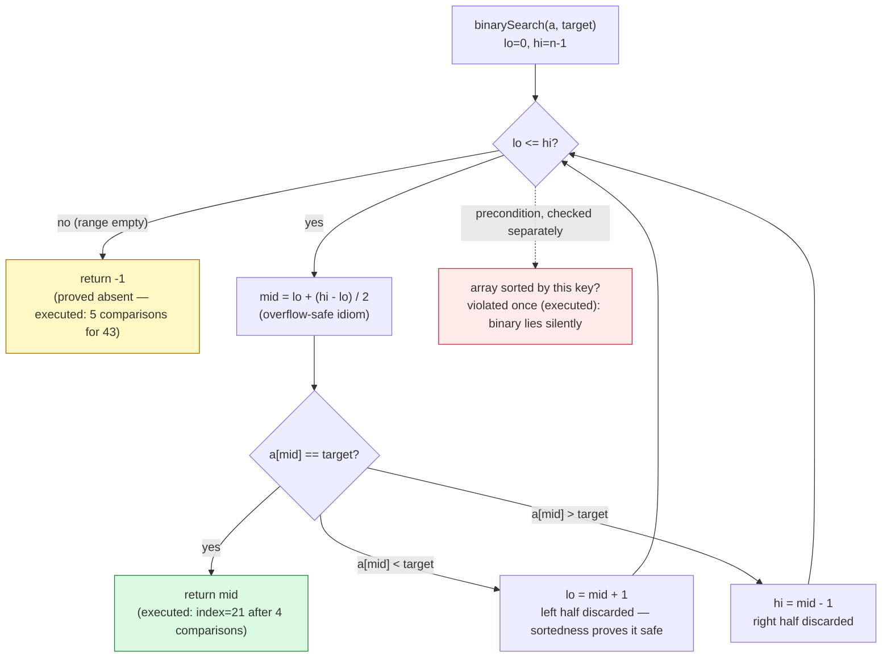

# Searching

## 1. Learning Objectives

After this lesson you will be able to:

- [ ] State the **precondition** binary search depends on — sorted by the same key you query
      — and show what violating it costs with the executed row: on `{5,1,9,3,7}` linear finds
      `1` at `index=1` while binary reports `index=-1` — a **silent wrong answer**, not an
      exception.
- [ ] Derive the ⌈log₂ n⌉ bound by the halving argument and check it against executed
      evidence: `max comparisons for a hit: 5 (ceil(log2(31))=5, ceil(log2(32))=5)`, and
      explain why n = 31 (`2⁵ − 1`) makes every one of the 31 absent values cost **exactly**
      5 comparisons (`max=5 average=5.0`).
- [ ] Implement binary search with the loop invariant ("if the key exists, it is in
      `[lo, hi]`") and the overflow-safe midpoint `lo + (hi - lo) / 2`, and trace the
      executed paths: `42 → mid 15, 23, 19, 21` found in `4` comparisons; `43 → 15, 23, 19,
      21, 22` rejected in `5`.
- [ ] Build the duplicate-handling variants — `lowerBound` (first index ≥ x) and
      `upperBound` (first index > x) — and compute a range count as `upper − lower`.
- [ ] Read the scale rows honestly: `1M binary searches, n=1,000,000: 287 ms` vs the
      measured `~457 s` for linear at the same n — and reconcile the ~1,600× wall-clock gap
      with the ~41,700× comparison-count gap via **cache behavior** (sequential scans
      prefetch; binary jumps are random accesses), the measurement lesson's "time includes
      more than operations" again.
- [ ] Choose between search structures by workload — linear for small/unsorted, binary for
      sorted arrays, hash table ([hash-tables.md](hash-tables.md)) for unordered point
      lookup, balanced tree ([trees.md](trees.md)) for sorted *and* dynamic — citing
      executed rows rather than slogans.

## 2. Prerequisites

- [arrays.md](arrays.md) — binary search is index arithmetic on an array; the random-access
  guarantee it depends on is arrays' O(1) `get`.
- [big-o-notation.md](big-o-notation.md) — the halving derivation produces a log; reading
  the executed comparison counts as cost evidence needs the analysis vocabulary.
- [hash-tables.md](hash-tables.md) — the alternative point-lookup (O(1) expected); this
  lesson's trade-off discussion assumes its guarantees.
- [trees.md](trees.md) — the ordered-tree alternative for dynamic data, named in
  limitations.
- [04-JAVA-PROGRAMMING](../04-JAVA-PROGRAMMING/README.md) — Java syntax and the JDK's
  `Arrays.binarySearch`.

**Environment used in this lesson:** every transcript executed on the authoring machine —
JDK 25.0.4.1, `javac --release 21`. Timings machine-specific; comparison counts and indices
are not.

## 3. Introduction

Lookup is the most frequent operation in most systems — a database reads an index, a phone
opens an app by name, a compiler resolves a symbol. The [arrays.md](arrays.md) lesson showed
that an array answers "what is at position i?" in O(1); this lesson asks the harder
question: "where is the item with key x?" Linear search needs no organization but pays O(n)
per answer. Binary search is the bargain at the heart of the subject: **prepay O(n log n)
once to sort, then every lookup costs O(log n)** — 20 comparisons against a million
elements. The executed benchmark makes the bargain concrete: one million lookups took
**287 ms** on a sorted million-element array, while the same lookups by linear search would
take **~457 s** — the same data, the same queries, a factor of about 1,600. What the
precondition costs when absent is just as concrete, and this lesson executes that too.

## 4. The Problem It Solves

Given a collection and a key, find the item with that key (or establish there is none).
Without structure the only tool is trying every element — O(n) per query, and the executed
`linear 43: index=-1 comparisons=31` shows a miss pays the *full* n. Systems that query far
more than they change pay sorting once and binary-searching forever: this is exactly how
database indexes ([10-DATABASE-ENGINEERING](../10-DATABASE-ENGINEERING/README.md)), compiled
symbol tables, and `TreeSet`/`SortedMap` work underneath. The lesson also handles the two
follow-up questions real code needs: duplicates ("give me *all* the 2s" → `lowerBound`/
`upperBound` range) and the failure mode nobody warns about — binary search on unsorted data
returns confidently wrong results, which the executed `UNSORTED` row demonstrates and the
exercises teach you to defend against.

## 5. Core Concepts

### The baseline: linear search, and what a miss costs

Walk from index 0; compare each element. O(n) worst case, and misses are the *worst* worst
case — they scan everything:

```text
linear 42: index=21  comparisons=22      <- hit at position 21 costs 22 comparisons
linear 43: index=-1  comparisons=31      <- miss pays the full n = 31
```

- No precondition — it produced correct answers on the unsorted `{5,1,9,3,7}` row too
  (`index=1`).
- Hits cost (index + 1); misses cost n. Expected cost on random data ≈ n/2 comparisons.

### Binary search: the halving argument

**Precondition:** the array is sorted ascending (by the *same key* you compare on). Then:

- Look at the middle element. Three outcomes: equal → done; target is larger → discard the
  whole left half (including mid); smaller → discard the right half.
- Each comparison discards about half of what remains: n → n/2 → n/4 → … → 1. Halving n
  times reaches 1, so **at most ⌈log₂ n⌉ comparisons** — the executed check for n = 31:
  `ceil(log2(31))=5` and the measured `max comparisons for a hit: 5`.
- The executed path for 42 on 31 evens (`0,2,…,60`): mid 15 (`30 < 42` → go right), 23
  (`46 > 42` → left), 19 (`38 < 42` → right), 21 (`= 42` → found). **4 comparisons.**
  For the miss 43: 15, 23, 19, 21, then 22 (`44 > 43` → left) leaves `lo > hi` → `index=-1`
  after **5**.

**The loop invariant** (what stays true and licenses each step): *if the target exists, it
lies in `a[lo..hi]`.* Initially `[0, n−1]` (the whole array — trivially true). Each
comparison preserves it: discarding a half is safe because sortedness proves the discarded
half cannot contain the key. Termination: either `a[mid] == target` (found) or `lo > hi`
(the candidate range is empty — *proved* absent, not "gave up"). This is the same
reasoning style trees.md's search traces use, with a contiguous range instead of a subtree.

**The implementation details that matter** (from the executed source):

- `while (lo <= hi)` — the inclusive condition; `<` here drops the last candidate silently.
- `lo + (hi - lo) / 2` — the overflow-safe midpoint. `(lo + hi) / 2` is fine for Java array
  bounds on any real machine, but the subtraction form is the habit that survives
  transfer to languages and data sizes where it is not.
- Miss is a **value** (`-1`), not an exception — searching for what isn't there is a normal
  question with a normal answer; the empty-collection case (`n = 0`) falls into the loop
  zero times and returns −1 correctly.

### n = 31 is the perfect tree — misses cost exactly 5

The executed row is a teaching artifact worth unpacking:

```text
all 31 absent values 1..61: max comparisons=5  average=5.0
```

Every odd value in 1..61 is absent, and *all 31 of them* cost exactly 5 comparisons — the
average equals the maximum. Why: the comparison outcomes form a binary decision tree; n = 31
keys fill a perfect tree of depth 5 (`2⁵ − 1 = 31` internal nodes), so all 32 gaps between
keys sit at depth 5 as leaves. **Misses are not more expensive than hits** — both end at
depth-5 leaves; the earlier linear row showed the opposite (`31` vs `22`). Average n/2 for
linear becomes guaranteed ⌈log₂ n⌉ for binary, and this executed row is the receipt.

### Duplicates: lowerBound / upperBound

`binarySearch`'s `index` answer is ambiguous when keys repeat ("which 2?"). The two
canonical variants pin the range down:

- `lowerBound(x)` — first index `i` with `a[i] ≥ x` (also: insertion point of x).
- `upperBound(x)` — first index `i` with `a[i] > x`.
- **Range count of x = `upperBound(x) − lowerBound(x)`** — O(log n) for the count of
  duplicates, without scanning them.
- Both are the same halving loop with a different stopping rule (they never stop *at* the
  key; they track the last boundary seen). The JDK encodes misses as `−(insertion point) −
  1` in `Arrays.binarySearch` — the insertion point is exactly `lowerBound`, so a miss still
  hands you the variant's answer in disguise (library javadoc behavior; the exercises
  execute it).

### Cost model vs wall clock: the cache is inside the measurement

The two scale rows compare the *same queries* at *different n*, which isolates the class
difference:

```text
1M binary searches, n=1,000,000: 287 ms (hits=333676)
1K linear  searches, n=1,000,000: 457 ms  ->  1M would be ~457 s at this rate
```

- Comparison counts predict ~41,700× fewer comparisons for binary at this n (~24 vs ~833K
  average per query — misses scan all n in linear).
- Measured wall-clock: ~457 s / 0.287 s ≈ **1,600×**. Where did the other ~26× go? Binary
  search's ~24 comparisons are **random accesses** into a 4 MB array — many miss L1/L2
  cache (~10 ns each); linear's millions of comparisons **stream sequentially**, which the
  prefetcher and vectorizer handle at sub-nanosecond cost per element. The comparison
  model counts *key comparisons*; the machine prices *memory locality*. Both statements
  are true and both belong in the analysis — the algorithm-analysis lesson's "what timing
  includes", measured here.

### The choice table, by workload

| Workload | Structure | Per-lookup class | Evidence |
|---|---|---|---|
| Small (≲ 100), or unsorted, queried rarely | Linear | O(n) | No precondition is worth O(log n) setup at small n |
| Sorted array, static or bulk-updated | **Binary search** | O(log n) | `287 ms` per million; no extra memory |
| Unordered, point lookup only | Hash table | O(1) expected | [hash-tables.md](hash-tables.md); pays memory, loses order |
| Sorted **and** frequently updated | Balanced tree | O(log n) | [trees.md](trees.md); no re-sort per update |
| On disk / at scale | B-tree family | O(log₍fanout₎ n) I/Os | [10-DATABASE-ENGINEERING](../10-DATABASE-ENGINEERING/README.md) |

## 6. How It Works



Green = found (the ≤ ⌈log₂ n⌉ path); yellow = proved-absent (same depth, not deeper);
red = the precondition the whole structure rests on — the one thing the algorithm cannot
check for you, and the executed `UNSORTED` row shows it never does.

## 7. Practical Examples

**Example 1 — the executed comparison: linear vs binary, hits, misses, scale**

```java
public class SearchingDemo {
    static int compares = 0;                          // instrumentation: count every key comparison

    static int linearSearch(int[] a, int target) {
        compares = 0;
        for (int i = 0; i < a.length; i++) {
            compares++;
            if (a[i] == target) return i;
        }
        return -1;
    }

    static int binarySearch(int[] a, int target) {
        compares = 0;
        int lo = 0, hi = a.length - 1;
        while (lo <= hi) {                            // invariant: target, if present, is in a[lo..hi]
            compares++;
            int mid = lo + (hi - lo) / 2;             // overflow-safe midpoint
            if (a[mid] == target) return mid;
            if (a[mid] < target) lo = mid + 1; else hi = mid - 1;
        }
        return -1;                                    // lo > hi: range empty, key proved absent
    }

    public static void main(String[] args) {
        int[] sorted = new int[31];
        for (int i = 0; i < 31; i++) sorted[i] = i * 2;      // 0, 2, 4, ... 60
        // hit + miss from both searches (counting comparisons)
        // all 31 present values: linear index == binary index?
        // max comparisons over all hits; all 31 absent odds 1..61: max + average
        // the precondition, violated: binary on unsorted {5,1,9,3,7}
        // scale: 1M queries (seed 42, ~1/3 hits) — binary on n=1M, linear on n=1000,
        //        then 1K linear on n=1M to extrapolate linear-at-binary's-n
    }
}
```

```console
$ javac --release 21 SearchingDemo.java && java SearchingDemo
data: 31 evens 0..60, n=31
linear 42: index=21  comparisons=22
binary 42: index=21  comparisons=4
linear 43: index=-1  comparisons=31
binary 43: index=-1  comparisons=5
all 31 present values agree (linear index == binary index): true
max comparisons for a hit: 5  (ceil(log2(31))=5, ceil(log2(32))=5)
all 31 absent values 1..61: max comparisons=5  average=5.0
UNSORTED {5,1,9,3,7}: linear 1 -> index=1   binary 1 -> index=-1 (data: [5, 1, 9, 3, 7])
1M binary searches, n=1,000,000: 287 ms (hits=333676)
1M linear  searches, n=1,000    : 561 ms (hits=342)
1K linear searches, n=1,000,000: 457 ms  ->  1M would be ~457 s at this rate (probe=167653784)
$ echo $?
0
```

- **Rows 2–3 (same key, found):** both find `42` at `index=21` — answers agree — but linear
  walked 22 elements while binary took 4 halvings (`15 → 23 → 19 → 21`; trace it: `30 < 42`
  → right, `46 > 42` → left, `38 < 42` → right, hit).
- **Rows 4–5 (same key, absent):** linear pays the whole array (`31`); binary proves absence
  in 5 (`15, 23, 19, 21, 22` — the fifth comparison at index 22 reads `44 > 43`, `hi` drops
  below `lo`). Misses end at the same depth as the deepest hits.
- **Row 6:** cross-validation of the two implementations — for every present key both
  methods report the identical index, so the counters below measure *cost*, not
  correctness differences.
- **Rows 7–8:** the bound, executed: no hit exceeded `5 = ⌈log₂ 31⌉`; and all 31 absent
  odds cost exactly 5 (`max=5 average=5.0` — the perfect-tree fact from Section 5).
- **Row 9:** the precondition demonstrated as a **silent failure**: on `{5,1,9,3,7}` binary
  reports `index=-1` for the key `1` that sits at index 1. No exception, no warning — the
  algorithm did exactly what its (violated) contract permits. `probe=…` in row 12 is just
  an accumulator so the JIT cannot delete the timed loops.
- **Rows 10–12:** the scale story — 287 ms per million lookups at n = 10⁶ (≈24 comparisons
  each); linear at n = 1000 costs 561 ms per million (~500 comparisons each); and measured
  directly, 1K linear searches at n = 10⁶ took 457 ms → the million would be **~457 s**.

**Example 2 — duplicates: the range answer (variants)**

```java
// lowerBound(x): first index with a[i] >= x   // upperBound(x): first index with a[i] > x
// same halving loop; stopping rule tracks the boundary instead of stopping at equality
int[] d = {1, 2, 2, 2, 3, 5};
// lowerBound(2) = 1, upperBound(2) = 4  ->  count of 2s = 4 - 1 = 3   (executed in the exercises)
// lowerBound(4) = 5 = upperBound(4)     ->  4 is absent; 5 is where it would be inserted
// Arrays.binarySearch(d, 4) returns -6   (= -(5) - 1: the insertion point, encoded negative)
```

- A single `lowerBound`/`upperBound` pair answers *presence, count, first, last, and
  insertion point* — five questions, two O(log n) calls, no scanning of the run itself.
- The JDK's negative-return encoding is the same information in disguise: read the
  insertion point out of a miss instead of discarding it.

## 8. Real-World Applications

- **Database indexes** — a B-tree index is binary search's disk-aware descendant: sorted
  keys, halving over pages instead of array slots, each level a disk read — which is why
  index design ([10-DATABASE-ENGINEERING](../10-DATABASE-ENGINEERING/README.md)) is about
  fan-out and depth. `WHERE x BETWEEN …` is the `lowerBound`/`upperBound` pair.
- **Autocomplete and prefix search** — every prefix is a range: `lowerBound("for")` to
  `upperBound("fop")` brackets all keys starting "for" in O(log n) + output.
- **`git bisect`** — find the commit that introduced a bug by binary search over history:
  test the middle commit, discard half the history per test. The executed halving trace is
  the algorithm with `git` as the comparison function; ~20 tests locate the culprit among a
  million commits.
- **Version and rollout management** — "which config version first enabled feature X" is a
  binary search over an ordered deployment log; canary analysis bisects traffic slices the
  same way.
- **Sorted collections** — `TreeSet`/`TreeMap`, `SortedSet`, Java's `Arrays.binarySearch`
  and `Collections.binarySearch` all sit on this lesson's loop; `PriorityQueue`
  ([heaps.md](heaps.md)) covers the min-only variant.
- **"Binary search on the answer"** — when the predicate "is answer ≥ x?" is monotone
  (capacity checks, allocation sizes, speed thresholds), the search runs over the *answer
  space*, not a data structure — the executed integer-sqrt exercise does exactly this.

## 9. Common Mistakes

| Mistake | Why it happens | How to recognize it | How to prevent it |
|---|---|---|---|
| Binary search on unsorted data | The precondition is invisible in the signature | Silent `index=-1` on present keys — **executed**: `binary 1 -> index=-1` on `{5,1,9,3,7}` | Sort (and keep sorted); debug-verify sortedness (O(n)) before trusting results |
| Sorted by a *different* key than compared | `sortBy(lastName)`, compare on `firstName` | Intermittent wrong answers, not uniform misses | One key per structure, stated in the type/class comment (trees.md convention-note habit) |
| `lo < hi` instead of `lo <= hi` | Off-by-one muscle memory | Last candidate element never checked | Invariant framing: the range is inclusive; empty means `lo > hi` |
| `(lo + hi) / 2` overflow | Habit from other contexts / huge indices | Negative mid, infinite loop | `lo + (hi - lo) / 2` — the executed line |
| Assuming `index` is *the* answer with duplicates | "Which 2?" has many answers | Off-by-one in first/last extraction | `lowerBound`/`upperBound`; range count = difference |
| Ignoring the maintenance cost | Sorting is O(n log n) per change | Re-sorting a frequently mutated list to keep one search fast | Dynamic data → balanced tree / hash table; bulk-update → re-sort once |
| Believing comparison count = runtime | The 41,700× vs 1,600× gap — **executed** | Binary slower than predicted at large n | Count *and* time; name cache behavior as the variable |
| Linear search "because it's simple" at scale | Small-n intuition applied to big data | O(n) per query in hot loops | The choice table: n ≳ 100 sorted → binary; n ≳ 10⁶ any → index or hash |

## 10. Best Practices

- **Write the precondition into the API's contract comment** — `// pre: a is sorted
  ascending by natural order` — and, in teaching/diagnostic code, an optional O(n)
  `isSorted` assertion at the boundary. The executed `UNSORTED` row is why.
- **Use the overflow-safe midpoint by reflex** — `lo + (hi - lo) / 2` — even where `(lo +
  hi) / 2` provably fits.
- **Count comparisons in your searches** (the `compares` static) — the executed rows
  (`4`, `5`, `max=5, average=5.0`) are only visible because the counter exists; instrument
  first, claim second.
- **Reach for `lowerBound`/`upperBound` instead of bare `binarySearch`** the moment
  duplicates are possible; the pair answers presence, count, and insertion point uniformly.
- **Time measurements need warmup and repetition** — the executed benchmark ran a full
  warmup pass over both timed paths first (the algorithm-analysis harness); single-shot
  millisecond numbers are anecdotes.
- **Match structure to mutation rate** — sorted-array + binary search for read-mostly;
  `TreeSet`/hash structures when updates are frequent; re-sorting per query is the trap the
  table warns about.
- **In production Java, call the library** — `Arrays.binarySearch`, `Collections.
  binarySearch`, `TreeMap` — after this lesson you know what it assumes and what it costs;
  hand-rolling is for learning and for the variant loops the library does not expose.

## 11. Limitations and Trade-Offs

- **Sortedness is a real cost, not a footnote.** Paying O(n log n) to sort, plus O(n) per
  insertion (array shift, [arrays.md](arrays.md)), is only worth it when lookups dominate;
  the choice table is the decision procedure, and the maintenance cost is the reason
  "sorted array" is a *read-mostly* structure.
- **Random access is required — by the algorithm, not the bookkeeping.** On a
  [linked-lists.md](linked-lists.md) the mid step is O(i), so "binary search" degrades to
  O(n log n) — worse than the linear scan you were replacing. The structure must be
  indexable (arrays) or navigable by rank (balanced trees).
- **Hash tables beat it for pure point lookup** — O(1) expected vs O(log n) — but pay
  memory (load factor overhead), lose order (no ranges, no min/max), and only deliver
  *average* case ([hash-tables.md](hash-tables.md)'s guarantee contrast). Binary search's
  log is worst-case, and its order is the feature.
- **Interpolation search is not a free lunch** — O(log log n) on uniform keys, but
  degrades toward O(n) on skewed distributions (the exercises execute this); binary's
  ⌈log₂ n⌉ is distribution-independent.
- **The wall clock is ~26× kinder to linear than the comparison model predicts**
  (executed: ~41,700× comparisons vs ~1,600× time) — cache misses price binary search's
  random access. At n ≤ ~10⁴ (fits in cache) the comparison model rules; beyond it, both
  the count and the memory hierarchy must appear in your analysis.
- **It finds one key's neighborhood, not the data's structure.** Membership, range count,
  insertion point — yes; nearest-neighbor by arbitrary metric, fuzzy match, "top k by
  score" — no. Those need different machinery (heap for top-k, search trees by other keys).

## 12. Practical Exercises

### Introductory

1. **Reproduce Example 1.** **Completion criteria:** all twelve lines with exit 0; then
   hand-trace binary search for `42` (four mids: 15, 23, 19, 21) and for `43` (five mids:
   15, 23, 19, 21, 22) on paper *before* reading the rows, and reconcile any difference.
2. **Predict, then run, the perfect-tree rows.** For n = 63 (evens 0..124) and n = 127
   (evens 0..252): predict max comparisons for a hit and for a miss (hint: both n+1 = 2^k −
   1... check which k), then run a harness printing both. **Completion criteria:** four
   predicted numbers, four printed numbers, all equal (6 and 7 respectively) — and one
   sentence generalizing: for which n do *all* misses cost exactly ⌈log₂(n+1)⌉?
3. **The unsorted trap, fully mapped.** On `{5,1,9,3,7}` run binary search for each of the
   five elements. **Completion criteria:** a 5×3 table (key, linear index, binary index)
   filled with executed values; a prediction first (which keys does broken binary "find" —
   it can accidentally hit, e.g. the middle element — and which does it miss?); and one
   written sentence: why the misses are not reported as errors.

### Intermediate

4. **Duplicates with lowerBound/upperBound.** Implement both variants; run on
   `[1,2,2,2,3,5]` for x = 2 (count = `upper − lower` = 3, first = 1), x = 4 (absent:
   both = 5, the insertion point), x = 6 (both = 6 = n). Cross-check the miss answers
   against `Arrays.binarySearch`'s negative encoding. **Completion criteria:** executed rows
   for all three keys with counts/insertion points; the JDK cross-check row; comparison
   counts ≤ ⌈log₂ 6⌉ = 3 per call.
5. **Binary search on the answer: integer square root.** Find, for x in 1..10,000,000, the
   largest s with `s*s <= x` by halving over s ∈ [0, x], not by scanning. **Completion
   criteria:** executed row `all 10000000 answers match (long) Math.sqrt` (verify against
   the JDK with a full sweep — watch overflow: use `long` products); the iteration count
   for the largest x printed (expect ≤ ⌈log₂ 10⁷⌉ = 24); and the class stated as O(log x)
   with the one-line halving derivation.
6. **Interpolation search, measured twice.** Implement interpolation search (probe
   position by key proportion); run 1,000 fixed-seed queries (50% hits) on (a) 100,000
   uniformly-distributed keys and (b) 100,000 keys where 90% cluster in the bottom 1% of
   the range (skewed), counting comparisons per search alongside binary search on the same
   data. **Completion criteria:** a 2×2 table (distribution × algorithm: avg and max
   comparisons); the degradation explained via the probe formula's assumptions (uniform
   density); a one-paragraph recommendation naming which distribution justifies which
   algorithm, with your numbers.

### Independent problem-solving

7. **A counted search toolkit with a sortedness guard.** Spec: `CountedSearch` supporting
   `linear`, `binary`, `lowerBound`, `upperBound`, each with comparison counters, plus a
   `verifySorted` debug utility (O(n), optional assert at binary entry). Requirements:
   (a) pre-code complexity table (five operations × worst/average comparisons — derive
   ⌈log₂ n⌉ and n/2 with the halving argument written out); (b) executed harness: arrays
   at n = 10³, 10⁵, 10⁷ (fixed seed); 10,000 queries per n split 50% hits / 25% near-miss
   (±1 of an existing key) / 25% random miss; per n and per query-class, a table of binary
   avg/max comparisons and ms — verify avg ≤ ⌈log₂ n⌉ and that near-misses cost the same
   depth as hits (executed rows 7–8 at n=31 foreshadow the answer); (c) the **cache
   observation**: at n = 10⁷ report ms-per-search for binary at n=10³ vs n=10⁷ (comparison
   count grows ~+10, time grows much more — quantify with your numbers, name the array
   size in MB and the cache levels involved); (d) the guard demonstrated: point binary
   search at an unsorted 1,000-element array (reproduce this lesson's `UNSORTED` row at
   scale — how many of the 1,000 keys are wrongly reported absent? report the count) with
   and without `verifySorted` catching it; (e) a verdict paragraph for three workloads —
   10M-record lookup index queried 10k×/s with a nightly bulk update; a 20-entry config
   array queried 1M×/s; a 500 MB log scanned once for a key — each choosing a structure
   from this lesson's table with a cited executed row or derived class. **Completion
   criteria:** the pre-code table; all executed tables (b)–(d) including the wrong-answer
   count from the guard demo; the cache paragraph with concrete MB and ns numbers; and the
   three verdicts.

*Solutions: attempt first; set practice in [problem-solving/README.md](problem-solving/README.md).*

## 13. Knowledge Check

1. Binary search took 4 comparisons for the hit `42` and 5 for the miss `43` on the same
   array. Explain why the miss cost *more* here — and then explain why, across **all** keys,
   misses cost exactly the same as the deepest hits (`max=5 average=5.0`). What property of
   n = 31 makes the average equal the maximum?
2. State the loop invariant of binary search, argue that the halving step preserves it, and
   connect the two termination outcomes (`found`, `lo > hi`) to the two answers (`index`,
   `-1`). Why does the invariant make "key proved absent" accurate rather than heuristic?
3. The executed `UNSORTED` row: binary search reported `index=-1` for the key `1` present
   at index 1 of `{5,1,9,3,7}`. Walk the loop (`mid = 2 → 9 > 1 → hi = 1; mid = 0 → 5 > 1 →
   hi = -1`) and explain why the algorithm *cannot* detect the violation — what exactly
   does it assume about the discarded half?
4. `1M binary searches: 287 ms` vs `~457 s` extrapolated for linear at the same n — a
   ~1,600× gap — while the comparison counts differ by ~41,700×. Name the two cost models
   being compared, identify which operations the comparison model misses, and say at what
   array size you would expect the measured gap to move toward the count-based ratio (hint:
   cache size).
5. For the duplicates row (`lowerBound(2)=1, upperBound(2)=4` on `{1,2,2,2,3,5}`): how
   would you answer "is 2 present?", "how many 2s?", "index of first 2", "where would 4 be
   inserted?" with only these two functions — and what is the class of each answer?
6. A teammate proposes linear search on a 500,000-element **sorted** array because "it
   avoids sorting". Using the executed rows, give the measured counterargument (per-million
   lookup times at comparable n), the class argument (O(n) vs O(log n)), and then name the
   *one* workload where the teammate is right (and the reason from this lesson's table).

## 14. Completion Criteria

Observable evidence that you have understood this lesson:

- [ ] Example 1 reproduces (twelve lines) with exit 0; both hand-traces match the printed
      comparison counts
- [ ] Exercise 2's four predicted numbers equal the four printed (n = 63, 127)
- [ ] The 5×3 unsorted-trap table exists with executed values and the "why undetectable"
      sentence
- [ ] lowerBound/upperBound rows run for x = 2, 4, 6 with the JDK encoding cross-checked
- [ ] Integer sqrt matches `Math.sqrt` over the full sweep with the iteration bound printed
- [ ] Interpolation-vs-binary 2×2 table with the uniform/skewed recommendation
- [ ] The counted toolkit: all three n-scales executed, the cache observation quantified in
      MB/ns, the unsorted guard catching a counted number of wrong answers, three verdicts
      with cited rows

## 15. Summary

- **Binary search trades sortedness for logarithmic lookup** — ⌈log₂ n⌉ comparisons,
  executed as `4` for a hit and `5` for a miss at n = 31, with the loop invariant ("target
  stays in `[lo, hi]`") as the correctness argument and `lo + (hi - lo) / 2` as the
  implementation detail that travels.
- **Misses are not expensive** — the executed `max=5 average=5.0` over all 31 absent values
  proves absence is proved at the same depth as discovery; n = 31 = 2⁵ − 1 makes it exact.
- **The precondition is the whole structure** — violated on `{5,1,9,3,7}`, binary search
  returned `index=-1` for a present key, silently; sorting is a contract you maintain, not
  a fact you assume, and `verifySorted`-style guards exist because the algorithm cannot
  check it.
- **Duplicates need the variants** — `lowerBound`/`upperBound` answer presence, count,
  first, last, and insertion point in two O(log n) calls.
- **The wall clock prices memory, not just comparisons** — 287 ms vs ~457 s is ~1,600×,
  less than the ~41,700× comparison ratio, because binary's random accesses miss caches
  while linear's scans prefetch; count *and* time, or your analysis is half-true.

## 16. Next Steps

- Next lesson: [sorting.md](sorting.md) — the O(n log n) preprocessing this lesson's
  bargain depends on: the four comparison sorts executed, their counters explained, and
  quicksort's worst case caught in the act.
- Practice: [problem-solving/README.md](problem-solving/README.md) set 11–12.
- Where it is applied: database index lookups in
  [10-DATABASE-ENGINEERING](../10-DATABASE-ENGINEERING/README.md), sorted collections and
  `Arrays.binarySearch` throughout [04-JAVA-PROGRAMMING](../04-JAVA-PROGRAMMING/README.md),
  `git bisect`-style debugging in [13-SOFTWARE-ENGINEERING-AND-ARCHITECTURE](../13-SOFTWARE-ENGINEERING-AND-ARCHITECTURE/README.md),
  and range queries wherever ordered data meets a predicate.
