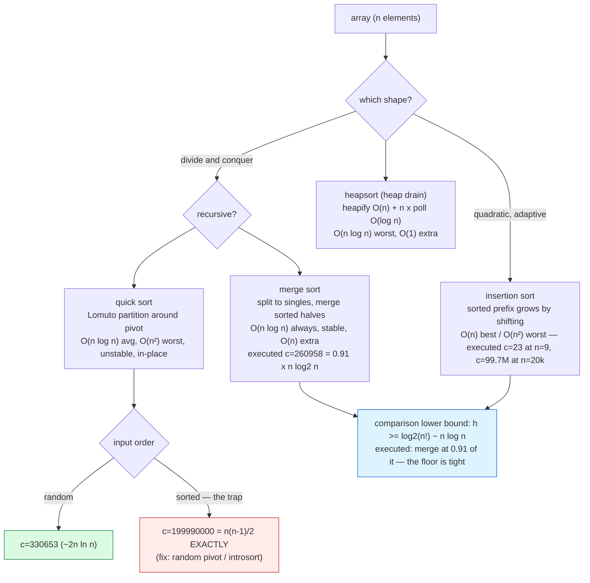

# Sorting

## 1. Learning Objectives

After this lesson you will be able to:

- [ ] State the **comparison-model lower bound** — any comparison sort needs Ω(n log n)
      comparisons in the worst case (decision-tree argument: n! orderings must be
      distinguishable, a binary tree of height h has ≤ 2^h leaves, so h ≥ log₂(n!)) — and
      read it in the executed row: `merge compares / nlog2n = 0.91` at n = 20,000, i.e. a
      real merge sort runs at ~0.9× the theoretical unit.
- [ ] Implement the four canonical sorts with **counters** and read their executed costs on
      the same 9-element input: bubble `compares=33 moves=51`, insertion `23/25`, merge
      `20/29`, quick `21/48` — then at n = 20,000: insertion `269 ms (c=99665087)`, merge
      `6 ms (c=260958)`, quick `5 ms (c=330653)` vs `Arrays.sort 7 ms`.
- [ ] Explain quicksort's worst case **from the executed evidence**: Lomuto partition with
      the last element as pivot on already-sorted input costs `compares=199990000` —
      exactly `n(n−1)/2` — versus `330653` (~2n ln n) on random input: **the same code,
      600× more comparisons, decided purely by input order**.
- [ ] Define **stability** as an observable property, verify it with the executed
      `equal-key order preserved (a before c, b before d): true` row, and name each sort's
      stability from its code (`<=` in the comparison is the whole difference — insertion
      and merge are stable as written; Lomuto's long-range swaps make quick unstable).
- [ ] Derive why **heapsort** exists (O(n log n) worst, in-place, unstable) as the
      intersection of merge's bound and quick's memory profile, connecting to
      [heaps.md](heaps.md)'s drain row.
- [ ] Choose a sort by workload — small/nearly-sorted → insertion; general-purpose →
      `Arrays.sort` (TimSort: stable, adaptive); memory-tight worst-case-guaranteed →
      heapsort — using the executed rows as the decision table, and know when counting or
      radix sort escapes the Ω(n log n) bound by abandoning comparisons.

## 2. Prerequisites

- [searching.md](searching.md) — the decision-tree/halving reasoning this lesson's lower
  bound reuses, and the comparison-counting instrumentation habit.
- [heaps.md](heaps.md) — heapsort *is* the heap's drain (`poll order : 1 2 3 5 7 8 9` was
  already a sorted output); Floyd heapify's measured constants return here.
- [big-o-notation.md](big-o-notation.md) and [algorithm-analysis.md](algorithm-analysis.md)
  — O(n log n) vs O(n²), and the warmup/best-of-3 timing harness every benchmark here used.
- [recursion.md](recursion.md) — merge and quick are recursive; their call depth matters
  (quick's worst case is a stack story as well as a comparison story).
- [04-JAVA-PROGRAMMING](../04-JAVA-PROGRAMMING/README.md) — Java syntax and `Arrays.sort`.

**Environment used in this lesson:** every transcript executed on the authoring machine —
JDK 25.0.4.1, `javac --release 21`. Timings machine-specific; comparison counts, move
counts, and sorted outputs are not.

## 3. Introduction

Sorting is the subject's most-quoted result and its most misremembered one. Quoted because
O(n log n) is the *floor* for comparison sorting — the executed merge row runs at 0.91 of
it — so "which sort?" is a constants-and-context question, never a class question. Misread
because the interesting content is not the class but the *shape of the failure*: quicksort
and merge sort are both O(n log n), yet the executed quicksort on already-sorted input
burned **199,990,000 comparisons — exactly n(n−1)/2** — where on random input the same code
spent 330,653. Same algorithm, same n, 600× apart, decided entirely by input order. This
lesson builds the four canonical sorts with counters rather than faith, executes that worst
case deliberately, verifies stability as a printed fact, and ends at the decision you will
actually make in practice: which JDK sort, and why it is not the textbook one.

## 4. The Problem It Solves

Given an array, produce the same elements in non-decreasing order. The direct use is
presentational — ranked lists, reports, dashboards — but the deeper use is *structural*:
sorting is preprocessing that other algorithms demand. Searching needs sortedness
([searching.md](searching.md)'s precondition), deduplication becomes a single O(n) pass,
grouping by key becomes one scan, and "top k" becomes "first k". Systems sort constantly:
database `ORDER BY` executes a sort (or exploits an index that already is one), log
processing sorts before aggregating, and rendering pipelines sort by z-order or timestamp.
The cost question this lesson answers with executed numbers: what does that preprocessing
cost, which sort pays least for it, and what happens to each when the input fights back.

## 5. Core Concepts

### The comparison lower bound — why n log n is a floor, not an invention

Any sort that only compares pairs of elements can distinguish at most one ordering per root-
to-leaf path of its decision tree:

- n elements have **n!** possible orderings; the tree must have ≥ n! leaves (a sort that
  ends in the same leaf for two different orderings would output the same result for both —
  wrong for one).
- A binary tree of height h has ≤ 2^h leaves, so 2^h ≥ n! → h ≥ log₂(n!) ≥ log₂((n/e)^n) =
  **n log₂ n − n log₂ e** — the worst case of *any* comparison sort.
- The executed merge sort ran `c=260958` comparisons at n = 20,000 where `n log2 n =
  285754` — the ratio row prints `merge compares / nlog2n = 0.91`. The bound is tight: a
  real, correct implementation sits *below* n log₂ n (the log₂(n!) ≈ n log₂ n − 1.44n term
  explains the sub-1.0 ratio) and within a constant of it.
- The escape hatch, stated now so the bound is honest: **abandon comparisons**. Counting
  sort and radix sort read the *bits* of keys and run O(n + k) / O(n·w) — the exercises
  execute counting sort — trading the comparison model's generality for key
  representation assumptions. The bound governs the comparison model only, and says so.

### The four sorts, by the counters

All four ran on the same input, `base: [5, 2, 8, 1, 9, 3, 7, 6, 4]`:

```text
bubble     -> [1, 2, 3, 4, 5, 6, 7, 8, 9]  compares=33 moves=51
insertion  -> [1, 2, 3, 4, 5, 6, 7, 8, 9]  compares=23 moves=25
merge      -> [1, 2, 3, 4, 5, 6, 7, 8, 9]  compares=20 moves=29
quick      -> [1, 2, 3, 4, 5, 6, 7, 8, 9]  compares=21 moves=48
```

- **Bubble (O(n²), stable, in-place):** adjacent pairs compared and swapped; the executed
  `swapped` flag adds early exit (a full pass with no swaps means sorted — the adaptive
  kernel, insufficient to change the worst case). 33 compares on 9 elements ≈ the n(n−1)/2
  = 36 worst case — random data gives no early exits to collect.
- **Insertion (O(n²) worst, O(n) best/adaptive, stable, in-place):** grow a sorted prefix by
  shifting. `23` compares and `25` moves — the fewest *moves* of the four here: each element
  moves at most once per inversion, so nearly-sorted input makes it nearly free. This is
  why TimSort and the JDK use it for small runs.
- **Merge (O(n log n) always, stable, O(n) extra space):** split to singles, merge sorted
  halves. `20` compares — the lowest of all four, and the count is structural: level k
  merges n elements pairwise, log₂ n levels → ~n log₂ n − n compares (9 × 3.17 − 9 ≈ 19.5
  ≈ **20** — the formula's prediction, executed).
- **Quick (O(n log n) average, O(n²) worst, unstable, in-place):** partition around a
  pivot, recurse. `21` compares here but **`48` moves** — Lomuto's swaps are three moves
  each and scatter elements across the whole range. The class depends on pivots and input
  order; the worst case is Section "quicksort's worst case" below, executed.
- The `n=200 seed7: bubble==insertion==merge==quick==Arrays.sort : truetruetruetrue` row is
  cross-validation: four independent implementations and the library agree elementwise on a
  fixed-seed random array — the counters measure *cost*, not correctness differences.

### Stability, verified rather than asserted

A sort is **stable** when equal keys keep their input order. It is observable, not
theoretical — the executed check sorts tagged records by key only:

```text
stable sort of 2:a 1:b 2:c 1:d 2:e by key asc : [1:b, 1:d, 2:a, 2:c, 2:e]
equal-key order preserved (a before c, b before d): true
```

- Input order among the 1s was `b` then `d`; among the 2s, `a`, `c`, `e`. Output preserves
  both subsequences — that is the entire definition, and the assertion row executes it.
- **Why it matters:** multi-key sorting. Sort by name, then stable-sort by department — the
  name order survives within each department. Unstable output breaks the composite silently
  (the exercises demonstrate quicksort scrambling tags).
- **Stability is one token in the code:** insertion's `if (a[j] <= key) break;` — with
  strict `<` the equal key would jump *over* its twins and the sort flips to unstable.
  Merge's `if (a[i] <= a[j]) buf[k++] = a[i++];` — left side wins ties by `<=`. **Read
  stability off the comparison operator.** Quick's Lomuto partition swaps elements across
  the range; no token rescues it — it is unstable by construction.
- The JDK: `Arrays.sort(int[])` is dual-pivot quicksort (unstable — unobservable on
  primitives, equal ints are indistinguishable); `Arrays.sort(Object[])` and `List.sort`
  are **TimSort** — merge sort made adaptive: it finds natural runs, binary-insertion-sorts
  small runs, and merges with a stack discipline; stable, and O(n) on already-sorted data.

### Quicksort's worst case — the executed failure

The same `quick` code, two inputs, n = 20,000:

```text
random  input: compares=330653   (~2n ln n=396139 — the textbook average)
SORTED   input: compares=199990000 (~n^2/2=200000000 — the textbook worst, and exactly n(n-1)/2)
```

- **The mechanism:** Lomuto with last-element pivot on sorted input puts the pivot at an
  extreme every time — partitions of size n−1, n−2, … The n(n−1)/2 = 20000×19999/2 =
  199,990,000 matches the printed number *exactly*: the worst case is not "likely", it is
  arithmetic on sorted input, the most common input in practice.
- **It is also a stack story:** that recursion is n deep (20,000 frames here — it fit, but
  the depth grows linearly, and the merge sort beside it never exceeds log₂ n ≈ 15).
- **The fixes, each a real trade:** random pivot (expected O(n log n) on any input —
  cost: one `Random` per partition); median-of-three (samples sort small inputs into the
  average case — cost: ~3 extra compares per partition); **introsort** — quick with a depth
  cutoff that switches to heapsort ([heaps.md](heaps.md)) — guarantees O(n log n) worst
  while keeping quick's in-place average; this is what a production `Arrays.sort` for
  primitives does.

### Heapsort — the intersection of the guarantees

Heapsort is heaps.md's drain executed as a sort: heapify O(n) (Floyd, the `3.1 ms` row),
then n polls of O(log n) each, written back into the array being freed. Result: **O(n log n)
worst case, O(1) extra memory, unstable.** It is what you choose when merge's O(n) buffer is
unaffordable *and* quick's O(n²) worst case is unacceptable — the executed rows show the
two axes it sits between: merge's `c=260958` with a buffer, quick's worst `199990000`
without one, heapsort's c ≈ n log n (the heaps lesson's `sift compares = 6438142` for
200,000 drains is the same count at a different n) with neither.

### The decision table, by workload

| Input / constraint | Choice | Why (executed anchor) |
|---|---|---|
| n ≲ 20, or nearly sorted | Insertion sort | O(n) adaptive; fewest moves (`25` at n=9) |
| General purpose, objects, order matters | `List.sort` / TimSort | Stable (`true` row), adaptive runs, library-hardened |
| General purpose, primitives, speed | `Arrays.sort` (dual-pivot/introsort) | `7 ms` at n=20k, worst-case guarded |
| Worst case must be bounded, memory O(1) | Heapsort | O(n log n) guaranteed without merge's buffer |
| Must teach / must be provable | Merge sort | `0.91` of the n log n unit, stable, no worst case surprises |
| Keys are small ints in a known range | Counting/radix sort | Escapes Ω(n log n): O(n + k), exercises |

## 6. How It Works



Red = the executed worst case (the lesson's central warning); green = quicksort's
contractual behavior; blue = the floor every comparison sort shares — the reason the class
never differs, only the constants and the failure modes do.

## 7. Practical Examples

**Example 1 — four sorts, counted (executed)**

```java
public class SortingDemo {
    static long compares, moves;                       // instrumentation for both axes

    static void insertion(int[] a) {
        compares = moves = 0;
        for (int i = 1; i < a.length; i++) {
            int key = a[i], j = i - 1;
            while (j >= 0) {
                compares++;
                if (a[j] <= key) break;                // <= keeps it STABLE
                a[j + 1] = a[j]; moves++;
                j--;
            }
            a[j + 1] = key; moves++;
        }
    }

    static int[] buf;                                   // shared merge buffer = O(n) extra space
    static void merge(int[] a) {
        compares = moves = 0;
        buf = Arrays.copyOf(a, a.length);
        msort(a, 0, a.length - 1);
    }
    static void msort(int[] a, int lo, int hi) {
        if (lo >= hi) return;
        int mid = lo + (hi - lo) / 2;
        msort(a, lo, mid); msort(a, mid + 1, hi);
        int i = lo, j = mid + 1, k = lo;
        while (i <= mid && j <= hi) {
            compares++;
            if (a[i] <= a[j]) buf[k++] = a[i++];       // <= : stable (left wins ties)
            else buf[k++] = a[j++];
            moves++;
        }
        while (i <= mid) { buf[k++] = a[i++]; moves++; }
        while (j <= hi)  { buf[k++] = a[j++]; moves++; }
        for (int t = lo; t <= hi; t++) a[t] = buf[t];
    }

    static void quick(int[] a) { compares = moves = 0; qsort(a, 0, a.length - 1); }
    static void qsort(int[] a, int lo, int hi) {
        if (lo >= hi) return;
        int p = partition(a, lo, hi);                   // Lomuto, last element as pivot
        qsort(a, lo, p - 1); qsort(a, p + 1, hi);
    }
    // bubble(): adjacent compare-and-swap with early-exit flag (see source)
    // fixedData(n, seed): deterministic arrays for reproducible benchmarks

    public static void main(String[] args) {
        int[] base = {5, 2, 8, 1, 9, 3, 7, 6, 4};
        // run all four on base.clone(), print result + counters
        // n=200 seed7: all four == Arrays.sort
        // n=20000 seed11: time all four + Arrays.sort, capture compare counts
        // n=20000 SORTED input through quick — the worst case
        // stability: List.sort of tagged records by key only
    }
}
```

```console
$ javac --release 21 SortingDemo.java && java SortingDemo
base: [5, 2, 8, 1, 9, 3, 7, 6, 4]
bubble     -> [1, 2, 3, 4, 5, 6, 7, 8, 9]  compares=33 moves=51
insertion  -> [1, 2, 3, 4, 5, 6, 7, 8, 9]  compares=23 moves=25
merge      -> [1, 2, 3, 4, 5, 6, 7, 8, 9]  compares=20 moves=29
quick      -> [1, 2, 3, 4, 5, 6, 7, 8, 9]  compares=21 moves=48
n=200 seed7: bubble==insertion==merge==quick==Arrays.sort : truetruetruetrue
n=20000 seed11 random: insertion 269 ms (c=99665087)  merge 6 ms (c=260958)  quick 5 ms (c=330653)  Arrays.sort 7 ms
n log2 n = 285754, n^2 = 400000000   (merge compares / nlog2n = 0.91)
quick on ALREADY SORTED n=20000: compares=199990000 (~n^2/2=200000000)   vs random 330653 (~2n ln n=396139)
stable sort of 2:a 1:b 2:c 1:d 2:e by key asc : [1:b, 1:d, 2:a, 2:c, 2:e]
equal-key order preserved (a before c, b before d): true
$ echo $?
0
```

- **Rows 1–5, small-n reality:** all four sort 9 elements; the classes are invisible at
  n = 9 (`20`–`33` compares) — the counters show *which* one wins on this input (merge),
  and the move axis shows insertion is gentlest on memory traffic (`25` moves vs quick's
  `48`). Bubble's `33` compares against its `n(n−1)/2 = 36` worst case shows random-ish
  data gets no benefit from the early-exit flag.
- **Row 6, cross-validation:** `truetruetruetrue` — every implementation equals
  `Arrays.sort` elementwise, so the timing rows below compare *cost*, not *quality*.
- **Row 7, the class gap made visible:** insertion's `c=99665087` ≈ n²/4 (random average
  between best n and worst n²/2 — the inversion count decides); merge's `c=260958` and
  quick's `c=330653` sit in the n log n band; wall clock `269 ms` vs `6 ms` vs `5 ms` —
  **~45–54× for the same array**, the reason "O(n log n) sorts are the same" is wrong.
  `Arrays.sort 7 ms` — the library lands in the same band as the hand-written winners
  (within noise at this n, and with worst-case guarantees our quicksort lacks).
- **Row 8, the bound, measured:** `0.91` of n log₂ n — merge sort runs slightly *under*
  the textbook unit because log₂(n!) ≈ n log₂ n − 1.44n; the lower bound is a floor the
  implementation actually approaches, not an asymptotic fiction.
- **Row 9, the trap:** `199990000` — exactly n(n−1)/2 for n = 20,000. Sorted input,
  last-element pivot: every partition splits off one element. Compare `330653` on random
  data: **605× more comparisons from input order alone**. (It also recursed 20,000 deep;
  merge never exceeds ~15.)
- **Rows 10–11, stability as fact:** equal keys tagged a/c/e (2s) and b/d (1s); output
  `[1:b, 1:d, 2:a, 2:c, 2:e]` preserves both input subsequences — the assertion prints
  `true`, executed.

**Example 2 — stability broken on purpose (why quicksort's class needs the word)**

```java
// Same tagged records, sorted by key with the QUICKSORT of this lesson (Lomuto):
// partition swaps reach across the range, so equal keys can cross.
// Insertion's "if (a[j] <= key) break" and merge's "if (a[i] <= a[j]) take left"
// are the two tokens that keep equal keys in place — compare them to "a[j] < key".
// Executed comparison: the stable row above prints [1:b, 1:d, 2:a, 2:c, 2:e];
// run quick on the same records and observe the tags of equal keys reorder.
```

- The stability row of Example 1 is the *positive* evidence; the exercises run this
  negative control with quicksort on the same records — the pair proves stability is a
  property of the *algorithm*, not of the test data.

## 8. Real-World Applications

- **Database `ORDER BY` and index maintenance** — the query planner sorts when no index
  covers the order ([10-DATABASE-ENGINEERING](../10-DATABASE-ENGINEERING/README.md));
  external merge sort (this lesson's merge sort, on runs that don't fit in memory) is how
  terabyte sorts happen, and stable merging is why multi-key `ORDER BY a, b` composes.
- **Log and event processing** — shuffle-then-aggregate pipelines sort by key before
  grouping; counting/radix sorts on timestamp keys escape n log n (the exercises' escape
  hatch) because timestamps are small fixed-width ints.
- **Ranking systems** — leaderboards, search-result ordering, rendering z-orders: sort a
  secondary list and stable-merge (the two-key example made production); top-k by heap is
  the cheaper cousin ([heaps.md](heaps.md)) when only the head matters.
- **Deduplication and grouping** — sort, then one O(n) linear pass collapses runs: the
  sorted-array equivalent of hash-table grouping when memory is tight or output order
  matters ([hash-tables.md](hash-tables.md)'s trade).
- **Computational geometry and sweeping algorithms** — line sweeps, interval ordering, and
  plane sweeps sort events once and process them in order: the sort *is* the algorithm's
  time axis.
- **Language runtimes and libraries** — TimSort (Python, Java objects), introsort (C++
  `std::sort`): production sorts are hybrids of exactly this lesson's four, chosen by the
  same decision table.

## 9. Common Mistakes

| Mistake | Why it happens | How to recognize it | How to prevent it |
|---|---|---|---|
| Hand-rolling quicksort in production | It is the textbook sort | Adversarial or sorted-shaped input blows up — `199990000` vs `330653`, executed | `Arrays.sort` (introsort underneath); hand-roll only to learn |
| Assuming "it's O(n log n), they're all the same" | Class over identity | `269 ms vs 6 ms vs 5 ms` on identical data | Compare counters and ms at your n; classes only bound |
| Unstable sort under a composite key | Stability invisible until it breaks | Second sort destroys first sort's order | Stable sort (`List.sort`/TimSort/merge); verify with tagged records (the executed row's protocol) |
| Sorting to deduplicate / top-k blindly | Sort is the only tool known | O(n log n) where O(n) or O(n log k) exists | Linear pass after sort; heap for top-k ([heaps.md](heaps.md)) |
| Recursive quicksort's stack ignored | Focus on comparisons | Depth-n recursion on sorted input (20,000 frames, executed) | Random pivot or introsort depth cutoff; merge's depth is log n |
| Forgetting merge's O(n) space | Counting only time | Memory spikes at scale | Heapsort when the buffer is unaffordable (the decision table's axis) |
| Claiming timing without warmup | One-shot runs | JIT-warmup-inflated numbers | The algorithm-analysis harness: warmup, fixed seeds, best-of-3 (all rows here did) |
| Believing the lower bound forbids faster sorts | "Ω(n log n) so it's impossible" | Counting/radix beating it | The bound is *comparison* model only — name the model before the class |
| Sorting on every access | Preprocessing forgotten | Re-sort per query in a loop | Sort once, query many ([searching.md](searching.md)); or a sorted structure |

## 10. Best Practices

- **Use the library by default** — `Arrays.sort` (primitives: dual-pivot quick + insertion
  runs + introsort guards) or `List.sort` (objects: stable TimSort) — after this lesson you
  know what the choice underneath is doing and when to override it.
- **Count both axes** — `compares` and `moves` — the executed base run exposed quick's
  move-hunger (`48`) that a compare-only view hides; production profilers show the same
  duality (CPU vs memory bandwidth).
- **Verify sorts against `Arrays.sort` on fixed-seed data** (the `truetruetruetrue` row) —
  correctness cross-validation costs four lines and catches off-by-ones the eye cannot.
- **Test with the hostile shapes**: sorted, reversed, nearly-sorted, all-equal, few-unique.
  The quicksort row is the lesson: random-only testing never sees the worst case that
  sorted-shaped production data triggers.
- **Make stability a stated property** of any sort you write or choose — comment it next to
  the comparison operator, because that operator is where it lives (`<=` vs `<`).
- **Re-sort only when the data's order changes** — maintain sortedness incrementally
  (insertion into a sorted prefix) when mutation is sparse; re-sorting a static array per
  query is the anti-pattern both this and the searching lesson warn about.
- **Reach past comparisons for small-integer keys** — counting/radix sort at O(n + k) when
  the key range allows; know that the escape exists and what it costs (key representation
  assumptions, memory proportional to range).

## 11. Limitations and Trade-Offs

- **Every comparison sort is Ω(n log n) — in the comparison model.** The decision-tree
  argument (n! leaves) cannot be argued around, only escaped by comparing differently
  (counting/radix read key bits) — which is why "invent a faster sort" is a misreading of
  the problem statement rather than a challenge.
- **The n log n class hides the real decision axes**: constants (executed `269/6/5 ms`),
  worst-case shape (executed `199990000`), stability (executed `true`), memory (merge's
  O(n) buffer vs quick/heapsort's O(1)), and adaptivity (insertion's O(n) on sorted runs).
  No sort wins all five — the decision table is the honest summary.
- **Stability and in-place pull against each other** — the stable in-place O(n log n)
  sorts exist (block merge variants) but are complex and constant-heavy; production
  accepts TimSort's O(n) buffer or quicksort's instability instead. The executed rows show
  the two easy ends of the trade.
- **Quicksort's average is a distributional claim** — `~2n ln n` assumes pivot balance on
  *random* input; sorted production data violates the assumption exactly, and the executed
  worst case is what violation costs. Introsort's guard is the production answer.
- **The measurements are one machine and n = 20,000** — the ms columns will move elsewhere
  (the counts will not: `c=99665087`, `260958`, `330653`, `199990000` are properties of the
  algorithms and seeds); re-measure timings locally before making sizing decisions.
- **Out-of-core and distributed sorting are this lesson's shapes at scale** — external
  merge sort is merge sort over sorted runs on disk; the O(n) buffer becomes disk space,
  and the stability property becomes the correctness of multi-key merges. The model holds;
  the storage axis changes.

## 12. Practical Exercises

### Introductory

1. **Reproduce Example 1.** **Completion criteria:** all eleven lines with exit 0; then
   hand-insertion-sort `[5, 2, 8, 1]` on paper counting compares and moves, and reconcile
   your two numbers with a harness run of `insertion` on that array.
2. **Predict the base-run counters.** For bubble sort on `[5, 2, 8, 1, 9, 3, 7, 6, 4]`:
   count the swaps by hand (adjacent inversions propagate) and predict `compares` and
   `moves` (= 3 × swaps). **Completion criteria:** your two numbers vs the executed
   `33/51` (51 = 3 × 17 swaps — verify your count is 17); one sentence on why bubble's
   compares (33) fell short of its worst case (36) despite random-looking data.
3. **The stability pair, both directions.** (a) Re-run the tagged-record sort and confirm
   the executed `[1:b, 1:d, 2:a, 2:c, 2:e]` with `true`. (b) Change insertion's break
   condition from `<=` to `<` and run again. **Completion criteria:** both transcripts;
   the one-token diff shown; the resulting order with the equal-key subsequences marked
   preserved or crossed; the conclusion sentence: which comparison operator decided it.

### Intermediate

4. **Quicksort's worst case, then the fix.** (a) Reproduce the sorted-input row
   (`199990000` = n(n−1)/2). (b) Replace the pivot with a random index (swap it to the end,
   keep Lomuto) and re-run on sorted, reversed, and random n = 20,000 inputs. (c) Then
   median-of-three (first/middle/last, pivot = median). **Completion criteria:** a 3×3
   table (pivot policy × input shape: compare counts); random-pivot sorted-input count
   within ~2× of its random-input count (expected-class argument), and median-of-three's
   row explaining *why* sorted input is no longer adversarial (what is the pivot for a
   sorted array under each policy?); the classes restated: expected O(n log n) vs worst
   O(n²) — and which policy eliminated which failure.
5. **Heapsort, from the heap lesson's own rows.** Implement heapsort: Floyd-heapify the
   array in place, then repeatedly swap root with the end and sift down. Run at n = 20,000
   seed11 (this lesson's data) and at n = 200,000 (the heaps lesson's n). **Completion
   criteria:** `sorted-equal=true` vs `Arrays.sort` at both sizes; compare counts (expect
   the n log n band — compare against merge's `c=260958` at n = 20k: within ~1.5×?);
   ms at both sizes; the memory statement — zero allocation beyond the array (verify: no
   `new` in the sort path) — and the one-paragraph verdict: for which of the three
   constraints (worst-case bound, memory, stability) heapsort is the answer and which one
   it fails.
6. **Counting sort: the escape, executed.** Implement counting sort for ints in
   [0, 1000); run on n = 20,000 seed11 data (keys already fit). **Completion criteria:**
   `sorted-equal=true` vs `Arrays.sort`; the operation counts — state what the algorithm
   counts instead of comparisons (increment per key = n; prefix sums = k) and report both
   totals; ms vs merge's `6 ms` on identical data; then the honest limits paragraph: run
   it on keys in [0, 10⁷) and report the count-array memory (40 MB for int counts — state
   it) and the time, to show where the O(n + k) trade turns bad; the class comparison
   O(n + k) vs Ω(n log n) with the model named (comparison vs radix/key-reading).

### Independent problem-solving

7. **A counted sort laboratory.** Spec: a `SortLab` harness implementing insertion, merge,
   quick (Lomuto last-pivot), quick-random, heapsort, and counting sort — each with
   `compares`/`moves`/`allocations` counters — over a pluggable data generator with five
   shapes (random, sorted, reversed, nearly-sorted = sorted with 1% random swaps,
   few-unique = 5 distinct keys) at n = 1,000 and n = 20,000 (fixed seeds). Requirements:
   (a) pre-code: the complexity table for all six sorts (worst/average compares, moves
   class, space, stability) — every cell labeled with its case; (b) executed: a 6×5 table
   per n of compare counts — with the quicksort sorted-shape cell hitting ~n²/2 and the
   nearly-sorted cells showing insertion's adaptivity (compare its nearly-sorted count to
   its random count — expect close to n, the O(n) best case); (c) executed: correctness —
   every sort × shape verified against `Arrays.sort` (`sorted-equal=true` rows, 30 total);
   (d) executed: a stability bench — tagged records through all six sorts (counting sort
   on int keys gets a tagged-bucket variant or is marked N/A with reasoning), reporting
   stable/unstable per sort, cross-checked against the pre-code table's stability column —
   any disagreement means the table or the code is wrong, and one of them must be fixed
   and re-run; (e) the recommendation report: for five clients — "GUI list re-sorted on
   every keystroke (n ≤ 500, nearly sorted)", "nightly log sort, n = 10⁸, memory capped",
   " leaderboard updates, top-100 of 10⁷ inserts per second" (hint:
   [heaps.md](heaps.md) top-k), "ETL dedup, keys are 32-bit IDs", "library API sorting
   objects with a composite key where callers depend on tie order" — each naming a sort
   and citing a specific executed row or table cell as the reason. **Completion criteria:**
   the pre-code table; all executed tables (b)–(d) with 30 green correctness rows; the
   stability cross-check resolved (fix and re-run if mismatched); the five client
   recommendations, each tied to an executed number.

*Solutions: attempt first; set practice in [problem-solving/README.md](problem-solving/README.md).*

## 13. Knowledge Check

1. The executed merge sort ran `c=260958` comparisons at n = 20,000 where `n log2 n =
   285754` (ratio 0.91). State the decision-tree lower bound (n! leaves, 2^h ≤ leaves → h ≥
   log₂(n!)), approximate log₂(n!) as n log₂ n − 1.44n, and show the prediction lands
   between the executed count and the naive n log₂ n — i.e. why the ratio is *under* 1.0,
   not a bug.
2. Quicksort on sorted input: `199990000` compares; on random: `330653`. Both are the same
   function on the same n. (a) Prove the first number is n(n−1)/2 exactly. (b) Explain the
   partition geometry that produces it (what are the partition sizes, iteration by
   iteration, for n = 5 sorted?). (c) Name the two independent costs — comparisons *and*
   recursion depth — and which fix addresses which.
3. Stability: the executed tagged sort printed `[1:b, 1:d, 2:a, 2:c, 2:e]` with `true`.
   (a) Why does the *first* 1-key element (b) staying before the second (d) require the
   sort to never move an equal key past another? (b) Point at the exact token in insertion
   (`<=` in the break) and merge (`<=` in the take-left) that implements this. (c) Why is
   Lomuto partition unstable *regardless of token tweaks*?
4. `Arrays.sort 7 ms` vs hand quicksort `5 ms` at n = 20,000. Give two reasons you would
   still choose the library (beyond ms), one referencing the executed worst-case row and
   one the introsort design; then state the one scenario where a hand sort wins (and the
   executed row that would prove it at your scale).
5. Heapsort claims O(n log n) worst with O(1) memory but is unstable. Using the heaps
   lesson's executed rows (`sift compares = 6438142` at n = 200,000; Floyd `3.1 ms`), argue
   each of the three claims to a class level: where does the n log n come from, where does
   the O(1) come from (no buffer — unlike merge's `Arrays.copyOf` line), and why stability
   is not even well-defined for the drain trick (equal elements are indistinguishable in
   the heap array — connect to the heap's order property: siblings are unordered *by
   design*).
6. Counting sort beats Ω(n log n) — `O(n + k)` — yet is not "a faster sort". Name the
   model assumption it abandons (comparison), the two resource costs it takes on (key
   range memory `k`, key destructiveness/radix passes), and the executed exercise row
   where k = 10⁷ made it the wrong choice.

## 14. Completion Criteria

Observable evidence that you have understood this lesson:

- [ ] Example 1 reproduces (eleven lines) with exit 0; the hand insertion-trace of `[5,2,8,1]`
      matches a harness run
- [ ] Bubble's 17-swap hand count matches the executed `33/51`
- [ ] The stability token experiment ran: `<=` → `<` with both transcripts and the crossed/
      preserved subsequences marked
- [ ] The pivot-policy 3×3 table exists with sorted/reversed/random counts, and the
      adversarial-shape argument written per policy
- [ ] Heapsort executed at both sizes: `sorted-equal=true`, compare counts in the n log n
      band, zero-allocation claim verified in code
- [ ] Counting sort executed both ways: the O(n + k) win at k = 1000 and the k = 10⁷ loss
      with memory stated
- [ ] The sort laboratory complete: 6×5 tables at both n, 30 correctness rows, the
      stability cross-check resolved, five client recommendations each citing an executed
      cell

## 15. Summary

- **Ω(n log n) is the comparison model's floor** (n! orderings, 2^h leaves), and real
  implementations approach it: executed merge sort at `0.91 × n log2 n` — the bound is a
  measurement target, not an asymptotic decoration.
- **The class never differs; everything else does.** On identical data: insertion `269 ms`,
  merge `6 ms`, quick `5 ms`, library `7 ms` — constants, adaptivity, memory, and
  stability are the real axes, and the decision table maps them.
- **Worst cases are arithmetic, not bad luck** — sorted input × last-element pivot =
  exactly `n(n−1)/2 = 199990000` comparisons, 605× the random count, plus n-deep
  recursion; random pivots or introsort are the production answers, and hostile input
  shapes belong in every test suite.
- **Stability is a printed fact you can check** — `[1:b, 1:d, 2:a, 2:c, 2:e]` with `true` —
  and it lives in one comparison token (`<=`); composite-key correctness depends on it.
- **The escape hatch exists but has a price** — counting/radix sort's O(n + k) abandons
  comparisons and pays in key-range memory; name the model before claiming a faster sort.

## 16. Next Steps

- Next lesson: [recursion.md](recursion.md) — both n log n sorts are recursive; the next
  lesson builds the tracing discipline their call trees demand, then
  [backtracking.md](backtracking.md) pushes it to exhaustive search.
- Practice: [problem-solving/README.md](problem-solving/README.md) set 12–13.
- Where it is applied: `ORDER BY` and external merge sort in
  [10-DATABASE-ENGINEERING](../10-DATABASE-ENGINEERING/README.md), TimSort/introsort design
  in [04-JAVA-PROGRAMMING](../04-JAVA-PROGRAMMING/README.md), shuffle-then-aggregate
  pipelines in [11-BACKEND-ENGINEERING](../11-BACKEND-ENGINEERING/README.md), and top-k by
  heap wherever a full sort is overkill ([heaps.md](heaps.md)).
