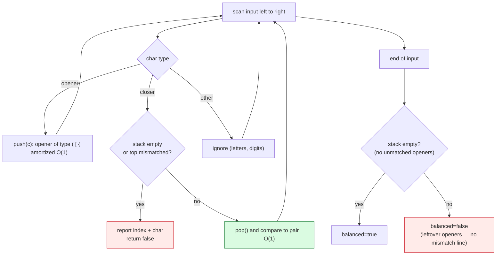

# Stacks

## 1. Learning Objectives

After this lesson you will be able to:

- [ ] Implement a stack (LIFO) over a dynamic array — `push`/`pop`/`peek` all **O(1)** (append
      amortized), with the `top` cursor as the only moving part — and state why one pointer
      makes a stack simpler than a queue (next lesson).
- [ ] Trace the empty-state protocol: the executed `EmptyStackException` on pop-under-empty
      and recovery by pushing again (`push after empty: peek=40`).
- [ ] Derive **why matching brackets is a stack problem** — the "innermost pair closes first"
      nesting rule — then implement it and read the four executed verdicts, including the two
      distinct failure modes: *leftover openers* (`"((())"` → `balanced=false`, no mismatch
      printed) vs *wrong closer* (`"a(b]c"` → `mismatch at index 3: ']'`).
- [ ] Name the LIFO discipline as a correctness tool, not a data-layout detail: the executed
      `LIFO drain: 3 2 1` is the property undo, backtracking, and DFS all depend on.
- [ ] Compare stack implementations honestly — array-backed (this lesson) vs linked-backed —
      with complexity and memory on both axes.
- [ ] Recognize the recursion↔stack correspondence (frames are a stack — see
      [recursion.md](recursion.md)) and where the JVM's own stack limits appear.

## 2. Prerequisites

- [arrays.md](arrays.md) — the dynamic-array growth this implementation reuses (`push` is
  `add` with a `top` cursor).
- [linked-lists.md](linked-lists.md) — the splice picture a *linked* stack would use
  (`push` = `addFirst`), for the comparison in Section 11.
- [04-JAVA-PROGRAMMING](../04-JAVA-PROGRAMMING/README.md) — arrays, exceptions, `Map.of`.

**Environment used in this lesson:** every transcript executed on the authoring machine —
JDK 25.0.4.1, `javac --release 21`. Timings machine-specific.

## 3. Introduction

A stack is an array (or list) **plus a rule**: access only the most recent element. The rule
buys correctness properties no free-access structure has — matching, nesting, undo, and
last-in-first-out drain order become definable — and costs nothing measurable: `push` and
`pop` move one cursor. This lesson builds it, exercises the empty-state edge cases that every
real implementation must answer, and then applies the structure to its canonical problem —
**bracket matching** — where the executed output shows both ways matching can fail and why
one counter (`top`) suffices for each.

## 4. The Problem It Solves

Any problem whose correctness is defined by *nesting* — inner closes before outer, newest
undoes first — is not merely "easier with a stack": it is **ill-defined without one**. Consider
matching `"({[()]})"` by any position-only rule: the innermost `(` and `)` are adjacent in
time but not in position; pairs interleave. The stack captures the actual grammar: push
openers, and on every closer demand "the most recent opener is your pair" — a demand only the
last element can answer, which is exactly LIFO. The executed four-case run in Section 7 is the
spec: correct nesting accepted, an unclosed opener rejected (leftover check), a mismatched
closer rejected *at its index* (`mismatch at index 3: ']'`), and non-bracket characters
ignored (`"{[()()]}extra"` → true).

## 5. Core Concepts

### LIFO: the discipline

**Last in, first out.** `push(10); push(20); push(30)` then three pops return `30, 20, 10` —
the executed drain (`LIFO drain: 3 2 1` for pushes `1,2,3`) prints the property as behavior.
The invariant that makes it: **`pop` removes exactly what `push` last wrote** — no
reordering, no interleaving. Callers don't need to remember where they put something; the
structure remembers recency *for* them.

### One cursor: the implementation

```java
public class StackDemo {
    private int[] data = new int[4];
    private int top = 0;                     // elements live in data[0..top-1]

    public void push(int v) {
        if (top == data.length) data = Arrays.copyOf(data, data.length * 2);
        data[top++] = v;
    }
    public int pop() {
        if (top == 0) throw new EmptyStackException();
        return data[--top];
    }
    public int peek() {
        if (top == 0) throw new EmptyStackException();
        return data[top - 1];
    }
    public boolean isEmpty() { return top == 0; }
}
```

- `top` is the *only* field that changes per operation — size = `top`, capacity = `data.length`
  (both from [arrays.md](arrays.md), unchanged). **No shifting anywhere:** `pop` just
  decrements (the vacated slot keeps its value until overwritten — harmless because `top`
  defines the visible region; a security-sensitive context would zero it — a documented
  trade, not a default).
- Bounds: `push` grows geometrically → **amortized O(1)**, worst O(n) on the growth line;
  `pop`/`peek` → **O(1) worst**, each with the empty guard.
- The empty guard *is* the API decision: return a sentinel (what?) vs throw
  (`EmptyStackException` — the executed choice; you must handle it or propagate).

### Empty-state protocol — executed

```text
peek=30 pop=30 pop=20
after two pops: empty=false
third pop returns 10
now empty=true
pop on empty: EmptyStackException
push after empty: peek=40
```

Read it as a state machine: three pushes; `peek` doesn't remove (30 printed once, then popped);
two pops leave one element (`empty=false`); the third pop empties it (`now empty=true`); the
fourth **throws** — and the structure is *not corrupted*: `push(40)` afterwards works
(`peek=40`). That recovery row is the one tests usually miss: an exception must leave the
stack usable — the invariant `0 ≤ top ≤ capacity` survived the throw.

### Why brackets are a stack problem

The pairing rule has one hard property: **the most recently opened pair must close first**
(nesting). Any structure that can answer "who was the last unmatched opener?" in O(1) and
remove it in O(1) solves matching — LIFO by name. The algorithm:

```java
static boolean balanced(String s) {
    StackDemo st = new StackDemo();
    Map<Character, Character> close = Map.of(')', '(', ']', '[', '}', '{');
    for (int i = 0; i < s.length(); i++) {
        char c = s.charAt(i);
        if (c == '(' || c == '[' || c == '{') st.push(c);
        else if (close.containsKey(c)) {
            if (st.isEmpty() || st.pop() != close.get(c)) {
                System.out.println("  mismatch at index " + i + ": '" + c + "'");
                return false;
            }
        }
    }
    return st.isEmpty();
}
```

Two exit paths, two failure modes — both visible in the executed run:

| Input | Result | Failure mode | Line that decides |
|---|---|---|---|
| `"(a[b]{c})"` | `balanced=true` | — (correct nesting) | final `isEmpty()` true |
| `"((())"` | `balanced=false` | **leftover openers** (nothing printed) | `return st.isEmpty()` → false |
| `"a(b]c"` | `balanced=false` | **wrong closer at index 3** | `mismatch at index 3: ']'` printed first |
| `"{[()()]}extra"` | `balanced=true` | letters ignored by design | neither branch fires for letters |

Cost: **one pass, O(n)** — each char pushed at most once and popped at most once; stack depth
≤ n (worst case `((((…` → space O(n), the input's own nesting depth).

## 6. How It Works



The green node is where the LIFO rule *is* the algorithm: `pop()` delivers exactly the opener
that the grammar says must match. The two red exits are the two executed failure rows —
distinguish them in bugs: a printed `mismatch` line means *wrong order/character*; silence
with `false` means *unclosed*.

## 7. Practical Examples

**Example 1 — the stack, its states, its exception (executed)**

```console
$ javac --release 21 StackDemo.java && java StackDemo
peek=30 pop=30 pop=20
after two pops: empty=false
third pop returns 10
now empty=true
pop on empty: EmptyStackException
push after empty: peek=40
"(a[b]{c})" balanced=true
"((())" balanced=false
  mismatch at index 3: ']'
"a(b]c" balanced=false
"{[()()]}extra" balanced=true
LIFO drain: 3 2 1
$ echo $?
0
```

- **Lines 1–6:** the protocol from Section 5 — `peek` non-destructive, three pops to empty,
  throw on the fourth, recovery push works. Note `third pop returns 10` despite
  `after two pops: empty=false` — the *last* element leaves on that pop (`now empty=true`).
- **Lines 7–11:** the four verdicts, in the table above. The order of prints matters for
  reading: for `"a(b]c"` the `mismatch at index 3` line prints **before** its verdict line —
  the diagnostic fires inside `balanced()`, the verdict after it returns. `index 3` is the
  `]` (`a`=0, `(`=1, `b`=2, `]`=3) — the index-inclusive message is the debugging contract
  worth copying (same idea as `index 17, size 17` in the arrays lesson).
- **`"{[()()]}extra"` is a design question, not a bug:** letters pass through untouched —
  the checker validates *bracket* structure only. If your spec says "reject anything else",
  add an `else` branch — decide deliberately; the executed run documents the current choice.
- **Line 12:** `push 1,2,3` then drain → `3 2 1` — LIFO printed as evidence; every stack
  claim in later lessons (undo, backtracking, JVM frames) is this line.

**Example 2 — deeper trace of the mismatch case (executed logic, hand-traced states)**

```text
input "a(b]c"
i=0 'a'  : ignored (not a bracket)        stack: (        top=1 after next step...
i=1 '('  : opener -> push                  stack: (
i=2 'b'  : ignored                         stack: (
i=3 ']'  : closer; stack NOT empty; pop '(' ;  '(' != '[' -> MISMATCH
          prints "  mismatch at index 3: ']'"  -> balanced=false
(never reaches i=4 or the final isEmpty check)
```

- The counterfactual matters: if the input were `"a(b)c"`, `i=3` pops `'('` matching `')'`,
  `i=5`... final stack empty → true. The structure's job was to *deliver* `(` at exactly the
  moment `]` demanded a pair — and the demand itself was wrong (`]` wants `[`, not what it
  got). One pop answers both "is there an opener?" and "is it the right one?" — the `||` in
  `st.isEmpty() || st.pop() != close.get(c)` short-circuits: **empty is its own failure**
  (a closer with nothing open — e.g. `")"` — prints `mismatch at index 0`).

## 8. Real-World Applications

- **Expression evaluation and compilers** — operands/values stack, operators stack, matching
  parse trees; [04-JAVA-PROGRAMMING/jvm-and-memory.md](../04-JAVA-PROGRAMMING/jvm-and-memory.md)'s
  operand stack in `javap -c` output is this structure at the JVM level.
- **Undo/redo in editors** — every mutation pushes the inverse; redo pops. LIFO is the
  *product requirement* (undo reverses the latest change first).
- **Backtracking and DFS** — [backtracking.md](backtracking.md) and
  [graph-algorithms.md](graph-algorithms.md) use an explicit stack (or recursion's implicit
  one) to return to the most recent choice point — the `LIFO drain` order is what makes
  "return to the last fork" definable.
- **Syntax and config validation** — brackets, XML/HTML tags, YAML indentation: nested
  closers are everywhere; the executed checker is the minimal true version.
- **Call stacks** — the JVM runs every method call on a stack (frames push on call, pop on
  return); `StackOverflowError` is this lesson's `EmptyStackException`'s cousin — an
  exhausted structure, named by the structure.

## 9. Common Mistakes

| Mistake | Why it happens | How to recognize it | How to prevent it |
|---|---|---|---|
| Returning null/-1 on empty pop | Sentinel habit | Callers silently propagate garbage | Throw (executed choice) *or* return `Optional` — decide in the API doc |
| Not testing recovery after the throw | Exception treated as end | Stack unusable post-`EmptyStackException` | The `push after empty: peek=40` row — always test the operation *after* the exception |
| Bracket checker treats letters as errors (or ignores them) silently | Spec unset | Verdicts disagree with your validator's intent | Decide ignore-vs-reject explicitly (Section 7 documents the choice) |
| Forgetting *leftover* check (`isEmpty()` at end) | Only mid-loop failures handled | `"((())"` would print **true** | Final `st.isEmpty()` — the second red exit in the diagram |
| Mixing stack and queue semantics | LIFO/FIFO confusion | Undo behaves like "oldest first" | Write the drain order first (`3 2 1` vs `3 4 5 6 7`) and test it |
| Using `java.util.Stack`'s legacy API blindly | Older code copied | `Vector` synchronized overhead, `empty()` naming | Prefer `ArrayDeque` as stack in modern Java (Section 11) |
| Growing stack without bound on hostile input | Depth ≤ n forgotten | Memory blowup on `((((…` 10⁶ long | Cap depth, or accept O(n) as the documented bound |
| Popping past the visible region accidentally | `top` bookkeeping off-by-one | `peek` returns stale value | Invariant `0 ≤ top ≤ capacity`; test after every growth line |

## 10. Best Practices

- **Define the empty contract first** — throw vs sentinel, documented before implementation;
  then test pop-under-empty *and* the next operation after the throw (the executed protocol).
- **Keep the invariant comment on the fields** — `// data[0..top-1] valid; size == top` —
  it's the difference between `--top` and `top--` being obviously right.
- **One pass, two exits** for matching problems: mismatch (with index) inside, leftover check
  at end — both printed verdicts in your tests, not just the happy path.
- **Use `ArrayDeque` as the stack in production Java** — `push`/`pop`/`peek` exist, it's
  array-backed and unsynchronized; `java.util.Stack` extends `Vector` (legacy lock
  overhead). This lesson's class is the teaching model of the thing you now *read* correctly.
- **Count depth as complexity's second axis** — matching is O(n) time **and O(depth)** space;
  state both (the `((((…` worst case is O(n) space).
- **Instrument your teaching code** — the exception rows and drain orders here are tests in
  transcript form; keep them executable.
- **Pair every stack claim with its drain test** — `LIFO drain: 3 2 1` style — an order
  property is only proven by an ordered output.

## 11. Limitations and Trade-Offs

- **No access below the top** — `stack[1]` doesn't exist; any problem needing mid-access is
  the wrong problem for this structure (that restriction is the point, but it's still a
  restriction).
- **Array-backed growth = occasional O(n) copy** (amortized, from arrays.md); a linked-backed
  stack avoids the copy but pays a pointer/node per element and worse locality — for a stack
  whose depth is modest, the array wins (why `ArrayDeque` is the JDK default).
- **Depth bound equals input nesting** — hostile or pathological inputs (`((((…`, deeply
  nested JSON) can exhaust memory or the JVM stack (recursion form:
  `StackOverflowError`); real validators impose depth limits — the O(n) space bound stated
  as a policy.
- **This lesson's checker is a model, not a lexer** — it ignores strings, escapes, and
  comments (`"("` inside a string literal counts as an opener — wrong for real code
  validation). The structure is right; fronting it with tokenization is the engineering
  (a documented gap, not a fake claim).
- **Exception-per-empty is a cost signal** — throwing is slow when *expected* empty polls are
  frequent; the `isEmpty()`-then-`pop()` idiom in hot loops (or `poll()` returning null in
  `ArrayDeque`) trades safety for speed deliberately — name which one your context wants.

## 12. Practical Exercises

### Introductory

1. **Reproduce Example 1.** **Completion criteria:** all twelve output lines with exit 0;
   the hand-trace of the `"a(b]c"` path (Example 2) matching the printed `mismatch at
   index 3` line.
2. **Predict-then-run two inputs.** For `"([{}])"` and `")(()"`, write the stack state after
   each character and the final verdict (including whether a mismatch line prints), then run
   both through the executed `balanced`. **Completion criteria:** two written traces; two
   program verdicts matching; the `")(()"` case's mismatch index predicted correctly
   (index 0, empty-stack failure — the short-circuit path).
3. **Drain-order battery.** Push `1..5`, drain; push `1,2`, pop, push `3`, drain; drain an
   empty stack (expect the exception row). **Completion criteria:** three outputs, the two
   drain orders written as sequences, exception row captured, and the `isEmpty` states
   between operations logged.

### Intermediate

4. **Stack min in O(1).** Implement `MinStack` whose `min()` is O(1) worst — the auxiliary
   stack technique (pair values, or a second stack of minima). **Completion criteria:** the
   class table written first; a trace showing min evolution through
   `push 5,3,7,pop,push 2,pop` with both stacks printed per step; argument for why a single
   "current min" variable fails (the executed-style row showing the wrong answer it gives).
5. **Two-stack queue (and vice versa).** Implement FIFO using two stacks; push all, pop from
   the other only when empty (amortized argument: each element moves twice). **Completion
   criteria:** the amortized derivation (total moves ≤ 2n over any operation sequence) written
   *before* code; a mixed sequence of 12 ops with both stack states printed per step; the
   drain order `3 4 5 6 7`-style FIFO check on that sequence; one timing probe at n = 100,000
   mixed ops with harness method stated (warmup + best-of-5).
6. **Reverse polish evaluator.** `eval("3 4 + 2 *")` via operand stack; support `+ - * /` and
   multi-digit integers (tokenize first). **Completion criteria:** the complexity stated
   (O(tokens) time, O(depth) space); five executed cases — one invalid expression per failure
   mode (too few operands → stack underflow caught; leftover operands at end → result
   ambiguous — your chosen error); and the hand-eval of one case shown as the check.

### Independent problem-solving

7. **A text-bracket validator with a real lexer.** Spec: `validate(source)` handling `()[]{}`
   *outside* string literals (`'...'`, `"..."` with backslash escapes) and line comments
   (`// …`), reporting the first structural error with line and column (not just index).
   Requirements: (a) the stack-based core reusing this lesson's algorithm, with the two
   failure modes distinguishable in output (wrong closer with position; unclosed opener with
   its *opening* position); (b) ignored regions documented (comments/strings never push or
   pop — prove with a test where `")("` inside a string is accepted while a bare `")"` is
   rejected); (c) depth limit of 1,000 with its own explicit error (the Section 11 policy —
   make the O(n) bound a rule); (d) executed transcript: ≥ 8 inputs covering both failure
   modes, the string/comment cases, and one pathological `((((…` 10-deep (and one 1,001-deep
   triggering the limit); (e) complexity section: O(n) time, O(depth) space with the worst
   case stated; (f) a comparison paragraph: what your validator *still* misses vs a real
   compiler's (name two: e.g. Unicode identifiers, nested comment syntax) — the Section 11
   honesty discipline. **Completion criteria:** the eight-case transcript with line/column
   outputs; the depth-limit row showing the explicit error; the pre-code stack-state trace
   for one failing case matching program output exactly; and the limitations paragraph with
   two named gaps.

*Solutions: attempt first; set practice in [problem-solving/README.md](problem-solving/README.md).*

## 13. Knowledge Check

1. Draw the fields after `push 10, push 20, push 30` (`data`, `top`), then after two pops —
   and state the invariant line that makes `pop`'s `--top` correct. Why does `peek` not
   change `top`?
2. The executed protocol: `after two pops: empty=false` then `third pop returns 10` and
   `now empty=true`. Count pushes and pops to verify nothing was lost, then explain why
   `push after empty: peek=40` is in the transcript (what regression would it catch?).
3. Two failure modes, two outputs: `"((())"` printed a verdict with **no** mismatch line;
   `"a(b]c"` printed `mismatch at index 3` first. Explain the code path for each and what the
   final `return st.isEmpty()` contributes in each case.
4. Why must a *closer* check `st.isEmpty()` before popping (short-circuit order in
   `st.isEmpty() || st.pop() != …`)? Give the input that exercises it and the printed line.
5. `"{[()()]}extra"` → `balanced=true`. Was that a deliberate design choice in this
   implementation? Show the branch that letters take, and state one spec under which the
   output *should* be false — plus the minimal code change.
6. LIFO drain `3 2 1` — connect this line to one downstream use: pick undo, DFS, or JVM
   frames and state what would break if the drain printed `1 2 3` instead.

## 14. Completion Criteria

Observable evidence that you have understood this lesson:

- [ ] Example 1 reproduces (twelve lines) with exit 0
- [ ] Two inputs predicted (state-by-state) before running, verdicts matching
- [ ] Drain battery: two ordered sequences + exception + recovery rows captured
- [ ] `MinStack` trace with both stacks printed; the single-variable counterexample shown
- [ ] Two-stack queue: amortized derivation written pre-code; 12-op sequence traced; FIFO
      drain verified
- [ ] RPN evaluator runs with all failure modes exercised
- [ ] The validator (or equivalent independent set) has the eight-case transcript, depth
      limit, and the two-gap limitations paragraph

## 15. Summary

- **Stack = array + one cursor + LIFO rule**: `push`/`pop`/`peek` O(1) (append amortized),
  empty guard throwing `EmptyStackException`, and **recovery after the throw tested**.
- **Brackets are the canonical application** because nesting demands "most recent opener
  first" — one pass, two failure modes, both visible in the executed four-case run
  (`mismatch at index 3` vs silent leftover).
- **Order properties are proven by drain output** — `LIFO drain: 3 2 1` is the evidence
  pattern; downstream structures (undo, backtracking, call frames) inherit it verbatim.
- **Depth is the second complexity axis** — O(n) time, O(depth) space, and real systems cap
  it; the JDK's own answer to this lesson is `ArrayDeque`, not the legacy `Stack`.

## 16. Next Steps

- Next lesson: [queues.md](queues.md) — FIFO, two cursors, and why dequeue needs a *ring*
  (the executed `ring 0.82 ms` vs `shift-all-dequeue 60.6 ms` is the teaser).
- Practice: [problem-solving/README.md](problem-solving/README.md) set 3–4.
- Where it is applied: backtracking ([backtracking.md](backtracking.md)), DFS in
  [graph-algorithms.md](graph-algorithms.md), and the operand stack you already saw in
  [04-JAVA-PROGRAMMING/jvm-and-memory.md](../04-JAVA-PROGRAMMING/jvm-and-memory.md).
