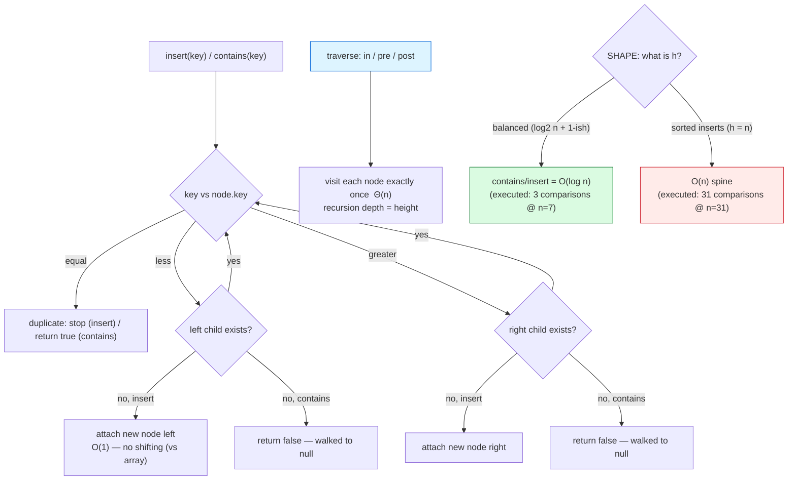

# Trees

## 1. Learning Objectives

After this lesson you will be able to:

- [ ] Define the binary **search** tree invariant (`left < node < right`, unique keys) and
      trace `insert`/`contains` along it — with the executed `contains(60)=true after 3
      comparisons` row as the cost model: **one comparison per level**.
- [ ] Implement the three traversals and read their executed outputs — `in-order` printing
      sorted keys (`20 30 40 50 60 70 80`) and `pre-order` reconstructing insertion structure
      (`50 30 20 40 70 60 80`) — and state which traversal answers which question.
- [ ] Derive height as the complexity determinant: balanced `7 nodes → height 3`
      (`ceil(log2(7+1))`) vs the executed degenerate spine `insert 1..31 → height 31` — and
      explain *why* sorted insertion guarantees the spine (linked list in tree costume).
- [ ] Read a miss correctly: `contains(1000)=false after 3 comparisons (miss = walk to null)` —
      a miss still costs exactly the depth it walked, and the same depth for hit and miss in
      the executed rows.
- [ ] Compute and compare the two evidence ratios from the run — sorted vs shuffled insert
      order, `31/8` — and state what the *shuffled* row proves (random order ≈ log-ish height,
      not guaranteed) versus what it does not (self-balancing).
- [ ] State why a plain BST is one bad input away from O(n), name the fix family (AVL,
      red-black, scapegoat — re-balancing), and choose BST vs hash vs array with complexity,
      order, and memory on all three axes.

## 2. Prerequisites

- [linked-lists.md](linked-lists.md) — nodes and recursive structure; a tree is a list with
  *two* (or more) next-pointers.
- [hash-tables.md](hash-tables.md) — the ordered-versus-unordered decision this lesson
  completes.
- [04-JAVA-PROGRAMMING](../04-JAVA-PROGRAMMING/README.md) — recursion-ready methods,
  nested classes; traversals here reuse the call-stack discipline from
  [04-JAVA-PROGRAMMING/jvm-and-memory.md](../04-JAVA-PROGRAMMING/jvm-and-memory.md).
- [big-o-notation.md](big-o-notation.md) — log-shaped claims are made precise there; heights
  are where they become *physical* (levels of nodes).

**Environment used in this lesson:** every transcript executed on the authoring machine —
JDK 25.0.4.1, `javac --release 21`.

## 3. Introduction

A tree is a linked structure with a *branching* rule, and the binary search tree adds one
invariant — **every left descendant is smaller, every right descendant larger** — that turns
branching into *decision-making*: each comparison halves (roughly) the remaining search space,
which is binary search's halving executed as physical shape. The executed transcript is this
lesson's spine: three comparisons to find a key in a 7-node tree, sorted output falling out
of an in-order walk for free, and two opposite fates for the same 31 keys — **height 31** when
inserted in sorted order, **height 8** when shuffled. The lesson is how to read those numbers,
keep the good one, and plan for the bad one.

## 4. The Problem It Solves

Hash tables gave O(1) equality but *no order* (lesson 08). Sorted arrays give order with
O(log n) search but O(n) insert ([arrays.md](arrays.md)'s shift). The BST is the classic
attempt at both: ordered traversal *and* log-ish search *and* node-at-a-time insert with no
shifting — pay one pointer per node, get the middle ground. Its exposed weakness is exactly
what the executed `31/8` comparison measures: the guarantees are **shape-dependent**, and
shape depends on insertion order unless the structure re-balances itself. So this lesson
teaches the tree *and* the honesty clause: a plain BST is a performance contract whose fine
print (height) the input can rewrite — which is why production ordered maps are AVL/red-black
variants, named here and built on the invariants learned below.

## 5. Core Concepts

### The invariant

```java
static class Node { int key; Node left, right; Node(int k) { key = k; } }
```

- **BST invariant:** for every node, all keys in the left subtree `< node.key` and all keys in
  the right `> node.key` (the executed `insert` also skips duplicates — `key == n.key` stops
  descent; uniqueness is part of the invariant you must *choose*, and this implementation
  chose it).
- **In-order traversal prints keys sorted** — executed: `in-order : 20 30 40 50 60 70 80`
  from a tree built by inserting `50, 30, 70, 20, 40, 60, 80`. Nothing sorted anything —
  the invariant *is* a sorted order, discovered by walking left-root-right. This is the
  tree's headline trade: **order without maintaining an array's contiguous layout**.
- **Search is binary search made of nodes:** at each node one comparison discards a whole
  subtree. `contains` counts them: `steps++` per node visited — comparisons = levels touched.

### Traversals: three orders, three questions (executed)

```text
in-order  : 20 30 40 50 60 70 80
pre-order : 50 30 20 40 70 60 80
```

| Traversal | Order | Question it answers | Executed evidence |
|---|---|---|---|
| in-order | left → node → right | "list keys sorted" (BST's gift) | `20 30 40 50 60 70 80` — sorted ✓ |
| pre-order | node → left → right | "rebuild/serialize this exact shape" | starts with root `50`, then subtree order preserved |
| post-order | left → right → node | "children before parent" (delete, evaluate) | not printed — derived in exercises |

All three are Θ(n) — every node visited exactly once — and the recursion depth is the
**height**: Θ(h) frames live at once, which for the degenerate tree below is Θ(n) frames —
a `StackOverflowError` shape (recursion lesson revisits).

### Height is the complexity knob — both fates, executed

```text
height of balanced 7-node tree = 3  (ceil(log2(7+1)) = 3)
insert 1..31 in order: height = 31  (a linked list wearing a tree costume)
searching for 31 in the spine: 31 comparisons
same 31 keys, shuffled insert order: height = 8
sorted-insert height / shuffled height = 31/8
```

- **Height in this code counts nodes along the deepest path** (`height(null) = 0`,
  `1 + max(...)`), so a perfectly packed 7-node tree = 3, and the closed form
  `ceil(log2(n+1))` matches the printed 3.
- **Sorted inserts make a spine:** `1 → 2 → 3 → … → 31` all-right-descendants → height **31**
  = n. Search degrades to a linked-list walk: `searching for 31 in the spine: 31 comparisons`
  — the executed proof that BST worst case is **Θ(n)**, not Θ(log n). The output's own
  epigram says it: *"a linked list wearing a tree costume."*
- **Shuffled order is the realistic hope, not a guarantee:** same 31 keys, `Random(7)`-shuffled
  order → height **8**. Compare: perfect = 5 (`ceil(log2 32)`); random BSTs average ≈
  `~1.39·log₂n ≈ 1.39×5 ≈ 7` — the observed 8 sits right in that band. Better than 31 by
  **31/8 ≈ 3.9×**, but *worse than balanced by 8/5* — random insertion does not buy the
  balanced bound; only re-balancing does (Section 11).
- **Every operation costs O(height)** — search, insert, delete: comparisons = levels. So the
  BST's real class is **O(h)** with `log₂n ≤ h ≤ n`, and *which end you get* is a property
  of insert order — the sentence every BST claim must carry.

### Misses cost depth too — executed

```text
contains(60)=true after 3 comparisons
contains(65)=false after 3 comparisons
contains(1000)=false after 3 comparisons (miss = walk to null)
```

- `contains(60)`: `50 → 70 → 60` = 3 (hit at depth 3).
- `contains(65)`: `65 > 50` → right to `70`; `65 < 70` → left to `60`; `65 > 60` → right is
  `null` — the loop counted the three non-null nodes it visited (`50, 70, 60`) before falling
  off, printing **3**. **Misses walk until they fall off** — cost = depth of the position
  where the key *would* sit, i.e. same order as a hit at that depth. Misses are not cheaper;
  they end at null instead of at a key.
- The practical reading: *average* comparison counts over mixed workloads ≈ tree height —
  one number (`h`) predicts them all. Measure `h`, know your costs.

## 6. How It Works



The decision loop (top) *is* the invariant executed — every descent is one comparison down
one level. The bottom fork is the lesson's warning in one picture: same code, same keys,
two shapes, two complexity classes — green when shape cooperates, red when input order
doesn't.

## 7. Practical Examples

**Example 1 — build, traverse, search (executed)**

```java
public class BST {
    static class Node { int key; Node left, right; Node(int k) { key = k; } }
    private Node root;
    static int steps = 0;

    public void insert(int key) { root = insert(root, key); }
    private Node insert(Node n, int key) {
        if (n == null) return new Node(key);
        if (key < n.key) n.left = insert(n.left, key);
        else if (key > n.key) n.right = insert(n.right, key);
        return n;
    }
    public boolean contains(int key) {
        Node n = root;
        while (n != null) {
            steps++;
            if (key == n.key) return true;
            n = key < n.key ? n.left : n.right;
        }
        return false;
    }
    // inOrder / preOrder / height — recursive, as in Section 5
}
```

```console
$ javac --release 21 BST.java && java BST
in-order  : 20 30 40 50 60 70 80
pre-order : 50 30 20 40 70 60 80
height of balanced 7-node tree = 3  (ceil(log2(7+1)) = 3)
contains(60)=true after 3 comparisons
contains(65)=false after 3 comparisons
contains(1000)=false after 3 comparisons (miss = walk to null)
insert 1..31 in order: height = 31  (a linked list wearing a tree costume)
searching for 31 in the spine: 31 comparisons
same 31 keys, shuffled insert order: height = 8
sorted-insert height / shuffled height = 31/8
$ echo $?
0
```

- **Rows 1–2:** inserted in order `50, 30, 70, 20, 40, 60, 80` — in-order output is sorted
  (invariant read left-root-right); pre-order output starts at the root and *reconstructs* the
  insertion shape (compare: rebuild the tree from `pre-order` alone + sorted keys = exercise
  3's derivation).
- **Row 3:** balanced height = 3, with the closed form printed *beside* it so the claim is
  checkable: `ceil(log2 8) = 3` ✓.
- **Rows 4–6:** hit at 3, miss-at-65 at 3, miss-at-1000 at 3 — note the *random* miss
  (`1000` is off in the right-of-80 direction) also took 3: in a balanced 7-node tree every
  path falls off within 3 levels. The parenthetical *(miss = walk to null)* is the cost
  statement: misses end at null, priced by depth.
- **Rows 7–9:** the spine and its measurement — `height = 31` (n nodes → n-deep path),
  `31 comparisons` for the deepest key (worst case realized: O(n) search in a structure
  advertised as O(log n)-ish), then the shuffled rerun's `height = 8`.
- **Row 10:** `31/8` — the comparison ratio stated as data: *input order* changed height by
  ~3.9× on identical keys; the structure and code never changed.

**Example 2 — hand-trace of one insertion round (the invariant at work)**

```text
tree after inserting 50, 30, 70:
        50
       /  \
     30    70
insert 20:  20 < 50 → left;  20 < 30 → left;  30.left == null → attach
insert 40:  40 < 50 → left;  40 > 30 → right; 30.right == null → attach
final in-order walk: 20 30 40 50 70  (sorted — invariant holds at every node)
```

- Two comparisons per insertion — levels touched, not nodes touched: the other 4 nodes were
  never visited. If `contains(40)` runs next, the identical path runs again — **the shape
  caches the decision history of all inserts that created it.**
- The uniqueness line: inserting `40` again → `40 == 40` stops at that node, nothing
  changes — the `else if (key > n.key)` in `insert` (equality falls through without
  descending) is the chosen duplicate policy, visible in the code you executed.

## 8. Real-World Applications

- **Ordered maps and sets (`TreeMap`/`TreeSet`)** — range queries, floor/ceiling, sorted
  iteration: the ordered half of the hash-vs-tree toolkit this subject has been assembling
  ([10-DATABASE-ENGINEERING](../10-DATABASE-ENGINEERING/README.md)'s B-tree indexes are the
  disk-adapted cousin — same invariant, fatter nodes for page sizes).
- **Expression and ASTs** — compilers parse into trees; in-order reads infix, pre-order reads
  prefix (the traversal table's question column, at scale: the
  [04-JAVA-PROGRAMMING](../04-JAVA-PROGRAMMING/README.md) compiler pipeline touches these
  shapes every build).
- **File systems and DOM** — directories-in-directories and document trees are *general*
  trees (n-ary, not binary) — the traversal and height reasoning transfers directly.
- **Heap-shaped scheduling** (next lesson) and **BST-shaped lookup** are deliberately
  separated in this curriculum: different questions (min-next vs key-lookup), different
  structures.
- **Balanced-tree family in databases/standard libraries** — AVL, red-black (Java's
  `TreeMap`, Linux CFS scheduler's rb-tree) exist because the executed `31/8` row is a
  *production incident* waiting for sorted input.

## 9. Common Mistakes

| Mistake | Why it happens | How to recognize it | How to prevent it |
|---|---|---|---|
| Assuming BST = O(log n) always | Height bound forgotten | Sorted-load test suddenly slow (`31 comparisons` shape) | Always say O(h); test sorted, reverse, and shuffled insert orders |
| Inserting sorted data into a plain BST | Real inputs arrive sorted (ids, timestamps) | Height ≈ n, spine-shaped | Re-balancing tree, or shuffle, or pre-build balanced (exercises) |
| Forgetting duplicates policy | `==` case unhandled | Infinite descent or silent dupes | Choose: skip / count / allow right — the executed code skips; document it |
| Confusing traversals | Order names blur | pre-order output expected sorted | Memorize the *question* column (Section 5 table), not the names |
| Recursive traversal on degenerate tree | Depth = height forgotten | `StackOverflowError` at n ≈ 10⁵ spine | Iterative traversal, or bound depth — the h ≤ n warning has a runtime form |
| Parent pointer missing in delete | Recursive delete needs context | Delete "works" until leaf cases | This lesson defers delete to exercises — know the three cases before coding |
| Comparing equality with `<`/`>` only | Equal-key handling drifts | Tree grows with dupes, search misses | The explicit `key == n.key` stop in `insert`/`contains` |
| Choosing BST when only equality needed | Structure mismatch | No range queries, hash would be O(1) avg | The decision sheet from lesson 08: order needed? → tree; else → hash |
| Height defined inconsistently (edges vs nodes) | Textbook mixing | Off-by-one vs `ceil(log2(n+1))` | Pick one counting (this lesson: nodes on path) and recheck closed forms against a printed row |

## 10. Best Practices

- **State BST claims as O(h)** with the insert-order caveat attached — the three-line honest
  version: `O(h), log n ≤ h ≤ n; sorted inserts give the worst end (executed: 31)`.
- **Test shape sensitivity deliberately** — sorted, reverse-sorted, and shuffled inserts on
  the same keys, compare heights (the executed `31/8` pair is the template) — a structure's
  input-sensitivity belongs in its test suite.
- **Make the invariant checkable** — write `validateBST(node, min, max)` (exercises) that
  asserts the range rule on every node; run it after mutation in tests, like lesson 05's
  list invariant checker.
- **Count comparisons in searches** — the `steps` counter pattern again: turns "should be
  log-ish" into a printed number (`3 comparisons`) you can regress against.
- **Know your traversal's question** — sorted-verification → in-order; serialization →
  pre-order (+ reconstruction); safe deletion/evaluation → post-order; pick by question.
- **Pre-build balanced when you know the keys** — sort first, insert middle-first (exercises
  prove the height) — the cheap way to get log-shape without an AVL implementation.
- **Reach for `TreeMap`/`TreeSet` in production Java** — this class is the readable model of
  what you're instantiating; its Javadoc's order/range guarantees are now derivable claims.

## 11. Limitations and Trade-Offs

- **The shape lottery** — plain BSTs have no re-balancing: one sorted stream and every
  guarantee reverts to Θ(n) *silently* (executed: heights 8 vs 31). The fix family — AVL
  (strict, rotation-maintained balance), red-black (looser, fewer rotations), scapegoat
  (amortized, no per-insert bookkeeping) — trades **extra pointer/flag state + rotation
  logic** per insert for the *guaranteed* `O(log n)`; this lesson builds the plain form on
  purpose: rotations are an optimization over an understood base.
- **Pointers, not locality** — tree nodes scatter like lesson 05's list; sequential scans lose
  to arrays (the `2.49 vs 2.51 ms`-style locality argument applies, and real B-trees exist
  partly to fix exactly this at the cache/page level).
- **Height is a global property** — measuring it needs a walk (or a cached height updated on
  every mutation — a maintenance cost in itself); operations *cost* by height but *don't
  know* it.
- **More memory per node than a hash bucket array** — two child pointers + header per key
  (plus balance data in self-balancing variants) vs the array's flat slots — the order
  feature's memory price, on top of lesson 08's slack comparison.
- **Smaller constant than hash at equal n** — at n where both are ~log/constant (small n),
  the array scan often wins anyway (lesson 08's "when is a map overkill" — still true);
  trees shine in the *middle*: ordered, large, dynamic.

## 12. Practical Exercises

### Introductory

1. **Reproduce Example 1.** **Completion criteria:** all ten lines with exit 0; the
   `ceil(log2(7+1)) = 3` arithmetic shown next to the printed height; the `65`-miss path
   (`50 → 70 → 60 → null`) hand-traced and reconciled with `after 3 comparisons`.
2. **Shape sensitivity run.** For n = 31: insert ascending, descending, and shuffled (seed
   fixed); print heights for all three. **Completion criteria:** three heights; the ratio
   best/worst; one paragraph predicting *before* running why descending must equal ascending
   (mirror argument) — then the printed confirmation.
3. **Traversal predictions.** For the tree built by inserting `50, 30, 70, 20, 40, 60, 80`
   (Example 1's), write in-order and pre-order by hand from the shape, *then* run.
   **Completion criteria:** two hand-written sequences matching the printed rows; the
   post-order sequence derived by you (left-right-root) and verified by adding a method.

### Intermediate

4. **`validateBST(node, min, max)`** — recursive range check; test on (a) Example 1's tree,
   (b) the spine, (c) a deliberately corrupted tree (one key moved). **Completion criteria:**
   `true`, `true`, `false` with the *position* of the violation reported — the invariant from
   Section 5 used as executable law.
5. **Middle-first build → guaranteed balance.** Sort keys, build by recursive
   `mid = (lo+hi)/2` insertion; for n = 31 and n = 1000 compare heights vs random-order
   inserts (same seed harness). **Completion criteria:** predicted height
   (`ceil(log2(n+1))`: 5 for 31) before running; measured heights for built vs shuffled at
   both n; the closed form's match or a stated deviation with explanation.
6. **Height without recursion.** Implement `heightIterative` (level-order counting, queue
   from [queues.md](queues.md)); run on the spine n = 1,000 — where the recursive `height`
   (and any recursive traversal) would use 1,000 frames. **Completion criteria:** iterative
   vs recursive heights equal on all three shapes; one paragraph on when the recursive form's
   depth becomes the `StackOverflowError` risk (name an n where you'd worry — JVM default
   stack ≈ thousands of frames, cite your own probe if you run one).

### Independent problem-solving

7. **An ordered-map library with a shape report.** Spec: `OrderedMap` on a plain BST with
   `put/get/remove(ranged or by-key)/size/minKey/maxKey/inOrderKeys()` plus `height()`,
   `depthOf(key)`, and `validate()`. Requirements: (a) pre-code complexity table: every
   method in O(h) terms with the `log n ≤ h ≤ n` range spelled out, plus Θ(n) for
   traversals/size-cache-free ops; (b) executed tests: the three-shape battery (ascending /
   descending / shuffled n = 1000) printing heights and `depthOf(maxKey)` per shape — the
   `31`-style worst case *scaled up*, with the O(h)→O(n) class restated from *your* numbers;
   (c) `remove` implemented and tested across all three node cases (leaf, one child, two
   children — the successor-replacement rule written out *before* code, with a hand trace of
   the two-children case on Example 1's tree), `validate()` passing after each; (d) a
   comparison paragraph using executed evidence from three lessons: BST height rows vs hash
   `load=0.49 / visits=2` vs array `0.05 ms` random access — for a keyed-lookup workload at
   n = 1,000,000 *with range queries required*, pick a structure and disqualify the other two
   by name; (e) one measured finding of your own (e.g. put-mix timing across the three
   shapes, warmup + best-of-5) whose per-shape ratios you correlate with the height ratios —
   showing cost ∝ shape on your machine. **Completion criteria:** the pre-code O(h) table;
   all executed transcripts; the successor-rule hand trace matching program output; the
   three-structure verdict paragraph citing executed rows; and the measured shape-timing
   table with ratios compared to height ratios.

*Solutions: attempt first; set practice in [problem-solving/README.md](problem-solving/README.md).*

## 13. Knowledge Check

1. State the BST invariant in one sentence, then use it to explain why in-order prints sorted
   (`20 30 40 50 60 70 80`) *without any sorting code* — trace one mid-key (e.g. `50`) through
   the walk.
2. `contains(60)`, `contains(65)`, `contains(1000)` all printed `3 comparisons`. Hand-trace
   each path, and explain why the *miss* isn't cheaper — what does "walk to null" cost?
3. Perfect height for 31 nodes would be 5 (`ceil(log2 32)`). Observed: shuffled 8, sorted 31.
   What does each number prove (and what doesn't it)? Cite the executed rows and the
   `1.39·log₂n ≈ 7` rule of thumb for why 8 is "healthy for a plain BST".
4. Why does sorted input produce a spine? Walk `insert 1, 2, 3` through the `key < n.key`
   branch and show every new node attaching in the same direction — then state which real
   data types arrive this way in practice (three examples).
5. Recursion depth equals height — connect the spine (h = 31 at n = 31) to frame usage, and
   predict the failure mode at n = 100,000 sorted inserts (name the error, from lesson 04's
   JVM material). Which exercise's method would still work?
6. Hash map vs BST for: (a) word-frequency counts, (b) "find all users with id in
   [1000, 2000]", (c) session lookups. Answer each with classes (from executed rows:
   `visits=2`, height `8`, etc.), plus one non-complexity factor per answer.

## 14. Completion Criteria

Observable evidence that you have understood this lesson:

- [ ] Example 1 reproduces (ten lines) with exit 0; all three `contains` paths hand-traced
- [ ] Three-shape battery heights printed; descending-mirror prediction confirmed
- [ ] Three traversals predicted by hand first, then verified (post-order added)
- [ ] `validateBST` returns true/true/false with violation position on the corrupt tree
- [ ] Middle-first build matches the predicted `ceil(log2(n+1))` height at n = 31
- [ ] Iterative height agrees with recursive on all shapes; the frame-risk paragraph exists
- [ ] The ordered-map set runs (O(h) table, shape battery at n = 1000, three-case `remove`,
      three-structure verdict, measured shape-timing table)

## 15. Summary

- **BST = invariant + traversal + shape:** `left < node < right` makes in-order sorted
  (executed `20 … 80`), makes search a halving walk, and makes **height the complexity** —
  `O(h)` with `log n ≤ h ≤ n`.
- **Both fates executed on identical keys:** balanced `3` comparisons at n=7; sorted inserts
  → spine `height 31`, `31 comparisons` (Θ(n) — "linked list in a tree costume"); shuffled →
  `8` (healthy but *not* guaranteed log — `31/8` is the input-order dividend).
- **Misses cost depth, not luck** — `false after 3 comparisons` rows: walk-to-null is priced
  by where the key would have sat.
- **Traversals are questions** — in-order: sorted; pre-order: shape/serialization;
  post-order: children-first — each Θ(n), recursion depth = height (the spine's overflow
  warning).
- **Shape is an engineering decision:** pre-build balanced, shuffle, or re-balance
  (AVL/red-black named) — a plain BST ships with a fine print the input can rewrite.

## 16. Next Steps

- Next lesson: [heaps.md](heaps.md) — a tree used *not* for search but for min/max: the same
  branching shape with a different contract (and an array-friendly one).
- Practice: [problem-solving/README.md](problem-solving/README.md) set 6–7.
- Where it is applied: ordered indexes in
  [10-DATABASE-ENGINEERING](../10-DATABASE-ENGINEERING/README.md), `TreeMap`-backed ordered
  services in [11-BACKEND-ENGINEERING](../11-BACKEND-ENGINEERING/README.md), and the
  decision tables you built across lessons 08–09 for real workloads.
