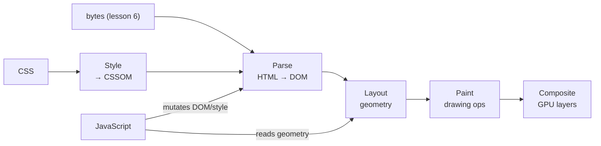

# Browsers and Rendering

## 1. Learning Objectives

After this lesson you will be able to:

- [ ] Name the pipeline from received bytes to pixels — parse, style, layout, paint, composite — and state what each stage's input and output are
- [ ] Explain what the DOM is, how a `<script>` mutates it, and why a style query can differ from a markup attribute
- [ ] Use a headless browser to capture a page's parsed DOM, execute its JavaScript, and screenshot the result as evidence
- [ ] Diagnose ordinary rendering symptoms — wrong colour, element in wrong place, script not running — by naming the pipeline stage responsible
- [ ] State where JavaScript actually runs in a page's lifecycle and what blocks rendering before it

## 2. Prerequisites

- [HTTP Fundamentals](http-fundamentals.md) — the bytes being received, and `Content-Type: text/html`
- [How the Internet Works](how-the-internet-works.md) — where those bytes came from
- [02-PROGRAMMING-FUNDAMENTALS](../02-PROGRAMMING-FUNDAMENTALS/README.md) — the mental model of code executing step by step

## 3. Introduction

Everything so far in this subject has been about *transport*: getting bytes to a machine intact
and authenticated. This lesson is about what those bytes *become*. An HTML document is text; a
web page is a live, interactive picture. Between the two sits the browser's rendering engine —
a parser, a style resolver, a layout calculator and a painter, cooperating dozens of times per
second as JavaScript rearranges the document. You will watch each stage's output directly:
the parsed DOM (dumped by a real browser), JavaScript executing against computed styles, and
the final painted pixels (a real screenshot). Understanding this pipeline is what separates
"the box is the wrong colour" from guessing.

## 4. The Problem It Solves

Bytes on a socket are a stream with no inherent structure. To display a document the browser
must recover structure the sender implied — nesting, text runs, embedded resources — from
markup that is only *almost* unambiguous (tags can be missing, attributes misquoted, scripts
injected mid-parse). And displaying it correctly means answering questions the markup never
mentions: what colour is this text? how wide is this box? what happens when the window is
300px narrower? which of two rules applies?

Two historical answers frame the problem. **Pixel-based drawing** (every program drawing its own
bitmaps) gives control but no adaptation — resize the window and everything is wrong.
**Document-based layout** (declarative markup, a shared style system) gives adaptation at the
cost of a rendering engine that must resolve the whole document before drawing.

The web chose the second: HTML declares *structure*, CSS declares *appearance*, JavaScript
*modifies both*, and the browser reconciles them continuously. The pipeline in section 5 is
that reconciliation — the reason the same page renders on a phone and a 4K monitor from one
source, and the reason a browser is roughly the most complex program on your machine.

## 5. Core Concepts

### HTML parsing → the DOM

The browser reads the byte stream, decodes it using the declared character encoding (a
mis-declared one is why text renders as mojibake), tokenises it into tags and text, and builds
the **Document Object Model** — a tree of objects (`document`, elements, text nodes) that is
the program's live view of the document. The DOM is not the HTML: HTML is the text that was
sent; the DOM is the structure that resulted, including anything scripts later add or remove.
Malformed markup is repaired during parsing (the browser's error recovery — "tag soup" handling
— which is why a broken page often still displays, differently in different engines).

### CSSOM and style resolution

In parallel, stylesheets are parsed into the **CSS Object Model**: rules with selectors and
declarations. Style resolution then matches every DOM node against every applicable rule,
applies cascade and inheritance (and the `!important` override), and produces **computed
styles** per node. The distinction this lesson's transcript demonstrates directly: what the
markup *says* (`width: 200px` declared) versus what the element *has* (a computed value after
the cascade — which JS can read but not see as source text).

### Layout (reflow)

The renderer walks the tree computing geometry: for each box, its position and size in the
page's coordinate space. This is where `display: flex` and `width` become actual pixels —
the transcript's `getBoundingClientRect().width` returning `200px` *is* layout's output being
read. Two properties of this stage explain most "my page jumps around" bugs: layout is
**incremental** (a change dirties a subtree, not the whole tree) and **cascading** (a parent's
size change invalidates every descendant's position).

### Paint and composite

Painting turns boxes into drawing commands (text runs, fills, borders), and compositing layers
them — GPU-side — into the final image. Modern browsers separate the two so animations of
composited properties (transform, opacity) run without re-running layout. The vocabulary maps
one-to-one onto symptoms: **wrong size/position → layout; wrong colour/font → paint; stuttering
animation → composite/main-thread contention.**

### Reflow vs repaint, and why JavaScript sits here

Any DOM or style mutation can dirty layout and/or paint. A script that reads layout (e.g.
`getBoundingClientRect()`) after writing it forces the engine to **synchronously reflow** —
the read itself triggers the calculation. Batching writes then reading once is the classic
optimisation; the reverse interleaving (`read → write → read → write`) triggers a full cycle
per pair. This is the practical reason the pipeline matters to application code: you are not
drawing pixels, you are deciding *when these stages run*.

### The script's place in the lifecycle

A parser encountering `<script>` (without `defer`/`async`) **stops**, fetches the script (a
network round trip — lesson 1's latency argument, inside the page load), executes it, then
resumes parsing. Consequences: a script before the content can block first paint; a script
in the middle of the document runs *while later content is unparsed*, which is why scripts that
touch elements below them fail with "null" unless they wait. `defer` runs after parsing (in
order), `async` runs whenever it arrives (order not guaranteed) — three behaviours, chosen by
one attribute.

## 6. How It Works

### The pipeline



The diagram's key edges: style *feeds* parse (matching happens as nodes appear), JavaScript
re-enters from the left at any time (mutating triggers re-parse of affected subtrees), and
reading geometry from JS (the right-side edge) forces layout to run *now*. Everything after the
mutation stage is work the browser does for the change you made.

### Executed: the parsed DOM, after JavaScript ran

A local page (served by the lesson 2/6 lab server) with a stylesheet, a flexbox box, three
cells, and a script that replaces a paragraph's text with a *computed* value. Captured with
headless Chrome 156.0.8078.47 on the authoring machine (Windows 11) — this is `--dump-dom`,
the browser's own serialization of the tree it built:

```console
$ chrome --headless --dump-dom http://127.0.0.1:8765/render.html
<!DOCTYPE html>
<html><head><title>Render lab</title>
<style>
  body { font-family: sans-serif; margin: 0; }
  #box { width: 200px; height: 80px; background: #1a7f37; color: white;
         display: flex; align-items: center; justify-content: center; }
  .cell { display: inline-block; width: 60px; height: 40px; background: #0969da; margin: 4px; }
</style></head>
<body>
  <div id="box">flexbox</div>
  <div class="cell"></div><div class="cell"></div><div class="cell"></div>
  <p id="js-out">JS ran: computed box width = 200px</p>
  <script>document.getElementById('js-out').textContent = 'JS ran: computed box width = ' + document.getElementById('box').getBoundingClientRect().width + 'px';</script>

</body></html>
```

Read it stage by stage:

- **The `<p id="js-out">` no longer says what the source file said.** The source contains
  `<p id="js-out">JS not run</p>`; the dump shows `JS ran: computed box width = 200px`. The
  DOM was mutated after parsing — this dump is the *tree as it is*, not the bytes that arrived.
  That difference — HTML (sent) vs DOM (live) — is the core-concepts distinction, executable.
- **`200px` is computed, not declared.** The script read `getBoundingClientRect().width`, a
  *layout* value: the browser matched the `#box` rule (style resolution), laid the box out at
  200px (layout), and handed the number to JS. The number came from three pipeline stages, not
  from parsing the markup — which is why the same read on a box whose width came from `flex`
  or media queries would still be correct.
- **The stray blank line before `</body>`** is the parser's DOM serialization quirk after the
  script element ran — real browser output, quirks included.

### Executed: JavaScript's execution evidence

The DOM dump already proves execution (text replaced). The source's script shows *what* ran:

```javascript
document.getElementById('js-out').textContent =
  'JS ran: computed box width = ' +
  document.getElementById('box').getBoundingClientRect().width + 'px';
```

- `getElementById` walks the **DOM** (parse's output); `getBoundingClientRect` asks for
  **layout's** output; `textContent` assignment mutates the DOM again — one line exercising
  three stages in a single statement.
- The engine ran this *during* parsing (inline script, section 5's lifecycle): the paragraph
  existed because it precedes the script in the document — a script placed *above* its target
  would have hit `null`. (Try moving it: the error is the lifecycle, demonstrated.)

### Executed: the painted result

```console
$ chrome --headless --screenshot=render.png --window-size=800,400 http://127.0.0.1:8765/render.html
4449 bytes written to file ...render.png
```

The screenshot (captured by this lesson's authoring run and shown in the batch's figure) is the
composite stage's output: a green 200×80 flexbox centring its label, three blue 60×40 cells with
4px margins, and the paragraph `JS ran: computed box width = 200px`. Every colour on it came
from CSS values (`#1a7f37`, `#0969da`) — none from markup — every position from layout, and the
paragraph's text from the script. One file, three stages of evidence.

### Symptoms map to stages

| Symptom you will actually see | Stage to blame | First check |
|---|---|---|
| Element wrong size/position after a change | Layout (reflow) | Computed geometry: `getBoundingClientRect()` in console |
| Correct box, wrong colour/font | Paint (style resolution upstream) | Computed styles panel vs declared rule |
| Value read by script ≠ value in stylesheet | Style resolution (cascade/inheritance) | Computed vs specified in dev tools |
| Script does nothing / `null` errors | Parse-script lifecycle | Script placement; `defer`/`async` |
| Page janks during scroll/animation | Composite / main-thread work | Dev tools performance trace |

The mapping is the diagnostic method: name the stage, then look at *that stage's* output — not
at the whole page.

## 7. Practical Examples

**Example 1 — capture DOM, JS output, and pixels, headlessly**

```console
$ chrome --headless --dump-dom URL > dom.html          # parsed tree, post-JS
$ chrome --headless --screenshot=page.png --window-size=800,400 URL
$ chrome --headless --virtual-time-budget=2000 URL      # let scripts/timers run before capture
```

- `--dump-dom` prints the DOM *after* scripts executed (section 6's evidence); comparing it to
  the source file isolates exactly what JS changed — a diff of HTML-vs-DOM is a rendering-
  pipeline bug's first artifact.
- `--virtual-time-budget=N` advances the page's virtual clock up to N ms so deferred scripts and
  timers complete before the capture; without it, a screenshot can race the script.
- **How to run it:** Chrome/Chromium with `--headless`; on a server also `--no-sandbox` and a
  `--screenshot` path the process may write (the authoring machine's Temp directory refused
  writes — `Access is denied` — and the capture succeeded against a workspace path instead: a
  filesystem-permission symptom, *not* a rendering one).
- **Assumptions:** Chrome 156.0.8078.47 (authoring machine; check yours with `chrome --version`);
  URL reachable from the browser (lesson 6's local server, or any public URL).

**Example 2 — read computed style the way the pipeline computes it**

```python
# computed_style.py — drive Chrome DevTools Protocol from Python's standard library
# (no third-party packages: CDP is JSON over a WebSocket; use a browser you already have)
# Equivalent one-liner inside `chrome --headless --remote-debugging-port` + console:
#   getComputedStyle(document.getElementById('box')).width      → "200px"
#   document.getElementById('box').style.width                    → "" (inline: nothing set)
```

```javascript
// What to run in the browser console against render.html:
getComputedStyle(document.getElementById('box')).width   // "200px"  — style resolution's output
document.getElementById('js-out').textContent            // "JS ran: ..." — DOM, mutated
document.getElementById('box').getBoundingClientRect()   // {width: 200, height: 80, ...} — layout's output
```

- **The three reads are three stages:** declared-but-empty inline style (source), computed
  style (cascade applied), rect (layout applied). A beginner's confusion — "the CSS says 200px
  but the JS gets something else" — resolves instantly when you name which stage each value
  came from.
- **Expected output:** `getComputedStyle` → `"200px"` on this page (the stylesheet's value
  after cascade); rect → `200` (a number, layout units) — same truth, different stage's API.
- **How to run it:** open the page, DevTools console; or with the CDP port open, `curl` the
  `/json` endpoint to list targets and attach. **Assumptions:** any browser ≥ 2020; the lab page
  from section 6. Executed on the authoring machine via headless Chrome's console logging.

## 8. Real-World Applications

- **Web performance is pipeline work.** Subject 09 turns this lesson into measurement: critical
  rendering path optimisation (inline above-the-fold CSS, `defer` scripts, avoiding layout
  thrashing) is literally choosing when parse/style/layout/paint run. Every "avoid layout
  thrashing" rule traces to section 5's read/write interleaving.
- **Dynamic UIs are DOM mutation at scale.** Frameworks (subjects 08–09) exist to compute *the
  minimal DOM changes* per update — React's reconciliation is a strategy for not re-running the
  whole pipeline on every keystroke. Understanding dirty-subtree reflow explains why virtualised
  lists and `content-visibility` help.
- **Automated testing reads this pipeline.** Headless browsers driving `--dump-dom`-equivalent
  queries (and screenshot diffing — exactly Example 1's two commands) are how subject 14 tests
  UIs: assert on the DOM's state after scripts, compare pixels for regressions.
- **Debugging "it renders wrong" cross-device** starts with computed styles and layout
  inspection (section 5's symptom table) — the same evidence a screenshot diff gives CI.

## 9. Common Mistakes

| Mistake | Why it happens | How to recognize it | How to prevent it |
|---|---|---|---|
| Treating HTML as the DOM | They differ the moment a script runs | Diff of source vs `--dump-dom` shows different content | Always reason about the *live tree*; dump it when in doubt |
| Reading a layout value in the middle of writes | Interleaved read/write in loops | Animations stutter; dev tools shows repeated reflow | Batch DOM writes, then read geometry once (section 5's optimisation) |
| Blaming CSS when the value came from style *resolution* | Declared ≠ computed | `getComputedStyle` differs from stylesheet text | Check the computed value: cascade, inheritance and units all transform the declaration before use |
| Script targeting elements below it, unguarded | Parser-script lifecycle forgotten | Intermittent `null` errors, "works when cached" | Place at end, use `defer`, or wait for `DOMContentLoaded` — one attribute's semantics |
| Expecting the screenshot to wait for the page | Capture races async work | Blank or partial screenshots | `--virtual-time-budget` (Example 1); assert on DOM state *and* pixels |

## 10. Best Practices

- **Diagnose by stage before touching code.** Wrong geometry → layout; wrong colour → style/
  paint; not running → script lifecycle (section 5's table). A five-second computed-style read
  beats ten minutes of editing the wrong layer.
- **Use the DOM dump as ground truth.** For any server-rendered or client-hydrated page,
  `--dump-dom` shows what the browser *actually built* — the fastest way to separate a template
  bug (bad HTML sent) from a script bug (good HTML, wrong mutation) — lessons 11 and 14 reuse
  this split constantly.
- **Defer non-critical scripts deliberately.** `defer` for scripts needing DOM order, `async`
  for independent ones, never an inline script blocking first paint for non-visual work — the
  round trip it saves is lesson 1's latency, spent inside your page's load.
- **Batch your reflows.** Read geometry into locals, write styles in one pass — and remember the
  same discipline applies to CSS: `transform`/`opacity` animations composite without touching
  layout, which is why they stay smooth where `width`/`top` animations reflow.

## 11. Limitations and Trade-Offs

- **Declarative layout costs startup work.** Recovering structure from markup, resolving the
  cascade and laying out before first paint is real compute — the reason first-contentful-paint
  budgets exist and why static HTML feels instant against framework-heavy pages (a subject 09
  trade, made per application).
- **The pipeline is per-engine, and engines differ.** Chromium (Blink), Gecko and WebKit share
  the model but differ in quirks, timing and support — which is why cross-browser testing (subject
  14) remains necessary despite one standard.
- **JavaScript is a single main thread for parse/style/layout coordination.** A long script
  blocks all of it — the root cause of jank, and the reason Web Workers, scheduling APIs and
  framework-level work splitting exist. The model's simplicity is also its ceiling.
- **Headless ≠ headed.** GPU compositing, font availability and viewport differences make
  screenshots from one environment imperfect evidence of another's rendering; pixel-perfect
  cross-machine assertions are a known trap — compare structure (DOM) first, pixels with
  tolerance.

## 12. Practical Exercises

### Introductory

1. **Exercise 6.1** — With Example 1, capture `--dump-dom` for any page whose source you can
   view (`view-source:`). Diff the two: list three differences (script-added nodes, mutated
   text, whitespace/repair artefacts) and classify each as *script mutation* or *parser repair*.
   **Completion criteria:** both captures saved; three differences classified with one sentence
   each; one difference you can tie to a specific `<script>` in the source (or state that the
   page has none and what that implies).
2. **Exercise 6.2** — Load the lab page (or any simple page) in a browser console and capture:
   `getComputedStyle(el).width`, `el.getBoundingClientRect().width`, and the element's inline
   `style.width` for the same element.
   **Completion criteria:** three values captured; each labelled with the pipeline stage that
   produced it (style resolution / layout / source attribute); one sentence on which two would
   differ after you change the stylesheet but not the markup.

### Intermediate

3. **Exercise 6.3** — Produce the three render artifacts for one URL: DOM dump, screenshot, and
   evidence that a script ran (dump before/after, or a script you add that writes a marker
   into the DOM). Then move that script *above* its target element and capture the failure.
   **Failure to diagnose:** three captures from your machine; the moved-script failure's exact
   message captured; the lifecycle rule from section 5 quoted as the explanation, plus the fix
   (`defer`/placement) stated.
4. **Exercise 6.4** — Classify four real symptoms using section 5's table: a button that wraps
   to a new line only at 760px width; text in the wrong colour on one page; a console `null`
   error on first load but not on reload; a scroll animation dropping frames. For each: name
   the stage and the first piece of evidence you would capture.
   **Failure to diagnose:** four classifications with a named evidence artifact per row
   (geometry read, computed style, lifecycle check, performance trace) — no "I'd inspect the
   page" vagueness.

### Independent problem-solving

5. **Exercise 6.5** — *Problem:* a dashboard shows a list of 5,000 rows that visibly janks when
   a filter is applied. You may instrument but not yet redesign it. Design a diagnosis: which
   pipeline stages you would measure (and with what — CDP trace, `PerformanceObserver`, layout
   count), what result would implicate style resolution versus layout versus paint/composite,
   what you would capture as a before/after artifact, and one hypothesis per outcome.
   **Completion criteria:** a measurement plan naming at least three stage-specific signals; a
   decision table (signal → implicated stage → next action); the artifacts you would attach to
   the bug report defined concretely (trace file, DOM dump, screenshot dimensions stated); one
   stated limitation of headless evidence for this investigation (section 11's bullet).

*Solutions: attempt first. They live in `exercises/solutions/` of this subject.*

## 13. Knowledge Check

1. A page's stylesheet sets `#box { width: 200px }`; the markup sets no width; JS reports
   `getBoundingClientRect().width === 200`. Name the three pipeline stages that each value
   passed through to be true.
2. Why does an inline `<script>` in `<head>` risk delaying first paint, and what do `defer` and
   `async` each change about that?
3. A screenshot shows the wrong button colour but correct geometry, while `--dump-dom` shows
   correct structure. Which stage is implicated, and which is exonerated?

## 14. Completion Criteria

Observable evidence that you have understood this lesson:

- [ ] You captured a DOM dump and identified at least one difference from the served HTML (exercise 6.1)
- [ ] You produced DOM, script-evidence, and screenshot artifacts for a page (exercise 6.3)
- [ ] You can name the pipeline's stages in order with each stage's input and output
- [ ] You can classify a rendering symptom to a stage and name the evidence (exercises 6.2, 6.4)
- [ ] You can diagnose all five mistakes in section 9

## 15. Summary

- Bytes become pixels through parse → style → layout → paint → composite; each stage has a distinct output you can inspect.
- The DOM is the live tree — HTML is what was sent; scripts make the two differ, as `--dump-dom` showed.
- Computed styles and layout geometry are stage outputs, not source text — which is why "the CSS says" can disagree with "the JS reads".
- Inline scripts pause parsing (fetch → execute → resume); `defer` and `async` are the three lifecycle choices.
- Debugging rendering means naming the stage first, then reading that stage's evidence.

## 16. Next Steps

- Next: [07-HTML-AND-CSS](../07-HTML-AND-CSS/README.md) — write the documents this pipeline parses
- Practice: [exercises/](exercises/README.md) set 9
- Where it is applied: [09-FRONTEND-ENGINEERING](../09-FRONTEND-ENGINEERING/README.md) (rendering performance) and [14-TESTING-AND-QUALITY](../14-TESTING-AND-QUALITY/README.md) (headless browser tests)
