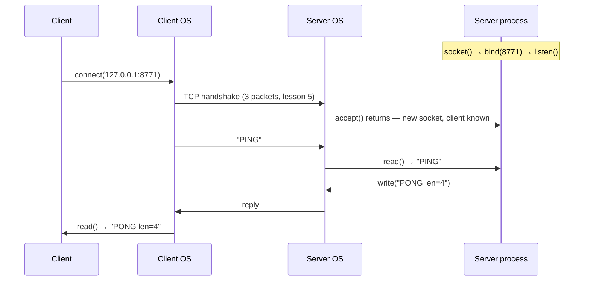

# Client–Server Architecture

## 1. Learning Objectives

After this lesson you will be able to:

- [ ] State the client–server pattern precisely: who initiates, who listens, who knows whom
- [ ] Explain what a socket is and what "a server is listening on a port" means in operating-system terms
- [ ] Read a `netstat` listing and identify which services on your own machine are servers right now
- [ ] Distinguish client–server from peer-to-peer and from a single-process program, and name when each fits
- [ ] Describe why the server must be written to expect many clients, and what "many" forces you to design for

## 2. Prerequisites

- [How the Internet Works](how-the-internet-works.md) — packets, IP addresses, and the layered model
- [02-PROGRAMMING-FUNDAMENTALS](../02-PROGRAMMING-FUNDAMENTALS/README.md) — you will read and then
  write small programs that use sockets

## 3. Introduction

Every application you build from this subject onward is one half of a conversation. A browser
fetching a page, a phone app syncing contacts, a game client receiving positions, a database
query from your backend — all follow the same shape: one program *initiates* (the client), one
program *waits* (the server), and the network carries their messages. This lesson names that
shape precisely, shows you the machinery underneath it on your own machine, and sets the
vocabulary — socket, port, bind, listen, accept — that the next four lessons use constantly.

## 4. The Problem It Solves

Two programs on different machines want to exchange data. The internet layer from the last
lesson delivers a packet to *a machine*, but not to *a program*. And a machine runs dozens of
programs simultaneously. Two problems therefore need solving:

**Which program should receive the data?** The answer is a rendezvous convention. One program
announces itself by binding a well-known number — a **port** — and waits there. The initiator
addresses both the machine (IP address) and the program (port). That pair, `address:port`, is
enough to reach exactly one running program on the whole internet.

**Who has to know about whom?** If every device on earth had to know the address of every
device it might talk to, the system would not scale. The client–server asymmetry dissolves this:
clients are ephemeral and mostly anonymous — a fresh browser tab knows the server's address and
nothing else needs to know the browser exists. Servers are stable and named. Clients find
servers through DNS (lesson 4); servers never need to find clients.

The pattern's cost is equally real: the server is a permanent, exposed, shared resource that
must stay up, must handle strangers' requests safely, and becomes the single point of failure.
That cost is why alternatives exist (peer-to-peer, serverless, mesh), and why the rest of this
curriculum spends so many subjects on building servers well.

## 5. Core Concepts

### Socket

A **socket** is an operating-system endpoint for communication: a handle a program gets when it
asks the OS to participate in the network. Your program does not touch packets directly — it
reads from and writes to a socket, and the OS's network stack (transport, internet, link layers)
handles everything from the last lesson. A socket is identified locally by the address:port pair
it is bound to.

### Port

A **port** is a 16-bit number (0–65535) naming a specific service on a machine. Ports below
1024 are reserved for well-known services (80 = HTTP, 443 = HTTPS, 22 = SSH); anything above is
available to ordinary programs. A port is not a physical thing — it is a number the OS uses to
demultiplex incoming data to the right process, exactly as lesson 1's layers demultiplex by
address.

### The server's four verbs

Building a server means calling the same four steps in order, on every platform:

1. **bind** — claim a specific address:port
2. **listen** — tell the OS "queue incoming connection attempts here"
3. **accept** — wait until a connection arrives, then receive a *new* socket dedicated to it
4. **read/write** — exchange data on that per-client socket, then close it

The critical subtlety is step 3: the listening socket exists only to *create* per-client
sockets. Each accepted client gets its own socket, which is why one server can talk to a
thousand clients simultaneously without the conversations mixing.

### Client

A **client** does two things: resolve a name to an address (DNS, lesson 4) and *connect* — a
single step that asks the OS to establish a connection to a specific address:port. The OS
picks a fresh, usually ephemeral port for the client's side of the conversation, so thousands
of clients behind one machine don't collide.

### Concurrent clients

Because each accepted connection gets its own socket, a server must decide how to serve them:
one thread or async task per connection (simple, scales to thousands), a thread pool (bounds
resource use), or a single-threaded event loop (what many production servers use). The design
choice is invisible in the protocol — clients can't tell — but it decides what happens at load.

### Peer-to-peer

In **peer-to-peer**, every participant both provides and consumes; there is no stable server.
BitTorrent and some real-time communication systems work this way. It removes the single point
of failure and the central bandwidth bill, at the cost of discovery complexity (how do you find
a peer?) and inconsistent availability. Almost everything in this curriculum is client–server,
because almost everything you will professionally build is.

## 6. How It Works

### The connection sequence



The client's `connect` does not return until the handshake completes; the server's `accept`
does not return until a client shows up. Both are then holding a socket to *that* conversation.

### Executed evidence — both sides in one transcript

The following is executed on the authoring machine (Windows 11, Git Bash, Python 3.13.5) from
the lab used throughout this subject. A server thread binds port 8771 and waits in `accept()`;
a client connects, sends `PING`, and reads the reply. Both sides print what they observe:

```console
$ python socklab.py
TCP server listening on ('127.0.0.1', 8771)
TCP client: connected local=('127.0.0.1', 51294) peer=('127.0.0.1', 8771)
TCP handshake complete: accepted from 127.0.0.1:51294
TCP server recv: "PING" (4 bytes)
TCP client recv: "PONG len=4"
```

Every line maps onto the sequence diagram:

- `TCP server listening on ('127.0.0.1', 8771)` — bind + listen succeeded
- `connected local=(..., 51294) peer=(..., 8771)` — the client's socket reports **both ends**:
  its own ephemeral port 51294 (chosen by the OS) and the server's 8771. The full address:port of
  each side is exactly what lesson 1's packets needed.
- `TCP handshake complete: accepted from 127.0.0.1:51294` — printed by the server *inside*
  `accept()`, which only returns after the handshake finished. The server learned its client's
  identity at that moment.
- The `recv` lines show the data crossing — and note the server counts bytes: `4 bytes`.

### Your own machine is full of servers right now

The rendezvous convention is not something servers-only machines do — *your* machine is doing it
right now. Executed on the same machine:

```console
$ netstat -ano | grep LISTENING | head -10
  TCP    0.0.0.0:135            0.0.0.0:0              LISTENING       1496
  TCP    0.0.0.0:445            0.0.0.0:0              LISTENING       4
  TCP    0.0.0.0:623            0.0.0.0:0              LISTENING       12980
  TCP    0.0.0.0:2179           0.0.0.0:0              LISTENING       3532
  TCP    0.0.0.0:3389           0.0.0.0:0              LISTENING       6464
  TCP    0.0.0.0:4369           0.0.0.0:0              LISTENING       15020
  TCP    0.0.0.0:5040           0.0.0.0:0              LISTENING       7964
  TCP    0.0.0.0:5432           0.0.0.0:0              LISTENING       15748
  TCP    0.0.0.0:5672           0.0.0.0:0              LISTENING       14084
  TCP    0.0.0.0:6379           0.0.0.0:0              LISTENING       12392
```

Read the columns: local address (`0.0.0.0` = listening on *every* interface, versus the lab
server's deliberate `127.0.0.1` = loopback only), the port, and the owning process ID. Among
these are a database (5432, PostgreSQL), a message broker (5672, AMQP/RabbitMQ), a cache (6379,
Redis) and remote-desktop (3389) — all waiting in `listen()` right now, exactly like the five
lines of Python above. The difference between a laptop and a server is degree, not kind.

Note also the security boundary being drawn: `0.0.0.0:6379` exposes that cache to your whole
local network, while the lab server bound `127.0.0.1` and is unreachable from outside the
machine. Binding an address is a security decision, made before a single line of protocol logic.

## 7. Practical Examples

**Example 1 — the smallest possible server, in ten lines**

```python
# tiny_server.py — a complete client-server exchange in the standard library
from socket import socket, AF_INET, SOCK_STREAM

with socket(AF_INET, SOCK_STREAM) as srv:          # 1. create
    srv.setsockopt(SOL_SOCKET := 1, SO_REUSEADDR := 2, 1)
    srv.bind(("127.0.0.1", 8780))                  # 2. bind: loopback only
    srv.listen(1)                                  # 3. listen: queue depth 1
    print("waiting on 127.0.0.1:8780", flush=True)
    conn, peer = srv.accept()                      # 4. accept: blocks until a client arrives
    print(f"client {peer} connected", flush=True)
    data = conn.recv(1024)                         # 5. read
    print(f"got {data!r}", flush=True)
    conn.sendall(b"hello from server\n")           # 6. write
    conn.close()
```

```python
# tiny_client.py — run in a second terminal while the server blocks in accept()
from socket import socket, AF_INET, SOCK_STREAM

with socket(AF_INET, SOCK_STREAM) as s:
    s.connect(("127.0.0.1", 8780))                 # resolves nothing: it's already an address
    s.sendall(b"ping\n")
    print(f"reply: {s.recv(1024)!r}", flush=True)
```

- **Expected output** (server): `waiting on 127.0.0.1:8780` then `client ('127.0.0.1', <port>) connected`
  then `got b'ping\n'`; (client): `reply: b'hello from server\n'`.
- **How to run it:** start `python tiny_server.py` in one terminal, then `python tiny_client.py`
  in another. The server prints its first line and waits — that pause *is* `accept()` blocking.
- **Assumptions:** Python 3.13 (per [VERSIONS.md](../VERSIONS.md)); any OS. Executed on the
  authoring machine with these versions.
- **Why `SO_REUSEADDR`:** without it, restarting the server within a few minutes fails with
  "address already in use" — the OS keeps the old port reserved while old connections drain.
  It is the first error every server author meets.

**Example 2 — one server, many clients, the design consequence**

```console
$ python socklab.py
TCP server listening on ('127.0.0.1', 8771)
TCP client: connected local=('127.0.0.1', 51294) peer=('127.0.0.1', 8771)
TCP handshake complete: accepted from 127.0.0.1:51294
```

- In the lab, the server handles one client because the transcript needed to stay legible. The
  *architecture* requires nothing else: a second `accept()` would return a second, independent
  socket. What a real server adds is the concurrency policy from section 5 — thread, pool, or
  event loop — and that choice is invisible to clients.
- **The observable consequence:** two clients connecting at the same moment get different
  ephemeral ports (`51294` here), so the server's `accept()` return value alone tells the two
  conversations apart. Identity in client–server is *address:port*, never a login.

## 8. Real-World Applications

- **Web servers.** nginx, Apache, and every application server (Node, Spring Boot, Django) are
  the Example 1 program grown up: bind 80/443, listen, accept, parse an HTTP request (lesson 6),
  respond, close or keep the connection. Everything in subjects 11 and 16 builds on this.
- **Databases as servers.** PostgreSQL on 5432 and Redis on 6379 in the `netstat` above are
  exactly the same pattern with a different protocol. Your backend is the *client* of one server
  while being the *server* for your frontend — most real systems are both, simultaneously.
- **Push and long connections.** Chat, live scores and notifications invert the timing — the
  server holds many open connections to push through — without changing the pattern: the client
  still initiated, the server still accepted. The pattern's vocabulary survives every feature.
- **Microservices.** Splitting an application into services multiplies the number of
  client–server conversations inside one system; every internal call is this lesson's diagram
  again, over the internal network. This is why subjects 11 and 13 treat network calls as
  categorically more expensive and failure-prone than function calls.

## 9. Common Mistakes

| Mistake | Why it happens | How to recognize it | How to prevent it |
|---|---|---|---|
| Believing the server calls the client | The reply obviously travels backward | You cannot explain how the reply finds the process that sent the request | Remember: the reply rides the *same* socket pair, symmetric at the transport layer (lesson 5) |
| `accept()`-then-serve, one client at a time | The minimal example does exactly this | Second client hangs until the first disconnects | Decide the concurrency model before writing the loop; test with two simultaneous clients |
| Binding `0.0.0.0` by default | Tutorials do it so browsers can reach the server | `netstat` shows your dev server on every interface | Bind `127.0.0.1` in development; open the address deliberately, as a decision |
| Forgetting the socket closes | Example 1 closes explicitly; real code often does not | Clients hang or time out instead of getting an error | Use `with` blocks (Python) or try-with-resources (Java); close is part of the protocol |
| Confusing a port with a protocol | 80 "means HTTP" in casual speech | You assume anything on 80 speaks HTTP correctly | A port is a *rendezvous number*; the protocol is whatever both sides agreed to speak (lesson 8) |

## 10. Best Practices

- **Bind the narrowest address that works.** `127.0.0.1` for local development, the LAN address
  for a demo on your network, `0.0.0.0` only behind a firewall you understand. The `netstat`
  output above is a checklist of exactly what your machine currently exposes.
- **Treat `accept` as the start of untrusted input.** Whatever arrives on an accepted socket is
  stranger-controlled bytes. Validate before parsing, bound your reads, and time out idle
  connections — subjects [14](../14-TESTING-AND-QUALITY/README.md) and
  [15](../15-APPLICATION-SECURITY/README.md) return to this constantly.
- **Name the address:port pair as the identity it is.** In logs, keep both ends (as the lab's
  `peer=('127.0.0.1', 51294)` does); when a bug involves "the connection", the ephemeral port is
  the thread that ties two machines' logs together.
- **Design for the second client from the first line.** Even a single-user tool will be run
  twice. Shared mutable state across connections is where server bugs come from; make each
  accepted connection's state local to its handler unless you have deliberately shared it.

## 11. Limitations and Trade-Offs

- **The server is a single point of failure and a concentration of trust.** Everything the
  pattern buys in simplicity it charges for in availability: when the server is down, nobody
  talks. Scaling that out (replicas, load balancers) is subject
  [17](../17-CLOUD-AND-PRODUCTION/README.md)'s work.
- **Clients cannot be reached directly.** NAT, firewalls and mobile networks mean a client
  usually cannot accept inbound connections, which is *why* the pattern is client-initiated. Any
  feature needing server-to-client delivery (push, voice) must route through the server or use
  traversal tricks — a real design constraint, not an implementation detail.
- **The ephemeral-port identity is weak.** address:port says nothing about *who* the user is;
  authentication is a separate layer (subject 15) built on top of this one.
- **Synchronous request/reply hides asynchrony.** The pattern's natural shape is call-and-wait,
  but real systems need queues, retries and eventual delivery — which is why message brokers
  (5672 above) exist as a neighbouring pattern, not a replacement.

## 12. Practical Exercises

### Introductory

1. **Exercise 6.1** — Run the `netstat` (Windows) or `ss -tlnp` / `netstat -tlnp` (Linux) listing
   from section 6 on your own machine. Identify three listening services and state, for each,
   what it is (from its port) and whether it listens on all interfaces or loopback.
   **Completion criteria:** three entries labelled; one sentence on which of the three you would
   not want reachable from your LAN, and why.
2. **Exercise 6.2** — Write and run Example 1's server and client. Then start a *second* client
   while the first connection is open, and observe what happens.
   **Completion criteria:** the first exchange's output captured; the second client's behaviour
   observed and explained from the queue-depth (`listen(1)`) semantics.

### Intermediate

3. **Exercise 6.3** — Modify the server to accept three clients in a row (a `for` loop around
   `accept`), each getting its own greeting. Run three clients concurrently from three terminals.
   **Completion criteria:** all three greetings received; you state which server-side value proves
   the clients were distinguished (the per-connection socket) and why the listening socket alone
   could not have served them.
4. **Exercise 6.4** — Break the server deliberately: remove the `bind` call and run it.
   **Failure to diagnose:** Python raises before your code runs; read the message, explain what
   the OS was protecting, and fix it by binding a port of your choosing. Then restart the server
   twice in one minute and diagnose the second failure.
   **Completion criteria:** both real error messages captured; the fix for each stated in terms
   of the four server verbs.

### Independent problem-solving

5. **Exercise 6.5** — *Problem:* a small team wants a shared "word of the day" service on the
   office LAN: any machine can ask for today's word, and one admin machine can set it. Design it
   as a client–server system using only the standard library's socket API and plain text
   messages you invent. Decide: the port and bind address, how a client distinguishes "get" from
   "set" without a login, what happens when two admins set simultaneously, and what you would
   tell the team about who can set the word.
   **Completion criteria:** a working implementation with a captured transcript of a get and a
   set; your protocol documented in five lines or fewer; one honest paragraph on the security
   limitation of having no authentication (the lesson's section 11 predicts it).

*Solutions: attempt first. They live in `exercises/solutions/` of this subject.*

## 13. Knowledge Check

1. A server prints `client ('127.0.0.1', 51294) connected`. Which machine, which program, and
   which two sockets produced that line?
2. Why does the *server* not need to know any client's address before the client connects — and
   what does that asymmetry cost?
3. When would you deliberately choose peer-to-peer instead of this pattern, and what problem does
   that choice hand to your users?

## 14. Completion Criteria

Observable evidence that you have understood this lesson:

- [ ] You can draw the connection sequence from memory and say what each of the four verbs does
- [ ] You ran a server and client of your own and captured a working transcript (exercise 6.2/6.3)
- [ ] You identified three real services listening on your own machine (exercise 6.1)
- [ ] You can state why each accepted client gets its own socket, and what breaks if it did not
- [ ] You can diagnose all five mistakes in section 9

## 15. Summary

- Client–server is an asymmetry: clients initiate and are ephemeral; servers listen and are
  stable, which is what makes global discovery scale.
- A server binds an address:port, listens, and accepts; each accepted connection gets its own
  socket, which is how one process serves many clients.
- Ports are OS-level rendezvous numbers, not cables; `netstat` shows your own machine running
  several servers right now.
- Binding `127.0.0.1` versus `0.0.0.0` is a security decision made before any protocol logic.
- The pattern trades availability (single point of failure) and direct reachability for
  simplicity — those costs drive everything subjects 15–17 add.

## 16. Next Steps

- Next lesson: [IP Addressing](ip-addressing.md) — the addressing scheme underneath every one
  of these conversations
- Practice: [exercises/](exercises/README.md) set 2
- Where it is applied: [11-BACKEND-ENGINEERING](../11-BACKEND-ENGINEERING/README.md) (the servers
  you will professionally build)
