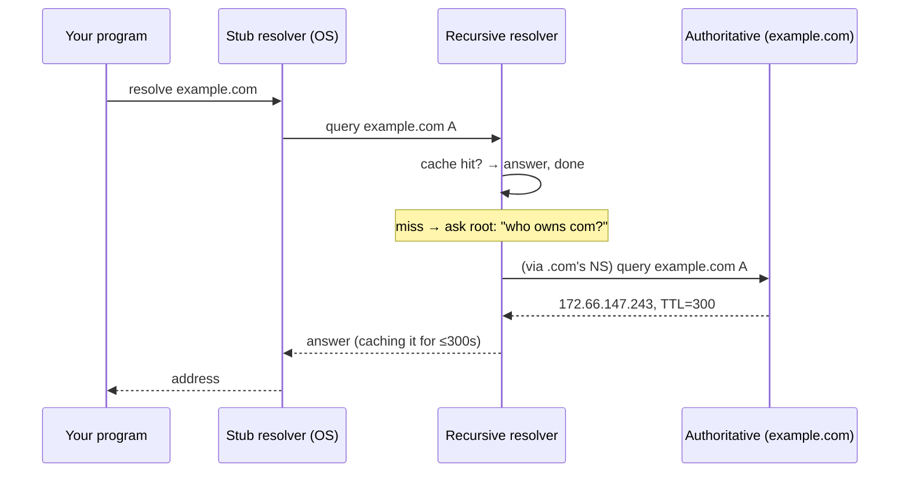

# DNS — The Domain Name System

## 1. Learning Objectives

After this lesson you will be able to:

- [ ] Trace a name lookup end to end: stub resolver → recursive resolver → root → TLD → authoritative
- [ ] Read real output from `nslookup`/`dig` and identify which record types answer which question
- [ ] Explain what "non-authoritative answer" means and why caches (of several kinds) dominate DNS behaviour
- [ ] Diagnose the four ordinary failure modes — NXDOMAIN, SERVFAIL, stale cache, propagation lag — from symptoms
- [ ] State what DNS guarantees about freshness and consistency (and that the answer is: very little)

## 2. Prerequisites

- [IP Addressing and Subnets](ip-addressing.md) — addresses are what lookups produce
- [How the Internet Works](how-the-internet-works.md) — packets, ports, and the request/response rhythm
- [03-DEVELOPER-TOOLS/terminal-fundamentals.md](../03-DEVELOPER-TOOLS/terminal-fundamentals.md) — piping and reading command output

## 3. Introduction

Nobody types `172.66.147.243`. People type `example.com`, and something turns that into the
address a packet needs. That something is DNS: a global distributed database of name→value
records, queried billions of times a day, that no single organisation controls and everyone
depends on. It is the first thing that happens in every request you make, the component most
often blamed when "the site is down" (and usually correctly), and the mechanism behind a whole
class of outages, hijacks, and configuration mistakes. This lesson traces one lookup from your
program to the authoritative server and back, using real queries executed against real
resolvers.

## 4. The Problem It Solves

The internet's routers forward on numeric addresses (lesson 3). Humans cannot reliably
remember numbers, and — worse — addresses *change*: a server moves, an ISP renumbers, a service
moves to another provider. If programs hard-coded addresses, every move would require editing
every client.

What is needed is an indirection layer: a stable name mapped to a currently-correct address,
updatable in one place. The obvious solution — one central directory file — fails on three
counts: it must never go down (a single point of failure for the entire internet), it must
scale to every query on earth, and it must be administrable by many independent parties (every
domain owner edits their own records, nobody edits yours).

DNS's answer was **distributed authority**: cut the name into hierarchical labels
(`www.example.com` → `com` → `example.com` → `www`), and delegate each subtree to its own
servers. The root servers know who runs `.com`; `.com`'s servers know who runs `example.com`;
`example.com`'s servers answer for `www.example.com`. No central file, no central operator, and
queries go straight to whoever is responsible for the name. Caching everywhere makes it fast.

## 5. Core Concepts

### Labels, zones, and the resolver's job

A **fully qualified domain name** is written right-to-left in hierarchy: `docs.python.org` is
`www`-less — the label `docs` under `python.org` under `org` under the root. A **zone** is a
slice of that tree administered by one authority (the zone `example.com` and its subdomains).
An **authoritative** server is one that holds the zone's actual records; a **recursive
resolver** is one that does the legwork of finding out, on behalf of a program that just wants
an answer.

The distinction that clears up most confusion: your machine's **stub resolver** (the OS's DNS
client) never walks the hierarchy itself. It asks one recursive resolver — usually your ISP's
or a public one like `1.1.1.1` or `8.8.8.8` — and waits. That recursive resolver is the one
that queries root, TLD, and authoritative servers, caching as it goes.

### Record types

Records are typed; each type answers a different question:

| Type | Question it answers | Example use |
|---|---|---|
| `A` | What IPv4 address? | the address your socket connects to |
| `AAAA` | What IPv6 address? | dual-stack (the `AF_INET6` answer in lesson 3) |
| `CNAME` | What other name is this an alias of? | `docs.python.org` → CDN name |
| `MX` | Which servers accept this domain's email? | with preference ordering |
| `TXT` | Arbitrary text | domain verification, SPF, DMARC |
| `NS` | Which servers are authoritative for this zone? | delegation itself |

A name's **TTL** (time to live, in seconds) sits on every record and says how long a cached
answer may be reused. TTL is the dial that controls the freshness/cost trade: high TTL means
fewer queries but slower changes to take effect; low TTL means quick changes but more load.

### The lookup, step by step



Between the root and the zone sit the **TLD servers** (`com`, `org`, `tz`…); each referral
hands the resolver one step closer. Most of this happens only when the recursive resolver's
cache is cold — a warm cache answers the whole thing locally in microseconds.

### Caching, and where it lives

Answers are cached in at least four places: the OS stub cache, the recursive resolver's cache,
your application or HTTP client's cache, and any intermediate (CDN, corporate proxy). Each has
its own TTL countdown. This is why "I changed the record, why hasn't it updated?" has four
different answers, and why lesson 7's conditional `304` responses feel familiar: DNS solves the
same staleness problem with TTLs instead of validators.

### Negative caching

A resolver that learns "this name does not exist" caches *that* too — **negative caching**,
usually for a short TTL. So a typo'd domain fails fast, but a name you registered thirty
seconds ago may still be refused for the length of the negative TTL.

## 6. How It Works

### Real queries, real resolver

Executed on the authoring machine (Windows 11, Git Bash, `nslookup` — `dig` is not installed
here, which is why these transcripts use `nslookup`):

```console
$ nslookup example.com
Non-authoritative answer:
Server:  ns.ditnet.ac.tz
Address:  102.208.185.3

Name:    example.com
Addresses:  2606:4700:10::6814:179a
	  2606:4700:10::ac42:93f3
	  172.66.147.243
	  104.20.23.154
```

Three readings:

1. **`Server: ns.ditnet.ac.tz` / `102.208.185.3`** — the recursive resolver that answered is
   this machine's configured one, operated by the local ISP. It did the root→TLD→authoritative
   walk (or served it from cache); your machine never contacted `example.com`'s servers itself.
   Lesson 3's `getaddrinfo` transcript showed these same four addresses arriving at the program
   — this is where they came from.
2. **"Non-authoritative answer"** — the answering server was *not* `example.com`'s own
   authoritative server; it was a recursive resolver passing along an answer it holds. The
   label is a honesty marker: you are reading a copy, and its accuracy is only as fresh as the
   TTL it was cached with.
3. **Four addresses for one name** — two `A` (IPv4) and two `AAAA` (IPv6). Multiple answers
   give the client redundancy (lesson 3) and let the resolver spread load. A name can change
   its address set without any client knowing the list was ever different.

### The record types in real output

```console
$ nslookup -query=MX gmail.com
Non-authoritative answer:
gmail.com	MX preference = 10, mail exchanger = alt1.gmail-smtp-in.l.google.com
gmail.com	MX preference = 30, mail exchanger = alt3.gmail-smtp-in.l.google.com
gmail.com	MX preference = 5, mail exchanger = gmail-smtp-in.l.google.com
gmail.com	MX preference = 20, mail exchanger = alt2.gmail-smtp-in.l.google.com
gmail.com	MX preference = 40, mail exchanger = alt4.gmail-smtp-in.l.google.com
```

The **preference** numbers are the lesson: lower wins (5 is best), so mail tries
`gmail-smtp-in` first and falls back through 10, 20, 30, 40 — built-in failover encoded as
data. Email is the original DNS success story: a protocol you have never configured that
routinely finds the right server anywhere on earth.

```console
$ nslookup -query=CNAME docs.python.org
Non-authoritative answer:
docs.python.org	canonical name = dualstack.python.map.fastly.net
```

A **CNAME** says "this name is an alias; ask instead about this other name" — one record lets
`docs.python.org` inherit everything about a CDN's name (its addresses, its TTL) without
duplicating it. This is how a site moves to a CDN by changing exactly one record.

```console
$ nslookup -query=TXT google.com
google.com	text =

	"apple-domain-verification=30afIBcvSuDV2PLX"
```

**TXT records** carry arbitrary strings — in this case proof to Apple that whoever controls
`google.com` approved an app's association. SPF and DMARC (email anti-forgery policies) also
live here. TXT is the system's escape hatch: any protocol that needs to publish verifiable data
about a domain can do so without asking DNS for a new record type.

### What the program receives

```console
$ python socklab.py
getaddrinfo('example.com', 443):
  family=AF_INET type=0 addr=172.66.147.243:443
  family=AF_INET type=0 addr=104.20.23.154:443
```

The OS resolver collapses the DNS answer into socket-ready pairs (address family + address +
port). The program asked for a *name* and a *service*; it got addresses. Everything above —
which one it connects to first, what happens if that one refuses — is the application's
business (HTTP's connection reuse is lesson 7's).

### The failure modes, by symptom

| Symptom | Message (typical) | Means | Where to look |
|---|---|---|---|
| Name doesn't exist | `NXDOMAIN` / `Name or service not known` | Authoritative server says no such record | Typo? Zone file actually contains the name? |
| Resolver can't answer | `SERVFAIL` / `Temporary failure` | Some server in the chain errored or timed out | Upstream resolver down? DNSSEC validation failing? |
| Answer is wrong/stale | Old address still returned | Some cache holds it until TTL expiry | Which of the four caches (section 5)? Lower TTL, flush OS cache |
| New record "not visible" | Works on one machine, not another | Each machine asks a different resolver | Wait out TTLs, or query the authoritative server directly to bypass caches |

That last row is the professional's move: `nslookup example.com <authoritative-server-ip>`
asks the *source of truth* directly, bypassing every cache — the fastest way to tell "my record
is wrong" from "my record is right but cached wrong elsewhere."

## 7. Practical Examples

**Example 1 — query the authoritative source directly, bypassing caches**

```console
$ nslookup example.com 102.208.185.3
```

- Passing the resolver address as the second argument makes `nslookup` ask *that* server. Using
  a public resolver (`1.1.1.1`) instead of your ISP's checks whether the disagreement is local.
- **Expected output:** the same `Non-authoritative answer` format — but now you know *whose*
  cache you may be reading. To reach the authoritative server itself, first read the zone's `NS`
  records, then query one of those.
- **How to run it:** works on Windows, Linux and macOS with `nslookup`; with `dig @1.1.1.1
  example.com` the `@` notation is equivalent.
- **Assumptions:** a working resolver; no privileges needed.

**Example 2 — read a zone's timing policy, not by magic**

```console
$ nslookup -query=SOA example.com
Non-authoritative answer:
Server:  ns.ditnet.ac.tz
Address:  102.208.185.3

example.com
	primary name server = elliott.ns.cloudflare.com
	responsible mail addr = dns.cloudflare.com
	serial  = 2418004112
	refresh = 10000 (2 hours 46 mins 40 secs)
	retry   = 2400 (40 mins)
	expire  = 604800 (7 days)
	default TTL = 1800 (30 mins)
```

The **SOA** (start of authority) record is the zone's own metadata, and `default TTL = 1800`
is the policy any record inherits when its publisher does not override it: a fresh copy of this
zone's answers may be reused for 30 minutes. The other fields are the zone's internal clocks
(`refresh`/`retry`/`expire` govern how secondary servers sync — the same freshness reasoning at
a larger scale).

An honest seam: on this machine (Windows, `nslookup`) a bare query cannot display *per-record*
TTLs — `-query=TTL` is not a real type and nslookup silently answers with the default A records
instead. `dig example.com +noall +answer` prints each record's TTL, but `dig` is not installed
here, so this transcript shows what the stock tool can actually prove. Whatever tool you use,
read the number before you migrate: with `default TTL = 1800`, yesterday's answer can survive
30 minutes after your change.

- **The design rule this proves:** DNS change propagation is not a mystery — it is the sum of
  the TTLs of every cache the answer passed through. Set TTLs low *before* you plan a migration;
  you cannot lower them afterwards for caches already holding the high value.
- **How to run it:** `nslookup -query=SOA <name>` on any platform; `dig <name> SOA` or
  `dig <name> +noall +answer` where `dig` exists.
- **Assumptions:** values vary per zone; the transcript's exact number was observed on the
  authoring machine on 2026-10-22 and is recorded in your own output when you rerun it.

## 8. Real-World Applications

- **Every `curl`, browser tab, and API client** starts with a lookup. `curl -v`'s first lines
  show the resolved address before any connection (lesson 6's transcripts do exactly this) —
  proving DNS ran before TCP, every time.
- **CDN routing is DNS.** A CDN answers your lookup from a server near you — the address you get
  *is* the routing decision. "The site is slow in Europe" is often a DNS geo-routing question.
- **Service discovery.** Kubernetes, Consul and cloud load balancers hand out internal DNS names
  for services that appear and disappear; your backend's "database hostname" is a DNS name
  precisely so the database can move (subjects 10, 11, 17).
- **Email deliverability** hangs on MX, SPF and TXT records — misconfigured TXT is why mail
  lands in spam. And DNS-based outages (expired domain, botched zone edit, DNSSEC failure) are
  among the few outages that make a whole product unreachable while every server is healthy.

## 9. Common Mistakes

| Mistake | Why it happens | How to recognize it | How to prevent it |
|---|---|---|---|
| Treating DNS as instant | Caches were designed to make it not-instant | Change published, still old answers minutes/hours later | Set short TTLs *ahead of* planned changes; query authoritative to verify |
| Believing "Non-authoritative" means "wrong" | The label sounds like a warning | You distrust a correct answer | It means *a copy*: check freshness via TTL and, when it matters, ask the authoritative server |
| Debugging connection failures before checking resolution | Both produce "can't reach host" | `ping`/`curl` fail with a name error, not a timeout | First question: did we get an address at all? Read the error's layer (lesson 1's triage ladder) |
| Assuming one machine's answer is the global answer | Different stubs ask different resolvers | Works on your laptop, fails on the server | Test with a second resolver and directly at authoritative before filing a DNS bug |
| Copying TTL=3600 from a template | Tutorials rarely revisit the value | Migrations take an hour to propagate, unexpectedly | Choose TTLs from your change frequency; document them in the zone plan |

## 10. Best Practices

- **Set TTLs deliberately, per record type.** Minutes for records you move often (a service's
  `A` during migration), days for stable infrastructure (`NS`, mail). TTL is an operational
  decision, not a default to accept.
- **Change one thing, then verify from outside.** After any zone edit: query the authoritative
  server directly (Example 1), then a public resolver, then your machine — the three answers
  tell you exactly which cache still holds the old value.
- **Never use a public IP as an application's hostname.** It hardcodes what DNS exists to
  abstract (lesson 3's "addresses are ephemeral"); services are addressed by name, always.
- **Test resolution as part of incident triage.** "Did DNS resolve?" is the first rung of the
  connection ladder: `curl -v` prints the resolved address before it connects, separating
  "name failed" (DNS) from "connect refused" (server) from "slow response" (application).

## 11. Limitations and Trade-Offs

- **DNS offers no consistency guarantee.** Different caches hold different versions until
  TTLs expire; a "rolled out" change is eventually everywhere, never simultaneously everywhere.
  Systems that need coordinated cutovers (migrations, certificate changes) must lower TTLs
  first and wait — the protocol does not help them.
- **UDP first, with fallback.** Traditional DNS queries are UDP datagrams (lesson 5) on port
  53 — small, fast, no connection. Large responses (DNSSEC, big TXT) fall back to TCP. This is
  also why DNS is spoofable at the edges: a forged answer can win a race, which is what DNSSEC
  and source-port randomisation defend against.
- **The whole internet trusts a small root/TLD set.** Hierarchy concentrates responsibility;
  root server attacks and DDoS events are real historical incidents (mitigated, not impossible).
- **DNS is not secret.** Queries are visible to every resolver in the chain; encrypted DNS
  (DoH/DoT) exists because of that, at the cost of handing your query log to whoever runs the
  encrypted endpoint.

## 12. Practical Exercises

### Introductory

1. **Exercise 6.1** — Capture your machine's configured resolver (`ipconfig /all` shows
   "DNS Servers" on Windows; `resolv.conf` on Linux), then run `nslookup example.com` and
   identify the resolver from the output. State whether the answer was labelled authoritative
   and what that label means.
   **Completion criteria:** resolver address captured; the answer's label quoted; one sentence
   on what the recursive resolver did that your machine did not.
2. **Exercise 6.2** — Query `A`, `AAAA`, `MX`, `CNAME`, and `TXT` for five different names (use
   the section 6 commands as models). For each output, write the question that record type
   answers.
   **Completion criteria:** five transcripts; five question→record mappings; the `TXT` output's
   purpose guessed and then verified by searching for the domain's documented use of it.

### Intermediate

3. **Exercise 6.3** — Read the TTL of a record you can query, then wait out a deliberately
   shortened version of it: publish nothing, but compare the same name's TTL from two different
   resolvers (yours and `1.1.1.1`) over several minutes and record the numbers.
   **Completion criteria:** TTL values from both resolvers captured at two times each; a
   two-sentence explanation of why they may differ even though both are correct.
4. **Exercise 6.4** — Diagnose from the symptom alone, one case per row: (a) `curl` reports
   `Could not resolve host: typo.examplee.com`; (b) a record was changed 10 minutes ago and one
   colleague still sees the old value; (c) `nslookup` returns `** server can't find ...: SERVFAIL`.
   For each: name the failure class from section 6's table and the first command you would run.
   **Failure to diagnose:** three real messages captured; each mapped to NXDOMAIN/stale-cache/
   SERVFAIL with a first-command answer; (b)'s answer must mention which cache you would
   bypass and how.

### Independent problem-solving

5. **Exercise 6.5** — *Problem:* you are migrating a service from an old host to a new one with
   zero user-visible downtime. Design the DNS procedure: what TTL you set and when, in which
   order you change records, how you verify each step from outside your own machine, how you
   roll back if the new host fails, and what the residual risk is during the TTL wait.
   **Completion criteria:** a step-by-step runbook with timings derived from actual TTL values;
   a verification command per step; the rollback trigger and action stated explicitly; one
   honest paragraph on what can still go wrong (caches you do not control, negative caching).

*Solutions: attempt first. They live in `exercises/solutions/` of this subject.*

## 13. Knowledge Check

1. Your program calls `getaddrinfo("shop.example.com", "443")`. Describe every system involved
   before a TCP connection begins, and the point at which caching can short-circuit the chain.
2. Why does a "non-authoritative answer" still get used billions of times a day — what is the
   engineering argument for trusting a copy?
3. A teammate says "DNS propagation takes 48 hours." Rewrite that sentence so it is technically
   accurate.

## 14. Completion Criteria

Observable evidence that you have understood this lesson:

- [ ] You can draw the lookup sequence and say what each participant (stub, recursive, root, TLD, authoritative) does
- [ ] You captured real output for at least four record types and interpreted each (exercise 6.2)
- [ ] You can explain "non-authoritative" and negative caching without notes
- [ ] You can tell, from a symptom, which of the four failure modes it is (exercise 6.4)
- [ ] You can diagnose all five mistakes in section 9

## 15. Summary

- DNS maps hierarchical names to typed records through delegated authority — no central file, no central operator.
- Your machine asks one recursive resolver; that resolver walks root → TLD → authoritative, caching every answer.
- Record types answer different questions (A/AAAA, CNAME, MX, TXT, NS), each with its own TTL.
- Every answer is a possibly-stale copy — "non-authoritative" means *a cache*, and propagation is just TTL expiry.
- Failures classify cleanly: NXDOMAIN (no such name), SERVFAIL (chain error), stale cache (wait/bypass), propagation lag (query authoritative).

## 16. Next Steps

- Next lesson: [TCP and UDP](tcp-and-udp.md) — the transport protocols those addresses and ports are actually carrying
- Practice: [exercises/](exercises/README.md) set 4
- Where it is applied: [16-DEVOPS-AND-INFRASTRUCTURE](../16-DEVOPS-AND-INFRASTRUCTURE/README.md)
  (DNS as an operational dependency) and [15-APPLICATION-SECURITY](../15-APPLICATION-SECURITY/README.md)
  (DNSSEC, spoofing, and domain takeover)
