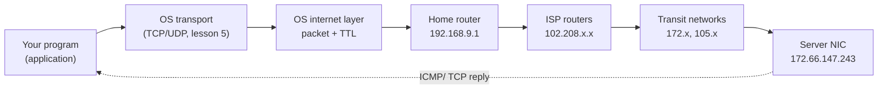

# How the Internet Works

## 1. Learning Objectives

After this lesson you will be able to:

- [ ] Explain what a packet is and why the internet delivers data in packets instead of streams
- [ ] Name the four TCP/IP layers and state what one job each layer does
- [ ] Use `ping` and `tracert`/`traceroute` and read TTL and round-trip time as evidence, not decoration
- [ ] Describe a packet's journey from your machine through your router and ISP to a distant server
- [ ] State what the internet guarantees about delivery — and what it deliberately does not

## 2. Prerequisites

- [01-COMPUTER-FOUNDATIONS](../01-COMPUTER-FOUNDATIONS/README.md) — binary, memory, and the idea
  that everything on a machine is bits
- [02-PROGRAMMING-FUNDAMENTALS](../02-PROGRAMMING-FUNDAMENTALS/README.md) — you will later write
  small socket programs; basic programming literacy is assumed now
- [03-DEVELOPER-TOOLS/terminal-fundamentals.md](../03-DEVELOPER-TOOLS/terminal-fundamentals.md) —
  every command in this lesson runs in a terminal

## 3. Introduction

Every program you have written so far has run on one machine: it reads memory, computes, writes
memory. From this subject onward your programs participate in a conversation with *other*
machines, and that changes what "correct" means. A method that returns the right value can still
deliver the wrong result if the network drops a packet, reorders two messages, or takes five
seconds instead of five milliseconds.

The internet is the machinery underneath every one of those conversations. It is not a cloud and
it is not a cable: it is a set of agreements between networks about how to hand packets to each
other, plus the routers that do the handing. This lesson builds the mental model. Every later
lesson — DNS, TCP, HTTP, TLS — is a layer on top of what you learn here.

## 4. The Problem It Solves

The telephone network solved long-distance communication with **circuit switching**: when you
called someone, the switches reserved a dedicated physical path for the whole call. That gives
guarantees — constant quality, instant feedback — but it wastes capacity brutally: a reserved
circuit sits idle during every pause in conversation, and building enough circuits for everyone
who might call at once is ruinously expensive.

The internet's founders wanted a network that survives partial failure (this was a Cold War-era
concern) and carries data, which is bursty rather than continuous. Their answer was **packet
switching**: chop messages into small blocks called **packets**, label each with its destination,
and let every router forward each packet independently toward that destination. No reservation,
no dedicated path, packets of one conversation interleave freely with packets of another. You
trade the telephone network's guarantees for enormous statistical efficiency and resilience —
if one router fails, the next packet simply takes a different route.

## 5. Core Concepts

### Packet

A packet is a self-contained block of data with a header (addressing and control information)
and a payload (your bytes). Packets are small — typically at most ~1,500 bytes on ordinary
networks — because small blocks can be forwarded quickly by cheap hardware and can take
different routes independently. A 5 MB image arrives as roughly 3,500 packets, not one delivery.

### IP address and router

An **IP address** is the packet's destination label; every device on a network has one. A
**router** is a device that forwards packets between networks: it reads the destination address
of each arriving packet, consults its forwarding table, and sends it out the interface that
gets it one network closer to the destination. The plural of a packet's stops is *hops*.

### ISP and autonomous system

Your **ISP** (internet service provider) is the network that sells you a path onto the internet.
Large networks — ISPs, universities, content providers — manage their own internal routing and
are called **autonomous systems (ASes)**; the internet's job at large is stitching these
together. When people say "the internet is a network of networks", ASes are the networks.

### TTL (time to live)

Every packet carries a **TTL** value. Each router decrements it by at least one before
forwarding; when it reaches zero, the router discards the packet and sends back an error.
This exists to kill packets that enter a forwarding loop — without TTL, misconfigured routers
would circulate a packet forever. Side effect you will exploit in a moment: because TTL
shrinks on every hop, the TTL that arrives tells you roughly how many routers were crossed.

### Latency, bandwidth, jitter

Three quantities people constantly confuse:

- **Latency** — how long one packet takes to make a round trip. Measured in milliseconds.
- **Bandwidth** — how much data the path can move per second. Measured in Mbps or Gbps.
- **Jitter** — how much the latency varies between packets.

A fat pipe with high latency (a satellite link) and a thin pipe with low latency (a neighbour's
house) feel completely different, for unrelated reasons. Later lessons on TCP and HTTP will lean
on all three.

### The layer model

Engineers keep the system manageable by splitting it into layers, each solving one problem and
depending only on the layer beneath. The internet uses the **TCP/IP model**; the older seven-layer
**OSI model** is taught alongside it and its vocabulary (especially "layer 7") is still used in
industry conversation.

| TCP/IP layer | Job | You will meet it as |
|---|---|---|
| 4 · Application | The protocol the programs speak | HTTP, DNS, TLS (subject of lessons 6–8) |
| 3 · Transport | Reliable byte delivery (TCP) or bare datagrams (UDP) | lesson 5 |
| 2 · Internet | Addressing and routing packets across networks | this lesson |
| 1 · Link | Moving a frame one hop over one medium | Wi-Fi, Ethernet, invisible to you |

The rule that makes layers work: each layer adds its own header and trusts the layers above it
completely. An HTTP client never checks whether the packets took TCP orUDP; TCP never asks how
the frames travelled. That separation is why the internet can carry HTTP over fibre, radio and
copper without changing a line of HTTP.

## 6. How It Works

### Watching a real round trip

`ping` sends **ICMP echo request** packets (a diagnostic protocol at the internet layer) and
times the replies. Executed on the authoring machine (Windows 11, Git Bash) against a public
host:

```console
$ ping -n 3 example.com

Pinging example.com [172.66.147.243] with 32 bytes of data:

Reply from 172.66.147.243: bytes=32 time=5ms TTL=54
Reply from 172.66.147.243: bytes=32 time=8ms TTL=54
Reply from 172.66.147.243: bytes=32 time=9ms TTL=54

Ping statistics for 172.66.147.243:
    Packets: Sent = 3, Received = 3, Lost = 0 (0% loss),
Approximate round trip times in milli-seconds:
    Minimum = 5ms, Maximum = 9ms, Average = 7ms
```

Read it as evidence:

- `example.com [172.66.147.243]` — a name was resolved to an address before any packet was sent
  (that whole mechanism is the next lesson's subject)
- `time=5ms` — five milliseconds for the round trip: this server is *close* in network terms
- `TTL=54` — Windows starts its own packets at TTL 128, most Linux stacks at 64. An arriving
  TTL of 54 means the reply began with 64 and lost 10 on the way here: roughly ten routers
  separate you from that server

Contrast the loopback address, which never leaves the machine:

```console
$ ping -n 1 127.0.0.1

Reply from 127.0.0.1: bytes=32 time<1ms TTL=128
```

TTL 128 arrived untouched — zero routers, because the packet was never routed anywhere.

### Seeing the path, hop by hop

`tracert` (Windows; `traceroute` on Linux and macOS) maps the route by sending packets with
successively larger TTLs: each router that discards a packet at TTL 1 replies with its own
address, so the route reveals itself one hop at a time:

```console
$ tracert -d -h 8 example.com

Tracing route to example.com [172.66.147.243]
over a maximum of 8 hops:

  1     2 ms     4 ms     2 ms  192.168.9.1 
  2     4 ms     2 ms     3 ms  102.208.185.1 
  3    10 ms    11 ms     6 ms  102.208.186.121 
  4    13 ms    16 ms    10 ms  172.20.1.1 
  5    11 ms    10 ms    16 ms  172.30.1.67 
  6    12 ms    13 ms    17 ms  172.30.1.65 
  7     7 ms     7 ms     7 ms  105.27.106.65 
  8    10 ms     6 ms     6 ms  105.16.11.237 

Trace complete.
```

Three honest observations about this real output:

1. **Hop 1 is the home router** (192.168.9.1, a private address — lesson 3 covers why it is not
   public). Hops 2–3 are the ISP's own network. Everything after that is transit toward the
   destination.
2. **The trace did not reach the destination.** `-h 8` capped it at 8 hops; the last address
   shown (105.16.11.237) is not example.com. Note the tension with the ping above: TTL 54 implies
   ~10 hops, so the true path is longer than the cap. "Trace complete" means the command stopped,
   not that the journey ended — a reading mistake worth catching early.
3. **Some hops are slower than others and times vary per probe** — jitter, visible per hop.
   A hop that answers slowly is not necessarily a problem for you; the *destination's* total
   round trip is what your application feels.

### The journey, end to end

Assembling the pieces, a packet from your program to a server and back:



Each arrow adds and removes a layer's header: your program's bytes get a TCP header, then an IP
header, then the router swaps the link-layer framing for the next hop, and the whole stack peels
back on arrival. The payload your program receives is byte-identical to what was sent, or the
transport layer reports a failure — those are the only two outcomes TCP will eventually promise
(lesson 5); the internet layer itself promises nothing.

## 7. Practical Examples

**Example 1 — measure your own path's baseline**

```console
$ ping -n 5 example.com
```

- Run it three times at different times of day; record minimum, average, and loss.
- **Expected output:** loss near 0% and a stable average; a rising average or rising loss means
  congestion somewhere on the path — the tracert you ran tells you *where* the time is spent,
  not *why* it is spent.
- **How to run it:** any terminal; no privileges needed.
- **Assumptions:** a machine with a network connection. Executed on Windows 11 / Git Bash; on
  Linux use the same command without `-n` (the count flag there is `-c`).

**Example 2 — TTL as a hop counter, not a mystery number**

Take the arrival `TTL=54` from the transcript above and the stack's initial value:

```console
$ ping -n 1 127.0.0.1
Reply from 127.0.0.1: bytes=32 time<1ms TTL=128
```

- Windows sends with TTL 128; `64 − 54 = 10`... except this reply *arrived* at 54, and 128 is
  what Windows uses for its own originating packets — the *server's* stack chose the starting
  value, which is almost certainly Linux's 64. So 64 − 54 = 10 hops on the return path.
- **The lesson inside the lesson:** TTL arithmetic is a two-sided estimate. You know the decrement;
  you infer the origin's initial value from convention. Two plausible answers (10 hops from a
  64-start, 74 hops from a 128-start) collapse the moment you know which stacks use which default.
- **Assumptions:** nothing beyond the transcript; this is the honest reasoning that produced the
  "roughly ten routers" claim in section 6.

## 8. Real-World Applications

- **Latency-driven design.** Every "why is my app slow" investigation starts here: 5 ms to the
  server means a page making 40 sequential round trips burns 200 ms before any work is visible;
  200 ms per hop across an ocean means those 40 round trips cost eight seconds. Connection reuse
  and parallel fetching (subject 06's HTTP lessons, then [09-FRONTEND-ENGINEERING](../09-FRONTEND-ENGINEERING/README.md))
  exist to reduce round trips, not bytes.
- **Incident triage.** When a service is unreachable, the first question is "where does the path
  break?" A tracert that times out inside your own ISP implicates the ISP; one that times out
  at the last hop implicates the destination's firewall. Engineers keep these commands in muscle
  memory for exactly this reason.
- **CDNs.** Content delivery networks exist because latency is mostly *distance*: cache content
  close to users and the `time=` column collapses. The whole industry is an economic response to
  the millisecond numbers in section 6.
- **VPN and proxy behaviour.** A VPN reroutes your packets through a company network — you can
  watch both effects directly: tracert's early hops change, and latency rises by the detour's cost.

## 9. Common Mistakes

| Mistake | Why it happens | How to recognize it | How to prevent it |
|---|---|---|---|
| Treating TTL as a distance in kilometres | It counts router decrements, which correlate with hops only loosely | Two paths of similar length show very different TTLs | Always compute `initial − arrival` and state the assumed initial value |
| "ping failed, so the server is down" | ICMP echo is often filtered by firewalls and cloud load balancers | curl/HTTP works while ping times out | Treat ping as one probe; confirm with the protocol you actually use |
| Equating low ping with a fast site | Latency and bandwidth are different quantities | A page is slow despite 5 ms ping | Count round trips as well as measuring them (Example 1's design argument) |
| Believing a star-shaped network diagram | The internet has no centre; it is a mesh of ASes | tracert to two nearby hosts shares no early hops | Draw networks as overlapping clouds, joined by agreements |
| Assuming "Trace complete" means arrival | The cap (`-h`) or a filtering hop ends the display | Last shown IP ≠ destination IP | Compare the final hop against the address ping resolved |

## 10. Best Practices

- **Measure, then claim.** "The network is slow" is an opinion; `time=`, loss percentage and hop
  counts are evidence. Practitioners state numbers with their diagnoses — and so should you from
  this lesson onward.
- **Use `-d` on tracert** (omit on Linux `traceroute`) to skip reverse DNS lookups. Reverse
  resolution of unresponsive hops can add tens of seconds to the command for no information.
- **Separate "where" from "why".** Traceroute tells you *which* hop is slow; it cannot tell you
  why (congestion, routing policy, rate-limiting on ICMP). Do not let the tool's precision
  overstate its knowledge.
- **Remember the direction asymmetry.** Your outbound path and the return path may differ; ping's
  round trip mixes both. When debugging, test from both ends if you can.

## 11. Limitations and Trade-Offs

- **The internet layer promises no delivery.** Packets can be lost, duplicated, reordered or
  delayed without any notification at this layer. Everything that feels reliable is built on top
  (TCP, lesson 5) — and everything that must be fast sometimes skips it (UDP, and real-time
  protocols above it).
- **ICMP is the diagnostic layer, and it is expendable.** Many networks deprioritise or drop it,
  so diagnostics can lie by omission: silence means "no answer", not "no host".
- **Hop-by-hop visibility is limited by policy.** Routers are not obliged to reply to probes;
  middleboxes hide topology. A trace is the routers that chose to answer, not a census.
- **Bandwidth is shared.** The statistical multiplexing that made packet switching cheap means
  your path's capacity depends on your neighbours' traffic. Nothing reserves capacity for you —
  which is precisely the trade section 4 described.

## 12. Practical Exercises

### Introductory

1. **Exercise 6.1** — Run `ping` against two hosts (e.g. `example.com` and your default gateway
   from `ipconfig`/`ip route`). For each, compute the hop estimate from the arriving TTL and
   state the initial value you assumed and why.
   **Completion criteria:** two TTL computations shown; each names its assumed starting value;
   the closer host's estimate is smaller (or you explain why not).
2. **Exercise 6.2** — Run `tracert -d` (or `traceroute`) to `example.com` and identify: your
   home router, the first ISP hop, and whether the trace reached the destination.
   **Completion criteria:** the three hops labelled from your own output; a one-sentence
   explanation of any hop that returned `*` (no reply).

### Intermediate

3. **Exercise 6.3** — Ping `example.com` five times, then saturate nothing and ping again during
   a download on the same machine. Compare average latency and loss.
   **Completion criteria:** both sets of numbers captured; a two-sentence explanation naming
   which of latency/loss/jitter moved and why the download caused it.
4. **Exercise 6.4** — This claim is wrong: *"The reply showed TTL=128, so the server is one hop
   away."* Explain both errors in it and give the correct inference procedure.
   **Completion criteria:** both errors named (initial-value ambiguity; TTL decrements at every
   intermediate router, so 128-arrival tells you distance only if you know the start); the
   correct procedure stated as three steps.

### Independent problem-solving

5. **Exercise 6.5** — *Problem:* your team's service at `example.com` reports "page loads are
   slow" from users in one country. Design a measurement procedure — commands, what each
   number means, and what you would conclude from each possible result — that separates "the
   network is far" from "the server is slow" from "the path is lossy", using only terminal
   tools.
   **Completion criteria:** the procedure names at least three commands with the metric each
   produces; every branch of your decision tree maps a real observable to one conclusion; you
   state one thing the procedure cannot distinguish.

*Solutions: attempt first. They live in `exercises/solutions/` of this subject.*

## 13. Knowledge Check

1. Two applications on your machine send data to the same server at the same moment. Their
   packets interleave on the wire. Explain, using the layer model, why neither application can
   observe the interleaving.
2. What would happen to the internet if the TTL field did not exist?
3. When would you *not* trust a tracert output as a description of the real path?

## 14. Completion Criteria

Observable evidence that you have understood this lesson:

- [ ] You can explain packet switching versus circuit switching in your own words, including
      the trade that was made
- [ ] You can name the four TCP/IP layers with one job each, without notes
- [ ] You captured your own ping and tracert output and interpreted TTL, latency and hop count
      from it (exercises 6.1–6.2)
- [ ] You can state two things the internet layer explicitly does not guarantee
- [ ] You can diagnose all five mistakes in section 9

## 15. Summary

- The internet delivers data as independently-routed packets, trading circuit-style guarantees
  for efficiency and resilience.
- Four layers (application, transport, internet, link) each add their own header; each trusts
  the layers above it, which is why HTTP works over any medium.
- Routers forward by destination address and decrement TTL, which both prevents loops and lets
  you estimate hop counts.
- `ping` measures round-trip time and loss; `tracert` reveals the path hop by hop — both are
  evidence, and both can be filtered into silence.
- Latency, bandwidth and jitter are three different quantities; applications feel round trips.

## 16. Next Steps

- Next lesson: [Client–Server Architecture](client-server-architecture.md) — the pattern every
  application you build from now on will take
- Practice: [exercises/](exercises/README.md) set 1
- Where it is applied: [16-DEVOPS-AND-INFRASTRUCTURE](../16-DEVOPS-AND-INFRASTRUCTURE/README.md)
  (network diagnostics during incidents)
