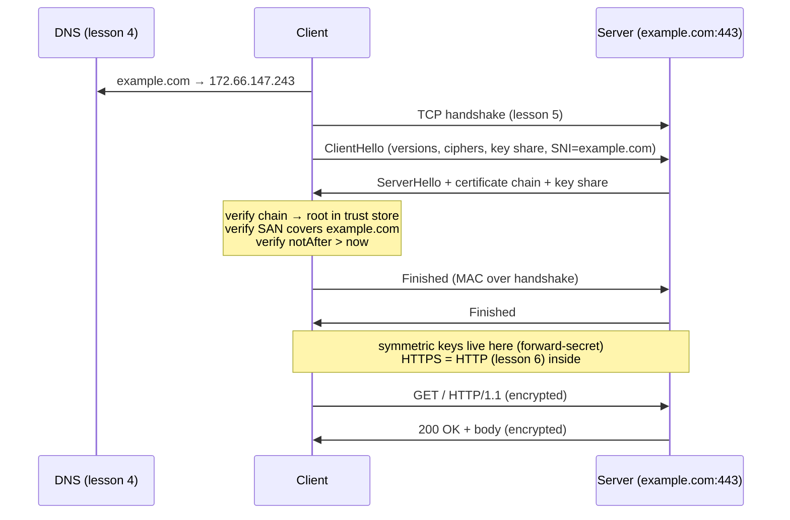

# HTTPS and TLS

## 1. Learning Objectives

After this lesson you will be able to:

- [ ] State precisely what TLS guarantees (confidentiality, integrity, server authenticity) and what it does not (who operates the server, what it logs, client identity by default)
- [ ] Describe the handshake from ClientHello to Finished, naming where the session keys come from and which steps are asymmetric versus symmetric
- [ ] Read real `openssl s_client` output: negotiated protocol and cipher, certificate chain, SAN, validity dates, and verification result
- [ ] Explain the CA trust model as a transitive chain of signatures, and what an expired or wrong-hostname certificate means operationally
- [ ] Diagnose ordinary TLS failures — expiry, hostname mismatch, untrusted issuer, version too old — from the error the client reports

## 2. Prerequisites

- [HTTP Fundamentals](http-fundamentals.md) — TLS wraps HTTP messages; ports and hosts are assumed
- [TCP and UDP](tcp-and-udp.md) — the handshake happens inside an established TCP connection
- [01-COMPUTER-FOUNDATIONS](../01-COMPUTER-FOUNDATIONS/README.md) — hashing and the idea of a fingerprint

## 3. Introduction

Lesson 6 showed HTTP in clear text: anyone on the path can read every header and body, and any
party can forge a response. On a hostile network (and every network you do not administer is
one), that protocol is naked. **TLS** is the layer that fixes it — the "S" in HTTPS, and the
reason a padlock appears in your browser. It is also the layer most developers inherit as pure
intuition: "TLS means secure" is roughly as precise as "the internet means cables". This lesson
makes it executable: you will watch a real handshake against a real server, read a real
certificate, and watch TLS *fail correctly* against a deliberately broken certificate.

## 4. The Problem It Solves

Section 6's raw-socket transcript proved HTTP is text anyone can send — which cuts both ways.
Three concrete attacks follow directly from that transcript:

- **Eavesdropping.** Any router, hotspot operator, or upstream ISP on the path can read the
  bytes: passwords, session cookies, the `Authorization` header you just learned to use.
- **Tampering.** Any party that can modify packets can alter responses — change a price, inject
  a script, redirect a payment.
- **Impersonation.** Because DNS (lesson 4) and routing (lesson 1) are ways to *steer* traffic,
  an attacker who poisons either can present a perfect-looking server that is not yours.
  Encryption alone would not catch this — you would have a private conversation with the wrong
  host.

The three classical encryption approaches each fail somewhere. **Symmetric encryption** (one
shared key) is fast but has a bootstrap problem: how do you get the key to a stranger you have
never met? **Asymmetric encryption** (public/private keypair) solves the bootstrap — anyone
encrypts to your public key, only you decrypt — but is too slow to encrypt a video stream.
**Hashes** prove data unchanged but do not authenticate the sender.

TLS composes all three: asymmetric crypto to agree keys safely *once*, symmetric crypto for the
bulk (fast), hashes everywhere for integrity — plus a certificate system to answer "is this
public key really theirs?", which is the authenticity problem crypto alone cannot solve.

## 5. Core Concepts

### The guarantees, stated exactly

TLS provides three properties for the channel it opens:

1. **Confidentiality** — traffic is encrypted to a key both sides derive; passive observers see ciphertext only.
2. **Integrity** — every record carries a MAC; modified bytes are detected and the connection is torn down rather than delivered altered.
3. **Peer authentication** — the server proves it holds the private key matching a certificate the client can validate (clients prove identity too only when *mutual TLS* is configured — rarely, by default).

What TLS does **not** do: it does not verify the server's *good intentions* (a perfectly
valid evil.com is still evil), does not hide metadata (who you connected to, when, how much
data — visible to the network), does not authenticate *you* to the server (application-level
login still required), and does not survive the endpoint being compromised. Encryption moves
the attack surface; it does not delete it.

### Certificates and the CA chain

A **certificate** is a server's public key plus identity claims, signed by a **certificate
authority (CA)**. Your device trusts a CA because its root certificate is in the OS/browser
**trust store** — a bundle of ~150 roots shipped and updated by vendors. Validation is a
*chain*: leaf → intermediate → root, each signature vouched for by the next. The intermediates
exist so roots (which are baked into everything and hard to reissue) sign sparingly and stay
offline.

The chain answers only: *"this key belongs to this name, and vouched-for by issuers you
already trust."* Everything else — the site's reputation, its operators — is out of scope.

### What a certificate actually binds

The certificate's subject/SAN says **which names** the key is valid for. Modern validation uses
**Subject Alternative Name (SAN)**, not the older Common Name field (deprecated for exactly the
ambiguity it caused). Validity dates (`notBefore`/`notAfter`) bound the time window: an expired
certificate fails validation regardless of how correct everything else is — and browsers
enforcing that is a *feature*, the one that forces renewal automation (Let's Encrypt's 90-day
certificates are the industry's answer, along with ACME automation).

### Handshake in four acts

Executed as the real thing in section 6; conceptually:

1. **Hello** — client offers TLS versions, cipher suites, a key-share; server picks and replies with its certificate (in TLS 1.3 the key share arrives here)
2. **Key agreement** — an *ephemeral* Diffie-Hellman exchange derives shared secrets; **forward secrecy** comes from this: session keys are never stored, so recording today's traffic and stealing the server's long-term key tomorrow still cannot decrypt yesterday
3. **Verify + Finished** — client validates the chain and hostname, both sides switch to the agreed *symmetric* cipher, and each sends a Finished message (a MAC over the handshake) proving no tampering occurred during negotiation
4. **Application data** — the rest is symmetric encryption of records; the TCP stream underneath (lesson 5) knows nothing about any of this

Roughly two round trips (TLS 1.2 with a full chain; 1.3 fits key share and often data into one) —
which is why lesson 7's keep-alive matters: pay the handshake once per connection, not per request.

### TLS versions and ciphers

Versions in the wild: TLS 1.3 (current, fastest, most restricted), TLS 1.2 (still common and
acceptable), and everything older (SSLv3, TLS 1.0/1.1) **deprecated and refused** — because
their constructions are broken, not because of fashion. A *cipher suite* names the algorithms
for key exchange, bulk encryption and hashing; 1.3's small allowed list exists because letting
servers negotiate down to something weak (the "downgrade" attacks of the 2010s) was itself a
vulnerability class.

### HTTPS, precisely

HTTPS = HTTP (lesson 6) carried inside a TLS connection. Mechanically: TCP connect to port 443,
TLS handshake (during which SNI names the target host — a TLS 1.2 header, and still plaintext
in 1.3 — and ALPN negotiates `h2` or `http/1.1`), then HTTP messages as bytes, encrypted. The
request line and headers from lesson 6 are byte-identical inside; only who can read them has
changed.

## 6. How It Works

### A real handshake, with certificates

Executed on the authoring machine (Windows 11, OpenSSL 3.5.9) against a public server:

```console
$ openssl version
OpenSSL 3.5.9 29 Sep 2026 (Library: OpenSSL 3.5.9 29 Sep 2026)

$ echo | openssl s_client -connect example.com:443 -servername example.com 2>/dev/null | grep -E "subject=|issuer=|Protocol|Cipher is|Verify return code"
subject=CN=example.com
issuer=C=US, O=SSL Corporation, CN=Cloudflare TLS Issuing ECC CA 3
New, TLSv1.3, Cipher is TLS_AES_256_GCM_SHA384
Protocol: TLSv1.3
Verify return code: 0 (ok)
```

Read each line as a concept:

- **`TLSv1.3` + `TLS_AES_256_GCM_SHA384`** — the negotiated version and the agreed symmetric
  suite: AES in Galois/Counter mode (authenticated encryption, section 5's integrity) with
  SHA-384 for key derivation. Everything after the handshake uses *these* fast symmetric
  primitives — the asymmetric part is already over.
- **`subject` / `issuer`** — the leaf's name and *who vouched for it*. The issuer is an
  **intermediate** (Cloudflare's), not a root: precisely the chain structure from section 5.
- **`Verify return code: 0 (ok)`** — the client walked the chain to a trusted root and checked
  the name. This one line is the entire trust decision; every TLS bug report should include it.

Forcing an older protocol proves negotiation is real (the server *chooses* to accept 1.2 here —
and would refuse 1.0, as the same command with `-tls1` returns `no protocols available` on this
OpenSSL build):

```console
$ echo | openssl s_client -connect example.com:443 -servername example.com -tls1_2 2>/dev/null | grep -E "Protocol|Cipher is"
New, TLSv1.2, Cipher is ECDHE-ECDSA-CHACHA20-POLY1305
Protocol: TLSv1.2
```

The `ECDHE` prefix matters: **ephemeral** key exchange — the forward-secrecy property of
section 5 in the cipher's own name.

### The certificate's own fields

```console
$ echo | openssl s_client -connect example.com:443 -servername example.com 2>/dev/null | openssl x509 -noout -subject -issuer -dates -ext subjectAltName
subject=CN=example.com
issuer=C=US, O=SSL Corporation, CN=Cloudflare TLS Issuing ECC CA 3
notBefore=Sep 26 22:49:11 2026 GMT
notAfter=Dec 25 22:56:35 2026 GMT
X509v3 Subject Alternative Name: 
    DNS:example.com, DNS:*.example.com
```

- **`notBefore`–`notAfter`** — the validity window (~90 days here, the modern short-lived
  norm). Outside it, validation fails for everyone, no exceptions.
- **`SAN: example.com, *.example.com`** — the names this key serves, including a **wildcard**
  for subdomains. This — not the subject line — is what the client matches your URL against;
  `www.example.com` matches the wildcard, `example.org` does not.
- The chain itself (`-showcerts`) shows the middle link the issuer line implies:
  `0 s:CN=example.com / i:...Cloudflare TLS Issuing ECC CA 3` with ECDSA signature — the leaf
  signed by an intermediate, which the client then chains to a trusted root in its store.

### TLS failing *correctly* — the failure that matters

A certificate's worth is proved when a bad one is refused. `expired.badssl.com` exists to be
expired; executed against it:

```console
$ echo | openssl s_client -connect expired.badssl.com:443 -servername expired.badssl.com 2>/dev/null | grep -E "Verify return code|verification error"
    Verify return code: 10 (certificate has expired)
```

Connection established, cipher negotiated, certificate presented — and **validation refuses**:
code 10, `certificate has expired`. No application data is exchanged on a channel the client
has rejected. Note what rejected it: not "the internet" but the *client*, applying rules from
section 5 against a chain it could verify. The same output with code `60`/`unable to get local
issuer certificate` means a missing intermediate; code `62`/hostname mismatch means the SAN
didn't cover the name — each code names a different repair.

### The full picture, from DNS to decrypted bytes



Every box from lessons 1–6 appears: routing delivered the packets, DNS produced the address,
TCP carried the bytes, TLS authenticates and wraps them, and HTTP speaks inside. A page load is
five lessons of machinery executed in about 100 milliseconds.

## 7. Practical Examples

**Example 1 — inspect any site's certificate from the terminal**

```console
$ echo | openssl s_client -connect example.com:443 -servername example.com 2>/dev/null | openssl x509 -noout -subject -issuer -dates -ext subjectAltName
$ echo | openssl s_client -connect example.com:443 -servername example.com 2>/dev/null | grep -E "Protocol|Cipher is|Verify return"
```

- `-servername example.com` sends **SNI** — without it, servers hosting many names cannot pick
  which certificate to send (lesson 8's URL anatomy names this port).
- **What to check on any real site:** issuer (public CA vs private/in-house — a private issuer
  in a client you ship means you must distribute that root yourself), `notAfter` (days
  remaining, not just "valid"), SAN coverage of the exact host you are calling, and the verify
  code.
- **How to run it:** any platform with OpenSSL (Linux/macOS ship it; on Windows the Git Bash /
  bundled build used here works). **Assumptions:** outbound 443 permitted; read-only.

**Example 2 — a TLS client in Python, verifying deliberately**

```python
# tls_probe.py — connect, handshake, and report exactly what was verified
import socket, ssl

ctx = ssl.create_default_context()          # OS trust store + hostname checking ON
with socket.create_connection(("example.com", 443), timeout=10) as raw:
    with ctx.wrap_socket(raw, server_hostname="example.com") as tls:
        cert = tls.getpeercert()
        print("protocol:", tls.version())                    # e.g. TLSv1.3
        print("cipher:", tls.cipher()[0])
        print("subject:", dict(x[0] for x in cert["subject"])["commonName"])
        print("SAN:", [v for t, v in cert["subjectAltName"] if t == "DNS"])
        tls.sendall(b"GET / HTTP/1.1\r\nHost: example.com\r\nConnection: close\r\n\r\n")
        print("first line:", tls.recv(200).split(b"\r\n")[0].decode())
```

- **Expected output:** `protocol: TLSv1.3`, a cipher name, `subject: example.com`,
  `SAN: ['example.com', '*.example.com']`, `first line: HTTP/1.1 200 OK` — handshake, chain
  verification, hostname check, *then* lesson 6's HTTP, in one short program.
- **The security-critical line is `create_default_context()`:** it enables certificate-chain
  *and* hostname verification. The common catastrophic alternative — `ssl._create_unverified_context()`
  or `CERT_NONE` — makes the program connect to anyone; lesson 15 treats that as a vulnerability
  class (it has been the bug behind real app breaches).
- **How to run it:** `python tls_probe.py`. **Assumptions:** Python 3.13, outbound HTTPS.
  Executed on the authoring machine.
- **Break it on purpose:** point the same script at `https://expired.badssl.com` and watch the
  `SSLCertVerificationError` — code 10's sibling, raised client-side. TLS failing is *evidence*,
  printed where section 6's `Verify return code` showed it.

## 8. Real-World Applications

- **Everything is TLS now.** Browsers mark plain-HTTP forms and password fields as "Not
  secure"; HSTS (subject 15) forces upgrades; Let's Encrypt made certificates free, so *not*
  having one is a choice with visible consequences. Nearly every HTTP conversation after
  lesson 6 happens inside this layer.
- **Service-to-service mTLS.** Inside clusters (Kubernetes, subject 17), services authenticate
  *each other* with certificates — the mutual variant from section 5 — because the private
  network is not trusted by default. The trust store becomes an identity system, usually with
  short-lived automated certificates.
- **Certificate automation is an operational discipline.** Expiry outages are a recurring
  industry genre (major platforms have gone down on a lapsed cert). ACME clients renew on
  timers and install keys without humans — the engineering response to `notAfter` being absolute.
- **TLS termination topology.** Load balancers and proxies (subject 16) commonly *terminate*
  TLS, then speak HTTP or re-encrypt internally. Knowing where the boundary is — which leg is
  encrypted, who can read what where — is the first diagram in any security review of a deployment.

## 9. Common Mistakes

| Mistake | Why it happens | How to recognize it | How to prevent it |
|---|---|---|---|
| "HTTPS means the site is trustworthy" | The padlock reads as an endorsement | A phishing domain has perfect TLS | TLS proves *the channel's* peer is who the cert names; authenticity of intent is application-level (subject 15) |
| Ignoring certificate expiry until it breaks | Long-lived manual certs, no monitoring | Production dies on a renewal date | Monitor `notAfter` (days-to-expiry alerts) and automate renewal with ACME |
| Disabling verification to "fix" a client error | `SSLCertVerificationError` looks like a network bug | The error vanishes with `CERT_NONE` | Fix the real cause: missing intermediate, wrong hostname, wrong trust store — never the check |
| Assuming TLS encrypts everything about the connection | SNI, IPs and timing are still visible | A network observer sees which host you reached | Understand the metadata boundary; DNS-over-HTTPS/encrypted SNI exist for the remainder |
| Retrying a whole non-idempotent POST after a TLS failure | Confusing transport failure with application outcome | Duplicate side effects after reconnect | Lesson 6's idempotency rule: which retries are safe is decided by method semantics, not by where the failure occurred |

## 10. Best Practices

- **Verify always, in every environment.** Development servers should get certificates from a
  local CA you install *into the trust store* — the real fix for "self-signed in dev" — rather
  than verification being switched off in code paths that leak to production.
- **Set a protocol floor.** TLS 1.2 minimum, 1.3 preferred, older versions refused at the
  server. The transcript in section 6 shows both commands you need to prove your floor holds.
- **Inspect certs as routine.** The `openssl` one-liners in Example 1 are the fastest answer to
  "what does that site present?" — issuer, SAN, expiry and verify code in one line each; they
  belong in deployment checklists and incident runbooks.
- **Short lifetimes + automation, never long lifetimes + calendars.** A 90-day cert renewed by a
  bot has a smaller blast radius than a two-year cert renewed by a person's reminder; treat
  expiry monitoring as a health check (subjects 16–17 build exactly these).

## 11. Limitations and Trade-Offs

- **TLS terminates at endpoints; hosts remain exposed.** Encryption in transit does nothing
  for a compromised server, leaked key, or SQL injection (subject 15's territory). Attackers
  simply move to attacking the decrypted side.
- **Metadata survives.** IP addresses, SNI (in TLS 1.3 without ECH), packet timing and sizes
  are visible to the network. Full traffic analysis resistance is a different, harder problem.
- **Handshake latency is real.** A cold TLS handshake costs a round trip or two — noticeable on
  high-latency paths — which is why connection reuse (lesson 7's keep-alive), session
  resumption (1.3's 0-RTT, with its replay caveats) and CDN edge termination are performance
  features, not just security ones.
- **The CA model concentrates trust.** Every root in your store can vouch for any name; a
  mis-issuing or compromised CA can mint valid certificates for domains it does not own
  (this happened at scale historically; Certificate Transparency logs and CT enforcement are
  the mitigation, not a proof it cannot recur). Browsers trusting ~150 organisations by default
  is the price of "it just works".
- **Private CAs shift the burden.** Enterprises issuing their own certificates must distribute
  and rotate trust stores themselves — an operational system that fails exactly when a new
  device or language runtime appears with different store paths.

## 12. Practical Exercises

### Introductory

1. **Exercise 6.1** — Run Example 1's inspection against `example.com` and one site you use
   daily. For each: record issuer, `notAfter` (days remaining), SAN entries, negotiated
   protocol and cipher, and the verify code.
   **Completion criteria:** two full inspection transcripts; one sentence naming which layer
   checked each thing you recorded (chain? SAN? version?); the wildcard SAN's coverage rule
   stated with one hostname it would match and one it would not.
2. **Exercise 6.2** — Force protocol downgrades with `-tls1_2` against a modern server, then
   attempt `-tls1` (or `-tls1_1`). Capture what each returns.
   **Completion criteria:** the 1.2 transcript (cipher shown) and the old-version failure
   captured verbatim; one sentence on *who* refused the old version and why refusal is the
   correct behaviour.

### Intermediate

3. **Exercise 6.3** — Capture a real TLS failure and classify it. Connect to
   `https://expired.badssl.com` with `openssl s_client` *and* with Python's
   `ssl.create_default_context()`; record both error outputs.
   **Failure to diagnose:** both real messages captured; the verify code identified (10,
   expiry) and mapped to the section 6 repair table; the *wrong* fix named and rejected —
   explaining in one sentence why turning verification off converts this message into an
   undetectable man-in-the-middle.
4. **Exercise 6.4** — Follow a certificate chain by hand: use `-showcerts` on any HTTPS site,
   extract the leaf and intermediate subjects, and identify which certificate in your system's
   trust store the chain terminates at (via `openssl x509` on the root you find, or your OS's
   cert manager for public CAs).
   **Completion criteria:** leaf and intermediate subjects captured; the root named; one
   paragraph on why intermediates exist instead of the root signing leaves directly (section 5's
   offline-root argument).

### Independent problem-solving

5. **Exercise 6.5** — *Problem:* your team ships an API client to partner companies; partners
   report intermittent `certificate verify failed` errors that appear on some machines and not
   others, and one partner runs an intercepting corporate proxy. Design the diagnosis: what you
   would capture from a failing machine, how you would distinguish missing-intermediate from
   wrong-hostname from untrusted-root (and corporate MITM) from clock skew, what you would ask
   each partner for, and what your client must never do to "just work".
   **Completion criteria:** a decision tree mapping each captured symptom (verify code, SAN
   mismatch message, issuer identity, expiry dates from the proxy's cert) to exactly one cause;
   an explicit prohibition with justification for the disabling-verification "fix"; one policy
   recommendation for supporting (or refusing) intercepting proxies.

*Solutions: attempt first. They live in `exercises/solutions/` of this subject.*

## 13. Knowledge Check

1. During a TLS 1.3 handshake, which key material is asymmetric and which symmetric — and why
   is the ephemeral Diffie-Hellman exchange the part that earns the phrase "forward secrecy"?
2. A site's certificate is valid, its chain verifies, and its SAN covers your hostname. State
   three things an attacker can *still* do despite all of that.
3. Your browser shows a certificate error for a hostname the cert's SAN does not include, but
   the Common Name matches it. Explain what modern validation does and why the older behaviour
   was removed.

## 14. Completion Criteria

Observable evidence that you have understood this lesson:

- [ ] You captured a real handshake (protocol, cipher, verify code) against at least two hosts (exercise 6.1)
- [ ] You forced a version downgrade and captured an old-version refusal (exercise 6.2)
- [ ] You triggered and classified a real TLS failure against the expired host (exercise 6.3)
- [ ] You can state TLS's three guarantees and four non-guarantees without notes
- [ ] You can diagnose all five mistakes in section 9

## 15. Summary

- TLS provides confidentiality, integrity and (server) authentication over TCP; it does not vouch for the server's intentions, hide metadata, or log you in.
- Certificates bind public keys to names via SAN, signed through a chain to a root in the client's trust store; expiry and hostname are checked per connection.
- The handshake does asymmetric work once to derive ephemeral symmetric keys (forward secrecy), then everything is fast symmetric encryption inside HTTP.
- The transcript showed negotiation (`TLSv1.3`, `TLS_AES_256_GCM_SHA384`), chain evidence (issuer, SAN, dates), and correct refusal (`code 10, expired`).
- Verification failures are client-side decisions: disabling them converts a detectable attack into an invisible one — never a fix.

## 16. Next Steps

- Next lesson: [URLs and Ports](urls-and-ports.md) — how a resource and a service are addressed, from scheme to port number
- Practice: [exercises/](exercises/README.md) set 7
- Where it is applied: [15-APPLICATION-SECURITY](../15-APPLICATION-SECURITY/README.md) (the threat model TLS sits inside) and [16-DEVOPS-AND-INFRASTRUCTURE](../16-DEVOPS-AND-INFRASTRUCTURE/README.md) (termination, certificates, and rotation)
