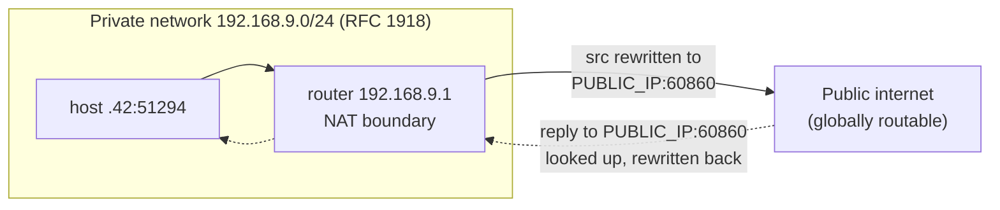

# IP Addressing and Subnets

## 1. Learning Objectives

After this lesson you will be able to:

- [ ] Read an IPv4 address and state its network and host parts under any given prefix, and compute the address range a prefix defines
- [ ] Explain what a CIDR prefix does, and why private address ranges plus NAT let a whole network share one public address
- [ ] Recognise an IPv6 address, explain why its format looks the way it does, and state what it fixes
- [ ] Use `ipconfig`/`ip a` and `getaddrinfo` output to describe your own machine's addressing right now
- [ ] Diagnose the ordinary address failures — wrong subnet, exhausted NAT pool, stale lease — from their symptoms

## 2. Prerequisites

- [How the Internet Works](how-the-internet-works.md) — packets, routers, and TTL
- [01-COMPUTER-FOUNDATIONS](../01-COMPUTER-FOUNDATIONS/README.md) — binary arithmetic is needed to compute address ranges by hand

## 3. Introduction

Lesson 1 said packets carry a destination address and routers forward on it. This lesson opens
that address up. An IP address is not a location and not an identity — it is a *routing hint*,
a number that tells the network which prefix to deliver to, and which changes when you move,
reconnect, or switch networks. Every bug you will ever file against "the network" is usually a
bug about addressing: the wrong subnet, the wrong interface, the wrong family. This lesson
teaches you to read the number and see the network underneath it.

## 4. The Problem It Solves

In the 1970s, every network used its own address format, and internetworking meant writing a
translator for every pair. TCP/IP's founding move was to pick **one** address format used by
every network: a fixed-length number, structured so that routers can forward with a table
lookup instead of a translation. Two constraints shaped the design:

**Routers must forward fast.** A router handling millions of packets cannot consult a table of
every host on earth. So the address is split: a **network prefix** shared by everyone in the
same network, and a **host part** identifying the machine inside it. Routers store routes for
prefixes, not hosts — forwarding is a longest-prefix match, and the forwarding table stays
tractable.

**Addresses must be handed out in blocks.** A single organisation gets one prefix, not scattered
individual addresses, so allocation and billing and aggregation all work on blocks. That is why
your ISP gives you one address (or prefix), not a phone book.

The consequence nobody anticipated perfectly: IPv4's 32-bit space ran out. The exhaustion is
the direct cause of the two mechanisms that dominate real addressing today — private ranges
with NAT (section 5) and the long-deferred arrival of IPv6 (section 6).

## 5. Core Concepts

### IPv4 address and dotted quad

An IPv4 address is **32 bits**, written as four decimal numbers (0–255) separated by dots —
each number is one **octet** (eight bits). `172.66.147.243` is the binary below in disguise:

```
172      66       147      243
10101100 01000010 10010011 11101011
```

32 bits means 2³² ≈ 4.3 billion addresses — a number that sounded inexhaustible in 1981 and was
exhausted for new allocations by 2011.

### Prefix and CIDR

The **prefix length**, written as a slash and a number (`/24`), says how many leading bits name
the *network*. The remaining bits name the *host*. `192.168.9.0/24` means: the first 24 bits
(192.168.9) are the network; the last 8 bits (0–255) are hosts on it. This notation is
**CIDR** (classless inter-domain routing); it replaced the old fixed class A/B/C system,
which wasted enormous blocks by forcing sizes to be powers of 256.

The arithmetic you will actually do: a `/24` has 8 host bits → 2⁸ = 256 addresses, of which two
are reserved (the all-zeros **network address** and the all-ones **broadcast address**), leaving
254 usable. A `/25` halves that to 127 usable; a `/30` gives four addresses, of which two are
usable — the classic size for a point-to-point link between two routers.

### Private ranges

Three IPv4 ranges are marked **private** and never routed on the public internet
(RFC 1918):

| Range | Prefix | Typical use |
|---|---|---|
| `10.0.0.0` – `10.255.255.255` | `10.0.0.0/8` | Large corporate networks |
| `172.16.0.0` – `172.31.255.255` | `172.16.0.0/12` | Data centres, Docker, cloud VPCs |
| `192.168.0.0` – `192.168.255.255` | `192.168.0.0/16` | Home and small-office routers |

Two consequences matter constantly in practice. First, private addresses are *reusable*: every
home on earth uses 192.168.x.x simultaneously without conflict, because conflict is only possible
on the public internet. Second, they are a routing hint in themselves — a router seeing
`192.168.9.1` knows it is not a global destination, and so do you, the moment you see a
tracert hop (lesson 1 showed exactly such a hop).

### NAT

**Network address translation** is the mechanism that lets hundreds of private-address machines
share one public address. Your home router rewrites addresses as packets cross the boundary:

- **Outbound:** the router replaces the source `192.168.9.42:51294` with its own public
  address plus a fresh port, and remembers the mapping
- **Inbound:** a reply addressed to the router's public port is looked up in that table and
  rewritten back to `192.168.9.42:51294` before being forwarded inside

The table is why the lesson-2 asymmetry exists in practice: a server on the public internet
cannot initiate a connection *to* your laptop, because no mapping for it exists — nobody has
ever sent anything out from that tuple. Only traffic your machine initiated (or that the router
was explicitly told to forward, via "port forwarding") can come back. NAT turned an address
exhaustion crisis into a manageable shortage, and simultaneously created the reachability
asymmetry that client–server architecture, WebSockets relays, and VPNs all live inside.

### Loopback and link-local

`127.0.0.0/8` (commonly `127.0.0.1`) is the **loopback** range: packets to it never leave the
machine. It is how processes talk to services on their own host — and how the lab server in
lesson 2 bound itself so that only this machine could reach it. IPv4 also reserves
`169.254.0.0/16` and IPv6 `fe80::/10` as **link-local** addresses: auto-configured addresses
valid only on one network segment, used when no DHCP server answers.

### IPv6

IPv6 addresses are **128 bits**, written as eight groups of four hex digits separated by colons:
`2606:4700:10::6814:179a`. The size is the headline — 2¹²⁸ addresses ends exhaustion permanently —
but the format is equally important:

- **No NAT by design.** Every device can have a globally unique address, which restores direct
  reachability (and with it, the security problem NAT accidentally solved — see section 9)
- **Hex, groups, colons:** four hex digits = 16 bits, eight groups = 128 bits. `::` collapses
  any run of zero groups (once only), which is why `2606:4700:10::6814:179a` is really
  `2606:4700:0010:0000:0000:0000:6814:179a`
- **No broadcast.** Replaced by multicast and anycast, which scale better
- **Autoconfiguration** (SLAAC) reduces or removes the need for DHCP

IPv6 is not "IPv4 with more bits" — it is IPv4's addressing model minus the NAT workaround,
which is why it changes how you think about firewalls.

## 6. How It Works

### Your own machine, right now

Executed on the authoring machine (Windows 11, Git Bash) — the addressing behind the tracert in
lesson 1:

```console
$ ipconfig | grep -A4 "Default Gateway"
   Default Gateway . . . . . . . . . . : 192.168.9.1
```

The **default gateway** is the router every packet not matching a more specific route is handed
to — the exit from your local network. Compare it with the addresses in lesson 1's tracert:

```
  1     2 ms     4 ms     2 ms  192.168.9.1      ← private, RFC 1918: your router
  2     4 ms     2 ms     3 ms  102.208.185.1    ← your ISP's first public hop
  7     7 ms     7 ms     7 ms  105.27.106.65    ← transit network
  8    10 ms     6 ms     6 ms  105.16.11.237
```

Reading that as addresses rather than times: hop 1 is inside your private range and therefore
not reachable from outside; hops 2+ are public and globally routable. The boundary between them
is precisely where NAT does its rewriting.

### Resolution hands you addresses, not names

The address a program ultimately needs comes from DNS (lesson 4), delivered to your program by
the OS resolver. Executed in the same lab, showing what a program actually receives:

```console
$ python socklab.py
getaddrinfo('example.com', 443):
  family=AF_INET type=0 addr=172.66.147.243:443
  family=AF_INET type=0 addr=104.20.23.154:443
```

Two things to notice. The call returned **two different addresses** for one name — a small
built-in redundancy (lesson 4 explains why a name maps to several addresses). And each is
tagged `AF_INET`, the address-family constant for IPv4; an IPv6 answer would carry `AF_INET6`.
Programs that handle both families are said to be **dual-stack**.

### The subnet arithmetic, worked

Take `192.168.9.0/24` — the network lesson 1 and this machine are on:

1. 24 network bits, 8 host bits
2. Host count: 2⁸ = 256; usable: 256 − 2 = 254 (`…9.0` network, `…9.255` broadcast)
3. Range of usable hosts: `192.168.9.1` through `192.168.9.254`
4. The router took `.1` by convention; the machine took some other address from the pool (DHCP
   assigned, not chosen — the pool is a range the router hands out and expires)

Now change the prefix to `/25` and redo it: 25 host bits → 2⁷ = 128 addresses, 126 usable,
range `192.168.9.1`–`192.168.9.126`. That is the whole skill: read the prefix, count host bits,
subtract the two reserved addresses. Every subnetting question on an exam and every "why is
192.168.9.200 unreachable" bug reduces to this.



## 7. Practical Examples

**Example 1 — compute a range by hand, then verify it**

For `10.0.4.0/22`:

1. 22 network bits; host bits = 32 − 22 = 10
2. Addresses: 2¹⁰ = 1024; usable: 1022
3. The block spans 1024 addresses from `10.0.4.0`; 4 blocks of 256 means it ends at
   `10.0.7.255` (4, 5, 6, 7 — the third octet advances)
4. Usable: `10.0.4.1` – `10.0.7.254`

- **Verify on any machine:** `python -c "import ipaddress; print(ipaddress.ip_network('10.0.4.0/22'))"`
  prints the network and its broadcast address, confirming step 3.
- **Assumptions:** the input is already a valid network address; `ipaddress` is standard library
  (executed with Python 3.13 on the authoring machine).

**Example 2 — see both families for one name**

```console
$ nslookup -query=AAAA example.com
Non-authoritative answer:
Server:  ns.ditnet.ac.tz
Address:  102.208.185.3

Name:    example.com
Addresses:  2606:4700:10::6814:179a
	  2606:4700:10::ac42:93f3
```

- Expand one address by hand: `2606:4700:10::6814:179a` =
  `2606:4700:0010:0000:0000:0000:6814:179a` — the `::` stands for the four zero groups the
  compressor removed. Count the bits: 8 groups × 16 = 128.
- The same name having both A (IPv4) and AAAA (IPv6) records is what makes dual-stack work:
  the program in section 6 could have received either family.
- **How to run it:** `nslookup` ships with Windows and most Linux distributions (`dig -6 AAAA
  example.com` is the alternative; `dig` is not installed on the authoring machine, which is why
  this transcript uses `nslookup`).

## 8. Real-World Applications

- **Cloud networking is subnet arithmetic.** AWS VPCs, GCP networks and Azure VNets are CIDR
  blocks you choose *before* creating anything: picking `10.0.0.0/16` for a VPC and `/24` per
  subnet, then discovering they overlap with your office's `10.0.0.0/16` over VPN, is one of the
  most common first-cloud-weekend errors. Example 1's arithmetic is the daily tool.
- **Container networking.** Docker assigns each container a private-range address (often from
  `172.17.0.0/16`); Kubernetes clusters allocate pod CIDRs the same way. "Why can't the service
  reach the database container?" is nearly always a subnet or route question.
- **Debugging "it works locally".** A service bound to `127.0.0.1` (lesson 2) is reachable only
  via loopback; a colleague on the LAN reaching your machine needs your private address, not
  localhost. Distinguishing the two is half of remote-debugging hygiene.
- **VPN address planning.** Corporate VPNs must reconcile office subnets, home networks and
  cloud VPCs into one non-overlapping map — which is why network engineers treat address space
  as a carefully allocated scarce resource, not a form field.

## 9. Common Mistakes

| Mistake | Why it happens | How to recognize it | How to prevent it |
|---|---|---|---|
| Treating an IP address as an identity or location | Devices move; addresses are leased | A "known" address now belongs to someone else after a DHCP renewal | Identify by name (DNS) or application-level identity; treat addresses as ephemeral routing hints |
| Assuming your public IP is unique to you | NAT means thousands share one | A friend on the same ISP sees your same public IP on a speed test | Remember the NAT table: the *pair* address:port is the real tuple |
| Overlapping CIDR blocks | Two networks both chose `10.0.0.0/16` | Connectivity works until a VPN/cloud link joins them, then half the traffic blackholes | Maintain one address plan across all environments before linking them |
| Confusing `/24` with "254 hosts always" | The two reserved addresses are forgotten; /25 is miscounted | Off-by-two errors in range calculations | Always compute 2^(32−prefix) then subtract 2 for usable |
| Believing IPv6 is just longer IPv4 | NAT is absent; firewall semantics differ | An IPv6 service is reachable from outside that its IPv4 twin never was | Review firewall rules per family; IPv6 reachability is direct by design |

## 10. Best Practices

- **Plan address space before you need it.** One page listing every network you own or rent,
  its prefix, and its purpose prevents the overlapping-blocks disaster and makes firewall rules
  auditable. Cloud providers give you tools; the discipline is yours.
- **Reserve documentation prefixes in examples.** Tutorials should use the reserved
  documentation ranges (`192.0.2.0/24`, `198.51.100.0/24`, `203.0.113.0/24`) or RFC 1918 private
  addresses, never a real host's address. This curriculum's transcripts show real observed
  addresses because the point is reading *your own* machine's output.
- **Write dual-stack code from the start.** Use `getaddrinfo` (which returns both families,
  as section 6 showed) rather than the legacy `gethostbyname`; never hardcode an IPv4 address.
  Code written IPv4-only becomes a migration project the moment IPv6 reaches it.
- **Log the address family and full address:port.** When a connection fails, "connection
  refused" versus "timeout" plus the exact tuple tells you whether the service was absent
  (refused) or the path was wrong (timeout) — the difference between a server bug and a
  firewall/NAT problem.

## 11. Limitations and Trade-Offs

- **NAT broke end-to-end reachability.** It solved exhaustion and accidentally became the
  internet's most-deployed firewall: nothing inside can be reached unless it first spoke out.
  Application designers compensate with relays, keep-alives, hole punching and STUN/TURN —
  machinery whose entire reason for existing is NAT's asymmetry.
- **Private addresses are not a security boundary.** They are routing labels, not permissions.
  Anything that reaches your LAN — malware, a guest, a compromised IoT device — sees every
  `192.168.x.x` service. The `0.0.0.0:6379` in lesson 2's `netstat` is exactly such a service,
  exposed to everything on the private network.
- **DHCP leases are leases.** Addresses change; a hard-coded address is a time bomb. This is why
  services register names (DNS) instead of memorising addresses.
- **IPv6's direct reachability is a double-edged sword.** Without NAT's implicit filter, every
  IPv6 device is globally addressable — which is why IPv6 firewalls must be *explicitly*
  configured, a change in default posture many teams forget.

## 12. Practical Exercises

### Introductory

1. **Exercise 6.1** — From your own machine, capture your IPv4 address, your default gateway,
   and your prefix length (via `ipconfig /all` on Windows or `ip a` on Linux). State which
   range (RFC 1918) your address falls in and compute your subnet's usable range.
   **Completion criteria:** the three values captured from real output; the range computed by
   hand and confirmed with `ipaddress.ip_network`; one sentence on why your address must be
   private rather than public.
2. **Exercise 6.2** — Expand these IPv6 addresses to their full eight-group form:
   `2606:4700:10::6814:179a` and `fe80::1`. For each, state whether it is globally routable or
   link-local, citing the prefix.
   **Completion criteria:** both expansions written; both classifications correct with the
   prefix named (`::/0`-space global vs `fe80::/10` link-local).

### Intermediate

3. **Exercise 6.3** — A network is `10.20.4.0/22`. Compute: usable host count, first and last
   usable addresses, and broadcast address. Then verify every number with the `ipaddress`
   module.
   **Completion criteria:** hand computation shown step by step; the Python verification
   transcript; any discrepancy between the two explained.
4. **Exercise 6.4** — This transcript is from a machine that cannot reach a printer at
   `192.168.9.77`: `ping 192.168.9.77` → `Destination host unreachable` from gateway
   `192.168.9.1`, while `ping 8.8.8.8` succeeds. Diagnose what layer the failure is at and what
   you would check next — and state what you can conclude from the *specific* error source.
   **Failure to diagnose:** the reply came from the *gateway*, not the printer — which means the
   gateway knew the destination was unreachable on its local network, not that the internet
   path failed. The next check is the printer's own link (power, Wi-Fi, self-assigned
   `169.254.x.x` address indicating failed DHCP).

### Independent problem-solving

5. **Exercise 6.5** — *Problem:* you are allocating address space for a small company: head
   office (120 devices), two branch offices (40 devices each), a server room (25 devices), and
   cloud VPCs (500 addresses), all to be linked over VPN. Produce a single non-overlapping plan
   using RFC 1918 space, justifying each prefix length, and describe what breaks if two sites
   later pick the same prefix.
   **Completion criteria:** every site has a stated prefix and device count fits with headroom;
   no overlap anywhere (verified with `ipaddress`); the overlap failure mode explained using
   the NAT/routing model from section 6.

*Solutions: attempt first. They live in `exercises/solutions/` of this subject.*

## 13. Knowledge Check

1. Your laptop has address `192.168.9.42/24`. It wants to send to `93.184.216.34`. Walk the
   first two decisions the OS and the router make, naming the two tables consulted.
2. Why does the same home router give different machines the *same* public address, and where
   does the per-machine distinction survive the translation?
3. When would you choose a `/28` over a `/24` for a subnet, and what does the smaller prefix
   cost you?

## 14. Completion Criteria

Observable evidence that you have understood this lesson:

- [ ] You computed an address range from a CIDR prefix and verified it with `ipaddress` (exercise 6.3)
- [ ] You described your own machine's addressing — address, gateway, range type — from real output (exercise 6.1)
- [ ] You can expand a compressed IPv6 address and classify it as global or link-local
- [ ] You can explain NAT's inbound/outbound rewrite using the address:port tuple, not hand-waving
- [ ] You can diagnose all five mistakes in section 9

## 15. Summary

- An IP address is a structured routing hint: network prefix plus host part, split by a CIDR prefix length.
- Private RFC 1918 ranges plus NAT let billions of devices share a few hundred million public
  addresses, and NAT's inbound table is why servers cannot initiate to you.
- IPv6's 128 bits end exhaustion and remove NAT, restoring direct reachability — with new firewall obligations.
- Subnet arithmetic is a two-step skill: count host bits, subtract the two reserved addresses.
- Addresses are leased and movable; names and application identities are the stable references.

## 16. Next Steps

- Next lesson: [DNS](dns.md) — the system that turns the names you type into these addresses
- Practice: [exercises/](exercises/README.md) set 3
- Where it is applied: [16-DEVOPS-AND-INFRASTRUCTURE](../16-DEVOPS-AND-INFRASTRUCTURE/README.md)
  (cloud VPC planning) and [15-APPLICATION-SECURITY](../15-APPLICATION-SECURITY/README.md)
  (what NAT does and does not protect)
