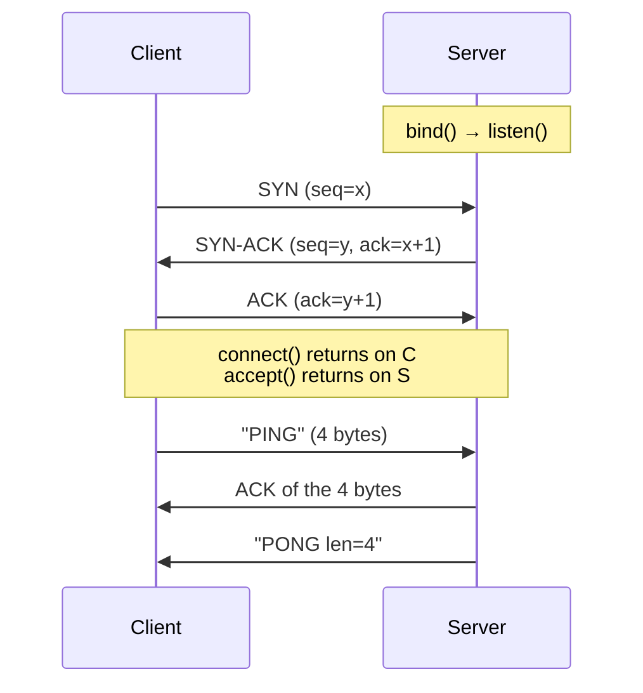

# TCP and UDP

## 1. Learning Objectives

After this lesson you will be able to:

- [ ] State the guarantee each protocol provides, in one sentence each, and the price of each
- [ ] Describe the TCP three-way handshake and where the connection's state lives
- [ ] Read an executed socket transcript and identify where the handshake completed and where bytes were delivered reliably
- [ ] Explain datagram semantics — including what happens when a UDP packet meets an absent receiver (as the lab transcript shows)
- [ ] Choose TCP, UDP, or a purpose-built protocol for a stated application, with a justification naming the actual trade

## 2. Prerequisites

- [Client–Server Architecture](client-server-architecture.md) — sockets, ports, accept/connect
- [How the Internet Works](how-the-internet-works.md) — packets, TTL, latency, jitter

## 3. Introduction

Two programs exchange bytes, and somebody has to decide what happens when a packet is lost,
duplicated, or delivered out of order. That decision belongs to the **transport layer**, which
sits directly above the internet layer from lesson 1. The internet layer's rule was simple:
deliver nothing guaranteed, forget everything after forwarding. The transport layer rebuilds
the guarantees applications actually want — or deliberately refuses to.

There are two answers in wide use. **TCP** rebuilds a perfect byte stream on top of an
imperfect packet network, and nearly everything you use daily rides on it: web pages, email,
file transfer, databases, SSH. **UDP** adds almost nothing and takes almost nothing: a bare
addressed datagram, fast and stateless, whose losses are visible to the application rather than
hidden. This lesson teaches you both by running them, reading a real transcript where each
protocol's behaviour is measured rather than asserted.

## 4. The Problem It Solves

The internet layer delivers independent packets. Applications, however, are written as if
data arrives as a *stream of bytes in order* — `read()` should return what `write()` was given,
in sequence, once. Between those two realities sits the **reliability gap**: packets can be
lost, reordered, duplicated, or split arbitrarily.

**TCP's solution:** reconstruct the illusion. Sequence every byte, acknowledge receipt,
retransmit losses, reorder arrivals, and deliver only in-order bytes to the application. The
application never learns that any of it happened — which is exactly why it is called a *reliable
byte stream*.

**UDP's solution:** refuse the job. Pass the datagram up as received, discard what arrives out
of order, tell the application nothing about loss. If loss matters to the application, UDP makes
it the application's business.

Why would anyone accept loss? Because TCP's guarantees have real costs: every conversation
requires a handshake (extra round trips before any data), every byte is acknowledged (an
acknowledgement stream travelling back), retransmissions add delay (a late repair of an old
packet is often useless), and head-of-line blocking (a lost packet stalls every byte behind it,
even newer ones). For live voice, video and games, a stale packet is worse than a missing one:
the information has expired. UDP lets those applications send *now* and patch gaps themselves —
or ignore them, for small losses of small consequence.

## 5. Core Concepts

### The three-way handshake

TCP opens a connection before sending data. Both sides must agree that both are alive and able
to send and receive — three messages, because that is the minimum that proves each direction:

1. **SYN** — client says "I want to talk; my sequence numbers start here"
2. **SYN-ACK** — server answers "I heard you; my numbers start here too"
3. **ACK** — client confirms "your reply arrived; we are open"

The verbs client-side are `connect()` (returns after step 3) and server-side `accept()`
(returns when the handshake completes — which is exactly why lesson 2's server printed
`TCP handshake complete` only at that moment). The state lives in both operating systems, not
in your program: sockets carry it, which is why a server can serve thousands of connections
without any protocol-level confusion about who is who.

### Reliability: sequence numbers, ACKs, retransmission

Every byte gets a sequence number. The receiver acknowledges the highest contiguous byte it
has; gaps in the acknowledgement tell the sender exactly what to retransmit and after how long.
The retransmission timeout is *measured*, not fixed — it tracks the connection's observed round
trip (the same `time=` value lesson 1 measured with ping), so a path that gets slower adapts.
Two consequences worth knowing: TCP's retransmission delay can be hundreds of milliseconds
(loss recovery costs latency), and TCP's congestion control deliberately *shrinks* sending rate
when loss appears, on the theory that loss means congestion. (A wireless loss is not congestion —
this mismatch is why mobile protocols needed tuning.)

### Flow control vs congestion control

- **Flow control** protects the *receiver*: it advertises how much buffer space it has left, so
  a fast sender cannot overrun a slow reader.
- **Congestion control** protects the *network*: the sender probes for available bandwidth and
  backs off on loss, so every TCP sender behaves as a polite citizen.

Both are automatic, both are why a well-written application rarely thinks about them — until a
single long-lived transfer starts slowly (TCP slow start) or a big download on the same link
makes your video stutter (competing congestion control).

### Datagram semantics

A **datagram** is a self-addressed message: send it, and it either arrives intact, arrives
damaged, or does not arrive. UDP offers **at-most-once** delivery with no ordering: no
retransmission, no acknowledgement, no connection (though `connect()` on a UDP socket exists —
it merely sets a default peer and lets ICMP errors flow back, nothing is negotiated). If a
message matters, the application implements its own identification, deduplication, ordering and
retry — which is precisely what protocols like QUIC (HTTP/3's transport) later did on top of
UDP, because they wanted reliability *their* way, without TCP's head-of-line blocking.

### Ports, multiplexing, and the handshake's by-products

Both protocols use ports identically (lesson 2). TCP's connection-tracking produces two
observable by-products you will meet in practice: a connection in **TIME_WAIT** (the closing
side lingers briefly so late duplicates cannot poison a future connection — the reason
`SO_REUSEADDR` in lesson 2's server exists), and **port exhaustion** (a client machine can run
out of ephemeral ports if it opens and closes connections too fast without reusing them).

## 6. How It Works

### Both protocols in one executed transcript

Executed on the authoring machine (Windows 11, Git Bash, Python 3.13.5): `socklab.py` starts a
TCP server on 8771 and a UDP server on 8772, runs one exchange over each, and then performs a
telling experiment — it sends a datagram to a port where *no server is listening any more*.

```console
$ python socklab.py
UDP server bound on ('127.0.0.1', 8772)
TCP server listening on ('127.0.0.1', 8771)
TCP client: connected local=('127.0.0.1', 51294) peer=('127.0.0.1', 8771)
TCP handshake complete: accepted from 127.0.0.1:51294
TCP server recv: "PING" (4 bytes)
TCP client recv: "PONG len=4"
UDP client: local=('127.0.0.1', 60860) (bound explicitly; no connect needed to send)
UDP recvfrom: "HELLO-UDP" from 127.0.0.1:60860
UDP client got: "PONG-DATAGRAM" from 127.0.0.1:8772
UDP ghost: ConnectionResetError 10054 <- ICMP port-unreachable surfaced to the socket (Windows behavior)
getaddrinfo('example.com', 443):
  family=AF_INET type=0 addr=172.66.147.243:443
  family=AF_INET type=0 addr=104.20.23.154:443
```

Read the TCP half first — it is lesson 2's sequence, now annotated as a transport event:

- `listening` → `connected` → `handshake complete`: three lines, one handshake. The client's
  `connect()` had already returned when it printed `connected`; the server's `accept()` printed
  only after the handshake finished. Nothing in either program's code made that ordering —
  the transport layer did.
- `TCP server recv: "PING" (4 bytes)` then `TCP client recv: "PONG len=4"`: byte counts are the
  reliability contract in miniature — the receiver knows exactly how many bytes to expect
  (Content-Length in lesson 6 depends on this), and TCP would retransmit until all four arrived.

Now the UDP half, which is a different world:

- **`bound explicitly; no connect needed to send`** — there was no handshake; the client bound
  a local port and fired a datagram at the server's address. Nothing was negotiated, nothing
  was state. (The explicit bind exists because Windows requires an explicit bind before
  `getsockname()` — a platform detail worth capturing honestly rather than hiding.)
- **`recvfrom` returns the sender's address** — a UDP receiver learns *who sent it* from the
  datagram itself, per message, because there is no connection to remember it. This is what
  makes UDP natural for many-clients-one-socket designs (DNS, lesson 4, does exactly this).
- **The ghost line** — this is the experiment: the client sent one more datagram to a port
  where the server had already exited. On a connectionless protocol you would expect silence.
  What happened instead: the local network stack generated an ICMP *port unreachable* message,
  the operating system converted it into a socket error, and the client's `recv` raised
  `ConnectionResetError 10054`. That is a genuinely instructive platform behaviour — UDP itself
  guarantees nothing and delivered no error over the wire; the *host* chose to surface its own
  ICMP reply to the application. On another OS the same experiment may time out silently
  (which is why the script also handles that case): either way, the application learned of the
  failure, and either way it learned it **late and indirectly** — the UDP signature.

### The handshake, drawn



Compare the same exchange over UDP: one message out (`HELLO-UDP`), one message back
(`PONG-DATAGRAM`), four lines total, no notes, no ACKs — and no indication in the protocol
whatsoever that a fifth message had been sent to a dead port.

### What the loss experiment proves about design

TCP would have handled the dead-port case *for* the application: the connect attempt or the
following data write would fail fast with `Connection refused` (a reset packet comes back
through the transport layer itself), and the application's `send` would not appear to succeed.
UDP's answer arrived out-of-band and OS-dependent — the protocol's silence was the design. When
you choose UDP, you are choosing to write the code that TCP would have written for you:
timeouts, retries, duplicate suppression, ordering. Do that accounting before choosing.

## 7. Practical Examples

**Example 1 — the reliability gap, observed from one process**

```console
$ python socklab.py
TCP server recv: "PING" (4 bytes)
TCP client recv: "PONG len=4"
UDP client got: "PONG-DATAGRAM" from 127.0.0.1:8772
UDP ghost: ConnectionResetError 10054 <- ICMP port-unreachable surfaced to the socket (Windows behavior)
```

- Both protocols delivered their one message — over a loopback link with no real congestion,
  the difference between them is invisible. That is the point: **on a good path, TCP and UDP
  look identical**; you only see the gap when packets are actually lost. Production networks
  lose packets routinely (lesson 1's loss column), and that is where the two diverge.
- **The observable difference in this transcript** is failure signalling, not delivery: the TCP
  half never had to consider a dead peer, while the UDP half's last message surfaced a late,
  OS-translated error.
- **How to run it:** `python socklab.py` (source in the batch's lab; self-contained standard
  library). **Assumptions:** Python 3.13; Windows semantics for error 10054 as labelled.

**Example 2 — choosing by asking "what does a late packet cost?"**

| Application | Transport | Why, in the lesson's terms |
|---|---|---|
| Web page, API, file, email, SSH, database | **TCP** | A missing byte corrupts the whole; correctness beats 100 ms of retransmission delay |
| Live voice/video call | **UDP** (often RTP) | A packet arriving late is worthless; drop it and let the codec conceal it |
| DNS query | **UDP** (TCP fallback for big answers) | One small request/response; a timeout at the application is a perfectly good retry policy (lesson 4's failure table) |
| Online game state | **UDP** (custom reliability) | Only the newest state matters; retransmitting an old position is actively wrong |
| QUIC (HTTP/3) | **UDP** + its own reliability | Wanted encryption and no head-of-line blocking *without* waiting for TCP to change |

- **The decision procedure:** name what happens when data is lost — if the application cannot
  proceed without it, TCP (or QUIC); if newer data makes old data irrelevant, UDP with the
  application's own repair logic. There is no third option and "UDP is faster" is not a reason:
  the speed difference is the missing guarantees, priced per byte.
- **Assumptions:** the table reflects the systems' design as deployed; every row is checkable
  with `netstat`/`ss` (lesson 8 does exactly this against a live machine).

## 8. Real-World Applications

- **HTTP is TCP, and always has been** — lesson 6's messages ride TCP streams; lesson 7's TLS
  handshake happens inside one; a dropped packet mid-response is repaired invisibly before your
  browser sees a byte. HTTP/3 moved to QUIC/UDP to change *that* — one of the few protocol-layer
  swaps in the web's history.
- **Databases depend on TCP's ordering** — a query result delivered out of order would be
  nonsense; which is also why a database over a high-latency path hurts: every round trip in
  the query protocol is TCP-acknowledged latency (lesson 1's round-trip argument, at scale).
- **Streaming media** uses UDP at the edges (live ingest, WebRTC) and TCP or HTTP in the
  middle (VOD), matching each hop's loss tolerance to the transport's price.
- **Tunnels and VPNs** (WireGuard, VPN protocols) run their own crypto+reliability over UDP,
  because a TCP-over-TCP stack retransmitting into itself produces the "TCP meltdown"
  performance collapse — a textbook case of choosing the transport deliberately.

## 9. Common Mistakes

| Mistake | Why it happens | How to recognize it | How to prevent it |
|---|---|---|---|
| "UDP is faster, so use it for performance" | The handshake/ACK cost is real but small | UDP and TCP run within a few percent on a clean LAN | Price the *loss* path: state what a missing packet costs your app before choosing |
| Assuming TCP guarantees delivery to the *application* | It guarantees delivery into the receiver's buffer | Process crashes lose "reliable" data; the sender got its ACKs | Durability is your storage's job; TCP only repaired the wire |
| Ignoring head-of-line blocking | "Everything is over TCP" for decades | One lost packet stalls newer data behind it | For live media and multiplexed streams, evaluate QUIC/HTTP3 (subject 11) |
| Fighting `TIME_WAIT` with `SO_REUSEADDR` blindly | Restart errors look like "port in use" | Server won't restart after a burst of connections | Understand it: TIME_WAIT is a safety linger; fix client connection churn, not the OS |
| Believing UDP "just loses silently always" | The lab's error line surprises people | The ghost experiment raised a local error, not a wire one | It was the host's ICMP surfaced locally (platform-dependent); UDP the protocol still promises nothing |

## 10. Best Practices

- **Let the OS pick your retransmission and congestion policy** (default TCP); only tune it when
  you have measurements from your own path — a bad `tcp_rto` guess causes more harm than no guess.
- **If you build on UDP, budget the whole reliability layer** before writing code: message IDs,
  dedup, ordering, application timeouts, retry with backoff, and a flow-control scheme. QUIC's
  decade of engineering is the receipt for how much that is.
- **Reuse connections.** TCP's handshake (and lesson 7's TLS handshake) are per-connection
  costs; HTTP keep-alive and connection pooling exist to amortise them — the single most
  effective latency optimisation in practice (lesson 7 measures it).
- **Diagnose with the right verb.** `Connection refused` means the transport heard the server
  is absent (fast, informative); a hang with no response means packets went somewhere and were
  dropped (path, firewall, or silent loss). The symptom names the layer — the triage habit from
  lesson 1, applied to sockets.

## 11. Limitations and Trade-Offs

- **TCP cannot fix an unusable path.** If the link is 40% lossy, retransmission turns it into a
  crawling but correct connection — availability at the cost of latency, and no configuration
  changes that. Some paths need a different route (lesson 1) or a different protocol entirely.
- **Reliability is a per-connection property, not an end-to-end one.** Two TCP hops (app→proxy,
  proxy→backend) do not compose into one guarantee: the proxy's successful receipt says nothing
  about the backend's. Systems must reason hop-by-hop — the lesson behind every retry policy in
  subject 11.
- **UDP's flexibility is unbounded work.** Every guarantee you need is yours to implement; the
  history of custom-UDP protocols is also a history of discovered edge cases (NAT timeouts
  killing idle flows, ICMP filtering hiding failures, MTU issues — lesson 8 touches MTU).
- **Neither protocol knows what its bytes mean.** Ordering, encryption, framing, authentication
  — all of it lives above: HTTP gives TCP's stream a grammar (lesson 6), TLS gives it
  confidentiality (lesson 7). The transport delivers; it does not interpret.

## 12. Practical Exercises

### Introductory

1. **Exercise 6.1** — Run the lab transcript from section 6 on your machine. Annotate each line:
   which protocol produced it, and which party (client/server/OS) printed it.
   **Completion criteria:** every line labelled; the two lines that evidence a completed
   handshake identified (`connected`, `handshake complete`) with one sentence on which call
   blocked until that moment.
2. **Exercise 6.2** — With `netstat`/`ss`, find three established TCP connections and their
   local/remote port pairs. State for each which side is the server and how you can tell from
   the port number alone.
   **Completion criteria:** three pairs captured; the server identified by its well-known port
   in each; one connection's local port identified as ephemeral.

### Intermediate

3. **Exercise 6.3** — Reproduce the ghost experiment as a standalone script: send a UDP datagram
   to a port with nothing bound, then a second datagram after starting a server there. Capture
   both results.
   **Completion criteria:** the first result's actual behaviour on your OS captured (error or
   timeout — either is correct, it is platform-dependent); the second delivered; one sentence on
   why the protocol itself produced neither outcome.
4. **Exercise 6.4** — This claim needs fixing: *"We should switch the chat app to UDP because it
   is faster, and UDP is connectionless so it has no overhead."* Produce a corrected decision
   that names: what chat's loss actually costs (old messages vs. current typing state), what
   UDP's connectionlessness gives you (no handshake) and what it costs (no ordering, no retry,
   no congestion politeness), and which parts of chat genuinely tolerate loss.
   **Failure to diagnose:** the claim replaced by a three-column trade (guarantee / cost /
   verdict per chat feature); at least one feature that *should* stay reliable transport.

### Independent problem-solving

5. **Exercise 6.5** — *Problem:* design the transport for a fleet of soil-moisture sensors on a
   lossy rural link: each sensor sends a reading every 60 seconds, readings are redundant (the
   next one supersedes), but configuration updates from the server must arrive exactly once.
   Choose the transport for each direction, specify what your protocol does about duplicates,
   ordering, and timeouts, and explain where TCP would have wasted time or bytes.
   **Completion criteria:** a direction-by-direction choice with justification; the duplicate/
   ordering/timeout policy stated as implementable rules; a one-paragraph argument citing the
   "stale packet is worse than missing" criterion from section 4.

*Solutions: attempt first. They live in `exercises/solutions/` of this subject.*

## 13. Knowledge Check

1. A `write()` to a TCP socket returns success, then the receiver's machine power-cycles before
   reading. What did TCP guarantee, what did it not, and where did the data actually live?
2. Why does a UDP receiver use `recvfrom` while a TCP receiver uses `recv` — what does each
   signature tell you about who the sender is?
3. When would you put *both* on the same port number for one application, and what does the
   protocol choice communicate in that design?

## 14. Completion Criteria

Observable evidence that you have understood this lesson:

- [ ] You can state each protocol's guarantee and price in one sentence, without notes
- [ ] You executed the lab transcript and annotated where the handshake completed (exercise 6.1)
- [ ] You reproduced the UDP dead-port experiment and explained your OS's actual result (exercise 6.3)
- [ ] You can pick a transport for any application by asking what a lost packet costs, not by habit
- [ ] You can diagnose all five mistakes in section 9

## 15. Summary

- TCP rebuilds a reliable in-order byte stream over an unreliable network, costing a handshake, ACK traffic, retransmission delay, and head-of-line blocking.
- UDP passes bare datagrams with no connection, ordering, or loss notification — the application owns every guarantee.
- The handshake is the minimum exchange proving both directions work; `connect()` and `accept()` return when it completes.
- The lab showed both protocols succeeding on a clean path and diverging exactly once — on failure signalling, which is the real decision axis.
- Transport choice is decided by one question: what does a lost or late packet cost this application?

## 16. Next Steps

- Next lesson: [HTTP Fundamentals](http-fundamentals.md) — the message grammar that rides on TCP's byte stream
- Practice: [exercises/](exercises/README.md) set 5
- Where it is applied: [11-BACKEND-ENGINEERING](../11-BACKEND-ENGINEERING/README.md) (connection handling and timeouts) and [17-CLOUD-AND-PRODUCTION](../17-CLOUD-AND-PRODUCTION/README.md) (tuning real paths)
