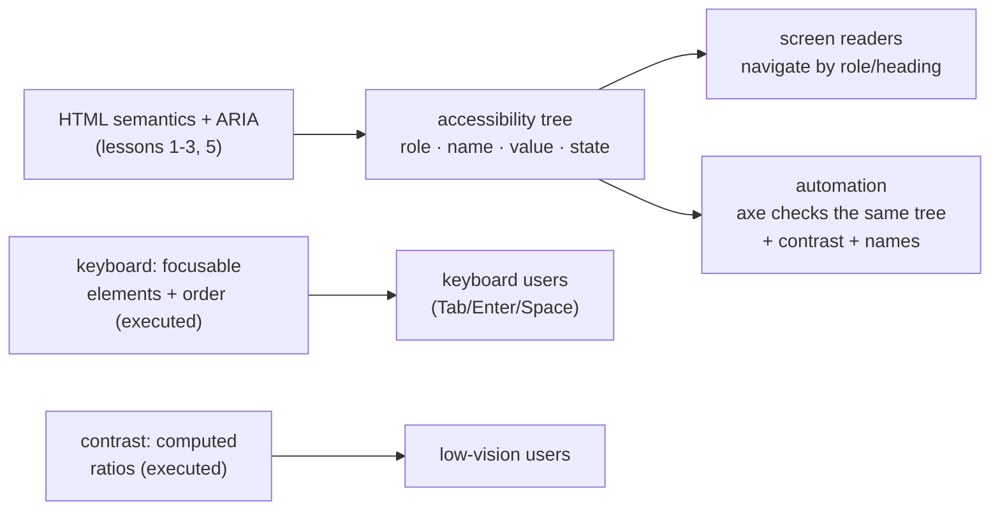

# Accessibility

## 1. Learning Objectives

After this lesson you can:

- [ ] State the four principles (perceivable, operable, understandable, robust) and map a real defect to the one it violates
- [ ] Run an axe-core audit, read its rule IDs and impact levels, and fix a page from 7 violations to 0 — as executed here
- [ ] Compute a contrast ratio from two colors, cite the AA/AAA thresholds it must pass, and fix a failing pair (executed: 2.85:1 → 7.00:1)
- [ ] Describe keyboard operation of a page — native focusability, tab order, the positive-`tabindex` trap — from the executed focus probe
- [ ] Know what automated tools *cannot* check (the manual list) and run the keyboard pass that covers it

## 2. Prerequisites

- [Semantic HTML](semantic-html.md) — landmarks and headings are the accessibility tree's skeleton
- [Forms and Validation](forms-and-validation.md) — labels and hints are the interactive contract
- [Typography and Design Tokens](typography-and-design-tokens.md) — the color/size numbers contrast depends on

## 3. Introduction

Accessibility is not a feature layer — it is whether the thing works at all for people who
navigate by keyboard, hear a screen reader, have low vision, or use motion-dampening settings.
The encouraging fact this lesson executes: most failures are *structural and quantifiable* —
a missing `alt`, a 2.85:1 gray, an unlabeled input — findable by tooling and fixable in
minutes. The audit pair below (bad page: **7 violations**; same content corrected: **0**) is
the entire argument for building it in from lesson 1 rather than retrofitting.

## 4. The Problem It Solves

Interfaces built only for a mouse-seeing user exclude a large population — and the exclusion
is invisible to the builder because the *pixels* look fine. A `div onclick` renders perfectly
and is unreachable by Tab. Gray-on-white text reads fine at 20/20 vision and disappears at
4:1 vision. A placeholder-only field is obvious to you and silent to a screen reader. None of
these fail a screenshot review; all of them fail the user.

Regulations made the stakes explicit (WCAG 2.1 AA is the baseline referenced by the EU's
European Accessibility Act, Section 508, and most procurement rules), but the engineering
argument stands alone: accessible structure is *durable* structure — semantic landmarks
(lesson 2) help screen readers **and** reader modes **and** crawlers; visible labels help
low-vision users **and** everyone on a phone; keyboard operation helps assistive tech **and**
power users. The four principles (POUR) are the checkable frame:

- **Perceivable** — content available to senses in use: text alternatives, contrast, structure
- **Operable** — everything reachable and activatable: keyboard, focus order, no traps
- **Understandable** — predictable: labels, instructions, error identification
- **Robust** — interpretable by current and future assistive tech: valid semantics, proper roles

## 5. Core Concepts

### Contrast: the arithmetic, not the opinion

WCAG **1.4.3 Contrast (Minimum)**: body text needs **≥ 4.5:1** against its background;
**large text** (≥ 24px, or ≥ 19px bold — roughly 18.66px/14px CSS at 1.5× AA) needs **≥ 3:1**.
**1.4.6 Contrast (Enhanced)**: **7:1** and **4.5:1** for AAA. The ratio is computed from
relative luminance (sRGB channel → linearize → weighted sum) — and it is symmetric and
tool-checkable, which is why it belongs in a token decision (lesson 9): choose `--color-text-muted`
once, at 7.00:1, rather than per component.

Executed against the two lab pages' actual colors (authoring machine, computed with the WCAG
formula):

```console
bad page #999 on #fff: 2.85:1  -> AA fail (<4.5), AAA fail
good page #595959 on #fff: 7.00:1  -> AA pass, AAA pass (>=7)
lab green #2a6 on white: 3.00:1  -> AA fail (<4.5), AAA fail
```

Three honest readings: `#999` is the classic "designer gray" and fails AA outright for body
text (it only clears the 3:1 *large-text* bar); `#595959` passes **AAA** exactly — the fix
the good page shipped; and the lab's own flexbox green at **3.00:1** fails AA for small text —
teaching material is not exempt (white 12px labels on `#2a6` would fail; they're decorative in
that demo, but the same green behind real body copy would be a violation — say so, don't
special-case yourself).

### Keyboard: native focusability and the order rules

Everything interactive must be reachable **and operable** by Tab/Shift-Tab/Enter/Space. Native
focusability covers `a[href]`, `button`, `input`, `select`, `textarea`, and anything with a
`tabindex`. Executed focus probe (headless Chrome 156, authoring machine):

```console
natively focusable: a, button, input, button(disabled), a
div[onclick] focusable natively: false
elements with tabindex: div#tab5 tabindex=5 | div#programmatic tabindex=-1 | a#positive tabindex=3
tab order from this markup (0 = DOM order, then ascending positive):
  1. a#positive (tabIndex=3)
  2. div#tab5 (tabIndex=5)
  3. a (tabIndex=0)
  4. button (tabIndex=0)
  5. input#field (tabIndex=0)
NOTE: positive tabindex elements jump the queue BEFORE tabindex=0 elements
excluded from tab order: div#programmatic, button
```

Read it as three rules with receipts:

1. **`div[onclick]` is not focusable (`false`)** — a click handler does not make a div a
   control: it never enters the tab order, never gets a focus ring, never receives Enter/Space.
   This is why lesson 2's "links navigate, buttons act" rule exists — the div fails POUR's
   *operable* leg before any styling conversation. (Fix: use `<button>`, or at minimum
   `tabindex="0"` + key handlers + role + accessible name — all four, which is exactly the
   reimplementation of `<button>` that the first rule says to avoid.)
2. **Positive `tabindex` jumps the queue** — the probe's items with `tabindex=3` and `5`
   ranked *before* every natural element. Positive values renumber the whole page's priority
   and rot the moment content moves (a new dialog with `tabindex=2` fights the old `5`).
   The convention: `tabindex="0"` (join natural order) or `-1` (programmatic focus only) —
   **never positive**. `div#programmatic` with `-1` demonstrates the legitimate exception:
   focusable via `el.focus()` (a modal's initial focus target), absent from Tab.
3. **Disabled elements leave the order** — `button[disabled]` excluded (executed), and with it
   the a11y rule that disabled controls need an *understandable* alternative (a disabled Save
   button should say *why* — tooltip or adjacent text — not just refuse).

Focus *visibility* is the half the probe can't print: WCAG 2.4.7 requires a visible focus
indicator (and 2.4.11 in 2.2 makes it non-suppressible in spirit) — `:focus-visible { outline: … }`
styling, never `outline: none` without replacement (the canonical silent barrier).

### The audit: axe-core, executed

**axe-core** (open-source, Deque) injects into a page and checks DOM/CSS rules against WCAG
criteria. The lab pages ran it in-browser and wrote the results into the DOM — bad page first:

```console
axe-core 4.10.2 violations: 7
  [critical] button-name: Buttons must have discernible text (1 node(s))
  [serious] color-contrast: Elements must meet minimum color contrast ratio thresholds (1 node(s))
  [serious] html-has-lang: <html> element must have a lang attribute (1 node(s))
  [critical] image-alt: Images must have alternative text (1 node(s))
  [moderate] landmark-one-main: Document should have one main landmark (1 node(n))
  [moderate] page-has-heading-one: Page should contain a level-one heading (1 node(s))
  [moderate] region: All page content should be contained by landmarks (10 node(s))
```

The **same content**, corrected (executed):

```console
axe-core 4.10.2 violations: 0
  (none)
```

The seven map to this course's lessons — the audit is a syllabus in reverse:

| axe rule | Impact | Lesson that fixes it | The fix shipped |
|---|---|---|---|
| `button-name` | critical | semantic/labels — name the empty `<button></button>` | `Save settings` text |
| `color-contrast` | serious | typography tokens | `#999` → `#595959` (2.85 → 7.00:1, executed above) |
| `html-has-lang` | serious | html-fundamentals skeleton | `<html lang="en">` |
| `image-alt` | critical | html/semantic | `alt="Quarterly revenue rose 12 percent"` |
| `landmark-one-main` | moderate | semantic landmarks | `<main>` (outline probe: `main=0 → 1`) |
| `page-has-heading-one` | moderate | heading outline | sole `<h3>` → `<h1>` |
| `region` | moderate | landmarks everywhere | content wrapped in `<main>` (10 nodes → contained) |

And the outline probes that ran on both pages (lesson 2's evidence, here as the *before*
state):

```console
# bad page
heading outline: H3 "Skipped heading level"
landmarks: header=0 nav=0 main=0 article=0 section=0 footer=0
duplicate ids: email
images without alt attribute: 1
links with text <= 5 chars or generic: 1
inputs without associated label: 1
```

Five defects the outline sees that axe's summary compresses: the duplicate id (invalid HTML
that breaks `label[for]` targeting — lesson 1), the generic link text ("click here" — the
link needs a *name* that survives being read out of context), and the unlabeled input
(forms lesson). **A tool's severity list is a starting triage, not a complete census** — the
outline probe's row-level detail is the second pass.

### What automation cannot check

Executed tooling above verifies *structure and numbers*. It cannot verify:

- **Keyboard operability in motion** — the probe printed *order*, not *behavior*: focus traps
  in modals, Enter/Space on custom widgets, visible focus styling (2.4.7). Manual pass: Tab
  through the page from the address bar; every stop reachable, operable, visible, and ending
  where it should.
- **Accessible names making sense** — `aria-label="btn"` passes `button-name` while being
  useless. Listen (NVDA/VoiceOver) or inspect the accessibility tree; names must make sense
  *read aloud, alone*.
- **Announcements and state timing** — live regions (`aria-live`) announcing form errors at
  the right moment; `aria-expanded` flipping on toggle — needs a screen reader or a scripted
  role/state query.
- **Cognitive load** — predictable navigation, plain language, error recovery (POUR's
  *understandable* leg is mostly human judgment).
- **Color meaning beyond contrast** — hue-only distinctions (error vs success) need a
  non-color cue (icon/text) — axe checks contrast, not "is red the only signal".

The engineering habit: **automate the census, script the order, hand-test the experience** —
axe in CI (subject 14), the focus probe in the harness, one keyboard pass + one screen-reader
spot check per feature.

### The accessibility tree (what all of this feeds)

Browsers expose a parallel tree — role, name, value, state per node — built *from* your
semantics (lessons 1–3) and ARIA; screen readers consume it. `<div class="nav">` is a `generic`
node in it (invisible to landmark navigation); `<nav aria-label="Primary">` is `navigation:
"Primary"`. Every fix in the seven-row table *changes this tree*: that's the mechanism, and it
is why "it looks the same" is never a rebuttal — the tree, not the pixels, is the artifact.



The diagram's two executed inputs (keyboard order, contrast numbers) and the audit's
rule list are *all views of the same contract*: what the tree promises, what the keyboard can
reach, what the eye can resolve.

## 6. How It Works — the audit pair, end to end

The complete bad→good delta, all four artifacts executed on the authoring machine:

```console
# BEFORE (a11y-bad.html)
outline: heading outline: H3 "Skipped heading level"
         landmarks: header=0 nav=0 main=0 article=0 section=0 footer=0
         duplicate ids: email | images without alt: 1 | generic links: 1 | unlabeled inputs: 1
axe:     7 violations (2 critical, 2 serious, 3 moderate)
contrast: #999 on #fff = 2.85:1  (AA fail)

# AFTER — same content, corrected markup (a11y-good.html)
outline: heading outline: H1 "Proper heading order"
         landmarks: header=0 nav=0 main=1 article=0 section=0 footer=0
         duplicate ids: none | images without alt: 0 | generic links: 0 | unlabeled inputs: 0
axe:     0 violations
contrast: #595959 on #fff = 7.00:1  (AAA pass)
```

Every change was a *lesson concept*, not a trick: `lang`, one `h1`, `<main>` wrapping content,
an `alt` describing the image's information, real link text ("About this organisation"),
`<label for>` + `aria-describedby` for the input, a button with a name, and a darker gray.
Compare with the seven-row table: no ARIA was added anywhere — **the fixes were HTML**,
which is ARIA's first rule applied literally (the only ARIA present: `aria-describedby`
*associating* an existing hint — describing, not re-declaring).

## 7. Practical Examples

**Example 1 — audit any page in two commands**

```console
# axe in-browser (as executed): serve axe.min.js beside the page, then
#   <script src="axe.min.js"></script><script>axe.run().then(r => …write summary…)</script>
$ chrome --headless --dump-dom --virtual-time-budget=8000 http://your-page/ > dom.html

# or the devtools route: F12 → Lighthouse → Accessibility (scores + pass/fail list),
# and DevTools' "Issues" panel runs axe rules live on the open page.
```

- **Expected output:** violation count + rule IDs with impact (executed reference: 7 → 0);
  every remaining `serious`/`critical` is a bug ticket with a named fix.
- **How to run it:** the in-page `axe.run()` pattern (what the lab used — axe 4.10.2 served
  locally, results written into `#out` and captured by `--dump-dom`); or Lighthouse for a
  one-command score.
- **Assumptions:** any Chromium (authoring machine: Chrome 156); `axe.run()` needs a settle
  window (the `--virtual-time-budget=8000` above is the measured one — smaller budgets
  captured `running axe...` instead of results, a race the lab hit and fixed).

**Example 2 — the keyboard pass (manual, five minutes, per feature)**

```console
1. Click NOTHING. From the address bar, press Tab repeatedly:
   - every interactive element gets a stop, in reading order
   - the focus indicator is visible at every stop (:focus-visible outline — never 'outline: none' alone)
   - Enter activates links/buttons, Space activates buttons/checkboxes
2. Escape closes any overlay; Tab inside a modal cycles within it and returns focus to its trigger
3. Shift+Tab walks back symmetrically; no dead ends (the keyboard-trap rule, WCAG 2.1.2)
```

- **Pair it with the focus probe** (section 5's transcript) *before* the pass: the probe tells
  you what *should* be in the order (natively focusable list, tabindex anomalies, the
  positive-tabindex jumps); the manual pass confirms the runtime behavior the probe can't print
  — focus rings, activation, traps.
- **Expected result:** zero stops without a visible ring; zero unreachable controls; the
  probe's `div[onclick] focusable: false` never appears on a real interactive element.
- **Assumptions:** any keyboard; the probe page pattern from section 5 is in this lesson's lab.

## 8. Real-World Applications

- **CI accessibility gates** run exactly the executed pattern: build → serve → `axe.run()`
  (or `@axe-core/playwright`) → fail the build on `serious`/`critical`. Subject 14 wires this
  into the test suite; the 7→0 pair is a template for what the gate enforces.
- **Procurement and legal baselines** (WCAG 2.1 AA) are written as the numbers in section 5:
  4.5:1 contrast, keyboard operable, labeled controls, `lang`, alt text — auditors run axe and
  a keyboard pass *first*, exactly as here; knowing the rule IDs turns an audit report into a
  work list.
- **Design systems bake it in** (subject 09): focus-visible tokens, contrast-checked palettes
  (tokens with pre-computed ratios — lesson 9's `--gray-700` at 7.00:1), minimum target sizes
  (44×44 — lesson 3's `height: 44px` needs border-box honesty from lesson 5). Teams that bake
  it in pass audits by default; teams that retrofit re-litigate every component.
- **Platform features depend on it**: reader mode, voice control ("click Save settings" —
  works because the button has that *name*), OS dark mode, and browser zoom all consume the
  same semantics and numbers this lesson executed.

## 9. Common Mistakes

| Mistake | Why it happens | How to recognize it | How to prevent it |
|---|---|---|---|
| "It passes axe, so it's accessible" | Tool as ceiling | axe 0 but the page is unusable by keyboard/screen reader | Section 5's cannot-check list: keyboard pass + name review + SR spot check, every feature |
| Click handlers on divs | Divs style more easily | Probe line: `div[onclick] focusable natively: false` | Native `<button>`/`<a>` (lesson 2) — role, focus, keys come free |
| `outline: none` on focus | Ring "looks messy" | Keyboard user blind at every stop | Style `:focus-visible` deliberately (a *better* ring), never remove without replacement |
| Placeholder as label; icon-only buttons unnamed | Visual minimalism | axe `label` / `button-name`; SR announces "button" alone | Visible `<label>`; button text or `aria-label` with a name that reads alone |
| Positive `tabindex` to "reorder" | Shortcut for design order | Probe NOTE line: elements jump the queue ahead of everything | `0` or `-1` only; fix order in DOM (which is also reading order for SR) — lesson 2's outline discipline |

## 10. Best Practices

- **Fix violations by severity, but fix *classes* by habit.** The executed 7 → 0 was seven
  *concepts* (lang, h1, main, alt, name, label, contrast) — build them into the template once
  (lesson 1's skeleton + lesson 2's outline + lesson 3's label pattern) and each new page
  starts near zero.
- **Pre-commit contrast to tokens.** Ratios are computable (section 5's arithmetic) — check
  palette tokens when *defined*; the axe `color-contrast` rule then only catches ad-hoc values
  that escaped the system.
- **Automate the census in CI** (axe, heading-outline and landmark assertions like lesson 2's
  probe) and keep the *cannot-check* list as a per-feature manual checklist — written down, in
  the PR template (subject 14).
- **Write alt text from the image's information, not its file name.** "Chart" is not alt;
  "Quarterly revenue rose 12 percent" (the executed good page) transfers the *information* —
  if the text nearby already says it, `alt=""` (decorative) avoids double-reading.
- **Test one feature with a screen reader before you ship it.** Even five minutes with
  VoiceOver/NVDA recalibrates what "the tree looks right" means — names, order, and
  announcements become concrete instead of assumed.

## 11. Limitations and Trade-Offs

- **Automation covers a minority of the surface.** axe-style tools catch structure, names,
  contrast, and roles — maybe a third of a real audit's findings; operable-in-motion,
  understandable, and robust-over-time are manual/longitudinal (section 5's list is the honest
  boundary, and a 0-violation score must never be reported as "fully accessible").
- **Contrast thresholds are floors, not aesthetics.** 4.5:1 still permits combinations many
  low-vision users struggle with; AAA (7:1) is achievable for text (executed `#595959`) but
  some brand palettes fight it — the trade is discussed at the *token* level (one decision),
  and body text should default to AAA where possible since it costs one shade.
- **ARIA additions can regress.** A wrong role/name/state is worse than none (lesson 2) —
  which is why this lesson's 7→0 fix list contains *one* ARIA attribute; every further ARIA
  needs the interaction to justify it plus a manual tree check.
- **Remediation of legacy UI is order-of-magnitude costlier than building in** (the subject
  README's warning): retrofitting semantics onto div-soup layout tables can mean re-architecting
  markup that CSS depends on — the economic argument for this subject's sequence (semantics
  in lessons 1–3, *before* the layout lessons), not an accident of syllabus ordering.
- **Assistive tech behaves per-platform.** NVDA/Firefox, VoiceOver/Safari, TalkBack/Chrome
  differ in announcement details — spot-check on at least one pairing your users actually use
  rather than trusting any single green result.

## 12. Practical Exercises

### Introductory

1. **Exercise 7.1** — Reproduce the audit pair: build both pages (or use this batch's lab
   pages), run axe in-browser, and capture the 7-violation and 0-violation outputs with rule
   IDs. Map each of the seven to its fixing lesson.
   **Completion criteria:** both transcripts captured; the seven-row mapping (rule → lesson →
   fix) completed from *your* runs; the impact levels quoted (2 critical / 2 serious /
   3 moderate).
2. **Exercise 7.2** — Compute contrast for three real color pairs with the WCAG formula (a
   script, as executed): one passing body pair, one failing gray, one large-text-only pair.
   State AA/AAA verdicts per size class.
   **Completion criteria:** three ratios computed (show the luminance steps for one);
   verdicts per section 5's thresholds; one pair fixed to ≥4.5 by changing *only* the
   foreground, with the new ratio.

### Intermediate

3. **Exercise 7.3** — Take a page with interactive elements: run the focus probe (section 5's
   script) and then the manual keyboard pass (Example 2). Report: probe focusables vs what
   you could actually reach, every stop missing a visible ring, any positive tabindex, and any
   element that was visually clickable but probe-invisible (`[onclick]` on non-controls).
   **Failure to diagnose:** probe transcript + pass checklist; at least one probe-vs-reality
   comparison (e.g. disabled exclusion, `-1` exclusion); every `onclick`-non-control named as
   a fix ticket (use `<button>`).
4. **Exercise 7.4** — Introduce each of three defects deliberately on a working page (remove
   `alt`, drop contrast to `#999` on text, delete the `<main>`), run axe each time, and record
   which single rule fires. Then fix all three and re-run to 0.
   **Failure to diagnose:** four transcripts (3 broken + 1 clean); each defect→rule pairing
   confirmed by your own run; one sentence on why a *deleted landmark* produces a moderate
   (not critical) impact — and why it still blocks navigation.

### Independent problem-solving

5. **Exercise 7.5** — *Problem:* your team's PR template has "accessibility: ☐ axe passes".
   Design the real gate: the automated checks to run in CI (name each — axe with which failure
   threshold? outline/landmark assertions like lesson 2's probe? focusability probe? contrast
   on changed tokens?), what each *cannot* catch, the per-PR manual checklist items that cover
   those gaps (keyboard pass steps, name-quality spot check — one screen-reader interaction?),
   how to keep the gate fast enough that nobody disables it, and how you'd handle a legacy page
   that legitimately can't reach 0 today (baseline/scar tissue policy with a ratchet).
   **Completion criteria:** CI checks named with commands/artifacts and failure thresholds;
   explicit cannot-catch list mapped to manual items; runtime budget stated; legacy-ratchet
   policy that never *lowers* the bar (with the mechanism — e.g. violation-count baseline
   failing on increase); one metric you'd report to the team monthly.

*Solutions: attempt first. This subject's applied work is in [projects/](projects/README.md)
— every brief's acceptance criteria include the keyboard and contrast checks executed here.*

## 13. Knowledge Check

1. Walk the executed seven: for each, name the POUR principle it broke (one each is enough to
   cover all four) and the lesson concept that fixed it.
2. Why does the focus probe show positive `tabindex` items *first* — and what is the
   conventional alternative that also keeps DOM reading order intact?
3. axe reports 0 violations on your page. List four things it still has not verified, and the
   manual method for each.

## 14. Completion Criteria

Observable evidence that you have understood this lesson:

- [ ] You reproduced the 7→0 audit pair with rule IDs from your own runs (exercise 7.1)
- [ ] You computed three contrast ratios with verdicts per text size (exercise 7.2)
- [ ] You ran the focus probe plus a keyboard pass and reported probe-vs-reality (exercise 7.3)
- [ ] You triggered three defects and watched the exact rules fire (exercise 7.4)
- [ ] You can diagnose all five mistakes in section 9, and state what automation cannot check

## 15. Summary

- Accessibility = POUR applied as measurable contract: contrast numbers, focus order, names, landmarks — executed here as 7 violations → 0 with the same content.
- The fixes were HTML and tokens, not ARIA: `lang`, one `h1`, `<main>`, real `alt`, named buttons, labeled inputs, `#595959` at 7.00:1 — ARIA's first rule applied literally.
- Keyboard operation: native focusability (`div[onclick]` = `false`), positive tabindex jumps the queue (executed), `0`/`-1` only, visible focus always.
- Automation is a census, not a verdict: order, rings, names-in-context, timing and cognition need the manual pass.
- Contrast is computed at token definition time (2.85 fail / 7.00 AAA — both executed); the tree, not the pixels, is what assistive tech reads.

## 16. Next Steps

- Next: [08-JAVASCRIPT-AND-TYPESCRIPT](../08-JAVASCRIPT-AND-TYPESCRIPT/README.md) — add behavior, keeping every contract in this lesson intact (focus, roles, announcements)
- Applied work: [projects/](projects/README.md) — all three briefs carry the keyboard/contrast acceptance criteria; Project 02's promotion gate requires them
- Where it is applied: [14-TESTING-AND-QUALITY](../14-TESTING-AND-QUALITY/README.md) (axe in CI) and [15-APPLICATION-SECURITY](../15-APPLICATION-SECURITY/README.md) (accessible auth is usable auth)
