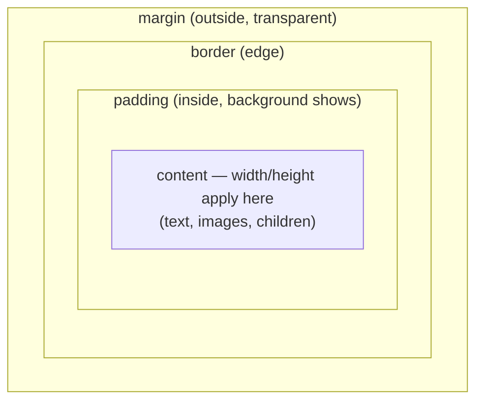

# The Box Model

## 1. Learning Objectives

After this lesson you will be able to:

- [ ] Decompose any element into content → padding → border → margin and state which of the four is inside the declared `width`
- [ ] Compute an element's total footprint by hand for both `box-sizing` modes, then verify against `offsetWidth`/`clientWidth`
- [ ] Read a computed-style probe and say which measurement answers which layout question
- [ ] Diagnose the classic symptoms — overflowing rows, doubled gaps, "my width is 18% too big" — as box-model causes
- [ ] Set a deliberate `box-sizing` policy for a codebase and justify it

## 2. Prerequisites

- [CSS Fundamentals](css-fundamentals.md) — which declaration wins before you measure what it did
- [HTML Fundamentals](html-fundamentals.md) — elements are the boxes being measured

## 3. Introduction

Every element you render is a rectangle made of four concentric layers. Almost every
"why does it overflow / why is there a double gap / why is my sidebar 40px too wide" bug is the
box model misunderstanding *once*, encountered a hundred times. This lesson makes the model
measurable: two boxes with identical CSS, opposite `box-sizing`, measured live — the numbers
below are the browser's own, and the arithmetic between them is the entire lesson.

## 4. The Problem It Solves

Early CSS said `width: 200px` means the *content* is 200px — and then `padding` and `border`
are **added on top**. So a `width: 20%` column with `padding: 16px` and a `border` is wider
than 20% of its container, two such columns overflow, and every layout built on percentages
needed arithmetic adjustments per element. The mental tax was constant and the failure mode
(overflow, wrapping) was delayed until real content arrived.

Two responses, both now standard:

- **The default (`content-box`)** — honest about content: `width` is content; padding/border/
  margin are extra. Predictable for text sizing, surprising for layout math.
- **The opt-out (`border-box`)** — `width` means *the box including padding and border*. A
  `width: 50%` sidebar with `padding` stays 50% wide. This is what every framework's reset
  does on day one (`*, ::before, ::after { box-sizing: border-box }`) — the modern default by
  convention, because layout math dominates the pain.

Neither is "correct"; they answer different questions. The executed section 6 shows *both
answers for the same declared width*, which is the fastest way to internalize the difference.

## 5. Core Concepts

### The four layers, inside out



- **Content** — where text lives; `width`/`height` target this in `content-box`.
- **Padding** — breathing room inside the border; background color paints under it (a padded
  box's `background` fills padding too — that's why padding ≠ margin visually).
- **Border** — the drawn edge, with width/style/color; *inside* the width in both modes?
  Careful: in `content-box` the border is outside the declared width; in `border-box` it's
  within it. The diagram's nesting (padding inside border inside margin) holds in both.
- **Margin** — outside the border, always transparent, **never part of any width**, and it
  *collapses* vertically between siblings (two stacked `16px` margins become 16px, not 32px —
  the other classic "double gap" surprise; collapse happens for vertical margins of in-flow
  block boxes only).

### box-sizing, precisely

| | `content-box` (default) | `border-box` (opt-in) |
|---|---|---|
| `width: 200px` means | content = 200px | content+padding+border = 200px |
| `+ padding: 20px×2 + border: 5px×2` | total box = **250px** | total box = **200px** (content shrinks to 190) |
| Layout percentages | exceed the % once padding/border added | exactly the % |
| Best for | intrinsic content sizing (text columns, images) | grid/flex layout math (columns, cards, buttons) |

`box-sizing` is inherited-and-overridable like any property; the universal-reset idiom makes
`border-box` the base and lets exceptions opt *out*.

### Measuring: which API answers which question

- **`offsetWidth`** — the **border box**: content + padding + border (what the element *occupies*
  horizontally, excluding margin).
- **`clientWidth`** — content + padding, **excluding border** (and scrollbars): the usable
  interior.
- **`getBoundingClientRect().width`** — border box in *layout pixels* (fractions preserved,
  transforms applied — the number lesson 06/9's rendering probe read).
- **`getComputedStyle(el).width`** — the **computed `width` property value**, i.e. content-box
  width under `content-box`, and content width *derived* under `border-box` (the executed
  transcript shows `200px` for both boxes' computed width property — but their content areas
  differ, which `clientWidth` exposes).

The rule for debugging: **property** (`getComputedStyle`) answers "what CSS won";
**geometry** (`offset*`, `rect`) answers "what space it takes". Confusing them is why people
conclude `border-box` "didn't work" when their computed property changed but the footprint
didn't.

### Margin collapse, and how to escape it

Vertical margins between adjacent in-flow blocks collapse to the larger single margin
(whitespace around `<p>` is one margin, not two). Collapsing **does not happen** when: the
elements are flex/grid items, there's a border/padding between them, or you create a new
block formatting context (`overflow: not visible`, `display: flow-root`, floats). Fixing a
"gap is half/double what I specified" bug means first identifying whether collapse *should*
have happened — section 9's table maps symptom to cause.

### Where the box model sits in the pipeline

Layout (lesson 06/9) computes each box's four layers from used values; paint fills them in
order (background under padding/border, content on top); margin resolves *outside* the painted
box. The measurement APIs read different stages' outputs — which is why the same element
yields three different "widths" without any of them being wrong.

## 6. How It Works

### Two boxes, identical CSS, opposite modes — executed

Source (lab page, headless Chrome 156, authoring machine):

```css
.box { width: 200px; padding: 20px; border: 5px solid #333; margin: 10px; background: #eef; }
#content-box { box-sizing: content-box; }
#border-box  { box-sizing: border-box; }
```

Measured live, element by element — full executed output:

```console
content-box:
  box-sizing = content-box
  computed width property = 200px
  clientWidth (content + padding) = 240
  offsetWidth (border box) = 250
  padding = 20px, border = 5px, margin = 10px
  rect width = 250
  offsetTop (margin pushed it down) = 10
border-box:
  box-sizing = border-box
  computed width property = 200px
  clientWidth (content + padding) = 190
  offsetWidth (border box) = 200
  padding = 20px, border = 5px, margin = 10px
  rect width = 200
  offsetTop (margin pushed it down) = 88
```

The arithmetic, line by line:

1. **Both computed `width` properties read `200px`** — the CSS was identical, so the
   *property* agrees. The trap: concluding the boxes are the same size. `box-sizing` changes
   what the property *counts*, not the value you wrote.
2. **content-box: `clientWidth 240`, `offsetWidth 250`** —
   - content (computed width) = 200
   - + padding 20×2 → 240 = `clientWidth` ✓ (content+padding, no border)
   - + border 5×2 → 250 = `offsetWidth` ✓ (border box)
   - Total footprint with margin = 250 + 10×2 = **270px** of page.
3. **border-box: `clientWidth 190`, `offsetWidth 200`** —
   - the declared 200 *is the border box*: minus border 5×2 → **padding box = 190** =
     content + padding = `clientWidth` ✓
   - content = 200 − 40 (padding) − 10 (border) = **150** — the content area shrank so the
     declaration could remain 200
   - `offsetWidth` = 200 = declared ✓
   - Footprint with margin = 200 + 20 = **220px**.
   Same CSS, same `computed width = 200px` line, **60px difference in room for text**
   (200 vs 150) — that gap is the entire content-box/border-box distinction.
4. **`offsetTop` 10 → 88** — vertical stacking, read backwards from the second box:
   `88 = 10` (its own top margin, measured from the body edge — box one's `offsetTop`) `+ 68`
   (box one's border-box *height*: an ~18px content line + 40 padding + 10 border — neither
   box declared a `height`, so content set it) `+ 10` (the two `10px` vertical margins
   **collapsed** to `max(10,10)`). The line's lesson: a box's position below depends on the
   previous box's **full footprint plus collapsed margins** — never on the declared width
   alone — which is why the smaller `border-box` footprint shifts everything after it.

**The one-sentence model:** `content-box` adds padding+border *to* the width;
`border-box` fits them *inside* it — and margin is never in either sum.

### Two consequences you can now compute

```console
# "My two 50% columns don't fit side by side"
# content-box: 50% + padding(16×2) + border(1×2) > 100% → second column wraps/overflows
# border-box:  50% + padding + border = 50% → fits exactly (both measured as their % of container)
```

```console
# "My button with width: 120px; padding: 12px; border: 2px is 148px wide"
# content-box math: 120 + 24 + 4 = 148  ✓ (or set box-sizing: border-box to keep 120)
```

Both are the executed pair's arithmetic applied to real components — compute `offsetWidth`
(`el.offsetWidth` in the console) to confirm before editing anything.

## 7. Practical Examples

**Example 1 — measure any element's full box in the console**

```javascript
const measure = el => {
  const cs = getComputedStyle(el);
  const r = el.getBoundingClientRect();
  return {
    sizing: cs.box-sizing,
    cssWidth: cs.width,                       // property (what CSS won)
    borderBox: el.offsetWidth,                // occupies (round)
    rectBox: r.width,                         // occupies (fractional, transformed)
    contentPlusPadding: el.clientWidth,       // interior
    layers: `${cs.paddingTop} pad / ${cs.borderTopWidth} border / ${cs.marginTop} margin`,
    total: r.width + parseFloat(cs.marginLeft) + parseFloat(cs.marginRight),
  };
};
measure(document.querySelector('.sidebar'));
```

- **Expected output:** an object whose `borderBox` equals `cssWidth` iff `sizing` is
  `border-box` (with zero padding/border) — the same relationship the executed transcript
  printed as `200/250` vs `200/200`.
- **How to run it:** devtools console on any page, or wire into a headless probe as this
  lesson's transcript did (headless Chrome 156, authoring machine).
- **Assumptions:** evergreen browser; the fractional `rectBox` vs rounded `offsetWidth` is
  subpixel layout, not a bug (lesson 06/9).

**Example 2 — the policy, applied to a real codebase**

```css
/* globals.css — one decision, applied everywhere; exceptions opt out deliberately */
*, *::before, *::after { box-sizing: border-box; }

/* content-box is the right exception for intrinsic things: */
.prose p, .prose h1, .prose img { box-sizing: content-box; }
```

- **Why a policy instead of per-element:** mixed modes are how 250-vs-200 bugs re-enter a
  codebase — the executed transcript *is* the bug (two identical declarations, 50px different
  footprints). The universal reset (Tailwind's preflight, Bootstrap's reboot — both ship
  exactly this line) makes `border-box` the default and reserves content-box for where content
  width is the real constraint.
- **Expected result:** `measure()` from Example 1 reports `borderBox === cssWidth` for layout
  elements site-wide; the wrapper rule above is the only place the mode changes.
- **How to run it:** apply to a page, run Example 1's probe over a few selectors.
- **Assumptions:** no legacy CSS depends on the old default (check with a screenshot diff when
  retrofitting — the *first* thing a policy change does is resize every padded box).

## 8. Real-World Applications

- **Percent/flex/grid layout only works with border-box.** Every column system assumes the
  width you asked for is the width you got: `grid-template-columns: 1fr 1fr` with gap, `width: 33%`
  cards with padding, `flex: 1` panels with borders — subject 6/7's layout lessons (flexbox,
  grid) execute assuming this mode, and mixed sizing is the #1 "my grid overflows" cause.
- **Component sizing contracts** — a button that is "44px tall" (accessibility target: touch
  size) must count its padding: `height: 44px` + `padding: 10px` in content-box is 64px, which
  breaks both the design and the 44×44 WCAG target (2.5.8, lesson 11); border-box makes the
  contract honest.
- **Email and legacy contexts** mix modes unpredictably — inline `width` on table cells in
  email clients behaves in the mode the client chooses; knowing both modes exists is how you
  read "works in Gmail, 20px off in Outlook".
- **Print stylesheets** inherit layout assumptions: a border-box column at 100% width with
  page padding overflows paper — print CSS often switches sizing or recomputes width per page.

## 9. Common Mistakes

| Mistake | Why it happens | How to recognize it | How to prevent it |
|---|---|---|---|
| Assuming `width` is the whole box | content-box default | Element wider than declared by `2×padding + 2×border` (executed: 200 → 250) | Universal `border-box` policy, or compute the sum before blaming CSS |
| Counting margin into `width` | "total size" intuition | `offsetWidth` smaller than your sum expectation | Margin is outside every box API — add it yourself (`measure().total`) |
| Fighting margin collapse | Expecting 16+16=32 | Gap is 16, not 32 (or vice-versa after layout changes) | Decide deliberately: `display: flow-root`/gap/flex context to stop it, or design for it |
| `getComputedStyle().width` vs `offsetWidth` confusion | Both called "width" | Computed says 200, element measures 250 (or 190) — "contradiction" | Property vs geometry (section 5); state which question you're asking |
| Chasing padding with negative margins | Symptom patching | Negative-margin hacks accumulate, break at breakpoints | The cause is sizing mode or a gap system — fix the model, not the offset |

## 10. Best Practices

- **Set the policy once, at the top, and write it down.** A codebase where some files assume
  `border-box` and others don't is the 250-vs-200 bug waiting; document the reset in your
  README so nobody "cleans it up".
- **Measure before you adjust.** The three-number probe (`cssWidth` / `offsetWidth` /
  `clientWidth`) tells you the mode and the layers in one call — the difference between
  editing numbers blindly and knowing which layer to change (this lesson's whole transcript is
  three numbers per box).
- **Use `gap` where the model gets fiddly.** Flex and grid `gap` is spacing *between* items
  that never collapses and never participates in box sizing — it replaces margin math for
  layout children entirely (flexbox and grid lessons use it throughout).
- **Mind the background truth:** backgrounds paint padding+border — for a "content-only"
  highlight, size an inner element or use `background-clip: content-box` rather than moving
  boxes around.

## 11. Limitations and Trade-Offs

- **Two modes is one too many.** The ecosystem keeps `content-box` as default for backwards
  compatibility; new projects pay a small tax (remembering the reset) forever. No sign of
  change — the policy line is permanent housekeeping.
- **The model is per-box; layout interactions aren't.** Overflow (`scroll` vs `visible`),
  absolutely-positioned children (whose containing block ignores margins differently), and
  transforms (rect ≠ offset — `getBoundingClientRect` includes transforms, `offsetWidth`
  doesn't) each bend the four-layer story; the executed measurements are the in-flow case.
- **Subpixel reality.** Percentage and fractional layouts produce fractional boxes (the
  transcript's `134.656px`-style values in the grid lesson); rounded `offsetWidth` vs
  fractional rects can differ by a pixel — compare like with like.
- **`box-sizing` doesn't solve spacing.** It fixes width math, not rhythm: vertical gaps still
  involve margin collapse or `gap`, and inner *percentage* children still resolve against the
  content box (padding percentages resolve against the *width* — a classic asymmetry).

## 12. Practical Exercises

### Introductory

1. **Exercise 7.1** — Recreate the executed pair in your own file and reproduce both
   measurement groups. Then predict, *before measuring*: `width: 150px; padding: 10px;
   border: 2px` in each mode → `offsetWidth`?
   **Completion criteria:** both transcripts captured; two predictions (`content-box → 174`,
   `border-box → 150`) verified by measurement; the arithmetic written out per prediction.
2. **Exercise 7.2** — Run Example 1's `measure()` on three real elements (a button, a card,
   a sidebar) on any page; report mode, the three widths, and total footprint including margin.
   **Completion criteria:** three result objects captured; for each, one sentence saying which
   number you'd use to answer "does it fit next to X?" (footprint) vs "will my text fit?"
   (content).

### Intermediate

3. **Exercise 7.3** — Reproduce both classic symptoms: (a) two `width: 50%` content-box
   columns with padding overflowing their row; (b) a paragraph whose sibling's margin appears
   "missing" (collapse). Capture `offsetWidth` sums / `offsetTop` deltas as evidence, then fix
   each (border-box; `flow-root`) and re-capture.
   **Failure to diagnose:** four captures (broken/fixed × two symptoms); the fix for each
   stated as a model fact (what the sum now equals; when collapse stops).
4. **Exercise 7.4** — Apply the Example 2 policy to a small page you own: screenshot before
   and after, and account for *every* visual difference by naming the box layer that caused it.
   **Failure to diagnose:** screenshot pair; each delta mapped to padding/border now inside the
   declared width; one sentence on why images/text wrappers typically opt out.

### Independent problem-solving

5. **Exercise 7.5** — *Problem:* a settings card design says "400px wide, 24px padding, 1px
   border, sits 32px from the sidebar, content inside must fit a 320px form control row, and
   the row beside it takes the remaining space in a 1000px panel." Specify: the sizing modes
   (and why), the exact `width` values/percentages for card and neighbour, the footprint math
   showing the row fits (`400 + 32 + neighbor = 1000`), where `gap` beats margins here, and
   what you'd measure to verify (name the API and expected numbers).
   **Completion criteria:** mode chosen per element with a one-line rationale; arithmetic that
   closes (all four layers counted once); verification plan naming `offsetWidth`/
   `getBoundingClientRect` with predicted values; one edge case (window narrower than 1000 —
   what breaks first, from this lesson's model).

*Solutions: attempt first. This subject's applied work is in [projects/](projects/README.md).*

## 13. Knowledge Check

1. `width: 200px; padding: 20px; border: 5px; margin: 10px` in `content-box`: give
   `clientWidth`, `offsetWidth`, and total footprint — then repeat for `border-box`.
2. Why do backgrounds paint under padding but never under margin — and how would you highlight
   *only* the content area?
3. Two stacked elements each declare `margin-top: 16px`. The gap is 16px, not 32px. Name the
   mechanism and two ways to get the 32px you "measured in the design".

## 14. Completion Criteria

Observable evidence that you have understood this lesson:

- [ ] You reproduced the two-mode measurement transcript and passed the predict-then-measure drill (exercise 7.1)
- [ ] You measured three real elements and answered both sizing questions per element (exercise 7.2)
- [ ] You reproduced and fixed both classic symptoms (exercise 7.3)
- [ ] You can compute any element's four layers by hand and verify with the right API
- [ ] You can diagnose all five mistakes in section 9

## 15. Summary

- Every element is content → padding → border → margin; margin is outside all width APIs and vertical margins can collapse.
- `content-box` adds padding/border to the declared width (executed: 200 → 250); `border-box` includes them (executed: 200 → 200, content shrinks to 150).
- `getComputedStyle().width` is the property; `offsetWidth`/`clientWidth`/rects are geometry — the executed pair showed identical properties, 50px-different boxes.
- The ecosystem's policy: universal `border-box`, explicit exceptions for intrinsic content.
- Layout with `gap` sidesteps margin arithmetic wherever flex/grid is in play.

## 16. Next Steps

- Next lesson: [Flexbox](flexbox.md) — arranging boxes along one axis, with executed positions
- Applied work: [projects/](projects/README.md) brief 2 (responsive navigation)
- Where it is applied: [09-FRONTEND-ENGINEERING](../09-FRONTEND-ENGINEERING/README.md) (component sizing contracts)
