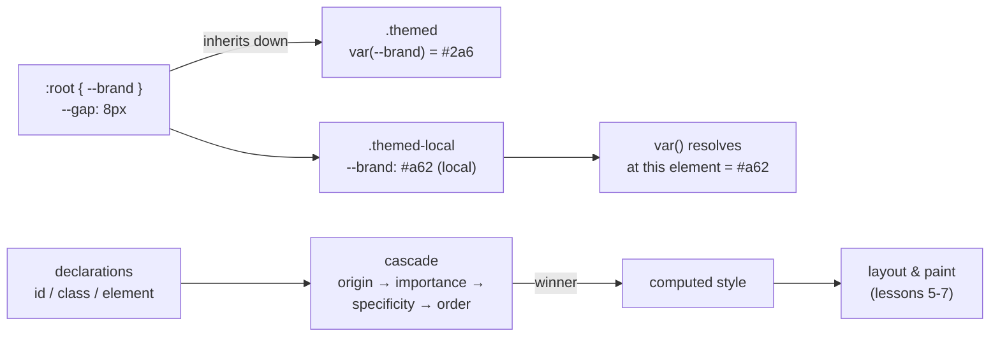

# CSS Fundamentals: Cascade, Selectors, Custom Properties

## 1. Learning Objectives

After this lesson you will be able to:

- [ ] Predict which declaration wins for any property, using the four cascade inputs in order (origin, importance, specificity, order)
- [ ] Compute specificity as `(ids, classes, elements)` and explain every step of a tie
- [ ] Choose selectors by intent — class for reusable style, attribute/pseudo for state — and avoid the specificity traps that produce `!important` arms races
- [ ] Use custom properties (`--x`, `var()`) for design values, and state how inheritance and fallbacks differ from preprocessor variables
- [ ] Read a computed-style probe and name the exact rule that produced the value

## 2. Prerequisites

- [HTML Fundamentals](html-fundamentals.md) — elements and attributes are what selectors match
- [06-INTERNET-AND-WEB-FOUNDATIONS/browsers-and-rendering.md](../06-INTERNET-AND-WEB-FOUNDATIONS/browsers-and-rendering.md) — style resolution as a pipeline stage (this is that stage, opened up)

## 3. Introduction

CSS's promise: change presentation without touching content. Its price: *somebody* decides
which of fifty matching declarations for `color` wins, and if you can't predict who, every
override becomes archaeology. This lesson is the decision procedure — origin, importance,
specificity, order — proven against a browser: every line of the executed transcript below
shows a *different branch* of the rule firing, including the two surprises (a compound class
beating an id-adjacent case, and `!important` beating an inline style).

## 4. The Problem It Solves

Content authors and style authors are different people at different times: the content team
writes HTML, a design system ships base styles, a page adds overrides, an app injects dynamic
rules, and a user applies a stylesheet for high contrast. **All of them may set `color` on the
same element.** Without an ordered decision procedure, "which color shows" would depend on
file order, load order, or luck — and every page would negotiate differently.

The cascade *is* that procedure, and its properties are what make CSS scale:

- **Modularity by layers of trust:** user styles beat author styles (accessibility override
  path); `!important` reverses that axis deliberately (so a user's important rule can pin
  contrast against a stubborn site).
- **Deterministic competition:** specificity then source order — same input, same winner, on
  every browser (spec-defined, which is why the executed numbers below are reproducible).
- **Value indirection:** custom properties give a design system a single source (`--brand`)
  that cascades like any other property — the missing piece between "one CSS file" and
  theming (section 6 executes inheritance and local override).

The failure mode this lesson prevents: treating the cascade as a mystery and reaching for
`!important` (which only *moves* the competition up one axis — until two `!important`s race
and only origin/order remain). Prediction replaces escalation.

## 5. Core Concepts

### The cascade, in order

For one property on one element, declarations compete in this exact order — first
disqualifier, last survivor:

1. **Origin & importance** — origins: user-agent (browser defaults) < user < author.
   `!important` **reverses** within each: user-`!important` > author-`!important` > author >
   user > UA. (Stylesheet order among origins is later-beats-earlier.)
2. **Specificity** — the `(a, b, c)` triple, compared lexicographically (a beats any b+c):
   - `a` — `#id` occurrences
   - `b` — `.class`, `[attr]`, `:hover`/`:nth-child(…)` pseudo-**classes**
   - `c` — element names, `::before`/`::after` pseudo-**elements**
   - `:where()` contributes **zero**; inline `style="…"` is specificity `(1,0,0,0)` — above any
     selector, below `!important`
3. **Order of appearance** — later declaration wins ties (same origin, importance,
   specificity). This is the branch that surprises people: two `.card` rules, the second wins,
   forever silent about it.

### Selectors: match by intent

- **Class (`.btn`)** — the workhorse: composable, low-specificity, style-only (keeps HTML
  semantic — lessons 1–2 stay intact).
- **ID (`#main`)** — *specific*; valid for a one-off anchor or JS hook, but as a style tool it
  starts the specificity ladder you'll later fight. Prefer `main` (element) or a class.
- **Combinators** — descendant ` `, child `>`, sibling `+`, `~`: scope rules to structure
  (`.card > img` = direct images only).
- **Attribute** — `[data-state="open"]`, `[href^="https"]`: match on real attributes (including
  `data-*`), state without classes.
- **Pseudo-classes** — `:hover`, `:focus-visible`, `:nth-child(2n)`, `:not(.x)`: state and
  position *without markup changes*. `:where()` for zero-specificity grouping, `:is()` takes
  the max of its arguments — the modern tools for keeping specificity low.
- **Pseudo-elements** — `::before`/`::after` inject generated boxes (content via CSS): useful
  for decoration that must not be in the DOM — *never* for meaningful content (it's invisible
  to selection and inconsistent for assistive tech; lesson 11).

### Inheritance

Properties that describe *text* (`color`, `font-*`, `line-height`, `letter-spacing`, `visibility`)
**inherit** from the parent when unset; box properties (`width`, `border`, `background`) do not.
That's why your `<body>` font choice reaches every paragraph — and why `border` on a parent
never leaks. Custom properties inherit **by default** (they're properties), which is what makes
them design tokens (section 6). `inherit`, `initial`, `unset`, `revert` are the explicit reset
keywords for any property.

### Custom properties

```css
:root { --brand: #2a6; --gap: 8px; --radius: 6px; }
.card  { background: var(--brand); padding: var(--gap); border-radius: var(--radius); }
.card.local { --brand: #a62; }   /* re-themes this subtree — nothing else changes */
```

- **Declared like properties, resolved at computed-value time** — which means they inherit
  down the tree and can be overridden per subtree (executed below: two divs, one inherited
  value, one local override, both from one `:root` declaration).
- **`var(--x, fallback)`** for graceful absence; `@property` adds typing/animation for
  advanced cases.
- **Contrast with preprocessors:** Sass variables are *build-time substitution* (a textual
  copy — no cascade, no runtime re-theming); custom properties are *runtime, cascading values*.
  Tokens for design systems are custom properties; loop counters are preprocessor work.

## 6. How It Works

### Every cascade branch, executed

One page, seven probes, each isolating one rule. Headless Chrome 156, authoring machine —
the full executed output:

```console
id target, #winner declared: rgb(40, 100, 170)   (rule tested: (1,0,0) id beat (0,1,0) class beat (0,0,1) element)
tie target, two .card rules: rgb(180, 140, 60)   (rule tested: (0,1,0) tie -> the LATER declaration wins)
compound target, .card.deep: rgb(100, 40, 160)   (rule tested: (0,2,0) compound beat single .card)
element-only target: rgb(170, 170, 170)   (rule tested: (0,0,1) only p applies (no .plainpara rule))
inline target vs !important: rgb(90, 90, 90)   (rule tested: !important beat inline style)
themed background via var(--brand): rgb(34, 170, 102)   (inherited custom property)
themed-local background: rgb(166, 30, 30)   (local custom property override)
--gap on :root: 8px
```

The stylesheet it was tested against:

```css
:root { --brand: #2a6; --gap: 8px; }
p          { color: rgb(170, 170, 170); }   /* (0,0,1) */
.card      { color: rgb(160, 100, 40); }    /* (0,1,0) first */
#winner    { color: rgb(40, 100, 170); }    /* (1,0,0) */
.card.deep { color: rgb(100, 40, 160); }    /* (0,2,0) */
.card      { color: rgb(180, 140, 60); }    /* (0,1,0) later */
.force     { color: rgb(90, 90, 90) !important; }
.themed      { background-color: var(--brand); }
.themed-local { --brand: rgb(166, 30, 30); background-color: var(--brand); }
```

Line by line:

1. **`#winner` → 40,100,170** — the id rule beat `.card` (0,1,0) and `p` (0,0,1): specificity
   decided before order mattered (the id rule was declared *third*, and still won — order
   never gets consulted when specificity differs).
2. **tie → 180,140,60** — two `.card` rules, both (0,1,0): **source order** awarded the win to
   the later declaration. This is the branch that silently breaks "I already set that color"
   in an earlier file.
3. **compound → 100,40,160** — `.card.deep` is (0,2,0) and beats single `.card` (0,1,0): the
   `b` counter compares *before* any tie-breaking, per component.
4. **element-only → 170,170,170** — only `p` matched (no `.plainpara` rule exists): the
   weakest selector still wins when it's the *only* claimant. Specificity ranks competition,
   it doesn't demand importance.
5. **inline target → 90,90,90** — the element's own `style="color: rgb(0,0,0)"` (effectively
   (1,0,0,0)) lost to `.force`'s `!important`: importance sits *above* specificity in the
   cascade order (step 1 beats step 2).
6. **var inheritance → rgb(34, 170, 102)** — `#2a6` = (34,170,102): the `.themed` div never
   declared a color; it read `--brand` *inherited* from `:root`.
7. **local override → rgb(166,30,30)** — the sibling set `--brand` on itself; its own
   `var()` resolved locally. One `:root` token, two computed values — the theming primitive
   (dark mode in section 8).

### Reading the winner from computed style

`getComputedStyle(el).color` **is** the cascade's verdict — you never have to guess. The probe
pattern used above (worth copying into any debugging session):

```javascript
const probe = (sel, prop = 'color') => {
  const el = document.querySelector(sel);
  return `${sel}: ${getComputedStyle(el)[prop]}`;
};
probe('#winner'); probe('.tie'); probe('.card.deep');
// → in devtools, Styles pane shows the same: crossed-out losers, winner on top,
//   with "matched" filter to see every rule that claimed the element.
```

The devtools Styles pane is this transcript made interactive: struck-through declarations are
the cascade's rejects, each with its specificity visible — the same three numbers as line 1–4.

### The value flow, diagrammed



Two edges carry the whole lesson: declarations compete *before* becoming computed style (left
branch — the five executed winners), and custom properties resolve *at the element that reads
them* (right branch — inheritance then local override).

## 7. Practical Examples

**Example 1 — predict, then verify (the exercise loop this lesson demands)**

```css
.a .b { color: red; }        /* (0,2,0) */
#c    { color: blue; }       /* (1,0,0) */
div   { color: green; }      /* (0,0,1) */
```
```html
<div id="c" class="a b">Which color?</div>
```

- **Predict before running:** `blue` — (1,0,0) beats (0,2,0): *ids outweigh any number of
  classes*. The class count of 2 doesn't matter once `a` differs.
- **Verify:** paste into a file, add `console.log(getComputedStyle(document.querySelector('#c')).color)`,
  run via `chrome --headless --dump-dom --virtual-time-budget=1000 file:///…` →
  `rgb(0, 0, 255)`.
- **Assumptions:** any browser; the id-beats-two-classes result is the one people most often
  get wrong — which is exactly why it's the first drill.

**Example 2 — a token block that themes a subtree at runtime**

```css
:root {
  --brand: #2a6;  --brand-contrast: #fff;
  --bg: #fff;     --text: #1a1a1a;
  --gap: 8px;     --radius: 6px;
}
.btn { background: var(--brand); color: var(--brand-contrast); padding: var(--gap); }

/* dark theme: same markup, different tokens — nothing else is restyled */
[data-theme="dark"] {
  --brand: #6ad;  --bg: #14181c;  --text: #e6e6e6;
}
```

- **What the important lines do:** every consumer reads `var(...)`; the dark block redefines
  *only tokens*, so buttons, cards and text follow automatically — the executed
  inherited/override pair (`rgb(34,170,102)` vs `rgb(166,30,30)`) is this mechanism in
  miniature. No `!important` needed because custom properties ride the normal cascade.
- **Expected output:** toggling `data-theme` on any ancestor re-renders its whole subtree;
  verify with `getComputedStyle(document.querySelector('.btn')).backgroundColor` before/after.
- **How to run it:** plain file in a browser; theme toggle is one attribute (subject 08 adds
  the JS to persist it).
- **Assumptions:** `var()` support is universal in evergreen browsers (caniuse: 98%+); the
  preprocessor-vs-custom-property distinction of section 5 explains when Sass is still right.

## 8. Real-World Applications

- **Design systems are specificity architecture.** Base layer (low specificity, classes),
  component layer, utility layer — modern systems (Tailwind, CSS layers via `@layer`) manage
  the *order and origin* axes explicitly; `@layer` makes the cascade's step 1 a first-class
  tool instead of file-order luck. The prediction skill transfers unchanged.
- **Theming and dark mode** are custom properties + one attribute/media condition (executed
  pattern above); OS-level preference (`prefers-color-scheme`) becomes a token swap — subject
  09 builds whole systems on it.
- **Debugging "why is this blue"** is the computed-style probe: Styles pane → crossed-out
  losers → the winner's file and specificity. Teams that can read that pane stop guessing at
  overrides (and stop adding `!important`, which the pane will show *still* losing to another
  important declaration — the arms race made visible).
- **User stylesheets & accessibility overrides** depend on the origin axis: reader-mode
  extensions and high-contrast user tools rely on `!important` reversing author dominance —
  the same executed rule (line 5), used deliberately from the user side.

## 9. Common Mistakes

| Mistake | Why it happens | How to recognize it | How to prevent it |
|---|---|---|---|
| Reaching for `!important` to win a fight | Fastest lever | Two `!important`s in one file; Styles pane shows crossed-out importants | Fix the cause: lower specificity (classes, `:where()`), raise nothing; use importance only for genuinely overriding user needs |
| Styling by id (`#nav a`) | Feels precise | Any later `.nav-item` rule can't win without matching specificity | IDs for JS/anchors; classes (or elements) for selectors |
| Assuming later files always override | Specificity outranks order | Earlier-file `#x` beats later-file `.card` | Normalize input: same specificity (utility classes), or `@layer` for explicit ordering |
| Preprocessor variables where tokens are needed | Sass habit | Theme switch requires recompile; no cascade | Custom properties for anything that must cascade/theme; Sass for computation (loops, math) |
| Pseudo-elements for real content | Convenience | Text missing from selection, copy-paste, and screen readers | Decoration only; content in HTML (lessons 1–2) |

## 10. Best Practices

- **Predict-then-verify as a habit.** Before running, write the `(a,b,c)` triple for each
  matching rule and name the winner — the drill of Example 1. If your prediction fails, *that*
  is the learning moment; the executed transcript exists to make the checks reproducible.
- **Keep specificity flat: one class per selector where possible.** `.card .title` (0,2,0) is
  fine; `#main .card .title span` (1,3,1) is a loan against future changes. Composition (many
  small classes) beats deep selectors — and `:where()`/`:is()` let you group at zero cost.
- **Tokenize anything that appears twice.** A hex value in three files is a future one-off
  edit miss; `--brand` once in `:root` is a one-line change for the whole site (and the
  prerequisite for the dark-theme swap).
- **Read the Styles pane before editing.** The crossed-out declarations tell you *who else
  claimed this element* — turning "which file?" archaeology into a one-glance fact.

## 11. Limitations and Trade-Offs

- **Specificity is not a priority system.** It ranks *selectors*, not intent — a "more
  important" rule doesn't get a higher score, it gets a more specific selector, which is why
  utility-class systems deliberately flatten it and `@layer` exists to express ordering
  outside the specificity war entirely.
- **`!important` is a nuclear option with its own physics.** It wins its axis until *another*
  important declaration from a higher origin beats it; it also disables normal debugging
  (you can't see a way down from it in the pane) and makes overrides genuinely hard — reserve
  it for third-party embeds and accessibility pinning.
- **Custom properties resolve late.** They cannot be used inside selectors or media queries
  (a `var()` in a selector position is invalid — the selector doesn't parse), and unresolvable
  `var()` without fallback invalidates the *whole property*, silently (transparent background,
  not red text) — always supply a fallback for critical values.
- **Cascade math still differs from intent-organization.** `@layer`, `:where()` and flat
  specificity are the escape hatches when files accumulate; without deliberate layering, any
  long-lived stylesheet drifts toward specificity debt regardless of local discipline.

## 12. Practical Exercises

### Introductory

1. **Exercise 7.1** — Run the executed probe's stylesheet yourself (Example 1's loop for all
   seven targets): predict each winner first (write the triples), then capture the
   `getComputedStyle` output.
   **Completion criteria:** seven predictions, seven captured values, every mismatch between
   prediction and capture explained by naming the cascade step that decided it.
2. **Exercise 7.2** — Take a stylesheet you've written, list its five most specific selectors
   as `(a,b,c)` triples, and rewrite the top two with flat classes without changing rendering
   (screenshot before/after).
   **Completion criteria:** five triples; two rewrites; identical screenshots or the deltas
   explained; one sentence on what the rewrite buys the next maintainer.

### Intermediate

3. **Exercise 7.3** — Reproduce an `!important` arms race deliberately: make a rule lose to an
   `!important`, then escalate to two importants and observe who wins (origin/order). Then fix
   the original conflict *without* importance (specificity or order) and show the Styles pane
   (screenshot or prose of crossed-out state).
   **Failure to diagnose:** three states captured (lost → escalated → resolved-natively); the
   cascade order quoted that explains each transition; the no-importance fix stated.
4. **Exercise 7.4** — Build the two-theme token block from Example 2; switch the theme
   attribute and capture computed `background-color` of one button and one body text element
   before/after — from *one* set of rules.
   **Failure to diagnose:** four captured values (2 elements × 2 themes); a one-sentence
   argument for why custom properties were required (Sass would need recompile — cite
   section 5's distinction).

### Independent problem-solving

5. **Exercise 7.5** — *Problem:* a team's CSS has a `#main .card .title span { color: … }`
   (1,3,1) rule that a later `.card-title-link { color: … }` (0,1,0) cannot override; the
   previous dev fixed three similar conflicts with `!important`. Deliver: a diagnosis of the
   conflict in cascade terms (both rules, triples, who wins and why), a migration plan to flat
   specificity that can ship incrementally (what you change first, how you verify no visual
   regression), and a team convention that prevents the pattern from returning (selector lint
   rules, review checklist — pick and justify).
   **Completion criteria:** both triples + winner + deciding cascade step; an ordered
   incremental plan with a verification command per step (computed-style probe or screenshot
   diff); one enforceable convention (named tool or rule of thumb) with the failure it catches.

*Solutions: attempt first. This subject's applied work is in [projects/](projects/README.md).*

## 13. Knowledge Check

1. For `color` on `<p id="x" class="a b">`, four declarations: `p {…}`, `.a {…}`,
   `#x {…}`, `.a.b {…}` — name the winner and the triples, then say what happens if you add
   `.a.b.c {…}`.
2. Why does a user stylesheet beat an author stylesheet even though the author declared
   `!important` — and what does that tell you about importance being an *axis reversal* rather
   than a trump card?
3. Your theme switch requires recompiling Sass. Which section-5 property of custom properties
   is missing, and what's the minimal migration?

## 14. Completion Criteria

Observable evidence that you have understood this lesson:

- [ ] You predicted and verified all seven cascade probes (exercise 7.1)
- [ ] You recomputed your own selectors' triples and flattened two (exercise 7.2)
- [ ] You reproduced the `!important` race and resolved it natively (exercise 7.3)
- [ ] You shipped a runtime theme swap from one rule set (exercise 7.4)
- [ ] You can diagnose all five mistakes in section 9

## 15. Summary

- The cascade decides in order: origin/importance → specificity → source order; the executed transcript showed one winner per branch.
- Specificity is `(ids, classes, elements)` compared lexicographically; later wins only exact ties; ids outrank any class count.
- `!important` reverses the importance axis (above specificity) — a tool for genuine overrides, not a tie-breaker of convenience.
- Custom properties inherit and resolve at the reading element: one `:root` token, per-subtree overrides — the runtime-theming primitive Sass cannot provide.
- `getComputedStyle` / the Styles pane make the verdict readable — prediction plus probe replaces guessing.

## 16. Next Steps

- Next lesson: [The Box Model](box-model.md) — from winning declarations to measured geometry
- Applied work: [projects/](projects/README.md) brief 2 (responsive navigation)
- Where it is applied: [09-FRONTEND-ENGINEERING](../09-FRONTEND-ENGINEERING/README.md) (design tokens and utility systems)
