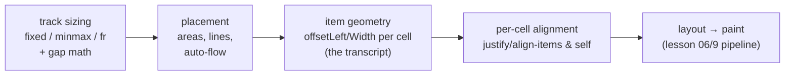

# CSS Grid

## 1. Learning Objectives

After this lesson you can:

- [ ] Declare two-dimensional layouts — tracks, gaps, placement — and predict every item's column span and position before rendering
- [ ] Read computed `grid-template-columns` and explain fractional (`fr`) distribution including subpixel results
- [ ] Choose between named `grid-template-areas`, line numbers, and `span` for each placement job — and switch between the three notations
- [ ] Diagnose the two classic grid bugs: implicit rows appearing "from nowhere" and `1fr` items overflowing (the `min-content` floor)
- [ ] State when Grid beats Flexbox (and the reverse), using the axis rule from the previous lesson

## 2. Prerequisites

- [Flexbox](flexbox.md) — the axis model, `gap`, and `min-width: auto` (all carry over)
- [The Box Model](box-model.md) — what `offsetWidth` measures for a grid item
- [CSS Fundamentals](css-fundamentals.md) — `fr` and `repeat()` live in the same cascade

## 3. Introduction

Flexbox distributes items along *one* axis; CSS Grid defines **both axes at once**: you
declare columns and rows as tracks, then place items into the resulting cells. Page-level
layout — headers spanning full width beside a sidebar and content, galleries, dashboards — is
grid's territory, and its mental model is simpler than flex's *because* placement is explicit:
you say where things go, and the grid computes the space. This lesson's evidence is a
four-item grid whose computed tracks, areas, and item positions were all captured from the
browser, including the subpixel track widths and the implicit-row placement that puzzle
everyone once.

## 4. The Problem It Solves

Two-dimensional layout was the last unsolved mainstream CSS problem. Floats and flex both
reduce to one-axis thinking, so "sidebar next to content, both under a full-width header, and
*the rows must line up across both columns*" meant nested tables (semantically wrong —
lesson 2), absolute positioning (no flow, no content sizing), or JS-measured hacks. The core
need: **a container where column sizes and row positions are decided by the container, not
inferred from item content.**

Grid's answer: declare a **track list** (columns *and* rows as sizing functions — fixed,
`fr`, `auto`, `minmax()`), then place items by **line numbers**, **areas** (named rectangles
spanning cells), or **auto-placement** (flow into the next free cell). Consequences of
container-decided structure:

- **Alignment on both axes independently** — items align within their *cell*, not within a
  flex line; `justify-items`/`align-items` default to `stretch` per cell (grid's default makes
  every cell a box model citizen).
- **Gaps are structural** — `gap` applies between tracks in *both* directions, once, without
  margins or collapse (the flex `gap` lesson, now two-axis).
- **Responsive is a template swap** — one media query changing `grid-template-columns`
  reflows the entire placement graph; items don't need to know (section 6's responsive
  sibling probe in lesson 8 uses the same lever).

The trade mirrors flex: grid is poor at *within-cell* distribution (a toolbar inside a cell is
flex's job) — the ecosystem split is page structure = grid, component internals = flex.

## 5. Core Concepts

### Tracks, lines, and cells

- **Track** — one column or row (a declared size function). **Track list** — the sequence
  (`grid-template-columns: repeat(3, 1fr)` = three equal columns).
- **Line** — the boundaries between tracks, counted from **1** (not 0): a 3-column grid has
  lines 1–4; `grid-column: 2 / 4` spans from line 2 to line 4 (two cells).
- **Cell** — the intersection an item occupies; **area** — a rectangle of cells.
- **Implicit tracks** — items placed *beyond* the declared lists create **implicit rows/columns**
  sized `auto` — the source of "my grid got taller than expected" (the executed g-span below
  lands in implicit row 3, and the transcript proves it).

### Sizing functions

| Function | Meaning | Typical use |
|---|---|---|
| `1fr` | one share of *remaining* space after fixed/`auto` tracks | equal columns |
| `auto` | content-sized (`minmax(auto, auto)`), grows with content | sidebars, wrapped rows |
| `min-content` / `max-content` | narrowest unbreakable / widest unwrapped size | intrinsic bounds |
| `minmax(min, max)` | the honest two-ended declaration | `minmax(200px, 1fr)` — never below 200 |
| `%` / `px` / `rem` | definite sizes | fixed rails |
| `repeat(n, …)` | shorthand repetition; `repeat(auto-fill, minmax(…))` = **responsive columns with no media queries** | card galleries |
| `grid-auto-rows` / `grid-auto-flow` | sizing/placement for implicit tracks | row height policy, dense packing |

**`fr` is a *share*, not a percentage:** tracks take their share of the space *left after*
fixed and content-sized tracks — so `1fr 2fr` with a `200px` middle track gives the fr tracks
`(container − 200 − gaps)/3` each, two shares to the second. And critically: **`1fr` has an
implicit `min` of `auto`** (min-content floor) — a long word can force an fr track wider than
its share (section 6's diagnosis).

### Placement, three notations (same grid)

```css
/* 1. line numbers — precise, positional, brittle to template edits */
.item { grid-column: 2 / 4; grid-row: 1; }

/* 2. named areas — readable structure; the template is the diagram */
.grid { grid-template-areas:
  "head head head"
  "side main main"; }
.head { grid-area: head; }

/* 3. span / auto — "take the next N cells"; most robust under reflow */
.spanner { grid-column: span 2; }
```

Areas **require** the matching template (an `grid-area: foo` with no `foo` in
`grid-template-areas` is an *invalid* placement → item auto-places — silent, like every
silent CSS thing). Areas are also self-documenting: the template *is* a picture of the
layout, which is why brief 1's structure and this lesson's executed page both use it.

### Alignment: per-cell on both axes

- `justify-items` / `align-items` (container) — each item within its **cell** (`stretch` default)
- `justify-self` / `align-self` (item) — the one-cell override
- `justify-content` / `align-content` (container) — the *whole track set* inside the container
  when tracks don't fill it (the grid analogue of flex's justify — different object: tracks,
  not items)

Three levels, three names — the level you're acting on is the noun (items vs tracks).

### Grid vs Flex, decided by the question

- **Both axes declared up front / items must line up across rows?** → Grid (galleries,
  dashboards, page shells, forms with aligned label-control columns).
- **One dimension, content-driven distribution / component internals?** → Flex (toolbars,
  button groups, centered stacks, media objects).
- **"How many columns at width W?" with no media query?** → `repeat(auto-fill, minmax())`
  — grid-only superpower.
Nesting flex inside grid cells is the normal composition (the ecosystem's actual pattern).

## 6. How It Works

### The executed grid

Lab page (headless Chrome 156, authoring machine): container `width: 420px`, `gap: 8px`,
`grid-template-columns: repeat(3, 1fr)`, named areas, four items (the fourth has
`grid-column: span 2`). Full executed output:

```console
grid-template-columns = 134.656px 134.672px 134.672px
grid-template-areas = "head head head" "side main main"
g-head: area=head colStart=head colEnd=head left=17 width=420
g-side: area=side colStart=side colEnd=side left=17 width=135
g-main: area=main colStart=main colEnd=main left=160 width=277
g-span: area=auto / span 2 colStart=span 2 colEnd=auto left=17 width=277
```

Decode, arithmetic first:

1. **Track widths: `134.656 / 134.672 / 134.672`** — free space for fr shares =
   `420 − 2×8 (gaps) = 404`; `404 / 3 = 134.666…`. The browser hands out fractional pixels and
   the sum is exact: `134.656 + 134.672×2 = 404.0` ✓ — the first track absorbs the rounding
   (`.0104` less) so the *last* track ends flush at the container edge. Subpixel tracks are
   normal (layout works in 1/64px); only *compare* like with like (lesson 5's rounding note).
2. **`g-head: width 420, left 17`** — `grid-area: head` spans all three cells:
   `404 (tracks) + 16 (gaps) = 420` ✓ full content width; `left 17` is the baseline from
   lesson 6 (`body 8 + margin 8 + border 1`).
3. **`g-side: width 135, left 17`** — area `side` = column 1 alone: `134.656 → offsetWidth`
   rounds to **135** ✓ (the fractional part is *there*; `offsetWidth` rounds, rects don't).
4. **`g-main: left 160, width 277`** — area `main` spans columns 2–3: start = `17 + 134.656 +
   8 = 159.656 → 160` ✓; width = `134.672×2 + 8 = 277.344 → 277` ✓. Both numbers derive from
   line 1's tracks — read computed tracks *first* and every item's geometry follows.
5. **`g-span: colStart=span 2, left=17, width=277`** — the fourth item has no area. The two
   declared rows are full (`head` took row 1; `side`+`main` took row 2), so auto-placement
   opens an **implicit row 3** and starts it at column 1: `span 2` → columns 1–2 →
   width `134.656 + 8 + 134.672 = 277.3` → **277** ✓, left back at `17` ✓.
   The `area=auto / span 2` line is the evidence: `auto` row = *implicit*, unnamed — the
   "row from nowhere" bug, captured in one line. (Its height comes from `grid-auto-rows: auto`
   → content-sized: the 40px cell.)

The template, as the browser reads it (line numbers drawn for the placement discussion):

```
        line 1        2         3         4
        ┌───────────────────────────────┐ ─┬─
row 1   │           g-head              │  │ areas: head spans 3
        ├────────────┬──────────────────┤  │
row 2   │  g-side    │     g-main       │  │ side | main main
        ├────────────┼──────────────────┤  │
row 3   │      g-span (span 2)          │  │ implicit row (auto)
        └────────────┴──────────────────┘ ─┴─
        col 1 = 134.656px, cols 2-3 = 134.672px each, gap 8px
```

### The `1fr` floor, diagnosed

Hand-trace (illustrative computation — verify with the probe): `grid-template-columns: 1fr 1fr`
in a 600px container, first cell contains `a-very-long-unbroken-url-like-token…` whose
min-content width is 320px:

1. Fr math predicts `296 | 296` (each `(600−8)/2`)
2. But `1fr` = `minmax(auto, 1fr)`: track 1's min floor = its content's min-content = **320**
3. Browser: track 1 = 320, track 2 gets the rest = `600 − 8 − 320 = 272` — **asymmetric, and
   the container may overflow if floors exceed it**
4. Fix: `minmax(0, 1fr)` (floor zero) or `min-width: 0` on the offender + `overflow-wrap:
   anywhere` — same medicine as flex's `min-width: auto`, now declared on the *track*

That trace is the entire "my equal columns aren't equal" bug class.

### Where grid sits in the pipeline



Track sizing runs **before** placement (sizes determine where lines land; placement then
assigns items; alignment positions within cells). The executed output reads in exactly that
order — line 1 (tracks) explains lines 3–5 (items); nothing about items fed back into sizes
because areas and spans don't size tracks (`auto` rows did, by content).

## 7. Practical Examples

**Example 1 — the grid probe (predict → measure)**

```javascript
const gridProbe = sel => {
  const g = document.querySelector(sel);
  const cs = getComputedStyle(g);
  const out = [
    'grid-template-columns = ' + cs.gridTemplateColumns,
    'grid-template-areas = ' + cs.gridTemplateAreas.split('\n').join(' ').replace(/ +/g, ' '),
  ];
  for (const cell of g.children) {
    const c = getComputedStyle(cell);
    out.push(`${cell.id}: area=${c.gridArea} colStart=${c.gridColumnStart} colEnd=${c.gridColumnEnd}` +
             ` left=${cell.offsetLeft} width=${cell.offsetWidth}`);
  }
  return out.join('\n');
};
gridProbe('#grid');
```

- **Expected output:** the executed transcript (tracks may differ by your container width —
  recompute `free = width − gaps; free/3` to check).
- **How to run it:** any page's console or a headless `--dump-dom` probe (Chrome 156,
  authoring machine).
- **Assumptions:** lesson 5's box model for the `17`/rounding baselines.

**Example 2 — a responsive gallery with no media queries**

```css
.gallery {
  display: grid;
  gap: 16px;
  grid-template-columns: repeat(auto-fill, minmax(240px, 1fr));
}
```

- **What the important lines do:** `auto-fill` lays down as many 240px-min tracks as fit
  (creating empty ones when few items), `minmax(240px, 1fr)` lets each track grow to share
  leftovers — one column on a phone, five on a desktop, **no breakpoint written**; items
  re-flow as tracks appear/disappear.
- **Expected output:** at container 500px → `repeat(auto-fill, minmax(240px,1fr))` computes
  **2 tracks** (2×240 + 16 = 496 ≤ 500; 3 would need 736); at 768 → 3. Verify with
  `getComputedStyle(g).gridTemplateColumns` (the probe's line 1) at each width — or with the
  lesson 8 responsive harness (`--window-size` sweeps).
- **How to run it:** page + probe; resize or re-run headless at `--window-size=500,800` /
  `768,800` (authoring machine captured exactly this way for lesson 8).
- **Assumptions:** evergreen support for `auto-fill`/`minmax` (universal since 2017-era).

## 8. Real-World Applications

- **Page shells** are grid's home: `grid-template-areas` for header/sidebar/main/footer with
  named regions — the executed page is the minimal form; real shells add a media query
  collapsing `side` out of the row (areas redeclared per breakpoint — one structural change,
  all items follow).
- **Dashboards and card galleries** use `auto-fill`+`minmax` (Example 2) — zero-JS responsive
  columns that keep cards uniform; `aspect-ratio` on cells fixes card heights (a grid-era
  property built exactly for this pairing).
- **Form layout** — label/control columns with `grid-template-columns: minmax(0,1fr) 2fr`,
  rows aligning across fields without float hacks; also the `align-items: baseline` rows
  (lesson 6's tool) at cell level.
- **Design systems ship grid recipes** (subject 09): a 12-column `repeat(12, 1fr)` master grid
  with items spanning N columns — the responsive-editorial pattern (span changes per
  breakpoint) — same line/span notation as the executed `span 2`.

## 9. Common Mistakes

| Mistake | Why it happens | How to recognize it | How to prevent it |
|---|---|---|---|
| `grid-area: name` with no matching template area | Areas and template edited separately | Item silently auto-places (the executed `g-span` behaviour — `area=auto`) | The template *is* the contract: add the area name to `grid-template-areas` in the same change; check `getComputedStyle().gridArea` |
| Unexplained extra rows/taller container | Items past the template create implicit tracks | `gridAutoRows` not set; last item lower than expected | Set `grid-auto-rows` explicitly, or extend the template; know auto-placement opens rows (row 3 above) |
| `1fr` columns overflowing with long content | `1fr`'s implicit `min: auto` floor | Unequal "equal" columns; measured tracks ≠ computed shares | `minmax(0, 1fr)` on content tracks; `overflow-wrap` for the content |
| Grid inside grid inside grid for a toolbar | Applying the page tool at component scale | Deep wrappers; free-space distribution fights content | Cells hold *flex* toolbars (section 5's boundary); grid for structure |
| Expecting `gap` to collapse or take edge space | Margin-era instincts | Gap looks "missing" at container edges | `gap` is interior-only and literal — edges belong to container padding/margin |

## 10. Best Practices

- **Draw the template first.** Write the areas string (or the line map like section 6's) *before*
  any item rule — the template's ASCII shape is the spec, and reviews of an areas block catch
  placement bugs no stylesheet diff shows.
- **Declare floors on fluid tracks:** `minmax(0, 1fr)` is the default you should *earn the
  removal of* — measure first: if content can't overflow (short, wrapping text), plain `1fr`
  is fine; otherwise the floor bites (the hand-trace).
- **Probe computed tracks after every template change.** `gridTemplateColumns` (probe line 1)
  is the ground truth for "did my 2-col mobile layout become 1-col" — one property, exact
  fractional widths, no screenshot needed.
- **Name areas for anything that moves at breakpoints.** Media queries that redeclare
  `grid-template-areas` (and only that) relocate every child at once — far less error-prone
  than re-placing ten items by line numbers per breakpoint.
- **Keep implicit sizing explicit:** set `grid-auto-rows` (e.g. `minmax(80px, auto)`) so
  surprise content can't unbalance the row rhythm — implicit ≠ unmanaged.

## 11. Limitations and Trade-Offs

- **Placement-by-line is brittle.** Inserting a track shifts every line number; areas and
  spans survive because they're relational — that's the notation hierarchy's real reason, not
  aesthetics.
- **Subpixel distribution is inherent.** Fractional tracks (`.656/.672`) mean *sums* are exact
  but individual `offsetWidth`s round; comparing a computed track to an `offsetWidth` will
  look "off by one" — compare rects to computed values (lesson 5's property-vs-geometry rule).
- **Intrinsic sizing still governs `auto`.** Content-driven tracks make layout *content-
  dependent* — surprising text (a long URL, a translated label) changes geometry; if the
  design is fixed-size, declare fixed/minmax floors rather than trusting content.
- **Browser support is excellent but `auto-*` semantics are subtle.** `auto-fill` vs
  `auto-fit` (fit collapses *empty* tracks — different with few items), `dense` flow
  back-packing items (visual order ≠ DOM order — an **accessibility hazard**: lesson 11's
  reading-order rule; avoid `dense` for anything with a reading order).

## 12. Practical Exercises

### Introductory

1. **Exercise 7.1** — Recreate the executed grid. Predict: track widths (`404/3` math), all
   four items' widths/lefts, and *which row* the span item lands in — then run the probe.
   **Completion criteria:** track prediction vs `134.656/134.672/134.672` (your container's
   equivalent) with the rounding explained; four predicted pairs vs measured; implicit row 3
   predicted *before* seeing `area=auto / span 2`.
2. **Exercise 7.2** — Build the same layout three ways: areas, line numbers, spans. Measure
   all three (identical geometry expected), then insert a new column into the template and
   re-measure — which notation survived untouched?
   **Completion criteria:** three transcripts with equal values; the post-edit transcripts;
   one sentence choosing the survivor (and why — section 9 row 1).

### Intermediate

3. **Exercise 7.3** — Reproduce the `1fr` floor: `1fr 1fr` with an unbreakable 320px token in
   a 600px container. Capture computed tracks (asymmetric!), then apply `minmax(0, 1fr)` and
   capture again (symmetric `296/296`). Hand-trace both before measuring.
   **Failure to diagnose:** hand-trace + two transcripts; the implicit `min: auto` named as
   the cause; the content-side fix (`overflow-wrap`) stated as the alternative that doesn't
   shrink tracks.
4. **Exercise 7.4** — Build Example 2's gallery; at three container widths capture
   `gridTemplateColumns` and count tracks vs the `auto-fill` prediction
   (floor math: `n×240 + (n−1)×16 ≤ width`).
   **Failure to diagnose:** three transcripts with track counts; the inequality shown per
   width; one sentence on `auto-fill` vs `auto-fit` observed by removing all but one item
   (measure — empty tracks persist vs collapse).

### Independent problem-solving

5. **Exercise 7.5** — *Problem:* design a documentation page layout: full-width header; a
   240px sidebar (collapses to a top bar under 768px); main column capped at 720px readable
   measure *inside* a wider content area with a right-hand "on this page" rail (160px,
   hidden under 1024px); 24px rhythm; and a related-articles card row (responsive columns,
   no breakpoints) below the main content. Deliver: the areas template(s) per breakpoint,
   the track declarations with floors justified, per-item placement notation, the card-row
   `auto-fill` math for 360/768/1440, what goes in flex *inside* cells, and the probe values
   you'd verify at each breakpoint (name properties and expected numbers).
   **Completion criteria:** one template per breakpoint with area changes noted; every track
   has a floor decision (`minmax` where content flows); `auto-fill` inequality solved for all
   three widths; flex-within-cell named for the header/rail toolbars; verification list with
   concrete computed properties (`gridTemplateColumns`, `gridTemplateAreas`) and predicted
   counts; one stated risk (e.g. rail content reflow at 1024 boundary) with mitigation.

*Solutions: attempt first. This subject's applied work is in [projects/](projects/README.md).*

## 13. Knowledge Check

1. Given `grid-template-columns: 200px 1fr 2fr` with `gap: 12px` in a 760px container: compute
   every track (fr share math), then state what the container does if track 2's content has
   min-content 260px.
2. The executed `g-span` shows `colStart=span 2` and an implicit row — explain where row 3
   came from, how its height was decided, and how you'd stop the container growing for
   unexpected content.
3. Name the two layout questions you'd ask to choose grid vs flex, and give one component and
   one page example for each answer.

## 14. Completion Criteria

Observable evidence that you have understood this lesson:

- [ ] You reproduced the executed grid with predicted tracks and placements (exercise 7.1)
- [ ] You built one layout three notations and watched a template edit's blast radius (exercise 7.2)
- [ ] You reproduced the `1fr` floor bug and both fixes (exercise 7.3)
- [ ] You solved `auto-fill` column counts by inequality at three widths (exercise 7.4)
- [ ] You can diagnose all five mistakes in section 9

## 15. Summary

- Grid declares both axes as tracks; placement is areas, lines, or spans; items land in cells with per-cell alignment on both axes.
- The executed transcript is pure arithmetic: `404/3` fr shares with exact-sum subpixel rounding, `span 2` width `277`, and an implicit row 3 from auto-placement (`area=auto / span 2`).
- `fr` shares leftovers *after* fixed tracks, but carries an implicit `min: auto` floor — `minmax(0, 1fr)` is the deliberate un-flooring.
- Areas are a contract with `grid-template-areas`; missing names silently auto-place — one of the two classic grid bugs, captured.
- Page structure in grid, component internals in flex; `repeat(auto-fill, minmax())` gives breakpoint-free responsive columns.

## 16. Next Steps

- Next lesson: [Responsive Design](responsive-design.md) — the breakpoints and fluid units that move these layouts between widths
- Applied work: [projects/](projects/README.md) brief 2 (responsive navigation)
- Where it is applied: [09-FRONTEND-ENGINEERING](../09-FRONTEND-ENGINEERING/README.md) (page shells and design-system grids)
