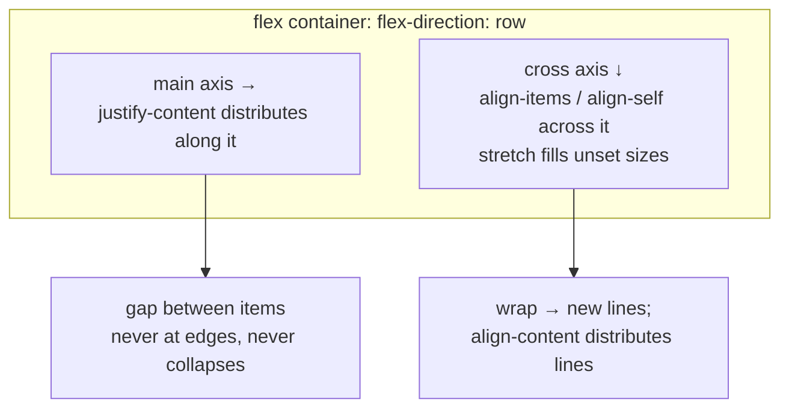

# Flexbox

## 1. Learning Objectives

After this lesson you will be able to:

- [ ] State the flex model — main/cross axis, container vs items — and name what `flex-direction` decides
- [ ] Predict item positions for any `justify-content` / `align-items` combination **before** running it, then verify with `offsetLeft`/`offsetTop`
- [ ] Explain wrapping: when a line breaks, what `gap` costs per line, and how `flex-wrap` changes cross-axis behavior
- [ ] Diagnose why a flex child ignored `height` (stretch), shrank unexpectedly (`flex-shrink`), or refused to shrink (`min-width: auto`)
- [ ] Choose between "margin vs `justify-content` vs `gap`" for spacing, with the failure each causes

## 2. Prerequisites

- [The Box Model](box-model.md) — what `offsetLeft`/`offsetTop` measure, and margin collapse (flex containers never collapse margins)
- [CSS Fundamentals](css-fundamentals.md) — the cascade that selected your flex rules

## 3. Introduction

Flexbox is one-dimensional layout: you declare *how a row (or column) distributes its items*
and the browser computes positions — no floats, no negative margins, no pixel math. The
reputation of flexbox as "weird" comes from one source: people reason about it as a box
alignment problem instead of an **axis** problem. This lesson fixes the axis model first, then
proves every rule with measured positions: five containers, fifteen items, all coordinates
captured from a real browser.

## 4. The Problem It Solves

Before flexbox, horizontal layout was fought with `float: left` (which needs `clear`,
breaks document flow, and needs a clearfix hack per container), `inline-block` (whitespace
nodes create gaps you can't explain), and absolute positioning (removes elements from flow —
no wrapping, no content-driven sizing). Every pattern had two bugs: **spacing** (how do I put
*exactly* 8px between items and equal space at the ends?) and **alignment** (center this child
vertically against a container of unknown height — the single most-asked CSS question ever).

Flexbox answers both as first-class properties: `gap` (spacing *between*, no collapse, no
edge gaps), `justify-content` (main-axis distribution including free space), `align-items`
(cross-axis, including `stretch` so children *fill* unknown heights automatically), and
`align-self` for the one child that differs. The trade: flexbox knows *one axis*. When you
need rows **and** columns controlled together — a dashboard, a gallery grid — you reach for
CSS Grid (lesson 7) instead of nesting flex containers into a lattice.

## 5. Core Concepts

### The axis model

A flex container has exactly **one main axis** and **one cross axis**, perpendicular:

- `flex-direction: row` (default) — main axis = horizontal LTR, cross = vertical
- `flex-direction: column` — axes swap: `justify-content` now distributes *vertically*,
  `align-items` horizontally
- `row-reverse` / `column-reverse` — same axis, opposite direction

Everything below follows from this one decision: **`justify-*` is always main-axis,
`align-*` is always cross-axis** — not "horizontal"/"vertical". A column container with
`justify-content: center` centers children *vertically*. Memorizing properties without the
axis is why flexbox "surprises" people.

### Container properties

- **`justify-content`** — main-axis distribution of items *and* free space:
  `flex-start` (default), `center`, `flex-end`, `space-between` (free space split *between*
  items — flush edges), `space-around` (half-space at edges, full between), `space-evenly`
  (identical gaps everywhere).
- **`align-items`** — cross-axis per item: `stretch` (default), `flex-start`, `center`,
  `flex-end`, `baseline` (text baselines aligned — typography's friend).
- **`gap`** — space *between* items only (never before first/after last, never collapses,
  never needs margin hacks on children). `row-gap`/`column-gap` differ once wrapping exists.
- **`flex-wrap`** — `nowrap` (default: items on one line, shrinking if needed) vs `wrap`
  (lines break when items exceed the container; multi-line containers also get
  `align-content` for distributing the *lines*).
- **`align-self`** — one item's cross-axis override.

### Item properties: the `flex` shorthand

`flex: <grow> <shrink> <basis>` describes an item's life in free-space negotiations:

- **`flex-basis`** — the starting size along the main axis (`auto` → the `width`/`height`
  property, else content)
- **`flex-grow`** — share of *leftover* space (0 = don't grow; items with `1 1 auto` split
  surplus equally, proportionally to grow values)
- **`flex-shrink`** — share of *deficit* space (items scale down proportionally to
  `shrink × basis`) — **shrink is why "my 300px child collapsed" happens**: default
  `flex: 0 1 auto` shrinks, and `min-width: auto` (the other default) then *floors* an item
  at its content size — the "refuses to shrink" half of the same story (largest unbreakable
  word / intrinsic content sets the floor; `min-width: 0` releases it — the classic fix for
  overflowing text/grid children).

Common recipes: `flex: 1` = `1 1 0%` (equal-width growable columns — the workhorse);
`flex: 0 0 200px` (fixed sidebar); `flex: 0 1 auto` (default: content-sized, shrinkable).

### Spacing: three tools, three jobs

| Tool | Puts space… | Collapses? | Use for |
|---|---|---|---|
| `gap` | between items | never | item rhythm inside any flex/grid container |
| `justify-content` | from *free space* distribution | n/a | centering; edge-flush distribution (`space-between`) |
| `margin` | outside an item (incl. its auto margins) | never in flex | pushing *one* item; `margin-inline-start: auto` pins one child to the end |

Mixing them (gap + per-item margins + justify) produces the "double space I didn't write" —
pick per section 9.

## 6. How It Works

### Five containers, fifteen measurements — executed

Lab page (headless Chrome 156, authoring machine): all containers `width: 400px` (200px for
the wrap case), `gap: 8px`, border `1px`, items `width: 60px; height: 30px`. Full executed
output:

```console
fsb: display=flex justify=space-between align=normal wrap=nowrap
  A: left=17 top=9 w=60 h=30
  B: left=187 top=9 w=60 h=30
  C: left=357 top=9 w=60 h=30
fsc: display=flex justify=center align=normal wrap=nowrap
  A: left=119 top=49 w=60 h=30
  B: left=187 top=49 w=60 h=30
  C: left=255 top=49 w=60 h=30
fsw: display=flex justify=normal align=normal wrap=wrap
  A: left=17 top=89 w=60 h=30
  B: left=85 top=89 w=60 h=30
  C: left=153 top=89 w=60 h=30
  D: left=17 top=127 w=60 h=30
fas: display=flex justify=normal align=flex-start wrap=nowrap
  A: left=17 top=167 w=60 h=30
  B: left=85 top=167 w=60 h=30
fst: display=flex justify=normal align=stretch wrap=nowrap
  A: left=17 top=207 w=60 h=60
  B: left=85 top=207 w=60 h=60
```

Decode each container (offsets are from the page's body edge; body margin 8, container margin
8, border 1 — the `17` that starts every row is `8 + 8 + 1`):

**`fsb` — `space-between`, content width 400:**
items total `3×60 = 180`; `gap` puts 8 between pairs; free space `400 − 180 − 2×8 = 204`
is split **between** the two gaps: `8 + 102 = 110` per gap.
`A 17` → `B 17+60+110 = 187` ✓ → `C 187+60+110 = 357` ✓, and `C`'s right edge `417` =
container content edge (flush — the *definition* of space-between: no edge space, all
interior).

**`fsc` — `center`:** same 196px of content (`180 + 2×8`), free `400 − 196 = 204` split as
`102` on each side: `A 17+102 = 119` ✓, `B 119+68 = 187` ✓, `C 255` ✓ — note `B` lands at
187 in *both* containers by coincidence of the math (center packs, between spreads).

**`fsw` — `wrap` at width 200:** content 200; `A,B,C` at `17, 85, 153` (gaps of 8:
`17+60+8=85` ✓) — `C` ends at `213`, and `D` would need `221 > 217` (content edge) → **new
line**: `top = 89 + 30 (row) + 8 (row-gap) = 127` ✓. The line break is size-driven, not
content-driven — shrink would have kept `D` on line 1 (`nowrap`), but `wrap` made room instead.

**`fas` — `align-items: flex-start`:** both items keep their declared `h=30` at the line's top
(`top=167`) — the cross axis does nothing but park items at the start.

**`fst` — `align-items: stretch`:** with **no cross size declared** (this version of the page
removed `height` from these two items), each stretches to the line's cross size: `h=60`
(the container's content height — set by its own `height: 60px`), both at `top=207`.
This pair encodes a trap worth naming: **an explicit `height` blocks stretch** — the first
version of this very probe declared `height: 30px` on all items and stretch silently measured
`h=30`. Stretch only fills sizes you *didn't* specify.

**Vertical stacking across containers:** `top` runs `9 → 49 → 89 → 167 → 207`. Each next
container starts at previous `previous container's border-box end + max(margins) = +8` —
flex containers' margins **never collapse** (box-model §collapse: no collapsing in flex
formatting contexts), so the gaps are literal and predictable: `9 + 32 = 41, +8 = 49` ✓;
`49 + 32 = 81, +8 = 89` ✓; the 2-row wrap container is `68+2 = 70` tall → `89+... = 167` ✓
(rows 30 + 8 + 30 + borders).

### The axis rule, drawn



Every property above is a *direction*, not a coordinate: swapping `flex-direction: column`
swaps which of justify/align answers "center it vertically" — the diagram is the whole mental
model; the transcript is its arithmetic.

### The shrink question, hand-traced

Three items `flex: 1 1 auto` with `widths 300, 200, 100` in a 500px container (illustrative
hand-trace — verify with the probe pattern):

1. basis total 600, deficit 100
2. shrink ∝ basis: shares `100 × (300/600, 200/600, 100/600)` = `50, 33.3, 16.7`
3. final `250, 166.7, 83.3` — proportions preserved
4. **floor check:** any item whose *content* (longest word) exceeds its result stops shrinking
   (`min-width: auto`) — the container then overflows instead; `min-width: 0` on the item
   re-enables shrinking below content size.

That four-step trace answers both classic bugs ("they didn't shrink evenly" — step 2; "one
won't shrink at all" — step 4) without opening devtools first.

## 7. Practical Examples

**Example 1 — the predict-then-measure probe (this lesson's engine)**

```javascript
const flexProbe = containerSel => {
  const c = document.querySelector(containerSel);
  const cs = getComputedStyle(c);
  return [
    `${c.id}: justify=${cs.justifyContent} align=${cs.alignItems} wrap=${cs.flexWrap}`,
    ...[...c.children].map(el =>
      `  ${el.textContent.trim()}: left=${el.offsetLeft} top=${el.offsetTop} w=${el.offsetWidth} h=${el.offsetHeight}`),
  ].join('\n');
};
['#fsb', '#fsc', '#fsw', '#fas', '#fst'].map(flexProbe).join('\n');
```

- **Expected output:** exactly the executed transcript (positions may shift by your body/margin
  context — the *deltas* are the invariant: `space-between` gap = `(free − 0)/pairs`,
  `center` side = `free/2`, wrap `top` delta = `row + row-gap`).
- **How to run it:** any page's console, or wire into a headless `--dump-dom` probe as the
  authoring run did (Chrome 156).
- **Assumptions:** standard box model per lesson 5 (`offsetLeft` includes border offsets as
  seen in the `17` baseline).

**Example 2 — the three layouts every app needs**

```css
/* 1. centered stack: axis does the work (no transforms, no margins) */
.centered   { display: flex; flex-direction: column; justify-content: center; align-items: center; min-height: 100dvh; }

/* 2. sidebar + fluid content, sidebar never collapses below 240, content text can shrink */
.page       { display: flex; gap: 16px; }
.sidebar    { flex: 0 0 240px; }          /* fixed basis, no grow/shrink */
.content    { flex: 1 1 auto; min-width: 0; }  /* grow to fill; min-width releases the text floor */

/* 3. toolbar: most items left, last pinned right — auto margin beats a wrapper */
.toolbar    { display: flex; gap: 8px; align-items: center; }
.toolbar .push-end { margin-inline-start: auto; }
```

- **What the important lines do:** (1) `column` makes justify vertical — the axis rule;
  (2) `flex: 0 0 240px` = the executed-style hand-trace with grow 0 (sidebar holds) while
  `min-width: 0` preempts step 4's floor bug; (3) `margin-inline-start: auto` on one child
  absorbs *all* free space — distribution without `space-between`'s edge behavior.
- **Expected output:** `measure()` (lesson 5) on `.sidebar` shows `offsetWidth = 240`;
  resizing narrower collapses `.content` (min-width: 0) instead of overflowing.
- **How to run it:** drop into any page; verify with the Example 1 probe and window resizing.
- **Assumptions:** evergreen browsers; `dvh` for mobile browser chrome (subject 8's
  responsive lesson returns to viewport units).

## 8. Real-World Applications

- **Navigation bars and toolbars** are the `fsb` transcript in production: logo left, links
  right (`space-between`), `gap` instead of item margins, `align-items: center` for vertical
  rhythm regardless of label height — brief 2 in [projects/](projects/README.md) builds exactly
  this, responsive (the nav stacks at mobile via lesson 8's media query, same flex axis flipped
  to `column` — the executed responsive probe showed `nav flex-direction = column/row` flips).
- **Card rows and media objects** use `flex` with `min-width: 0` children (the step-4 fix) so
  long titles ellipsize instead of blowing out rows — the most common production flex bug
  filed and fixed in one line.
- **Centering** — the historic meme ("how to center a div") is one line now, and the executed
  `fsc` positions (`102px` free each side) are its arithmetic proof.
- **Component internals**: buttons (`icon + label + gap`, `align-items: baseline`), modals
  (`column` with header/body/footer, body `overflow: auto` + `flex: 1`), list rows
  (`space-between` name/action) — flex is the *within-component* tool; grid is the *page* tool
  (next lesson draws that boundary explicitly).

## 9. Common Mistakes

| Mistake | Why it happens | How to recognize it | How to prevent it |
|---|---|---|---|
| Reasoning "horizontal = justify" | Property names sound directional | `justify-content: center` doesn't center vertically in a `row` container | Axis rule: justify = main (whichever direction `flex-direction` set); flip direction when the axis you want isn't the one you have |
| Child's `height` ignored | `align-items: stretch` fills unset sizes — and *any* cross size blocks it | Item measures `h=60` (or stays `h=30`) vs declared 45 | Decide explicitly: `align-self: center/start` for fixed, omit cross size for fill — and remember stretch was the silent third party (the probe's first run) |
| Overflow in a flex/grid child | `min-width: auto` floor prevents shrinking below content | Container overflows; child `offsetWidth` > assigned | `min-width: 0` (`min-height: 0` in columns) on text children |
| `gap` + item margins + `justify` combined | Layered fixes from three tutorials | Space you can't find in any single rule | One spacing system per container: `gap` for rhythm, `justify`/auto-margin for distribution, margins only for the outside |
| Nesting flex to fake a grid | flex is one axis | Two-level wrappers everywhere; row *and* column gaps can't share | Use CSS Grid when both axes matter (lesson 7) — nesting flex is a signal, not a technique |

## 10. Best Practices

- **Predict, then measure — always, at first.** Write the expected `left`/`top` arithmetic
  (section 6 shows every formula), run the probe, and explain any delta. The delta *is* the
  lesson; the executed transcript exists so you can check your predictions against known-good
  numbers.
- **Default to `gap` and one distribution property.** Items carry no margins in a flex
  container (except deliberate auto-margin pins) — the container owns spacing, which keeps
  components copy-paste safe in any parent.
- **Set `min-width: 0` (columns: `min-height: 0`) as reflex on fluid children** the moment
  they contain text, images, or nested scroll — cheaper than the bug report.
- **Prefer baseline alignment for text rows** (`align-items: baseline`): equal-height boxes
  with mixed font sizes look aligned but read misaligned; baselines are what eyes track.
- **Name the axis out loud when reviewing CSS** ("main axis is vertical here") — most
  flex diffs in code review are two people assuming different directions.

## 11. Limitations and Trade-Offs

- **One axis only.** Rows *and* columns simultaneously means nesting or grid; `gap` doesn't
  coordinate across levels. Grid (lesson 7) owns two-dimensional work — knowing the boundary
  is the maturity marker.
- **Distribution is per-line, per-container.** `space-between` on a wrapped container's last
  line leaves the short last line flush-left (all free space went "between" zero trailing
  pairs) — a real pattern people expect `space-around` logic to fix; multi-line needs
  `align-content`/`justify-content` thought per axis.
- **Intrinsic sizing is genuinely complex.** `auto` basis, content floors (`min-width: auto`),
  percentage-vs-flex resolution — the spec's algorithm has corners where "reasonable" browsers
  historically diverged (flex-in-flex, intrinsic min sizing); test the weird content case, not
  only the lorem ipsum.
- **Free-space math depends on `box-sizing`.** The executed arithmetic assumed content-box
  widths + borders (the `17` baseline); in a `border-box` codebase the same trace uses border
  widths directly — lesson 5's policy changes the constants, never the distribution rules.

## 12. Practical Exercises

### Introductory

1. **Exercise 7.1** — Reproduce the five-container lab. For each container, predict all
   fifteen `left`/`top` values from the section-6 formulas *before* running the probe.
   **Completion criteria:** fifteen predictions, fifteen measured values; every mismatch
   derived to a formula term (free space, gap, margin, border); the `17` baseline explained
   once.
2. **Exercise 7.2** — Achieve "three items, equal space between, flush edges" two ways
   (`space-between` vs equal `flex: 1` items) and "center one item in unknown-height
   container" two ways (container justify vs item auto margins). Measure all four.
   **Completion criteria:** four transcripts; one sentence each on when the second way is
   preferable (fixed-content children; single pinned item).

### Intermediate

3. **Exercise 7.3** — Reproduce the two shrink bugs: (a) a child with a long unbreakable word
   overflowing its flex parent; (b) after `min-width: 0`, the same row fitting with ellipsis.
   Capture `offsetWidth`s for both states. Then hand-trace the section-6 four-step shrink
   calculation for a 300/200/100 trio in a 500px container and verify with measurement.
   **Failure to diagnose:** two captures (overflow/fit) + the hand-trace + measured final
   widths (`250, 166.7, 83.3` ± rounding); the `min-width: auto` floor named as cause (a).
4. **Exercise 7.4** — The stretch trap: declare `height` on a stretch item, measure, remove
   it, measure — reproducing the probe's own first-run finding. Then center *one* item in that
   container with `align-self` while the rest stretch.
   **Failure to diagnose:** three states captured (`h=30` despite align stretch → `h=60`
   without → mixed heights with `align-self: center` at its measured top); one sentence on
   which cross-size decision the browser makes per item.

### Independent problem-solving

5. **Exercise 7.5** — *Problem:* design the flex architecture for a settings page: fixed
   240px section nav (horizontally scrollable link row on mobile), a 640px-max form column
   that shrinks on small screens, a sticky footer bar with left-aligned Cancel and
   right-aligned Save, and 16px rhythm everywhere — using only flexbox (no grid). For each
   region: container properties, item `flex` values, spacing choice (justify/gap/margin — one
   system each), and the axis. Specify what you'd measure to verify (probe values per region)
   and identify which requirement you'd hand to Grid instead if allowed, with the reason.
   **Completion criteria:** per-region property sets; every spacing value assigned to exactly
   one mechanism; verification list with predicted numbers for at least three; the
   grid-vs-flex boundary stated per lesson 11's limitation.

*Solutions: attempt first. This subject's applied work is in [projects/](projects/README.md).*

## 13. Knowledge Check

1. `flex-direction: column; justify-content: center` — where are items centered, horizontally
   or vertically? State the rule that makes your answer automatic.
2. Explain, from the executed transcript, how `B: left=187` arises in *both* `fsb` (space-between)
   and `fsc` (center) — same number, different mechanisms.
3. A flex row overflows its container when a card title contains a long URL. Name the two CSS
   defaults that combine to cause it and the one-line fix per cause.

## 14. Completion Criteria

Observable evidence that you have understood this lesson:

- [ ] You reproduced the five-container probe with fifteen predicted-then-measured positions (exercise 7.1)
- [ ] You achieved each target layout two ways and measured both (exercise 7.2)
- [ ] You reproduced and fixed both shrink bugs and verified the hand-trace (exercise 7.3, 7.4)
- [ ] You can state the axis rule, the spacing-system rule, and the min-width floor without notes
- [ ] You can diagnose all five mistakes in section 9

## 15. Summary

- Flexbox is one axis: `flex-direction` picks the main axis; `justify-*` always distributes along it, `align-*` always across it.
- The executed positions are arithmetic: `space-between` splits free space between items (187/357), `center` splits it as halves (119), wrap breaks when `content + gap` exceeds the line (D at top 127), stretch fills unset cross sizes only (h=60).
- `gap` is spacing without edges or collapse; distribution and margins are separate jobs — one system per container.
- Shrink math is proportional to basis; `min-width: auto` floors content — `min-width: 0` is the overflow fix.
- Flex owns components and toolbars; when both axes matter, that's Grid's job.

## 16. Next Steps

- Next lesson: [CSS Grid](css-grid.md) — the two-dimensional counterpart, with executed track measurements
- Applied work: [projects/](projects/README.md) brief 2 (responsive navigation)
- Where it is applied: [09-FRONTEND-ENGINEERING](../09-FRONTEND-ENGINEERING/README.md) (component layout contracts)
