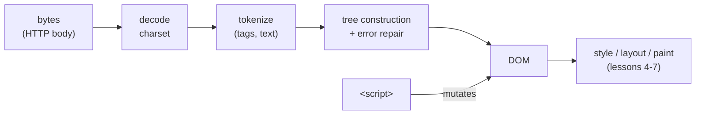

# HTML Fundamentals

## 1. Learning Objectives

After this lesson you will be able to:

- [ ] Write a valid HTML document skeleton — doctype, `lang`, `charset`, `viewport` — and state what each declaration actually does
- [ ] Describe how the parser turns text into a tree, including what it does when tags are missing or misnested
- [ ] Distinguish *source text*, *parse errors*, and *DOM* — and predict how malformed markup will be repaired
- [ ] Choose correctly between attributes, text content, and data-* storage
- [ ] Validate your own markup and explain why "it renders fine" is not the same as "it is correct"

## 2. Prerequisites

- [06-INTERNET-AND-WEB-FOUNDATIONS/browsers-and-rendering.md](../06-INTERNET-AND-WEB-FOUNDATIONS/browsers-and-rendering.md) — the parse stage this lesson lives inside
- [06-INTERNET-AND-WEB-FOUNDATIONS/http-fundamentals.md](../06-INTERNET-AND-WEB-FOUNDATIONS/http-fundamentals.md) — the bytes and `Content-Type: text/html` that carry a document
- [02-PROGRAMMING-FUNDAMENTALS](../02-PROGRAMMING-FUNDAMENTALS/README.md) — trees and nested structure are assumed

## 3. Introduction

HTML is the document language of the web: text a browser turns into a tree, which everything
else — CSS, JavaScript, screen readers, search engines — consumes. It looks trivial (tags in
angle brackets) and is learned badly precisely because it *looks* trivial: most "broken page"
bugs are markup that a browser silently repaired into something other than what the author
imagined. This lesson treats HTML as what it is — a parsing language with well-defined error
recovery — and shows that recovery running: malformed source in, repaired tree out, captured
from a real browser.

## 4. The Problem It Solves

Hypertext needs a format that is **robust in the face of author error**. The early web's
founding constraint: millions of hand-authored pages, no compiler, no build step — if a missing
`</p>` blanked the page, the web would have been unusable. SGML-style strictness (reject
invalid documents) was traded for **error recovery**: the parser's job is to produce a
*reasonable tree from unreasonable input*, every time, deterministically.

That trade has a consequence you must internalize: **browsers do not report HTML syntax errors
to users.** In JavaScript, a missing brace halts everything with a message. In HTML, a missing
close tag is silently fixed — sometimes the way you meant, sometimes not. The document that
renders is the *repaired* document, and until you look at the tree (this lesson's transcripts
do exactly that) you are guessing about what you shipped.

The companion problem is *meaning*: HTML originally offered a dozen layout tags (`<font>`,
`<center>`, `<table>`-as-layout) that described appearance, not content. Semantics — the next
lesson's subject — replaced them; this lesson teaches the *structure* those semantics live in.

## 5. Core Concepts

### Document skeleton

Every modern document starts with the same five declarations:

```html
<!DOCTYPE html>
<html lang="en">
<head>
  <meta charset="utf-8">
  <meta name="viewport" content="width=device-width, initial-scale=1">
  <title>Page title</title>
</head>
<body>...</body>
</html>
```

- **`<!DOCTYPE html>`** — one token, no version number since HTML5. Its job: switch the parser
  into **standards mode**. Without it, browsers use **quirks mode** (compatibility with 1990s
  table layouts — e.g. certain box-sizing and line-height behaviors differ silently). It is a
  parse-mode switch, not a comment.
- **`lang="en"`** — the document's language, used by screen readers for pronunciation and by
  browsers for hyphenation/font selection. Omitting it is an accessibility defect (lesson 11's
  axe run flags it: `html-has-lang`).
- **`<meta charset="utf-8">`** — how to decode the byte stream (lesson 6's transport is bytes;
  this says which text encoding turns them into characters). It must appear within the first
  1024 bytes or some browsers sniff first and decode wrongly — the classic mojibake cause.
- **`viewport`** — tells a mobile browser the layout viewport is the device width; without it,
  mobile browsers fake a ~980px viewport and scale the page down. Lesson 8's responsive work
  assumes this line exists.
- **`<title>`** — the tab label, default bookmark text, and a primary search-engine signal.

### Elements, tags, attributes

An **element** = start tag + optional content + optional end tag. `<p class="lede">Hi</p>`:
start tag `p`, attribute `class="lede"`, text content `Hi`, end tag `</p>`. Void elements
(``, `<br>`, `<input>`, `<meta>`) have no end tag and no content — they *close
themselves*; in XHTML-style syntax they may be written ``, but the slash is optional
in HTML. Attributes are name-value pairs in the start tag; **boolean attributes**
(`disabled`, `required`, `checked`) are written by presence alone. **`data-*`** attributes are
the escape hatch for storing application state on an element — arbitrary names, string values,
reachable from CSS (`attr()`, mostly) and JavaScript (`dataset`).

### Nesting, and why it must be a tree

Elements nest strictly: an element must be fully inside its parent. `<b><i>x</i></b>` is
properly nested; `<b><i>x</b></i>` is not — and the parser must still produce a tree. Trees
give every node exactly one parent, which is what lets CSS reason about inheritance (a
`color` on an ancestor flows down unique paths) and lets the accessibility tree (lesson 11)
represent relationships. **Block vs inline** is a layout default, not a nature: `<div>` is
block-level, `<span>` inline — but lesson 6's `display` property can change any element's
behavior, so structure should be chosen for *meaning* first.

### Parse errors vs render failures

Three distinct things get called "broken HTML":

1. **Parse error** — a token the grammar rejects (stray `</div>`, misnesting). The parser
   repairs and continues; the page renders. Most common, least visible.
2. **Validity failure** — parses fine, but violates the standard's content models (a `<div>`
   inside a `<p>`, an `<h1>` inside a `<label>`). Renders anyway; may repair (a `<div>` closes
   the `<p>` implicitly!) and can break layout/semantics unexpectedly.
3. **Actual failure** — something visible is wrong (unstyled text, missing image, broken
   interaction). What users see.

A validator (W3C Nu, `vnu`) reports classes 1–2 with file:line. Running it is the only way to
hear what the browser silently repaired — the habit this lesson's exercises demand.

### The tree the parser produces: the DOM

The output is the **Document Object Model**: elements, text nodes, comments — the live tree
lesson 06/9 dumped with `--dump-dom`. Crucially it is **not** the source file: the parser
closes tags you left open, drops tokens it cannot use, and scripts may then mutate it further.
When you debug "why is my paragraph blue", the DOM — not your .html file — is the artifact CSS
actually matched against.

## 6. How It Works

### The repair experiment, executed

This source was served by the lab server and loaded in headless Chrome 156 (authoring
machine) — deliberately malformed in four distinct ways:

```html
<!DOCTYPE html>
<html lang="en"><head><meta charset="utf-8"><title>Parser repair lab</title></head>
<body>
<h1>Source below is deliberately malformed</h1>
<pre id="probe-out"></pre>
<p>First paragraph
<p>Second paragraph started without closing the first
<ul><li>Item one<li>Item two</ul>
<b><i>misnested emphasis</b></i>
<div>Balanced div</div>
</div>
<script>
  /* probe writes its findings into #probe-out */
</script>
</body></html>
```

The page interrogated its own tree after parsing. Executed output
(`--dump-dom`, headless Chrome 156, authoring machine):

```console
p elements: 2 (source wrote 2 <p> tags, no closes)
li elements: 2 (source wrote no </li>)
b contains i: true
i contains b: false
div elements: 1 (1 written, stray </div> ignored)
```

Read each line as a named repair:

1. **`p elements: 2`** — HTML allows `<p>` to be closed implicitly by the *start* of another
   `<p>`: the parser closed "First paragraph" when it saw the second `<p>`. Two opens, zero
   closes in the source, two elements out.
2. **`li elements: 2`** — list items have the same implicit-close rule (`<li>` starts a new
   `li`): `</li>` tags are optional by grammar, not by oversight.
3. **`b contains i: true; i contains b: false`** — the **adoption agency algorithm** repaired
   the misnested `</b>`: it closed `<b>` *around* the `<i>` (so `b` still contains `i`) and
   re-opened/adjusted `<i>` afterwards. The source's crossed nesting became a legal tree — not
   by throwing the content away, but by restructuring it.
4. **`div elements: 1`** — the stray `</div>` (no open element to close) is a parse error whose
   token the parser simply **drops**: no element is created from a closer.

None of the four produced an error message anywhere. The page rendered perfectly — repaired.

### The pipeline position



The diagram's edge that matters: decoding happens *before* tokenizing (why `<meta charset>`
must come early — it configures stage 2), and scripts attach to the DOM at stage E, which is
why a script between two malformed tags still sees a coherent tree: repair happens *during*
construction, not after.

### Attributes in the wild: the same page, three storage choices

Executed in the same page family — attributes are readable by CSS/JS, text content is not:

```html
<a href="https://example.com" title="Go to example" data-track="nav-header">Example</a>
```

- `href` / `title` — **standard attributes**: the parser puts them in the element node; CSS
  can't select on them (`[title]` can) and JS reads `el.href` (resolved to an absolute URL —
  another silent transformation: the *attribute value* is the raw string, the *property* is
  absolute).
- `data-track` — **application data**: same element, no semantic meaning to the platform, but
  available as `el.dataset.track` and to CSS via generated content in limited ways. The rule:
  platform-meaningful → standard attribute; app bookkeeping → `data-*`; content → text nodes.
- Never store data *only* in `title` or hidden text: neither is reliably exposed to assistive
  tech (lesson 11).

## 7. Practical Examples

**Example 1 — see your own document's tree, not its source**

```console
$ chrome --headless --dump-dom file:///path/to/your.html > dom.html
$ diff your.html dom.html
```

- The diff *is* the repair report: implicit closes, dropped tokens, serialization differences.
  Run it on any page you write; a surprising diff means you relied on repair you didn't choose.
- **How to run it:** Chrome/Chromium with `--dump-dom` (authoring machine: Chrome 156
  headless). For files with scripts, add `--virtual-time-budget=2000` so mutations finish.
- **Assumptions:** a Chrome-family browser; the lesson's probe page shows what to write *inside*
  the document to make the tree talk (`querySelectorAll(...).length` is the whole tool).

**Example 2 — a valid, minimal, correct-by-construction page**

```html
<!DOCTYPE html>
<html lang="en">
<head>
  <meta charset="utf-8">
  <meta name="viewport" content="width=device-width, initial-scale=1">
  <title>Article: How parsers repair HTML</title>
</head>
<body>
  <header>
    <nav aria-label="Primary">
      <ul>
        <li><a href="/">Home</a></li>
        <li><a href="/articles">Articles</a></li>
      </ul>
    </nav>
  </header>
  <main>
    <article>
      <h1>How parsers repair HTML</h1>
      <p>Every unclosed tag is a decision the parser makes for you.</p>
    </article>
  </main>
  <footer><p>© 2026 Example</p></footer>
</body>
</html>
```

- Every tag closed; every element nested inside one parent; landmarks (`header`/`nav`/`main`/
  `footer`) already in place (lesson 2); `lang` and `charset` present; one `<h1>`.
- **Expected result:** a validator reports zero errors; `--dump-dom`'s diff against this file is
  whitespace-only.
- **How to run it:** paste into a file, open, then apply Example 1's diff; optionally paste the
  source into the Nu Html Checker (`https://validator.w3.org/nu/`) — the same check, hosted.
- **Assumptions:** none — this is the target shape every later exercise builds on.

## 8. Real-World Applications

- **Every framework emits this language.** React/Vue/Svelte templates compile to element
  creation (and HTML strings for server rendering); "JSX is not HTML" differences (unquoted
  attributes are illegal, `class` becomes `className`, tags must be balanced or self-closing)
  exist precisely because the target grammar is the one in this lesson.
- **Email HTML is HTML at its most constrained** — clients strip doctypes, ignore flexbox, and
  re-parse aggressively; markup written to the strictest subset (tables for layout, inline
  styles) works, and the difference between "renders in Gmail" and "renders in Outlook" is
  mostly parser- and support-level differences like the ones executed above.
- **HTML sanitization is a security boundary** (subject 15): parsers' repair behavior is why
  naive string-checking fails — `<svg><script>` parses into a real script node; comment/element
  tricks like `<a<!--> href="javascript:">` parse differently than they read. Sanitizers must
  parse the same way browsers do, then serialize.
- **SEO crawlers parse HTML too** — a title, heading hierarchy and landmarks (lesson 2) are how
  a search engine reconstructs your page's meaning; malformed structure silently changes what
  it can extract.

## 9. Common Mistakes

| Mistake | Why it happens | How to recognize it | How to prevent it |
|---|---|---|---|
| Assuming unclosed tags are harmless | Browsers hide the repair | A validator or `diff source dom.html` shows elements you never closed | Close every tag; run a validator in CI (lessons 14's pipeline) |
| Forgetting `<!DOCTYPE html>` | It "looks like a comment" | Subtle layout differences (quirks mode) with no console message | First line, always; check `document.compatMode` if suspicious |
| Putting the charset late (or in the body) | Visibility seems irrelevant | Accented text garbles when the connection is slow | `<meta charset>` first thing in `<head>` (within the first 1024 bytes) |
| Expecting markup errors to fail loudly | Habits from compiled languages | The page renders — but *repaired*, differently across contexts | Instrument: dump the DOM; validate; never rely on the eye alone |
| Using presentational tags (`<font>`, `<b>` for headings) | Old tutorials | Structure is invisible to assistive tech; CSS needed for meaning | Meaning first: heading elements, `<strong>`, CSS for appearance (lesson 2) |

## 10. Best Practices

- **Write balanced, explicitly-closed markup** even though parsers forgive it. Optional close
  tags (`</li>`, `</p>`) save nothing and cost readability; explicit structure survives copy
  and paste, templating, and future parsers.
- **Validate once per feature, not once per crisis.** The Nu validator (or `vnu` in CI —
  subject 14) costs seconds and reports every silent repair with a line number. Treat its
  output like a compiler message.
- **Diff source against `--dump-dom` when layout puzzles you.** If the tree is not what you
  wrote, no CSS can match what you meant — this one command splits "markup bug" from "style
  bug" before you open devtools.
- **Keep the head early and boring.** `charset` first, `viewport` next, title, then stylesheets;
  scripts that must run early get `defer` (lesson 06/9's lifecycle) — head ordering is
  performance, not taste.

## 11. Limitations and Trade-Offs

- **Error recovery is permanent.** The repair rules are standardized (HTML Living Standard §13)
  but they are *repairs*: the tree may not be the tree you meant, and the standard deliberately
  prioritizes "render something" over "tell the author". Tooling — validators, DOM diffs — is
  the compensating control, and it is optional in a way compiler errors are not.
- **Validity ≠ correctness ≠ accessibility.** A document can validate and still be
  unusable (empty links, wrong heading order — lessons 2 and 11), or render perfectly while
  containing errors that a *different* consumer (an email client, a crawler, a sanitizer)
  handles differently. Three checkers, three questions.
- **The tree is a snapshot.** `--dump-dom` shows the tree at capture time; scripts run later,
  frameworks hydrate, ads mutate. For dynamic pages the honest statement is "the DOM *at time
  T*", not "the DOM".
- **Some repairs are browser-consistent but surprising** (adoption agency outcomes, foster
  parenting of table content). Relying on the *exact* shape of a repair chains your code to a
  spec detail that exists only for compatibility — fix the source instead.

## 12. Practical Exercises

### Introductory

1. **Exercise 7.1** — Write the document skeleton from Example 2 from memory in a new file;
   then deliberately remove `<!DOCTYPE html>` and the `charset` meta, and capture
   `document.compatMode` and the head from `--dump-dom` for both versions.
   **Completion criteria:** both dumps captured; `CSS1Compat` vs `BackCompat` (or your browser's
   quirks indicator) identified; one sentence stating what changed about parsing, not rendering.
2. **Exercise 7.2** — Take any page you have written (or the lesson's malformed source) and
   produce `diff source dom.html`. Classify every difference as *implicit close*, *dropped
   token*, or *serialization*.
   **Completion criteria:** the diff captured; at least two differences classified; one
   difference you can tie to a specific parser rule named in section 6.

### Intermediate

3. **Exercise 7.3** — Reproduce the four repairs of the executed experiment (unclosed `<p>`,
   unclosed `<li>`, crossed `<b>/<i>`, stray `</div>`) in your own file, with a probe counting
   each element type. Then *fix* the source and re-run the probe.
   **Failure to diagnose:** both transcripts captured (before: 2/2/repaired/1 — after: counts
   match your intent); for each repair you can say what the parser's rule was.
4. **Exercise 7.4** — Run the Nu validator on a real page from the web (any article you read).
   Report: how many errors, how many *info-level* warnings, and one error whose fix you can
   state without changing how the page looks.
   **Completion criteria:** validator output captured (URL or uploaded source); counts; one
   fix stated as source change + why rendering is unchanged.

### Independent problem-solving

5. **Exercise 7.5** — *Problem:* a teammate's template engine sometimes renders a page where a
   sidebar appears **inside** a paragraph, breaking the layout, but only for some records. You
   suspect the data contains markup the engine inserts verbatim. Design the investigation:
   what you would capture (source vs dumped DOM for a failing record), which parser behavior
   explains a `<div>` ending up inside `<p>` (hint: it *cannot* — what actually happens?), the
   validator error you expect, and the fix at the template layer versus the data layer, with a
   recommendation.
   **Completion criteria:** a capture plan naming both artifacts; the correct account of what
   the parser does when a `<div>` appears inside `<p>` (the `<p>` closes implicitly — cite the
   executed `p elements: 2` analogue); expected validator message quoted from a real run;
   template-vs-data fix compared in two sentences with one chosen.

*Solutions: attempt first. They live in `exercises/` guidance of the next subject's practice
sets; this subject's applied work is in [projects/](projects/README.md).*

## 13. Knowledge Check

1. A page renders identically before and after you add `<!DOCTYPE html>`. What *did* change,
   and how would you prove it in one console line?
2. The source contains `<b><i>x</b></i>`; describe the tree a browser builds, and explain why
   `diff source dom.html` is the command that reveals it.
3. When would you choose an attribute over text content over a `data-*` value for a piece of
   information — and what does each choice cost a screen reader?

## 14. Completion Criteria

Observable evidence that you have understood this lesson:

- [ ] You can write the five-declaration skeleton from memory and say what each line does
- [ ] You reproduced the four-parser-repair experiment in your own file (exercise 7.3)
- [ ] You diffed source against dumped DOM and classified the differences (exercise 7.2)
- [ ] A validator run on real markup produced output you can interpret (exercise 7.4)
- [ ] You can diagnose all five mistakes in section 9

## 15. Summary

- HTML is a parsing language with standardized error recovery: browsers repair silently and never show you a syntax error.
- The DOM is the repaired, possibly-script-mutated tree — not your source file; `--dump-dom` shows it.
- Implicit closes (`p`, `li`), the adoption agency for misnesting, and dropped stray closers are named rules, all observed in the executed transcript.
- The five skeleton declarations switch parse mode (`DOCTYPE`), set decoding (`charset`), language (`lang`) and layout viewport (`viewport`).
- Validity, rendering correctness, and accessibility are three separate checks; only one of them is the browser doing it for you.

## 16. Next Steps

- Next lesson: [Semantic HTML](semantic-html.md) — giving the tree *meaning* with elements that expose structure to everyone who reads it
- Applied work: [projects/](projects/README.md) brief 1 (semantic article page)
- Where it is applied: [15-APPLICATION-SECURITY](../15-APPLICATION-SECURITY/README.md) (HTML sanitization parses like a browser) and [09-FRONTEND-ENGINEERING](../09-FRONTEND-ENGINEERING/README.md) (framework output)
