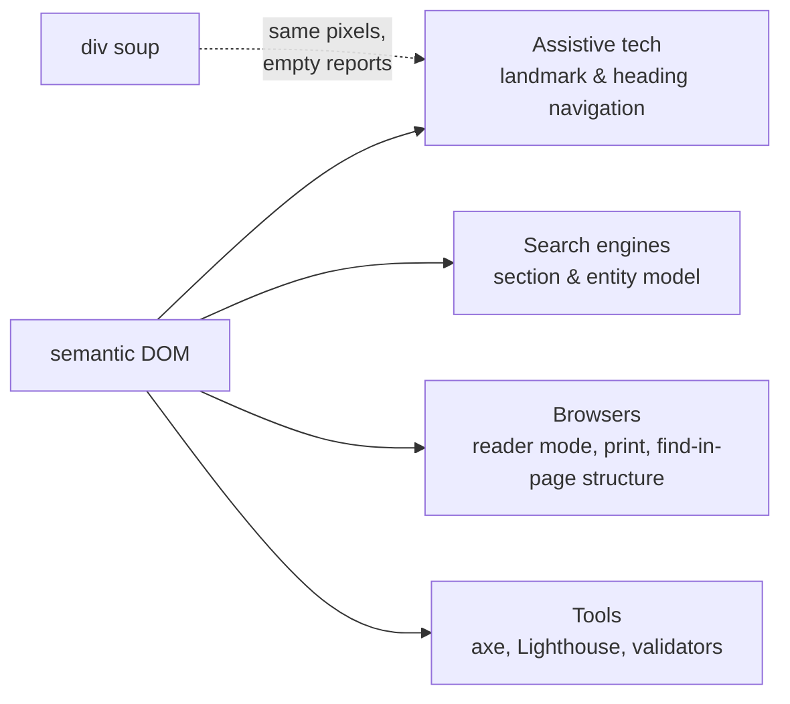

# Semantic HTML

## 1. Learning Objectives

After this lesson you will be able to:

- [ ] Choose the correct structural element for any region of a page (`header`, `nav`, `main`, `article`, `section`, `aside`, `footer`) and justify the choice in one sentence each
- [ ] Build a heading hierarchy that is correct visually *and* as an outline — no skips, one `<h1>`, levels as structure rather than font size
- [ ] Read a heading/landmark outline probe of a real page and name what assistive technology would report
- [ ] State three concrete consumers of semantics (screen-reader navigation, search engines, browser tooling) with the mechanism each uses
- [ ] Replace a div-soup region with semantic markup **without changing the rendering**, then prove both facts

## 2. Prerequisites

- [HTML Fundamentals](html-fundamentals.md) — elements, attributes, and the tree they build
- [06-INTERNET-AND-WEB-FOUNDATIONS/browsers-and-rendering.md](../06-INTERNET-AND-WEB-FOUNDATIONS/browsers-and-rendering.md) — the DOM as the shared structure

## 3. Introduction

Two pages can render as identical pixels while one is navigable by keyboard and screen reader
and the other is a featureless wall of text. The difference is not styling and not ARIA — it is
**which elements you chose**. HTML's elements are a vocabulary of *meaning*: `<nav>` says
"navigation region", `<h2>` says "section heading", `<main>` says "the page's primary content".
Everything downstream reads that meaning: assistive technology builds its navigation model from
it, search engines reconstruct the page from it, browsers optimize with it. This lesson teaches
the vocabulary and the discipline — and shows, with executed outline probes, exactly what a
page's semantics look like from the outside.

## 4. The Problem It Solves

In HTML4's world, structure was conveyed by `<div>` plus naming conventions
(`<div class="sidebar">`). That renders perfectly — and communicates nothing outside your own
CSS. Three consumers were left guessing:

- **Screen reader users** had no landmarks to jump between (a "list of links" affordance, "go
  to main content" shortcut) — every page became a linear read from top to bottom, or worse, a
  soup of untagged regions announced as bare text.
- **Search engines** saw divs and had to infer meaning from content patterns — the historical
  reason `<table>`-for-layout pages ranked and read poorly.
- **Browsers and tools** could not use structure for anything: skip-links, reader modes
  (mobile browsers' "reader view" still extracts by heuristics *and* semantics), translation
  tools, and print stylesheets all benefit from knowing `<main>` from `<aside>`.

The fix was to put structure *in the language*: HTML5 introduced the landmark and sectioning
elements. The cost was a rule learners resist — **choose by meaning, then style** — because
`<div>` feels flexible and semantics feel like extra work. The executed evidence in section 6
shows what those semantics buy: the same content, one version reporting every landmark a
consumer needs, the other reporting nothing.

## 5. Core Concepts

### Landmarks: the page's regions

| Element | Landmark role | Use it for | Do not use it for |
|---|---|---|---|
| `<header>` | banner (when top-level) | Site-wide branding, masthead | A header inside an article (that's just a header — no landmark) |
| `<nav>` | navigation | Major link groups — label when repeated (`aria-label`) | Every list of links (footer social links often get their own labeled nav) |
| `<main>` | main | **Exactly one** visible primary content region | Anything duplicated across pages (that's header/footer material) |
| `<article>` | article | Self-contained composition — a post, a card that makes sense alone | A generic wrapper (use `<section>` or plain `<div>`) |
| `<section>` | region (when it has a heading) | Themed groupings **with a heading** | Anonymous boxes — an unnamed `<section>` is just a `<div>` with extra steps |
| `<aside>` | complementary | Tangential content (sidebars, pull quotes, related links) | Content that belongs to the article's flow |
| `<footer>` | contentinfo (when top-level) | Site-wide footers, colophons | A `<footer>` inside `<article>` (its byline/date — not a landmark) |

The rule behind the table: **landmarks describe page regions to consumers, so only claim a
region that exists.** An empty `<nav>` or a `<main>` nested inside another `<main>` (invalid)
*adds noise* rather than structure.

### Headings are an outline, not a font choice

Headings (`h1`–`h6`) are the document's outline — the tree a screen reader's "headings list"
navigation and a search engine's section model both read. The rules:

- **One `<h1>`**: the page's topic (not "Welcome" by reflex — the topic itself).
- **No level skips** going down (`h1 → h3` is an error: consumers assume a missing level means
  a missing section). Going back *up* is fine (`h2` after a sub-`h4` section ends).
- **Never size by level.** If you want `<h3>` visually bigger than `<h2>`, you have a styling
  need — CSS sets size; the level stays honest. Picking `h3` because it "looks right" corrupts
  the outline, which is the entire mechanism.

Executed below: an outline probe of a page whose only heading is `<h3>` — the outline reads
`H3 "Skipped heading level"`, and axe reports both `page-has-heading-one` and, for a page with
no landmarks, `region`/`landmark-one-main`.

### Text-level semantics

Beyond regions, the inline vocabulary carries meaning consumers act on:

- **`<strong>` / `<em>`** — importance and emphasis *as meaning* (announced with weight/tone
  by screen readers; **styled** by CSS). `<b>`/`<i>` are purely visual (historical
  bold/italic) with no implied meaning — use them only when the styling has *no* semantic
  content (a product name in a list, e.g. `<b>` per styling conventions).
- **`<time datetime="2026-10-22">`** — machine-readable time behind display text: crawlers and
  tools parse the attribute; users see your format.
- **`<a href>` vs `<button>`** — the single most-tested distinction in interviews and audits:
  **navigating** (any URL, even `#`) is a link; **doing** (submit, toggle, reveal) is a button.
  A `<div onclick>` does neither: no keyboard focus, no role, no default behavior (lesson 11).
- **Lists** (`ul`/`ol`) for collections: a screen reader announces "list, 5 items" —
  instant context a stack of `<div class="row">` never gives.
- **`<figure>` / `<figcaption>`** — image plus caption as one semantic unit; `<table>` for
  *tabular data only* (lesson 6's layout tables are a presentation crime the semantics rule
  out).

### When HTML is enough, and ARIA's first rule

**"No ARIA is better than bad ARIA."** Every ARIA attribute re-declares in JS-land what HTML
already says — and saying it *wrong* (an `aria-label` on a non-interactive `<div>`, a
`role="button"` with no keyboard handler) is worse than silence, because you've told consumers
something false. The rule of thumb: **first reach for the right HTML element**; use ARIA only
to (a) label the unlabeled (`aria-label` on a repeated `<nav>`), (b) bridge what HTML can't
express yet, (c) manage dynamic widget state (`aria-expanded`) — with the keyboard behavior
lesson 11 requires alongside it.

## 6. How It Works

### The same region, two vocabularies

**Div soup:**

```html
<div class="wrapper">
  <div class="top-bar"><div class="links">…links…</div></div>
  <div class="body"><div class="content">…article…</div><div class="side">…</div></div>
  <div class="bottom">…</div>
</div>
```

**Semantics:**

```html
<body>
  <header><nav aria-label="Primary">…links…</nav></header>
  <main>
    <article>…article…</article>
    <aside>…</aside>
  </main>
  <footer>…</footer>
</body>
```

Identical rendering (CSS targets classes or elements equally). What differs is *reporting*.
Executed on the authoring machine (headless Chrome 156) — a probe reading both pages' structure:

```console
# a11y-bad.html (structure: h3 only, no landmarks, div soup)
heading outline: H3 "Skipped heading level"
landmarks: header=0 nav=0 main=0 article=0 section=0 footer=0
duplicate ids: email
images without alt attribute: 1
links with text <= 5 chars or generic: 1
inputs without associated label: 1

# a11y-good.html (same content, semantic structure)
heading outline: H1 "Proper heading order"
landmarks: header=0 nav=0 main=1 article=0 section=0 footer=0
duplicate ids: none
images without alt attribute: 0
links with text <= 5 chars or generic: 0
inputs without associated label: 0
```

The probe computed what a consumer would find:

- **Outline:** `H3` alone vs `H1` — the bad page offers no entry point (screen-reader users
  navigate by heading; a lone `h3` both skips a level and fails "one h1").
- **Landmarks:** `main=0` vs `main=1` — with no landmark, "jump to main content", the most
  used screen-reader shortcut, does nothing. (This test page has no `header`/`nav`/`footer` in
  *either* version — `header=0 nav=0` on the good page is honest: nothing was claimed that
  doesn't exist. The good page's fix set was: one h1, one main, correct ids, alt, labels.)
- The remaining four rows are the audit this pair was built to contrast (lesson 11 runs the
  full axe check: **7 violations → 0**).

### The heading-skipping rule, shown as an outline

A real outline extraction (same probe, `querySelectorAll('h1,…,h6')` in document order):

```console
# good page
heading outline: H1 "Proper heading order"
```

Against a page that starts at h3:

```console
heading outline: H3 "Skipped heading level"
```

The consumer's interpretation: **level gaps imply missing content.** If your first heading is
`h3`, an outline builder asks where h1 and h2 went; several tools then *normalize* (and often
mangle) your outline for you. One h1, no downward skips, and the outline is the structure you
think it is.

### Semantics have measurable consumers



The diagram's lower edge is the executed experiment: same pixels, `landmarks: header=0 nav=0
main=0` — structure exists only where you declared it. Everything downstream of the DOM reads
*elements*, and `<div class="main">` is invisible to all five branches.

## 7. Practical Examples

**Example 1 — outline any page in one command**

```console
$ chrome --headless --dump-dom --virtual-time-budget=2000 URL > dom.html
$ grep -oE '<h[1-6][^>]*>[^<]*' dom.html | sed 's/<\([a-z0-9]*\)[^>]*>/\U\1\E /'
```

- Prints the heading outline in document order — the same extraction the executed probe did,
  with grep instead of JS.
- **Expected output:** one line per heading (`H1 …`, `H2 …`); check for a single `H1` and no
  downward level jumps.
- **How to run it:** any Chrome + shell; on a local file use `file:///path`, for a remote URL
  pass it directly. **Assumptions:** Chrome 156 (authoring machine); page reachable.

**Example 2 — convert div soup without touching CSS**

```html
<!-- before -->                         <!-- after (CSS unchanged when you keep the class) -->
<div class="top-bar">            →      <header class="top-bar">
<div class="links">             →      <nav class="links" aria-label="Primary">
<div class="content">           →      <main class="content">
<div class="side">              →      <aside class="side">
<div class="bottom">            →      <footer class="bottom">
```

- Keeping the classes means zero CSS edits — semantics and presentation are orthogonal
  (lesson 4's cascade targets either). Verify with a screenshot diff before/after: pixels
  identical, outline changed.
- **The one deliberate behavior change:** `<main>` gets the browser's default
  `display: block` like the div it replaced; `nav`/`header`/`footer` likewise. If a stray
  stylesheet targeted `div` specifically (`div { … }`), that's the diff you'll see — and it was
  a bug waiting to bite the semantic version anyway.
- **Expected proof:** outline probe before (`main=0`) vs after (`main=1`); screenshot diff
  clean.
- **How to run it:** your page + the Example 1 outline command; screenshots via
  `--screenshot=before.png` / `after.png` (authoring machine: screenshots written to a
  workspace path — Chrome refused the Temp directory with `Access is denied`, a filesystem
  seam noted in batch 8).

## 8. Real-World Applications

- **Skip links and landmark navigation** are how screen-reader and keyboard users move through
  long pages: `<a class="skip" href="#main">Skip to content</a>` as the first link inside
  `<header>` plus a `<main id="main">` is a five-line pattern that turns a 40-tab page into a
  3-tab page. It only works because the landmarks exist.
- **Reader modes** (Safari/Chrome "reader view") extract articles by scoring semantic
  structure — `<article>`, headings, text density. Div-soup pages get ignored or mangled;
  semantic ones get clean, ad-free reading.
- **Structured data and SEO**: while schema.org JSON-LD is the explicit layer, crawlers use the
  heading outline and landmarks as the page's skeleton — `h1` duplication or skipped levels
  are classic audit findings with traffic consequences.
- **Component libraries** (subject 09) bake semantics in: a "Card" component's `<article>` +
  heading level prop, a "Tabs" widget's `role="tablist"` — semantics are a *design system*
  decision made once, not per-page heroics.

## 9. Common Mistakes

| Mistake | Why it happens | How to recognize it | How to prevent it |
|---|---|---|---|
| Heading levels picked by desired size | Default `h3` "looks better" | Outline skips or has several h1s; CSS then fights defaults | Style with CSS (`font-size`), choose level by outline position |
| One `<div>`-per-region with a class name | `<div class="nav">` renders the same | Outline probe reports `landmarks: … nav=0` | Landmark elements first; keep classes for styling (Example 2) |
| `<section>`/`<article>` used as generic boxes | Tutorials sprinkle them | Sections with no heading (invisible to outline) or `article` around every row | `<section>` needs a heading; `<article>` must stand alone sensibly |
| `<div onclick>` "buttons" | Visual simplicity | Not focusable, no role, keyboard-dead | `<button>` (or `<a>` for navigation) — lesson 11 executes the keyboard test |
| Premature ARIA (`role="button"` everywhere) | Believes ARIA creates semantics | ARIA roles with no keyboard support — worse than none | Right element first; ARIA only to label or manage dynamic state |

## 10. Best Practices

- **Draft the outline before the markup.** One line per region (h1 topic, h2 sections, h3
  subsections, landmarks) — then write elements to match. The outline is the spec; visuals come
  after (this mirrors brief 1 in [projects/](projects/README.md)).
- **Check semantics with the probe, not the eye.** Rendering can't distinguish `<main>` from
  `<div>`; the outline command in Example 1 can, in seconds. Run it before claiming a page is
  "semantic".
- **Name repeated landmarks.** Two `<nav>` elements need distinct `aria-label` ("Primary",
  "Footer") — otherwise a screen reader's landmark list says "navigation, navigation". The
  executed good page labeled its nav for this reason.
- **Keep one h1 per page and treat it as the title.** For article templates, the article title
  *is* the h1; site-wide "welcome" headings steal the slot from the actual topic.

## 11. Limitations and Trade-Offs

- **Semantics are invisible in the pixels.** Every benefit lands in non-visual consumers, so
  the payoff is invisible to teams that only screenshot — which is why the probe exists as
  proof, and why accessibility regressions (lesson 11) need tooling to catch.
- **"Correct" semantics can be contested.** `<section>` vs `<div>`, banner-scope `<header>`,
  whether footer links warrant a nav — reasonable people differ; validators won't catch it and
  axe only catches some of it. The discipline is a judgment informed by what consumers do with
  the element, not a checklist.
- **Old content fights back.** Email clients, some CMS sanitizers, and legacy browsers strip or
  mishandle elements like `<main>` (unsupported before 2017-era browsers need a `div` fallback
  plus `role="main"` — an ARIA bridge that is exactly its legitimate use).
- **Reader-mode extraction is heuristic.** Semantic markup makes you a *candidate*; the
  extractor still decides — plenty of semantic pages still fail extraction because of layout
  complexity elsewhere.

## 12. Practical Exercises

### Introductory

1. **Exercise 7.1** — Take the homepage of a site you use and produce its outline with Example 1's
   command. Report: the h1 (or count, if several), any level skips, the landmark counts, and
   one place the site's structure surprised you.
   **Completion criteria:** captured outline; h1 count + first skip named; one sentence on how
   a screen-reader user would start navigating this page from that evidence.
2. **Exercise 7.2** — Write a five-region page (header/nav/main/article/footer) from Example 2's
   mapping, with a single h1 and two h2s. Run the outline probe.
   **Completion criteria:** probe output showing `main=1` and your landmarks; outline showing
   `H1 → H2 → H2` with no skips.

### Intermediate

3. **Exercise 7.3** — Convert a real div-soup page *you wrote* to semantics, keeping classes.
   Capture: outline before, outline after, and a screenshot pair.
   **Failure to diagnose:** three artifacts; the outline deltas listed (`main`/`nav` counts and
   heading outline); screenshots compared and rendering change (if any) traced to a CSS rule
   that targeted a tag instead of a class — or declared identical.
4. **Exercise 7.4** — A template renders *two* `<h1>`s on listing pages (site title + first
   card). Diagnose what that does to the outline, then fix it two ways: (a) demote card
   headings to `h2`, (b) drop the visual site-title heading to a styled link with
   `aria-label`. State which you'd ship and why.
   **Failure to diagnose:** outline captured for all three states; the screen-reader effect of
   two h1s stated (two "top-level" entries in the headings list); one choice justified from
   section 5's rules.

### Independent problem-solving

5. **Exercise 7.5** — *Problem:* you inherit a documentation site (200 pages) whose outline is
   `H3`-first with skipped levels and five `<div class="section">` blocks per page. Design the
   semantic migration: how you'd audit all 200 pages automatically (outline extraction per
   page, summarized), the target outline policy, how you'd prevent regressions in CI (what
   command fails the build), and how you'd handle pages where the *content* itself has no
   logical h1.
   **Completion criteria:** an audit plan with a named command and a summary format; a written
   policy (h1 rule, skip rule, landmark rules); the CI gate stated as a command + failure
   condition; the no-h1 case handled with a stated rationale; one risk (template components
   that force levels, say) named.

*Solutions: attempt first. This subject's applied work is in [projects/](projects/README.md).*

## 13. Knowledge Check

1. Why does `<div class="nav">` fail a screen-reader user while `<nav>` succeeds — the pixels
   are identical? Name the consumer and what it reads.
2. A design mock wants the sidebar heading visually larger than the page title. What do you
   change, and which of the two headings (if either) changes level?
3. State ARIA's first rule in your own words and give one example where adding ARIA made a page
   *less* accessible.

## 14. Completion Criteria

Observable evidence that you have understood this lesson:

- [ ] You produced an outline probe of a real page and interpreted it (exercise 7.1)
- [ ] You built the five-region page with a clean `H1 → H2` outline (exercise 7.2)
- [ ] You converted real div soup with pixel-identical rendering and a changed outline (exercise 7.3)
- [ ] You can name each landmark's correct scope (top-level vs nested) without notes
- [ ] You can diagnose all five mistakes in section 9

## 15. Summary

- Semantics are structure expressed in elements, consumed by assistive tech, search engines, browsers, and tools — not decoration for its own pixels.
- Landmarks (`header`/`nav`/`main`/`aside`/`footer`) exist only where you declare them — the executed probe showed `main=0` vs `main=1` on identical pixels.
- Headings are an outline: one h1, no downward skips, size chosen by CSS — consumers assume a missing level is missing content.
- Links navigate, buttons act; text-level elements (`strong`, `time`, `ul`, `figure`) carry meaning CSS cannot restore.
- ARIA's first rule is no ARIA: right elements first, ARIA only to label or to manage dynamic state — with keyboard behavior attached.

## 16. Next Steps

- Next lesson: [Forms and Validation](forms-and-validation.md) — semantics where they have the highest interactive stakes
- Applied work: [projects/](projects/README.md) brief 1 (semantic article page)
- Where it is applied: [15-APPLICATION-SECURITY](../15-APPLICATION-SECURITY/README.md) (accessible auth flows) and [09-FRONTEND-ENGINEERING](../09-FRONTEND-ENGINEERING/README.md) (component semantics)
