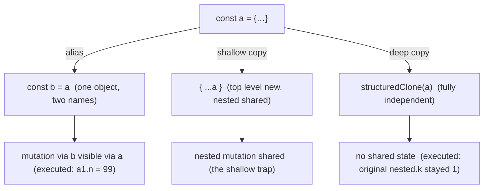

# Arrays and Objects

## 1. Learning Objectives

After this lesson you can:

- [ ] Predict aliasing vs copying for every assignment/spread/clone shown in the executed probe
- [ ] Choose mutator vs pure array methods from the executed `push`/`concat` evidence
- [ ] Read object key order rules (executed: integer-like keys first) and say when they matter
- [ ] Apply `Object.freeze` correctly — including its **strict-mode throws** (executed verbatim)
- [ ] Sort safely: default lexicographic vs comparator, and non-mutating copies (executed)

## 2. Prerequisites

- [JavaScript Fundamentals](javascript-fundamentals.md) — destructuring, `??`, references
- [02-PROGRAMMING-FUNDAMENTALS](../02-PROGRAMMING-FUNDAMENTALS/README.md) — lists and dicts are
  assumed; this lesson is JavaScript's version of that machinery

## 3. Introduction

Arrays and objects are the two data workhorses of JavaScript — almost every value you handle is
one. This lesson's transcripts were executed on Node 24.13.1, and they include two crashes the
probe hit *on purpose's behalf*: in ES modules (always strict mode), assigning to a frozen
property **throws** instead of silently ignoring. That distinction — strict vs sloppy, mutator vs
pure, reference vs copy — is the whole subject here, because getting it wrong is how a "small"
bug becomes everyone's state.

## 4. The Problem It Solves

JavaScript's default assignment **aliases** (two names, one object), and its most popular array
methods **mutate in place**. Combined, that means a "harmless" `const b = a; b.push(1)` or a
shared list rendered in two components silently corrupts the other consumer. The industry-wide
shift to immutability (React state, Redux, Vue's reactivity warnings) exists because this model
is easy to get wrong at scale. The tools to get it right — spread/concat for copies,
`structuredClone` for deep copies, `Object.freeze` for enforcement, comparator sorts — are all
executed below.

## 5. Core Concepts

### Reference semantics: assignment copies the reference

```console
== references: assignment and spread copy the reference ==
a1 after a2.n=99: 99 (same object)
arr1 after arr2.push: [1,2,3]
spread shallow copy: original 99 copy 7 (nested objects still shared)
structuredClone deep copy, original nested.k: 1
```

`const a2 = a1` does **not** copy the object — both bindings point at one object, so `a2.n = 99`
shows up through `a1` too (line 1: `99`). Same for arrays (`arr1` grew when `arr2.push(3)` ran).
The spread `{ ...a1 }` makes a **shallow** copy: top-level fields are independent (copy's `n = 7`
did not affect the original), but *nested* objects are still shared. `structuredClone` is the
deep-copy tool that severs every level: mutating the clone's `nested.k` left the original at `1`.
Rule of thumb: one level → spread; deep → `structuredClone`; never alias by accident.

### Mutator vs pure array methods

```console
== mutator vs pure: push vs concat/spread ==
push returns new length: 3 and mutates: [1,2,3]
concat/spread leave source: [1,2,3] [1,2,3] source now [99,2]
```

`push` returns the new *length* (a number) **and mutates** the receiver — the source printed
`[1,2,3]`. `concat` and `[...p, 3]` produce new arrays; after `p[0] = 99` the copies still read
`[1,2,3]`. The mutator list (memorize the shape, not the whole table): `push`, `pop`, `shift`,
`unshift`, `splice`, `sort`, `reverse`, `fill`, `copyWithin` — all return something *else* (an
index/value/length) and change the array. Pure list: `map`, `filter`, `concat`, `slice`,
`toSorted`, `toReversed`, `flat` — new array out, source untouched. The `toSorted`/`toReversed`
names (ES2023) exist precisely because `sort`/`reverse` mutate.

### map/filter/reduce — and the identity shapes

```console
== map/filter/reduce ==
map*2: [10,24,16,266,8]
filter>10: [12,133]
reduce sum: 162
reduce to map by id: {"1":{"id":1,"admin":false},"2":{"id":2,"admin":true},"3":{"id":3,"admin":false}}
```

`map` transforms 1:1 (same length), `filter` selects (subset), `reduce` folds the array into one
value with an accumulator — the initial value (`0` here) decides both the start and, when omitted,
the bug (an empty array with no initial throws). The last line is the pattern worth stealing:
**reduce into an index** (`byId`) for O(1) lookups by key, instead of `find`ing a list on every
access.

### find, some, every, findIndex

```console
== find vs filter vs some/every ==
find first>10: 12 | indexOf of that value: 1
some>100: true | every>0: true
findIndex: 3 (-1 = absent)
```

`find` returns the first *element* matching a predicate; `indexOf` returns its *position* but
compares by value with `===` (no predicate — useless for objects); `findIndex` is the predicate
version of `indexOf` and, like it, returns **`-1`** when absent. `some`/`every` are boolean
questions (exists / all) and short-circuit — cheaper than `filter(...).length` when you only need
the answer.

### Object key order and enumeration

```console
== object keys: insertion order and numeric keys ==
key order: ["2","10","b","a"] (integer-like keys sort first, then strings in insertion order)
spread order: {"2":4,"10":2,"b":1,"a":3}
Object.entries: [["x",1],["y",2]]
```

The spec orders keys in three bands: **integer-like keys ascending** (`2` before `10`, numerically
not lexically — `10` after `2` proves it), then **string keys in insertion order**, then symbols.
`{ ...o }` and `Object.keys` follow the same order, so serialization is deterministic — but do
not *depend* on integer ordering unless it matters (APIs do: JSON APIs keyed by numeric IDs come
back sorted). `Object.entries` gives `[key, value]` pairs — the iterable shape for `for…of` and
for building `Map`s.

### Freezing — and the strict-mode throw (executed crashes)

```console
== freezing ==
freeze assignment throws in strict mode (.mjs): TypeError: Cannot assign to read only property 'n' of object '#<Object>'
frozen array push throws in strict mode: TypeError | isFrozen: true | array unchanged: [1]
```

`Object.freeze` makes properties non-writable, non-addable, non-deletable (shallowly — nested
objects must be frozen separately). The probe crashed **twice** here, and both crashes are the
evidence: in strict mode (all ES modules, all TypeScript output, all class bodies) assigning a
frozen property throws `TypeError: Cannot assign to read only property`, and pushing to a frozen
array throws `TypeError: Cannot add property 1, object is not extensible`. In sloppy-mode legacy
scripts the same writes fail *silently* — which is worse. Note the second line: the array was
unchanged (`[1]`, `isFrozen: true`) — the throw protects state. The honest trade-off: freeze is
shallow and unchecked at runtime cost-free only where you accept the `TypeError`; for guaranteed
deep immutability you want copies (spread/`structuredClone`) plus conventions, with freeze as the
tripwire for state you truly own.

### Sorting: lexicographic by default, comparator by choice, always mutating

```console
== sorting: default lexicographic, and numeric comparator ==
default sort [10,9,1]: [1,10,9]
numeric sort: [1,9,10]
sort mutates in place: [1,2,3]
sort by length: ["fig","pear","banana"]
```

Default `sort()` converts to strings and compares lexically — `[10,9,1]` became `[1,10,9]`, the
classic "10 before 9" surprise. A **comparator** `(a, b) => …` fixes it: negative → `a` first,
positive → `b` first, `0` → tie (the `(x, y) => x - y` numeric form). The third line: `sort`
**mutated in place** — it is on the mutator list. The last line sorts by a derived key
(`length`) without mutating the source intent. And `sort` is *unstable* in the spec sense
(different engines may order equal elements differently) — sort by an explicit tiebreaker when
the secondary order matters.

## 6. How It Works



The diagram traces the three relationship types from one source object: alias (two names, one
object — the executed `a1.n = 99`), shallow copy (top level independent, nested shared — the
probe's comment "nested objects still shared"), and deep clone (fully severed — the executed
`original nested.k: 1`). Every immutability decision is choosing which of these three you want.

## 7. Practical Examples

**Example 1 — the full executed probe (minimal case)**

```js
// save as data.mjs and run: node data.mjs
const a1 = { n: 1 }; const a2 = a1; a2.n = 99;
console.log(a1.n);                                  // 99 — alias
const p = [1, 2]; const copy = [...p, 3];
p[0] = 99;
console.log(copy);                                  // [1,2,3] — copy independent
const deep = structuredClone({ n: 1, nested: { k: 1 } });
deep.nested.k = 999; console.log(deep.nested.k, "original 1"); // deep severed
console.log([10, 9, 1].sort(), [10, 9, 1].sort((x, y) => x - y)); // [1,10,9] [1,9,10]
const hard = Object.freeze({ n: 1 });
try { hard.n = 5; } catch (e) { console.log(e.constructor.name); } // TypeError (strict mode)
```

- What the important lines do: alias vs copy vs clone side by side; the default-sort trap; the
  strict-mode freeze throw the probe hit live.
- **Expected output:** `99` / `[ 1, 2, 3 ]` / `999 original 1` / `[ 1, 10, 9 ] [ 1, 9, 10 ]` /
  `TypeError`.
- **How to run it:** `node data.mjs` (Node ≥ 18 for `structuredClone`; executed on 24.13.1).
- **Assumptions:** `.mjs` or `"type": "module"` — strict mode is what makes the freeze throw.

**Example 2 — immutable state update in practice (realistic use case)**

```js
// The React/Redux update shape: never mutate, always new references where you changed.
const state = { users: [{ id: 1, active: false }, { id: 2, active: true }], filter: "all" };

// Toggle user 1 WITHOUT mutation:
const next = {
  ...state,
  users: state.users.map(u => (u.id === 1 ? { ...u, active: !u.active } : u)),
};

console.log(state.users[0].active);   // false — original untouched
console.log(next.users[0].active);    // true  — new array, new object, changed path only
console.log(state.users === next.users, state.users[0] === next.users[0]); // false false
```

- What the important lines do: top-level spread + `map` producing a new array + per-item spread
  only on the changed element — identity checks (`===`) at each level show exactly which
  references changed, which is what React's rendering compares.
- **Expected output:** `false` / `true` / `false false`.
- **How to run it:** `node state.mjs` (executed on Node 24.13.1; same code runs in-browser).
- **Assumptions:** none.

## 8. Real-World Applications

- **Framework state** is Example 2 everywhere: React's `setState`, Redux reducers, Zustand
  stores — all require new references on change (the identity checks are how the framework knows
  what to re-render).
- **API data normalized `byId`** — the executed reduce-to-map shape — is how frontends turn list
  payloads into O(1)-lookup stores (`entities.users[42]`).
- **Sorting tables/lists** with comparators (name, then date as tiebreaker) — every data grid.
- **Freezing config/state** as a tripwire (`import config from "./config.js"; Object.freeze(config)`)
  so an accidental write in strict-mode code surfaces as a `TypeError`, not a mystery.

## 9. Common Mistakes

| Mistake | Why it happens | How to recognize it | How to prevent it |
|---|---|---|---|
| `const b = a` treated as a copy | reference semantics (executed `a1.n = 99`) | mutating "the copy" changes the source | spread for one level, `structuredClone` for deep; assert with `===` |
| Shallow copy of nested state | `{...a}` only clones top level (executed comment) | nested mutation still shared | clone/spread each changed level (Example 2) |
| `sort()` on numbers | default lexicographic order (executed `[1,10,9]`) | "10" sorts before "9" | always pass a comparator for non-strings |
| Expecting `push` to return an array | it returns the new length (executed `3`) | chaining breaks after `push` | do not chain mutators; use `[...arr, x]` |
| `filter(x => x.id === id)[0]` | missing `find` | array-of-one instead of the element | `find` (returns element or `undefined`) |

## 10. Best Practices

- **Default to copies in shared state; mutate only in local, single-owner code.** The executed
  probe shows why: aliasing is invisible until it isn't.
- **`push`'s return value is a length** — never chain from it; build new arrays with spread when
  the result feeds anything else.
- **Comparator sorts, always for numbers/dates/objects**; add a secondary key so ties are
  deterministic (the "unstable order" limitation).
- **`freeze` config objects and exported constants** as a cheap tripwire — but remember it is
  shallow; deep-freeze is a recursion you write once or get from a library.
- **Reduce into indexes (`byId`) when you will look up by key more than once** — the executed
  `reduce to map by id` line is the shape; `find` per access is O(n²) overall.
- **`Object.entries` + `for…of`** beats `for…in` (which walks inherited enumerable keys — a
  classic pollution source) for own-key iteration.

## 11. Limitations and Trade-Offs

- **Copying costs**: every spread of a large list is a new allocation and a linear pass. In hot
  loops or very large datasets, mutate a private working copy and publish an immutable result
  once — immutability at the *boundary*, not per iteration. State this consciously; naive
  "copy everything always" is a real performance bug (the arrays lesson in
  [05-DATA-STRUCTURES-AND-ALGORITHMS](../05-DATA-STRUCTURES-AND-ALGORITHMS/arrays.md) gives the
  complexity view).
- **`freeze` is shallow and runtime-checked** — deep structures slip through, and the `TypeError`
  (executed) only fires in strict mode; sloppy scripts fail silently, which is a reason this
  subject never writes one.
- **Key order is deterministic but subtle** — integer-like keys first (executed) can reorder
  numeric-ID maps during serialization; if order is data, use an array or `Map` (insertion-ordered
  by spec, though that is beyond this lesson's executed evidence).
- **`structuredClone` rejects functions and DOM nodes** (throws `DataCloneError`) — it clones
  *data*, not behavior; objects with methods need a different strategy.

## 12. Practical Exercises

### Introductory

1. **Exercise 4.1** — Predict then execute: for each, what is `arr`/`obj` afterward? `const b =
   arr; b.push(4)` / `const c = [...arr]; c.push(4)` / `const d = arr.slice(); d.pop()` /
   `const e = arr.toSorted((x, y) => y - x)`. **Completion criteria:** four predictions matching
   execution; the mutator/pure classification written out for each method used.
2. **Exercise 4.2** — Reproduce both executed freeze crashes (`hard.n = 5` and
   `frozenArr.push(2)`) inside `try`/`catch` in an `.mjs` file; print each constructor name and
   message; then show the array unchanged. **Completion criteria:** two `TypeError` transcripts
   with verbatim messages; `JSON.stringify` proving state survived; one sentence on why sloppy
   mode would have hidden both.

### Intermediate

3. **Exercise 4.3** — Given `const db = { rows: [{ id, v }] }`, write `withRow(id, fn)` that
   returns a *new* `db` with `fn` applied to the matching row (or the original reference when no
   row matches — the identity fast-path). **Completion criteria:** original untouched after
   update (executed check); unchanged rows are reference-equal (`===`), changed row is not; no
   row case returns the same `rows` array reference.
4. **Exercise 4.4** — Sort a mixed array of `{ name, score }` objects by `score` descending, ties
   by `name` ascending — with a two-clause comparator — using a **non-mutating** call, and prove
   the source order is intact afterwards. **Completion criteria:** tie order deterministic across
   runs; source array identity and contents unchanged; the comparator's sign logic explained
   clause by clause.

### Independent problem-solving

5. **Exercise 4.5** — *Problem:* a dashboard receives `items` (array of objects) and must expose
   `getById(id)`, `byCategory(cat)` (index cache), and `withTag(id, tag)` (immutable add) —
   while guaranteeing callers can never mutate internals. Design it: which structures are built
   once (reduce-to-index — the executed pattern), which are copies (spread), where `freeze`
   belongs (tripwire on what?), and what happens to the caches after `withTag`.
   **Completion criteria:** executed transcript proving external mutation attempts fail (or leave
   results unchanged) and `withTag` leaving the source untouched; caches correct after update
   (stale-cache bug hunted and handled); the freeze placement justified against its executed
   shallow-strict-mode semantics.

*Solutions: attempt first. This subject's applied work is in [exercises/](exercises/README.md) —
set 3 carries this lesson's practice.*

## 13. Knowledge Check

1. The executed probe shows `a1.n = 99` after aliasing but `copy` stayed `[1,2,3]`. Which
   relationship (alias/shallow/deep) does each line prove, and what is the one shared-level rule
   for spreads?
2. Why did `sort()` produce `[1,10,9]`? Write the comparator that fixes it and the one that
   sorts objects by a derived key with a tiebreaker.
3. Assign to a frozen object's property in (a) an ES module, (b) a sloppy script. What happens in
   each — quote the executed evidence for (a).

## 14. Completion Criteria

Observable evidence that you have understood this lesson:

- [ ] You predicted alias/copy/clone outcomes and verified them (exercise 4.1)
- [ ] You reproduced both freeze `TypeError`s with verbatim messages (exercise 4.2)
- [ ] You built an immutable row-update with reference-equality fast-paths (exercise 4.3)
- [ ] You wrote a two-clause non-mutating sort (exercise 4.4)
- [ ] You can diagnose all five mistakes in section 9, including the default-sort trap

## 15. Summary

- Assignment aliases (executed `99`); spread is shallow (nested shared); `structuredClone` is deep.
- Mutators (`push/splice/sort/reverse/…`) change the receiver and return non-arrays; pure methods
  return new arrays (executed `push` → length `3`, source mutated).
- Key order: integer-like keys numerically first, then insertion order (executed `["2","10","b","a"]`).
- `Object.freeze` is shallow and **throws in strict mode** (two executed `TypeError`s) — a
  tripwire, not a deep-immutability strategy.
- Default `sort` is lexicographic (executed `[1,10,9]`); comparators decide, and sort mutates —
  use `toSorted` when you need the source kept.

## 16. Next Steps

- Next: [The DOM and Events](dom-and-events.md) — putting these values on a page: selection,
  mutation, and event propagation
- Practice: [exercises/](exercises/README.md) — set 3
- Where it is applied: [09-FRONTEND-ENGINEERING](../09-FRONTEND-ENGINEERING/README.md) — React's
  state model is this lesson's copy discipline made mandatory
