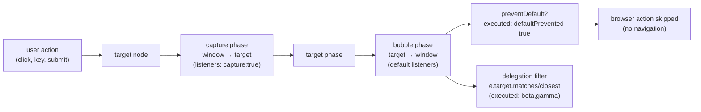

# The DOM and Events

## 1. Learning Objectives

After this lesson you can:

- [ ] Select, create, and update elements with the executed probe's APIs (`querySelector`, `append`,
      `dataset`, `DocumentFragment`)
- [ ] Trace an event through capture → target → bubble (executed trail) and place listeners where
      the trace says they belong
- [ ] Explain listener identity rules from the executed `hits=1` result and use
      `removeEventListener` correctly
- [ ] Build a delegation listener that serves elements created *after* it (executed `beta,gamma`)
- [ ] Cancel default behavior with `preventDefault` (executed `defaultPrevented: true`) and know
      when `passive` matters

## 2. Prerequisites

- [Arrays and Objects](arrays-and-objects.md) — iteration and object literals feed every snippet
- [07-HTML-AND-CSS](../07-HTML-AND-CSS/README.md) — you must know the markup you are manipulating
  (its semantic-html lesson is the contract this lesson's code edits)

## 3. Introduction

The **DOM** (Document Object Model) is the browser's live object representation of your HTML —
a tree of nodes your script can read and rewrite. The **event system** is how the page tells your
script what the user did. This lesson's transcript was executed in headless Chrome 156 by driving
a real page and dumping its DOM: every `log` line below is what the browser actually printed,
including the propagation trail and the `defaultPrevented` flag. Together, selection + mutation +
events are the entire "make the page behave" surface — the mental model React abstracts over, and
therefore the thing you must own before any framework.

## 4. The Problem It Solves

HTML alone is static; interactivity needs a *programmable view* of the document. Early attempts
(proprietary APIs per browser, inline `onclick` attributes) produced exactly the fragmentation
and mixing-of-concerns that HTML/CSS fought. The DOM standardized the tree, and the standard
event model added two things that still structure everything: **propagation** (an event travels
through ancestors, so one listener can serve a subtree) and **listener registration** (functions
attached at runtime, removable by identity). Without propagation you would need a listener on
every button ever created; with it, one listener on a container covers elements that do not exist
yet — the executed delegation line proves exactly that.

## 5. Core Concepts

### Selection: one API, CSS selectors

```console
== selection ==
getElementById #list: UL | querySelector .item: alpha | querySelectorAll .item: 2 nodes | CSS selector API also does: beta
```

`getElementById` is the fast single-id call; `querySelector(sel)` returns the **first** match or
`null`; `querySelectorAll(sel)` returns a **static NodeList** (a snapshot — the executed `2 nodes`
would not grow if the DOM changed after the call). The lesson's helper `$$` converts it to an
array (`[...root.querySelectorAll(sel)]`) to unlock `map`/`filter`. Crucially the selector syntax
is *the same CSS you already know* — `#list > li.item:nth-child(2)` worked in the probe — so there
is exactly one query language to learn, not two.

### Creation and update: `createElement`, `textContent`, `append`, `dataset`

```console
== creation and update ==
after append: alpha,beta,gamma | dataset roundtrip: li[data-order] -> gamma | after fragment: 5 items
innerHTML vs textContent: textContent of li = "gamma"
```

`document.createElement("li")` makes a detached node; `.append(...)` inserts it (accepting nodes
and strings; `append` also handles text — `appendChild` is nodes-only, the older sibling).
**`textContent` sets text safely** — it cannot introduce markup, which is the XSS rule: user data
in `textContent` or `setAttribute("value", …)`, never spliced into `innerHTML`. `li.dataset.order
= "3"` maps to the HTML attribute `data-order="3"` (and back: `$('[data-order="3"]')` found it) —
the DOM's camelCase↔kebab-case bridge for script-held data. The `DocumentFragment` row shows the
batch-insert idiom: collect many nodes in a fragment (it has no layout — appending children to it
does not trigger reflow), then append the fragment **once** — one layout pass instead of five.

### Propagation: capture → target → bubble

```console
== event propagation: capture -> target -> bubble ==
document-capture:add -> button-bubble
```

Click the `#add` button and the trail printed `document-capture:add -> button-bubble`. Read it as
the spec's three phases: the event travels **down** from the window to the target (capture phase —
the `document` listener was registered with the third argument `true`, so it fired on the way
down), then the target itself fires, then it **bubbles up** (the button's own bubble listener
fired; note `list-bubble` correctly did **not** fire — the button is not inside the list, so
ancestry, not proximity, decides who hears what). Two practical rules fall out: to intercept
*before* children handle an event, listen in capture; to react *after* children, listen in bubble
(the default). And bubbling is the mechanism delegation (below) rides.

### Listener identity: same function, one registration

```console
== listener behavior ==
same function registered twice fires once per click: hits=1 | removeEventListener silenced the handler
```

The probe registered the *same function reference* twice and one click produced `hits=1` — the
spec de-duplicates by (type, callback, capture) triple. Two consequences: re-registering the same
function is harmless (but re-rendering that creates *new* closures each time is not — each new
closure is a new identity, so the pile-up begins); and `removeEventListener` needs the **same
reference** you passed in — removing `() => handle()` or `obj.handle.bind(obj)` cannot work,
because you passed a different function object. That is why handlers are stored in variables (the
probe's `removable` function) and why `once: true` and `signal` (AbortController) exist for the
one-shot case.

### Delegation: one listener, future elements

```console
== delegation: one listener for future children ==
delegated clicks: beta,gamma
```

One listener on `#list` served both an existing `li` (`beta`) and the `gamma` item the script had
appended **after** setup — because events bubble from any descendant, the container hears them
all. The pattern: attach once on a stable ancestor, then filter with `e.target.matches("li.item")`
(…and usually `e.target.closest(selector)` when the click can land on a child *of* the item — a
span inside the button case). Benefits: O(1) listeners regardless of child count, automatic
coverage of dynamically-created elements, and no teardown needed per child — it is how every
table, list, and toolbar in production gets its behavior.

### Defaults: `preventDefault`, `SubmitEvent`, and `passive`

```console
== preventDefault and passive ==
submit defaultPrevented: true, navigated=false
```

Dispatching a cancelable `submit` event hit the listener, which called `e.preventDefault()` — the
event reports `defaultPrevented: true` and the probe's `navigated` flag went `false`. That is the
standard interception contract: the event still *propagates* (listeners elsewhere still see it);
only the browser's built-in action (navigation, following a link, opening a context menu) is
cancelled. Two relatives worth knowing: `stopPropagation()` stops the trail instead of the
default (different job — use sparingly, because ancestors often legitimately need the event);
and the `passive` option (`addEventListener("scroll", fn, { passive: true })`) *promises* you
will never call `preventDefault`, letting the browser skip the wait and scroll immediately —
relevant for `touchstart`/`wheel`/`scroll` performance.

## 6. How It Works



The diagram walks one executed event: the action produces a target; the event travels down
(capture), hits the target, then travels up (bubbles — where delegation listens); at any point a
listener may cancel the default (the probe's `defaultPrevented: true`) while propagation itself
continues. Everything the probe printed is one of these boxes.

## 7. Practical Examples

**Example 1 — the executed probe, condensed (minimal case)**

```html
<!-- save as dom.html, open in any browser, read #log -->
<ul id="list"><li class="item">alpha</li><li class="item">beta</li></ul>
<button id="add">add</button>
<pre id="log"></pre>
<script>
const log = (s) => document.querySelector("#log").textContent += s + "\n";

// propagation trail
const trail = [];
document.addEventListener("click", e => trail.push("capture:" + e.target.id), true);
document.querySelector("#list").addEventListener("click", () => trail.push("list-bubble"));
document.querySelector("#add").addEventListener("click", () => trail.push("button-bubble"));
document.querySelector("#add").click();
log(trail.join(" -> "));        // capture:add -> button-bubble

// delegation covers future children
const hits = [];
document.querySelector("#list").addEventListener("click", e => {
  if (e.target.matches("li.item")) hits.push(e.target.textContent);
});
const li = document.createElement("li");
li.className = "item"; li.textContent = "gamma";
document.querySelector("#list").append(li);
li.click();
log("delegated: " + hits.join(","));   // delegated: beta,gamma (if beta clicked first)
</script>
```

- What the important lines do: capture listener registered with `true`; trail shows ancestry;
  delegation filters with `matches`; `append` of a created node.
- **Expected output:** `capture:add -> button-bubble` and a `delegated:` line (executed in
  headless Chrome 156; the full probe's log is quoted throughout this lesson).
- **How to run it:** open the file in a browser console, or the probe's exact harness:
  `chrome --headless --dump-dom file:///path/dom.html`.
- **Assumptions:** any evergreen browser (executed: Chrome 156).

**Example 2 — a todo list with delegation (realistic use case)**

```html
<div id="todos">
  <input id="new" placeholder="add a task">
  <ul id="items"></ul>
</div>
<script>
const items = document.querySelector("#items");
const input = document.querySelector("#new");

// ONE listener for current and future todos (executed pattern)
items.addEventListener("click", e => {
  const li = e.target.closest("li");            // click may land on inner text/span
  if (!li) return;
  if (e.target.matches(".done")) { li.classList.toggle("completed"); }
  if (e.target.matches(".del"))  { li.remove(); }
});

input.addEventListener("keydown", e => {
  if (e.key !== "Enter" || !input.value.trim()) return;
  e.preventDefault();                            // no form here, but habit for Enter-on-input
  const li = document.createElement("li");
  li.innerHTML = "";                             // structure only — no user data
  const span = document.createElement("span");
  span.textContent = input.value.trim();         // USER DATA → textContent (XSS rule)
  li.append(span, mkBtn("done", "✓"), mkBtn("del", "✕"));
  items.append(li);
  input.value = "";
});
function mkBtn(cls, label) {
  const b = document.createElement("button");
  b.className = cls; b.textContent = label; return b;
}
</script>
```

- What the important lines do: one delegated listener serves every todo ever added;
  `closest` handles clicks on inner content; user input goes in via `textContent` (never
  `innerHTML`); the item is built with created nodes and `append`.
- **Expected output:** (interactive) tasks add on Enter; ✓/✕ work on items added before or after
  the listener was attached — the delegation guarantee the probe executed.
- **How to run it:** open in a browser; DevTools console for inspection.
- **Assumptions:** evergreen browsers; no framework.

## 8. Real-World Applications

- **Virtualized tables/lists and data grids** rely on delegation — one listener per grid, not per
  cell, because cells number in the thousands.
- **Form validation UX** uses `input`/`change`/`submit` events with `preventDefault` for
  AJAX-style submit — the exact flow [forms and validation](../07-HTML-AND-CSS/forms-and-validation.md)
  designed, now wired in JS (and later typed in the TypeScript half).
- **Global hotkeys** (`document.addEventListener("keydown", …)`) — the target is the focused
  element, but the trail bubbles to document, which is where shortcuts live.
- **Synthetic event testing** — the probe's `.click()` / `dispatchEvent` calls are how component
  tests simulate user actions without a real mouse (subject 14).

## 9. Common Mistakes

| Mistake | Why it happens | How to recognize it | How to prevent it |
|---|---|---|---|
| New closure per render, listener pile-up | each `() => fn()` is a new identity (probe: same fn → `hits=1`) | handlers fire N times after N renders | stable references; or delegation once; or `AbortController` teardown |
| `removeEventListener` no-ops | you passed a fresh wrapper/`bind` result | handler still fires after "removal" | store the exact reference (probe's `removable`), or `{ once: true }` |
| `innerHTML` with user data | string concatenation is convenient | stored-XSS vulnerability | `textContent` / `createElement` (probe used both safely) |
| Listening on every child | no propagation awareness | O(n) listeners, leaks on delete | one container listener + `matches`/`closest` (executed `beta,gamma`) |
| `stopPropagation` everywhere | misusing it as "done" | ancestors' legitimate handlers never run | let it bubble; cancel only the *default* (`preventDefault`) |

## 10. Best Practices

- **Query with `querySelector`/`querySelectorAll`** — one selector language shared with your CSS
  (the probe's `#list > li.item:nth-child(2)` proves the overlap).
- **Delegation on stable containers** for lists/toolbars; per-element listeners only for
  long-lived, isolated controls.
- **User data always via `textContent`**; `innerHTML` only for trusted, authored template
  fragments (or use `replaceChildren` + created nodes throughout).
- **Batch DOM writes**: build in a `DocumentFragment` (executed: one append for many nodes), and
  follow the reflow discipline from [browsers and rendering](../06-INTERNET-AND-WEB-FOUNDATIONS/browsers-and-rendering.md)
  (read geometry after writes, not between).
- **Pair `keydown` Enter with `preventDefault` in inputs** to stop phantom submissions, and
  listen `passive` for scroll/touch when you will not cancel.
- **Teardown is real**: in SPA routes/components, remove listeners or use one
  `controller = new AbortController()` passed as `{ signal }` — bulk-removal in one line.

## 11. Limitations and Trade-Offs

- **The DOM is slow at scale** — thousands of nodes with frequent mutation cause layout thrash;
  that cost is the *reason* frameworks batch updates and virtualize lists. Delegation solves
  listener scaling, not rendering scaling — a different problem with a different fix.
- **Propagation can surprise you**: library code calling `stopPropagation` starves your ancestor
  listener; understanding the trail (executed) is how you diagnose "my handler never fires".
- **Synthetic events differ from real ones** — probe `.click()` does not produce trusted
  user-gesture context (`isTrusted: false`), which matters for fullscreen/clipboard/paywalls;
  tests must account for it (subject 14 covers the seam).
- **`innerHTML` remains the fast path for static chunks** and a constant XSS footgun — the
  trade-off is audited constantly; when unsure, `textContent` + created nodes, as the probe did.
- **This lesson is vanilla by design**: React replaces direct listener attachment with synthetic
  events *on the root* — which is delegation again, plus a scheduler. Owning this lesson makes
  that abstraction legible instead of magical.

## 12. Practical Exercises

### Introductory

1. **Exercise 5.1** — Reproduce the executed propagation trail in your own page with **four**
   listeners (capture on `document`, bubble on `body`, on the button, and on a sibling), click,
   and record the exact order. Then move the button inside the list and record the new order —
   showing `list-bubble` now appears.
   **Completion criteria:** two trails captured; the difference explained by ancestry;
   the capture flag's effect demonstrated by toggling it.
2. **Exercise 5.2** — Demonstrate listener identity: register the same named function twice,
   click once (`hits=1`); register an inline arrow twice, click once (fires twice); then
   `removeEventListener` the named one and show silence.
   **Completion criteria:** three states executed; the identity rule (type, callback, capture)
   stated; one sentence on why a re-rendering UI that recreates arrows leaks handlers.

### Intermediate

3. **Exercise 5.3** — Build the todo example (Example 2) and extend it: double-click an item's
   text to edit it inline (`contentEditable` or swap to `input`), Enter commits via `textContent`,
   Escape cancels. All through the **one** delegated listener.
   **Completion criteria:** add/edit/complete/delete work on items created before *and* after
   load; no per-item listeners in the code (grep for `addEventListener` count — exactly 2-3
   total); user input never touches `innerHTML`.
4. **Exercise 5.4** — Performance pair: attach 1,000 rows' worth of behavior (a) per-row and
   (b) delegated; count listeners (instrument `addEventListener`) and time a scripted click storm
   (loop `row.click()`). **Completion criteria:** counts and timings recorded; the scaling story
   (1000 vs 1) stated with your numbers; one sentence on where per-row listeners are still right
   (isolated, long-lived, few).

### Independent problem-solving

5. **Exercise 5.5** — *Problem:* a modal dialog must trap keyboard focus (Tab cycles inside),
   close on Escape or backdrop click, restore focus to the opener, and not leak listeners when
   opened/closed a hundred times. Design the event layer: which listeners, on which targets,
   capture or bubble, how teardown works (AbortController?), how the trail interacts with page
   content underneath, and how `preventDefault`/`stopPropagation` are used (and where they must
   NOT be). State your accessibility contract by referencing subject 07's keyboard pass.
   **Completion criteria:** executed open/close cycle ×100 with a listener count that does not
   grow; Tab-cycle verified with real key events; focus restore verified; every
   `preventDefault`/`stopPropagation` call site justified — including at least one case you
   deliberately *didn't* use either; the a11y checklist cross-referenced (focus-visible, Escape,
   no trap for screen readers — only for keyboard focus containment, which is the intended trap).

*Solutions: attempt first. This subject's applied work is in [exercises/](exercises/README.md) —
set 4 carries this lesson's practice.*

## 13. Knowledge Check

1. The executed trail was `document-capture:add -> button-bubble` — why did `list-bubble` not
   fire, and what changes if the button is moved inside the list?
2. A component re-renders 50 times, each pass adding `btn.onclick = () => …`-style listeners via
   `addEventListener(() => …)`. Explain the bug using the identity evidence (`hits=1`) and give
   two fixes.
3. When is `preventDefault` correct but `stopPropagation` wrong? Give a concrete event and the
   ancestor that legitimately needs it.

## 14. Completion Criteria

Observable evidence that you have understood this lesson:

- [ ] You reproduced the trail and the delegation lines from your own page (exercise 5.1)
- [ ] You demonstrated all three listener-identity states (exercise 5.2)
- [ ] You built the delegated todo list with ≤3 listeners total (exercise 5.3)
- [ ] You measured per-row vs delegated listener counts (exercise 5.4)
- [ ] You can diagnose all five mistakes in section 9, including the closure-per-render leak

## 15. Summary

- The DOM is a node tree queried with CSS selectors — `querySelector(All)` returns first/snapshot;
  `$$` + spread makes it array-workable.
- Create with `createElement`, set text with `textContent` (the XSS rule), insert with `append`,
  batch via `DocumentFragment` (executed: 5 items, one append).
- Events travel capture → target → bubble; ancestry decides who hears what (executed trail) — and
  bubbling is what delegation rides.
- Listener identity is (type, callback, capture): same function twice = one registration
  (`hits=1`); removal needs the same reference.
- `preventDefault` cancels the browser action while propagation continues (executed
  `defaultPrevented: true`); `passive` promises you won't call it.

## 16. Next Steps

- Next: [Modules](modules.md) — organizing these scripts across files with `import`/`export`
- Practice: [exercises/](exercises/README.md) — set 4
- Where it is applied: [09-FRONTEND-ENGINEERING](../09-FRONTEND-ENGINEERING/README.md) — React's
  synthetic events are delegation on the root, exactly as this lesson executed it
