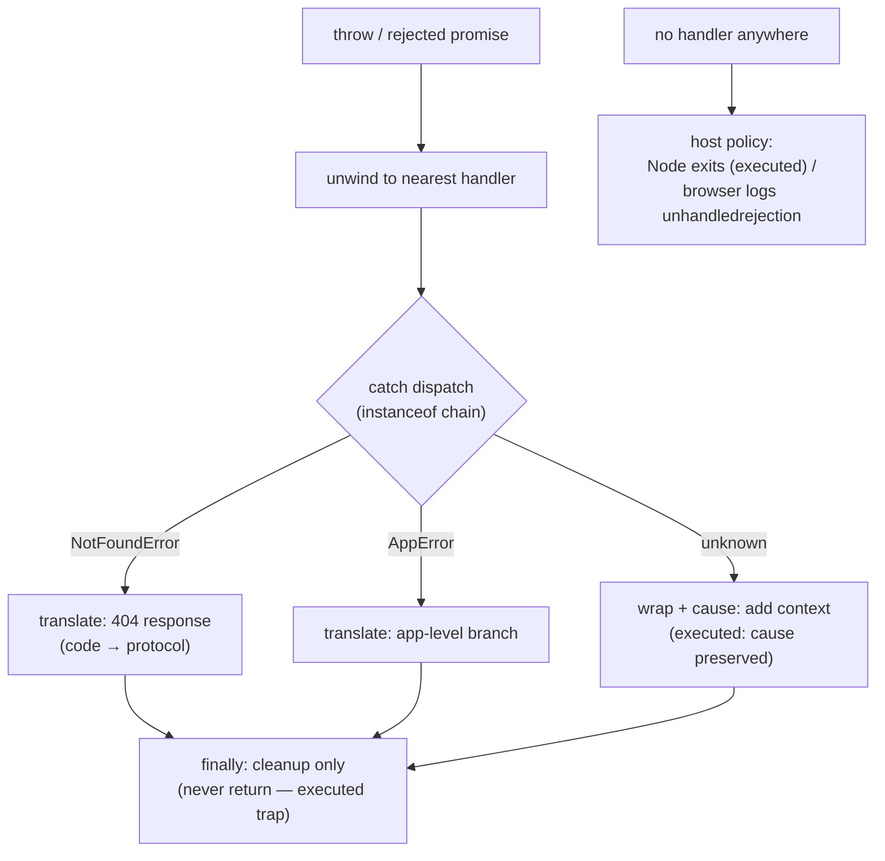

# Error Handling

## 1. Learning Objectives

After this lesson you can:

- [ ] Trace `try → catch → finally → after` in order and explain both executed `finally` return
      behaviors (preserve vs override)
- [ ] Design a custom error hierarchy and dispatch on it with `instanceof` (executed:
      `NotFoundError` → 404 branch)
- [ ] Preserve root causes when wrapping with `new Error(msg, { cause })` (executed comparison)
- [ ] Place async error boundaries correctly — awaited frame vs fire-and-forget `.catch`
      (both executed) — and prevent the executed unhandled-rejection process crash
- [ ] Choose where to catch: swallow, translate, or rethrow — with a stated boundary policy

## 2. Prerequisites

- [Promises and async/await](promises-and-async-await.md) — rejections and `await` semantics
- [Functions and Scope](functions-and-scope.md) — call stacks and scope
- [02-PROGRAMMING-FUNDAMENTALS](../02-PROGRAMMING-FUNDAMENTALS/debugging-fundamentals.md) —
  failure classification (syntax/runtime/logic) from the Python half

## 3. Introduction

Errors are not edge cases — they are half the program's control flow: network failures, bad
input, missing files, violated invariants. JavaScript gives you `throw`/`try`/`catch`/`finally`
plus a small ecosystem of built-in error types; what it does *not* give you is a policy. That is
design work: where boundaries sit, what each layer adds, what gets logged, what the caller sees.
This lesson's transcripts were executed on Node 24.13.1, and one more piece of evidence comes
from the promises lesson's real crash: a rejected promise with no handler **terminated the
process** — the same design failure, wearing async clothes.

## 4. The Problem It Solves

Two failure styles compete. **Error codes** (`if (result === ERR_NOT_FOUND)`) scale badly:
every call site must check, forgetting is silent, and the error travels far from its origin
without context. **Thrown exceptions** unwind the stack to the nearest handler — errors are
*forced* into your path instead of sitting next to the return value waiting to be ignored. The
JavaScript ecosystem chose throwing, and the async migration (promises) kept it — a rejected
promise *is* a thrown error carried on a queue. What goes wrong without discipline: the
`catch {}` that swallows, the wrap that discards the root cause (executed below), the boundary
that never exists so Node's default policy kills the process (executed in the promises lesson),
and the `finally` whose `return` silently overrides everything above it (executed in this one).

## 5. Core Concepts

### The four segments, in executed order

```console
== throw is just an expression; try/catch/finally order ==
try -> catch:caught-here -> finally -> after
```

`throw` is an *expression* (you can throw anything — conventionally an `Error` subclass);
execution jumps to `catch`, then **always** runs `finally`, then continues after the whole
statement (the probe's `after`). Two properties fall out: `finally` runs on the success path too
(the cleanup guarantee — close files, release locks, clear timers), and control *never* skips it
short of a crash or `process.exit`. The parallel console section also showed `catch` without a
binding (`} catch { … }`) — legal when you don't need the error object, e.g. an intentional
ignore; pair it with a comment, because an unnamed catch reads as a swallow.

### `finally` and the return trap

```console
== finally wins over catch's return ==
no return in finally: from-try | return in finally: from-finally
```

Both branches executed. Without a `return` in `finally`, the `try`'s return value survives —
`finally` is pure cleanup. **With** a `return` in `finally`, it *overrides* the in-flight result
(or a pending throw!) — `"from-finally"` won. That is legal, spec-defined, and a code smell:
it silently discards both results and exceptions above it. The rule (and the lint-practice):
`finally` performs side effects only — never `return`, never swallow, never mutate a result —
because the next reader will not expect the transfer, and neither will you at 3 a.m.

### Custom error classes: identity that survives the throw

```console
== custom error classes: identity survives the throw ==
instanceof Error: true | instanceof AppError: true
name/code: NotFoundError 404 | message: report 42 not found
dispatch by class: 404 branch
```

`class AppError extends Error` adds structure (`code`, a `name` reset — subclass `name` defaults
to `Error` without the assignment the probe made); `NotFoundError extends AppError` builds the
hierarchy. The `instanceof` chain proves **identity survives unwinding**: an error thrown deep
still matches the base type at any outer boundary (`instanceof Error: true`), so a top-level
handler can always treat "an error" generically while inner handlers dispatch precisely
(`404 branch` executed). The design rule follows directly: **one class per failure your code
*handles differently*** — the dispatch table in the probe (`NotFoundError` → 404,
`AppError` → generic app branch, else unknown) is the pattern; a class for every message is
noise. For wire protocols, the `code` field (`404`) is what maps to HTTP status or retry logic.

### Preserving causes: `new Error(msg, { cause })`

```console
== rethrow keeps the chain; wrapping loses it unless cause ==
without cause: root lost (wrapped.cause: undefined)
with cause: root preserved: true - root cause
```

The executed pair is the whole argument. Re-throwing a caught error unwinds *with* its identity
(silently correct), but wrapping it in a context error (`new Error("wrapper")`) **replaces** the
chain — `cause: undefined`, root gone, logs now start at the wrapper. The fix is one option:
`new Error("wrapper", { cause: e })` — executed: `withCause.cause instanceof Original: true`,
message `"root cause"` preserved. This is the modern contract for every boundary that adds
context ("failed to save report" + the real `TypeError` underneath): translation at boundaries,
identity through layers. `AggregateError` (met in the `Promise.any` lesson) is the same idea for
many causes.

### Async boundaries: awaited vs fire-and-forget (both executed)

```console
== catch is per-call: async boundaries ==
async error caught in the awaiting frame: async-error
fire-and-forget handled via .catch: async-error
```

Both paths executed and both *worked* — but by different mechanisms, and only one is default.
`await failAsync()` inside `try` transfers the rejection into the `catch` like a synchronous
throw. A *fire-and-forget* `const p = failAsync()` transfers nothing — until a `.catch` exists
to observe it. Absent that handler, the promises lesson's probe died:
`Error: no → Node.js v24.13.1` — Node's `--unhandled-rejections=throw` default. The boundary
placement rule: **every async entry point ends in a terminal `catch`** (route handler, event
callback, script main), and every promise *created* must be awaited or `.catch`ed in the same
logical operation — never parked across an unrelated await (the executed crash's exact sequence).
In the browser the host only *logs* `unhandledrejection`, so the bug hides longer; same bug,
different visibility.

### Assertion-style guards: fail loudly at the boundary

```console
== assertion-style: fail loudly at the boundary ==
guard caught: assertion failed: user must exist
```

The probe's `assertDefined` throws `TypeError` on a violated precondition instead of letting
`null` propagate into a confusing downstream `TypeError` at line 400. This is "fail fast with the
*real* reason": guard at the seam where the invariant belongs (function entry, parser output,
data from storage), name what failed, and let the boundary decide what that means for the user.
It is the same philosophy as the executed TDZ and freeze `TypeError`s — loud, early, attributed —
extended to your own invariants, which the language cannot check for you.

## 6. How It Works



The diagram is the executed dispatch flow: an error unwinds to the nearest boundary; `instanceof`
chooses the translation (the probe's `404 branch`); wrapping preserves the root via `cause`; the
implicit `finally` is cleanup-only (the override trap); and the orphan path is the crash the
probes actually took when no boundary existed.

## 7. Practical Examples

**Example 1 — the executed toolkit (minimal case)**

```js
// errors.mjs — node errors.mjs (executed on Node 24.13.1)
try { throw new Error("caught-here"); }
catch (e) { console.log("catch:", e.message); }
finally { console.log("cleanup runs always"); }

class AppError extends Error {
  constructor(message, code) { super(message); this.name = "AppError"; this.code = code; }
}
class NotFoundError extends AppError {
  constructor(res, id) { super(`${res} ${id} not found`, 404); this.name = "NotFoundError"; }
}
const e1 = new NotFoundError("report", 42);
console.log(e1 instanceof Error, e1.name, e1.code);   // true NotFoundError 404

try { inner(); } catch (e) {
  const wrapped = new Error("failed to load", { cause: e });
  console.log(wrapped.cause.message);                 // root cause kept (not undefined)
}
function inner() { throw new Error("root cause"); }
```

- What the important lines do: order guarantee; hierarchy with `code`; `cause` option retaining
  the root.
- **Expected output:** `catch: caught-here` / `cleanup runs always` / `true NotFoundError 404` /
  `root cause`.
- **How to run it:** `node errors.mjs`.
- **Assumptions:** Node ≥ 16.9 (`cause` option); browsers ≥ 2023 equivalently.

**Example 2 — an HTTP service boundary (realistic use case)**

```js
// The one place errors become responses: translate, log with cause, never swallow.
class ValidationError extends AppError { constructor(fields) { super("validation failed", 400); this.fields = fields; } }
class UpstreamError extends AppError { constructor(cause) { super("upstream unavailable", 502, { cause }); } }

async function handler(req, res) {
  try {
    const data = await parseBody(req);            // may throw SyntaxError (cause candidate)
    const saved = await db.save(data);            // may throw UpstreamError
    res.status(200).json(saved);
  } catch (err) {
    if (err instanceof ValidationError) {
      res.status(400).json({ error: err.message, fields: err.fields });  // expected: no log noise
    } else if (err instanceof AppError) {
      res.status(err.code).json({ error: "request failed" });            // mapped by code
      log.warn({ msg: "app error", code: err.code, cause: err.cause });  // context kept
    } else {
      // UNKNOWN: wrap with cause — root preserved (executed), user sees generic 500
      const wrapped = new Error("internal error", { cause: err });
      log.error({ msg: "unhandled", stack: wrapped.stack, cause: wrapped.cause?.message });
      res.status(500).json({ error: "internal error" });
    }
  } finally {
    // cleanup only: release request-scoped resources; NO return here (executed trap)
  }
}
// Registration is the boundary contract — no promise leaves unobserved (the crash rule):
process.on("unhandledRejection", (err) => log.fatal({ msg: "unobserved rejection", err }));
```

- What the important lines do: typed branches for *distinguishable* outcomes (400 vs 502 vs 500);
  unknown errors wrapped **with `cause`**; logging carries the cause the user never sees; the
  `finally` has no `return`; a process-level observer catches what the boundary missed (a monitor —
  per exercise 7.2's distinction — *in addition to*, never instead of, per-call handling).
- **Expected output:** status/body per error type; cause strings in logs; exit without
  unhandled-rejection noise (each combinator's behavior executed in the promises lesson).
- **How to run it:** with your framework of choice (Node HTTP server or subject 11's stack); the
  error-class and `cause` mechanics executed above stand alone.
- **Assumptions:** a framework/router supplies `req`/`res`; `AppError` from Example 1.

## 8. Real-World Applications

- **HTTP layers map classes → status codes** exactly as Example 2 — `err.code` or an
  `instanceof` table; the wire protocol is a *translation* of your internal hierarchy.
- **Retries and circuit breakers** dispatch on `code`/class (retry 502/timeout; never 400) — the
  `code` field the probe attached is what those systems branch on.
- **Logging pipelines** key off `cause` chains and `code` for grouping/alerting; a boundary that
  wraps without `cause` (executed `undefined`) breaks incident diagnosis at exactly the wrong
  moment.
- **Boundary handlers everywhere**: Express/Next error middleware, `window.onerror` +
  `unhandledrejection` listeners (browser observability), and test runners' "unhandled rejection"
  failures — all are this lesson's terminal-catch rule at different altitudes.

## 9. Common Mistakes

| Mistake | Why it happens | How to recognize it | How to prevent it |
|---|---|---|---|
| `finally { return … }` | cleanup and result conflated | results/rejections silently replaced (executed `from-finally`) | side effects only in `finally`; lint rule against return there |
| Wrapping without `cause` | pre-ES2022 habit | root `undefined` in logs (executed) | always pass `{ cause: e }`; or rethrow unwrapped |
| Empty/unnamed catch | "make it stop" reflex | bug vanishes until data corrupts | catch = handle *or* translate *or* rethrow — name the choice; comment intentional ignores |
| Un-awaited async at boundaries | fire-and-forget convenience | Node exits (executed `Error: no`); browser `unhandledrejection` | terminal `.catch`/`try-await-catch` on every entry point; no parked promises |
| A class per error message | hierarchy enthusiasm | giant `instanceof` chains nobody branches on | one class per *distinguishable handling*; messages and `code` for the rest |

## 10. Best Practices

- **Catch at boundaries, not everywhere**: inner layers *translate and rethrow* (with `cause`);
  outer layers *decide user-facing outcome* — the executed dispatch table gets exactly one home.
- **Custom class per handling difference; `code` for protocol** — the probe's
  `NotFoundError(404)` + `instanceof` dispatch is the minimal shape; `cause` for every wrap.
- **`finally` = cleanup only** — the executed override is spec-legal and indefensible in review.
- **Observe every promise**: awaited in `try`, `.catch`ed at creation, or watched by a
  process/page-level observer — with the documented understanding that the observer is a safety
  net (monitor), not the handling (executed crash is the difference).
- **Throw `Error` subclasses, never strings** — strings lose `stack`, `instanceof`, and `cause`
  (the whole toolkit above needs objects).
- **Fail fast at seams with assertions** (executed `assertDefined`) — your invariants deserve the
  TDZ's loudness.

## 11. Limitations and Trade-Offs

- **Exceptions are control flow with a cost**: `try` frames are cheap in modern engines but not
  free in extreme hot loops; more importantly, thrown control flow is *invisible in signatures* —
  JavaScript has no checked exceptions, so the caller can forget a failure that TypeScript (this
  subject's second half) also won't see. The mitigation is honest documentation and types for
  *expected* failures (`Result`-style returns for routine cases), exceptions for exceptional ones —
  a policy debate worth having per subsystem, not a universal answer.
- **Stack traces are engine-formatted and minified in production** — the executed `stack` first
  line (`TypeError: bad-type`) is readable locally; shipped bundles need source maps (subject 09)
  before traces mean anything.
- **The `cause` chain is opt-in history**: deep chains can bury the actionable message; keep wraps
  to layers that add *user-meaningful context*, and let the message surface the class.
- **Host policies differ** (Node exits, browsers log — both observed/known here): a design that
  "works because Node tells you" will silently accumulate errors in the browser; only your own
  boundaries are portable.
- **`AggregateError` from `Promise.any`** flattens multiple causes — the combinator lesson's
  failure case — and requires its own handling habit (iterate `errors[]`), which practice sets
  exercise.

## 12. Practical Exercises

### Introductory

1. **Exercise 9.1** — Reproduce all four executed order/return probes in your own file:
   (a) `try/catch/finally/after` order, (b) `finally` without return, (c) `finally` *with*
   return overriding, (d) a `finally` returning while `try` *throws* (prove it swallows the
   throw too). **Completion criteria:** four transcripts; (d) explicitly showing no exception
   escapes; one sentence stating the complete "what `finally` can override" list.
2. **Exercise 9.2** — Build a two-level hierarchy (`DomainError` → `PaymentError`) with `code`s,
   throw from depth, and dispatch at three nesting levels (`instanceof` at each). Then delete the
   `this.name = …` assignments and observe what `e.name` reports — capturing the inherited-name
   pitfall the probe avoided.
   **Completion criteria:** dispatch transcripts at each level; the `name` pitfall captured with
   the fix; the "class per handling difference" rule applied to your two classes (one sentence
   each on why they must be distinct).

### Intermediate

3. **Exercise 9.3** — The wrapping audit: take a function that catches and rethrows three
   different errors, wrap each with `new Error(…)` *without* `cause` (capture `cause: undefined`),
   then fix with `cause` and show the three roots preserved. Add `AggregateError` over two of
   them and iterate its `.errors` to list both roots.
   **Completion criteria:** before/after transcripts; both roots listed from the aggregate; a
   one-line policy for when a wrap is worth it vs plain rethrow.
4. **Exercise 9.4** — Async boundary trio: an awaited failure (caught in `try`), a fire-and-forget
   *with* `.catch`, and a fire-and-forget *without* any handler — run the third **in a child
   process** (`node orphan.mjs`) and capture the host's decision (exit code + message). Then add
   `process.on("unhandledRejection")` and show the process survives while the monitor logs.
   **Completion criteria:** three transcripts; exit status recorded for the orphan (the executed
   `Error: no` family); monitor-vs-boundary distinction restated in your own words with the
   caveat that the monitor still doesn't *handle*.

### Independent problem-solving

5. **Exercise 9.5** — *Problem:* design the error taxonomy and boundary map for a payments-style
   service with three layers (parse → validate → charge via upstream): classify failures into
   *expected* (bad input, declined charge) vs *unexpected* (bug, timeout-unknown-outcome — the
   nastiest class: did the charge land?), give each a class/`code`, say what each layer does
   (translate+`cause`? retry? rethrow?), where exactly the terminal catch lives, what the log
   carries vs the response, and how idempotency keys answer the unknown-outcome case. Include the
   executed-evidence citations: `cause` preservation, `finally` override danger, the unhandled-
   rejection crash, and the `instanceof` dispatch — one design decision each.
   **Completion criteria:** taxonomy table (class, code, layer action, response, log) with no
   class that has no branch; boundary map naming every async entry and its terminal handler;
   the unknown-outcome strategy stated (retry semantics, not just "retry"); every cited executed
   transcript quoted correctly with what it proves; one honest trade-off (e.g., where expected
   failures become return values instead of exceptions — and why that boundary was chosen).

*Solutions: attempt first. This subject's applied work is in [exercises/](exercises/README.md) —
set 8 carries this lesson's practice.*

## 13. Knowledge Check

1. Quote the executed order line and derive: does `finally` run if `catch` itself throws? What
   guarantees it, and what is the one host action that skips it?
2. The probe shows `wrapped.cause: undefined` beside `withCause.cause … true`. What class of
   production bug does the first line cause that the second prevents? (Think: the 3 a.m. log.)
3. A teammate says "unhandled rejections are fine — the browser just logs them." Using the two
   executed host behaviors (Node exit; browser log), state why the browser case is arguably
   *worse*, and give the boundary rule that makes hosts irrelevant.

## 14. Completion Criteria

Observable evidence that you have understood this lesson:

- [ ] You reproduced all four `finally` variants including the throw-swallowing one (exercise 9.1)
- [ ] You dispatched a hierarchy at three levels and captured the `name` pitfall (exercise 9.2)
- [ ] You ran the wrapping audit with `AggregateError` listing both roots (exercise 9.3)
- [ ] You captured the orphan rejection's host decision and the monitor's behavior (exercise 9.4)
- [ ] You can diagnose all five mistakes in section 9 from their signatures alone

## 15. Summary

- `throw` unwinds to the nearest `catch`; `finally` always runs after — and a `return` there
  overrides results *and* throws (executed `from-finally`).
- Custom classes carry identity through unwinding (`instanceof` dispatch executed); one class per
  handling difference, `code` for protocol.
- Wrapping without `{ cause }` erases the root (executed `undefined`); with it, diagnosis
  survives every layer.
- Async boundaries: awaited `try` and creation-site `.catch` are handling; the process/page
  observer is a monitor — the orphan probe died exactly where only a monitor existed.
- `finally` cleans up; boundaries translate; unknowns wrap with cause and a generic response;
  your own invariants fail loudly.

## 16. Next Steps

- Next: [TypeScript Fundamentals](typescript-fundamentals.md) — the type system that catches
  whole error classes *before* runtime
- Practice: [exercises/](exercises/README.md) — set 8
- Where it is applied: [15-APPLICATION-SECURITY](../15-APPLICATION-SECURITY/README.md) — error
  responses are an information-disclosure surface; the generic-500 rule above is security, not
  politeness
