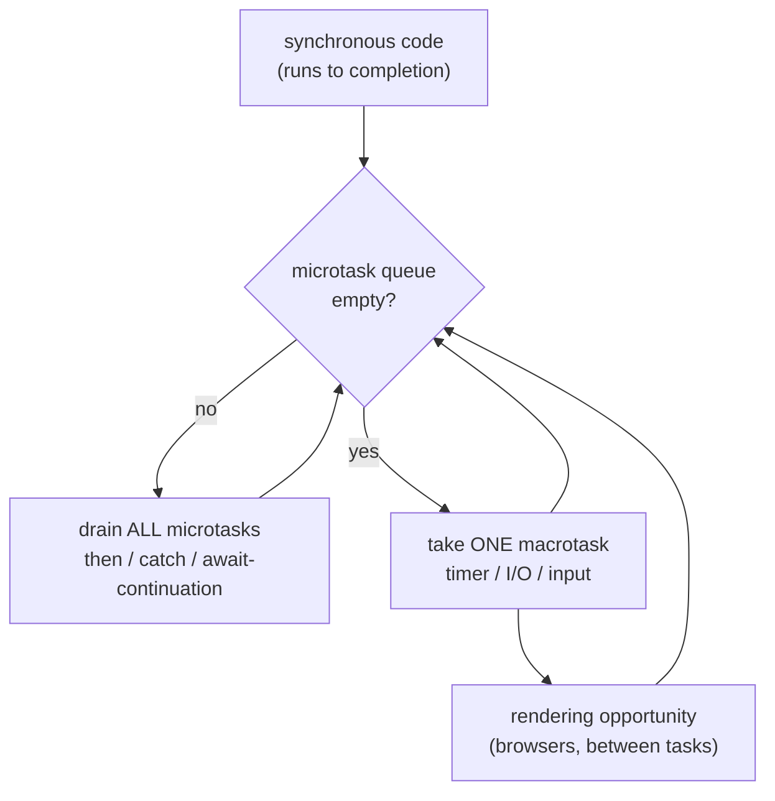

# The Event Loop

## 1. Learning Objectives

After this lesson you can:

- [ ] Predict the executed order of mixed sync/microtask/macrotask code from the transcript's
      three probes (ordering puzzle, interleaved trace, async-resume trace)
- [ ] State what `await` actually does — which queue resumes the function (executed:
      `after await` before `timeout`)
- [ ] Explain why `micro-3` ran before the chained `micro-2` (the extra-`.then`-hop rule)
- [ ] Describe starvation: why an unbounded microtask loop blocks every timer (bounded demo
      executed; the unbounded case named honestly)
- [ ] Convert a serial `await` loop into parallel and account for the executed timing shape
      (70 ms vs 44 ms)

## 2. Prerequisites

- [Promises and async/await](promises-and-async-await.md) — promise states and `await` syntax
- [Functions and Scope](functions-and-scope.md) — callbacks as the loop's units of work

## 3. Introduction

JavaScript runs on **one thread**, yet servers built on it handle thousands of concurrent
connections. The resolution is the **event loop**: your code runs to completion synchronously, and
everything else — timers, I/O, clicks, promise callbacks — is a *queued job* the engine runs when
the stack is empty, in a defined order. That order is what makes asynchronous code predictable
instead of racy, and "predict the output of five mixed callbacks" (the README's stated outcome)
is a skill you build from exactly the traces below — all executed on Node 24.13.1, plus the
browser-visible consequence: `setTimeout(fn, 0)` runs *last*.

## 4. The Problem It Solves

If JavaScript had threads with shared mutable state (like Java), every array in your app would
need locks; if it blocked the thread on I/O (like early synchronous server code), one slow query
would idle the whole process. The event loop sidesteps both: **no user-visible locking** (one
piece of user code runs at a time, to completion) and **non-blocking I/O** (the OS/kernel notifies
the engine, which queues your callback). The price is that *ordering is now a discipline you must
know*: two promises and a timer do not run in the order written but in the order of their
queues — and if you don't know the queues, you're guessing. This lesson makes the order
derivable.

## 5. Core Concepts

### Two queues: microtasks and macrotasks

The engine runs the current synchronous code first, then **drains the microtask queue**
(promise `then`/`catch`/`finally` callbacks, `queueMicrotask`, `await`-resumptions) *completely*,
then takes **one** macrotask (timer, I/O, input event) and drains microtasks again — repeat
forever. Executed, the classic puzzle:

```console
1 start
2a sync
3 microtask (queueMicrotask)
2b then (microtask)
2c then (microtask)
microtask chain drained after 3 hops (an unbounded pump would starve every timer)
4 timeout (macrotask)
```

Read the order against the code: the two `console.log`s written first printed first (`1`, `2a` —
synchronous work always completes before any queue); then *every* microtask, in insertion order —
`queueMicrotask` was registered before the two `.then`s, so `3` precedes `2b`/`2c` (both
promises were already resolved, so their callbacks were queued immediately at registration); then
the timer, last, on the next loop turn. The fourth line is the probe deliberately chaining three
bounded microtask hops to show the drain: the engine exhausts microtasks before ever looking at a
timer — which is both the ordering rule and, unbounded, the starvation rule (below).

### The interleaved trace: one drain, then one timer slice

```console
run order: sync-A -> sync-B -> micro-1 -> micro-3 -> micro-2 -> timeout-1 -> timeout-2 -> timeout-3
```

This is the same rule with more evidence, and one subtle gem. All synchronous pushes came first
(`sync-A -> sync-B` — the whole script body, remember, is one synchronous run). Then the
microtasks: **`micro-1 -> micro-3 -> micro-2`** — `micro-3` is a *direct* `.then` on
`Promise.resolve()`, queued at registration; `micro-2` comes from `.then(a).then(b)` — the
second link's callback can only be queued **after** the first link's resolves and runs, so it
takes one extra loop of the queue and lands behind `micro-3`, despite being *registered* earlier.
That "chained `.then` costs a hop" fact is the single most exam-worthy line here: registration
order orders same-lane callbacks; chaining inserts an extra drain cycle. Only then did the
timers fire — `timeout-1 -> timeout-2 -> timeout-3` in registration order (timers of equal delay
run FIFO) — one macrotask *each* turn? No: all three fit because each timer callback is one
macrotask, and between each the engine re-drains microtasks (there were none left) — the timers
still preserve their registration order within the timer phase.

### What `await` does: suspend, queue, resume on microtasks

```console
async resume order: sync -> before await -> sync-end -> after await -> micro inside async -> timeout
```

The most important trace in the lesson. An `async` IIFE ran to `await null` and **suspended** —
the rest of the function (its resumption) became a microtask queued behind everything already
there; control returned to the caller (`sync-end` printed *after* `before await`, proving the
function did not block). On the drain: `after await` resumed first (it was queued before the
`micro inside async` line, which was registered inside the resumption), and the
`micro inside async` callback still ran **before** `timeout` — because microtasks always precede
the next macrotask. So `await` is: *stop here, queue the continuation as a microtask, let the
synchronous caller finish*. Every async/await misconception ("it blocks the thread", "it runs on
another thread") is refuted by this one executed line.

### Timer semantics: 0 is not 0, and `setImmediate`

```console
timeout 0 fired
timeout 1 fired
setImmediate fired
```

All three are macrotasks; the probe shows `timeout 0` before `timeout 1` (registration order
within the timers phase — note `0` is clamped, browsers to ~4 ms, Node treats it as "as soon as
possible after the current turn"). `setImmediate` (Node; browsers' equivalent is a yielded
`postMessage`/`MessageChannel`) queues a check-phase callback — the explicit "next turn, after
I/O" primitive. The ordering between an already-scheduled `setTimeout(…, 0)` and
`setImmediate` *can vary* with process startup phase in Node — honest note: the probe's printed
order held for this run; do not build logic on their relative order, only on "both are macrotasks,
after microtasks" — which is the stable part of the model.

### Starvation: the queue the engine will not interrupt

```console
microtask chain drained after 3 hops (an unbounded pump would starve every timer)
```

The probe bounded its microtask pump at 3 hops precisely because an *unbounded* one never
returns: the engine drains microtasks **completely before touching a timer**, so a promise chain
that keeps queueing microtasks (recursive `queueMicrotask`, a `for await` over instantly-resolved
promises in a huge loop, a synchronous-feeling recursive `.then`) blocks timers, rendering, and
input *indefinitely* — the page freezes while "your code keeps making progress". The probe states
this as the counterfactual instead of executing it (an unbounded version would hang the run —
dishonest to present as a normal transcript, so it is named as what it is). The practical shape:
never do heavy work *in* microtasks without yielding; long synchronous work has the same effect
(the rendering lesson's jank table in subject 06) — the event loop tolerates neither kind of
"never returns".

### Sequential vs parallel awaits — timing again

```console
sequential total: 70 ms
parallel total: 44 ms
```

The promises lesson measured this from the latency angle; here it is the *scheduling* angle: two
30 ms sleeps awaited in sequence pay ~60 ms of timer floor plus overhead (70 measured);
`Promise.all` starts both, so elapsed ≈ the slower one (44 measured). The event-loop reason: a
timer's delay starts when `setTimeout` is *called*, not when it is awaited — sequential awaits
delay the *second call* itself. Causality still decides: `for await` over pagination (each page
needs the previous) stays serial; independent requests start together.

## 6. How It Works



The diagram is the executed rule in one picture: run sync; drain *every* microtask (the probe's
`micro-1 → micro-3 → micro-2` and the 3-hop pump); only then take one macrotask (the `timeout`
rows); loop. Browsers additionally render between macrotasks — which is why the long-microtask
starvation case freezes pixels, not just timers.

## 7. Practical Examples

**Example 1 — the executed ordering toolkit (minimal case)**

```js
// order.mjs — node order.mjs (executed on Node 24.13.1)
console.log("1 sync");
setTimeout(() => console.log("4 timeout"), 0);
queueMicrotask(() => console.log("3 queueMicrotask"));
Promise.resolve().then(() => console.log("2b then")).then(() => console.log("2c chain-2nd"));
console.log("2a sync");
// Predict BEFORE running: which of 2b/2c precedes 3? Which precedes the other?
```

- What the important lines do: sync always first; `queueMicrotask` and a direct `.then` queue
  immediately in registration order; the *chained* second `.then` needs an extra hop (the probe's
  interleaved trace showed it landing after a later-registered direct `.then`); the timer waits
  for a full drain.
- **Expected output (executed):** `1 sync`, `2a sync`, `3 queueMicrotask`, `2b then`,
  `2c chain-2nd`, `4 timeout`.
- **How to run it:** `node order.mjs`.
- **Assumptions:** Node ≥ 12.

**Example 2 — the event-loop-driven loader UI (realistic use case)**

```js
// A page that must stay responsive while loading: yield, batch, and never starve.
const rows = [];

async function loadAll(ids) {
  setStatus("loading…");                       // paint NOW (sync → render opportunity)
  for (let i = 0; i < ids.length; i += 100) {  // batches of 100, not one giant sync loop
    const batch = await Promise.all(ids.slice(i, i + 100).map(fetchRow)); // parallel inside
    rows.push(...batch);
    setStatus(`loaded ${rows.length}/${ids.length}`);  // each await = a macrotask gap → paint
    await new Promise(r => setTimeout(r, 0));  // explicit yield to the timer queue (if needed)
  }
  setStatus("done");                           // microtask continuation paints before next frame
  render(rows);
}
// The freeze bug this avoids: while (rows.length < ids.length) — or a microtask pump that
// never yields: timers + render never run (the starvation counterfactual).
```

- What the important lines do: every `await` is a scheduling gap where the browser can render;
  batches keep microtask drains short; the explicit `setTimeout(…, 0)` yields a *macrotask* when
  you need a guaranteed paint opportunity (microtask drains don't give one).
- **Expected output:** status updates paint progressively; UI input remains responsive (the
  starvation case would prove the opposite).
- **How to run it:** in a browser page with the described `fetchRow`/`render`/`setStatus`
  stubs; the scheduling claims executed in the probes above.
- **Assumptions:** evergreen browser; real network optional (stub with timed promises to reproduce
  the probe's environment).

## 8. Real-World Applications

- **Debugging "why does this run later?"** — console timestamps, React effect timing, and
  "state didn't update" bugs are almost always the queues: the traces here are the reading key.
- **UI responsiveness**: animation (`requestAnimationFrame` is a rendering-phase callback),
  debounced input (timers), and long-list rendering all depend on keeping each task short — the
  freeze-avoidance discipline of Example 2.
- **Server throughput**: Node's per-request concurrency relies on I/O callbacks arriving as
  macrotasks while your handler awaits — the 107→61 ms parallelism math runs *on* this loop.
- **Testing**: fake timers (`vi.useFakeTimers`, Jest's `jest.useFakeTimers`) replace the timer
  queue with a manual crank; knowing there are two queues (plus `advanceTimersToNextTimerAsync`'s
  microtask draining) is what makes flaky async tests fixable.

## 9. Common Mistakes

| Mistake | Why it happens | How to recognize it | How to prevent it |
|---|---|---|---|
| Predicting timer before microtasks | "setTimeout was registered first" | any executed trace puts `then` before `timeout` | learn the two queues: microtasks always drain first, completely |
| Forgetting the chained-`.then` hop | treating registration order as total order | `micro-3` before `micro-2` (executed) | account one queue-cycle per link; `await` = one continuation hop |
| Assuming `await` blocks | sync mental model | `sync-end` printed before `after await` (executed) | `await` suspends *the async function only*; continuation = microtask |
| Blocking work in one task | giant sync loop / unbounded microtask pump | timers never fire, UI frozen (the named counterfactual) | batch + yield (Example 2); heavy work in chunks with `await` gaps |
| Reordering on `setTimeout(0)` vs `setImmediate` | host-phase dependence | order varies across runs/hosts (honest note above) | rely only on stable facts: sync → microtasks → next macrotask |

## 10. Best Practices

- **Derive order from the queues, never from registration intuition**: sync first; then *all*
  microtasks (insertion order, one hop per chain link); then one macrotask. The three executed
  transcripts are cases of exactly that sentence.
- **Treat every `await` as (a) a suspension and (b) a rendering/idle opportunity** — it is both,
  always (executed `async resume order`).
- **Yield deliberately for long work**: chunk it and `await` a macrotask boundary
  (`setTimeout(0)` / `setImmediate` / `scheduler.postTask`) when you need paint or input between
  chunks; microtask yields are not enough for rendering.
- **Never build correctness on host-phase races** (the `timeout 0` vs `setImmediate` caveat) —
  if order matters, use one queue deliberately (`queueMicrotask` for same-turn, timers for later).
- **Measure before optimizing shape**: the 70/44 and 107/61 pairs show parallel wins are real but
  bounded — start with the causal-correct shape, then parallelize what is genuinely independent.

## 11. Limitations and Trade-Offs

- **The model differs slightly by host**: browsers add rendering between tasks (and rAF before
  paint), Node adds I/O and check phases; the two-queue core is stable, the per-phase details are
  not — this lesson's executed traces are Node's, and the browser's observable order for the same
  snippet matches because the core rules match.
- **One thread is a real ceiling**: a 200 ms synchronous parse blocks *everything* on that page or
  event loop — the existence proof behind Web Workers (subject 09's performance lesson) and
  worker-based offload; the event loop manages concurrency of I/O, not CPU parallelism.
- **Starvation is only self-policed**: nothing in the language stops an unbounded microtask pump
  (the probe bounded its own) — it is a code-review discipline, not a runtime guard.
- **Timers are minimum delays, not schedules** — `4 ms` clamp, background-tab throttling (browsers
  suspend timers to 1 s+ in background tabs), timer nesting limits — never use timers for precise
  timekeeping; for elapsed time use timestamps (`performance.now()`).

## 12. Practical Exercises

### Introductory

1. **Exercise 8.1** — Predict-then-run: five mixed snippets (`sync/then/timeout/queueMicrotask`,
   an `await` chain, a nested `.then` chain, a `setTimeout` inside a `then`, and a microtask
   registered from a timer). Write full expected order, execute, diff, and explain each line of
   any mismatch using only queue vocabulary.
   **Completion criteria:** five predictions + five executions; every mismatch explained by
   (a) which queue, (b) registration/insertion order, (c) chain hops — no "JS is weird" lines.
2. **Exercise 8.2** — Reproduce the probe's interleaved trace yourself, then modify it three
   ways: make `micro-2` a direct `.then` (does `micro-3` still jump ahead?), add a `then` inside
   a `setTimeout` (which queue does it join?), and `await` a resolved promise between the two
   timer registrations. Capture all four traces.
   **Completion criteria:** four traces; the "extra hop" rule confirmed by the first variant; the
   "timer callbacks run as macrotasks, their `.then`s as microtasks after" rule shown by the
   second.

### Intermediate

3. **Exercise 8.3** — Write a starvation demonstrator that is *bounded and honest*: a microtask
   chain that yields after N=1000 hops with a macrotask timer registered first; capture that the
   timer ran **after** the chain despite registration; then scale N and report the timer's
   measured delay growth. State explicitly what an unbounded version would do (never executed
   without a guard).
   **Completion criteria:** timer-after-chain transcript; delay vs N table (3 values); the
   counterfactual stated as a counterfactual — the honest-seam discipline this curriculum uses.
4. **Exercise 8.4** — Timing lab (the executed shape, yours): (a) serial awaits over five 30 ms
   tasks, (b) `Promise.all` over the same, (c) a `for await` over an async generator that
   *intentionally* chains — total each with `performance.now()`; explain each total by when
   timers were *created* vs *awaited*.
   **Completion criteria:** three totals; the creation-vs-await explanation; a decision rule for
   when (c)'s serialism is correct (causality) vs a bug.

### Independent problem-solving

5. **Exercise 8.5** — *Problem:* a dashboard runs four recurring jobs (a 1 s heartbeat, a
   30 s refresh, a debounced search at 250 ms, and an animation loop) plus user clicks, on one
   thread; the UI freezes intermittently. Deliver: (a) the timeline you predict for one second of
   activity drawn from the queue model (name which queue each callback lands in and their order);
   (b) the executed probe(s) you'd run to verify the prediction (which of this lesson's traces,
   adapted); (c) two plausible freeze causes distinguished by evidence (a long sync task vs a
   microtask pump — each with its distinguishing observation: timers-delayed-but-eventually-run vs
   never-run); (d) the fix for each; (e) the one measurement you'd add to production to catch it
   (long-task observer / lag counter) and its threshold rationale.
   **Completion criteria:** timeline drawn from the model with queue names per entry; at least
   one executed verification trace; the two causes distinguished by a *runnable* observation each;
   fixes matched to causes; the production metric named with a numeric threshold justified against
   your own trace timings.

*Solutions: attempt first. This subject's applied work is in [exercises/](exercises/README.md) —
set 7 carries this lesson's practice.*

## 13. Knowledge Check

1. Full prediction: `setTimeout(A, 0)` registered first; then `Promise.resolve().then(B).then(C)`;
   then `queueMicrotask(D)`; then sync log E. What is the order — and what single rule settles
   each adjacency?
2. The async-resume trace printed `sync-end` *after* `before await` but *before* `after await`.
   Reconstruct what the engine did at the `await` line, in queue vocabulary.
3. A timer registered before a promise chain still ran last. In one sentence: the drain rule, the
   starvation corollary, and one honest difference between Node and browsers the lesson flagged.

## 14. Completion Criteria

Observable evidence that you have understood this lesson:

- [ ] You predicted and executed all five mixed snippets with only queue-vocabulary explanations
      (exercise 8.1)
- [ ] You reproduced the interleaved trace and its three variants (exercise 8.2)
- [ ] You measured timer delay vs microtask-chain length (exercise 8.3)
- [ ] You measured serial/parallel/generator totals and justified each (exercise 8.4)
- [ ] You can diagnose all five mistakes in section 9 from a fresh trace

## 15. Summary

- The loop: run sync → drain **all** microtasks → take **one** macrotask → repeat (browsers may
  render between tasks).
- Microtasks (`then`/`catch`/await-resume/`queueMicrotask`) precede every timer; same lane runs
  in insertion order, and each chained `.then` costs an executed extra hop (`micro-3` before
  `micro-2`).
- `await` suspends the function and queues its continuation as a microtask — `sync-end` before
  `after await` proves non-blocking.
- An unbounded microtask chain starves timers/render forever (bounded probe executed; unbounded
  named as the counterfactual) — yield with macrotasks for paint.
- Independent awaits serialize by *call time*, not await time: create work together (107→61,
  70→44 executed) or accept serialism for genuine causality.

## 16. Next Steps

- Next: [Error Handling](error-handling.md) — failures across this machinery: custom errors,
  boundaries, and design
- Practice: [exercises/](exercises/README.md) — set 7
- Where it is applied: [14-TESTING-AND-QUALITY](../14-TESTING-AND-QUALITY/README.md) — fake-timer
  tests are this lesson's queues made manually crankable
