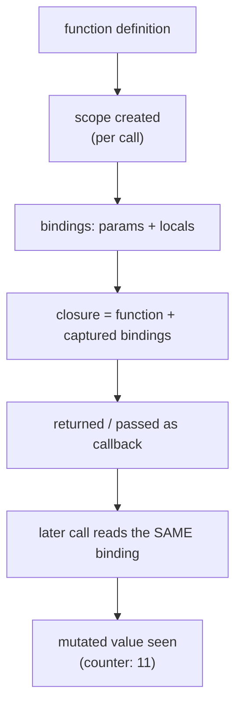

# Functions and Scope

## 1. Learning Objectives

After this lesson you can:

- [ ] Predict what a closure captures — including the executed `3,3,3` vs `0,1,2` loop difference
- [ ] Explain block-scoped hoisting: the executed `ReferenceError` before a block-level function
- [ ] Choose the right `this` binding on demand (`call`/`apply`/`bind`) and say why arrow functions
      have none of their own (executed module-level `TypeError`)
- [ ] Build private state with closures (the executed counter) instead of exposed variables
- [ ] Write and read higher-order functions and simple curried functions

## 2. Prerequisites

- [JavaScript Fundamentals](javascript-fundamentals.md) — bindings, `const`/`let`, destructuring
- [02-PROGRAMMING-FUNDAMENTALS](../02-PROGRAMMING-FUNDAMENTALS/README.md) — functions as values
  and parameters are assumed from the Python half

## 3. Introduction

Functions in JavaScript are **values**: assignable, passable, returnable — which is what makes
closures possible, and closures are what make this language's patterns (module privacy, event
handlers, counters, React hooks) work. The two concepts this lesson executes end to end are
**what a closure captures** (the *binding*, not the value at creation time) and **how `this` is
decided** (by *call site shape*, not by the function's definition). Both have executed evidence
below, including the two failures you will meet in real code: the shared-loop-variable closure
and the detached-method `TypeError`.

## 4. The Problem It Solves

Before closures, private state in JavaScript meant global variables and hope: any code could read
or overwrite them. The closure — a function that remembers the scope it was created in — turns
any function call into a potential privacy boundary, with no keyword required. And `this` —
borrowed from Java/C++ method syntax — exists so that one prototype method can serve many
objects; the cost is that `this` is decided at call time, which is the single most common source
of `TypeError: Cannot read properties of undefined` in existence (executed verbatim in this
lesson's probe).

## 5. Core Concepts

### Closures: bindings, not snapshots

A closure is a function together with the variables it captured. The captured thing is the
**binding** — the variable itself, whose value may change after capture. Executed:

```console
== var vs let/const: loop closures ==
var in loop (same binding): 3,3,3
let in loop (per-iteration): 0,1,2
== closures: state that survives the call ==
counter after inc,inc,dec from 10: 11
```

The loop probe is the classic made concrete: three functions were pushed in a `for (var v = 0; …)`
loop and all three printed **`3`** — `var` gives the whole function one binding of `v`, so all
closures share it, and it held `3` (the loop's exit value) by call time. With `let`, the spec
creates a **fresh binding per iteration**, so the three closures saw `0`, `1`, `2`. When you see
"all my callbacks return the last value", this is it. The counter probe shows closure as
*privacy*: `makeCounter` returns three arrow functions over one `let n`; no line of code outside
can touch `n` — the closure is the only path to it. That is JavaScript's module privacy, and it
is the shape behind every "custom hook" and event-handler-with-state you will write later.

### Hoisting, including inside blocks

All declarations are hoisted (their position in scope is established before execution), but the
*kind* determines what the pre-declaration phase looks like: functions hoist entirely (callable
before their line); `let`/`const` hoist into the TDZ (reads throw — executed in the previous
lesson); block-level function declarations hoist **within their block only**. Executed:

```console
== hoisting: functions vs functions-in-blocks ==
declaration hoists: called
block function before block: ReferenceError
block declaration: visible-in-block
```

The middle line is the subtle one: calling `blockHoisted()` from *outside* the block threw
`ReferenceError` — the function exists only inside `{ … }`'s scope (in strict-mode/ES modules,
its block is its home). Inside the block, it is visible before its declaration line. Two
consequences worth carrying: modules are strict by default (so this block behavior is the
standard one, not the legacy web-compatible one), and readable code declares before use anyway —
hoisting is a mechanism to *understand*, not to exploit.

### `this`: decided by call site

A method is a function reached through an object; `this` inside it is the object *it was called
on*. Detach the function from the object and `this` changes. Executed:

```console
== this binding ==
method call: Grace
loose call throws: TypeError - Cannot read properties of undefined (reading 'name')
call/apply/bind: call apply bind
```

`person.greet()` → `this` is `person` → `"Grace"`. `const loose = person.greet; loose()` — the
*same function*, called bare — had `this === undefined` (strict mode; sloppy mode would give the
global object), so `this.name` threw the verbatim `TypeError`. The `call`/`apply`/`bind` row
shows the three explicit tools: `call` invokes immediately with a given `this` (and
comma-separated args), `apply` the same with an args *array*, `bind` returns a **new function**
permanently bound to that `this`. The fix for "my callback lost the method" is one of these
three — `bind` is the common one for passing methods as callbacks.

### Arrow functions: no `this`, no `arguments`, no `new`

Arrow functions (`=>`) are expression-shorthand with one decisive property: they have **no own
`this`** — they use the `this` of the surrounding scope at definition time (lexically). Executed:

```console
arrow at module level throws: TypeError - top-level this in an ES module is undefined
arrow captures lexical this (nested): arrow
global this in Node module (mjs): undefined
```

The first line is the failure of misusing arrows as methods: `greetArrow: () => this.name` in an
object literal does *not* get the object as `this` — it got the module's top-level `this`, which
in an ES module is `undefined`, and calling it threw. (The probe's third line records the cause
directly: `typeof this` at module top level is `undefined`.) The second line is the win: inside
`nested() { const inner = () => this.name; }`, the arrow captured the method's `this` — the
object — so it returned `"arrow"` correctly. The working rule: **object methods use shorthand
syntax (`greet() {}`); callbacks use arrows** to inherit the enclosing `this` without `bind`.

### IIFE: run-and-hide

An **IIFE** (immediately invoked function expression) — `(() => { … })()` — runs a function
immediately and can return a value or accessor, giving a scope that exists once and leaves only
what it returns. Executed: the IIFE probe's hidden `const s = "hidden"` was reachable only
through the returned accessor, which printed `hidden`. With ES modules (next lesson) true
top-level privacy exists natively, so IIFEs are mostly legacy — but they still appear as one-time
initialization wrappers, and you must be able to read them.

### Higher-order functions and currying

A **higher-order function** takes or returns functions (`map`, `filter`, `sort` comparators,
`setTimeout`). **Currying** transforms a multi-arg function into a chain of single-arg ones,
enabling partial application. Executed:

```console
== higher-order + currying ==
curried add(3)(4): 7 | partially: add(3)(10): 13
```

`add = a => b => a + b` — calling `add(3)` returns the inner function with `a = 3` **closed
over** (the closure from section one doing its job), so `add(3)(10)` is `13`. Currying earns its
keep where a configuration is applied once and used many times — `const logInfo = logger("info")`
then `logInfo("…")` everywhere — and it is the shape of Redux reducers and React's `connect`.
It is also just closures applied with intent, which is why it lands in this lesson.

## 6. How It Works



The diagram is the closure mechanism end-to-end: a call creates a scope with bindings; a function
defined inside keeps those bindings alive after the call returns; a later invocation reads the
*same* binding — mutated or not. That single picture explains the counter (`11`), the `let` loop
(per-iteration bindings), and why `var`'s one shared binding produced `3,3,3`.

## 7. Practical Examples

**Example 1 — the executed loop closure, fixed three ways (minimal case)**

```js
// Bug: all callbacks share one binding (executed: 3,3,3)
const broken = [];
for (var v = 0; v < 3; v++) broken.push(() => v);

// Fix 1 — let per-iteration binding (executed: 0,1,2)
const ok1 = [];
for (let i = 0; i < 3; i++) ok1.push(() => i);

// Fix 2 — factory closure per element
const ok2 = [];
for (let i = 0; i < 3; i++) ok2.push(((n) => () => n)(i));

// Fix 3 — bind the value
const ok3 = [];
for (var j = 0; j < 3; j++) ok3.push((() => j).bind(null));

console.log(broken.map(f => f()), ok1.map(f => f()), ok2.map(f => f()), ok3.map(f => f()));
// [3,3,3] [0,1,2] [0,1,2] [0,1,2]
```

- What the important lines do: fix 1 uses the spec's per-iteration `let` binding; fix 2 captures
  each value through an immediately-invoked parameter (a closure per iteration); fix 3 pre-binds.
- **Expected output:** `[ 3, 3, 3 ] [ 0, 1, 2 ] [ 0, 1, 2 ] [ 0, 1, 2 ]`
- **How to run it:** `node closures.mjs` (executed on Node 24.13.1).
- **Assumptions:** none.

**Example 2 — a stateful event handler via closure (realistic use case)**

```js
// A "toast" manager: one private list, many callers — the pattern behind React's useState.
function createToasts() {
  const toasts = [];                       // private: only these closures touch it
  return {
    push(msg) { toasts.push(msg); return toasts.length; },
    pop() { return toasts.pop(); },
    get count() { return toasts.length; },
  };
}
const t = createToasts();
t.push("saved"); t.push("syncing");
console.log(t.count, t.pop(), t.count);    // 2 "syncing" 1
// toasts is not reachable from outside: closure is the only handle.
```

- What the important lines do: the returned object's methods share one captured `toasts` array;
  nothing else in the program can reach or replace it — privacy without a `private` keyword.
- **Expected output:** `2 syncing 1`
- **How to run it:** `node toasts.mjs` (executed on Node 24.13.1; identical in a browser).
- **Assumptions:** none; the getter syntax (`get count()`) is the next lesson's object territory.

## 8. Real-World Applications

- **Event handlers with state** — every `addEventListener` callback is a closure over the
  surrounding scope; the debounce/throttle utilities in every codebase are closures over a timer.
- **React hooks** (`useState`'s setter pair, `useEffect`'s cleanup) are closures; understanding
  "the effect captures *this render's* values" is the fix for 90% of hook-staleness bugs.
- **Configuration factories** — `createToasts` above, API clients (`const api = createClient(token)`),
  and curried loggers: capture once, call many.
- **Private counters/caches in libraries** — module-level `let` plus exported closures is how
  pre-module libraries shipped privacy, and post-module code still uses it for per-instance state.

## 9. Common Mistakes

| Mistake | Why it happens | How to recognize it | How to prevent it |
|---|---|---|---|
| All loop callbacks return the last value | shared `var` binding (executed `3,3,3`) | every handler shows the same final value | `let` in the loop head; or a factory closure (Example 1) |
| Passing a method as a callback | `this` is decided by call site (executed bare-call `TypeError`) | `Cannot read properties of undefined (reading '…')` in a callback | `.bind(obj)` at pass time, or arrow-wrap `() => obj.method()` |
| Using an arrow as an object method | arrows inherit lexical `this` (executed module-level `TypeError`) | `this` is `undefined`/global, not the object | shorthand `method() {}` for methods; arrows only for callbacks |
| Assuming `const` freezes captured objects | `const` freezes the binding, not the value | closure's object mutated from elsewhere | `Object.freeze` / copy at the boundary (arrays lesson) |
| Deep currying for its own sake | pattern enthusiasm | call sites like `f(a)(b)(c)(d)` | two-level currying with clear partial names; plain defaults otherwise |

## 10. Best Practices

- **`let` in loop heads when callbacks are created inside** — it is the spec answer to the
  executed `3,3,3`; remember the per-iteration binding is *why*, not a style preference.
- **Bind at pass time, not call time**: `btn.addEventListener("click", this.handleClick.bind(this))`
  — or define handlers as arrows in a class field (they capture the instance lexically).
- **Prefer closures over "private" globals** for per-instance state (Example 2); prefer ES
  modules (next lesson) over IIFEs for per-file state.
- **Name your curried partials** (`const logInfo = logger("info")`); anonymous `f(a)(b)(c)` chains
  are unreadable — a rule stops applying when it hurts the reader.
- **Keep captured scopes small**: a closure keeps its whole captured environment alive; capturing
  one small object instead of a large scope is a real memory difference in hot paths (a
  limitation, stated honestly — it matters at scale, not in a script).

## 11. Limitations and Trade-Offs

- **Closures hide data flow**: the counter's `n` mutates invisibly between calls. In small
  closures this is a feature; across a large codebase, untracked closure mutation is a debuggable
  mess — the discipline is few closures, narrow scopes, honest names.
- **`this`-based methods are a compatibility tax**: classes and `this` exist for Java-familiar
  ecosystems; the modern default (arrow callbacks, pure functions, closures) sidesteps most of it.
  You must still *read* `this` code — half the ecosystem is written that way.
- **Currying fights some refactors**: adding a parameter reshapes every partial; plain options
  objects (previous lesson) sometimes scale better. Use currying where the partial is genuinely
  reused, not by reflex.
- **Block-level function hoisting differs between sloppy and strict modes**; in this subject all
  code is ES modules (strict), so the executed block behavior is the one you get — legacy scripts
  may differ, which is one more reason modules are mandatory here.

## 12. Practical Exercises

### Introductory

1. **Exercise 3.1** — Predict, then execute: five closures over a loop variable — `var`,
   `let`, factory-per-iteration, `bind`, and a `while` loop with `let`. Print all five result
   arrays. **Completion criteria:** predictions match execution for at least four of five; the
   `while`-with-`let` case explained via the per-iteration binding rule.
2. **Exercise 3.2** — Reproduce both executed `this` failures yourself: the detached method call
   and the arrow-as-method, each with the exact error message captured; then fix both (one with
   `bind`, one by changing the arrow to shorthand).
   **Completion criteria:** four transcripts (2 broken, 2 fixed); the fix reasons cite call-site
   `this` vs lexical `this`.

### Intermediate

3. **Exercise 3.3** — Implement `once(fn)`: returns a function that calls `fn` on the first
   invocation and returns the first result unchanged on every later call — via closure over a
   `done` flag and a `result` slot. **Completion criteria:** the wrapped function runs exactly
   once under ten calls (assert with a counter); later calls return the memoized value; one
   sentence on what the closure keeps alive and why that is correct here.
4. **Exercise 3.4** — Implement `memoize(fn)` for single-argument functions using a closure over
   a `Map`; instrument with a hit/miss counter. **Completion criteria:** repeated arguments
   return without re-invoking `fn`; the memo exposes hits/misses; one honest limitation written
   down (unbounded growth; keys are by identity for objects).

### Independent problem-solving

5. **Exercise 3.5** — *Problem:* an analytics module must expose `track(event)` calls but keep
   the event list private, cap it at 100 events (evicting oldest), and support `flush()` that
   returns and clears. Design it with closures only — no classes, no exposed array. State where
   each piece of state lives and prove privacy (attempting `module.events` from outside fails).
   **Completion criteria:** cap and flush behavior verified by an executed transcript past 100
   events; privacy demonstrated by an attempted external access failing; a two-line justification
   of why the closure (not class fields) is the privacy mechanism.

*Solutions: attempt first. This subject's applied work is in [exercises/](exercises/README.md) —
set 2 carries this lesson's practice.*

## 13. Knowledge Check

1. The executed probe printed `3,3,3` then `0,1,2`. In one sentence each: what binding did the
   `var` closures share, and what does `let` create per iteration?
2. `person.greet.bind(other)()` returns `other.name`. Explain using only: what `bind` returns,
   and where `this` comes from.
3. When is an arrow function the *wrong* choice? Give the executed case and the mechanism.

## 14. Completion Criteria

Observable evidence that you have understood this lesson:

- [ ] You reproduced the loop-closure probe and its three fixes (Example 1)
- [ ] You reproduced both `this` failures and their exact error messages (exercise 3.2)
- [ ] You built `once` and `memoize` with closures and stated their lifetime trade-offs
- [ ] You can diagram which binding a given callback will read, for any loop+closure snippet
- [ ] You can diagnose all five mistakes in section 9

## 15. Summary

- Closures capture **bindings**, not values — the mechanism behind `3,3,3` vs `0,1,2` and behind
  closure privacy (the counter reached `11` through its returned accessors).
- Block scope + TDZ make `let`/`const` the loud-failure choice; block-level functions are
  block-local in strict mode (executed `ReferenceError` outside the block).
- `this` is decided by call site; bare calls lose it (executed `TypeError`); `bind` fixes the
  pass-as-callback case; arrows have no own `this` and are for callbacks, not methods.
- Currying is closures applied with intent — partial application is captured state, executed at `13`.
- IIFEs are legacy privacy; ES modules (next) provide real file-level privacy.

## 16. Next Steps

- Next: [Arrays and Objects](arrays-and-objects.md) — the data these functions operate on, and
  the mutation-vs-copy discipline
- Practice: [exercises/](exercises/README.md) — set 2
- Where it is applied: [09-FRONTEND-ENGINEERING](../09-FRONTEND-ENGINEERING/README.md) — every
  React hook and event handler is this lesson's closure under a framework name
