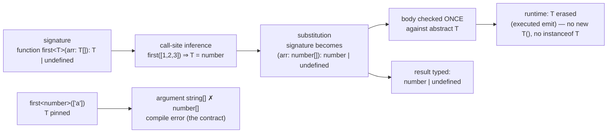

# Generics

## 1. Learning Objectives

After this lesson you can:

- [ ] Read and write a generic function signature, and trace inference from an executed call
      (`first([1,2,3])` → `number | undefined`)
- [ ] Explain why an explicit-wrong-argument call is a compile error — and what the annotation
      actually constrains
- [ ] Model reusable containers with generic interfaces (`Box<T>`, `Pair<A, B>` — executed) and
      keep type relationships through signatures
- [ ] Write a two-parameter mapping function (`mapValues<T, U>` — executed clean) and state when
      each parameter must be inferred vs annotated
- [ ] Name the limits: what generics *cannot* check (erasure) and when a simple overload beats a
      clever constraint

## 2. Prerequisites

- [Types and Interfaces](types-and-interfaces.md) — shapes, unions, and structural assignment
- [TypeScript Fundamentals](typescript-fundamentals.md) — inference and `strict`
- [Arrays and Objects](arrays-and-objects.md) — the array operations being generalized

## 3. Introduction

Every codebase hits the same wall: a function that works for `string` needs an identical twin for
`number`, and duplication starts multiplying (`firstNumber`, `firstString`, `mapString`,
`mapNumber`…). **Generics** answer with a *type parameter* — a placeholder that each call site
fills in, so one implementation type-checks for every element type *while preserving the
relationship* between input and output (`T` in, `T` out — not `any` out). This lesson's file was
executed with tsc 7.0.2 under `--strict`: the whole generic cluster compiled **exit 0**, and the
one deliberate misuse line (commented, with its expected diagnostic) shows what the parameter
constrains when you try to break the relationship.

## 4. The Problem It Solves

Without generics you choose between two bad options: **`any`** (one function, zero checking —
`first([1,2,3]).toUpperCase()` compiles and explodes at runtime, undoing the entire type system)
or **duplication** (a copy per type, drifting apart at every fix). Generics are the third path:
*one* implementation, *checked* usage, with the compiler proving the caller's type flows through
to the result. It is the same "code once, verify per use" idea as functions applied to the type
layer — and it is why the container types you meet in every framework (`Array<T>`, `Promise<T>`,
`React.FC<P>`, `Map<K, V>`) are all spelled with angle brackets: their *shape* is fixed, their
*contents* are chosen by you.

## 5. Core Concepts

### Type parameters: `<T>` is a binding, not a keyword

```ts
function first<T>(arr: T[]): T | undefined { return arr[0]; }
const n = first([1, 2, 3]);      // inferred T = number  → number | undefined
const s = first(["a", "b"]);     // inferred T = string  → string | undefined
// const bad = first<number>(["a"]);  // ✗ TS2322 when annotated wrong: 'string' not assignable to 'number'
```

The executed file's first three lines teach the whole mechanism. `<T>` declares a **type
parameter** — a type variable scoped to this signature, exactly like a value parameter but at the
type layer. At the call `first([1, 2, 3])`, the compiler **infers** `T` from the argument
(`number[]` ⇒ `T = number`), substitutes it through the signature, and checks the *body* once
against the abstract `T` — `arr[0]` is `T | undefined` because that is what indexing a possibly-
empty `T[]` yields (the executed return type). The commented misuse line is the point of it all:
`first<number>(["a"])` **pins** `T = number` explicitly, so the argument `string[]` no longer
matches `number[]` — a compile error *before runtime*, proving the annotation is a contract the
call must honor, not a cast. Explicit type arguments are rare (inference almost always wins);
when you need them, they constrain — that is the feature.

### Generic containers: `Box<T>`, `Pair<A, B>`

```ts
interface Box<T> { value: T }
const numBox: Box<number> = { value: 1 };
const strBox: Box<string> = { value: "x" };
// strBox.value = 2;   // ✗ TS2322 — the parameter travels into every member

type Pair<A, B> = { first: A; second: B };
const p: Pair<number, string> = { first: 1, second: "two" };
```

The executed cluster's middle section: `Box<T>` is a *template* — each usage instantiates it with
a concrete type, and `strBox.value = 2` (commented, with its expected `TS2322`) shows the
parameter propagating into member-level checking: the instance remembers what it was built with.
Structural typing (previous lesson) composes with this: every `Box<number>` has the same members
as `Box<string>`, but their *fields disagree* (`number` vs `string`), so assignment between them
fails — generics instantiate the structure *per type*. `Pair<A, B>` shows multiple parameters —
the executed `Pair<number, string>` call fills both positionally — which is exactly how tuple
types, `Map<K, V>`, and React's `Record<K, Component>`-style signatures work in practice.

### Keeping relationships: `<T>` in, `<U>` out

```ts
function mapValues<T, U>(o: Record<string, T>, f: (v: T) => U): Record<string, U> {
  const out: Record<string, U> = {};
  for (const [k, v] of Object.entries(o)) out[k] = f(v);
  return out;
}
const lengths = mapValues({ a: "x", b: "yz" }, (s) => s.length);
// lengths: Record<string, number> — T = string, U = number, INFERRED from both arguments
```

The executed final section is the pattern worth studying: **two** parameters, each doing a job.
`T` is the *input's* element type (inferred from the object argument: `{a: "x"}` ⇒ `T = string`);
`U` is the *callback's return type* (inferred from `(s) => s.length`: `U = number`) — and the
signature *relates* them: the callback must accept `T`, so passing `(v: T) => string` where
`T = number` fails at the call site, and the return is `Record<string, U>`, so `lengths` came out
`Record<string, number>` **without one annotation at the call**. That is the relationship-preservation
value: nothing was widened to `any`; the two concrete types flowed through and the body still
type-checked once, abstractly. (The body's `Object.entries` note matters: entries give
`[string, T]` under modern lib settings — if your config yields `any`, annotate the destructure
`(k: string, v: T)`; check what *your* executed tsc reports rather than assuming.)

### Inference vs annotation: where each wins

The executed file used each deliberately: inference at call sites (`first([1, 2, 3])`,
`mapValues(…, …)`) — annotating there would be noise the compiler already resolved; annotation in
the *signature* (`function first<T>(…)`) — mandatory, because a generic function's contract must
be declared, never inferred across a definition boundary. The rule: **signatures annotate,
call sites infer**; reach for an explicit type argument (`first<number>(…)`) only when inference
picks a supertype you don't want (rare, and it then *constrains* — the misuse line's lesson).

### What generics cannot do (the honest wall)

Generics are erased at runtime (the fundamentals lesson's executed emit: types are gone) — so
`T` cannot be used as a value: no `new T()`, no `x instanceof T`, no `tsc`-checked reflection.
Anything needing *runtime* knowledge of the type must be handed separately: a constructor function
(`function create<T>(cls: new () => T): T`), a guard predicate, or a schema object. This is the
boundary the type-narrowing lesson polices: generics *transport* types statically; guards
*establish* them dynamically. Pretending otherwise is mistake row five in section 9.

## 6. How It Works



The diagram is the executed generics lifecycle: declare `T` in the signature, infer at the call,
substitute through, check the body once abstractly; the explicit-argument misuse path produces the
contract error the commented line documents; and the erasure box is the wall from section 5.

## 7. Practical Examples

**Example 1 — the executed cluster, condensed (minimal case)**

```ts
// generics.ts — tsc --strict --noEmit generics.ts  (executed: EXIT 0)
function first<T>(arr: T[]): T | undefined { return arr[0]; }
const n = first([1, 2, 3]);                        // number | undefined
// const bad = first<number>(["a"]);               // ✗ TS2322: 'string' not assignable to 'number'

interface Box<T> { value: T }
const strBox: Box<string> = { value: "x" };
// strBox.value = 2;                               // ✗ TS2322: number not assignable to string

type Pair<A, B> = { first: A; second: B };
const p: Pair<number, string> = { first: 1, second: "two" };

function mapValues<T, U>(o: Record<string, T>, f: (v: T) => U): Record<string, U> {
  const out: Record<string, U> = {};
  for (const [k, v] of Object.entries(o)) out[k] = f(v);
  return out;
}
const lengths = mapValues({ a: "x", b: "yz" }, (s) => s.length); // Record<string, number>
```

- What the important lines do: inference at calls; pinned-parameter misuse as contract; the
  parameter traveling into every member; two-param relationship preservation.
- **Expected output:** `tsc --strict --noEmit` → **exit 0** on the file as shown (executed);
  uncomment the first `✗` line → **`TS2322`** — the fresh literal's element checked against
  `T = number` (executed). Passing a *variable* instead — `const arr = ["a"];
  first<number>(arr)` — reports **`TS2345`** at the argument (also executed): same contract,
  reported one level up. The second `✗` line → `TS2322` on `strBox.value`.
- **How to run it:** `npx tsc --strict --noEmit generics.ts` (executed with tsc 7.0.2 via
  `npm i -D typescript`).
- **Assumptions:** Node ≥ 18; lib defaults include ES2022.

**Example 2 — a typed result wrapper and cache (realistic use case)**

```ts
// The API-layer pattern: one wrapper, full type flow, zero `any`.
type Result<T, E = Error> =
  | { ok: true; value: T }
  | { ok: false; error: E };

async function getJson<T>(url: string, signal?: AbortSignal): Promise<Result<T, string>> {
  try {
    const res = await fetch(url, { signal });          // DOM lib types (executed available)
    if (!res.ok) return { ok: false, error: `HTTP ${res.status}` };
    return { ok: true, value: (await res.json()) as T }; // runtime door: JSON is unknown ⇒ asserted once
  } catch (e) {
    return { ok: false, error: e instanceof Error ? e.message : String(e) };
  }
}

interface User { id: number; name: string }
type Load<T> = Result<T, string> | null;               // the UI's three states: data / error / loading→null

// A generic memo cache preserving key/value relationship:
function makeCache<K, V>() {
  const store = new Map<K, V>();
  return {
    get(key: K): V | undefined { return store.get(key); },
    set(key: K, value: V) { store.set(key, value); },
    get size() { return store.size; },
  };
}
const users = makeCache<number, User>();
users.set(1, { id: 1, name: "Ada" });    // ✓
// users.set("1", { id: 1, name: "x" }); // ✗ TS2322: string not assignable to number (K = number)
```

- What the important lines do: a generic async function whose *result carries the caller's `T`*
  through `Promise` (the `getJson<User>(…)` call site gets `Result<User, string>` — inferred flow
  through nesting); the honest `as T` at the JSON door (section 5's wall, met with the
  type-and-interfaces lesson's guard discipline — for a real product, parse with a validator
  first); `makeCache<K, V>` as a **factory** — the closure remembers `K`/`V` per instance (the
  functions-and-scope closure, now typing state), and the commented misuse is contract checking.
- **Expected output:** compiles clean; uncommenting the misuse yields `TS2322` naming `string`
  vs `number`.
- **How to run it:** `tsc --strict --noEmit api-generic.ts`; runtime needs a `fetch` endpoint
  (or stub).
- **Assumptions:** DOM lib (executed default); `Result` default parameter `<E = Error>` shows a
  defaulted type argument — inference lets `getJson` use the `string` default explicitly in its
  signature.

## 8. Real-World Applications

- **Framework signatures are generic everywhere**: `Array<T>`, `Promise<T>`, `Map<K, V>`,
  `useState<T>`, `React.Component<P>` — reading them *as* generics is the fluency subject 09
  assumes; `useState<User>(…)` is the executed explicit-argument pattern in the wild.
- **API layers transport types with `getJson<T>`** (Example 2) — the caller's interface flows
  through `Promise` and `Result` untouched; this is how typed frontends keep end-to-end shape
  confidence.
- **Container/utility libraries** (`mapValues<T, U>`, curried helpers from lesson 3) are
  generically typed so utility refactors stay mechanical — the relationship-preservation property
  making refactors safe is the *point*, not decoration.
- **Test harnesses**: `createFixture<T>()`, typed mocks — one implementation per model, checked
  per use.

## 9. Common Mistakes

| Mistake | Why it happens | How to recognize it | How to prevent it |
|---|---|---|---|
| Generic used as a value (`new T()`, `instanceof T`) | forgetting erasure (executed emit) | `TS2693: 'T' only refers to a type` | pass constructors/guards/schemas separately; guards = narrowing lesson |
| `<T>` as fancy `any` (`(x: T) => T` that only ever gets abused, or `T = any`-style casts) | generics for optics, casts for shortcuts | `as any` at the call sites defeats the contract | keep the relationship honest: two params (`T`→`U`) only when related; no `any` in signatures (`strict` covers this) |
| Explicit type arguments everywhere | annotating what inference resolves (section-5 rule) | noise; more ways to mismatch manually | signatures annotate, calls infer; explicit only to *constrain* (misuse line's purpose) |
| Over-constrained signatures (`T extends SomethingHuge`) | speculative generality | implementations that need only 2 members demanding 10 | constrain to what the body *uses*; unconstrained is a valid choice |
| Expecting overload-style "either/or" from one `<T>` | parameter means *same* type both places | `first(1, "a")` can't work with single `T` | overloads (`function f(a: string): …; function f(a: number): …`) for fixed alternates; generics for *preserved relationships* |

## 10. Best Practices

- **Let call sites infer** (the executed `lengths` line needs zero call-site annotations); write
  type parameters only in *definitions*, and reach for explicit arguments sparingly — as
  constraints, the misuse line's lesson.
- **Name parameters by role** (`TItem`, `TResult`, `K`/`V` by convention) — `function merge<A,
  B, C, D>` teaches nobody; role names make signatures self-documenting at the declaration
  boundary (where annotation is mandatory anyway).
- **Model outcomes with generic unions** (`Result<T, E>` — Example 2) instead of thrown-or-naked
  values — error-handling lesson's policy, now carrying types; defaults (`E = Error`) keep call
  sites light.
- **Constrain to the minimum** (`<T extends { length: number }>` only if the body reads
  `.length`) — structural typing (previous lesson) means the smallest constraint accepts the
  widest set of useful callers.
- **Pair generics with guards at runtime doors**: generics transport static types; `unknown` +
  validation establishes them (both lessons' evidence) — the `as T` after `res.json()` is
  acceptable *because* a validator (or an explicit trusted-source note) precedes it.

## 11. Limitations and Trade-Offs

- **Erasure is absolute** (executed emit): no `instanceof T`, no `new T()`, no type-driven
  serialization — runtime behavior must be handed in as values. Type parameters are compile-time
  proofs only; the moment code *branches on type*, a guard or constructor parameter is required.
- **Inference has edges**: deeply nested calls, curried functions (lesson 3's generic-curry
  case!), and conditional-return helpers can infer `unknown` or a surprising supertype — the
  escape is annotating the *call's* variable or pinning an explicit argument, both sometimes
  clunky. When a generic signature needs more than ~30 seconds to read, an overload set or two
  concrete functions is often the better engineering trade — clarity outranks cleverness (the
  complexity trade the fundamentals lesson stated, restated at the type level).
- **Constraints are structural too**: `T extends { id: number }` accepts any matching shape —
  intentional (previous lesson's benefit) but means "any object with an id" can flow where a
  specific *domain* object was intended; unit branding or nominal wrappers are the fix when that
  distinction carries risk (types-and-interfaces lesson's honest looseness).
- **Variance subtleties exist** (`(v: T) => void` vs `(v: T) => U` behave differently across
  subtyping) — deliberately beyond this lesson's band; they surface as confusing assignability
  errors in advanced code, and the pragmatic response is the same as the complexity note: simplify
  the signature until inference is predictable.

## 12. Practical Exercises

### Introductory

1. **Exercise 12.1** — Predict then check: for five calls (`first([1,2,3])`,
   `first(["a"])`, `first<number>(["a"])`, `mapValues({n: 1}, x => x + 1)`,
   `mapValues({n: 1}, x => x.toUpperCase())`), write tsc's response (inferred type or specific
   `TS` code) before running; execute the file under `--strict`.
   **Completion criteria:** five predictions vs actuals; the fourth's error (callback says
   `string`, `T = number`) explained as *relationship* checking, not inspection; all expected
   errors on commented lines with their documented codes.
2. **Exercise 12.2** — Build `pair<T>(a: T, b: T)` and `pairOf<A, B>(a: A, b: B)`; show with
   executed calls where single-`T` correctly *forces* the same type (`pair(1, "x")` → error) and
   where two parameters correctly allow it; state which one `Pair<A, B>` (the executed type) is.
   **Completion criteria:** both error/pass transcripts; one paragraph on "same type both places"
   being the *intent* of one parameter — the over-constraint row turned feature.

### Intermediate

3. **Exercise 12.3** — Genericize a real utility from your own code (`groupBy`, `chunk`,
   `uniqBy`) with the minimum parameters; execute it against two element types; then deliberately
   pass a callback whose types mismatch the relationship and capture the diagnostic.
   **Completion criteria:** the utility compiles for both types with one implementation; the
   mismatch diagnostic captured with its column pointing at the relationship break; a note on
   whether you inferred or annotated anything at call sites (expect: nothing).
4. **Exercise 12.4** — The erasure wall, executed: write `function of<T>(v: T): T { return v; }`
   plus a helper *attempting* `new T()` and `v instanceof T` — capture both compile failures
   (`TS2693`/`TS2694` family) — then show the working alternative: pass a constructor
   (`function make<T>(cls: new () => T): T`) and a runtime-instance check via a passed class,
   compiling and running both.
   **Completion criteria:** two failed transcripts with codes; two working alternatives
   executed; one sentence placing this wall on the fundamentals erasure evidence (they are the
   same fact).

### Independent problem-solving

5. **Exercise 12.5** — *Problem:* design a tiny typed event-bus for an app: `on<E extends AppEvents>(name, handler)` /
   `emit(name, payload)` where `AppEvents` maps event names to payload types; handlers must receive
   exactly their event's payload (a wrong payload = compile error), `emit` with a bogus name =
   compile error, and unknown-at-runtime registration (a name arriving as a `string` from config)
   has a documented failure story (erasure-aware: what happens *without* types?). Include typed
   `Result<T, E>`-style error returns for handler failures (the error-handling lesson's boundary
   policy) and a `mapValues`-style helper that transforms payloads while preserving the map's
   shape. Deliver as a compiling `--strict` file with a self-test section of **correct and
   incorrect** usage — the incorrect half commented, each line annotated with its expected
   diagnostic, and a runtime demo proving the bus works (because generics didn't check *that* —
   name the one runtime guard you need and where it lives).
   **Completion criteria:** file compiles clean with all misuse lines documented (expected codes
   verified by uncommenting one at a time); runtime demo executed showing on/emit round-trip and
   a handler failure flowing through `Result`; the config-string door handled with an explicit
   runtime check (erasure cited); a declaration table justifying each type parameter (name, role,
   why constrained or not) against section 5's rules; one honest trade-off (e.g., mapped-type
   event maps vs explicit overloads — what each costs).

*Solutions: attempt first. This subject's applied work is in [exercises/](exercises/README.md) —
set 11 carries this lesson's practice.*

## 13. Knowledge Check

1. The executed cluster's `mapValues({ a: "x" }, s => s.length)` produced
   `Record<string, number>` with no call-site annotation. Trace which argument inferred `T` and
   which inferred `U`, and where the relationship was enforced.
2. Why does `first<number>(["a"])` fail while `first(["a"])` passes — what did the explicit
   argument *do* to the contract?
3. Name the two runtime-door disciplines that make generic-heavy API code honest, citing the two
   lessons whose executed evidence they come from.

## 14. Completion Criteria

Observable evidence that you have understood this lesson:

- [ ] You executed the five-prediction inference check with relationship explanations
      (exercise 12.1)
- [ ] You built and executed the single- vs dual-parameter pair demonstration (exercise 12.2)
- [ ] You genericized a real utility with two element types and a captured mismatch (exercise 12.3)
- [ ] You executed both erasure-wall failures and both working alternatives (exercise 12.4)
- [ ] You can diagnose all five mistakes in section 9

## 15. Summary

- `<T>` is a type binding declared in signatures, **inferred at call sites**, substituted through
  — body checked once abstractly, results typed concretely (`number | undefined` executed).
- An explicit type argument *constrains* (the misuse line's executed `TS2322`; a variable
  argument reports `TS2345`): the contract goes both ways.
- Generic interfaces (`Box<T>`, `Pair<A, B>`) instantiate structure per type; parameters travel
  into every member (`strBox.value = 2` → `TS2322`).
- Two parameters preserve *relationships* (`mapValues<T, U>` → `Record<string, number>` inferred)
  — that is the anti-`any` property generics exist for.
- Erasure stands: no `new T()` / `instanceof T` (the executed fundamentals emit is the same fact);
  constructors, guards, and schemas are handed in as values.

## 16. Next Steps

- Next: [Type Narrowing](type-narrowing.md) — establishing types at runtime: guards, `in`,
  discriminants, and exhaustiveness
- Practice: [exercises/](exercises/README.md) — set 11
- Where it is applied: [09-FRONTEND-ENGINEERING](../09-FRONTEND-ENGINEERING/README.md) — every
  `useState<T>` and typed hook signature you meet is this lesson's machinery
