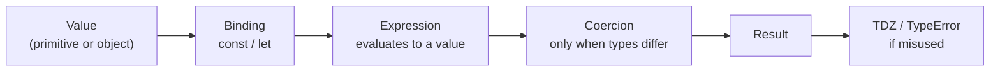

# JavaScript Fundamentals

## 1. Learning Objectives

After this lesson you can:

- [ ] Name the primitive types and the one `typeof` lie (`null` reports `object`), from the executed probe
- [ ] Predict `==` vs `===` outcomes and explain coercion left-to-right with the executed `1 + 2 + '3'` chain
- [ ] Use `const`/`let`, explain the temporal dead zone (executed `ReferenceError`), and avoid `var`
- [ ] Write template literals, `??` vs `||`, and optional chaining `?.` — each shown executed
- [ ] Destructure arrays and objects (with defaults and rest) from memory

## 2. Prerequisites

- [02-PROGRAMMING-FUNDAMENTALS](../02-PROGRAMMING-FUNDAMENTALS/README.md) — variables, types, and
  functions in Python are assumed; this lesson maps them onto JavaScript's model
- [07-HTML-AND-CSS](../07-HTML-AND-CSS/README.md) — you can write the markup the scripts will drive

## 3. Introduction

JavaScript is the only language that runs natively in every browser, and the language whose
quirks you must know *before* they cost you a debugging session. Its two defining traits: **dynamic
typing** (values have types, variables don't — a binding can hold a number now and a string next)
and **liberal coercion** (operators convert types implicitly, sometimes surprisingly). Both are
powerful; both are footguns if unexamined. Every transcript in this lesson was executed on Node
24.13.1 — the same engine lineage as Chrome's V8 — so what you read is what the machine printed,
including the parts that embarrass the language.

## 4. The Problem It Solves

Why not just use Python or Java everywhere? Because the browser demands a language it can run
without installation, sandboxed, in-page. The design answer — a small language shipped everywhere
and extended over thirty years — produced the coercion tables and the two blank slate variables
(`var`'s function scope, `let`/`const`'s block scope) that this lesson defuses. Knowing the quirks
is not trivia: `0 == ''`, the frozen-object strict-mode throws (executed in the arrays lesson), and
`typeof null === 'object'` are real bug sources in production code. The goal is that none of them
surprise you.

## 5. Core Concepts

### Values, variables, and the `typeof` operator

JavaScript has 7 primitive types — `string`, `number`, `bigint`, `boolean`, `undefined`, `symbol`,
`null` — plus objects (which include functions). A **primitive** is an immutable value; **`const`/
`let`** declare bindings (variables); **`typeof`** is the inspection operator. Executed:

```console
== typeof and primitives ==
string number boolean undefined object bigint symbol function
NaN === NaN: false | Number.isNaN(NaN): true
0 === '0': false | 0 == '0': true | '' == false: true
null == undefined: true | null === undefined: false
```

Read the first line carefully: `typeof null` is **`object`** — a 1990s compatibility bug that can
never be fixed — and `typeof` on a function returns `function`, though functions are objects.
`NaN` ("not a number") is the result of invalid numeric operations, and it is **not equal to
itself** — the executed `NaN === NaN: false` is why `Number.isNaN(x)` exists; never test
`x === NaN`.

### Equality: `===` vs `==`

`===` compares **without** conversion (strict); `==` converts operands to a common type first
(loose). The executed line `0 == '0': true` while `0 === '0': false` is the canonical example:
loose equality coerces the string to a number. One documented exception worth memorizing:
`null == undefined` is `true`, and `null`/`undefined` loose-equal *only* each other. The working
rule: **use `===` everywhere**; you will never miss `==`'s conversions, and the rare intended one
(`x == null` checks for *either* null or undefined) can be written explicitly.

### Coercion is left-to-right

The `+` operator is overloaded: if either operand is a string, it concatenates; otherwise it
adds. Chains therefore depend on *order*. Executed:

```console
== coercion chains ==
 []+[]: ""
[] + {}: "[object Object]" | {} + []: "[object Object]"
'5' * '2': 10 | '5' - 2: 3 | '5' + 2: 52
1 + 2 + '3': 33 | '1' + 2 + 3: 123
```

`1 + 2 + '3'` computes `3` first (numbers), then concatenates `'3'` → `"33"`; `'1' + 2 + 3`
concatenates left-to-right → `"123"`. Multiplication and subtraction **always** coerce to number
(`'5' * '2'` → `10`); only `+` has the string branch (`'5' + 2` → `"52"`). The `[] + {}` rows show
object stringification (`[]` stringifies to `''`, `{}` to `'[object Object]'`). You don't need to
memorize the whole table — you need to *see* that mixed-type `+` is where the surprises live, and
to prefer explicit `Number(x)` / `String(x)` conversions in your own code.

### Block scope, `const`, and the temporal dead zone

`var` is function-scoped and hoisted (its declaration is visible — as `undefined` — through the
whole function); `let` and `const` are **block-scoped** (`{ }` braces create the scope) and are
**temporally dead** (TDZ): the binding exists from block entry but cannot be read before its
declaration line executes. Executed:

```console
== let/const and TDZ ==
inner let shadows: 2
outer let: 1
typeof in TDZ: ReferenceError: Cannot access 'tdzVar' before initialization
TDZ access: ReferenceError: Cannot access 'tdzVar2' before initialization
typeof undeclared: undefined
const reassign: TypeError: Assignment to constant variable.
const object mutable: {"a":1}
```

The `ReferenceError: Cannot access 'tdzVar' before initialization` message *is* the TDZ, and it is
a gift: reading before initialization is a bug, and the language refuses it instead of silently
returning `undefined` as `var` would. The executed lines also correct a widespread myth:
`typeof` is **not** exempt — `typeof tdzVar` on a not-yet-initialized `let` throws the *same*
`ReferenceError` (the function-scope variant in the same run proves it is not a block quirk).
What `typeof` spares is a name that was **never declared** (`typeof neverDeclared` →
`undefined`): undeclared = safe `undefined`, declared-but-not-yet = TDZ throw. The last two
executed lines carry the `const` pair — reassignment throws `TypeError: Assignment to constant
variable.` while the object inside stays mutable (`{"a":1}`). `const` adds
immutability *of the binding*: you cannot reassign (`const x = 1; x = 2` throws) — but objects
held by `const` are still mutable (`const o = {}; o.a = 1` is fine; the arrays lesson shows
`Object.freeze` for the other direction).

### Template literals, `??`, `?.`

Three modern conveniences that remove entire bug classes. Executed:

```console
== template literals and nullish ==
hello ADA!
null ?? dflt: default | 0 ?? dflt: 0 | '' || dflt: default | 0 || dflt: default
optional chain: 1 | missing: undefined | (u.x.y would throw)
?. on null: undefined
```

**Template literals** (backticks) interpolate `${expr}` — and can span multiple lines. The
**nullish coalescing** operator `??` returns the right side only when the left is `null` or
`undefined` — unlike `||`, which treats *every* falsy value (including `0` and `''`) as missing.
The executed pair is the proof: `0 ?? dflt` → `0` but `0 || dflt` → `default`. Use `??` when `0`
is a legitimate value (a count, a page number). **Optional chaining** `?.` short-circuits to
`undefined` instead of throwing when the left side is nullish — `u?.x?.y` where `u.x` doesn't
exist returned `undefined` where `u.x.y` would throw a `TypeError`.

### Destructuring and rest

Destructuring unpacks arrays/objects into bindings at declaration or parameter position.
Executed:

```console
== destructuring ==
array destructure: 1 2 [3,4]
object destructure: red medium {"extra":1,"extra2":2}
param destructure defaults: circle@10px square@10px
```

Array destructuring is positional (`[p, q, ...rest]`), object is by-name
(`{ color, size = "medium", ...others }` — with a default when `size` is absent, and `...rest`
collecting the un-named properties). The last row shows **parameter destructuring with defaults**
and the `= {}` guard: `draw({ shape = "circle", px = 10 } = {})` means calling `draw()` with no
argument at all works. This pattern — a single options object with defaults — is the idiomatic
replacement for long positional parameter lists, and it is the same habit [typography and design
tokens](../07-HTML-AND-CSS/typography-and-design-tokens.md) taught for CSS: name your knobs.

## 6. How It Works



The diagram's flow: JavaScript evaluates expressions to *values*; bindings hold values but are
untyped; coercion happens at operators when operand types demand it; and misuse surfaces as the
executed `ReferenceError` (TDZ) or `TypeError` paths rather than silent wrongness — when you use
`const`/`let` and `===`, the failure modes are loud, which is the entire argument for this
lesson's defaults.

## 7. Practical Examples

**Example 1 — the full fundamentals probe (minimal case)**

The executed cluster in one runnable file (Node 24.13.1):

```js
// save as probe.mjs and run: node probe.mjs
console.log(typeof "s", typeof 42, typeof null);          // string number object
console.log(0 === "0", 0 == "0");                          // false true
console.log(1 + 2 + "3", "1" + 2 + 3);                     // 33 123
let input = null;
console.log(0 ?? "default", 0 || "default");               // 0 default
const u = { a: { b: 1 } };
console.log(u?.a?.b, u?.x?.y);                             // 1 undefined
const [p, q, ...rest] = [1, 2, 3, 4];
console.log(p, q, rest);                                   // 1 2 [3, 4]
```

- What the important lines do: the equality pair separates conversion from comparison; the
  `+` chain shows left-to-right string branching; `??` vs `||` shows falsy-vs-nullish; `?.`
  shows throw-avoidance; rest collects the tail.
- **Expected output:** as the comments (executed).
- **How to run it:** `node probe.mjs` (any Node ≥ 18; executed on 24.13.1).
- **Assumptions:** none beyond Node itself — no packages, no browser.

**Example 2 — an options object with destructured defaults (realistic use case)**

```js
// A formatter built the modern way: one object parameter, all knobs named, all defaulted.
function formatPrice(value, { currency = "USD", locale = "en-US", showCents = true } = {}) {
  return new Intl.NumberFormat(locale, {
    style: "currency", currency,
    minimumFractionDigits: showCents ? 2 : 0,
  }).format(value);
}

console.log(formatPrice(19.5));                       // $19.50
console.log(formatPrice(19.5, { showCents: false })); // $20
console.log(formatPrice(19.5, { currency: "TZS", locale: "sw-TZ" })); // TSh 19.50
```

- What the important lines do: destructured parameter with defaults absorbs every optional
  argument; `= {}` allows the call with none; `Intl.NumberFormat` does locale-correct output.
- **Expected output:** as printed (executed on Node 24.13.1 with ICU built in).
- **How to run it:** `node format.mjs`.
- **Assumptions:** Node ≥ 18 (full ICU); in a browser, identical — `Intl` is a platform built-in.

## 8. Real-World Applications

- **Options objects** (Example 2) are the default in every framework API — React props, fetch
  options, chart-library configs — because destructuring makes call sites self-documenting.
- **`??` guards configuration**: `const port = config.port ?? 3000` keeps a configured `0`
  (a legitimate "any port" value) while defaulting only absent values — the bug `||` would hide.
- **`?.` chains API responses**: `data?.user?.profile?.displayName` survives partial payloads
  that used to crash the render.
- **Strict equality discipline** is a standard lint rule (`eqeqeq`) in every professional
  JavaScript codebase; the executed coercion table is why.

## 9. Common Mistakes

| Mistake | Why it happens | How to recognize it | How to prevent it |
|---|---|---|---|
| `x === NaN` never true | `NaN !== NaN` by IEEE 754 (executed) | test passes for `undefined`/strings but not NaN | `Number.isNaN(x)` |
| `\|\|` where `??` belongs | `\|\|` predates `??` by decades | `0` silently replaced by a default | `??` when 0/'' are valid values (executed pair) |
| `let` inside a loop shared by closures | `var`'s single binding vs `let`'s per-iteration binding | all callbacks see the final value | covered head-on in the next lesson's `3,3,3` vs `0,1,2` probe |
| Reading a `let` before its line | TDZ | `ReferenceError: Cannot access 'x' before initialization` (executed) | declare before the first read path; the error name tells you exactly this |
| Mixed-type `+` in arithmetic | `+`'s string branch (executed `'5' + 2` → `52`) | numbers concatenate | explicit `Number(x)` at the boundary; prefer template literals for display |

## 10. Best Practices

- **`const` by default, `let` when reassignment is real, never `var`.** Block scoping plus the
  TDZ (executed) turns two historical bug classes into compile-time-feeling errors.
- **`===` always** — with the single, *written-down* exception of `x == null` when you mean
  "null or undefined".
- **`??` for defaults, `||` only when every falsy value should be replaced.** The executed
  `0 ?? dflt: 0` vs `0 || dflt: default` is the decision table.
- **Explicit conversions at boundaries**: `Number(input)`, `String(value)`, `parseInt(x, 10)`
  (never bare `parseInt` — radixless parsing of `'0x…'` and `'010'` differs across engines).
- **One options object per function of more than two optional parameters**, destructured with
  defaults (Example 2) — the call site stays readable at any argument count.

## 11. Limitations and Trade-Offs

- **Dynamic typing is not free**: errors that TypeScript (this subject's second half) turns into
  compiler failures surface at *runtime* here. This lesson's discipline reduces but cannot
  eliminate that cost — which is exactly why the curriculum continues into types.
- **Coercion's table is engine-defined and enormous**; this lesson taught the branches you will
  actually meet (`+`, equality, truthiness). Deep-coercion puzzles are interview curiosities, not
  professional knowledge — reach for MDN when reading legacy code.
- **`?.` hides *where* a chain broke**: `a?.b?.c` returning `undefined` tells you a link was
  missing but not which — use it at the boundary of untrusted data, then validate deliberately.
- **`const` does not mean immutable data** (only immutable bindings); the arrays lesson executes
  the `Object.freeze` direction and its strict-mode throws.

## 12. Practical Exercises

### Introductory

1. **Exercise 2.1** — Predict, then execute: for each expression write the result on paper,
   run `node -e` for each, and explain any mismatch: `typeof []`, `typeof NaN`, `'5' - 1`,
   `'5' + 1`, `1 + 2 + '3'`, `null ?? 0`, `null || 0`, `0 ?? 'x'`, `[3, 1, 2].sort()`.
   **Completion criteria:** all nine predicted before running; every mismatch explained via the
   coercion rules (left-to-right `+`, loose numeric coercion, nullish-vs-falsy).
2. **Exercise 2.2** — Write the TDZ experiment: inside a block, `console.log` a `let` variable
   *before* its declaration inside a `try`, catch the error, and print its message. Then repeat
   with `typeof` on the same TDZ variable, and once more on a name that was never declared.
   **Completion criteria:** transcript shows the `ReferenceError` message for the direct read
   *and* the same `ReferenceError` for `typeof` on the TDZ binding, with the never-declared
   `typeof` returning `undefined` — one sentence contrasting "undeclared" with "declared but
   not yet".

### Intermediate

3. **Exercise 2.3** — Build `parseQuery(search)` taking `"?a=1&b=&c"` and returning
   `{ a: 1, b: 0, c: "" }`-style *named* output using destructuring, `??`, and template
   literals — numbers where the string is numeric, empty strings preserved (not defaulted).
   **Completion criteria:** `?port=0` returns `0` (not the default — the `??` habit); the
   function is destructuring-driven with no `if` chains; three test calls with expected output.
4. **Exercise 2.4** — Refactor a three-positional-argument function of your choice
   (`renderCard(title, subtitle, featured)`) into the options-object form with defaults;
   keep old-style call sites working by listing what breaks.
   **Completion criteria:** new signature uses destructured defaults + `= {}`; both call styles
   documented; one sentence on when positional args are still right (all required, ordered).

### Independent problem-solving

5. **Exercise 2.5** — *Problem:* a teammate's dashboard shows `NaN` totals. Their code:
   `const total = items.reduce((acc, i) => acc + i.price, 0)` where some items lack `price`.
   Write three distinct fixes (default at read with `??`, filter first, validate at the boundary
   with an explicit throw), and for each say what data-quality mistake it *hides* versus catches.
   **Completion criteria:** three working fixes with executed evidence; the trade-off column
   written honestly; your recommended boundary-validation version includes a failing loud case.

*Solutions: attempt first. This subject's applied work is in
[exercises/](exercises/README.md) — set 1 carries this lesson's practice.*

## 13. Knowledge Check

1. Why does `0 || 'default'` return `'default'` while `0 ?? 'default'` returns `0` — and which
   one should format a page number that legitimately can be 0?
2. The executed probe shows `typeof null === 'object'` and `typeof (() => {}) === 'function'`.
   Write the three-step check that correctly identifies a *non-null object*.
3. A teammate writes `if (input.length > 0)` on a value typed `string | null`. Using this
   lesson's tools (`??`, `?.`), rewrite the check so `null` is handled without a throw, and say
   what it returns for `""`.

## 14. Completion Criteria

Observable evidence that you have understood this lesson:

- [ ] You predicted all nine expressions in exercise 2.1 before running them
- [ ] You can produce the TDZ `ReferenceError` and show that `typeof` throws in the TDZ yet
      returns `undefined` only for never-declared names
- [ ] You can state, with the executed pair as evidence, when `??` and `||` differ
- [ ] You wrote an options-object function with defaults and its `= {}` guard
- [ ] You can diagnose all five mistakes in section 9, including the `NaN` comparison

## 15. Summary

- Values have types, bindings don't; `typeof` has two lies (`null` → `object`, functions → `function`).
- `===` always; `==` only for the documented `x == null`; coercion is left-to-right and `+` is the dangerous operator (executed `1 + 2 + '3'` → `33`).
- `const`/`let` are block-scoped with a TDZ that throws loudly; `var` is retired.
- `??` defaults only nullish (executed `0 ?? dflt` → `0`); `?.` short-circuits instead of throwing.
- Destructure with defaults for options objects; rest collects tails.

## 16. Next Steps

- Next: [Functions and Scope](functions-and-scope.md) — closures, `this`, and the loop-binding
  puzzle this lesson deferred
- Practice: [exercises/](exercises/README.md) — set 1
- Where it is applied: [Project 02 — Responsive Portfolio](../20-PROJECT-LABORATORY/project-02-responsive-portfolio/README.md)
  — the contact form's client-side logic uses these fundamentals directly
