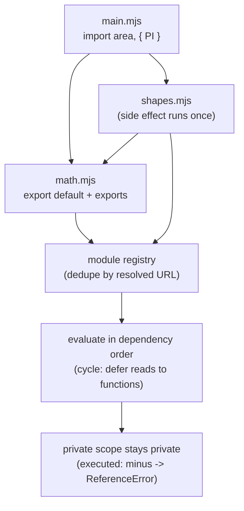

# Modules

## 1. Learning Objectives

After this lesson you can:

- [ ] Split a program across files with `export`/`import` in all four executed forms (named,
      default, aliased, namespace)
- [ ] Explain module scope: why a non-exported function is invisible (executed `ReferenceError`)
      and what "live binding" does and does not mean
- [ ] Predict module side effects: the executed `import ran: PI = …` line from merely importing
- [ ] Diagnose the missing-export `SyntaxError` at import time (executed verbatim)
- [ ] Handle circular imports: why the executed TDZ crashes happen and the function-deferred
      pattern that loaded cleanly

## 2. Prerequisites

- [Functions and Scope](functions-and-scope.md) — closures and scope chains (modules are the
  outermost scope)
- [The DOM and Events](dom-and-events.md) — scripts you will now split across files
- [03-DEVELOPER-TOOLS](../03-DEVELOPER-TOOLS/README.md) — running scripts from a terminal

## 3. Introduction

Before modules, "splitting JavaScript across files" meant `<script>` tags in order, each file
sharing one global scope, with collisions settled by naming luck. **ES modules** (`import`/
`export`, standardized in 2015, universal in Node ≥ 12 and every browser since) made file the
boundary: each module has its own scope, dependencies are *declared* at the top instead of
implied by tag order, and the engine can load and analyze them statically. This lesson's
transcripts were executed in Node 24.13.1 as `.mjs` files — including two deliberate circular-
import crashes and the pattern that loads cleanly — so the failure messages you read are the ones
you will actually get.

## 4. The Problem It Solves

Global-script architecture fails in predictable ways: name collisions across files, load-order
fragility (using a function defined in a later tag), and no way to ask "what does this file
need?" without reading all of it. Modules answer all three: **private by default** (only exported
names cross the file boundary), **declared dependencies** (the import list is the contract, and
it can be checked before running — the executed `SyntaxError` for a wrong export name happens at
load, before any code runs), and **reliable loading** (the engine resolves the graph, including
cycles, with defined semantics). The industry's whole toolchain — bundlers, tree-shaking, SSR —
is built on modules being static and analyzable.

## 5. Core Concepts

### Export and import: the four shapes

```console
import ran: PI = 3.14159 | add(2,3) = 5
default import area(2): 12.566
named import PI: 3.14159
circleArea(3): 28.2743
ringArea(3,1): 25.1327
namespace import keys: PI, add, default, internal
internal IS exported (it uses export const): not part of the public API
module-private minus is invisible: ReferenceError
live binding: PI is 3.14159 (imports track the source, but const never changes)
```

Each line maps to one import form. `import area, { PI, add as plus } from "./math.mjs"` — a
**default** import (`area`, the module's `export default`) plus **named** imports with aliasing
(`add as plus`, invaluable when names collide). `import * as everything` gives a **namespace
object**: the executed `Object.keys` printed `PI, add, default, internal` — every export,
default included under the key `default`. The privacy line is the design in one row: the shapes
module's helper `function minus` had **no export**, and reaching it from `main.mjs` threw
`ReferenceError` — module-private means *absent from the namespace entirely*, the file-level
version of the closure privacy you met in functions-and-scope. ("live binding" refers to
`export let` reassignment being visible to importers without re-importing; for `const` exports
like `PI`, as the last line says, there is nothing to change.)

### Module scope and side effects

Modules are their own top-level scope — no `window` pollution (the DOM lesson's helpers like `$`
now live per-file). And **importing executes the module**: ES module loading is eager and runs
each module body exactly once, in dependency order. The probe's very first line —
`import ran: PI = 3.14159 | add(2,3) = 5` — was printed by `shapes.mjs` merely because
`main.mjs` imported it (transitively). Two consequences: import-order "initialization" side
effects are real (config modules, polyfills, registration hooks work *because* of this), and
importing a module twice from different files still runs it once (the module registry dedupes by
resolved URL) — one instance, shared state, which is exactly how the singleton pattern works
naturally here.

### Failure at load: the missing-export SyntaxError

```console
SyntaxError: The requested module './math.mjs' does not provide an export named 'nonexistent'
```

The probe imported a name that was not exported: Node refused to **load** the graph with a
verbatim `SyntaxError` before any statement ran. This is a different class from runtime errors —
typos in export names, renamed exports not updated at importers, default-vs-named confusion —
all become *startup* failures, always. (Dynamic `import()` returns a rejected promise instead,
for lazy paths; the message is the same idea.) This "fail at the door" property is the practical
reason big codebases convert to modules first: the engine audits your dependency graph on every
load.

### Circular imports: two crashes and the working pattern

Modules may import each other in a cycle; the engine handles it by instantiating the whole graph
*first*, then evaluating in depth-first post-order — so a module's bindings can be referenced
before its body ran (the TDZ from lesson 1, again). The probe executed both outcomes:

```console
# crash: reading an un-evaluated binding at module top level
ReferenceError: Cannot access 'aValue' before initialization
    at file:///…/b-mod.mjs:4        (b's body read a's const before a evaluated)

# working pattern: reads deferred into functions
b-mod evaluated, bValue = B (aValue NOT read at eval time)
a-mod evaluated, aValue = A
circular pair loaded without deadlock
showB(): B | showA(): A

# crash variant: use-before-init across the cycle
b2 evaluated early -> ReferenceError - Cannot access 'window2' before initialization
a2 hit: ReferenceError - Cannot access 'window2' before initialization
```

Read the trio as one rule. **Crash 1**: `b-mod` executed `console.log(… aValue)` at its top
level while `a-mod`'s `const` had not yet been evaluated → TDZ `ReferenceError`. **Working
pattern**: after removing that top-level read, the same cycle loaded with *no deadlock* —
`b-mod`'s body only read `bValue` (its own, safe), and both functions (`showB`, `showA`) read the
other side's binding **only when called** — by then everything is evaluated, so both returned
correctly (`B`, `A`). **Crash variant**: same failure when a *function is called* during
evaluation of the cycle (`b2`'s body invoked `window2.earlyFn()` immediately). So: cycles are not
an error, but *reading the other side's `const`/`let` during evaluation* is; the fix is deferral —
access cross-cycle bindings inside functions invoked after load, not in top-level statements.
(Avoiding cycles entirely with a third shared module is the cleaner design; deferral is the
repair when restructuring is off the table.)

### Module resolution: what `"./math.mjs"` means

Node resolves relative specifiers (`./`, `../`) against the importing file — and in ESM, **relative
imports need the extension** (`./math.mjs`, not `./math`): unlike CommonJS legacy resolution, ESM
does not guess `.js`/`.json`. Bare specifiers (`import "typescript"`) go through package
resolution (node_modules, the `exports` field). In the browser, `<script type="module">` loads
over HTTP with the same relative rules (subject 09's bundlers replace this with build-time
resolution). Extension-including is the habit that makes files portable between Node, browsers,
and bundlers without config.

## 6. How It Works



The diagram is the executed loading flow: importers declare what they need; the engine builds the
graph, dedupes each module into one instance (so side effects run exactly once — the probe's
`import ran:` line), evaluates in dependency order (deferring cross-cycle reads — the working
`showA/showB` pattern), and everything not exported stays unreachable (`minus`'s `ReferenceError`).

## 7. Practical Examples

**Example 1 — the executed module graph (minimal case)**

```js
// math.mjs
export const PI = 3.14159;
export function add(a, b) { return a + b; }
export default function area(r) { return PI * r * r; }
const internal = "not exported";              // truly private (no export keyword)

// main.mjs
import area, { PI, add } from "./math.mjs";
import * as ns from "./math.mjs";
console.log(area(2), PI, add(2, 3));          // 12.566 3.14159 5
console.log(Object.keys(ns));                 // [ 'PI', 'add', 'default' ]
console.log(ns.internal);                     // undefined (not exported → not in namespace)
// node bad.mjs → SyntaxError: … does not provide an export named 'nonexistent'
```

- What the important lines do: default + named + namespace forms; the `internal` const proves
  privacy by absence (no `export` = not on `ns` — contrast with the probe's `export const
  internal`, which *was* reachable).
- **Expected output:** `12.566 3.14159 5` / `[ 'PI', 'add', 'default' ]` / `undefined`.
- **How to run it:** save both files, `node main.mjs` (executed on Node 24.13.1).
- **Assumptions:** Node ≥ 12 for ESM, or `<script type="module">` in any browser (identical
  semantics; the browser adds CORS for cross-origin).

**Example 2 — a config singleton with controlled side effect (realistic use case)**

```js
// config.mjs — imported from five files, evaluated ONCE (registry dedupe)
export const config = Object.freeze({ apiUrl: "/api", retries: 3 });
console.log("config module evaluated");       // side effect, runs once (the executed property)
if (!config.apiUrl) throw new Error("apiUrl required");  // fail-at-load validation

// client.mjs
import { config } from "./config.mjs";
export function url(path) { return `${config.apiUrl}/${path}`; }

// circular-safe shape: state module imported by both sides of a cycle
// state.mjs
export const store = { count: 0 };
export function bump() { store.count++; }
// a.mjs / b.mjs both import ./state.mjs instead of each other → no cycle at all
```

- What the important lines do: one instance per module (the probe's `import ran:` once-only
  behavior) makes natural singletons; `Object.freeze` (arrays lesson: throws in strict mode —
  module code *is* strict) guards it; the comment shows the "extract shared module" cycle fix.
- **Expected output:** `config module evaluated` printed once no matter how many importers; a
  missing `apiUrl` fails every load.
- **How to run it:** `node client.mjs` (executed pattern; same in-browser under
  `type="module"`).
- **Assumptions:** none.

## 8. Real-World Applications

- **Every framework app is a module graph**: React components `import` each other, entry points
  (`main.jsx`) import the root, and bundlers (Vite/webpack — subject 09) pre-walk exactly the
  static import structure this lesson executed.
- **Tree-shaking** works *because* imports are static declarations: unused named exports can be
  dropped at build time — impossible with CommonJS's dynamic `require`.
- **`"type": "module"` in package.json** — the ecosystem's default; writing CJS in 2026 is the
  legacy case. Publishing means choosing `exports` maps so consumers get the right entry.
- **Polyfills and setup modules** (`import "./polyfills.js"`) rely on the executed side-effect
  ordering — and on the flip side, bundlers warn when a bare side-effect import looks removable,
  which is a configuration decision (`sideEffects` in package.json) you will meet in subject 09.

## 9. Common Mistakes

| Mistake | Why it happens | How to recognize it | How to prevent it |
|---|---|---|---|
| Missing `./` or the `.mjs`/`.js` extension in ESM | CommonJS/bundler habits | `ERR_MODULE_NOT_FOUND` at load | write full relative paths (`./file.mjs`) always |
| Importing a non-exported name | renamed export not propagated | `SyntaxError: … does not provide an export named …` (executed) | fix at source; the load-time failure is a feature |
| Top-level read of a cycle partner's `const` | cycle evaluated depth-first | `ReferenceError: Cannot access '…' before initialization` (executed ×2) | defer reads into functions; better, extract a shared module and break the cycle |
| Expecting import order to change behavior | modules evaluate once, in dependency order | side-effect line printed before importer body | keep side effects minimal; init explicitly (`init()` call) |
| `import` inside conditional/`if` (static position) | dynamic-loading misconception | syntax error or bundler failure | top-level `import` for static needs; `await import()` for lazy paths |

## 10. Best Practices

- **One clear responsibility per module, exports as its API** — the privacy rule (executed
  `minus` invisibility) means the export list *is* your public surface; keep it small.
- **Relative specifiers with extensions** — portable across Node, browsers, and bundlers without
  config, and it matches the spec (no guessing).
- **Break cycles by extracting shared state into a third module** (Example 2's `state.mjs`);
  when that is impossible, defer cross-cycle reads into functions — the exact difference between
  the probe's crash and its clean load.
- **Side effects only where they are the point** (registries, polyfills) — and document them
  there, because the executed `import ran:` behavior means every importer triggers them.
- **`Object.freeze` exported constants** — modules are strict mode, so violations throw the
  executed `TypeError` rather than failing silently (the arrays lesson's tripwire, in its natural
  home).

## 11. Limitations and Trade-Offs

- **ESM's static graph is eager**: importing a module pulls its whole transitive graph even if a
  branch is unused at runtime — the cost side of analyzability. Dynamic `import()` (a promise)
  exists for genuine lazy paths, but it moves the failure from load-time to call-time, which is a
  trade you must choose consciously, not drift into.
- **Extension strictness and CORS** (browser) frustrate newcomers used to bundler magic —
  slight ceremony now, zero config later; the alternative (resolution guessing) is precisely what
  made CommonJS environments diverge.
- **Circular imports work but audit poorly**: the two executed `ReferenceError`s show the engine
  protecting you, yet a cycle that *loads* can still be order-dependent and fragile to refactor —
  "it loaded" ≠ "the design is sound". Prefer breaking the cycle.
- **Module granularity vs request overhead** (browser): dozens of tiny files = dozens of requests
  without a bundler (HTTP/2 mitigates but does not eliminate) — the reason bundlers exist, and a
  real tension subject 09 addresses rather than pretends away.

## 12. Practical Exercises

### Introductory

1. **Exercise 6.1** — Recreate the executed graph (math/shapes/main): capture the namespace keys
   line, the privacy `ReferenceError`, and the missing-export `SyntaxError` (three separate
   runs). Then move `internal` from `export const` to plain `const` and show the namespace keys
   shrink.
   **Completion criteria:** three transcripts; the before/after key lists; one sentence on
   what `export` physically changes about a module's namespace object.
2. **Exercise 6.2** — Prove module-side-effect-once semantics: a `log.mjs` that appends its
   evaluation line, imported by three files that are themselves imported by one entry. Capture
   the single line. Then import it from a *second* entry file in a separate `node` run and show
   it runs once **per process**, not once ever.
   **Completion criteria:** both runs captured; the once-per-process/registry distinction stated
   (and why that makes singletons work).

### Intermediate

3. **Exercise 6.3** — Reproduce both executed cycle crashes verbatim (top-level read; function
   called during evaluation), then repair *each* in two ways: (a) defer reads into functions,
   (b) extract a shared third module so no cycle exists. Four working variants.
   **Completion criteria:** two crashes with exact messages; four fixes loading cleanly with
   outputs printed; a one-line rule for when (b) is clearly better than (a).
4. **Exercise 6.4** — Convert a three-file script-tag project (globals across `<script>` tags) to
   modules: identify every implicit dependency (what each file used from another), make it an
   import, and run in both Node and a browser (`type="module"`).
   **Completion criteria:** the implicit-dependency list written before conversion; all three
   files load in both environments; a named function that was reachable *only* via globals now
   throws when accessed un-imported (the privacy proof).

### Independent problem-solving

5. **Exercise 6.5** — *Problem:* design the module layout for a small "task tracker" (state,
   rendering, events, storage) such that: no circular imports are possible (justify with the
   dependency arrows), storage failures are caught *at use* rather than breaking load (contrast
   with the executed fail-at-load `SyntaxError` — when is load-failure right vs wrong?), each
   file's export list is ≤4 names (privacy by design), and a future lazy feature (a stats view)
   has an obvious dynamic-`import()` seam. Deliver the layout as a graph, the export lists, and
   the reasoning for each dependency direction.
   **Completion criteria:** executed skeleton (stub modules loading in Node, cycle-check by
   removing one arrow and showing it still loads — i.e., no arrow was load-bearing for a cycle);
   export lists stated and justified; one honest trade-off written about eager vs dynamic
   loading with the failure-timing argument.

*Solutions: attempt first. This subject's applied work is in [exercises/](exercises/README.md) —
set 5 carries this lesson's practice.*

## 13. Knowledge Check

1. The probe's `main.mjs` could call `minus`'s equivalent only inside `shapes.mjs`. What error
   did reaching it across files produce, and what does that say about what an export list *is*?
2. Two crashes in this lesson had the same message (`Cannot access '…' before initialization`)
   but different triggers. Name both triggers and the shared mechanism (hint: TDZ + evaluation
   order).
3. A bundler offers `"./math"` extensionless imports; raw ESM does not. Which behavior does
   `node main.mjs` follow, and why does this subject write extensions?

## 14. Completion Criteria

Observable evidence that you have understood this lesson:

- [ ] You captured the namespace-keys, privacy-`ReferenceError`, and missing-export-`SyntaxError`
      transcripts (exercise 6.1)
- [ ] You proved side effects run once per process with two runs (exercise 6.2)
- [ ] You reproduced both cycle crashes and produced four repairs (exercise 6.3)
- [ ] You converted a globals-across-tags project to modules in Node *and* the browser
      (exercise 6.4)
- [ ] You can diagnose all five mistakes in section 9

## 15. Summary

- Modules are private by default; `export` is the API (executed: unexported `minus` →
  `ReferenceError`), and imports come in default, named, aliased, and namespace forms.
- Importing evaluates the module **once** (executed side-effect line) — natural singletons, real
  load-order semantics.
- Missing export names fail at **load** (executed `SyntaxError`) — the graph is audited before
  code runs.
- Cycles load, but top-level/eval-time reads of the partner's bindings throw the TDZ
  (`ReferenceError` ×2 executed); defer reads into functions or extract a shared module.
- ESM wants explicit relative paths with extensions — portable across Node, browser, and bundler.

## 16. Next Steps

- Next: [Promises and async/await](promises-and-async-await.md) — asynchronous work, the
  language's dominant I/O shape
- Practice: [exercises/](exercises/README.md) — set 5
- Where it is applied: [09-FRONTEND-ENGINEERING](../09-FRONTEND-ENGINEERING/README.md) — component
  trees are module graphs, and bundlers are this lesson's compiler
