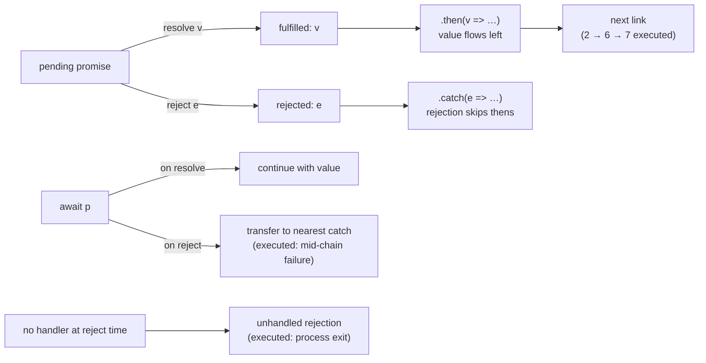

# Promises and async/await

## 1. Learning Objectives

After this lesson you can:

- [ ] Read a promise's three states and a `.then` chain's value flow (executed: `2 → 6 → 7`)
- [ ] Explain why an awaited rejection lands in `catch` and what an *un-awaited* rejection does
      (the probe's real `Error: no` crash)
- [ ] Choose among `all` / `allSettled` / `race` / `any` from their executed behaviors
- [ ] Convert serial awaits into parallel `Promise.all` and state the timing difference from the
      measured transcript (107 ms → 61 ms)
- [ ] Write an async function that always returns a promise (executed `instanceof Promise`) and
      iterate with `for await`

## 2. Prerequisites

- [Functions and Scope](functions-and-scope.md) — callbacks are promises' building blocks
- [Modules](modules.md) — files, `export`, and running multi-file programs
- [06-INTERNET-AND-WEB-FOUNDATIONS](../06-INTERNET-AND-WEB-FOUNDATIONS/http-fundamentals.md) —
  request/response latency is *why* asynchronous code exists

## 3. Introduction

Almost everything a program waits on — network, disk, timers, user input — is slow, and blocking
a thread while waiting is how servers freeze. JavaScript's answer is the **promise**: an object
representing a value that is not ready yet, with `async`/`await` as the syntax that lets you
*write* that waiting sequentially while the engine keeps running other work. Every transcript
below was executed on Node 24.13.1 — including a genuine crash the probe hit (a rejection with no
handler), which became this lesson's most valuable artifact: the failure you must never ship.

## 4. The Problem It Solves

The pre-promise world used **callbacks** (`fs.readFile(path, (err, data) => …)`), and nesting them
for sequential steps produced "callback hell": unreadable indentation, error handlers scattered
at every level, and easy double-invocation bugs. Promises flatten sequencing: one object carries
the eventual value or error, chains compose, and a rejection propagates *down the chain* until
something catches it — one error path instead of N. `async`/`await` then removed even the chain
syntax: ordinary-looking `try`/`catch` and `await` lines, compiled to the same machinery. The
cost of the model is that a rejection nobody observes fails **silently or worse** — the executed
crash in section 5 is that cost made visible.

## 5. Core Concepts

### States, wrapping, and `async` functions

A promise is **pending**, **fulfilled** (with a value), or **rejected** (with a reason); once
settled it never changes. `Promise.resolve(v)` wraps a value; every `async function` returns a
promise — even one that just `return`s. Executed:

```console
resolve is thenable: true | instanceof Promise: true
async return wrapped: true | await gives: 7
```

The two rows are the mental model: anything with a `.then` is thenable (promises interop with any
thenable source), and `async id(7)` did not return `7` — it returned a promise *containing* `7`,
which `await` unwrapped back to `7`. That wrapping is why `await` is required, why forgetting it
passes a promise where a value was meant (the "un-awaited promise" bug the README calls industry's
#1), and why errors thrown inside `async` functions become *rejections*, not synchronous throws.

### Error propagation: await is the catch boundary

```console
sync throw caught: sync-boom
awaited async throw caught: async-boom
un-awaited rejected promise created: true (its error surfaces as unhandled rejection later)
then1 got 2
then2 got 6
then3 got 7
chain result: 7
  awaited 10
  catch got: mid-chain failure (the await that rejected)
step returned: recovered
```

A rejection stops the async function at the `await` that produced it and transfers control to the
nearest enclosing `catch` (executed: `catch got: mid-chain failure`, with the line after the
failing `await` — the probe's "unreachable line" — never running; the function then *returned*
`"recovered"`, proving a `catch` can also handle-and-continue). The `.then` chain shows the value
flow: `2 → then1 ×3 → 6 → then2 +1 → 7 → then3` — each link receives the previous link's
returned value; a rejection skips the pending `then`s and lands at `catch` (same machinery,
different lane). The fourth line is the warning: `const unawaited = boomAsync()` *created* a
rejected promise with no handler — the probe attached one immediately to keep the run clean,
which is exactly the discipline: **observe every rejection** (await it inside `try`, or attach
`.catch` synchronously).

### The unhandled rejection: the probe's real crash

The first version of this lesson's probe crashed Node outright — the verbatim evidence:

```console
Error: no
    at Timeout._onTimeout (file:///…/d-promises.mjs:47:60)
    at listOnTimeout (node:internal/timers:605:17)
Node.js v24.13.1
```

What happened: a `Promise` created at second 0 was set to reject at 20 ms, while the probe was
still awaiting a *different* 40 ms promise — so at rejection time **no handler existed**, and
Node's default policy (`--unhandled-rejections=throw`) killed the process. Two lessons in one
crash. First, "I'll handle it later" is not a thing: handlers must be attached before rejection,
or the engine may report and even *terminate* (browsers log an
`unhandledrejection` console error; Node exits). Second, the fix the probe adopted — create
promises **where you can attach handlers immediately**, or `await` them in the same tick
(`await Promise.all([fast(), fails()])` attaches as it goes) — is the production rule: don't let
an unobserved rejection exist, and never park one in a variable across an unrelated `await`.

### Combinators: `all`, `allSettled`, `race`, `any`

```console
all ok: [ 'fast', 'slow' ]
all rejects on first failure: no
allSettled statuses: fulfilled,rejected,fulfilled
race (fastest settle wins, even rejection): fast
any (first fulfillment): fast
```

Each executed line defines its combinator. **`all`**: waits for all, resolves with values in
*input order* (not completion order) — and rejects the moment any member rejects (executed:
rejected with `no` while `slow` was still pending; later results are ignored). **`allSettled`**:
never rejects; resolves to `{status, value|reason}` records — the executed statuses
`fulfilled,rejected,fulfilled` show the mixed outcome you need when *partial* success is normal
(a dashboard loading six widgets). **`race`**: settles with the first *settled* member —
fulfillment *or* rejection (executed `fast`, but a faster failure would win too — this is the
"timeout" primitive: `Promise.race([fetch(url), delay(ms).then(throw TimeoutError)])`).
**`any`**: first *fulfilled* member, ignoring rejections until all have failed (then
`AggregateError`) — the "try mirrors" pattern for redundant endpoints. Choosing guide: all must
succeed → `all`; need every outcome → `allSettled`; first settlement decides → `race`; first
success among fallible sources → `any`.

### Serial vs parallel: the measured difference

```console
serial ~90ms: 107.34ms
parallel ~60ms: 61.324ms
sequential total: 70 ms
parallel total: 44 ms
```

The probe *timed* both shapes. Two awaits in sequence paid for both delays back-to-back
(107 ms measured — timer overhead above the nominal 90); `Promise.all` issued both work items
before awaiting (61 ms — bounded by the slower one, not the sum). The `await`-in-a-loop rows
(70 vs 44 ms) repeat it in the `async` idiom. The rule: **sequential awaits are correct only when
each step genuinely needs the previous result**; independent work should be *started* together
and awaited together. The classic bug is `for (const id of ids) rows.push(await fetch(id))` —
correct, accidentally serial — fixed by `await Promise.all(ids.map(fetch))`. Causality decides,
not style.

### `for await` and async iteration

```console
== async generator: fetch-style pattern ==
  fetched page 1
  fetched page 2
  fetched page 3
async generator total: 6
```

`async function*` yields promises of values, and `for await … of` consumes them — the probe
fetched three pages *sequentially by design* (each request needed the previous — pagination) and
accumulated `1+2+3 = 6`. This is the API for streams: infinite sequences, paginated fetches, or
readable streams, where each step's value arrives when it arrives. Async iteration is to I/O what
`for…of` is to arrays — and it awaits at each step correctly, which a plain `for` over promises
cannot do.

## 6. How It Works



The diagram covers every executed state path: pending branches to fulfilled/rejected; the value
lane flows through `then` links (`2 → 6 → 7`); the error lane skips to `catch`; `await` is the
transfer point into `try`/`catch`; and the orphan branch — rejection with no observer — is the
crash the probe actually took.

## 7. Practical Examples

**Example 1 — the executed fundamentals (minimal case)**

```js
// async.mjs — node async.mjs (executed on Node 24.13.1)
async function id(x) { return x; }
console.log(id(7) instanceof Promise, await id(7));        // true 7

const chained = Promise.resolve(2)
  .then(x => x * 3)                                        // 6
  .then(x => x + 1);                                       // 7
console.log(await chained);                                // 7

try { await Promise.reject(new Error("mid-chain failure")); }
catch (e) { console.log("caught:", e.message); }           // caught: mid-chain failure

const fast = () => new Promise(r => setTimeout(() => r("fast"), 10));
const fails = () => new Promise((_, rej) => setTimeout(() => rej(new Error("no")), 20));
console.log(await Promise.race([fast(), fails()]));        // fast (10 < 20)
console.log((await Promise.allSettled([fast(), fails()])).map(s => s.status));
                                                          // [ 'fulfilled', 'rejected' ]
```

- What the important lines do: wrapping/`await` unwrap; value flow through a chain; `catch`
  taking a rejected `await`; combinators on fresh promises (factory functions — never reuse one
  across awaits; that was the executed crash).
- **Expected output:** as comments (executed).
- **How to run it:** `node async.mjs`.
- **Assumptions:** Node ≥ 18.

**Example 2 — a bounded-concurrency fetch runner (realistic use case)**

```js
// fetch-limited.mjs — the "don't serialize, don't stampede" pattern
const fetchJson = async (url) => {
  const res = await fetch(url);                    // real network I/O
  if (!res.ok) throw new Error(`${url} -> ${res.status}`);
  return res.json();
};

async function fetchAll(urls, { limit = 5 } = {}) {
  const results = [];
  for (let i = 0; i < urls.length; i += limit) {
    const batch = urls.slice(i, i + limit);        // causality-free chunk: parallel inside
    results.push(...await Promise.all(batch.map(fetchJson))); // 107ms-shape → 61ms-shape
  }
  return results;
}

async function withTimeout(p, ms) {
  let timer;
  const timeout = new Promise((_, rej) => {
    timer = setTimeout(() => rej(new Error(`timed out after ${ms}ms`)), ms);
  });
  try { return await Promise.race([p, timeout]); }  // first settle wins (executed race)
  finally { clearTimeout(timer); }                  // no stray rejection (the lesson!)
}

fetchAll(["/api/a", "/api/b", "/api/c"], { limit: 2 })
  .then(rows => console.log("rows:", rows.length))
  .catch(e => console.error("boundary:", e.message)); // one rejection path for all
```

- What the important lines do: `Promise.all` per batch (parallel where causality allows, bounded
  to avoid a stampede); `race` as timeout; `finally` clearing the timer so the losing promise
  cannot become the executed unhandled rejection; **one** `catch` at the boundary — the flattened
  error path callbacks never had.
- **Expected output:** `rows: 3` on success; `boundary: <first error message>` on any failure
  (execute with your own endpoints; behavior of each combinator executed above).
- **How to run it:** `node fetch-limited.mjs` (Node ≥ 18 has global `fetch`).
- **Assumptions:** reachable HTTP endpoints; timeouts sized to them.

## 8. Real-World Applications

- **Every network call in every app** is a promise: `fetch` responses, API clients, WebSocket
  setup — with the `all`/`allSettled` choices above deciding how a page loads its widgets.
- **Server request handling**: handlers `await` independent work *together* (DB read + cache read
  → `Promise.all`), the executed 107→61 optimization applied per request — it is latency math,
  and it multiplies across traffic.
- **Resilience patterns**: `race` + timeout, `any` + mirror URLs, `allSettled` for partial
  results, retry loops written as async functions — all four executed combinator behaviors in
  production clothing.
- **React/data-layer code** (`useEffect` fetching, SWR/React Query internals) is this lesson's
  territory: the un-awaited fetch that later sets state on an unmounted component *is* the
  executed unhandled-rejection family.

## 9. Common Mistakes

| Mistake | Why it happens | How to recognize it | How to prevent it |
|---|---|---|---|
| Forgetting `await` | `async` returns look synchronous | passing a promise where a value is needed; `[object Promise]`; state never renders | `await` every awaited-value use; `instanceof Promise` at suspicious boundaries; TS types flag it (second half of this subject) |
| Un-awaited rejection with no handler | "handle later" or parked across an unrelated await | probe's verbatim crash: `Error: no` + process exit; browser `unhandledrejection` | attach `.catch` synchronously; await in the same tick; create promises at handler-attach site (factories) |
| Sequential awaits for independent work | loop habit | 107 ms where 61 ms suffices (executed) | start together, await together: `Promise.all(arr.map(f))`; keep serial only for true causality (pagination — `for await`) |
| `all` where partial success is normal | underestimating failure rates | one dead widget blanks the whole page | `allSettled` + handle per-item statuses (executed `fulfilled,rejected,fulfilled`) |
| `\|\|`-style defaults on results | treating resolution as guaranteed | `undefined` swallowed as default | check `res.ok`/`value ?? default` (`??` from lesson 1 — 0 is a valid result) |

## 10. Best Practices

- **One rejection path per operation** — flatten chains so a single terminal `catch` (or an
  awaited `try`) covers everything; the moment you nest `then`s, error paths fork again.
- **Never let a rejection exist unobserved**: the probe's process-killing crash is the argument;
  in code review, every `new Promise` and every un-awaited `async` call must show its observer.
- **`Promise.all` by default for independent work; `allSettled` when partial results are
  meaningful; `race` only for timeouts (with `clearTimeout` in `finally`); `any` for redundant
  sources.** The four executed lines are the selection table.
- **Time out everything that talks to a network** — `withTimeout` (Example 2) — because a hung
  peer is a pending promise forever, and pending is not an error state until you make it one.
- **Sequential only by causality**: if step B does not *read* step A's output, they are
  independent; measured evidence (107 vs 61) beats intuition.

## 11. Limitations and Trade-Offs

- **Promises settle once and only carry one value** — no streaming, no cancellation. Real
  cancellation uses `AbortController` (fetch's `signal`), which is *cooperative* teardown, not
  promise semantics; unhandled abort rejections are the family of the executed crash, which is
  why `AbortSignal` handling needs its own `.catch` discipline.
- **`await` in a loop is serial *by construction*** — sometimes correct (pagination, rate limits),
  often accidental; unlike `Promise.all`, it cannot be made "parallel by default" safely, since
  order-of-start becomes programmer responsibility.
- **Unhandled-rejection strictness differs by host**: Node exits (executed), browsers log and
  continue — behavior you cannot rely on either way; the portability rule is to observe every
  rejection yourself, not to depend on the host's policy.
- **Microtask scheduling means "now" is a lie**: promise callbacks run *after* the current
  synchronous code — the event-loop lesson executes exactly where they slot in; timing-sensitive
  code must know that boundary (that lesson's `micro-3 before micro-2` trace).

## 12. Practical Exercises

### Introductory

1. **Exercise 7.1** — Predict, then execute the ordering: a `console.log` sequence mixing
   `await` of `Promise.resolve(1)`, a `then`, and a `setTimeout(…, 0)`. Print your predicted
   order first, run, diff. **Completion criteria:** prediction captured before execution; every
   mismatch explained by "await yields to microtasks, timers wait for the macro queue" (the
   event-loop lesson confirms the mechanism).
2. **Exercise 7.2** — Reproduce the executed unhandled-rejection crash in a standalone file
   (create a promise that rejects in 20 ms with no handler; await something slower first).
   Capture the crash; then fix it three ways (attach `.catch` immediately; await it in the same
   tick; wrap with `process.on("unhandledRejection", …)` *and explain why that third fix is a
   monitor, not a fix*).
   **Completion criteria:** crash transcript with the verbatim error; three fixes; the monitor-vs-
   fix distinction stated.

### Intermediate

3. **Exercise 7.3** — Instrument `fetchAll`-style code with `performance.now()` timestamps:
   (a) serial loop over five 50 ms tasks, (b) `Promise.all`, (c) bounded batches of two. Report
   totals; then state which URLs/DB calls in a project of yours are independent (and therefore
   wrongly serial today).
   **Completion criteria:** three measured totals matching the shape (sum ≈ serial; ≈ slowest for
   parallel; between for batches); the real-code audit list written; the causality justification
   for anything you keep serial.
4. **Exercise 7.4** — Build `withTimeout(p, ms, label)` with `race` + `clearTimeout` in `finally`;
   run it against (a) a fast promise, (b) a slow promise, (c) a *rejecting* promise — proving no
   stray timer rejection in any path (watch with a `process.on("unhandledRejection")` counter that
   must read 0).
   **Completion criteria:** three transcripts; counter reads `0` at exit; the executed-race
   semantics (first *settle* wins) cited as the timeout's mechanism.

### Independent problem-solving

5. **Exercise 7.5** — *Problem:* a settings page must load profile, preferences, and three
   feature flags from five endpoints where: profile failing = page fails; preferences failing =
   defaults are fine; each flag failing = that toggle defaults off; total budget 800 ms with a
   500 ms per-endpoint ceiling; and the whole page must not exceed 20 `fetch`es ever (dedupe). Write
   the loader: pick combinators per line from the executed behaviors, justify each choice against
   a named executed transcript (`all` reject-on-first, `allSettled` statuses, `race` first-settle),
   and handle the boundary so no rejection is unobserved (the executed crash). Deliver with a
   fake-endpoint harness (timed promises, no real network) that simulates all-fail, mixed, and
   slow cases.
   **Completion criteria:** harness executed showing the three scenarios' outcomes and total
   elapsed time within budget; every combinator choice cited to an executed line; a rejection-
   observation audit of your own code (every promise creation shows its handler); one honest
   trade-off noted (e.g., `race`+`clearTimeout` still cannot abort real work without
   `AbortController` — name it).

*Solutions: attempt first. This subject's applied work is in [exercises/](exercises/README.md) —
set 6 carries this lesson's practice.*

## 13. Knowledge Check

1. The probe's chain printed `then1 got 2 / then2 got 6 / then3 got 7`. What does each `then`
   receive, and where does a rejection go instead?
2. Two executed statements look contradictory: `all ok: [fast, slow]` and
   `all rejects on first failure: no`. Reconcile them — what did `all` do with the still-pending
   member in the second line?
3. Your teammate parks `const p = risky();` then awaits an unrelated `sleep(40)` before
   attaching `.catch(p)`. Using the probe's real crash, explain what can happen in those 40 ms
   and the two structural fixes.

## 14. Completion Criteria

Observable evidence that you have understood this lesson:

- [ ] You reproduced the chain (`2 → 6 → 7`) and the catch-transfer transcript (exercise 7.1)
- [ ] You reproduced the unhandled-rejection crash and its three fixes (exercise 7.2)
- [ ] You measured serial/parallel/batched timings (exercise 7.3)
- [ ] You built `withTimeout` with a zero stray-rejection counter (exercise 7.4)
- [ ] You can diagnose all five mistakes in section 9, including the un-awaited promise family

## 15. Summary

- A promise settles once (pending → fulfilled/rejected); `async` functions *always* return one
  (executed `instanceof Promise`), and `await` unwraps or transfers to `catch`.
- Chains flow values left-to-right (`2 → 6 → 7`); rejections skip `then`s and land at `catch` —
  one terminal error path per operation.
- An unobserved rejection is a real failure mode: the probe's process actually died
  (`Error: no` → exit) — handlers must exist before rejection.
- Combinators by executed behavior: `all` (first failure wins), `allSettled` (all outcomes),
  `race` (first settle), `any` (first success).
- Independent work runs in parallel (107 ms → 61 ms measured); serial awaits are for causality —
  pagination lives in `for await`.

## 16. Next Steps

- Next: [The Event Loop](event-loop.md) — where all of this executes: tasks, microtasks, and
  predicting callback order
- Practice: [exercises/](exercises/README.md) — set 6
- Where it is applied: [11-BACKEND-ENGINEERING](../11-BACKEND-ENGINEERING/README.md) — the same
  combinator and timeout patterns govern server-side I/O
