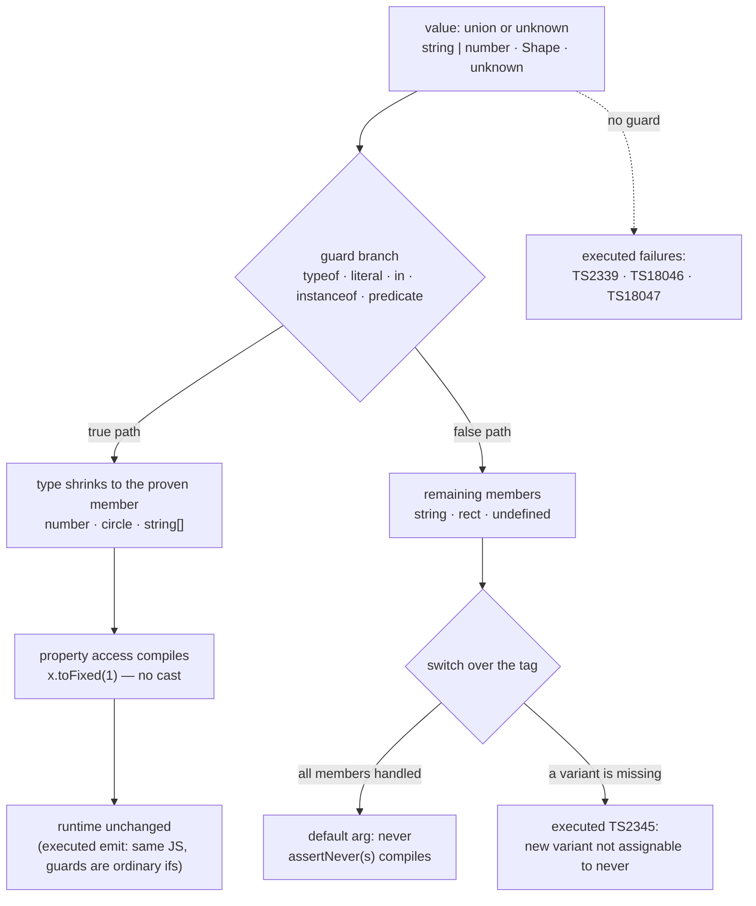

# Type Narrowing

## 1. Learning Objectives

After this lesson you can:

- [ ] Use every narrowing mechanism the executed probes exercised — `typeof`, literal
      discriminants, optional chaining, `in`, and type predicates — and say which type each
      produces in the branch it guards
- [ ] Explain the four executed diagnostics (`TS2339`, `TS18046`, `TS18047`, `TS2345`) as four
      faces of one rule: a union or `unknown` is used *before* something proved what it is
- [ ] Write an `unknown`-in/typed-out parser with a guard and reject malformed input loudly
- [ ] Build a discriminated union and prove exhaustiveness with `never` — and read the executed
      `TS2345` that fires when a fifth variant arrives unhandled
- [ ] Name the walls: narrowing is compile-time only (erasure), it dies across mutable captures,
      and a predicate you wrote is a claim the compiler believes

## 2. Prerequisites

- [Types and Interfaces](types-and-interfaces.md) — unions, literal types, and how they model data
- [TypeScript Fundamentals](typescript-fundamentals.md) — `strict`, inference, and reading a
  diagnostic line
- [Generics](generics.md) — why `v is string` and `<T>` are different tools
- [Error Handling](error-handling.md) — what "reject loudly" means at a boundary

## 3. Introduction

Unions and `unknown` (previous lessons) buy honesty by making the compiler *ask* — and then
every line of real code has to *answer*: if `x: string | number`, the compiler will not let you
call `x.toUpperCase()` until some check has proved the string case. **Narrowing** is that proof
mechanism: TypeScript's flow analysis watches your `if`s, guards, and predicates and *shrinks*
the type inside the branch that could only contain one member. This lesson's file was executed
with tsc 7.0.2 under `--strict`: the clean cluster compiled **exit 0** and ran under Node
(printing its results), while four deliberately broken neighbours each failed with their own
diagnostic — one per narrowing failure mode you will meet in production code.

## 4. The Problem It Solves

Without narrowing, honest types are unusable: a `string | number` parameter would force every
function to either cast blindly (`as string` — the compiler's trust, not its proof) or hand the
union to a helper and hope. Without `unknown` at boundaries, every parse of `JSON.parse`,
`localStorage`, or an API response is an unchecked assumption wearing a type's clothes. And
without exhaustiveness, adding a variant to a union silently leaves every `switch` on it a
little more wrong — the classic "we added `triangle` and shipped a crash". Narrowing solves all
three *at compile time*: the branch you checked is the branch the compiler trusts, so the union
stays honest everywhere else. It is the mechanism that makes `strict` livable — `null` checks
stop being noise and start being doors.

## 5. Core Concepts

### Flow-based narrowing: the guard shrinks the type

```ts
function label(x: string | number) {
  if (typeof x === "number") return x.toFixed(1);   // here: number
  return x.toUpperCase();                           // else: string
}
```

The executed cluster's opening function. Inside the `if`, the compiler has *flow analysis*:
`typeof x === "number"` is a test the value either passed or didn't, so on the true path the
only members left are `number` — `x.toFixed(1)` type-checks. The false path of a two-member
union is the *other* member, so the line after the `if` sees `string`. No cast, no `any`: a
check and a proof. This is the single most reused pattern in typed JavaScript — and note what
it is *not*: narrowing changes no runtime behavior (the emitted `.mjs` runs identically); it
only changes what the checker knows.

### Literal discriminants: narrowing on a tag

```ts
type Shape =
  | { kind: "circle"; radius: number }
  | { kind: "rect"; w: number; h: number };

function area(s: Shape): number {
  if (s.kind === "circle") return Math.PI * s.radius ** 2;   // narrowed to circle
  return s.w * s.h;                                          // else-branch: rect
}
```

The **discriminated union** (introduced in types-and-interfaces) is narrowing's flagship: a
literal-typed `kind` field whose *value* selects the member. `s.kind === "circle"` proves
membership, so `s.radius` exists on the true path and `s.w` on the false path — the else-branch
compiled with zero annotation in the executed file. Runtime and compile time finally agree:
the tag is a real property your code branches on anyway (lesson 4's data modeling), so the
proof costs nothing extra. This is how state machines, API responses, and Redux-style actions
are modeled in industry code.

### Truthiness, `null`, and optional chaining

```ts
let maybe: string | null = Math.random() > 0.5 ? "hi" : null;
console.log(maybe?.toUpperCase());   // executed: printed `undefined` on the null draw
if (maybe !== null) { maybe.toUpperCase(); }   // narrowed to string inside
```

Under `strict`, `null`/`undefined` are their own types — so `string | null` must be handled
before use, and two tools do it. The **`if` check** narrows (`!== null`, `!== undefined`, or
plain truthiness — careful: truthiness also excludes `0`, `""`, `NaN`, `false`, so it narrows
*more* than null-checks do). **Optional chaining** `?.` needs *no* narrowing: it short-circuits
to `undefined` instead of throwing, which the executed line proved by printing `undefined` on
the run where `maybe` was null. Use `?.` when absence has a sensible default answer; use the
`if` when you need the narrowed value *after* the check.

### `in`, `instanceof`, and type predicates

```ts
function readPort(v: unknown): number | undefined {
  if (typeof v === "object" && v !== null && "port" in v) {
    const p = (v as { port: unknown }).port;   // `in` proved the key, not the value's type
    return typeof p === "number" ? p : undefined;
  }
  return undefined;
}

const isString = (v: unknown): v is string => typeof v === "string";
const s = ["a", 1, "ok"].find(isString);   // s: string | undefined
```

`in` narrows unions by *presence of a key* (the executed `readPort` guard) — note the honest
seam: `in` proves the property exists, not what it holds, so the value is still `unknown` and
needs its own check (the second guard in the executed function). `instanceof` does the same for
class instances. A **type predicate** (`v is string`) is a user-written guard: a boolean-returning
function that *claims* its result means the argument is that type — and the compiler believes
you (section 11's wall). The executed `find(isString)` shows why they matter: array methods can
now narrow for you, turning `unknown[]` into `string | undefined` in one call.

### `unknown`: the guard door

```ts
const v: unknown = JSON.parse('{"a":1}');
// console.log(v.a);                                  // ✗ executed TS18046: 'v' is of type 'unknown'
if (typeof v === "object" && v !== null && "a" in v) {
  // v: object & Record<"a", unknown> after the guard
}
```

The executed `bad-unknown.ts` shows the door from both sides. `unknown` accepts *anything* and
lets you do *nothing* — `v.a` fails with `TS18046` ("is of type `unknown'`"), the compiler's
way of saying "prove something first". Each guard is a key turn: `typeof` gives `object`,
`!== null` removes null (which `typeof` does *not* exclude — the classic seam), `in` adds the
key. Inside the block you may read `.a` — typed `unknown`, so a further guard gives you a
`number`. This is the `unknown`-in/typed-out rule from types-and-interfaces made mechanical:
parse, guard, then hand out the narrow type; anything else is a cast pretending to be a
proof.

### Exhaustiveness: `never` as the proof of completeness

```ts
function assertNever(x: never): never { throw new Error(`unreachable: ${JSON.stringify(x)}`); }
function kindOf(s: Shape): string {
  switch (s.kind) {
    case "circle": return "round";
    case "rect": return "box";
    default: return assertNever(s);                 // s: never — every member handled
  }
}
```

The `default` branch of an *exhaustive* switch leaves the narrowed union with **no members
left** — which is exactly `never`. Passing it to `assertNever(x: never)` therefore compiles —
and any *future* member that slips in does not fit `never`, so the compiler shouts. The
executed `bad-exhaustive.ts` proves it: adding `{ kind: "triangle" … }` to the union made the
very same `default` line fail with `TS2345` ("not assignable to parameter of type `never`") at
the `s` argument. The check is free today and turns tomorrow's feature addition into a compile
error at the one line that must change — the mechanism behind exhaustive `switch` in every
typed codebase.

## 6. How It Works



The diagram is the executed narrowing lifecycle: a guard splits the flow and shrinks the type
on each path; unguarded use hits one of the three executed diagnostics; an exhaustive `switch`
collapses the union to `never` at its `default`, and a missing variant fires the executed
`TS2345`. The bottom box is the constant: none of this survives compilation — narrowing
changes what the checker knows, never what the program does.

## 7. Practical Examples

**Example 1 — the executed cluster, condensed (minimal case)**

```ts
// narrow.ts — tsc --strict --noEmit narrow.ts   (executed: EXIT 0)
function label(x: string | number) {
  if (typeof x === "number") return x.toFixed(1);   // number here
  return x.toUpperCase();                           // string here
}

type Shape = { kind: "circle"; radius: number } | { kind: "rect"; w: number; h: number };
function area(s: Shape): number {
  if (s.kind === "circle") return Math.PI * s.radius ** 2;
  return s.w * s.h;
}

const isString = (v: unknown): v is string => typeof v === "string";
const firstUpper = (xs: unknown[]) => xs.filter(isString).join(", ").toUpperCase();

function assertNever(x: never): never { throw new Error(String(x)); }
function kindOf(s: Shape): string {
  switch (s.kind) {
    case "circle": return "round";
    case "rect": return "box";
    default: return assertNever(s);
  }
}
```

- What the important lines do: four guards, four mechanisms — `typeof` pair, discriminant,
  predicate, `never` — each shrinking a type inside its branch.
- **Expected output:** `tsc --strict --noEmit` → **exit 0** (executed); compiled and run,
  the cluster printed `7.0 12 OK 8080 a, b round` (the `undefined` first line is the `?.` on
  the null draw — executed verbatim).
- **How to run it:** `npx tsc --strict --noEmit narrow.ts`, then `npx tsc --strict --module
  preserve --outDir out narrow.mts && node out/narrow.mjs` (executed with tsc 7.0.2, Node
  24.13.1).
- **Assumptions:** Node ≥ 18; the four `bad-*.ts` neighbours are separate files so each exit
  code stands alone.

**Example 2 — a typed state machine and an `unknown`-in parser (realistic use case)**

```ts
// The two shapes every frontend/API boundary takes.
type FetchState<T> =
  | { status: "idle" }
  | { status: "loading" }
  | { status: "error"; message: string }
  | { status: "ready"; data: T };

function render(s: FetchState<string[]>): string {
  switch (s.status) {
    case "idle":    return "";
    case "loading": return "Loading…";
    case "error":   return `Failed: ${s.message}`;   // narrowed: message exists
    case "ready":   return `${s.data.length} rows`;  // narrowed: data exists
    default:        return assertNever(s);           // a new status = compile error here
  }
}

// Boundary: unknown in, typed out — guards only, no `as` on untrusted data.
function parseUser(raw: string): { id: number; name: string } | null {
  let v: unknown;
  try { v = JSON.parse(raw); } catch { return null; }         // malformed input: reject
  if (typeof v !== "object" || v === null) return null;
  const o = v as Record<string, unknown>;
  if (typeof o.id !== "number" || typeof o.name !== "string") return null;  // per-field guard
  return { id: o.id, name: o.name };                          // narrow types escape
}
```

- What the important lines do: `FetchState<T>` makes the UI's four states *data*, so every
  render branch is a proof and `assertNever` (from the executed pattern) protects the switch;
  `parseUser` is the `unknown`-in/typed-out door — JSON parsing yields `unknown`, three guards
  narrow it, and only proven fields cross the boundary. Note the one `as Record<string,
  unknown>`: a *shape claim* for indexing, immediately re-checked field by field — the honest
  version of a cast (types-and-interfaces' runtime-door discipline).
- **Expected output:** compiles clean; delete one `case` → the executed `TS2345` fires on
  `assertNever(s)`; feed `parseUser("nope")` or `{"id":"7"}` → `null`, never a throw.
- **How to run it:** `tsc --strict --noEmit state.ts`; runtime needs only `node` (executed
  style: JSON strings inline).
- **Assumptions:** DOM lib not required; `T` shows generics + narrowing composing (previous
  lesson's flow now guarded).

## 8. Real-World Applications

- **UI state is a discriminated union** (`status`/`kind`/`type` tags) — React `useReducer`
  actions, form states, and feature flags are all narrowed by a literal tag; subject 09's
  components will switch on exactly this shape.
- **API and storage boundaries are `unknown`-in/typed-out**: `res.json()`, `JSON.parse`,
  `localStorage.getItem`, `postMessage`, webhook bodies — every one is parsed, guarded, then
  typed (Example 2's `parseUser`), which is the difference between a 500 with a stack trace
  and a 400 with a message.
- **Exhaustiveness guards production switches**: exhaustive `assertNever` is standard in
  payment-method rendering, notification routing, and error-taxonomy mapping (error-handling
  lesson's `code` switches) — the compiler, not a reviewer, catches the missing case.
- **Predicates make libraries narrow**: `.filter(isString)`, `.find(isUser)` — array pipelines
  that end typed instead of `any[]`, the everyday payoff of writing one three-line guard.

## 9. Common Mistakes

| Mistake | Why it happens | How to recognize it | How to prevent it |
|---|---|---|---|
| Using the union before guarding | treating the type as if it were the member you expect | executed `TS2339` (`toUpperCase` on `string \| number`) | guard first; make the guard the *first* line that touches the value |
| Doing anything with `unknown` | expecting `unknown` to behave like `any`-lite | executed `TS18046` ("is of type `unknown`") | guard chain per field; keep the `unknown`-in/typed-out rule |
| Narrowing captured by a closure | the checked `let` can change before the callback runs | executed `TS18047` (`input` possibly `null` inside the arrow) | copy to a `const` *after* narrowing (`const v = input;`) and capture that; or re-check inside the callback |
| A `switch` that forgets a new variant | union grows, `default` never enforced | executed `TS2345` (variant not assignable to `never`) | `assertNever(s)` in `default` — fail the build, not the request |
| Truthiness where a null-check meant | `if (x)` also excludes `0`, `""`, `false` | bug at runtime, not compile time: the zero/empty case vanished | narrow with `!== null` / `!== undefined`; use truthiness only when empty-means-absent is *true* |
| `as` instead of a guard | casting silences the compiler without proving anything | no diagnostic, wrong data later | assert the *shape* once (`as Record<string, unknown>`) then guard every field — Example 2's seam |
| A predicate that lies (`v is string` returning `typeof v === "number"`) | compiler believes the annotation | runtime crash despite exit 0 | keep predicates one line, derived from a real check; test the predicate itself |

## 10. Best Practices

- **Guard at the boundary, use with confidence inside** — one parse/validate step at the edge
  (`parseUser`), then plain typed code in the middle; per-function re-checking is the tax of a
  boundary that was never sealed.
- **Prefer narrow-at-source**: annotate the union once and let flow analysis do the work;
  reaching for `as` inside a function body usually means the *signature* should have been
  narrower.
- **Make discriminated unions the default shape** for anything with modes (`status`, `kind`) —
  then exhaustiveness checking is automatic and a new mode breaks the build at its `switch`.
- **Always end exhaustive switches with `assertNever`** — the one-line insurance the executed
  `TS2345` demonstrates; it costs nothing today and pays out on every feature branch.
- **Copy before capturing**: `const v = x;` immediately after a narrowing `if` — then closures,
  `setTimeout`, and event handlers all see the proven type (the executed `TS18047` is the
  alternative).
- **Keep predicates tiny and mechanical** (`typeof v === "string"`), one per type, exported
  beside the type they guard — a predicate is a *claim*; its body is the evidence.

## 11. Limitations and Trade-Offs

- **Narrowing is compile-time only** (erasure — the fundamentals emit): no `instanceof User`,
  no runtime "is this a Shape?" — guards inspect *values* (`typeof`, keys, tags), never types.
  Anything you cannot check at runtime cannot be narrowed at runtime either; a discriminant
  field exists because the tag must be *data*.
- **Mutable captures kill narrowing** (executed `TS18047`): flow analysis does not model
  "nothing reassigned `input` before the callback ran" — for `let` bindings captured in
  closures it conservatively re-widens. The fix is mechanical (copy to `const`), but forgetting
  it is the most common reason narrowing code needs an annotation it "shouldn't".
- **Predicates are trusted, not verified**: `v is string` is a promise; the compiler cannot
  check its body against its annotation (that would be undecidable), so a wrong predicate
  trades a compile error for a runtime one — same for assertion functions. Small, obvious, and
  tested is the mitigation.
- **Narrowing stops at aliasing edges**: property reads (`o.a`) narrow only while the compiler
  can see nothing mutated them — across function calls or indexed writes, the type re-widens.
  Deep object graphs therefore get *less* narrowing than unions of flat records; the pragmatic
  response is destructuring to locals right after the guard.
- **Guards can be over-narrow**: `typeof x === "string"` on `string | number` is exact, but
  `in`-based guards accept any object with the key, and truthiness accepts far more than
  "present". Narrowing proves *sufficiency*, not *identity* — read each guard as the question
  it actually answers (section 5's `readPort` note).

## 12. Practical Exercises

### Introductory

1. **Exercise 13.1** — Predict then check: for four lines (`x.toUpperCase()` on
   `string | number` unguarded; the same after `typeof x === "string"`; `v.a` on `unknown`;
   `v.a` inside an `in` guard), write tsc's response (specific `TS` code or exit 0) before
   running; execute each in its own file under `--strict`.
   **Completion criteria:** four predictions vs actuals; the executed `TS2339`/`TS18046` pair
   explained as "no proof yet"; the guarded pair exits 0 with the narrowed type written down.
2. **Exercise 13.2** — Reproduce all four executed failures verbatim (`bad-union`,
   `bad-unknown`, `bad-closure`, `bad-exhaustive`) in separate files; capture each exit code;
   then fix each one *without* `as any` and re-run to exit 0.
   **Completion criteria:** four failing transcripts with codes; four fixed versions compiling;
   the closure fix named as "copy to `const` after narrowing", not "annotate".

### Intermediate

3. **Exercise 13.3** — Write `parseConfig(raw: string): Config | null` for a config with three
   fields of three different types; feed it eight inputs (malformed JSON, wrong types, missing
   fields, one valid); capture which return `null`.
   **Completion criteria:** all eight outcomes captured; every rejection traced to a specific
   guard line; no `as` on untrusted data except the single documented `Record` shape claim.
4. **Exercise 13.4** — Take the executed `Shape` union and extend it to a five-member union
   (`circle`, `rect`, `triangle`, `pentagon`, `ellipse`) with an exhaustive `assertNever`
   switch; capture the `TS2345` by deleting one `case`, then restore to exit 0.
   **Completion criteria:** the failing and passing runs; the diagnostic quoted with its
   column pointing at `s`; one sentence on why `default: return 0` would have compiled (and
   shipped the bug).

### Independent problem-solving

5. **Exercise 13.5** — *Problem:* a chat app receives events over a socket: `{type: "msg",
   text, ts}`, `{type: "typing", userId}`, `{type: "edit", id, text}`, plus unknown future
   types from other clients. Design the discriminated union, the `unknown`-in `parseEvent(raw:
   string): AppEvent | null` boundary (unknown events rejected *loudly* with a logged
   category, not silently dropped), an exhaustive `reduce`-style state handler with
   `assertNever`, and a rendering switch. Include a self-test of **correct and incorrect**
   usage — malformed payloads, a deliberately missing `case` (captured `TS2345`), and a
   predicate that lies (captured crash) — executed under `--strict` with exit codes, plus the
   runtime demo of the state machine consuming five events.
   **Completion criteria:** the file compiles clean with every misuse line documented (codes
   verified by uncommenting one at a time); runtime demo executed showing parse → reduce →
   render for the five events; unknown-type handling logging a category and returning `null`
   (loud, per the boundary policy); a table mapping each guard to the member it proves; one
   honest trade-off (e.g., per-field guards vs a schema validator — what each costs at 3
   fields vs 30).

*Solutions: attempt first. This subject's applied work is in [exercises/](exercises/README.md) —
set 12 carries this lesson's practice.*

## 13. Knowledge Check

1. The executed `label` function compiled `x.toUpperCase()` with no cast. Explain how flow
   analysis reached `string` on that line from the `typeof` above it — including what the
   *false* path of a two-member union leaves behind.
2. What did each executed failure prove: `TS2339`, `TS18046`, `TS18047`, `TS2345`? Match each
   to the missing mechanism (guard, `unknown` discipline, `const` copy, exhaustiveness).
3. Why does `in` narrowing still leave `v.port` as `unknown`, and what does that teach about
   what a guard *proves* versus what the code still needs?

## 14. Completion Criteria

Observable evidence that you have understood this lesson:

- [ ] You executed the four-prediction guard check with narrowed types written down
      (exercise 13.1)
- [ ] You reproduced all four executed diagnostics and fixed each without `as any`
      (exercise 13.2)
- [ ] You built and executed an `unknown`-in parser over eight inputs (exercise 13.3)
- [ ] You captured the exhaustiveness `TS2345` and restored exit 0 (exercise 13.4)
- [ ] You can diagnose all seven mistakes in section 9

## 15. Summary

- **Narrowing is flow analysis**: guards (`typeof`, literal discriminants, `in`,
  `instanceof`, predicates) shrink a union or `unknown` inside the branch that proved it —
  compiled clean, executed identical.
- **`unknown` is a door, not a type you use**: executed `TS18046` fires on use; each guard is
  a key turn, and typed values come out the other side (`unknown`-in/typed-out).
- **Closures re-widen mutable bindings** — executed `TS18047`; copy to `const` after the
  check.
- **Exhaustiveness is `never`**: an exhaustive `switch`'s `default` sees no members, so
  `assertNever(s)` compiles — and the executed `TS2345` fires the day a variant is added.
- **It is all compile-time**: erasure stands (previous lessons' emit), so guards inspect
  values, predicates must be honest, and the runtime never learns any of this happened.

## 16. Next Steps

- Next: [09-FRONTEND-ENGINEERING](../09-FRONTEND-ENGINEERING/README.md) — React components,
  where every prop union, reducer action, and hook result is narrowed exactly as this lesson
  drilled
- Practice: [exercises/](exercises/README.md) — set 12
- Where it is applied: [14-TESTING-AND-QUALITY](../14-TESTING-AND-QUALITY/README.md) — the
  malformed-input tables of exercise 13.5 are the first unit tests of any typed parser
