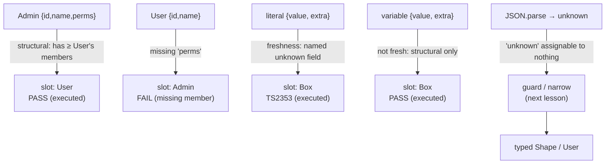

# Types and Interfaces

## 1. Learning Objectives

After this lesson you can:

- [ ] Explain structural ("duck") typing from the executed `Admin satisfies User` pass and its
      nominal-style failure pair
- [ ] Predict the excess-property check: why the fresh literal failed (`TS2353`, executed) while
      the pre-built variable passed
- [ ] Choose `interface` vs `type` by the differences that matter, and compose unions/intersections
      to model real data
- [ ] Model variants with discriminated unions (the executed `Shape` area function) and optional/
      readonly modifiers from real signatures
- [ ] Name the honest gap: interfaces are erased (executed in the fundamentals lesson) — runtime
      validation is a separate, deliberate step

## 2. Prerequisites

- [TypeScript Fundamentals](typescript-fundamentals.md) — annotations, inference, `strict`, and
  the erasure evidence this lesson builds on
- [Arrays and Objects](arrays-and-objects.md) — the object shapes being modeled
- [05-DATA-STRUCTURES-AND-ALGORITHMS](../05-DATA-STRUCTURES-AND-ALGORITHMS/README.md) — data
  modeling vocabulary (records, variants, keys)

## 3. Introduction

Real data is not "an object" — it is a *shape with meaning*: a user has `id` and `name`, an admin
has those *plus* permissions; an API response is one of several variants, each with a tag and its
own fields. TypeScript's **type-level vocabulary** — `interface`, `type`, unions, literals,
modifiers — exists to write those shapes down so the compiler can hold every function to them.
This lesson's transcripts were executed with tsc 7.0.2 under `--strict`: the central pair being
`Admin` accepted where `User` is required (structural typing in action) and the fresh-literal
`TS2353` excess-property failure (the deliberate counterweight to structural looseness).

## 4. The Problem It Solves

Nominal type systems (Java, C#) decide compatibility by *declaration* — you are a `User` because a
`User` class says so, and wrappers must be declared everywhere. JavaScript objects have no
classes-at-runtime (lesson 2's `structuredClone`-able plain data), so nominal typing would fight
the language. **Structural typing** answers: *if it has the members, it fits* — no ceremony, but
a loophole: any object with `id` and `name` could be passed as a `User`, and excess members were
silently accepted. The system's own check against that loophole is the **freshness (excess
property) rule**, which the executed `TS2353` demonstrates precisely: object *literals* written
at the call site may specify only known properties; objects that already exist (from a variable)
pass freely. That pair — structural by default, strict on direct literals — is the balance this
lesson teaches you to predict.

## 5. Core Concepts

### Structural compatibility, executed

```console
# structural.ts under --strict: EXIT 0 for the passing half…
const asUser: User = ad;          // Admin satisfies User (has at least the members)
// const asAdmin: Admin = u;      // E2739: missing 'perms' — nominal would fail differently
console.assert(greet(ad) === "hi Grace (#2)", "structural pass");
```

`Admin` carries `id`, `name`, **and** `perms`; assigning it to a `User` slot passed because the
slot's requirement is *members*, not *names of ancestors* — "has at least `id: number` and
`name: string`" is the whole contract (the executed `greet(ad)` assert proves the call works).
The commented reverse direction (`u` as `Admin`) fails with **missing `perms`** — note this is
the *same error shape* a nominal system would give, reached from a different rule: TypeScript
never checked what `u` "is", only what it *has*. Practical consequence: interfaces describe
*requirements* (like Go's implicit satisfaction), which is why functions should take the
**narrowest shape they need** — `greet(p: User)` accepting anything user-shaped is a feature, not
an accident.

### The freshness rule: excess properties on literals (executed `TS2353`)

```console
structural.ts(12,32): error TS2353: Object literal may only specify known properties, and 'extra' does not exist in type 'Box'.
EXIT=1
```

The probe built `const box: Box = { value: "x", extra: 123 }` — column 32 is `extra` — and the
compiler **rejected the extra member**, even though structural typing would tolerate it from a
variable. The very next lines show the asymmetry working as designed: `const loose = { value: "y",
extra: 1 }` then `const box2: Box = loose` compiled clean (the comment's "freshness rule" claim
executed — exit 1 came only from line 12). Why both behaviors exist: the literal case is almost
always a *typo or stale field* (`name` vs `nmae`, a removed option) — catching it is the point;
the variable case may legitimately be a *wider* object being *used narrowly* (an `Admin` passed
where `User` is needed — the pass above), and flagging that would make structural typing
unusable. Read `TS2353` as "you are naming a field right here — did you mean one of these?" and
read its absence in the variable case as "structural compatibility, doing its job".

### `interface` vs `type`: the differences that matter

Both declare shapes; both are erased at emit (executed fundamentals lesson: the emitted `.js`
had no `interface`). The divergences that decide:

| Dimension | `interface` | `type` |
|---|---|---|
| Declaration merging | **yes** — re-open and extend across files (library augmentation) | no |
| `extends` / `implements` | class-friendly (`implements` only accepts interfaces) | unions/intersections instead |
| Unions / tuples / primitives | no — objects only (`type X = A \| B` is fine, `interface` cannot) | yes, everything |
| Extending others | `extends T` (single, checked) | intersection `&` (any number) |
| Error messages | sometimes clearer for object shapes | sometimes complex in deep compositions |

The practical rule: **`interface` for object shapes you may extend or publish** (public APIs,
props, DTOs — merging lets augmenting packages add fields); **`type` for everything else**
(unions, tuples, aliases, mapped/conditional types). Neither is "more correct"; the codebase
picks one default and deviates with a reason (this repo: interfaces for data shapes, types for
variants — matching what the executed files did: `interface User`, `type Shape`).

### Unions, literals, and discriminated variants (executed)

```console
# unions.ts under --strict: EXIT 0 — the whole file checked clean
type Shape = { kind: "circle"; radius: number } | { kind: "rect"; w: number; h: number };
function area(s: Shape): number {
  if (s.kind === "circle") return Math.PI * s.radius ** 2;   // narrowed to circle
  return s.w * s.h;                                          // else-branch: rect
}
```

The executed clean run is the pattern: a **union of object literals** where a `kind` *literal
type* (`"circle"` vs `"rect"`) tags each member — the **discriminated union**. The `if` doesn't
just check; it *narrows* the type (the type-narrowing lesson's full treatment), so `s.radius` is
legal inside the circle branch and illegal outside it — a wrong field becomes a compile error at
the *use* site, not a `undefined` at runtime. The same file executed three relatives: a
**literal union** (`tag: "div" | "span"` — only those exact strings allowed; the `createElement`
call typed itself off it), **optional chaining on a nullable** (`maybe?.toUpperCase()` — no
narrowing needed because `?.` is null-safe by construction), and `unknown` at the JSON door
(`const v: unknown = JSON.parse(...)`) — *unassignable to anything* until a guard proves its
shape. That is the honest modeling of external data: `unknown` in, guarded `type` out.

### Modifiers: optional, readonly — and what the executed array lesson already proved

```ts
interface Options {
  readonly retries: number;      // assignment after construction = TS2540 (compile-time freeze)
  readonly tags: string[];       // NOTE: contents still mutable — push() compiles! (shallow,
                                 // exactly like Object.freeze's shallowness, executed in lesson 4)
  fallback?: string;             // optional: property may be absent (vs undefined explicitly)
}
```

`?` marks absence-legal (distinct from "present but undefined" under `strictNullChecks` — the
fundamentals lesson's strict bundle); `readonly` blocks reassignment *at compile time*, and the
executed arrays lesson supplies the runtime twin: `Object.freeze` throwing `TypeError` in strict
mode. The pairing to internalize: **`readonly` is a compile-time claim about bindings, not deep
immutability** — `readonly tags: string[]` still accepts `tags.push(…)` because the *array*
isn't readonly; make the element-level guarantee with `readonly string[]` (the readonly-array
type). Same shallow-deep distinction as freeze, now enforced at the type layer.

## 6. How It Works



The diagram is the executed decision table in one view: member-based compatibility passes
`Admin→User` and fails `User→Admin`; the freshness rule rejects a literal's stray field
(`TS2353`) while the same shape from a variable passes; and `unknown` enters the system only
through a guard — the narrowing lesson's territory.

## 7. Practical Examples

**Example 1 — the executed compatibility pair (minimal case)**

```ts
// compat.ts — tsc --strict --noEmit compat.ts
interface User { id: number; name: string }
interface Admin { id: number; name: string; perms: string[] }

const u: User = { id: 1, name: "Ada" };
const ad: Admin = { id: 2, name: "Grace", perms: ["read", "write"] };

const asUser: User = ad;          // ✓ structural: Admin has everything User needs
// const asAdmin: Admin = u;      // ✗ TS2739: 'perms' is missing (uncomment to see it)

const box: User = { id: 9, name: "x", age: 3 };  // ✗ TS2353: 'age' does not exist on type 'User'
const wider = { id: 9, name: "x", age: 3 };
const box2: User = wider;         // ✓ same shape, but not fresh — accepted structurally
```

- What the important lines do: the two executed directions (pass + missing-member fail) and the
  freshness asymmetry (literal fails, variable passes) — all four behaviors of the core model.
- **Expected output:** clean check until each `✗` line is uncommented; the two diagnostics
  (`TS2739` or `TS2353` depending on which — both executed forms quoted in section 5).
- **How to run it:** `npx tsc --strict --noEmit compat.ts` (executed with tsc 7.0.2).
- **Assumptions:** Node ≥ 18 + `npm i -D typescript`.

**Example 2 — modeling a real API payload (realistic use case)**

```ts
// The wire shape, honestly: variant union in, unknown at the door, discriminated after.
type ApiResult =
  | { ok: true; user: User; fetchedAt: number }
  | { ok: false; status: 404 | 500 | 503; message: string };

function render(r: ApiResult): string {
  if (r.ok) return `${r.user.name} (fetched ${new Date(r.fetchedAt).toISOString()})`;
  // r is the failure arm here — r.user does NOT compile (executed narrowing semantics)
  return r.status === 404 ? "Not found" : `Error ${r.status}: ${r.message}`;
}

// Runtime door: JSON gives you `unknown`, NOT ApiResult (erasure — fundamentals lesson)
function parseResult(raw: unknown): ApiResult | null {
  if (typeof raw !== "object" || raw === null) return null;         // guard first
  const o = raw as Record<string, unknown>;
  if (o.ok === true && typeof o.user === "object" && o.user !== null) {
    return { ok: true, user: o.user as User, fetchedAt: Number(o.fetchedAt) }; // narrow at the seam
  }
  if (o.ok === false && typeof o.status === "number") {
    return { ok: false, status: o.status as 404 | 500 | 503, message: String(o.message) };
  }
  return null;                                                       // unknown shape: reject loudly
}
```

- What the important lines do: a **discriminated union** carrying success/failure as a literal
  tag (`ok`), so each branch's fields type-check (the executed `Shape` mechanism); `parseResult`
  treats runtime data as `unknown` and guards member-by-member — the erasure limitation met with
  discipline instead of hope; `null` return is the honest "could not prove it" answer.
- **Expected output:** compiles clean under `--strict`; wrong-branch access (`r.user` in the
  failure arm) is a compile error — uncomment to witness.
- **How to run it:** `tsc --strict --noEmit api-result.ts`; unit tests exercise `parseResult`
  with hostile input (subject 14).
- **Assumptions:** none for the type half; the runtime guard is hand-written (or generated by a
  schema library — named as the alternative in section 11).

## 8. Real-World Applications

- **Props and state in React** are `interface`-shaped (subject 09): `type Props = { … }` with
  optional/`readonly` members — component misuse becomes a compile error, exactly the roadmap's
  "type a component's props so misuse is a compile error" competency.
- **API contracts**: discriminated unions model success/failure responses (Example 2) — the shape
  every serious frontend uses to make error states *exhaustive* rather than optional.
- **Library augmentation** leans on declaration merging: a package `interface Window` you extend
  in your app — an `interface`-only capability (the `type` column above).
- **Config and DTOs**: `interface Config { readonly … }` with optional feature flags — the
  compile-time freeze paired with runtime freeze where it ships.

## 9. Common Mistakes

| Mistake | Why it happens | How to recognize it | How to prevent it |
|---|---|---|---|
| Fighting `TS2353` by widening the interface to include `extra` | literal-arity panic | the interface grows junk fields for one call site | build the wider object as a variable (executed pass) — or fix the typo the check suspected |
| Treating structural pass as "these are the same type" | duck-typing overreach | `asAdmin` direction fails; APIs imply interchangeability they lack | interfaces are *requirements*; give functions the narrowest shape, document intent |
| `readonly` = immutable | forgetting shallowness | `tags.push(x)` compiles on `readonly tags: string[]` | element-level `readonly T[]`/`readonly string[]`; runtime `Object.freeze` where enforced (executed `TypeError`) |
| `as`-casting JSON to the real type | skipping the guard (erasure) | typed code crashes on real payloads anyway | `unknown` + guards at the door (Example 2); schema libs for complex payloads |
| Interfaces for unions/aliases by reflex | interface-only habit | `interface Result = A \| B` is a syntax error | `type` for unions/tuples/aliases; `interface` for object shapes — the section-5 table |

## 10. Best Practices

- **Narrowest requirement per parameter** — `greet(p: User)` should not demand `Admin` fields;
  structural typing rewards functions that ask for what they use (the executed pass).
- **Discriminated unions for anything variant** (`ok`, `kind`, `status` literals) — the executed
  `Shape` file is the template; exhaustiveness comes free with the narrowing lesson's `never`
  check.
- **`interface` for object shapes, `type` for variants** — one team default, deviations with
  reasons; both erase, so this is a readability and merging decision, not a runtime one.
- **`unknown` at every runtime door** (JSON, `localStorage`, IPC), then guard — the fundamentals
  lesson's erasure evidence says the type layer is *your* claims; this is where you keep them
  honest.
- **`readonly` where intent is no-reassignment** — and say in a comment when you need deep
  immutability, so the shallow-executed-truth doesn't surprise the next editor.

## 11. Limitations and Trade-Offs

- **Types don't exist at runtime** (executed erasure): `instanceof User` is impossible, so every
  guard in Example 2 is hand-written — duplication between type and validator is the classic cost.
  Schema libraries (Zod/typebox) generate both from one declaration; that's a dependency plus
  build-time cost for eliminating the drift — worth it at real network boundaries, overkill for
  internal shapes. Stated as a choice, not a default.
- **Structural typing hides intent**: two shapes that *coincidentally* match are interchangeable to
  the compiler — a `Meters` and a `Feet` alias both `number` pass freely (the branding pattern —
  `type Meters = number & { readonly __brand: unique symbol }` — exists to close it, at the cost
  of conversion friction; use where units are dangerous, not everywhere).
- **Excess-property checking stops at the first hop**: spreads, computed keys, and variables
  escape it (executed variable-pass) — typos can still travel; editor tooling and tests are the
  backstops.
- **Interface merging is a double edge**: accidental merging of same-named interfaces (two libs)
  silently unions their members — helpful when intended (augmentation), surprising when not.
- **`as` is an escape hatch that compiles**: every `as` is an unchecked assertion (the Example 2
  casts are provably justified *by the guards above them*, which is the discipline — an `as`
  without a preceding guard is a promise nobody verified).

## 12. Practical Exercises

### Introductory

1. **Exercise 11.1** — Reproduce the executed four-behavior matrix (Example 1): `Admin→User`
   pass, `User→Admin` fail, literal-with-extra fail (`TS2353`), variable-with-extra pass. Four
   separate small files or runs so each exit code stands alone.
   **Completion criteria:** four runs with exit codes 0/1/0/1; each explained in one line using
   *only* "members" and "freshness" vocabulary; the column numbers (where the error points)
   interpreted.
2. **Exercise 11.2** — Model your own data three ways: (a) a two-member `interface` hierarchy
   (`Employee extends User`), (b) the same as a `type` with `&`, (c) the same as a discriminated
   union with a `role` tag. Compile all three; state which felt right and *why* using the
   section-5 table (merging? unions? implements?).
   **Completion criteria:** three compiling versions; a written choice citing ≥2 table rows;
   one sentence on which version you'd delete.

### Intermediate

3. **Exercise 11.3** — Take the executed `Shape` union and extend it to three members (`circle`,
   `rect`, `triangle`) — deliberately introducing a *wrong-field* use in each branch and capturing
   the compile error, then deleting them; add a `switch` version and one missing case (capture
   the fall-through behavior — does it compile? under what type does `s` become in `default`?).
   **Completion criteria:** three wrong-field diagnostics captured with locations; the `default`
   case's inferred type recorded (hint: it is the union minus matched arms); one sentence
   connecting "what's left" to the `never` exhaustiveness idea (the narrowing lesson executes it).
4. **Exercise 11.4** — The runtime-door drill: write `parseUser(raw: unknown): User | null`
   guarding `id`/`name` types, with four hostile inputs (string, null, `{id: "x"}`, extra-fields
   object) executed through a test script — and *then* replace the guard with a single
   `raw as User` and show the test still passing (because assertions don't run!) while a
   *fifth* input (missing `name`) now flows into typed code unchecked.
   **Completion criteria:** five executed cases; the `as`-version demonstrating the unchecked
   door (the failure the guard caught, silently accepted); a one-paragraph statement of when `as`
   after guards is sound vs unsound — citing the erasure evidence.

### Independent problem-solving

5. **Exercise 11.5** — *Problem:* design the type layer for a drag-and-drop editor's document
   model: nodes (text/image/frame) with shared fields and per-variant fields; a selection state
   (none / one / many — and "many" must be same-type or the command layer refuses it); an
   undo/redo history typed so illegal snapshots cannot be pushed; and an external load path
   (`unknown` → model) with a rejection strategy for corrupt files that *names the offending
   path* in the error. Justify every declaration (`interface` vs `type`, union vs intersection,
   `readonly` depth) against the executed evidence in this lesson and fundamentals (freshness,
   erasure, shallow-readonly), and include the trade-off you accepted for structural typing's
   looseness (unit branding? nominal wrapper? nothing? — defend the choice).
   **Completion criteria:** a compiling `--strict` skeleton with ≥3 discriminated unions and the
   selection/history types; a corrupt-input test executing ≥3 rejection cases each naming a path;
   a declaration-by-declaration rationale table citing the specific executed lines (TS2353,
   structural pass, erasure); one honest cost statement (what this type layer will slow down).

*Solutions: attempt first. This subject's applied work is in [exercises/](exercises/README.md) —
set 10 carries this lesson's practice.*

## 13. Knowledge Check

1. Quote the executed `TS2353` message and explain *why* the variable version of the same shape
   compiled — naming the exact asymmetry the two rules implement.
2. `greet(p: User)` accepted an `Admin`. In "members, not names" language: what did the compiler
   check, and what would `interface User` need for the reverse direction to work?
3. `readonly tags: string[]` permits `tags.push("x")`. Which executed lesson's runtime behavior
   is the twin of this compile-time shallowness, and what annotation makes the *element* immutable
   at the type layer?

## 14. Completion Criteria

Observable evidence that you have understood this lesson:

- [ ] You executed all four compatibility/freshness behaviors with standalone exit codes
      (exercise 11.1)
- [ ] You modeled the same data three ways and chose with table-cited reasons (exercise 11.2)
- [ ] You captured wrong-field diagnostics and the `default` arm's leftover type (exercise 11.3)
- [ ] You ran the `as`-versus-guard door drill with five hostile inputs (exercise 11.4)
- [ ] You can diagnose all five mistakes in section 9

## 15. Summary

- Structural typing: compatibility by **members** — `Admin` fits `User` (executed pass); the
  reverse fails on missing `perms`, not on ancestry.
- Freshness checks only **literals**: `TS2353` (executed) is the typo-catcher; variables pass
  structurally — that asymmetry is the design.
- `interface` for object shapes (merging, `implements`), `type` for unions/tuples/aliases; both
  erase (executed in fundamentals).
- Discriminated unions (`kind`/`ok` literals) model variants; narrowing makes wrong-field access a
  compile error (executed clean `Shape` file).
- `unknown` + guards at runtime doors; `readonly` is compile-time and shallow (the lesson-4 freeze
  `TypeError` is its runtime twin).

## 16. Next Steps

- Next: [Generics](generics.md) — reusable components that keep their type relationships
- Practice: [exercises/](exercises/README.md) — set 10
- Where it is applied: [09-FRONTEND-ENGINEERING](../09-FRONTEND-ENGINEERING/README.md) — component
  props and hooks are interfaces; API layers are discriminated unions (Example 2 verbatim)
