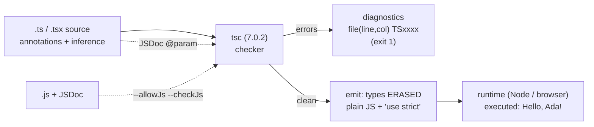

# TypeScript Fundamentals

## 1. Learning Objectives

After this lesson you can:

- [ ] State what the compiler adds and what it erases — from the executed emit transcript
      (`"use strict"` JS out, `Hello, Ada!` run)
- [ ] Read a `tsc` diagnostic line (file, line, column, `TS` code) — executed `TS2322` and
      `TS7006` quoted verbatim
- [ ] Explain annotation vs inference vs widening from the executed `let a = 42` / `const b = 42`
      pair and the tuple-widening trap
- [ ] Set up the check workflow: `--strict --noEmit`, `tsconfig.json`, and the JSDoc/`checkJs`
      on-ramp (executed exit 0)
- [ ] Say why `any` is the hole in the system, and how `strict` closes it (executed `TS7006`)

## 2. Prerequisites

- [JavaScript Fundamentals](javascript-fundamentals.md) — values, bindings, and dynamic typing
  (the model TypeScript re-labels)
- [Functions and Scope](functions-and-scope.md) — functions and parameters are annotation targets
- [03-DEVELOPER-TOOLS](../03-DEVELOPER-TOOLS/package-managers.md) — installing tools with npm

## 3. Introduction

TypeScript is JavaScript plus a **static type system**: a compile-time analysis that checks your
annotations and inferences against how values actually flow, then **erases every type at emit**
and hands the runtime ordinary JavaScript. That is the whole shape — types are a *proof layer*
over untyped code, not a new language runtime. The transcripts in this lesson were executed with
`tsc` **Version 7.0.2** — the native (Go) compiler, the project's current line — installing with
`npm install typescript` in a scratch directory. Every error message you read below came out of
that binary, exit statuses and all.

## 4. The Problem It Solves

JavaScript's dynamic typing moves an entire class of defects from edit time to *use* time:
`Cannot read properties of undefined (reading 'x')` at 2 a.m. in production, a string silently
flowing into arithmetic (the executed `'5' + 2 → 52` coercion from lesson 1 is a *type* bug the
language happily runs), a function called with arguments in the wrong order, a refactor that
compiles fine and breaks six call sites nobody remembered. Types catch these **before execution**:
the executed `TS2322: Type 'string' is not assignable to type 'number'` is a bug that in plain
JavaScript ships. The cost is annotations and a compiler step; the payoff is that entire bug
classes — mismatched arguments, unhandled union members, forgotten null checks under `strict` —
become *editor squiggles*, and refactors become mechanical again. Industry adoption (React 19
templates, Angular's foundation, most serious frontend codebases) is the market's verdict on that
trade.

## 5. Core Concepts

### What the compiler adds, what it erases

```console
# tsc --strict --target es2022 --outDir out greet.ts  →  exit 0
COMPILE OK (exit 0)
$ node out/greet.js
Hello, Ada!
# out/greet.js begins:
"use strict";
function greet(g) { … }        ← interface Greeter is GONE; the rest is plain JS
```

The executed workflow is the definition: `greet.ts` carried `interface Greeter` and the
`const result: string` annotation; the emitted `greet.js` contains **neither** — type syntax
erased, structure intact, `"use strict"` added (TypeScript emits strict-mode code by default —
the same mode the lessons' `.mjs` files run in, which is why the executed freeze/TDZ throws apply
to TS output too). Running the output printed `Hello, Ada!` — the proof that TypeScript is not a
runtime: **no types exist after compilation**; they existed only for the checker. Consequences
you must hold onto: you cannot ask a value "are you a `User`?" at runtime (interfaces don't
exist), and type-only bugs can still sneak through at untyped boundaries (`any`, JSON.parse —
later lessons).

### Diagnostics: reading a tsc line

```console
$ tsc --strict --noEmit errors.ts
errors.ts(3,1): error TS2322: Type 'string' is not assignable to type 'number'.
errors.ts(4,5): error TS2322: Type 'number' is not assignable to type 'string'.
EXIT=1
```

The format is fixed: `file(line,col): error TS<code>: message`. Column 1 on line 3 is the
*variable* (`n = "not a number"` — the assignment target is where assignability is checked),
column 5 on line 4 is where `123` sits inside `s: string = 123`. `TS2322` ("not assignable") is
the single most-hit code in any codebase; you will learn to read it as "here, this value, wrong
shape for that slot". `--noEmit` made this a pure check (exit 1, no output file) — the lint-like
mode CI uses. `--strict` is the bundle of strictness flags (below) — the subject-wide default.
(Executed seam on tsc 7.0.2: a *bare* `tsc --noEmit ts/inference.ts` reported `TS7006` **without**
`--strict` — the CLI's own defaults already enforce `noImplicitAny` — while a tsconfig with
`"strict": false` passed at exit 0. Decide strictness in the committed config, never by which
invocation you happened to type.)

### Inference, widening, and where annotations are needed

```console
# inference.ts under --strict:
inference.ts(8,17): error TS7006: Parameter 'x' implicitly has an 'any' type.
EXIT=1
```

TypeScript **infers** from use: `let a = 42` → `number` (line 3's `a = 10` passed — the comment's
claim executed); `const b = 42` → the *literal type* `42`, and reassignment fails with its own
executed code rather than plain assignability — `ladder.ts(2,15): error TS2588: Cannot assign
to 'b' because it is a constant.` (the *binding* is checked before the type comparison gets a
chance; annotate `const b: 42 = 43` and you get `TS2322` instead); object property
`{ mode: "dark" }` widens `mode` to `string` (a `let`-like box can hold more values), while
`as const` pins `"dark"` — the executed lines' design: **constness narrows types**. Two traps the
probe made executable: `let tup = [1, "x"]` infers `(string | number)[]` — a *union array*, not
a tuple — because a mutable array literal can later hold `2`; annotate `: [number, string]` for a
real tuple. And the lone error, `TS7006` at `(8,17)`: `function double(x)` — a parameter with no
context has **no inferable type** and defaults to implicit `any`, which `--strict` forbids. That
is the strictness philosophy in one message: untyped holes are compile errors, not gifts; annotate
the parameter (`x: number`) and the file checks clean (the annotation's neighbor `triple` passed).

### `strict` mode: the option bundle that closes the holes

`--strict` enables a family — `noImplicitAny` (executed `TS7006`), `strictNullChecks` (the big
one: `null`/`undefined` are their own types, not members of every type — forcing null to be
*handled* before use, the compile-time version of lesson 2's `?.` discipline), `noUncheckedIndexedAccess`-style
options (opt-in variants where `arr[i]` is `T | undefined`), and function-strictness flags. The
rule this course follows without exception: **`strict` on, always** — turning it off to "get it
to compile" converts the compiler back into the runtime-error machine it exists to replace, and
the repo's tsconfigs will show it on.

### The JSDoc on-ramp: types in JavaScript

```console
$ tsc --allowJs --checkJs --noEmit jsconfig-demo.js
JSDoc check EXIT=0
```

Types can live in `.js` via JSDoc comments: `/** @param {number} x */` gave the checker enough
to pass (`EXIT=0`) — and enough to *fail* an argument of the wrong type the same way. This is the
migration path that matters in practice: existing JS projects turn on `checkJs`, fix errors file
by file, and rename to `.ts` gradually — no flag day. It is also how library authors type JS
consumers see. The executed `exit 0` says the mechanism works with the same binary; subject 09's
tooling lesson covers `jsconfig.json` wiring.

## 6. How It Works



The diagram is the executed pipeline: source into the checker; diagnostics on the left (the
`TS2322`/`TS7006` lines, exit 1), erased JavaScript on the right (the `"use strict"` output that
printed `Hello, Ada!`), and the dashed JSDoc path — the same checker fed by comments, which is
the executed `checkJs EXIT=0` route.

## 7. Practical Examples

**Example 1 — the executed error-and-fix loop (minimal case)**

```ts
// errors.ts — tsc --strict --noEmit errors.ts
let n: number = 42;
n = "not a number";      // TS2322: Type 'string' is not assignable to type 'number'.
let s: string = 123;     // TS2322: Type 'number' is not assignable to type 'string'.

// fix:
let m: number = 42;
m = Number("42");        // explicit conversion at the boundary (lesson 1's rule, typed)
const ok: boolean = m > 40;
```

- What the important lines do: annotation is a *promise the checker verifies at every assignment*;
  the fix converts explicitly instead of hoping.
- **Expected output:** two `TS2322` lines, exit 1; after the fix, exit 0.
- **How to run it:** `npx tsc --strict --noEmit errors.ts` (executed with tsc 7.0.2 installed via
  `npm i -D typescript`).
- **Assumptions:** Node ≥ 18 for npm; any editor with TS support shows the same squiggles inline.

**Example 2 — check-then-run: a typed function with inferred call sites (realistic use case)**

```ts
// api.ts
interface User { id: number; name: string; }
interface FetchResult<T> { data: T; fetchedAt: number }

async function fetchUser(id: number): Promise<FetchResult<User>> { // full annotation: I/O boundary
  const res = await fetch(`/api/users/${id}`);
  if (!res.ok) throw new Error(`HTTP ${res.status}`);              // error-handling lesson, typed
  const data: User = await res.json();                             // JSON boundary: assert once
  return { data, fetchedAt: Date.now() };
}

async function main() {
  const r = await fetchUser(7);            // r: FetchResult<User> — INFERRED from the signature
  console.log(r.data.name);                // name checked against User — typo = TS2339 before run
  // r.data.nmae;                          // → TS2339: Property 'nmae' does not exist on type 'User'
}
```

- What the important lines do: annotations where the checker *cannot* infer (function signatures —
  especially I/O boundaries); inference where it can (call-site `r`); a deliberate typo showing
  the misspelled property caught pre-runtime; `res.json()` annotated because JSON is untyped at
  runtime (the honest boundary).
- **Expected output:** clean check on the shown code; the commented typo produces
  `TS2339 … 'nmae'`.
- **How to run it:** `tsc --strict --noEmit api.ts`; the runtime half needs an endpoint or a
  stubbed `fetch`.
- **Assumptions:** DOM lib types included by default in tsc 7 (the probe's `Document` usage
  compiled) — a `lib` setting may be needed in unusual configs.

## 8. Real-World Applications

- **Gradual adoption is the industry pattern**: `checkJs`/JSDoc first (executed `exit 0`), then
  rename hot files to `.ts` — the executed `--noEmit` loop is how teams ratchet error counts
  down without breaking builds.
- **CI gates run exactly the executed command**: `tsc --noEmit` failing the pipeline on
  `TSxxxx` — the compiler as test; subject 14 wires it in.
- **Library authoring**: types ship alongside JS (`.d.ts`) so *consumers* get checking while you
  may still emit JS — the erasure model makes mixed fleets possible.
- **Editor feedback loops**: every executed diagnostic here appears as a live squiggle with
  `F12` go-to-definition — the actual daily productivity argument for types.

## 9. Common Mistakes

| Mistake | Why it happens | How to recognize it | How to prevent it |
|---|---|---|---|
| Turning `--strict` off to green the build | short-term compile relief | `any` spreads; null bugs return as runtime errors | strict always; fix the file, not the flag |
| Annotating everything | mistrusting inference | noise; over-specified signatures | annotate *boundaries* (params, I/O); let locals infer (executed `let a = 42` pair) |
| Expecting types at runtime | forgetting erasure (executed `"use strict"` output) | `instanceof GreetUser` fails — interfaces don't exist | runtime checks where data crosses trust boundaries (`typeof`, guards — type-narrowing lesson) |
| Mutable-array literal as tuple | widening (executed `(string\|number)[]`) | positional access unions everywhere | annotate `: [number, string]` or `as const` |
| Implicit `any` creep via parameters | no context (executed `TS7006`) | strict flags exactly these | annotate parameter types; disable implicit-any escape hatches (`noImplicitAny` stays on) |

## 10. Best Practices

- **`strict: true` from the first commit** — the executed `TS7006`/`TS2322` pair shows the
  checker doing its job; every strictness opt-out is a documented future bug.
- **Annotate outward-facing surfaces; infer internals.** Signatures (the compiler *cannot* guess a
  caller's intent for a new function) and I/O/JSON boundaries get annotations; locals, iteration,
  and call sites get inference — the executed files followed this balance.
- **`--noEmit` as the check command** (lint-shaped, fast, no artifact), full emit only for
  builds; keep `tsconfig.json` in the repo so editor and CI share one configuration.
- **Migrate with JSDoc `checkJs`** (executed `exit 0`) rather than a rewrite — proven, incremental,
  and reversible per file.
- **Read diagnostics left to right**: file, line, *column at the offending value*, `TS` code —
  then look at the value's origin (assignability is checked at the target, proven by columns
  `3,1` and `4,5`).

## 11. Limitations and Trade-Offs

- **Types are erased and unchecked at runtime** (executed): `JSON.parse`, `fetch`, `localStorage`,
  and `any`-returning libraries are unchecked doors into typed code — the discipline is to annotate
  *at* those doors (the type-narrowing and types-and-interfaces lessons give the patterns), and
  the honest limitation remains: TypeScript verifies *your* claims, not the network's.
- **Erasure means no type-directed behavior** — no reflection on `User`, no runtime validation
  generated from interfaces (libraries like Zod bridge it; that boundary is a real design choice
  with a dependency cost, named here rather than assumed).
- **Type-level complexity is real**: deep conditionals and inference puzzles slow compilers and
  readers alike; the subject's remaining lessons deliberately stay in the *useful* complexity
  band — when a type takes longer to understand than the bug it prevents, plain `any`-free
  pragmatic typing wins (a stated exception, not a loophole).
- **A tsc 7.x note (honest version pin)**: this batch executed on **7.0.2**, the native compiler
  line; most community documentation targets 5.x. The core behaviors executed here (assignability,
  inference, erasure, `checkJs`) are stable across both, but exact diagnostics/flags can differ —
  check the message your own installed version prints (VERSIONS.md records what this repo ran).

## 12. Practical Exercises

### Introductory

1. **Exercise 10.1** — Reproduce the executed `errors.ts` pair (two `TS2322`s, exit 1), then fix
   both with explicit conversions; run the fixed file with `node` after `--outDir` emit (the
   executed Hello-Ada workflow) to show check-pass ⇒ runs.
   **Completion criteria:** failing and passing `tsc` runs with exit codes captured; emitted JS
   inspected for *absence* of annotations; one sentence on erasure ("where did the types go?").
2. **Exercise 10.2** — Inference ladder: annotate-by-`//` — predict tsc's inferred type for six
   bindings (`let a = 42`, `const b = 42`, `let c = "x"`, `const d = ["a"]`, `let e = [1, "x"]`,
   `const f = { mode: "dark" }`), then verify with deliberate misuse assignments (one per line,
   commented) that each produces the expected `TS2322` or passes.
   **Completion criteria:** six predicted vs actual inferred types; ≥4 misuse attempts with their
   diagnostics; the `let`-vs-`const`-vs-`as const` widening rule stated in one line.

### Intermediate

3. **Exercise 10.3** — The strict bundle audit: with the same error in one file, run it (a)
   with `"strict": false` in a tsconfig, (b) with `"strict": true` (or `--strict`). Witness which
   errors *disappear* when implicit `any` and `strictNullChecks` are off (the loose run passes
   where `TS7006` fired) — and record the executed toolchain seam: on tsc 7.0.2 a *bare* CLI run
   with no tsconfig already enforces `noImplicitAny`, so the loose run must come from a config,
   not from omitting a flag. Demonstrates exactly what strictness buys, with both outputs.
   **Completion criteria:** both runs captured with the config each came from; the specific
   flags responsible named (`noImplicitAny`, `strictNullChecks`); a one-paragraph defense of
   strict mode written using your two outputs as evidence.
4. **Exercise 10.4** — JSDoc conversion: take a small JS utility (5+ functions) with **no**
   comments, run `tsc --allowJs --checkJs --noEmit` (capture the errors), add `@param`/`@returns`
   JSDoc until clean, then introduce one deliberate type error in a comment and see it caught.
   **Completion criteria:** before/after error counts; the deliberate JSDoc-error diagnostic
   captured; the files renamed (or not) with reasoning — when is `.ts` actually worth it?

### Independent problem-solving

5. **Exercise 10.5** — *Problem:* your team inherits a 2,000-line JavaScript service. Design the
   adoption plan: the tsconfig you'd commit (with `strict` and *why* each flag — cite at least
   the two executed diagnostics as rationale), the entry strategy (JSDoc `checkJs` on or off first?
   — justify with the executed `EXIT=0` route), the boundary policy (where annotations go first:
   which three kinds of surfaces — and what stays untyped temporarily with *measured* justification),
   the CI gate (`tsc --noEmit` when, failing on what), and the ratchet (how the error count only
   goes down — name the exact commands for snapshot and diff). Include the runtime-door problem
   (executed erasure): the two boundaries where types lie most.
   **Completion criteria:** a tsconfig with per-flag rationale tied to executed evidence; a
   phased plan with commands and an error-count ratchet mechanism (baseline file + diff);
   boundary policy ranked with reasons; the erasure doors (JSON/network + `any`-typed deps)
   named with the mitigation you'd use for each; one honest trade-off about velocity cost vs
   defect cost with your team-size assumption stated.

*Solutions: attempt first. This subject's applied work is in [exercises/](exercises/README.md) —
set 9 carries this lesson's practice.*

## 13. Knowledge Check

1. The executed emit shows `greet.js` with no `interface` and a `"use strict"` header. What does
   that prove about asking "is this a `Greeter`?" at runtime — and which lesson's strict-mode
   throws therefore apply to TypeScript output too?
2. `let a = 42` accepts `a = 10`; `const b = 42` would reject `b = 43`. Which *inferred types*
   make both true, and what does that reveal about `const`?
3. Your teammate disables `--strict` to stop `TS7006`. Explain, using the executed messages, what
   they just converted back into — and which runtime failure family (lesson 1) returns with it.

## 14. Completion Criteria

Observable evidence that you have understood this lesson:

- [ ] You reproduced `TS2322` twice with exit 1, then the fixed run (exercise 10.1)
- [ ] You predicted six inferred types and verified with misuse attempts (exercise 10.2)
- [ ] You captured the strict-vs-loose diagnostic diff (exercise 10.3)
- [ ] You converted JS to JSDoc-clean with a deliberate-error check (exercise 10.4)
- [ ] You can diagnose all five mistakes in section 9 from their signatures alone

## 15. Summary

- TypeScript checks claims **at compile time** and erases them at emit — executed: types gone,
  `"use strict"` added, `Hello, Ada!` ran.
- Diagnostics read `file(line,col) TSxxxx: message`; `TS2322` (assignability) and `TS7006`
  (implicit `any`) are the daily two — both executed with exit 1.
- Inference fills annotations in (`let a = 42` → `number`; `const b = 42` → `42`); widening is why
  array literals aren't tuples; annotate boundaries, infer internals.
- `strict` never off — it is the set of flags (`noImplicitAny`, `strictNullChecks`) that convert
  runtime-error families into compile errors.
- JSDoc `checkJs` executes the same checker on `.js` (exit 0) — gradual adoption without a rewrite.

## 16. Next Steps

- Next: [Types and Interfaces](types-and-interfaces.md) — structural typing, unions, and modeling
  data honestly
- Practice: [exercises/](exercises/README.md) — set 9
- Where it is applied: [14-TESTING-AND-QUALITY](../14-TESTING-AND-QUALITY/README.md) — `tsc
  --noEmit` as the first gate in any pipeline
