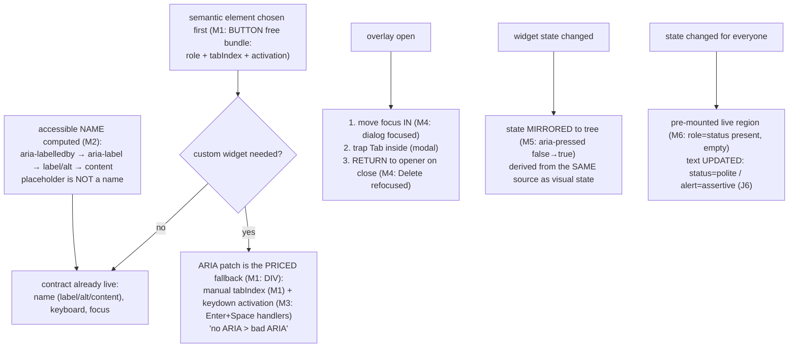

# Accessibility

## 1. Learning Objectives

After this lesson you can:

- [ ] Explain the accessibility tree as the interface AT actually consumes, and prove
      semantic HTML builds it for free (executed M1: two `role=button` hits — BUTTON and
      the patched DIV; both tabbable only because the DIV carried a manual `tabIndex`)
- [ ] Compute accessible names correctly (executed M2: `<label for>` association;
      `aria-label` beat the placeholder) — and audit a screen's unnamed controls
- [ ] Operate any UI you ship from the keyboard alone, executing the div-button tax
      (M3: native handled Enter+Space free; the DIV needed a `keydown` handler, and both
      keys fired through it) — and defend semantic-first over ARIA-patching
- [ ] Build a focus-managed overlay (executed M4: dialog focused itself, Escape closed
      it, focus returned to the opener — the full three-step contract)
- [ ] Expose widget state to AT (executed M5: `aria-pressed` flipped `false → true` with
      the click) and ship live regions that exist before their message (executed M6:
      `role="status"` present while empty, then `"Saved"`)

## 2. Prerequisites

- [07 — Accessibility](../07-HTML-AND-CSS/accessibility.md) — the semantics, contrast,
  and ARIA fundamentals this lesson applies inside components
- [Components and Props](components-and-props.md) — where the contract gets implemented
- [Error and Loading States](error-and-loading-states.md) — the message classes (J6's
  `status` vs `alert`) this lesson's regions carry

## 3. Introduction

Accessibility in React is the same contract as accessibility in HTML — **name, role,
value, state, keyboard** — enforced one component at a time, where a single reusable
mistake (an unnamed icon button, a div-click handler) propagates to every screen that
consumes it. The executed M cluster is a component-level contract test: M1 showed the
semantic element and its ARIA-patched imitation both reaching `role=button`, with the
imitation needing a manual `tabIndex` to even enter the tab order — the pattern this
lesson generalizes as **semantic-first**: HTML elements ship the whole bundle (role,
keyboard, focus, AT support) and ARIA patches are the priced fallback, not the default.
M2–M6 executed the five contract points — names (M2), keyboard (M3), focus management
(M4), state exposure (M5), and announcements (M6) — each one a thing jsdom can verify and
a screen-reader pass confirms.

## 4. The Problem It Solves

React's rendering model makes it *easy to destroy* accessibility that HTML gave you for
free: a `<button>` becomes a `<div onClick>` during a refactor and silently loses
Enter/Space activation, focus semantics, and the AT role (M3 executed both halves — the
tax the imitation pays); an `` loses its `alt` in a template change and becomes an
unlabeled image; a custom dropdown reimplements what `<select>` did, in 200 lines that
miss at least one of name/role/value/keyboard. The DOM-only failures are invisible to
sighted reviewers and to most test suites — which is why this lesson's probes query the
*accessibility tree* (`getAllByRole`, `getByLabelText`) rather than the DOM: the tree is
the user-facing surface for AT, and asserting on it makes a missing label or role a test
failure (frontend-testing lesson's method applied to a11y). The other half of the problem
is state: visual widgets (toggles, tabs, disclosures, dialogs) carry state that sighted
users see (the switch looks on) but AT users don't — M5's `aria-pressed` is the mirror
that makes the state observable, and M6's pre-mounted live region is the channel that
makes changes *announced* rather than merely rendered.

## 5. Core Concepts

### The accessibility tree is the product surface

```console
M1 role=button count: 2 tags: BUTTON,DIV | M1 tabbable (tabIndex>=0): 2 of 2
```

M1 rendered a real `<button>` next to a `<div role="button">` and queried the
accessibility tree: both resolved to `role=button` (the ARIA patch *does* restore the
role), and both were tabbable — but only because the DIV carried a manual `tabIndex={0}`,
which the `<button>` got for free. The executed contrast is the lesson's core: every
semantic element you replace with a div/span is a bundle you re-implement by hand —
`tabIndex` (reachability), `role` (identity), `keydown` activation (M3's tax), focus
visibility, and the AT behaviors that come with the native role and are *not* fully
specifiable in ARIA (button press announcements, link "opens in new tab" hints, list
semantics inside a custom listbox). The rule this supports: **start from the semantic
element that does the job** (`button` for actions, `a` for navigation, `input`/`label`
for fields, `select` for simple choice), and reach for ARIA only when no HTML element
carries the role — at which point ARIA's own first rule applies: *no ARIA is better than
bad ARIA* (a wrong role is worse than none, because AT trusts it).

### Accessible names: computed, not displayed

```console
M2 getByLabelText('Email address'): email | M2 aria-label wins over placeholder: INPUT
```

M2 executed the two canonical naming paths: `<label htmlFor="email">` association found
the input by its label text, and an input with only `aria-label="Phone (mobile)"` was
found by *that* — the `aria-label` winning over the visible placeholder. The computed-
name hierarchy this lesson standardizes (simplified): `aria-labelledby` → `aria-label` →
native `<label>`/`alt`/`title`-of-element → content (button text, table caption) — and
the trap M2's second line hints at: **placeholder is not a name** (it disappears on
input, fails contrast by default, and is ignored by the name computation when a label
exists) — it is a hint, never a label. The audit method the executed pair enables: for
every interactive element on a screen, ask "what does the screen reader say?" — and the
RTL query `getByRole("button", { name: "…" })` failing to find it is the mechanical
version. Icon-only buttons need `aria-label` (or visually-hidden text); close buttons
named "Close" alone are ambiguous in a page with two dialogs — name the *thing* closed.

### Keyboard is not a feature; it's the floor (the div-button tax, executed)

```console
M3 focus 1: Native → focus 2: Div → clicks: native,div,div
```

M3 tabbed through both buttons and pressed Enter (then Space): the native button fired
once for Enter (its default behavior), and the div fired for **both** keys — because its
`keydown` handler explicitly mapped `"Enter"` and `" "` to the click. That transcript is
the tax in full: the native element's activation behavior existed before any code ran;
the imitation paid for it with a handler that must be written, remembered, and kept in
sync (add `"NumpadEnter"`? prevent the Space scroll — the handler did `preventDefault`
for exactly that). Two further keyboard contracts the executed dialog (M4) completes:
**focus order follows DOM order** (so layout order = tab order; CSS `order` and
`position` move focus visually out of sequence — a real bug class in flex/grid
re-ordering), and **focus visibility is mandatory** (`:focus-visible` styling — a
keyboard user must always see where they are; the styling belongs in the design system's
base layer, per the token lesson). The composite-widget standard this builds toward: a
custom menu/tab/carousel needs the full ARIA keyboard pattern (arrow keys, Home/End) —
which is why the components lesson's honest advice stands: prefer the native element or
a vetted headless library (Radix et al.) over hand-rolling widget behavior.

### Focus management: the overlay contract (three steps, executed)

```console
M4 after open, focus: dialog | M4 dialog gone: true | M4 focus returned to: Delete
```

M4 executed the complete dialog lifecycle: opening moved focus *into* the dialog
(`ref.current?.focus()` — the executed focus landing on the `role="dialog"` container),
Escape closed it (a `keydown` handler on the dialog — the documented dismissal path for
`aria-modal`), and closing **returned focus to the opener** (`document.activeElement`
captured before open, restored on close — the executed third line showing focus back on
"Delete"). The executed three-step contract generalizes to every overlay and every DOM
mutation that steals focus: **on open** — move focus to the overlay (its heading or
container); **while open** — keep focus inside it (a focus *trap* for modal dialogs:
Tab cycles within; this probe skipped the trap to keep the contract legible — real modals
need it, or the aria-modal claim is a lie); **on close** — return focus to the element
that had it. The failure each step prevents: no move → the user is stranded behind the
dialog; no trap → Tab walks into the invisible page; no return → focus resets to
`<body>` and the user re-tabs from the top of the page — the single most-reported a11y bug
in modals. The React-specific note: the executed effect keyed on `open` and read
`document.activeElement` at the right moment — in real apps the opener capture must
happen *before* the overlay mounts (a click handler on the opener is the reliable spot).

### State exposure: aria-pressed as the mirror

```console
M5 initial aria-pressed: false | M5 after click aria-pressed: true
```

M5's toggle button flipped `aria-pressed` with its click — the executed mirror of visual
state. The principle it demonstrates generalizes: **whatever the widget shows, it must
say** — toggle → `aria-pressed`/`aria-checked`; disclosure → `aria-expanded`; tabs →
`aria-selected` + `aria-controls`; loading → `aria-busy` (error lesson's Example 2);
selected row → `aria-selected` or `aria-current`. The discipline that keeps these honest:
the state is **derived in render** from the same source as the visual state (the
executed `aria-pressed={on}` is literally the toggle's state variable — one source,
two consumers: the eyes and the tree), never synced imperatively after the fact (a state
mirror maintained in two places is the render-time union from the state lesson, done
wrong). And the related rule from the components lesson: a component whose *only*
state change is visual has an a11y bug — if the switch changed, something in the tree
changed too.

### Announcements: the pre-mounted live region

```console
M6 region present pre-message: true text: "" | M6 after update, text: "Saved"
```

M6 executed the announcement contract from the error lesson (J6), now as a component:
the `role="status"` region existed **while empty** (the first line — present with
`text: ""`), and the save's message became its text (second line — `"Saved"`). The
executed first line is the subtle half: a live region must exist in the accessibility
tree *before* its content changes, or many screen readers announce nothing (mounting
`<p role="status">{msg}</p>` fresh with the message already inside can be missed —
which is also why a conditional `{msg && <p role="status">}` is a bug; render the
region, update its text). The full contract from J6 stands: progress/success →
`status` (polite), failures → `alert` (assertive), and the class assignment is a budget
(desensitization is real). The React-shaped trap: portals (routing lesson) and
conditional subtrees change tree position — keep the region mounted in a *stable* parent,
and don't move it between renders.

## 6. How It Works



The executed contract loop: semantic-first DOM, names computed not displayed, keyboard
floor, overlay focus discipline, state mirrored, announcements pre-mounted.

## 7. Practical Examples

**Example 1 — the executed cluster, condensed (minimal case)**

```tsx
// probe-m.test.tsx — npx vitest run (executed: 6 passed)
// M1: <button>Save</button> + <div role="button" tabIndex={0}>Fake</div>
//      → getAllByRole("button").length === 2; both tabbable (DIV needed the tabIndex)

// M2: <label htmlFor="email">Email address</label><input id="email" />
//      <input aria-label="Phone (mobile)" placeholder="555-0100" />
//      → getByLabelText("Email address") finds the input; aria-label beats placeholder

// M3: native button handled Enter for free; the div needed:
//      onKeyDown={(e) => { if (e.key === "Enter" || e.key === " ") { e.preventDefault(); onClick(); } }}
//      → clicks: native,div,div (both keys activated the imitation)

// M4: dialog contract —
//      useEffect(() => { if (open) { opener.current = document.activeElement; ref.current?.focus(); }
//                       else opener.current?.focus(); }, [open]);
//      onKeyDown: Escape → onClose
//      → focus: dialog → (Escape) → dialog gone → focus returned to "Delete"

// M5: <button aria-pressed={on} onClick={() => setOn(v => !v)}>Notifications</button>
//      → aria-pressed: false → true

// M6: <p role="status">{msg}</p> mounted ALWAYS; update msg on save
//      → region present pre-message: true, text "" → "Saved"
```

- What the important lines do: the five contract points — role/tabIndex bundle (M1),
  name computation (M2), activation tax (M3), focus three-step (M4), state mirror (M5),
  pre-mounted region (M6).
- **Expected output:** `6 passed`, exit 0; console lines quoted verbatim in section 5.
- **How to run it:** `npx vitest run src/probe-m.test.tsx` (executed: React 19.3.1,
  Vitest 5.0.5, jsdom 30.1.3, @testing-library/user-event 14.6.1).
- **Assumptions:** role queries read the accessibility tree — jsdom + DTL compute roles
  from the DOM; real AT behavior still needs a screen-reader pass (section 11).

**Example 2 — a data table row action group, contract-first (realistic use case)**

A table of projects with a row-level action menu — the pattern most likely to be
hand-rolled badly:

```tsx
function RowActions({ project, onDelete }: Props) {
  const [open, setOpen] = useState(false);
  const triggerRef = useRef<HTMLButtonElement>(null);
  const menuRef = useRef<HTMLDivElement>(null);

  return (
    <div>
      <button
        ref={triggerRef}
        aria-haspopup="menu"
        aria-expanded={open}
        aria-label={`Actions for ${project.name}`}   // M2: name the THING, not "Menu"
        onClick={() => setOpen(v => !v)}
      >⋯</button>
      {open && (
        <div
          role="menu"
          ref={menuRef}
          onKeyDown={(e) => {
            if (e.key === "Escape") { setOpen(false); triggerRef.current?.focus(); } // M4 step 3
            if (e.key === "ArrowDown" || e.key === "ArrowUp") { /* focus next/prev item */ }
          }}
        >
          <button role="menuitem" onClick={() => { onDelete(project.id); setOpen(false); triggerRef.current?.focus(); }}>
            Delete…
          </button>
        </div>
      )}
      <p role="status">{project.deleted ? `${project.name} deleted` : ""}</p>  // M6: mounted always
    </div>
  );
}
```

- What the important lines do: the trigger exposes **name** (M2), **state**
  (`aria-expanded`/`aria-haspopup` — M5's mirror) and is the focus anchor; Escape
  executes M4's return-to-opener step (also after delete — focus must not fall to
  `<body>` when the row disappears); arrow keys are the menu pattern's floor (the ARIA
  APG contract the lesson says to prefer from a vetted library in production); the
  status region is pre-mounted (M6) so the deletion is announced politely (J6's class).
- **Expected output:** role queries find trigger (`name: "Actions for X"`), menu,
  menuitem; after Escape, `document.activeElement === trigger`; the status text updates
  in place.
- **How to run it:** the RTL assertions in exercises; a real pass with NVDA/VoiceOver
  announces "Actions for X, button, collapsed" on focus.
- **Assumptions:** only ONE open menu at a time (a real menu system closes siblings —
  state-management lesson's shared state); click-outside also closes, restoring focus
  only if focus was inside the menu.

## 8. Real-World Applications

- **Every interactive component ships these five assertions**: it has a role, a name,
  keyboard operation, a state mirror, and announcements where changes matter — the M
  cluster *is* the acceptance suite for the components lesson's extracted components.
- **Forms** get their a11y from M2's naming plus the forms lesson: per-field `<label>`,
  errors wired with `aria-describedby` + `aria-invalid`, the summary pattern at submit —
  the projects' wizard brief requires it.
- **Routing integration** (routing lesson) owns two contracts this lesson defines:
  focus reset on navigation (move focus to the new page's `<h1>` — otherwise SPA
  navigation leaves focus on a dead link) and route-change announcements (the pre-mounted
  `role="status"` announcing the new title).
- **Design systems encode the floor** (design-systems lesson): `:focus-visible` tokens,
  target sizes, contrast ratios — accessibility as a token-pipeline gate rather than a
  per-screen review.
- **CI gates**: axe-core run against the RTL render (or against the built app in a real
  browser) turns sections 5–6 into failing checks — the testing lesson wires it up.

## 9. Common Mistakes

| Mistake | Why it happens | How to recognize it | How to prevent it |
|---|---|---|---|
| div/span with onClick | visual-first refactor | role/tabIndex/keydown all missing (M1, M3) | semantic-first rule; treat any `role=` on a div as a documented exception |
| Placeholder as label | visual minimalism | label disappears on input; name computation empty (M2) | real `<label>`; placeholder = hint only |
| aria-label instead of visible label | AT-only text | sighted users see no label | visible label + association (M2's first line); aria-label for icon-only controls |
| Focus lost on overlay close | dialog unmounts | focus jumps to `<body>` (M4's failure) | capture opener, restore on close (executed) |
| Live region mounted with content | conditional `{msg && <p role=status>}` | announcements randomly missed (M6's trap) | region always mounted, text updated |
| State shown only visually | toggle styled but no aria | AT says "button" with no state (M5) | derive aria from the same state variable in render |
| `aria-hidden` on focusable elements | hiding decoration | hidden element still tabbable | `tabIndex={-1}` + no interactive children, or don't hide |
| Assuming jsdom = screen reader | probe-green confidence | axe clean, real AT fails | real NVDA/VoiceOver pass on release builds (section 11) |

## 10. Best Practices

- **Semantic-first, ARIA last** (M1's executed contrast): every `role=` on a div is a
  feature you re-built — document why the native element couldn't do it.
- **Name the thing, not the icon** (M2): computed names audited with role+name queries —
  `getByRole("button", { name })` IS the audit.
- **Keyboard floor before mouse polish** (M3): tab in, operate, Escape out — the demo
  that fails on a div-button fails for real users.
- **Overlay three-step, always** (M4): move in, trap (modal), return — plus focus reset
  on SPA navigation.
- **State mirrored from one source** (M5): aria in the same JSX expression as the visual
  state; new visual state without tree state = bug.
- **Regions pre-mounted, text updated** (M6 + J6): `status` polite for progress/
  confirmation, `alert` for failures, stable tree position.
- **Test the tree, then the AT**: RTL role queries + axe in CI (this lesson), real
  screen-reader and keyboard-only passes per release (the human half).

## 11. Limitations and Trade-Offs

- **jsdom verifies structure, not speech** — M1–M6 proved roles, names, focus, and
  attributes in the accessibility *tree*; what NVDA/VoiceOver actually announce depends
  on the AT, browser, and platform (the K6 lesson's jsdom note, at higher stakes). Real
  passes remain human work.
- **Roles are computed approximately by test utilities** — Testing Library's role
  resolution follows the spec's main cases; exotic implicit-role corners (some
  ARIA-in-HTML pairings) can differ from real browsers — role assertions are strong
  evidence, not a proof of AT behavior.
- **The trap in M4 was omitted** — the executed dialog moved focus in and returned it
  out, but a modal without a Tab trap lets focus walk behind the overlay while
  `aria-modal="true"` *claims* it can't — the claim and the behavior must ship together;
  hand-rolling traps has edge cases (browser chrome, iframe focus), which is why the
  lesson points at vetted libraries for modal systems.
- **Hand-rolled composite widgets are a contract surface** — menus/tabs/treeviews each
  have full keyboard patterns (roving tabindex, typeahead) defined in the ARIA APG;
  partial implementations are worse than native elements used partially (section 5's
  "no ARIA > bad ARIA").
- **Focus reset on navigation needs a decision**: moving focus to the new `<h1>` makes
  SPA navigation announce, but a visible focus ring on the heading may read as styling
  noise — use `tabIndex={-1}` + programmatic focus, styled without a ring (focus-visible
  handles this natively).
- **Automated tools catch a minority** — axe reports ~30–40% of real issues (names,
  roles, contrast); sequence, instructions, and live-region timing (M6's subtlety) need
  human review — the CI gate is a floor, never the ceiling.

## 12. Practical Exercises

### Introductory

1. **Exercise 15.1** — Re-execute the M cluster (all six), then flip each probe's
   contract on purpose: remove the label (M2 query fails), remove the keydown (M3 div
   silent on Enter), remove the opener restore (M4 focus lost), make the region
   conditional (M6 mount timing). Capture each failure transcript as the "what users get"
   evidence.
   **Completion criteria:** six passing baselines + four broken variants, each with the
   captured failing query or missing behavior; one sentence per break naming the user
   population affected.
2. **Exercise 15.2** — The semantic-first audit: take any screen of yours and list every
   interactive element with (a) the element used, (b) the semantic element that *should*
   do the job, (c) what the substitution currently breaks (role/key/focus — cite M1–M3).
   Convert three.
   **Completion criteria:** the audit table; three conversions with role-query before/
   after (`getAllByRole("button")` counts); the K1 extraction note if one conversion
   produced a reusable pattern.

### Intermediate

3. **Exercise 15.3** — Full focus management: build a modal dialog (trap included — the
   part M4 omitted) and execute the complete contract: focus enters on open, Tab cycles
   inside (trap proven by tabbing 5× and never escaping), Escape closes, focus returns;
   then add a second dialog opened from the *first* (nested) and prove each returns focus
   to its own opener.
   **Completion criteria:** trap proven by the tab-cycle transcript; both nested returns
   captured; the click-outside behavior documented (closes? returns focus?) with your
   justification.
4. **Exercise 15.4** — Announcements under load: build a status pipeline for a screen
   with save, validation error, and background sync — three message classes, each with
   the right role (J6's classes + M6's timing). Execute: region present while empty,
   each message announced in sequence, no double-announcement when two events land in
   the same tick (batching — cite L1).
   **Completion criteria:** captured sequence with roles per message; the same-tick
   double-send handled (last-wins or queue — your choice, argued); the desensitization
   budget stated (what earns `alert` in your product).

### Independent problem-solving

5. **Exercise 15.5** — *Problem:* make one real screen keyboard-and-AT operable, end to
   end, and prove it. Take any screen you've built: (a) walk it keyboard-only from the
   browser's address bar — every action reachable, order matches visual order, focus
   always visible — logging the exact failure points; (b) audit names on every
   interactive element via RTL role+name queries (M2's method) — list the unnamed; (c)
   fix per contract: semantics first (M1), names (M2), keyboard activation (M3), overlay
   focus (M4 if present), state mirrors (M5), announcements for async results (M6);
   (d) re-run the keyboard walk and the name audit — passing transcripts; (e) run axe
   against the render and triage *every* finding (fix or document why not — including
   false positives); (f) the honest limits: list what jsdom/axe cannot verify for this
   screen (announcement timing? contrast in real rendering? reading order?) and what a
   human AT pass would need to confirm. Deliver: before/after transcripts for keyboard,
   names, and axe; the fix list keyed to M1–M6; the limits statement.
   **Completion criteria:** keyboard walk executed before and after (failure points →
   none); every interactive element found by role+name query; axe zero critical/serious
   (or each triaged); the limits section explicit about what remains unverified by this
   toolchain.

*Solutions: attempt first. This subject's applied work is in [exercises/](exercises/README.md) —
set 11 carries this lesson's practice.*

## 13. Knowledge Check

1. M1 found BUTTON and patched DIV both at `role=button`, with the DIV needing a manual
   `tabIndex`. What is the semantic-first rule, why is ARIA the priced fallback, and
   name two bundle members the native button shipped for free.
2. M2 showed label association and `aria-label` precedence while the placeholder was
   ignored. What is the computed-name hierarchy you'll audit with, and why is placeholder
   structurally disqualified as a name?
3. M4 executed move-in/Escape/return and M6 mounted the region while empty. Why must an
   overlay *trap* (beyond M4's executed steps) to honor `aria-modal`, and why does a
   conditionally-mounted live region announce nothing?

## 14. Completion Criteria

Observable evidence that you have understood this lesson:

- [ ] You executed the M cluster plus four deliberate contract breaks (exercise 15.1)
- [ ] You produced a semantic-first audit and converted three elements (exercise 15.2)
- [ ] You built a trapped modal with nested-opener focus returns (exercise 15.3)
- [ ] You shipped a three-class announcement pipeline with same-tick handling (exercise 15.4)
- [ ] You can diagnose all eight mistakes in section 9

## 15. Summary

- **The accessibility tree is the product surface** (M1): semantic elements ship the
  bundle free; every `role=` on a div re-implements it (M3's activation tax executed).
- **Names are computed** (M2): label association and aria-label; placeholder is a hint,
  never a name.
- **Keyboard is the floor**: focus order follows DOM order, `:focus-visible` always, and
  overlays execute the three-step contract (M4: in, trap, back to opener).
- **State is mirrored** (M5: `aria-pressed` false → true) from the same source as the
  visual state — visual change without tree change is a bug.
- **Announcements are channels** (M6): regions mounted while empty, text updated,
  `status` polite vs `alert` assertive (J6's budget).
- **Automate the floor** (role queries + axe in CI), then do the human pass — the
  toolchain's limits are section 11's honest list.

## 16. Next Steps

- Next: [Frontend Testing](frontend-testing.md) — the role queries and contract
  assertions from this lesson become tests that fail when a11y regresses
- Practice: [exercises/](exercises/README.md) — set 11
- Where it is applied: [Build and Deployment](build-and-deployment.md) — production
  builds are where the human AT pass runs; ship the a11y gate in CI before deploy

