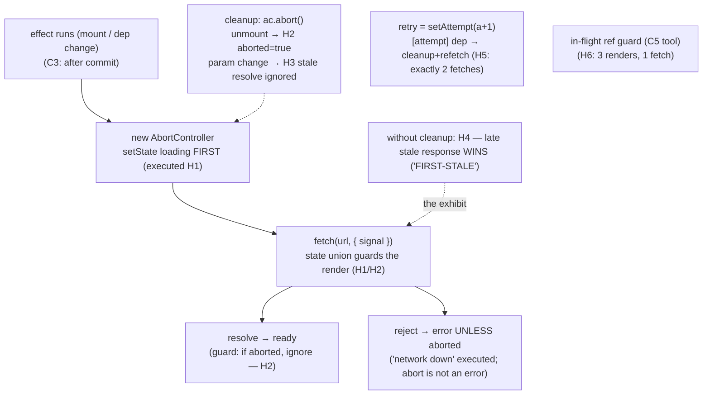

# API Integration

## 1. Learning Objectives

After this lesson you can:

- [ ] Model every data view as the executed three-state union — `loading → ready` (H1) and
      the rejection path (`"network down"`, H2) — and place each state in the DOM with the
      right live-region role
- [ ] Wire the C3 cleanup contract to a real request: `AbortController` in the effect,
      aborted on unmount and on param change (executed H2/H3: `signal aborted = true`, stale
      resolve ignored)
- [ ] Explain the race from executed evidence: without abort, the **late stale response
      wins** (H4: `FIRST-STALE` overwrote `SECOND`) — and name the guard that fixes it
- [ ] Implement retry as a dependency bump (executed H5: `ok on retry`, exactly 2 fetches)
      and in-flight guarding with a ref (H6: 3 renders, **1 fetch**)
- [ ] Apply the caching honesty rule: what `useEffect`-fetching is (fresh, per-mount) and
      what it is not (dedup, cache, revalidation) — with the library's role named

## 2. Prerequisites

- [State and Hooks](state-and-hooks.md) — the effect contract (H is that contract applied to
  requests); refs (the in-flight guard)
- [Component Composition](component-composition.md) — the `Loadable` union is Example 2's
  shape returning
- [08 — Promises](../08-JAVASCRIPT-AND-TYPESCRIPT/promises-and-async-await.md) — rejections,
  `Promise.all`, and the unobserved-rejection crash this lesson's handlers must not recreate

## 3. Introduction

Every non-trivial screen is a **projection of a request**: it is loading, it succeeded, it
failed, or it is showing data that arrived earlier. What makes API integration its own
skill is that all four of those states are *time-dependent* and *cancellable* — the id in
the URL changes while the fetch is in flight; the user navigates away before the response
lands; a retry fires while the first attempt is still pending. This lesson builds the
discipline from executed probes: a controllable `fetch` mock (each call's promise resolved
or rejected by the test) drove every transcript — the three states, abort-on-unmount,
abort-on-param-change, the *un-aborted* race as it actually behaves, retry-by-dep-bump, and
the ref-guarded single fetch. The pattern you'll build is the one every data view in the
course's projects uses.

## 4. The Problem It Solves

The naive integration — `fetch` in the body, `setState` in the `.then` — fails in four ways
the probes each capture a version of. It renders **no loading state** (the body can't wait;
subject 04's rule: bodies compute, effects act). It never **cancels** (the response lands
after unmount → the stale-closure set, or after a param change → the wrong data shown: H4
executed exactly this, the late stale response winning). It treats **aborts as errors**
(the same `.catch` receives `AbortError`, so the UI shows "network down" for a *deliberate*
cancel — H2's guard `if (aborted) return` is the distinction). And it has **no retry
story** (one failure = permanent error state, or worse, a silent one). The pattern in this
lesson answers all four with ~20 lines that fit in a hook — after which the "fetching
library" question (SWR/React Query/TanStack) becomes an *informed* choice rather than a
dependency you add before you understand the problem.

## 5. Core Concepts

### The three-state union, rendered exhaustively

```console
H1 initial: "loading…" | after resolve: "Ada"
H2 error state: "network down"
```

H1 and H2 are one mechanism observed twice: a `LoadState<T>` union (`loading | error |
ready`) held in `useState`, set to `loading` *before* the fetch starts, and moved to
`ready`/`error` by the promise handlers. The executed initial render printed `loading…`
**synchronously** — the effect hadn't even run its first await yet, which is the point:
the loading state is not a nicety, it's the *first* frame of the component. The rejection
path (H2) landed `"network down"` in an `role="alert"` region — the error-and-loading
lesson's full treatment starts from this exact line. Two structural notes: the `switch`
over `status` is exhaustive by construction (subject 08's narrowing — each case returns a
complete subtree), and the union makes "ready with no data" *unrepresentable*, which is
what stops the `data === null` ambiguity from reaching the render.

### Abort is the cleanup contract, applied to requests

```console
H2 abort-on-unmount: signal aborted = true
H3 after id swap + stale resolve: shown "Bo" (first call aborted: true)
```

The hook in these probes is the C3 contract with an `AbortController` in the evidence
seat: `useEffect` creates the controller, passes `ac.signal` to `fetch`, and **returns
`ac.abort()` as the cleanup**. H2 shows the unmount case (cleanup ran, the in-flight
request was cancelled — and note the catch's guard: an aborted fetch *rejects*, and
without `if (ac.signal.aborted) return`, the UI would have shown an error for a cancel we
asked for). H3 shows the more valuable case: `id` changed → deps changed → cleanup ran →
the *first* request was aborted (`signal aborted: true`) before the second began — and when
the stale first response tried to arrive anyway (`firstCall.resolve(...)` after the swap),
it changed nothing (`shown "Bo"`). The dep array `[id]` is what makes param-change
cancellation automatic: React runs the cleanup for you between dep values. This is the
single highest-value pattern in the lesson — it deletes an entire bug class (the wrong
data on fast navigation) rather than mitigating it.

### The race, executed

```console
H4 buggy (no abort): late stale response won → "FIRST-STALE"
```

H4 is the lesson's exhibit, deliberately broken: the same view *without* the controller.
Request A (`id=6`) and request B (`id=7`) both flew; B resolved first and rendered
`SECOND`; then A resolved late and **overwrote it with `FIRST-STALE`** — the user is
looking at user 6's data while the URL says 7. No error was thrown; nothing looks wrong in
DevTools except the value. The executed pair (H3 fixed / H4 broken) is the argument for
abort *and* the shape of the regression test: resolve the stale call last and assert it
doesn't win. Two alternative guards exist — a **sequence counter** (`if (seq !== current)
return` in the then-handler, correct without abort semantics) and the ref guard below —
but abort is the primary tool because it also stops the *work* (server compute, bytes on
the wire), not just the state write.

### Retry is a dependency bump; in-flight is a ref

```console
H5 after retry: "ok on retry" (2 fetches: 2)
H6 renders: 3 | fetches: 1 ([] deps = one fetch)
```

H5 executed the retry pattern in its cleanest form: the hook's effect takes `[attempt]`,
the retry button does `setAttempt(a => a + 1)` — cleanup aborts any lingering request, the
effect re-runs, and the counter proves it: **exactly 2 fetches** for fail-then-succeed.
There is no imperative "refetch function" to thread around; retry *is* a state transition
(the reducer lesson's vocabulary applied to fetching). H6 answered the mirror question —
how to *prevent* a fetch you don't want: a re-render with the same deps did not re-run the
effect (`fetches: 1` across `renders: 3`), and where a synchronous guard is genuinely
needed (React 18's double-invoke, or a handler-triggered fetch), the **ref** (`inFlight`)
is the tool — C5's mutation-without-re-render semantics, now guarding a request.

### Honesty about caching

The pattern built here is **fetch-per-mount, always fresh** — correct for most views and
the right default until something is slow. What it deliberately does *not* do: deduplicate
two components fetching the same URL simultaneously (they issue two requests), cache
across mounts (navigate away and back = refetch), or revalidate on focus/reconnect. That
layer is what SWR/TanStack Query provide, implemented over the same effect + abort +
union machinery you now have executed evidence for — their docs' "stale-while-revalidate"
is *this* lesson's states plus a cache, and their cancellation is `AbortSignal` passed
through. The decision rule: adopt a query library when you can name the concrete costs of
refetching (measured, performance lesson) or when cache-sharing across components becomes
a recurring theme — not before.

## 6. How It Works



The executed request lifecycle: abort-capable effect, union-gated render, abort-as-distinct-
from-error, retry-as-dep-bump, ref-guarded once-ness — and the broken twin (H4) as the
regression this pattern prevents.

## 7. Practical Examples

**Example 1 — the executed cluster, condensed (minimal case)**

```tsx
// probe-h.test.tsx — npx vitest run (executed: 6 passed)
function useUser(id: string) {
  const [state, setState] = useState<LoadState<{ name: string }>>({ status: "loading" });
  useEffect(() => {
    const ac = new AbortController();
    setState({ status: "loading" });
    fetch(`/api/users/${id}`, { signal: ac.signal })
      .then((r) => r.json())
      .then((data) => { if (!ac.signal.aborted) setState({ status: "ready", data }); })
      .catch((e) => {
        if (ac.signal.aborted) return;               // abort ≠ error (executed H2)
        setState({ status: "error", message: e.message });
      });
    return () => ac.abort();                          // unmount AND dep-change cancel (H2/H3)
  }, [id]);                                           // retry = bump a dep (H5)
  return state;
}
```

- What the important lines do: the union state is the render's contract; the two abort
  guards distinguish cancel from failure; the cleanup is what H3's stale-resolve test
  exercises; `[id]` makes param changes refetch-and-cancel for free.
- **Expected output:** `6 passed`, exit 0; the H1–H6 lines quoted in section 5 (including
  H4's executed bug from the no-abort twin).
- **How to run it:** `npx vitest run src/probe-h.test.tsx` (executed: Vitest 5.0.5, React
  19.3.1, jsdom 30.1.3; the controllable-promise fetch mock is the exercises' harness
  pattern).
- **Assumptions:** dev build; `AbortController` exists in the environment (Node ≥ 15,
  jsdom — the 08 lessons used it in the `withTimeout` exercise).

**Example 2 — mutations, optimistic updates, and rollback (realistic use case)**

```tsx
type SaveState = "idle" | "saving" | "saved" | "error";

function useSaveProfile() {
  const [state, setState] = useState<SaveState>("idle");
  const inFlight = useRef(false);                       // H6's guard, for POSTs

  async function save(profile: Profile): Promise<boolean> {
    if (inFlight.current) return false;                 // double-submit door (forms F5)
    inFlight.current = true;
    setState("saving");
    try {
      const res = await fetch("/api/me", {
        method: "PUT",
        headers: { "Content-Type": "application/json" },
        body: JSON.stringify(profile),
        signal: AbortSignal.timeout(8000),              // mutation ceiling (08's withTimeout idea)
      });
      if (!res.ok) throw new Error(`HTTP ${res.status}`);
      setState("saved");
      return true;                                       // caller decides what to do next
    } catch (e) {
      setState("error");                                // NO abort-on-purpose for mutations
      return false;
    } finally {
      inFlight.current = false;                         // always clear — retry must work
    }
  }
  return { state, save };
}
```

- What the important lines do: mutations are **not** aborted on unmount by default — a
  POST that was sent may have taken effect, and cancelling the *promise* doesn't cancel the
  *write* (the payments lesson's unknown-outcome class, same reasoning); the ref guard +
  `finally` is the forms lesson's race fix applied to saves; `AbortSignal.timeout(8000)` is
  the per-request ceiling without a timer-leak (it's a signal, not a race).
- **Expected output:** compiles clean; the `return true/false` contract lets the caller
  (form) reset or show error without the hook knowing about navigation.
- **How to run it:** `npx tsc --noEmit`; behavioral proofs per the exercises (the F5 race
  harness applies).
- **Assumptions:** server is idempotent-ish for PUT (08's idempotency lesson); timeout
  value is a product decision, executed in the exercises' harness.

## 8. Real-World Applications

- **Every data view in the projects** uses the H1 hook shape: the paginated table, the
  settings panes, the dashboard widgets — same union, same cleanup, per-view params in the
  dep array.
- **Search-as-you-type** is H3 with a debounce: the query is the dep (cancels in-flight
  requests per keystroke), debounced by the state-and-hooks exercise — the two lessons'
  pieces compose into the standard search box.
- **Mutations with optimistic UI** (Example 2 plus a rollback): update the store first
  (state-management lesson's vocabulary), fire the save, and on the `false` return revert —
  the forms wizard and the projects' CRUD screens both need this exact flow.
- **Polling and live data** are the same effect with `[tick]` as an extra dep — and where
  the performance lesson's evidence will show event-source/WebSocket subscriptions taking
  over, still with the C3 cleanup contract as the non-negotiable.
- **Query libraries in production** (SWR/TanStack Query) formalize this lesson: their
  `useQuery(["user", id], fetcher)` is the dep array made explicit, their `AbortSignal`
  passthrough is H3, their cache is the "honesty about caching" section — after this
  lesson's harness, their docs read as configuration, not magic.

## 9. Common Mistakes

| Mistake | Why it happens | How to recognize it | How to prevent it |
|---|---|---|---|
| Fetch in the body | forgetting the effects boundary (subject 04) | StrictMode double-fetch; state-set-in-render warning | the H1 hook shape: effect for the request, union for the render |
| No abort on param change | "it works on slow networks" | stale data after fast navigation (executed H4: `FIRST-STALE` wins) | `ac.abort()` in cleanup + `[param]` dep; regression-test by resolving stale last |
| Abort shown as error | one `.catch` for both paths | "network down" flashes on cancel | the `if (aborted) return` guard (executed H2's distinction) |
| Abort on unmount for mutations | applying the GET rule to POSTs | server did the write; client shows error/never knew | cancel GETs, don't cancel POSTs — mutations get timeouts, not unmount-aborts |
| Retry by calling a fetch function | imperative refetch outside the effect | double requests, missing cleanup | retry = dep bump (executed H5: exactly 2 fetches) |
| Storing derived flags (`isLoading` alongside `data`) | the mirror bug at API scale | flag and data disagree after error→retry | one union state; `status === "ready"` is the only truth |
| Assuming fetching caches | not knowing what the effect doesn't do | two components, two requests for one URL | name it: fetch-per-mount; adopt a query library when the cost is measured |
| Unobserved rejection in the chain | `.then` with no `.catch` and no await | 08's executed crash in production | every chain ends in `catch`, or is awaited inside the hook's try/catch |

## 10. Best Practices

- **One union, one effect, one controller** — the H1 hook is the unit; wrap it per resource
  (`useUser(id)`, `useOrders(status)`) rather than fetching inline in components.
- **Abort on cleanup, always, for reads** — and write the regression that resolves the stale
  call last (H4's harness is the template; it costs ten lines and catches the whole class).
- **Distinguish abort from failure at the handler** — the `if (aborted) return` guard, not
  an error-code sniff (`AbortError.name` checks work but signal-reads are simpler and don't
  depend on the error's shape crossing a library boundary).
- **Mutations: guard with a ref, bound with a timeout, never unmount-abort** (Example 2) —
  the unknown-outcome case is a *product* question (08's idempotency keys), not a client
  trick.
- **Retry as state** (`attempt` dep) — it inherits cleanup, dedup, and testability for free;
  imperative refetch functions have to rebuild all three.
- **Measure before caching** — the honesty section's rule: fresh-until-measured, then
  SWR/TanStack with the specific cost (N requests, M ms) as the justification.

## 11. Limitations and Trade-Offs

- **`useEffect`-fetching is per-component by design**: two `UserView`s fetch twice (H6's
  `[]` deps guarantee once *per mount*, not once per URL) — deduplication is a cache-layer
  feature, and until you add one, sharing means lifting the fetch (composition lesson) or
  accepting the duplicate.
- **Abort doesn't rewind the world**: the aborted request's *server work* may have
  completed (you cancelled the listening, not the compute) — irrelevant for GETs, a
  correctness trap for anything with side effects (mutations, per Example 2).
- **The hook form is a teaching shape, not a library**: it omits pagination, revalidation,
  request de-duplication, and error categorization (HTTP 401 vs 500 vs network) — the auth
  lesson adds the 401 seam, the error lesson the categorization; each layer composes onto
  this one, which is why building it once by hand pays off before adopting the library.
- **`AbortSignal.timeout` is modern-API territory**: Node ≥ 17.3 / recent browsers; the 08
  `withTimeout` exercise's `race + clearTimeout` is the compatible fallback, and its
  "cannot abort real work" caveat is why passing the signal to `fetch` (as done here) is
  the better half of the pattern.
- **jsdom evidence ≠ network evidence**: every H-probe used a controllable mock — perfect
  for ordering and cancellation semantics, blind to real-world latency variance, HTTP/2
  multiplexing, and CORS failures; the performance lesson's real-browser measurements and
  06's HTTP evidence cover the parts this harness cannot see.

## 12. Practical Exercises

### Introductory

1. **Exercise 9.1** — Reproduce H1–H2 with the controllable mock: capture the three states
   (loading, ready, error) across three runs; then add the `role` attributes and verify
   with RTL's role queries that each state is announced correctly.
   **Completion criteria:** three transcripts; the abort-vs-error distinction demonstrated
   (an aborted run shows no error state); one sentence on why loading renders *before* the
   effect resolves.
2. **Exercise 9.2** — Reproduce H3 and H4 as a *pair*: the fixed view (abort) and the buggy
   twin (no abort), same script — swap the id, resolve the second call, then resolve the
   stale first call last; capture both final renders.
   **Completion criteria:** two transcripts side by side (`Bo` vs `FIRST-STALE`); one
   paragraph on what a user would report for each; the dep-array role named.

### Intermediate

3. **Exercise 9.3** — Retry, three ways: (a) reproduce H5's dep-bump retry; (b) a
   "retry once automatically" variant (`.catch` → bump attempt if `attempt < 1`, executed:
   exactly 2 fetches, no button); (c) an exponential-backoff version with `setTimeout` in
   the effect — cleanup must clear the pending timer (prove with a StrictMode double-run
   that no orphan timer fires).
   **Completion criteria:** three transcripts with fetch counts; the cleanup-proven
   backoff; one policy sentence for when auto-retry is safe (GETs) vs not (POSTs).
4. **Exercise 9.4** — The mutation half: build Example 2's `useSaveProfile`, execute
   success, HTTP-500, and network-failure paths (three state captures), then
   double-invoke `save` concurrently and prove the ref guard produced exactly one PUT.
   **Completion criteria:** three state transcripts; the concurrent-run fetch count (1);
   the never-abort-on-unmount argument written in your own words with the unknown-outcome
   reference.

### Independent problem-solving

5. **Exercise 9.5** — *Problem:* build an "employee directory" that searches-as-you-type
   against a mock server (controllable promises), shows the three states, cancels superseded
   requests (executed: five keystrokes → only the last request survives — count them),
   debounces at 250ms (state-and-hooks' exercise composed in), retries a flaky endpoint
   once with backoff (executed), and renders a per-row detail pane whose fetches follow the
   same contract when the selected id changes *while a search request is in flight*
   (execute the interleaving; prove no cross-contamination between the two request
   channels). Deliver: the component tree with hooks per node, the executed keystroke-count
   transcript, the interleaving transcript, the retry transcript, and an honest trade-off
   (effect-hooks vs adopting SWR for this screen — what you'd need to measure to decide).
   **Completion criteria:** five transcripts each backing a numbered requirement; the
   cross-channel isolation proven by an executed interleaving (not asserted); debounce
   composed from the earlier exercise's code; the trade-off names a *measurement* as the
   decider.

*Solutions: attempt first. This subject's applied work is in [exercises/](exercises/README.md) —
set 8 carries this lesson's practice.*

## 13. Knowledge Check

1. H3's stale resolve changed nothing (`shown "Bo"`), and H4's identical script ended at
   `FIRST-STALE`. What single mechanism differs between them, and at what two moments does
   it fire?
2. H2's aborted fetch rejected — but no error state was rendered. Quote the guard and say
   why a signal-read beats sniffing `error.name === "AbortError"` here.
3. H5 produced exactly 2 fetches for fail-then-retry. Explain why "retry = `setAttempt(a =>
   a + 1)`" inherits cancellation and testability, while an imperative `refetch()` does
   not.

## 14. Completion Criteria

Observable evidence that you have understood this lesson:

- [ ] You reproduced H1–H2 with roles verified (exercise 9.1)
- [ ] You executed the H3/H4 fixed-vs-buggy pair side by side (exercise 9.2)
- [ ] You built all three retry variants with the orphan-timer proof (exercise 9.3)
- [ ] You executed the mutation hook's three paths and the concurrent guard (exercise 9.4)
- [ ] You can diagnose all eight mistakes in section 9

## 15. Summary

- **One union + one effect + one controller** (executed H1/H2): the three states are the
  render's contract; loading renders first.
- **Abort in cleanup covers unmount *and* param change** (executed H2/H3) — and the
  executed twin (H4: `FIRST-STALE` wins) is the regression test's template.
- **Abort is not an error** (executed guard) — the signal-read at the catch, every read.
- **Retry is a dep bump** (executed H5: exactly 2 fetches); **in-flight is a ref** (executed
  H6: 3 renders, 1 fetch).
- **Mutations get timeouts and guards, not unmount-aborts** — the write may have landed;
  that's a product question, not a client one.
- **Fetching doesn't cache** — be honest about it, then measure before adopting a query
  library.

## 16. Next Steps

- Next: [Frontend Authentication](frontend-authentication.md) — the 401 seam, token
  storage trade-offs, and the refresh dance — this lesson's error handling, specialized
- Practice: [exercises/](exercises/README.md) — set 8
- Where it is applied: [error-and-loading-states](error-and-loading-states.md) — the H1
  union grown into skeletons, empty states, and error boundaries around the whole tree
