# Build and Deployment

## 1. Learning Objectives

After this lesson you can:

- [ ] Run and interpret a real production build (executed O: Vite 8.3.5, `16 modules
      transformed`, built in 735ms → three artifacts with content hashes) — and explain
      what each output line promises
- [ ] Apply the environment-variable **prefix gate** exactly (executed O: `VITE_API_URL`
      inlined as `https://api.example.com` into the bundle; `API_TOKEN=supersecret…`
      **absent from dist** — grep found nothing) — and state the rule that keeps secrets
      out of client builds
- [ ] Split the initial bundle with dynamic import (executed O: `React.lazy` →
      `heavy-CEsDep9u.js` shipped as its own chunk, `0.13 kB │ gzip: 0.14 kB`) and decide
      what belongs in the critical path versus a chunk
- [ ] Interpret gzip sizes and hashed filenames as deployment contracts (O:
      `index-qny8FNsF.js 221.22 kB │ gzip: 69.26 kB`; HTML referencing the hash) — caching,
      cache-busting, and performance budgets in three fields
- [ ] Design the pipeline: build → test → preview → deploy → verify, with environment
      promotion and rollback — and name what jsdom could not verify about this build

## 2. Prerequisites

- [Performance](performance.md) — bundle weight as the load-time lever
- [Frontend Testing](frontend-testing.md) — the suite that gates the pipeline
- [03 — Terminal & CI](../03-DEVELOPER-TOOLS/terminal-fundamentals.md) — the command
  surface this lesson's pipeline runs on

## 3. Introduction

A frontend build is a **compiler invocation with deployment consequences**: it transforms
sources into artifacts that millions of browsers will trust, it decides what enters those
artifacts (including whether a secret does — O's grep is the acceptance test), and it
stamps them with hashes that become your caching protocol. The executed O cluster is the
whole lesson in four facts: the build ran and reported sizes with gzip figures; the
`VITE_`-prefixed variable was inlined into the bundle while the unprefixed token was
**nowhere in dist**; `React.lazy` produced a separate chunk; and the emitted HTML points
at the hashed filename. Everything else — environments, pipelines, rollback — is
operational discipline around those four facts.

## 4. The Problem It Solves

Two failures bracket frontend deployment. **The secret leak**: a token placed in an env
file without understanding the prefix gate gets *copied into shipped JavaScript* — O's
`API_TOKEN` demonstrates the correct side (Vite embeds only `VITE_`-prefixed names; the
rest are simply not referenced in the bundle), but the failure mode is one missing
prefix away and undetectable until someone greps production — which is why this lesson's
checklist starts with grep. **The stale-forever cache**: an `index.js` with no hash in
its name means a deploy can't bust a browser or CDN cache, and users run last week's
code against this week's API (the classic "fixed it, still broken for users" ticket) —
executed O's `index-qny8FNsF.js` answers it structurally (new content → new hash → new
URL → caches can't collide). Between those brackets sit the rest: unbundled dev-mode
code shipping at 10× weight (O's dev server never minifies; the production build
produced 221 kB total where the module graph would otherwise ship thousands of files),
unsplit bundles delaying first paint (`lazy` → O's second chunk), and manual deploys
without a reproducible pipeline. The lesson: the build *command* is small; getting its
contract right is the job.

## 5. Core Concepts

### The production build, executed and read

```console
vite v8.3.5 building client environment for production... ✓ 16 modules transformed.
o/dist/index.html 0.24 kB │ gzip: 0.18 kB
o/dist/assets/heavy-CEsDep9u.js 0.13 kB │ gzip: 0.14 kB
o/dist/assets/index-qny8FNsF.js 221.22 kB │ gzip: 69.26 kB
✓ built in 735ms
```

O's build output is a report card worth learning to read: **16 modules transformed** —
the import graph compiled (tree-shaking ran: only what the entry reached is in the
result); **three artifacts** — HTML entry plus two JS chunks; **`index.html 0.24 kB`** —
the shell that bootstraps; **the two size columns** — raw bytes *and* gzip bytes, where
the gzip figure is what the network actually pays (69.26 kB over the wire for the main
bundle — the number a performance budget compares against); **`built in 735ms`** — the
pipeline's unit of feedback. What the build *does* beyond bundling: transforms JSX/TS,
strips dev-only affordances (`process.env.NODE_ENV` count in O's bundle: **0** — the
guards React ships were compiled away to the production branch), minifies (identifiers
mangled, whitespace gone — O's single-line 221 kB file), and hashes filenames. What it
promises: the artifacts in `dist/` are the *entire* deployable site (Vite copies
`public/`, emits referenced assets) — nothing from `src/`, no toolchain, no secrets.

### The env-var prefix gate: O's grep is the acceptance test

```console
VITE_API_URL inlined → index-qny8FNsF.js contains "https://api.example.com" | API_TOKEN grep in dist → NOT FOUND
```

O declared both variables in one `.env` file and the build split them exactly: the
`VITE_`-prefixed URL was **statically inlined** at build time (it appears as a literal in
the bundle — `import.meta.env.VITE_API_URL` becomes `"https://api.example.com"` during
transform), while `API_TOKEN` was **not referenced at all** — the grep over all of
`dist/` came back empty, and that empty result is the entire security claim. The rules
this executes: **only `VITE_`-prefixed names reach the client**, so anything with the
prefix is public by definition (treat every client var as published); secrets have no
place in a *frontend* build at all — they live server-side (the api lesson's backend,
or an edge function) behind a proxy the client calls; and different files per
environment (`.env.production`, `.env.staging`) are how the *same code* gets different
endpoints — the build reads the file matching its mode. The discipline that makes this
auditable: `grep -r "YOUR_SECRET" dist/` returns nothing **before every deploy** — an
automated pipeline step, not a memory (O's exact command, kept as the check).

### Code splitting: the initial path is a budget, not an accident

```console
heavy-CEsDep9u.js 0.13 kB │ gzip: 0.14 kB — split out by React.lazy
```

O's `lazy(() => import("./heavy"))` made the bundler emit `heavy` as its **own chunk** —
a dynamic import is a *declaration of loading intent*: the module (and everything only
it imports) goes into a separate file fetched when the component is first rendered.
The executed mechanics: the main chunk no longer contains the heavy module (its bytes
and its dependencies moved out); the HTML/entry chunk only *references* it; and at
runtime React fetches it through the loader at first Suspense render. The decision
framework the executed fact generalizes: keep in the critical path what every screen
needs (the router shell, auth session boot, design tokens CSS); split what is
*conditional* — routes (`lazy` per route — the routing lesson's data loaders pair with
it), heavy features used rarely (charts, editors), and anything that survives only
behind a flag. The costs to price honestly: every chunk is one more request (fine over
HTTP/2, and the lesson's gzipped 0.14 kB shows chunk overhead is small), splits can
*over*-fragment (dozens of round-trips defeat the purpose — split by *visits*, not by
file), and a chunk that fails to fetch is a Suspense error boundary (error lesson —
the boundary is where that failure lands).

### Hashed filenames are the caching protocol

```console
dist HTML: <script type="module" crossorigin src="/assets/index-qny8FNsF.js">
```

O's emitted HTML references the hashed filename — the deployment contract in one line.
The semantics: the hash is of **content**, so any byte change → new filename → new URL →
every cache (browser, CDN, proxy) misses and refetches; unchanged files keep their names
→ cache hits at the edge. Together with the HTML (served `no-cache` or short-TTL — it's
the pointer, and pointers must update), this is the standard static-deploy model: long-
immutable TTLs on `/assets/*` (`Cache-Control: public, max-age=31536000, immutable`),
near-zero TTL on `index.html`. Two operational consequences the design forces: **atomic
deploys** (upload all new assets *before* flipping the HTML pointer, or mid-deploy users
get 404s on chunks — the SPA-flavor of the consistency problem), and **rollback = flip
the pointer back** (old hashed assets still exist → instant revert; the api lesson's
versioning philosophy applied to static files). The `crossorigin` attribute in O's tag
is the module-loading detail to notice: module scripts are fetched with CORS semantics —
serving them from a different origin without headers breaks the app *after* the build
succeeded, which is one of the deploy-time failures the verification step checks.

## 6. How It Works

```mermaid
flowchart LR
    SRC["src/ + index.html<br/>(mode: .env.production)"] --> BUILD["vite build (O: 735ms, 16 modules)"]
    BUILD --> GATE["BUILD GATES:<br/>1. vitest suite green (lesson 16)<br/>2. tsc noEmit<br/>3. grep dist for secrets — O's command<br/>4. gzip budget vs cap"]
    GATE --> DIST["dist/: index.html (pointer, short TTL)<br/>assets/*-HASH.js (immutable, 1yr)<br/>VITE_ vars inlined · secrets absent · NODE_ENV: 0"]
    DIST --> SPLIT["loading graph: critical path = shell+session<br/>React.lazy routes/features → own chunks (O: heavy-CEsDep9u.js)"]
    SPLIT --> DEPLOY["atomic upload: all assets FIRST,<br/>then HTML pointer"]
    DEPLOY --> VERIFY["verify on the real origin:<br/>200s + content-types, console clean,<br/>a smoke flow, secret grep again"]
    VERIFY --> PROMOTE["environments: staging (same build, .env.staging) → prod<br/>rollback = flip pointer to previous assets"]
```



The executed pipeline around O's four facts: build, gate (grep is step 3), deploy
atomically, verify on the real origin — hashes make every step reversible.

## 7. Practical Examples

**Example 1 — the executed cluster, condensed (minimal case)**

```bash
# probe O — executed with Vite 8.3.5 (real commands, real output)
$ npx vite build o
vite v8.3.5 building client environment for production...
✓ 16 modules transformed.
o/dist/index.html                   0.24 kB │ gzip:  0.18 kB
o/dist/assets/heavy-CEsDep9u.js     0.13 kB │ gzip:  0.14 kB
o/dist/assets/index-qny8FNsF.js   221.22 kB │ gzip: 69.26 kB
✓ built in 735ms

$ grep -rlo "supersecret" o/dist/   # → nothing (secret absent)
secret NOT in dist (good)
$ grep -o "https://api.example.com" o/dist/assets/*.js
o/dist/assets/index-qny8FNsF.js:https://api.example.com   # VITE_ var inlined
$ grep -c "process.env.NODE_ENV" o/dist/assets/index-qny8FNsF.js
0                                                          # prod branch baked
$ cat o/dist/index.html | grep assets
<script type="module" crossorigin src="/assets/index-qny8FNsF.js"></script>
```

```tsx
// o/main.tsx — the split that produced heavy-CEsDep9u.js
const Heavy = lazy(() => import("./heavy"));   // dynamic import = own chunk
<p>api: {import.meta.env.VITE_API_URL}</p>      // inlined at transform time
// o/.env: VITE_API_URL=… (public) | API_TOKEN=supersecret… (never referenced)
```

- What the important lines do: the build report (sizes + gzip = network cost), the
  prefix gate (inlined vs absent — the grep IS the security claim), `lazy` → split
  chunk, hash in the HTML pointer, `NODE_ENV` guards compiled away.
- **Expected output:** exactly the transcript above (executed); the secret grep must
  return **nothing** — if it ever prints a hit, the deploy stops.
- **How to run it:** `npx vite build o` then the three greps (executed: Vite 8.3.5,
  React 19.3.1, Node ≥ 20).
- **Assumptions:** `.env` read per build mode (production by default); public assets
  from `public/` copied alongside — `dist/` is the complete deployable.

**Example 2 — the pipeline as config (realistic use case)**

```yaml
# ci.yml (shape — adapt to your runner; the gates are the lesson)
deploy-preview:
  steps:
    - npm ci                    # lockfile-exact install (03's discipline)
    - npm run lint && npx tsc --noEmit
    - npm test                  # lesson 16 suite — the deliberate-break green
    - npm run build -- --mode staging   # staging .env inlined
    - test -z "$(grep -rl 'SECRET-TOKEN-PATTERN' dist/ || true)"   # gate 3: O's grep
    - SIZE=$(stat -c%s dist/assets/index-*.js)
      test $SIZE -lt $((250*1024))        # gate 4: raw budget; track gzip in report
    - upload dist/ to immutable /assets/* path (long TTL) FIRST
    - upload index.html with short TTL (the pointer flip)
    - verify: curl -I the hashed asset (200 + application/javascript),
              load the app, assert console clean + one smoke flow
```

- What the important lines do: gates before build artifacts exist (lint/type/test), the
  secret grep automated (O's command, un-skippable), the budget as a failing number not
  a feeling, **assets-before-pointer** ordering (atomicity), and verification against the
  *served* origin — the deploy isn't done when the upload returns 200.
- **Expected output:** a pipeline where any gate failure blocks the pointer flip; the
  previous hashed assets remain → rollback is re-pointing, not rebuilding.
- **How to run it:** CI runner with static hosting; locally, the same commands in order.
- **Assumptions:** one build artifact promoted across environments (never rebuild for
  prod — different `.env` at *build* time per mode, same commit); hosting serves
  `/assets/*` immutable and `index.html` no-cache.

## 8. Real-World Applications

- **SPA hosting** (Netlify/Vercel/S3+CDN/static Workers): the entire lesson is their
  reference configuration — hashed assets immutable, HTML revalidated, atomic uploads.
  The Sites platforms automate the ordering but not the gates; keep the grep and budget
  in *your* pipeline.
- **Multi-environment promotion**: the same `dist/` bytes deployed to staging then
  production with only the pointer (and, at build time, the `VITE_` endpoint) differing —
  “staging was fine” then means something, because the artifact is identical apart from
  declared config.
- **Rollback drills**: hashes make rollback a pointer flip (executed O's structure);
  rehearse it — a deploy you can't revert in one command is a deploy you'll hesitate on.
- **Bundle budgets as CI law**: the performance lesson's bundle lever gets teeth when
  `dist` sizes are asserted per PR (raw and gzip tracked over time — the 69.26 kB figure
  becomes a trend line, not a one-off).
- **Secret scanning at the gate**: O's grep generalized (token patterns, key prefixes)
  runs on every build and before every deploy — client bundles are readable by anyone
  who loads them, forever.

## 9. Common Mistakes

| Mistake | Why it happens | How to recognize it | How to prevent it |
|---|---|---|---|
| Secret without the prefix discipline | one env file for all vars | token present in dist (O's grep is the test) | only `VITE_`-prefixed is embedded; secrets live server-side; grep before every deploy |
| Unhashed filenames | default config drift | users on last week's JS after deploy | content hashes (executed O) + immutable cache on assets |
| Flipping HTML before assets | upload order ignored | intermittent chunk 404s at deploy | assets-first, pointer-last (Example 2's ordering) |
| Rebuilding for production | “staging build works” | prod-only bugs, unreproducible artifact | one build per env-mode, same commit; promote the artifact |
| Everything in the entry chunk | no `lazy` | 500 kB+ first load (O's entry was 221 kB total with react+router) | split by visit (routes/features); budget tracked |
| Testing only pre-deploy | jsdom green ≠ deployed | CORS/`crossorigin`/404 failures post-deploy | verify on the real origin: types, console, smoke flow |
| Ignoring gzip column | raw bytes read only | “221 kB” panic over 69 kB wire cost | budget the gzip figure (the network's number) |
| Long TTL on index.html | blanket cache rules | users pinned to old pointer | short/no-cache on HTML, immutable only on hashed assets |

## 10. Best Practices

- **Treat `dist/` as the complete, self-contained site** — nothing outside it ships;
  everything referenced from it must be inside it.
- **The prefix gate is a policy**: `VITE_` = published; client code never receives
  secrets (the api lesson's server is where they live) — and O's grep runs as a CI step,
  not as memory.
- **Split on the critical path budget**: shell + session + tokens in; routes and rare
  heavy features behind `lazy` (executed O's chunk) — measured by the gzip column.
- **Hashes + immutable assets + no-cache HTML + atomic order** = the caching protocol
  (section 5) — rollback is a pointer flip.
- **Gate order**: lint → types → tests → build → secret grep → size budget → upload →
  verify-on-origin — each gate stops the pointer, none skipped for speed.
- **Verify what the build cannot**: content-types, console errors, one real flow on the
  served origin — a green build is not a green deploy.
- **Environments are config, not code**: per-mode env files at build time; the artifact
  is promoted, never rebuilt.

## 11. Limitations and Trade-Offs

- **Everything in the bundle is public** — even the “secret” gate only proves absence in
  `dist`; a future dev adding an unprefixed-looking var that gets referenced anyway is
  one tool-change away from a leak. The durable mitigations: server-side secrets only,
  scanning in CI, and treating the prefix as a policy reviewed in code owners.
- **The executed build proves artifact shape, not production behavior** — jsdom tests
  (lessons 16) run against source in a test environment; the built bundle was only
  grepped and size-checked, not executed in a browser here. Real-browser smoke (the
  preview deploy step) is the unexecuted part of this lesson's own checklist — stated as
  a limitation, not a pass.
- **`process.env.NODE_ENV: 0` means branches are gone** — dev-only warnings won't exist
  to help if production misbehaves; that's the price of the 221 kB figure, paid
  deliberately (error boundaries + monitoring are the substitute — error lesson's
  `componentDidCatch` hook).
- **Splitting has a floor and a ceiling** — O's 0.13 kB chunk is nearly free, but many
  small chunks multiply round-trips; and a chunk that 404s lands in the Suspense error
  path, which means splitting *moves* failure modes into runtime states you must handle.
- **Static-only lesson boundary**: server rendering, edge functions, and on-demand
  revalidation are outside this subject's stack (the Projects may add them); the deploy
  model here is the pure-static one Vite emits.
- **Gzip ≠ brotli** — most CDNs serve brotli with better ratios; the executed figures are
  gzip because Vite reports gzip — compare like with like when budgeting, and don't treat
  either as the universal wire number.

## 12. Practical Exercises

### Introductory

1. **Exercise 17.1** — Re-execute probe O end to end: build the mini app, run all three
   greps (secret absent, `VITE_` var inlined, `NODE_ENV` gone), list the artifacts with
   raw+gzip sizes, and locate the hash in the emitted HTML. Then break it three ways:
   (a) rename `VITE_API_URL` → `API_URL` (what happens to the inline?), (b) reference
   `import.meta.env.API_TOKEN` in code (does the secret appear? what does the value say?),
   (c) remove `lazy` (which number moves, by how much?).
   **Completion criteria:** the passing transcript for all four facts; three broken
   variants each with output and one sentence on the mechanism.
2. **Exercise 17.2** — Cache-protocol rehearsal without a CDN: serve `dist/` locally
   (`npx vite preview o` or any static server), fetch `index.html` and the hashed asset
   with `curl -I`, and record the headers you'd set in production (state them even if the
   local server sends defaults); then rebuild after a one-line change — which URLs
   changed and which stayed identical?
   **Completion criteria:** header table (desired vs observed), the changed/unchanged URL
   list proving content-hashing behavior, and the one-line TTL policy you'd deploy.

### Intermediate

3. **Exercise 17.3** — Split the real app: take any project of yours, route-split it with
   `React.lazy` + Suspense, and measure before/after: entry bundle raw and gzip, chunk
   count, and a rough first-paint estimate (entry bytes ÷ realistic bandwidth). Then
   *over-split* deliberately (one chunk per tiny component) and capture the round-trip
   explosion — finding the ceiling.
   **Completion criteria:** before/after size table with gzip figures, the over-split
   failure evidence, and your split rule written (what you split on, what you keep in the
   entry, and why).
4. **Exercise 17.4** — Build the gate script: a single command (script in your repo) that
   runs types → tests → build → secret scan → size budget and exits non-zero on any
   failure — with each gate's failure message readable (break each gate once and capture
   its output). Wire it as a pre-push hook or CI step.
   **Completion criteria:** five gates, five captured failure outputs, exit codes
   verified; the script documented with the command others run.

### Independent problem-solving

5. **Exercise 17.5** — *Problem:* ship a project through a real pipeline and prove it.
   Take any frontend of yours: (a) the full gate script from 17.4, green on the real
   repo; (b) deploy the built artifact to **real static hosting** (your account — the
   free tiers of any static host qualify) with the caching headers set per section 5 and
   `curl -I` evidence for both TTLs; (c) verify on the served origin: console clean,
   content-types correct, one smoke flow end-to-end (route deep-link, refresh, back);
   (d) the secret audit: grep the *deployed* response bodies (not just local dist) for
   any env value — empty is the pass; (e) rollback drill: make a visible change,
   deploy, then roll back to the previous artifact — measure both times and confirm the
   old URL still serves; (f) the write-up: pipeline diagram with each gate's failure
   message, the two TTLs, the rollback time, and the honest list of what this method
   still can't catch (a bad deploy that passes all gates — name two classes). Deliver:
   hosting URL + gate script + curl headers + rollback transcript.
   **Completion criteria:** gates green on the real repo; `curl -I` showing immutable
   assets and revalidated HTML on the real origin; deployed-body secret scan empty;
   rollback executed with timing; the two “what still slips through” classes named
   (e.g., behavioral regressions the suite didn't model; region/edge propagation gaps).

*Solutions: attempt first. This subject's applied work is in [exercises/](exercises/README.md) —
set 12 carries this lesson's practice.*

## 13. Knowledge Check

1. O's build printed three artifacts with raw+gzip columns and 735ms. What do the gzip
   column actually measure, what does “16 modules transformed” imply about tree-shaking,
   and which number would you put in a CI budget?
2. `VITE_API_URL` was inlined while `API_TOKEN` was absent from dist entirely. State the
   prefix gate, where client-side secrets must live instead, and the automated check that
   enforces all of it.
3. `heavy-CEsDep9u.js` was split by `lazy` and the HTML points at `index-qny8FNsF.js`.
   Explain the caching protocol those two facts require (TTLs, upload order) and how
   rollback works within it.

## 14. Completion Criteria

Observable evidence that you have understood this lesson:

- [ ] You re-executed O and broke the build three ways with outputs (exercise 17.1)
- [ ] You served dist locally and documented the header/URL protocol (exercise 17.2)
- [ ] You measured route-splitting before/after including the over-split ceiling (exercise 17.3)
- [ ] You shipped a five-gate script with captured failure messages (exercise 17.4)
- [ ] You can diagnose all eight mistakes in section 9

## 15. Summary

- **The build report is readable**: modules, artifacts, raw + gzip sizes, time — the gzip
  column is the network's number and the budget's unit (executed O).
- **The prefix gate is the security boundary**: `VITE_` vars embed, everything else
  doesn't — enforced by the pre-deploy grep (O: token absent from dist).
- **Dynamic imports are loading intent** (executed O's separate chunk): split by visit,
  watch the round-trip ceiling, land failures in Suspense boundaries.
- **Hashes are the caching protocol**: immutable assets, no-cache pointer HTML,
  assets-before-pointer, rollback = flip back.
- **Pipeline order with gates that stop the pointer** — and verification on the served
  origin, because a green build is not a green deploy.
- **Artifacts are promoted, never rebuilt**; environments are config files.

## 16. Next Steps

- Practice: [exercises/](exercises/README.md) — set 12 (this lesson closes subject 09's
  lesson track)
- Where it is applied: [20 — Project Laboratory](../20-PROJECT-LABORATORY/README.md) —
  the frontend project briefs require this pipeline verbatim: gates, split, cache
  headers, rollback
- Next subject: [10 — Database Engineering](../10-DATABASE-ENGINEERING/README.md) —
  the other half of deployment: the data tier this lesson's static shell talks to

