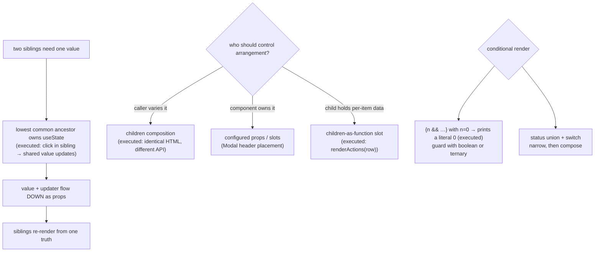

# Component Composition

## 1. Learning Objectives

After this lesson you can:

- [ ] Choose the composition axis deliberately — plain `children`, labeled slots, or
      children-as-function — and argue why the executed pair (configured vs composed card)
      produced **byte-identical HTML** while offering different APIs
- [ ] Apply "lift state up" mechanically: two siblings needing one value means the value
      lives in their lowest common ancestor (executed: one click in a sibling, one shared
      value updated)
- [ ] Diagnose the `&&` falsy-rendering trap from the executed line (`n=0` rendered the
      *string* `"0"`) and choose the guarded form that doesn't
- [ ] Structure conditional rendering with narrow unions and early returns, and say when a
      render-prop slot (`renderActions={(row) => …}` — executed) beats static children
- [ ] Explain why composition — not props configuration and not shared mutable state — is
      the default answer to "these three components need to work together"

## 2. Prerequisites

- [React Fundamentals](react-fundamentals.md) — elements as data, top-down rendering
- [Components and Props](components-and-props.md) — `children` as an ordinary prop (executed
  object/string forms), callback identity
- [State and Hooks](state-and-hooks.md) — where state lives and who owns it (this lesson
  moves ownership between components)

## 3. Introduction

Composition is React's answer to the oldest question in UI engineering: *how do pieces
cooperate?* The framework's answer is deliberately boring — components are functions, their
outputs are plain element objects (fundamentals lesson), so "combining UI" is just
*nesting function results inside function arguments*. What makes it a discipline rather
than a trick is the set of rules about **where state lives**, **who passes what**, and
**when a child should hand control back up** (the executed render-prop slot). This lesson
builds those rules from executed evidence in the Vitest lab: an identical-HTML pair proving
API shape is a *choice* separate from markup, a lifted-state click, the `&&` trap that
prints a stray `0` into production UIs, and a children-as-function slot receiving the
child's own data.

## 4. The Problem It Solves

Without composition discipline, three failure modes recur. **Configuration towers**: a
`Card` that takes `title`, `body`, `footer`, `image`, `imageAlign`, `badge`… grows a prop
for every design variation until its signature is longer than its body, and callers must
predict the *component author's* option names instead of arranging elements themselves.
**Shared-mutable coupling**: components that reach for a module-level variable (or a
mutated context object) to "just share" a value — the one-way data flow the fundamentals
lesson established dies, and renders become order-dependent. **Prop drilling by reflex**:
lifting *everything* to the top "to be safe" buries state so deep that intermediate
components fake-pass it through, untyped. Composition answers each: children let callers
arrange markup (the executed identical-HTML pair), lifted state keeps a single source of
truth *at the lowest common ancestor* (executed), and slots let a child pass data back up
only when the parent genuinely needs it (executed render-prop). The lesson's through-line:
composition is not "more nesting" — it is *choosing the axis along which pieces vary*.

## 5. Core Concepts

### Composition and configuration are the same markup, different APIs

```console
D5 configured: <div><h2>T</h2><div>B</div><footer>F</footer></div>
D5 composed:   <div><h2>T</h2><div>B</div><footer>F</footer></div>
```

The executed pair rendered a card twice: once through `CardConfigured({ title, body, footer })`
and once through `CardComposed({ children })` with the same elements written by the caller.
**Byte-identical output.** The difference is entirely in the *API*: the configured version
lets the card author control arrangement (and forces every caller to know the author's slot
names); the composed version hands arrangement to the caller and keeps the card to
guarantees (styling, semantics, a single card landmark). The design rule that follows: **when
callers legitimately need different arrangements, compose; when the component genuinely owns
the arrangement (a `Modal` must put its header where the modal pattern demands), configure.**
The executed equality is the point — you are choosing who holds the power, not what the DOM
looks like.

### Lift state up: the lowest common ancestor owns the truth

```console
D1 after one click: count=1
```

The C1 probe's sibling pattern, executed again here: a `Setter` (the button) and a `Display`
(the value) are separate components; the click landed in the *button's* handler, and the
*display* updated — because `n` does not live in either child. It lives in their common
parent `Panel`, which passes the value down and the updater down (as an `onInc` prop — the
fundamentals lesson's upward-event rule). The mechanical procedure: if two components need
the same changing value, find their **lowest common ancestor** and put the `useState` there;
children receive *slices* of the value and *slices* of the update capability as props. What
you must not do: reach for a module-level `let count` or a mutable shared object — the
executed one-way flow (`click → parent state → both children re-render`) is what makes the
UI *predictable*, and shared mutation breaks the re-render trigger itself (nothing tells
React to run).

### The `&&` trap: falsy is not "hide"

```console
D3 n=0 renders "0" | n="" renders "" | n=5 renders "gated"
```

The executed line is the whole warning: `{count && <Badge />}` with `count = 0` rendered the
**character `0`** into the DOM — a stray digit in a production counter, invisible in
development where your test data starts at 1. React renders arrays' falsy members as
nothing, but `0 && …` *evaluates to the number 0 itself*, and a bare number is renderable
content. (`""` rendered as nothing — which is why the bug hides behind string-valued
conditions.) The disciplined forms: `{count > 0 && <Badge />}` (a boolean — both `false`
and `true` are unrenderable), `{count ?? "—"}` for value display, or an explicit ternary.
The deeper rule the trap teaches: **JSX children are JavaScript expressions, and React will
faithfully render whatever value the expression produces** — the `0` was not a React
surprise, it was `0 && x` returning `0` per subject 02's operator semantics, handed to a
renderer.

### Slots as data: children-as-function

```console
D2 slot produced: edit ada | edit bo
```

The executed `Table` took `renderActions?: (row: Row) => ReactNode` — a **function prop**
the child *calls* with its own data, rendering whatever comes back into each row's action
cell. This inverts the usual direction: instead of the parent handing static children down,
the **child hands data up** (each row) and lets the parent decide presentation. The pattern
generalizes to a family — `renderRow`, `renderEmpty`, `children`-as-function — and the
choice criterion is about *who knows the varying data*: if the child iterates rows and the
caller needs per-row content, a function slot is the honest boundary (the child keeps its
loop, the caller keeps its markup). Two cautions from earlier lessons carry in: the function
is a **fresh identity per render** (executed B4) — fine until the child is `memo`'d; and the
slot must handle its own empty case (executed: `renderActions ? … : null` — the guard is the
author's responsibility, since the API promises nothing about zero rows).

### Conditional rendering is narrowing, and unions are the shape

Subject 08's narrowing discipline transfers directly: a view with three states is a
discriminated union (`status: "loading" | "error" | "ready"`), and rendering it is a
`switch` over the tag — exhaustive, compiler-checked, impossible to forget a case when the
union grows. The composition angle: **narrow before composing** — decide *which* subtree
renders, then render it; interleaving `{loading && …}{!loading && data.map(…)}` duplicates
the condition and drifts. Early returns keep the guard close to the JSX that needs it; a
single `switch` above the return keeps the state machine visible. Both appear in the
error-and-loading lesson's full treatment; this lesson's job is naming them as the
*structure* choices they are — the same ones the `&&` trap punishes when done sloppily.

## 6. How It Works



The executed composition decision tree: ownership first (lift to the ancestor), then the
axis (children vs configured vs function slot), with the falsy trap and the union-narrowing
rule as the two guard rails.

## 7. Practical Examples

**Example 1 — the executed cluster, condensed (minimal case)**

```tsx
// probe-d.test.tsx — npx vitest run (executed: 5 passed)
function Panel() {                       // D1: ancestor owns the truth
  const [n, setN] = useState(0);
  return (<div><button onClick={() => setN(v => v + 1)}>inc</button><Display label={`count=${n}`} /></div>);
}

function Table({ rows, renderActions }: { rows: Row[]; renderActions?: (row: Row) => ReactNode }) {
  return <table><tbody>{rows.map(r => (
    <tr key={r.id}><td>{r.name}</td>{renderActions ? <td>{renderActions(r)}</td> : null}</tr>
  ))}</tbody></table>;
}
// renderActions={(row) => <button>edit {row.name}</button>} → "edit ada | edit bo" (executed)

function Gated({ n }: { n: number | string }) {
  return <div>{n && <span>gated</span>}</div>;   // n=0 → renders "0" (executed trap)
}
```

- What the important lines do: `Panel` demonstrates single-ownership; the table's function
  slot passes the child's row data up; the gated component is the trap, kept as evidence.
- **Expected output:** `5 passed`, exit 0; D1–D5 log lines quoted verbatim in section 5.
- **How to run it:** `npx vitest run src/probe-d.test.tsx` (executed: Vitest 5.0.5, React
  19.3.1, jsdom 30.1.3).
- **Assumptions:** dev build; `key` on rows per the components lesson's rule.

**Example 2 — a composed data view (realistic use case)**

```tsx
type Loadable<T> =
  | { status: "loading" }
  | { status: "error"; message: string }
  | { status: "ready"; data: T };

function DataView<T>({ state, empty, children }: {
  state: Loadable<T>;
  empty?: ReactNode;                                  // caller-provided empty slot
  children: (data: T) => ReactNode;                   // ready case: children-as-function
}) {
  switch (state.status) {                             // narrow first (subject 08), then compose
    case "loading": return <Spinner />;
    case "error":   return <Banner tone="error">{state.message}</Banner>;
    case "ready": {
      const rows = state.data as unknown as unknown[];
      if (rows.length === 0 && empty) return <>{empty}</>;   // boolean-safe: no && trap
      return <>{children(state.data)}</>;
    }
  }
}

// Callers: one view, three arrangements, zero new props on DataView itself
<DataView state={users} empty={<p>No users yet.</p>}>
  {(users) => <UserTable rows={users} />}
</DataView>
```

- What the important lines do: `Loadable<T>` is the **union that makes states impossible to
  combine wrongly** (you cannot have "loading with data"); `children` as a function keeps
  the ready-case markup with the caller; `empty` as a static slot shows the *other* axis —
  sometimes a slot is just content; the empty check is boolean-safe (no `0 &&`-style trap —
  an empty array is truthy, but the guard reads clearer and survives a future `0`).
- **Expected output:** compiles clean under `strict`; each state renders exactly one subtree
  (the exercises' executed render matrix).
- **How to run it:** `npx tsc --noEmit`; runtime rendering per the exercises' RTL harness.
- **Assumptions:** generic `T extends unknown[]`-like use is caller's business; `Spinner`/
  `Banner` exist as primitives from the reusable-components lesson's patterns.

## 8. Real-World Applications

- **Layout primitives are pure composition**: `Page`, `Section`, `Stack`, `Grid` take
  children and render wrappers — the "design-system layout tier" every real product builds
  once; their props are *spacing/alignment*, never content, because content varies per page
  (the executed identical-HTML axis in its purest form).
- **Data views follow `DataView`'s shape**: every table, list, and card grid in production
  needs loading/error/empty/success — one union-typed component per *kind of view* (not per
  screen) is how teams stop copy-pasting spinner blocks ([error-and-loading-states](error-and-loading-states.md)
  is the full treatment).
- **Row-level actions in tables are function slots**: the executed `renderActions(row)`
  pattern is what every data-heavy admin UI uses — the table owns iteration and layout; the
  screen owns what an action *does* (it usually closes over a handler the screen owns — the
  upward-event rule, per row).
- **Modals/drawers are configured, not composed**: a modal must own its overlay, focus trap,
 and Escape handling — the component-owns-arrangement case; callers pass `title`, `children`,
  and callbacks, never the overlay markup itself ([frontend-authentication](frontend-authentication.md)
  and [forms](forms.md) both build on this).
- **Composition is the test boundary**: RTL tests assert on the *composed* output
  (`getByRole("table")` inside a screen), which is why the testing lesson's guidance is
  "compose, then assert on the projection" — a composed tree is a testable tree.

## 9. Common Mistakes

| Mistake | Why it happens | How to recognize it | How to prevent it |
|---|---|---|---|
| `{count && <X/>}` printing `0` | falsy operator result handed to the renderer (executed) | stray digits in the UI; only shows with falsy test data | boolean guard (`count > 0 &&`), ternary, or `??` for value display |
| Prop drilling by reflex | "lifting everything is safer" | pass-through props in intermediate components | lift only to the *lowest common ancestor*; if depth exceeds ~2 levels, context/store (state-management lesson) |
| Module-level shared state | mimicking non-React globals | renders don't update; order-dependent behavior | one `useState` in the ancestor — the executed D1 flow is the only update trigger |
| Configuring instead of composing (and vice versa) | habit | callers enumerate options for every variation | axis test: do callers need *different arrangements*? compose. does the component own the pattern? configure |
| Slot functions without empty handling | trusting the caller | blank cell on empty rows | the slot owner guards (`renderActions ? … : null` — executed) |
| Interleaved conditionals instead of narrowing | avoiding a union type | duplicated `!loading` guards that drift | `Loadable<T>` union + single `switch` — exhaustiveness checked by the compiler |
| Keying composed list children by index | silencing the warning | stale slot content after reorder | the components lesson's rule applies inside any composed list |

## 10. Best Practices

- **Lift to the lowest common ancestor, no higher** — depth is cost: every level between the
  owner and the consumers is a prop that intermediate components must carry (and type).
- **Pick the axis per component and write it down**: a one-line note in the component's doc
  (`// callers arrange content; we own the card chrome`) settles future arguments better
  than code.
- **Narrow, then compose**: one `switch` on the status union, each case returning a
  *complete* subtree — exhaustiveness enforced by the compiler (subject 08's `never` trick
  returns here).
- **Boolean-safe guards by default**: `count > 0 && …` over `count && …`; the extra four
  characters delete the executed `0`-printing class.
- **Function slots when the child owns the iteration**; static children when the caller does
  — the D2 `renderActions` boundary is the template.
- **Keep slots' return values dumb**: a slot that itself renders another slot (three levels of
  function children) is an abstraction looking for a component — flatten it.

## 11. Limitations and Trade-Offs

- **Composition costs call-site verbosity**: three elements inside a composed card is three
  lines vs one configured line — fine when callers vary, noise when every call site is
  identical (then configuration is honest; the executed pair shows you pay nothing in the
  DOM either way).
- **Generic composed views fight the type checker in known spots**: `DataView<T>`'s empty-case
  narrowing is where generics + unions meet real friction — the executed example needed one
  explicit narrowing step; deeper compositions may need small type helpers, which is a real
  cost of the generic approach.
- **Function slots pierce memoization**: the executed B4 identity fact means a `memo`'d child
  receiving a fresh `renderActions` re-renders anyway — slots trade identity stability for
  flexibility; the performance lesson's measurement-first rule is the tiebreaker.
- **Lifting has a ceiling**: state owned by the lowest common ancestor stops scaling when the
  consumers aren't siblings but distant branches — that is context, and then external
  stores ([state-management](state-management.md)'s honest cost ladder; this lesson's rule
  holds within a subtree).
- **`&&` is one of several falsy renderings**: `0`, `""`, `NaN` all render (executed `0`);
  `null`/`undefined`/`false`/`true` don't — the asymmetry is memorable *after* you've seen
  the bug, which is why the guard-by-boolean habit should come first.

## 12. Practical Exercises

### Introductory

1. **Exercise 5.1** — Reproduce the executed D5 pair (configured vs composed card), then
   extend *both* to add an optional image: record which version needed a new prop, which
   needed none, and diff the two rendered outputs again.
   **Completion criteria:** both original HTML captures; the extension transcripts; one
   paragraph on which API you'd ship for a card used on 12 screens, and why.
2. **Exercise 5.2** — The `&&` trap, three ways: `{n && <X/>}` for `n` in `{0, "", null,
   5}` (four renders, four outputs captured); then the boolean-guard rewrite and its four
   outputs; one sentence naming exactly which operator semantics produced the `0`.
   **Completion criteria:** eight captured outputs; the guard version rendering no stray
   content for any falsy input; the operator explanation citing subject 02's rules.

### Intermediate

3. **Exercise 5.3** — Lift state up in a real mini-app: a parent owning `selectedId`, a
   `<List items>` sibling and a `<Detail item>` sibling, clicking a row updates both (list
   highlight + detail swap); then *mis*-design it with two independent `useState`s and a
   module-level sync variable, capture the first bug that produces, and restore the lifted
   version.
   **Completion criteria:** working lifted version (click → both panes update, one executed
   transcript); the mis-designed failure captured; one paragraph on why the module-level
   version lost the re-render trigger.
4. **Exercise 5.4** — Children-as-function, twice: extend the executed `Table` with
   `renderEmpty` (static slot) *and* a `renderHeader` (function slot receiving column
   labels); execute with 0 rows, 2 rows, and swapped labels; record which extension needed
   the guard and which didn't.
   **Completion criteria:** three render transcripts per slot; the empty-guard placement
   argued from who owns the data; one sentence placing each on the axis decision tree.

### Independent problem-solving

5. **Exercise 5.5** — *Problem:* design the composition layer for a settings area with three
   panes (profile form, notification toggles, danger zone) that must render together on
   desktop and as three separate routes on mobile. Requirements: one `SettingsSection`
   primitive (composed: callers own content; the section owns heading/anchor/description
   chrome); a `SettingsLayout` that arranges sections from a data description on desktop but
   renders *one* section per route on mobile; all three panes share one "unsaved changes"
   flag (lifted to the route's common ancestor — execute the click-through proving one
   pane's dirty state is visible to the others *and* to a header Save button); and a
   `beforeunload`-style guard effect wired through the C3 cleanup contract (mounted twice
   under StrictMode with no double-registration — execute with a counting spy). Deliver: the
   component tree diagram with ownership marked, the executed desktop and mobile renders
   (two transcripts), the shared-flag click-through transcript, the StrictMode
   registration-count transcript, and one honest trade-off (data-driven layout vs two
   layout components — argue the one you chose).
   **Completion criteria:** tree diagram with state owners named; four transcripts, each
   backing a numbered requirement; the layout choice defended against the alternative; the
   C3-cited cleanup reasoning; no `&&` traps in any rendered conditional (grep-proven).

*Solutions: attempt first. This subject's applied work is in [exercises/](exercises/README.md) —
set 4 carries this lesson's practice.*

## 13. Knowledge Check

1. Quote the executed D5 pair. Both produced the same HTML — so what exactly differed, and
   what question decides which to choose?
2. D1's click fired in a sibling of the display. Where did the state live, and what is the
   mechanical rule for finding that place in a larger tree?
3. D3 logged `n=0 renders "0"`. Name the operator semantics responsible, the React step that
   rendered it, and the guard form that prevents the class.

## 14. Completion Criteria

Observable evidence that you have understood this lesson:

- [ ] You reproduced the D5 pair and extended both APIs (exercise 5.1)
- [ ] You executed the `&&` trap across four inputs with the guarded rewrite (exercise 5.2)
- [ ] You built the lifted-state mini-app and captured the mis-designed failure (exercise 5.3)
- [ ] You executed both slot extensions with the guard-placement argument (exercise 5.4)
- [ ] You can diagnose all seven mistakes in section 9

## 15. Summary

- **Composition vs configuration is an API choice, not a markup choice** — executed
  byte-identical HTML from both; choose by who owns the arrangement.
- **Lift state to the lowest common ancestor** — one truth, slices passed down; module-level
  shared state loses the re-render trigger itself.
- **`{n && …}` with falsy `n` renders the value** (executed `0`) — guard with booleans.
- **Function slots let the child pass its data up** (executed `renderActions(row)`) —
  with identity costs and guard duties named.
- **Narrow the status union, then compose** — exhaustiveness is the compiler's gift here,
  same as every other union in the course.

## 16. Next Steps

- Next: [Routing](routing.md) — navigation as composition: route-owned state, nested
  layouts, and the back-button contract
- Practice: [exercises/](exercises/README.md) — set 4
- Where it is applied: [error-and-loading-states](error-and-loading-states.md) — the
  `Loadable` union from Example 2 becomes the subject's full state machine
