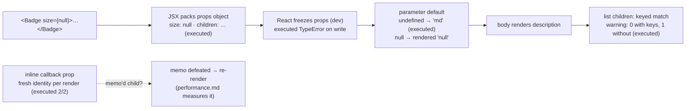

# Components and Props

## 1. Learning Objectives

After this lesson you can:

- [ ] Design a component's props as its public API: required vs optional, discriminated
      variants, and the types that make misuse a compile error
- [ ] Explain from executed evidence why defaults fire for `undefined` only (`md` vs `null`
      in the rendered attribute) and why `null` is the honest "explicitly nothing" value
- [ ] Use `children` and slot props as data (executed: object vs string forms arriving at
      the receiver), and choose composition over configuration without reaching for
      boolean-prop towers
- [ ] Predict callback-prop identity churn (executed: 2 renders → 2 distinct references) and
      say which later lesson owns the fix (`useCallback`/`memo`) and why you usually don't
      reach for it yet
- [ ] Read the executed key warning and list-identity evidence well enough to choose stable
      keys by data, not position

## 2. Prerequisites

- [React Fundamentals](react-fundamentals.md) — elements-as-objects, the props freeze, and
  the top-down invocation model (this lesson's probes sit on those facts)
- [08 — Types and Interfaces](../08-JAVASCRIPT-AND-TYPESCRIPT/types-and-interfaces.md) —
  structural typing and fresh-literal checks are how props *contracts* get enforced
- [08 — Type Narrowing](../08-JAVASCRIPT-AND-TYPESCRIPT/type-narrowing.md) — discriminated
  props variants are narrowed the same way

## 3. Introduction

If a component is a function, then its props are the function's **signature** — and the
difference between a codebase of crisp, misuse-proof components and one of mysterious
`undefined` crashes is almost entirely how deliberately that signature is designed. This
lesson treats props as an API-design problem: what the shape *communicates*, what TypeScript
*enforces*, what React *does* with the values (freezes, defaults, children), and what
happens when you get identity and keys wrong. Every claim here was executed in the Vitest +
jsdom lab (React 19.3.1) and the outputs are quoted verbatim — including the two behaviors
that trip every beginner: defaults defeated by `null`, and callback props that are new
functions on every render.

## 4. The Problem It Solves

Props are the framework's answer to two older problems. First, **coupling**: without a
props-style boundary, components reach into globals or mutate shared DOM, so changing one
widget breaks another three files away. Data-as-arguments makes each component's world
inspectable from its call site — `<Checkout total={1200} />` tells you more than any
comment. Second, **unaccountable UI**: when every consumer decides its own layout/variant/
behavior, screens drift. A designed props surface (`variant`, `size`, `children`) turns "how
does this look?" into "which arguments were passed?" — reviewable, testable, and (via
TypeScript) enforceable before the code runs. The failure modes are equally real — props
towers with fifteen booleans, `any`-typed bags that accept anything — so the lesson teaches
*design*, not just mechanics.

## 5. Core Concepts

### Props are the signature: types do the enforcing

```tsx
type ButtonProps = {
  children: ReactNode;
  variant?: "primary" | "secondary" | "ghost";   // closed set — misuse is a compile error
  size?: "sm" | "md" | "lg";
  disabled?: boolean;
  onPress: () => void;                            // required: every caller must pass it
};
```

Structural typing from subject 08 does the work here: a fresh literal at the call site with a
misspelled variant (`variant="primry"`) is the executed `TS2353` family — the excess/unknown
property check fires exactly where the developer is looking. Note what the type *refuses* to
say: nothing about the DOM, nothing about implementation — only the **contract**. Optional
fields (`?`) are how you document "this has a sensible default" at the type level, and the
`onPress: () => void` required field is how "forgot the handler" becomes a red squiggle
instead of a dead button in production. (The `void` matters — subject 08's rule: callers pass
callbacks they don't invoke; the *component* invokes them.)

### Defaults are parameter defaults — `undefined` only

```console
B3 omitted -> "md" | size={null} -> "null"
```

The executed pair is the whole story. `function Badge({ size = "md" })` uses a plain
JavaScript parameter default, and JavaScript's semantics are exact: **the default fires when
(and only when) the value is `undefined`**. Omit `size` and you get `"md"`. Pass
`size={null}` and you get the literal string `"null"` in the rendered attribute — because
`null` is a *deliberate value*, and React faithfully renders it. Two consequences to design
around: (a) `undefined` means "let the component decide", `null` means "I explicitly have
nothing" — that distinction is useful once you know it, and a foot-gun before; (b) if your
API must treat `null` like "unset", normalize once at the boundary (`size ?? "md"` — nullish
coalescing, subject 08's `??` discipline) rather than sprinkling checks through the body.
TypeScript's `size?: string | null` makes the possibility visible in the signature, so
callers must *choose*.

### Children are just a prop — and that's the composition machine

```console
B2 two elements: typeof=object | <p> nodes rendered: 2 | one string child: typeof=string
```

`children` arrives as whatever the caller wrote between the tags: two element children came
through as an **object** (an array of elements), a single text child came through as a
**string**. No magic slot language — JSX just packs arguments under `children`, as the
fundamentals lesson's emit showed. This reframes composition as data flow: a component that
takes `children` doesn't know or care what's inside, so callers compose *layouts* (a
`Card` wrapping arbitrary content) instead of configuring them (`Card` with `title`, `body`,
`footer`, `image` props — the configuration tower). The advanced version — **named slots**
(`header`, `footer` as separate props) — is the same mechanism with labels, and choosing
between "one bag of children" and "labeled slots" is genuinely a design question the
composition lesson takes up.

### Callback identity: fresh every render, and usually fine

```console
B4 renders: 2 | distinct callback references: 2
```

The executed counter stored each `onAction` reference across renders: two renders, two
**distinct** functions — because the inline arrow `() => setN(v => v + 1)` is a new closure
every time the parent body runs. This surprises people who expect "same handler, same
function." It matters in exactly one situation: a child optimized with `React.memo` that
receives the callback as a prop — fresh identity defeats the memo and the child re-renders
anyway (the performance lesson measures this precisely). It is emphatically *not* a license
to rush for `useCallback` everywhere: identity churn costs nothing when the child isn't
memoized, and memoizing without measuring is the premature-optimization tax the performance
lesson warns about. The correct reflex: **know** the identity changes (executed here), reach
for the fix only when a measurement shows the re-render it causes is a problem.

### Keys are list identity, not decoration

```console
B5 console.error with keys: 0 | without keys: 1 | first: Each child in a list should have a unique "key" prop.%s%s See https://react.dev/link/warning-keys for more information.
```

The executed pair: a keyed list produced **zero** warnings; the same list without keys
produced exactly one, with React's verbatim message. The warning's real subject is
**identity across renders**: when a list re-renders, React matches old elements to new ones
to decide what to patch in the DOM. A key is that match's identity — `key={item.id}` says
"this row is *that* row, wherever it moved to." `key={index}` says "row 0 is row 0" — which
breaks the moment order changes: the DOM node for "row 0" gets *reused for a different
item*, and any component with internal state (an input's text, a checkbox's tick) now shows
one item's state on another. The rule from the executed evidence and its consequence:
**key by stable data identity; use the index only for append-only lists that never reorder
or delete.**

## 6. How It Works



The executed props lifecycle: JSX packs a frozen object; parameter defaults resolve
`undefined` only; children render as data; list keys decide identity; fresh callback
identities quietly shape downstream rendering costs.

## 7. Practical Examples

**Example 1 — the executed cluster, condensed (minimal case)**

```tsx
// probe-b.test.tsx — npx vitest run (executed: 6 passed)
function Badge({ size = "md", tone = "info" }: { size?: string | null; tone?: string }) {
  return <span data-size={String(size)} data-tone={tone}>badge</span>;
}
// omitted → data-size="md"      size={null} → data-size="null"   (executed verbatim)

function Card({ children }: { children: ReactNode }) { return <section>{children}</section>; }
// two <p> children → typeof object · "plain text" child → typeof string (executed)

function List({ items }: { items: string[] }) {
  return <ul>{items.map((it) => <li key={it}>{it}</li>)}</ul>;   // 0 console.error (executed)
}
```

- What the important lines do: `String(size)` makes the default-vs-null distinction visible
  in the DOM; `children` types as `ReactNode` (accepting both executed forms); the `key`
  silences the executed warning by giving rows data identity.
- **Expected output:** `6 passed`, exit 0, with the B2/B3/B5 lines quoted in section 5.
- **How to run it:** `npx vitest run src/probe-b.test.tsx` in the lab (executed with
  Vitest 5.0.5, RTL 16.3.3, jsdom 30.1.3, React 19.3.1).
- **Assumptions:** development build — the props freeze and the key warning are dev-time
  behaviors (both executed in dev).

**Example 2 — a designed API: the alert as a discriminated union (realistic use case)**

```tsx
type Tone = "info" | "success" | "warning" | "error";
type AlertProps = {
  tone: Tone;                                     // required: no default tone — meaning depends on it
  title: string;                                  // required: an alert without words is noise
  children?: ReactNode;                           // optional detail body
  action?: { label: string; onPress: () => void }; // optional named slot as data
};
// Misuse, commented out — verified by uncommenting one at a time:
// <Alert tone="infoo" title="x" />   // ✗ TS2353/TS2322: unknown literal
// <Alert title="x" />                // ✗ TS2345: 'tone' missing — required means required
```

- What the important lines do: the *required/optional split* encodes product judgment —
  tone and title are never defaulted because an unbranded alert is worse than none; the
  `action` prop is a **slot as data** (label + handler travel together, so the component can
  render a button *and* callers can't pass a labelless handler); `children` optional detail
  keeps the common case one line.
- **Expected output:** compiles clean as written; each commented misuse yields its documented
  diagnostic (the types-and-interfaces lessons' verified `TS2353`/`TS2345` family — the same
  compiler, now guarding a component boundary).
- **How to run it:** `npx tsc --noEmit` in the lab (exit 0 as written; exit 1 per misuse line
  — the executed fundamentals pair established both codes).
- **Assumptions:** `strict` tsconfig from the lab; `ReactNode` imported from `react`.

## 8. Real-World Applications

- **Design systems live or die on props design**: every `Button`/`Input`/`Modal` in a real
  product is a discriminated-props API (`variant`, `size`, `tone`) — the union type is what
  lets a design-system team *add* a variant in exactly one place and have every call site
  re-check (design-systems lesson).
- **Children-as-composition** is how layout primitives work: `<Card>`, `<Stack gap={2}>`,
  `<Page>` take children and render wrappers — the pattern behind every component library's
  "layout" tier, and the reason "just add another prop" is the anti-pattern it is.
- **Form libraries and slot props** (`<Field label error>{input}</Field>`) standardize
  repeated UI by moving the *varying part* into children — forms lesson builds exactly this.
- **Key bugs are production bugs**: stale input text after list edits, wrong row highlighted
  after sort — all from index keys (the executed warning is the cheap version; the bug
  report is the expensive one). Data-id keys are the fix, and the API-integration lesson's
  fetched lists bring real ids to key on.

## 9. Common Mistakes

| Mistake | Why it happens | How to recognize it | How to prevent it |
|---|---|---|---|
| Default defeated by `null` | treating null and undefined alike | executed B3: `size={null}` renders `"null"` | document the distinction; normalize with `??` at the boundary if the API must absorb `null` |
| Prop-drilling through pass-through components | convenience | a component whose props mirror its child's exactly | compose with `children`, or lift — composition lesson |
| Boolean/config towers (`showHeader`, `hideFooter`, `isPrimary`) | configuration is familiar | 10+ boolean props; `variant` would be a union of them | one discriminated `variant`/`tone` prop (Example 2's shape) |
| Index keys on mutable lists | silencing the warning | input state jumps rows after sort/delete | key by stable id; index only for append-only lists (executed B5 pair) |
| Premature `useCallback` on every handler | memorizing the B4 identity churn as "a bug" | wrappers everywhere, no measurement | B4's churn is free unless a memo'd child exists — measure first (performance lesson) |
| `any`-typed props bag | speed | `<Comp data={thing} />` accepts anything | `ReactNode` for slots; explicit interfaces for the rest — types are the API docs |
| Naming callbacks inconsistently (`onClick`/`handleClick`/`cb`) | organic growth | callers guess wrong | convention: `on*` for props, `handle*` for the functions you pass to them |

## 10. Best Practices

- **Design the props before the body**: name required fields first (what makes this
  component meaningful?), then options with defaults, then `children`. The signature is the
  review artifact.
- **Prefer unions to booleans** for anything with more than two states — `variant:
  "primary" | "ghost"` beats `primary` + `outline` + `danger` flags, and the compiler
  enumerates your variants in one place.
- **Type children as `ReactNode`** (slots accept text, elements, fragments — both executed
  forms) and as a narrower type only when you genuinely need structure (`{ label, body }`
  objects instead of raw children).
- **Key by data identity** (executed warning is the reminder; stale-input bug is the
  consequence) — and if you must key by index, write a comment saying the list is
  append-only, so future-you knows the constraint.
- **Keep handlers as props, not imports** — a child that imports a parent's function inverts
  the data flow and breaks the model; the prop *is* the upward channel (fundamentals A5's
  loop).
- **Normalize `null` once, at the boundary** if your API absorbs it — `size ?? "md"` — so the
  body sees one honest value, not two half-truths.

## 11. Limitations and Trade-Offs

- **Props are shallow and by-value** — copying a large array/object into props on every
  parent render creates fresh references each time (the same identity churn as B4, for
  data instead of callbacks), which matters the moment a memoized child or an effect
  dependency compares by reference ([state-and-hooks](state-and-hooks.md)'s dependency rules,
  [performance](performance.md)'s measurement).
- **Structural typing is loose on purpose** — subject 08's executed `TS2353` shows fresh
  literals are checked but *variables* pass with extra fields; a props object built up in
  two statements can carry stale keys silently. The load door discipline (`unknown`-in,
  typed-out) returns when props cross network/storage boundaries.
- **`ReactNode` accepts almost anything** — including strings where you wanted elements;
  a `children: ReactElement` (singular, stricter) type is the fix when structure matters,
  and the cost is that callers lose harmless flexibility.
- **Composition has a naming cost** — three slots named by convention (`header`, `body`,
  `footer`) don't appear in a call site's *type* visibly the way required props do; teams
  disagree about whether slots or props communicate intent better, and the honest answer is
  "it depends on the component's audience" (composition lesson argues the cases).
- **Key choice interacts with statefulness** — the same index key is harmless in a dumb
  list and catastrophic in one with inputs; the type system cannot tell you which you have,
  so this remains a code-review responsibility.

## 12. Practical Exercises

### Introductory

1. **Exercise 3.1** — Reproduce the executed default pair with **four** variants: omitted,
   `undefined`, `null`, and a real value; render each and record the resulting attribute.
   Then add `size ?? "md"` normalization and re-record.
   **Completion criteria:** four outputs captured; the normalization transcript showing
   `null` now rendering `"md"`; one sentence on why the raw version distinguishes them at all.
2. **Exercise 3.2** — Prove the props freeze yourself: destructure a prop, attempt to write
   to the props *object* (not the local variable) inside the body, capture the executed
   `TypeError`; then show the destructured local is assignable (it isn't frozen — but note
   what re-render does to it).
   **Completion criteria:** the frozen-object `TypeError` captured; the local-variable
   contrast shown; one line on why "mutating the local" is still wrong (state is the tool).

### Intermediate

3. **Exercise 3.3** — Take a `Comment` component with four props (`author`, `text`,
   `timestamp`, `isEdited`) and redesign it twice: (a) `isEdited` → a discriminated
   `edited?: { at: Date; original: string }`, (b) author as `{ name, avatarUrl }` object;
   compile both, then pass a wrong literal to each and capture the diagnostics.
   **Completion criteria:** two redesigned versions compiling; two captured misuse
   diagnostics with codes; one paragraph on what each design *communicates* that the boolean
   didn't.
4. **Exercise 3.4** — The identity ledger: a parent with an inline-handler child and a
   `useCallback`-wrapped twin (import it — you don't need to understand it yet), a body spy
   in each child, and five clicks. Record each child's re-run count; state which child the
   B4 churn actually cost anything for, and *why* the other one didn't care.
   **Completion criteria:** two re-run tables; the B4 identity fact cited; one sentence
   promising the measurement-first policy of the performance lesson.

### Independent problem-solving

5. **Exercise 3.5** — *Problem:* design the props API for a `DataTable` used by three
   different screens: sortable rows with an "actions" column (screen A), a read-only variant
   with no sorting (screen B), and a selectable variant with bulk actions (screen C).
   Requirements: the read-only variant must not *accept* sort-related props (compile error,
   not a runtime no-op); actions are a per-row slot (a render-prop or children-as-function —
   look up the pattern, it's `renderRowActions?: (row: T) => ReactNode`); the component
   stays generic over its row type (subject 08's generics return). Deliver: the type
   declaration with per-line rationale, three call-site snippets that each compile, three
   misuse snippets each captured with its diagnostic, and one honest trade-off (union-discriminated
   props vs three separate components — argue for one).
   **Completion criteria:** types compile with `strict`; 3+3 transcripts (compiles / fails
   with the expected code) executed via `tsc --noEmit`; the generic parameter justified
   against subject 08's generics rules; the trade-off paragraph defends a *named* choice.

*Solutions: attempt first. This subject's applied work is in [exercises/](exercises/README.md) —
set 2 carries this lesson's practice.*

## 13. Knowledge Check

1. Quote the executed B3 line. Why did `size={null}` render the string `"null"`, and what
   does that reveal about where JS parameter defaults fire?
2. The B4 probe logged `renders: 2 | distinct callback references: 2`. Explain where the
   second reference came from, and name the *one* situation where the difference costs
   anything.
3. The B5 pair produced 0 and 1 key warnings. State the rule for choosing keys, and one
   concrete bug that `key={index}` causes on a reorderable list with inputs.

## 14. Completion Criteria

Observable evidence that you have understood this lesson:

- [ ] You reproduced the four-variant default experiment with normalization (exercise 3.1)
- [ ] You executed the props-freeze attempt and captured the `TypeError` (exercise 3.2)
- [ ] You redesigned `Comment` with a discriminated edit state and captured misuse
      (exercise 3.3)
- [ ] You built the identity ledger with re-run tables (exercise 3.4)
- [ ] You can diagnose all seven mistakes in section 9

## 15. Summary

- Props are the component's **signature**: required fields enforce meaning, optional fields
  document defaults, unions beat boolean towers — the type checker is your first consumer.
- Parameter defaults fire for **`undefined` only** (executed `md` vs `"null"`) — `null` is a
  deliberate value; normalize once at the boundary if the API must absorb it.
- `children` is an ordinary prop (executed object/string forms) — composition is data
  flow, not template syntax; slots-as-data generalize it.
- Callback props are **fresh references per render** (executed 2/2) — free unless a memoized
  child exists; measure before `useCallback`.
- **Keys are identity**: the executed 0-vs-1 warning pair and the stale-input bug it prevents
  — key by stable data, never by position on mutable lists.

## 16. Next Steps

- Next: [State and Hooks](state-and-hooks.md) — the writable half of the data model:
  `useState`'s updater semantics, effect boundaries, and the dependency rules
- Practice: [exercises/](exercises/README.md) — set 2
- Where it is applied: [reusable-components](reusable-components.md) — the props API *is* the
  component library's public interface; design-systems lesson scales this to dozens of
  components
