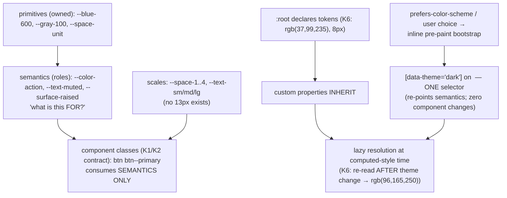

# Design Systems

## 1. Learning Objectives

After this lesson you can:

- [ ] Define **design tokens** as CSS custom properties and prove the mechanism: a `:root`
      token consumed by components and overridden per theme (executed K6: light
      `rgb(37,99,235)` → dark `rgb(96,165,250)` under `[data-theme]`, spacing token
      resolving `8px`)
- [ ] Separate **primitive** tokens (raw values) from **semantic** tokens (role names) and
      argue why components may only reference the semantic layer
- [ ] Build a theme switch with zero component changes (attribute selector + inherited
      custom properties — the executed half of K6) and defend the attribute-vs-class,
      attribute-vs-media choices
- [ ] Design a **type and space scale** that constrains by default (executed K6's
      `--space-2: 8px` as one rung of a ratio-based scale)
- [ ] State honestly when a project needs a design system and what a system *costs*
      (governance, change discipline) — with the three-instance extraction rule from the
      components lesson as the entry criterion

## 2. Prerequisites

- [Reusable Components](reusable-components.md) — the class-name contract and variant
  vocabulary this lesson generalizes
- [07 — CSS Architecture](../07-HTML-AND-CSS/responsive-design.md) and
  [Layout](../07-HTML-AND-CSS/flexbox.md) — cascade, specificity, media queries
- [Error and Loading States](error-and-loading-states.md) — the components (skeleton,
  empty, error) a system must define states for

## 3. Introduction

A design system is the answer to one question asked a thousand times: *what color is the
brand, how big is the gap, which blue is "danger"?* Without an answer, every screen
invents one, and the product drifts — 14 grays, three button paddings, a red that means
error on one page and delete on another. The executed K6 probe captured the *mechanism*
the whole practice rests on: a CSS custom property defined once on `:root`, resolved by
every consumer (`rgb(37,99,235)`), and overridden for a whole theme by one attribute
selector (`[data-theme="dark"]` → `rgb(96,165,250)`) — with **zero component changes**.
Everything else in this lesson is discipline layered on that mechanism: naming tokens by
*role* rather than value, scaling type and space by ratios instead of choices, and
governing change so the system stays one system.

## 4. The Problem It Solves

The pre-system failure is arithmetic: N screens × M styling decisions each, all drifting
independently. A rebrand touches every literal; a dark mode doubles the inventory; a
spacing audit finds every value ever typed. Custom properties (executed K6) invert the
dependency: components reference `var(--color-brand)`, so a change lands in **one
declaration** and propagates through inheritance at render time — the same "one source of
truth" argument as the api lesson's state unions, applied to visual language. But the
mechanism is the easy half. The hard half is *vocabulary*: `--blue-500` invites every
component to hardcode a hue choice, while `--color-action` says what the token is *for* —
and when someone asks "what does danger look like?", a role name is an answer and a hex
code is a footnote. The theme execution in K6 completes the argument: because custom
properties inherit down the tree, a single `[data-theme]` switch re-themes every consumer
without touching one component — the payoff the token layer exists to enable.

## 5. Core Concepts

### Tokens are the seam; the executed mechanism is inheritance

```console
K6 light token: rgb(37,99,235) | K6 dark token: rgb(96,165,250) | K6 space token: 8px
```

K6 declared `--color-brand` and `--space-2` on `:root` in one `<style>`, read them back
through `getComputedStyle` on a plain `div` — `rgb(37,99,235)` and `8px` — then set
`data-theme="dark"` on that div and re-read `--color-brand` as `rgb(96,165,250)`. Three
properties of CSS custom properties made this work, and each is load-bearing in a real
system: they **inherit** (a token on `:root` is visible to every element without any
selector reaching down — this is why tokens beat utility classes for theming); they
**resolve lazily at computed-style time** (the consumer asked *after* the attribute
changed and got the new value — no re-render, no JS propagation); and they are **just
strings** until used (the same `--color-brand` can feed `color`, `background`, a border,
or an SVG fill). The design consequence: tokens live in exactly one place (a `tokens.css`
or a build-time export), components consume them via `var()`, and the K2 lesson's
class-name contract stays stable because *values* move underneath, not names.

### Primitive vs semantic: the two-layer vocabulary

The executed K6 names are a teaching pair: `--color-brand` is already a **role** name
(something asks "what's the brand color?"), while `--space-2` is a **scale** name (a rung
on a numbered ramp). Real systems formalize this as two layers. **Primitives** are the raw
palette — `--blue-600: rgb(37,99,235)`, `--gray-100`, `--space-unit: 8px` — the *values*,
named by their position, changeable only by the system's owners. **Semantics** are the
roles — `--color-action: var(--blue-600)`, `--color-danger`, `--surface-raised`,
`--text-muted` — defined *in terms of* primitives, one hop away from usage. The rule that
earns its keep: **components may reference semantic tokens only**. The rebrand argument
proves it: a rebrand swaps the primitive *behind* the role (`--color-action` now points
at a new hue) and every component follows; a component that grabbed `--blue-600` directly
is now the wrong blue and must be hunted. The dark-theme execution in K6 is the same rule
at theme scope: the theme re-points semantics (`--color-action` → the dark ramp), not
primitives-per-consumer. When a new role appears, the question is never "which hex?" but
"what is this *for*?" — and if nobody can name the role, it isn't a token yet, it's a
one-off.

### Theme switching is one selector over inherited values

The executed K6 override — `[data-theme="dark"] { --color-brand: rgb(96,165,250); }` —
is the entire theming algorithm. Because custom properties inherit, any subtree can carry
the attribute and re-theme itself independently (a dark preview panel inside a light app
works with no extra wiring — the probe set the attribute on one div and only that subtree
changed). The three real-world choices around it: **attribute vs class** on the root
(`<html data-theme>` vs `<html class="dark">`) — attribute selectors read as intent and
don't collide with the class-name contracts from the components lesson, which is why K6
(and most systems) use them; **user-preference bootstrap** — `data-theme` gets set from
`prefers-color-scheme` (or a stored user choice, taking precedence) in a tiny inline
script *before first paint* to avoid the flash-of-wrong-theme, a script that is
deliberately not a React concern; and **system-contrast escalation** —
`prefers-contrast: more` and `prefers-reduced-motion` (accessibility lesson) ride the
same mechanism as additional attribute/ media selectors over the same semantic names, so
components never branch on user preferences themselves.

### Scales constrain by default: type and space

K6's `--space-2: 8px` is one rung of the pattern that replaces "how much padding?" with
"which rung?". A **space scale** is a short, ratio-based ramp (`--space-1: 4px`,
`--space-2: 8px`, `--space-3: 16px`, `--space-4: 24px` — a geometric-ish progression)
such that *there is no 13px*, ever. The constraint is the feature: designers and
developers choosing from four rungs converge visually; choosing any integer diverges by
definition. A **type scale** is the same move for font sizes — `--text-sm/md/lg/xl` as
named steps with line-heights paired (`--text-sm: 0.875rem/1.25` etc.), so components ask
for `--text-sm` and get the *ratio* maintained. The discipline note: scales are edited by
adding rungs, never by retuning one (retuning `--space-2` silently reflows every consumer
— the same breaking-change class as renaming `.btn--ghost` from the components lesson);
and components take a *step* prop (`size?: "sm" | "md" | "lg"` mapping to the scale),
never a raw number — the K1 closed-enum rule applied to spacing.

### Component APIs sit on top of tokens

The relationship between this lesson and the last is layering: the components lesson
built `<Button variant="primary">` with a class contract (`btn btn--primary`); this
lesson defines what `btn--primary` *means* — `--color-action`, `--space-2` padding,
`--text-md`, `--radius-pill` — all semantic tokens. The system's deliverable is exactly
this chain: **variant name → semantic tokens → primitives**, with the executed K6
mechanism carrying the values at render time. States are tokens too, which closes the
loop with the error-and-loading lesson: a skeleton's shimmer color, an error surface's
tint, an empty-state illustration's ink are all semantic names the system defines *once*,
so the quartet looks like one product on every screen. The honest boundary: a system is
not a component library by definition — tokens-plus-guidance is already a system (many
products run on tokens and three components); the component library is the *optional*
second half, extracted per the three-instance rule, not on day one.

## 6. How It Works



The executed token lifecycle: primitives behind roles, roles behind class contracts, and
one attribute selector re-pointing the whole tree through inheritance.

## 7. Practical Examples

**Example 1 — the executed cluster, condensed (minimal case)**

```tsx
// probe-k.test.tsx (K6) — npx vitest run (executed: 6 passed)
// one <style>:
//   :root { --color-brand: rgb(37, 99, 235); --space-2: 8px; }
//   [data-theme="dark"] { --color-brand: rgb(96, 165, 250); }
const el = document.createElement("div");
document.body.appendChild(el);
getComputedStyle(el).getPropertyValue("--color-brand").trim(); // "rgb(37,99,235)"  (K6 light)
el.setAttribute("data-theme", "dark");
getComputedStyle(el).getPropertyValue("--color-brand").trim(); // "rgb(96,165,250)" (K6 dark)
getComputedStyle(el).getPropertyValue("--space-2").trim();     // "8px"             (K6 space)
```

- What the important lines do: declare once on `:root`, consume anywhere (inheritance),
  re-theme by attribute (one selector, lazy re-resolution — no component touched).
- **Expected output:** `6 passed`, exit 0; the three values quoted above.
- **How to run it:** `npx vitest run src/probe-k.test.tsx` (executed: Vitest 5.0.5,
  jsdom 30.1.3 — jsdom resolves custom properties through `getComputedStyle`).
- **Assumptions:** Node ≥ 20; in a browser the same reads work on any live element.

**Example 2 — a real token file + theme bootstrap (realistic use case)**

```css
/* tokens.css — the single source of truth */
:root {
  /* primitives (owned by the system) */
  --blue-600: rgb(37, 99, 235);
  --blue-400: rgb(96, 165, 250);
  --gray-900: rgb(17, 24, 39);
  --gray-050: rgb(249, 250, 251);
  --unit: 8px;
  /* semantic roles (what components may use) */
  --color-action: var(--blue-600);
  --surface: var(--gray-050);
  --text: var(--gray-900);
  /* scales */
  --space-1: calc(var(--unit) * 0.5);
  --space-2: var(--unit);
  --space-3: calc(var(--unit) * 2);
  --radius-pill: 999px;
}
[data-theme="dark"] {
  --color-action: var(--blue-400);
  --surface: var(--gray-900);
  --text: var(--gray-050);
}
.btn { padding: var(--space-2) var(--space-3); background: var(--color-action); color: var(--surface); }
```

```html
<!-- pre-paint bootstrap: no flash of wrong theme -->
<script>
  const saved = localStorage.getItem("theme");
  const dark = matchMedia("(prefers-color-scheme: dark)").matches;
  document.documentElement.dataset.theme = saved ?? (dark ? "dark" : "light");
</script>
```

- What the important lines do: the two-layer split (primitives vs roles — components
  touch only roles); the scale with no off-ramp; one attribute selector re-points the
  theme; the bootstrap sets `data-theme` *before first paint* from stored choice →
  system preference, in that precedence order.
- **Expected output:** flipping `data-theme` restyles every consumer with zero component
  edits — K6's executed result, at product scale; `.btn` references semantics only, so a
  rebrand edits one line (`--color-action`).
- **How to run it:** any static page; verify with the K6 reads (`getComputedStyle`) or
  devtools' computed panel.
- **Assumptions:** stylesheet loaded before the bootstrap runs; `localStorage` guarded
  in real apps (private-mode try/catch).

## 8. Real-World Applications

- **Multi-brand products** (white-label, regional variants) are the same switch as
  theming: re-point semantic tokens per brand root, share every component — the
  executed `[data-theme]` mechanism at portfolio scale.
- **Design-token pipelines** (Style Dictionary, Figma Tokens) compile a JSON/YAML source
  into the CSS custom properties of Example 2 plus iOS/Android equivalents — the
  primitive/semantic split is exactly their input schema.
- **Design-system teams** maintain the token file the way backend teams maintain a
  schema: versioned, reviewed, breaking-change-flagged — the changelog lesson's discipline
  applied to visual language.
- **Density and theming modes** (compact/comfortable spacing steps; light/dark/high-
  contrast) ride the same attribute selectors over the same names — components never
  branch on user preference (accessibility lesson's contract).
- **Email and non-DOM surfaces** export the same primitives as literal values (custom
  properties don't exist in most email clients) — proof the token *source* is the asset,
  and CSS is one of several build targets.

## 9. Common Mistakes

| Mistake | Why it happens | How to recognize it | How to prevent it |
|---|---|---|---|
| Components consuming primitives | fastest to type | `background: var(--blue-600)` in a component | semantic-only rule; lint `var(--[a-z]+-\d\d\d)` out of component CSS |
| Value-named semantics | naming before role is known | `--color-main`, `--color-thing` | ask "what is it FOR?"; reject names that answer with popularity |
| One-off values beside the scale | 13px felt right once | gaps in rendered spacing rhythm | scales have no holes; add a rung or use one (K6's `--space-2`) |
| Theme by JS style-pushing | not trusting inheritance | loop setting `style.color` per element | one attribute selector (executed K6's override) |
| Flash of wrong theme | theme set after React mounts | white blink into dark app | pre-paint inline bootstrap (Example 2) |
| Retuning a scale rung | redesigning in place | every screen reflows silently | add/replace rungs, version the change |
| Day-one system | anticipating brands that never come | token file dwarfing the product | three-instance rule (components lesson) as the entry criterion |
| Dark theme as inverted colors | no semantic layer | gray-on-gray, muddy images | re-point roles per theme; keep imagery themed assets |

## 10. Best Practices

- **Name by role, own by layer**: primitives (palette, owned) → semantics (roles, the
  component-facing API) — the executed two-layer argument.
- **One file is the source of truth** (tokens.css / token JSON) — components never
  declare tokens, only consume (K6's single `<style>` at product scale).
- **Theme with one attribute selector** over inherited custom properties (executed K6) —
  attribute on `<html>`, bootstrapped pre-paint from stored choice → `prefers-color-scheme`.
- **Scale everything you repeat**: space, type, radius, z-index, duration — ratios, named
  steps, no holes; components take steps (`size` enums), never raw numbers.
- **Prefers ride the same names**: `prefers-contrast`, `prefers-reduced-motion` re-point
  semantics via additional selectors — components stay preference-blind.
- **Version the token file**: adding is minor, renaming/repurposing is major, retuning is
  a migration — the changelog lesson's semantics applied to design language.

## 11. Limitations and Trade-Offs

- **Custom properties are runtime strings**: no compiler help — `var(--typo)` silently
  resolves to nothing (or an inherited fallback) on misspelling; mitigate with a linter
  rule and a smoke test that walks tokens used vs tokens defined.
- **Inheritance is also the footgun**: a token set on a subtree re-themes everything
  below it — powerful for scoped previews (executed), hazardous when a modal portal or
  widget root sets one accidentally.
- **Scales constrain creativity on purpose** — a design needing 13px must either take
  12 or 16 or *add a rung with intent*; that friction is the system working, but it must
  have an owner or it curdles into bureaucracy.
- **A token system is not accessibility**: correct role names can hold inaccessible
  values (a `--text-muted` failing contrast breaks every consumer at once — single source
  of truth cuts both ways); contrast validation belongs in the token pipeline
  (accessibility lesson's tooling).
- **Non-DOM consumers need exports**: web components in native contexts, email, and
  printed PDFs each need the primitives compiled out — the pipeline is real work, not
  garnish, once a second target exists.
- **jsdom proves resolution, not appearance**: K6 showed the mechanism (declare, inherit,
  override); that `rgb(96,165,250)` on your actual surfaces *looks* right is browser
  evidence — screenshot and human review remain unautomated.

## 12. Practical Exercises

### Introductory

1. **Exercise 13.1** — Re-execute K6, then extend to three themes (`light`, `dark`,
   `hc` high-contrast): capture each theme's resolved `--color-action`, `--surface`,
   `--text` after switching the attribute on the same element. Write the role sentence
   for each token you defined.
   **Completion criteria:** nine captured values (3 themes × 3 roles); every token named
   by role; the one-selector claim demonstrated (no per-component edits between themes).
2. **Exercise 13.2** — The primitive/semantic audit: take any existing stylesheet of
   yours and classify every color/space literal as (a) already a semantic token, (b)
   should be a primitive, (c) should be a role, (d) one-off with justification. Produce
   the two-layer token file the audit implies and convert five components to consume it.
   **Completion criteria:** the audit table with all four classes present; the token
   file; five converted components with captured before/after computed styles.

### Intermediate

3. **Exercise 13.3** — Theme without the flash: implement Example 2's bootstrap (stored
   choice → system preference), prove precedence by storing `light` while emulating
   `prefers-color-scheme: dark` (capture the resolved attribute), then add the
   `prefers-contrast: more` re-point and capture a third set of values.
   **Completion criteria:** precedence transcript; contrast-escalated values; one
   paragraph on why the bootstrap is inline rather than in your framework's mount.
4. **Exercise 13.4** — The scale discipline: define space (5 rungs) and type (4 steps)
   scales, then restyle one screen using *only* scale tokens. Count the distinct spacing
   values you had before vs after; write the constraint argument using the rendered
   rhythm, not taste.
   **Completion criteria:** before/after value counts; zero off-scale values remaining
   (grep evidence); the scale file with ratio rationale per rung.

### Independent problem-solving

5. **Exercise 13.5** — *Problem:* define the system your product would actually need —
   and its stopping point. Take any real app of yours: (a) the token audit (13.2) at
   full scale — every literal classified, the two-layer file generated; (b) themes:
   light/dark via the executed attribute mechanism, plus your *product's* real third
   context (e.g., a dense data mode, a print view, an embeddable widget theme) — capture
   each context's resolved values; (c) the governance doc: who adds a role, what
   "breaking" means for a token rename, how a retune ships (version + migration note);
   (d) the stopping-point argument: which parts of a *system* you are deliberately NOT
   building (component library? docs site? Figma sync?) and what evidence would change
   that call (the three-instance rule cited with your actual component inventory);
   (e) a regression guard: a test that fails when component CSS references a primitive
   directly or when a token used is not defined.
   **Completion criteria:** executed value captures for every context; the governance
   doc with concrete role examples; the stopping-point argument naming real counts
   (components, screens, literal values); the guard test passing and failing on demand
   (break it once, capture the failure).

*Solutions: attempt first. This subject's applied work is in [exercises/](exercises/README.md) —
set 10 carries this lesson's practice.*

## 13. Knowledge Check

1. K6 resolved `rgb(37,99,235)` from `:root` on a plain `div`, then `rgb(96,165,250)`
   after setting one attribute — with no component edits. Name the three CSS properties
   of custom properties that made this work and what each buys a system.
2. Primitive vs semantic: why may components reference only the semantic layer, and what
   happens to a rebrand when they don't? Give the role-name test.
3. Your type scale's `--text-md` needs to change by 1px. Why is that a *versioned
   migration* rather than an edit — and which lesson's breaking-change semantics apply?

## 14. Completion Criteria

Observable evidence that you have understood this lesson:

- [ ] You executed three themes over the same components with captured values (exercise 13.1)
- [ ] You produced a classified token audit and converted five components (exercise 13.2)
- [ ] You implemented the pre-paint bootstrap with proven preference precedence (exercise 13.3)
- [ ] You restyled a screen with zero off-scale values and grep evidence (exercise 13.4)
- [ ] You can diagnose all eight mistakes in section 9

## 15. Summary

- **Tokens are CSS custom properties**: declared once, inherited everywhere, resolved
  lazily (executed K6: `rgb(37,99,235)` → `rgb(96,165,250)` under one attribute).
- **Two layers**: primitives (owned values) behind semantics (role names) — components
  consume roles only; the role-name test decides what's a token.
- **Theme is one selector**: `[data-theme]` re-points semantics through inheritance, with
  a pre-paint bootstrap and preference precedence.
- **Scales constrain by default**: space/type/radius as named rungs with no holes —
  components take steps, never raw numbers (K6's `--space-2` as one rung).
- **Govern like a schema**: versioning, migration notes, an owner — and start with the
  three-instance rule, not a day-one system.

## 16. Next Steps

- Next: [Performance](performance.md) — token-driven styling avoids one class of cost;
  the next lesson measures the ones it can't avoid (render frequency, bundle weight)
- Practice: [exercises/](exercises/README.md) — set 10
- Where it is applied: [Accessibility](accessibility.md) — `prefers-contrast` and
  `prefers-reduced-motion` ride this lesson's mechanism; contrast is a token-pipeline gate

