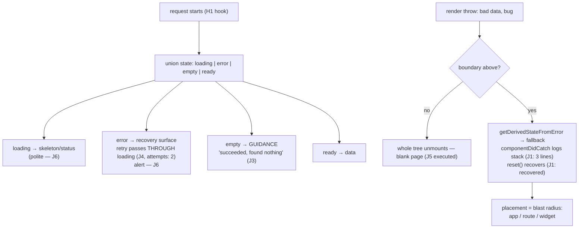

# Error and Loading States

## 1. Learning Objectives

After this lesson you can:

- [ ] Build the **four-state view** (`loading | error | empty | ready`) and render each
      distinctly (executed J2: four transcripts, four presentations) — arguing why `empty`
      is neither `error` nor `ready`
- [ ] Place an error boundary where it changes blast radius (executed J1: caught
      `render exploded`, reset → `recovered`; J5: without one, the error propagated and the
      tree went blank) — and design the fallback with a working `reset`
- [ ] Route async messages to the right live region (executed J6: `status` for progress,
      `alert` for failure) and say which is polite vs assertive
- [ ] Implement retry that passes **through** loading (executed J4: `attempts: 2`, no
      stale value shown) and defend "never show stale data as if fresh"
- [ ] Diagnose a real screen's missing states with the checklist: what happens on slow
      network, empty result, 500, offline, and mid-navigation unmount

## 2. Prerequisites

- [State and Hooks](state-and-hooks.md) — unions, derived state, the effect contract
- [API Integration](api-integration.md) — the H1 hook this lesson's views consume
- [07 — Accessibility](../07-HTML-AND-CSS/accessibility.md) — live regions; this lesson
  assigns them by message class

## 3. Introduction

Every data screen you ship has the same five moments: **nothing loaded yet**, **it broke**,
**it worked and found nothing**, **it worked**, and **the user left mid-load**. Products
are judged on the four awkward ones, not the happy one — a blank screen during a slow
request reads as "broken," an empty result labeled "Error!" reads as "broken," and a render
crash that takes the whole app down *is* broken, permanently, until reload. This lesson
makes each moment an explicit, executed case: the four-state union rendered four ways (J2),
empty-vs-error contrasted in the same UI slot (J3), the boundary pair — with (J1: caught,
recovered) and without (J5: blank page) — retry re-entering loading (J4), and the live-
region contract (J6). The through-line: **states are a design deliverable**, not what's
left after the happy path works.

## 4. The Problem It Solves

The pre-framework failure was universal: an `innerHTML = data` script that rendered
*nothing* until the response arrived (or forever, on failure), because failure and
"pending" had no representation at all. React makes representation easy — a union is three
lines of `switch` — which hides the harder part: **deciding the states exist in the first
place.** Screens grow by adding the ready path, then bolt on a spinner when QA notices a
flash, then an error string when QA notices a blank, then never distinguish empty from
error (both render "nothing," so nobody notices the lie until a user screenshots a search
with matches showing "Error"). The boundary half solves a different problem: one component's
bug (a bad `.map`, a `null.id`, a lost network race) should not blank the *application* —
React's default is exactly that (J5 executed), and the boundary is the blast-radius tool.

## 5. Core Concepts

### The four-state view, executed four ways

```console
J2 states — loading: "loading…" | error: "network down" | empty: "No results yet — try a search." | ready: "ab"
```

J2 rendered one component against its own union and captured each presentation: a
`role="status"` progress line, an `role="alert"` failure, an **invitation** for empty
("try a search" — the empty state is a *product surface*: it tells the user what to do),
and the data itself. The structural argument for four *named* states instead of
`if (data)` + `if (error)`: the combinations are eliminated by the type (you cannot hold
`error` and `ready` at once — subject 08's discriminated union doing product work), and
the `switch` makes a *missing* state a compiler-visible gap when the union grows (the
`never` trick). The ready case in the transcript rendered `"ab"` — a list joined by the
`<li>`s — and note what ready-with-zero-items would have shown: *not* this component's job
to distinguish, which is exactly the next probe's point.

### Empty is not error — same slot, opposite meaning

```console
J3 zero-results: "No matches — that succeeded, it just found nothing." | server failure: "server 500" — same UI slot, opposite meanings
```

J3 put both outcomes through one component: a search that found nothing rendered
`"No matches — that succeeded, it just found nothing."` while the server-500 path rendered
`"server 500"`. The distinction the executed pair makes undeniable: **empty is a successful
response with zero rows** (J1's lesson applied: an *expected* outcome, 08's taxonomy) and
error is a **failed request** (unexpected, needs recovery). Collapsing them — the default
when you render `data?.length ? rows : "Error!"` — lies to users in the direction that
hurts most: a user who mistypes one filter character is told the system is broken, so they
retry a thing that isn't broken, and lose trust anyway. The rule: empty state gets
*guidance* (what to try, a clear-filters action, an illustration), error state gets
*recovery* (retry, detail, support path) — different words because different situations.

### The error boundary: blast radius as a design choice

```console
J1 boundary caught: render exploded | component stack lines: 3
J1 caught: "render exploded" | after reset: recovered
J5 without boundary: error propagated to render — blank page (the failure the boundary exists for)
```

The executed pair is the whole boundary argument. **J5** first: a component threw during
render with no boundary above it — the error **propagated to the renderer**, and React's
behavior is to unmount the entire tree (the probe's blank page; in production, the white
screen users photograph). **J1**: the same throw under an `ErrorBoundary` was caught —
`getDerivedStateFromError` swapped in the fallback, `componentDidCatch` logged the message
plus a **3-line component stack**, and the fallback's `reset` button recovered to `fine`
after the child stopped throwing. Three design facts the two probes establish: a boundary
is a **class** component (still React's only class requirement — `getDerivedStateFromError`
is a static lifecycle that hooks don't replace); placement **is** blast radius — app-level
boundary means "any crash → full-page fallback," per-route means "this page dies, chrome
survives," per-widget means "this card shows an error, the dashboard lives"; and the
fallback must offer **reset** (J1's recover button — state that caused the crash often
needs clearing, not just re-rendering). Note what boundaries don't catch: **event
handlers** (a throw inside `onClick` never reaches the boundary — the api lesson's
`try/catch` there), `async` rejections (a rejected promise isn't a render error), and
`console.error`-level noise.

### Retry passes through loading; stale is a lie

```console
J4 first attempt: "flaky" | after retry: "loaded" (attempts: 2) — retry passed through loading
```

J4's retry did the full cycle: error shown → retry clicked → **loading** (the skeleton
returned — that's the `setState({s:"loading"})` at the top of `load()`) → ready. The
executed `attempts: 2` proves the handler re-ran rather than flipping a flag. The subtle
failure this prevents: keeping the *previous* data visible during a retry (or silently
refreshing without any indicator) means the user acts on stale values they believe are
current — the api lesson's H4 race in UI form. The honest ladder for retry UX: instant
skeleton (J4's default, right for fast views), keep-previous-with-refresh-indicator (right
for expensive lists — but the indicator *must* be there, and the data must be labelled
implicitly as "updating"), never keep-previous-silently. Same for navigation: an unmount
mid-load is not an error (the api lesson's abort guard) — no error UI, no stale flash,
just nothing, because the user already left.

### The live-region contract by message class

```console
J6 status(polite): "loading 3 of 10…" | alert(assertive): "Payment declined."
```

J6 executed the role pairing: `role="status"` (implicit `aria-live="polite"`) for
progress — it queues behind whatever the screen reader is saying — and `role="alert"`
(implicit `assertive`) for failures that interrupt, because a payment decline must not
wait its turn. This is subject 07's contract, now assigned **by class**: loading and
progress → `status`; recoverable errors → `alert`; success/confirmation → `status`
(polite — a success message *after* a submit shouldn't cut off the user's next field
entry). One trap the probe's shape hints at: regions must **exist before** their message
does (render an empty `<p role="status">` and update its text — mounting a region *with*
content can miss the announcement in some AT), and text updates beat label swaps for
announcing the same element twice.

## 6. How It Works



The executed state-and-failure lifecycle: four states with distinct presentations, retry
routing back through loading, and the boundary deciding whether a render throw is a page
event or an app-down event.

## 7. Practical Examples

**Example 1 — the executed cluster, condensed (minimal case)**

```tsx
// probe-j.test.tsx — npx vitest run (executed: 6 passed)
type Load<T> = { s: "loading" } | { s: "error"; msg: string } | { s: "empty" } | { s: "ready"; data: T };

function ListView<T>({ state }: { state: Load<T[]> }) {
  switch (state.s) {
    case "loading": return <p role="status">loading…</p>;
    case "error":   return <p role="alert">{state.msg}</p>;
    case "empty":   return <p>No results yet — try a search.</p>;
    case "ready":   return <ul>{state.data.map((x, i) => <li key={i}>{String(x)}</li>)}</ul>;
  }
}

class ErrorBoundary extends Component<Props, { error: Error | null }> {
  static getDerivedStateFromError(error: Error) { return { error }; }
  componentDidCatch(error: Error, info: ComponentStack) { /* log with info.componentStack */ }
  render() { return this.state.error ? this.props.fallback(this.state.error, this.reset) : this.props.children; }
}
```

- What the important lines do: the union *is* the state machine (exhaustive switch); the
  boundary's two lifecycles (static derive, instance log) plus a `reset` in the fallback —
  J1's recover path.
- **Expected output:** `6 passed`, exit 0; the J1–J6 lines quoted verbatim in section 5.
- **How to run it:** `npx vitest run src/probe-j.test.tsx` (executed: React 19.3.1, Vitest
  5.0.5, jsdom 30.1.3; the boundary's caught throw is React-logged, so the probe mocks
  `console.error` — expected noise, not silence).
- **Assumptions:** dev build; class component for the boundary is intentional (it's the
  API React ships).

**Example 2 — a data page with all five moments (realistic use case)**

```tsx
function ProjectsPage() {
  const [q, setQ] = useState("");
  const [attempt, setAttempt] = useState(0);              // J4's retry-as-dep
  const state = useProjects(q, attempt);                  // H1 hook: union + abort

  return (
    <section aria-busy={state.s === "loading"}>
      <label htmlFor="q">Search projects</label>
      <input id="q" value={q} onChange={(e) => setQ(e.target.value)} />

      {/* One region, kept mounted — text updates announce (J6's contract) */}
      <p role="status">{state.s === "loading" ? "Loading projects…" : ""}</p>

      <ErrorBoundary
        fallback={(e, reset) => (
          <div role="alert">
            <p>This section crashed: {e.message}</p>
            <button onClick={reset}>Try again</button>          {/* J1: reset, not just reload */}
          </div>
        )}
      >
        {state.s === "error" && (
          <div role="alert">
            <p>Couldn’t load projects: {state.msg}</p>
            <button onClick={() => setAttempt((a) => a + 1)}>Retry</button>   {/* → through loading */}
          </div>
        )}
        {state.s === "empty" && (
          <p>{q ? `No projects match “${q}”. Try clearing the search.` : "No projects yet — create your first."}</p>
        )}
        {state.s === "ready" && <ProjectTable rows={state.data} />}
      </ErrorBoundary>
    </section>
  );
}
```

- What the important lines do: `aria-busy` on the container gives assistive tech the
  in-progress flag beyond the region text; the **status region exists always** (empty text
  when idle) so updates announce; empty's copy *branches on why* (filtered vs none yet) —
  J3's guidance principle with product words; the boundary wraps the *widget* (blast radius
  = this section, per placement-is-radius), while the error branch is the recoverable path
  below it — two tools, two failure classes (expected request failure vs unexpected render
  bug).
- **Expected output:** compiles clean; the five moments to execute in the exercises: slow
  load (skeleton + `aria-busy`), 500 (alert + retry through loading), empty search
  (guidance), render crash under the boundary (fallback + reset works), unmount mid-load
  (no error UI — the abort guard).
- **How to run it:** `npx tsc --noEmit`; behaviors via the H/J harness in the exercises.
- **Assumptions:** `useProjects` follows the api lesson's hook (abortable, `attempt` dep);
  table component exists (reusable-components lesson).

## 8. Real-World Applications

- **Design systems ship these as components**: `<Skeleton>`, `<EmptyState
  icon title action>`, `<ErrorState retry>`, `<Alert>` — the projects' data table consumes
  exactly this quartet, and the reusable-components lesson builds the first two.
- **Error boundaries are structural in real apps**: per-route boundary (route dies, nav
  survives), per-widget boundary on dashboards (one broken chart doesn't blank the page),
  and a top boundary as the last net — placement is always a *product* decision made with
  J5's blank-page as the counterfactual.
- **Optimistic UIs need this taxonomy more than CRUD does**: a failed optimistic write
  rolls back into the `error` state with the previous data *labelled* by the failure (the
  banner over stale-but-usable data) — the "keep previous + indicator" rung from the retry
  section, now load-bearing.
- **SLO/monitoring ties in through `componentDidCatch`**: the boundary's log hook is where
  real apps send crashes to an error tracker (the log line the probe captured —
  message + component stack — is the payload), turning J1's `console.log` into your
  production signal.
- **Support tickets shrink**: the difference between "it said Error and nothing happened"
  and "it said *Couldn't load projects* with a Retry that worked" is the entire
  discipline — every executed line in J1–J6 is a ticket that doesn't get filed.

## 9. Common Mistakes

| Mistake | Why it happens | How to recognize it | How to prevent it |
|---|---|---|---|
| Empty rendered as error (or vice versa) | `data?.length ? rows : "Error!"` | users retry successful zero-results (executed J3's contrast) | four named states; empty gets guidance, error gets recovery |
| Spinner with no bound, no skeleton | bolted on after QA | permanent spin on failure | the union makes loading terminal only via its two exits (J2's matrix) |
| Boundary at the app root only | easiest placement | one bad widget → whole page fallback | place per failure domain (J1 vs J5 = radius choice); keep the app boundary as last net |
| Boundary without reset | fallback is a dead end | user reloads to recover | fallback takes `reset` (executed J1 `recovered`); reset clears the crashing state |
| Catching event-handler throws with a boundary | misunderstanding what boundaries see | throw in `onClick`, boundary silent | `try/catch` in handlers (api lesson's mutation paths) — boundaries see *render* only |
| Retry that skips loading | flipping a flag | stale data shown as current during refetch | J4's shape: re-enter loading (or show the refresh indicator explicitly) |
| Mounting the live region with its text | fresh `<p role="alert">{msg}</p>` each time | announcement missed by some AT | keep the region mounted, update text (Example 2's empty-text status line) |
| Stale-data-without-indicator | "better UX to keep it" | user acts on old rows believing they're new | keep-previous only *with* a visible updating state |

## 10. Best Practices

- **Enumerate the states before writing the view** — five moments (pending/fail/empty/
  success/unmount) per data surface, in the design doc; the union is then mechanical (J2's
  matrix is the checklist artifact).
- **One union per view, `switch` at the render** — exhaustiveness is the compiler doing
  QA; a new state forces every view to decide what to show.
- **Place boundaries by failure domain** (widget → route → app), each with a **reset** —
  J1's recover button is the acceptance test for a boundary being *useful* vs decorative.
- **Branch empty copy on cause** (filtered vs first-use) — J3's principle with product
  words; a clear-filters action beats a sad face.
- **Retry re-enters loading, always** (J4) — and choose the skeleton-vs-keep-previous rung
  explicitly, never silently.
- **Message class decides the region**: progress/success → `status`, failures → `alert`
  (executed J6), regions pre-mounted, text updated.

## 11. Limitations and Trade-Offs

- **Boundaries don't see everything**: event handlers, async rejections, `setTimeout`
  callbacks, and event-listener throws are outside React's render path (named in section
  5) — you still need `try/catch` at those seams (the api lesson's handlers) and a
  `window.onunhandledrejection`-style last net for promise crashes (08's executed orphan
  process, client edition).
- **`reset` only re-renders** — if the crash was caused by corrupted external state (a
  store value, a cached response), `reset` without clearing that source loops back into
  the fallback; the honest fallback distinguishes "retry render" from "clear the inputs
  that poisoned it," and sometimes from "reload" (say which, per J1's three-button-free
  design: one button, one honest label).
- **Skeletons cost design work per view** — a generic spinner is cheap and honest-ish; a
  good skeleton mirrors the real layout (reduces CLS, reads as speed) but must not
  *pretend* content it can't know (a skeleton that implies four rows for a one-row result
  sets up the J3 empty whiplash) — measure before investing (performance lesson).
- **Over-alerting desensitizes**: `alert` is assertive — using it for every status change
  makes AT users mute the region; the class assignment (J6) is a *budget*, not a default.
- **jsdom can't verify announcements** — J6 proved role *semantics* in the accessibility
  tree; whether a given screen reader announces it is AT-specific evidence from a real
  pass, which the accessibility lesson's browser work (and human testing) owns.
- **The four-state union doesn't include offline explicitly** — "network down" arrives as
  `error`, but the *product* response (banner + retry vs full-page offline page) may want a
  distinction the API can't give you (you often can't tell offline from server-down client-
  side; `navigator.onLine` is a hint, not proof) — fold it into `error` with differentiated
  copy when detectable, and say in the UI what you actually know.

## 12. Practical Exercises

### Introductory

1. **Exercise 11.1** — Reproduce J2's four-state matrix in your own component, then extend
   to **six**: add `unauthorized` and `offline` variants, render each distinctly, and
   capture all six presentations. Write the one-line product rule per state (guidance /
   recovery / escalation).
   **Completion criteria:** six captured renders; six rule sentences; the union + exhaustive
   switch shown compiling (`never` check in the default).
2. **Exercise 11.2** — Execute the J5/J1 pair yourself: a throwing child without a boundary
   (capture the propagated failure/blank tree), then with one (capture caught + logged
   stack + a `reset` that recovers after you stop the throw).
   **Completion criteria:** both transcripts; the component-stack log line quoted; one
   sentence naming what your *product's* blast radius would be at app-level placement.

### Intermediate

3. **Exercise 11.3** — Retry semantics, all three runs: (a) reproduce J4 (through-loading,
   `attempts: 2`); (b) keep-previous-with-indicator (previous rows stay, `aria-busy` +
   "Updating…" region text — capture both phases); (c) the forbidden variant — keep-previous
   *silently* — and write the bug report a user would file against it.
   **Completion criteria:** three executed runs; the bug report for (c) citing stale-belief;
   a one-line policy choosing between (a) and (b) for your projects' screens.
4. **Exercise 11.4** — The boundary placement study: same widget under (a) no boundary,
   (b) widget boundary, (c) route boundary — crash each and capture what survives (chrome,
   siblings, siblings' state). Then add a boundary around a **form** and prove `reset`
   requires clearing the field that caused the crash (the reset that lies).
   **Completion criteria:** three survival transcripts; the reset-refusal case; your
   placement rule written with J5 as counterfactual.

### Independent problem-solving

5. **Exercise 11.5** — *Problem:* audit and rebuild a real screen's failure UX. Take any
   data view you've built (or the projects' table): (a) produce its **state inventory** —
   for each of the five moments plus `unauthorized`, what does it do *today* (executed
   screenshots-as-text: render each state by forcing it); (b) rebuild it with the four-state
   union, per-state live regions, and empty copy branching on cause; (c) execute the full
   matrix — seven forced renders; (d) wire retry through loading (J4) and verify with an
   attempt counter; (e) wrap it in a boundary with a working reset, crash it, recover it
   (J1's transcript); (f) write the support-ticket reduction argument: which five ticket
   classes this design makes impossible, each tied to an executed state. Deliver: the
   before/after state inventory, seven state transcripts, the retry and boundary
   transcripts, and the ticket analysis.
   **Completion criteria:** every forced state executed (not described); retry counter and
   boundary recovery captured; live-region roles verified by RTL role queries; the ticket
   list each citing a specific executed failure mode from J1–J6; one honest trade-off
   (skeleton fidelity vs build cost for your screen).

*Solutions: attempt first. This subject's applied work is in [exercises/](exercises/README.md) —
set 10 carries this lesson's practice.*

## 13. Knowledge Check

1. J2's four presentations and J3's same-slot pair. Why are `empty` and `error` different
   *classes* of outcome, and what does each owe the user (one word each)?
2. J1 recovered with `reset` while J5 blanked the tree. What exactly does a boundary catch,
   where must it sit, and name two failures it structurally cannot see?
3. J4 retried with `attempts: 2` passing through loading. Why is showing previous data
   during a retry *without* an indicator a correctness bug rather than a UX nit — and when
   is keep-previous the right rung?

## 14. Completion Criteria

Observable evidence that you have understood this lesson:

- [ ] You executed the extended six-state matrix with per-state rules (exercise 11.1)
- [ ] You reproduced the J5/J1 boundary pair with the logged stack (exercise 11.2)
- [ ] You executed all three retry semantics including the forbidden variant (exercise 11.3)
- [ ] You ran the boundary placement study with the reset-refusal case (exercise 11.4)
- [ ] You can diagnose all eight mistakes in section 9

## 15. Summary

- **Four named states, one exhaustive switch** (executed J2) — the union eliminates
  impossible combinations and makes gaps compiler-visible.
- **Empty is success-with-zero** (executed J3's contrast): guidance for empty, recovery
  for error — collapsing them lies to users.
- **Boundaries are blast-radius tools** (executed J1 caught/recovered vs J5 blank): place
  by failure domain, always ship `reset`, and know they see render only.
- **Retry re-enters loading** (executed J4, `attempts: 2`); keep-previous only with a
  visible indicator — stale-belief is a correctness bug.
- **Live regions by class** (executed J6): `status` polite for progress, `alert`
  assertive for failures, regions pre-mounted.

## 16. Next Steps

- Next: [Reusable Components](reusable-components.md) — the skeletons, empty states, and
  error surfaces you just designed, generalized into a component API
- Practice: [exercises/](exercises/README.md) — set 10
- Where it is applied: [performance](performance.md) — skeleton fidelity, `aria-busy`, and
  measurement decide which loading rung your screen can afford
